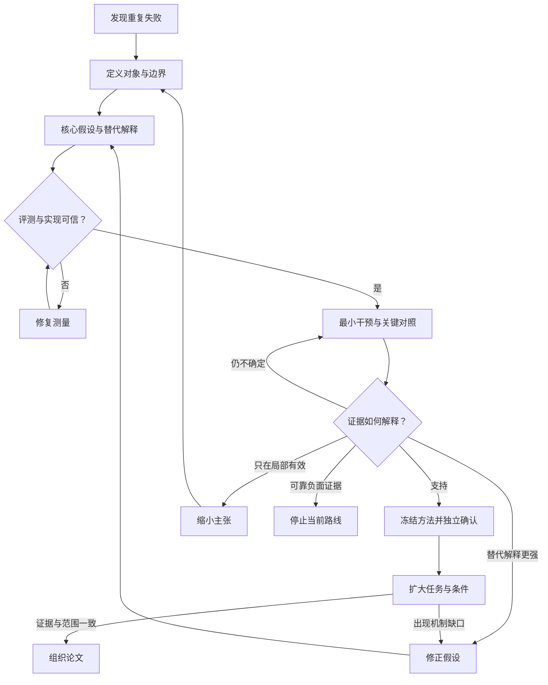

**这篇论文最值得学习的，是如何把“让 agent 更可靠”收敛为一个可修改、可检验的研究对象：程序性知识的表示与使用方式。** 阅读时尤其要分清：整套方法有效、图结构产生独立贡献、自动演化能够稳定找到好图，是三个需要不同证据的判断。

本文是 [*Procedural Graphs: Self-Evolving Execution Structures for LLM Agents*](https://arxiv.org/abs/2609.09153)，以下基于 2026 年 9 月 8 日的 v1。本文只做阅读、分析和实验规划，没有运行实验。

全文使用三个标记：

- **【原文】**：论文报告的设计或观察，有具体位置。
- **【反推】**：我重建的研究逻辑，不代表作者真实研发历史。
- **【建议】**：如果由我们开展研究，应该怎样验证或改进。

**1．先确定：这篇论文究竟贡献什么**

【反推·贡献判断】我将它归为**实证方法论文，带有系统实现贡献**。核心问题是：

> 在模型权重固定的情况下，怎样把过去获得的程序性经验组织起来，使其能够帮助当前决策，并能根据执行反馈修订？

这里的“程序性经验”包括前置条件、动作顺序、停止条件和失败后的恢复方式。最值得研究的对象，是**经验怎样影响后续行为**。

为避免后面反复复述论文，先建立一组原文证据锚点：

| 编号【原文】关键事实位置 |                                                               |                                                        |
| ------------ | ------------------------------------------------------------- | ------------------------------------------------------ |
| E1           | 图记录程序与带属性的转移；根据最近动作定位，结合局部邻域及近期历史生成软指导。                       | [§3.1–3.2，图2](https://arxiv.org/pdf/2609.09153#page=3) |
| E2           | 根据训练轨迹改图；经过结构检查，以验证分数不低于缓存值为接受条件，并记录拒绝；测试时图固定。                | [§3.3，算法1](https://arxiv.org/pdf/2609.09153#page=5)    |
| E3           | 主表覆盖四个模型、六个基准，PG 在 21/24 个配置中第一或并列第一。                         | [§5.1，表1](https://arxiv.org/pdf/2609.09153#page=7)     |
| E4           | MultiChallenge 构图研究使用 100/100/56 的训练、验证、测试切分。                 | [附录D.3](https://arxiv.org/pdf/2609.09153#page=31)      |
| E5           | 局部生成式指导优于全图生成式指导，但相对无图配置仍增加 token。                            | [§5.5，表3](https://arxiv.org/pdf/2609.09153#page=10)    |
| E6           | EnterpriseArena 演化研究采用 20/20/20、十轮搜索；返回图测试存活率为85%，搜索中最高为95%。  | [§5.4，表11](https://arxiv.org/pdf/2609.09153#page=32)   |
| E7           | MultiChallenge 验证案例059：要求按被动语态讲笑话，旧候选却评价对话；修改路径和指导后，成功标记由0变1。 | [附录F.2](https://arxiv.org/pdf/2609.09153#page=36)      |

【反推·核心 insight】可以把本文的研究思想理解为：

**经验的价值，取决于它能否在正确的决策位置被使用，以及错误经验能否被准确修改。**

据此，贡献可以拆成三个相互连接、但证据不能混用的部分：

| 贡献层真正需要回答的问题 |                           |
| ------------ | ------------------------- |
| 表示           | 显式组织程序之间的关系，是否比保留等价文本更有用？ |
| 使用           | 如何把已有经验转成当前步骤适用的指导？       |
| 学习           | 怎样从执行反馈中找到值得保留的修改？        |

【反推·适用边界】从这一贡献类型出发，应当要求任务效果、受控比较、修改过程的稳定性与成本证据。图的数学定义和更新公式，本身不构成性能保证。

还应避免三种跨越：

- **软指导不能直接当作动作合法性的保证。**
- **在多个模型上分别获得好结果，不能直接当作同一张图能够跨模型迁移。**
- **验证分数按接受规则不下降，不能直接当作真实泛化性能单调改善。**

这些边界决定后面的研究问题怎样表述。

**2．idea 的起点：什么现象值得研究**

【反推】一个有价值的起点，不是“agent 会出错”，而是更具体的矛盾：

> Agent 已经拥有完成任务所需的信息，却仍在错误的时机采取动作，或在错误的目标上继续执行。

这个现象值得研究，是因为修复它可能不需要重新训练全部模型，也不一定需要增加事实知识；它可能暴露的是**知识组织、状态识别和动作选择之间的缺口**。

但这只是候选诊断。至少有四种竞争解释：

1. 模型根本不理解任务。
2. 输入接口让任务与评测要求混淆。
3. 正确规则存在，但没有在当前步骤被检索出来。
4. 规则被读到了，却不足以改变动作。

四者对应的研究路线不同。没有先分开，就很容易把接口修复包装成新的规划方法。

【原始工作核查】我核对了四篇发表于本文之前的邻近工作：

| 工作原始工作的实质对本文研究定位的启示           |                                    |                                                                                   |
| ----------------------------- | ---------------------------------- | --------------------------------------------------------------------------------- |
| **AutoGuide**                 | 从对比轨迹提取条件化指导，并根据当前上下文选择适用规则。       | “按状态提供建议”已有基础。需要进一步检验连接关系是否带来额外价值。[§3，算法1–2](https://arxiv.org/html/2403.08978v2) |
| **KnowAgent**                 | 使用动作知识与转移规则，并结合轨迹生成、过滤和模型自学习。      | “显式动作关系”也不是新的起点。应区分修改外部知识与更新模型参数。[§3，图2](https://arxiv.org/pdf/2403.03101)        |
| **Agent Workflow Memory，AWM** | 从经验中归纳可复用流程，支持离线与在线积累，也可以构造更复杂的流程。 | 不能把已有 workflow 简化成只能执行固定脚本的系统。[§2](https://arxiv.org/pdf/2409.07429)              |
| **AFlow**                     | 在代码表示的工作流空间中，用执行反馈和搜索改进流程。         | 自动搜索结构已经存在；需要明确搜索对象、执行方式和控制粒度的差异。[§3，图3](https://arxiv.org/pdf/2410.10762)        |

【反推】因此，值得收敛的问题不是：

> 能否给 agent 加一个图？

而是：

> **在相同经验、模型和预算条件下，把程序依赖组织为可局部访问、可修订的结构，是否能够减少特定程序性错误，并改善未见任务表现？**

这给出了可操作的问题合同：

| 要素建议的问题定义 |                               |
| --------- | ----------------------------- |
| 研究对象      | Agent 使用和修改程序性经验的机制           |
| 输入        | 任务、可用工具、执行历史、已有经验             |
| 在线输出      | 下一步指导及最终动作                    |
| 离线输出      | 更新后的经验表示                      |
| 约束        | 固定模型；明确工具语义；限制搜索和推理预算；隔离最终测试  |
| 成功标准      | 改善目标错误和任务结果，且优势不能被等价文本或额外计算解释 |

宽泛方向由此被收敛为：**一种表示与使用机制，能否产生可归因的行为改善。**

上述邻近工作用于还原本文发表前的背景；没有把后续成果倒填进作者当时可能掌握的信息。

**3．建立贯穿论文的 hypothesis structure**

【反推】我建议把核心假设写成：

> **在具有可复用程序依赖的任务中，正确的局部程序关系能够为固定模型提供超出等价文本指导的决策价值；这些关系还可以通过执行反馈修订，使收益延续到未参与选择的任务。**

这比“PG 分数更高”更严格。它把**独立贡献、可学习性和泛化**都变成了可以失败的主张。

下面的假设编号全部是我的事后重建。论文最终稿中的动机和主张，不能证明作者在实验前就注册了这些假设。

| 假设对核心贡献为什么必要最强替代解释作者相关证据什么观察会推翻或限制它当前判断 |                  |                     |             |                             |                        |
| --------------------------------------- | ---------------- | ------------------- | ----------- | --------------------------- | ---------------------- |
| **P0：输入与评测测到了真实任务**                     | 否则可能只是在优化接口或评分方式 | 任务与评测目标混淆；评分器偏好特定表达 | E7及实验协议     | 清理接口或更换合格评测后，改善消失           | 必须先独立核查的前提             |
| **H1·问题：存在可复用的程序性错误**                   | 支撑“学习程序知识”的必要性   | 错误来自缺知识、基础能力不足或偶发失误 | E7等案例       | 错误没有稳定模式，或简单澄清 prompt 即普遍解决 | 有案例支持；不足以确定总体占比        |
| **H2·机制：关系组织与局部访问有独立价值**                | 支撑采用图这一方法选择      | 更好的文字、较短上下文、额外顾问调用  | E1、E5       | 保留等价语义的文本方法在匹配预算下同样有效       | 局部使用有支持；图关系的独立作用尚未完全分离 |
| **H3·效果：方法改善未见任务表现**                    | 支撑实际效用           | 个别任务、模型或基线适配方式带来的优势 | E3          | 配对重评后优势不稳定，或强基线消除差距         | 支持已测试配置的整体效用           |
| **H4·学习：反馈驱动的修订优于一次构建**                 | 支撑“可演化”的贡献       | 更多候选、更多验证调用，或偶然选中好图 | E2、E4、E6    | 匹配搜索预算后无优势；独立搜索频繁失败         | 有可行性证据；稳定性与各组件作用仍需分离   |
| **H5·泛化：经验可在一定变化下复用**                   | 决定贡献能覆盖多大范围      | 每换任务或模型就重新优化        | E3主要支持多配置适用 | 冻结图跨任务族、模型或接口迁移时失效          | 应区分“可重新构建”与“可直接迁移”     |

【反推】这些假设不是彼此平行的 checklist：

- P0 不成立，先修评测，暂不解释方法效果。
- H1 不成立，重新选择问题。
- H2 不成立，但 H3 成立，可以保留有效指导方法，收缩图结构主张。
- H4 不成立，可以保留固定图方法，暂停自动演化主张。
- H5 只在局部成立，就明确复用范围。

还要区分**机制假设**与**实验后的发现**。例如，“某次修订后路径变短”是观察；“缩短路径就是提升成功率的原因”仍需要干预证据。

**4．从 idea 到方法：怎样重建决策过程**

先把两种流程分开。

| 流程被更新的对象每次循环回答的问题 |                   |                       |
| ----------------- | ----------------- | --------------------- |
| **算法执行流程**        | 当前任务状态，或候选程序图     | 下一步怎么做？这个候选是否保留？      |
| **研究推进流程**        | 问题定义、机制假设、对照设计与主张 | 我们为什么相信这套方法？其他解释排除了吗？ |

【原文·算法】E1、E2对应两层操作：

- 在线：**定位 → 取相关结构 → 生成指导 → solver 选动作**。
- 离线：**收集反馈 → 提议修改 → 检查与验证 → 接受或拒绝**。

【反推】算法内部产生一个高分候选，只说明搜索找到了某个结果。研究者还必须检验：结果是否稳定、是否泛化、是否来自声称的机制。

下面是一条合理的研究路线，**不是作者真实研发时间线**。

| 决策步骤已知与未知合理选择及选择依据新证据与结果分支 |                        |                               |                                     |
| -------------------------- | ---------------------- | ----------------------------- | ----------------------------------- |
| **① 确认错误类型**               | 已知任务失败；未知是能力、接口还是程序性错误 | 先检查任务输入，做失败分类与最小 prompt 修复    | 若清理接口即可解决，先修问题定义；若程序错误持续，继续         |
| **② 建立最简单方案**              | 已找到可复用规则；未知是否需要结构      | 先做简洁规则表或状态化文本建议               | 若已足够有效，研究重点转为经验提取；否则寻找具体缺失关系        |
| **③ 决定表示**                 | 规则之间可能存在顺序、分支、前置条件     | 比较清单、条件规则、流程与图；只保留任务实际需要的表达能力 | 检验关系错误是否预测执行错误；若不能，图表示的必要性减弱        |
| **④ 决定如何使用**               | 有结构；未知如何让 solver 有效使用  | 比较全量与局部、原始输入与生成指导             | 若局部有效但生成无益，可删生成器；若额外顾问即可解释收益，收缩结构主张 |
| **⑤ 决定如何学习**               | 人工修改可能修复错误；未知自动诊断是否可靠  | 先验证少量可解释修改，再引入自动 refiner      | 若人工也找不到有效修改，自动搜索可能只是扩大噪声            |
| **⑥ 决定如何保留修改**             | 候选质量不同；评估有成本与噪声        | 使用隔离选择集、记录所有候选、限制预算           | 若候选排序不稳定，增加评估或简化搜索；若只对已看任务有效，停止扩展   |

【反推】这条路线的重要性在于：**失败可能要求改变研究对象，而不只是增加模块。**

例如：

- 全量经验造成干扰，推动改变访问方式。
- 同一动作在不同状态需要不同处理，推动改变状态表示。
- 一次性生成的规则不可靠，推动改变学习方式。
- 搜索只提高验证分数，推动改变选择协议和主张范围。

这些都是可能的逻辑转折，不能在缺少实验记录时写成“作者先做了 A，失败后发明了 B”。

**具体案例：以 E7 为中心走通六步**

| 环节分析       |                                                           |
| ---------- | --------------------------------------------------------- |
| **失败现象**   | 【原文】E7表现为回答目标错位：系统没有完成用户请求。                               |
| **原因假设**   | 【反推】至少有两个竞争原因：允许过早结束的路径；文字指导或输入接口将评测问题误当成任务。              |
| **最小干预**   | 【建议】分别修改路径与文字指导。原文候选间同时改变了两者，不能视为单变量干预。                   |
| **可检验预测**  | 【建议】若路径是关键，单独修改路径应减少错误结束；若文字是关键，单独澄清目标就应恢复；若两者交互，组合才明显有效。 |
| **结果**     | 【原文】E7给出了修改前后的成功标记变化。                                     |
| **修正后的判断** | 【反推】它支持“这个执行配置可以被修复”，尚不足以确定是哪项修改造成修复，也不能估计类似错误的频率。        |

【建议】最小的因果对照是一个 `2\times2` 设计：

| 原文字指导修订文字指导 |      |      |
| ----------- | ---- | ---- |
| 原路径         | 原配置  | 只改文字 |
| 修订路径        | 只改路径 | 联合修改 |

保持相同输入、历史和模型设置，比较后续行为。

再增加一个**接口诊断对照**：仅保留用户应当看到的任务信息，把评测元信息从 solver 输入中分离。它回答：

> 这次修复是在解决真实任务中的程序依赖，还是在补偿评测适配器引入的目标混淆？

这不是断言存在答案泄漏。**评测目标暴露、任务混淆和答案泄漏是不同问题。**

该案例没有完成上述单变量实验，所以原因仍应保留为假设。

**5．如果从零开始，最小 PoC 应怎样设计**

【原文】论文中可用于借鉴的小规模证据包括：

- E4：较小测试集上的构图比较。
- E6：较小独立 episode 集上的演化过程。
- E7：单个候选修改前后的行为案例。

它们可以帮助设计 PoC，但不能据此确认它们就是作者最早做的实验。

【建议】我们的 PoC 应采用**两个阶段，先固定表示，再验证自动修订**。

**第一阶段：先决定“图这条路线是否值得继续”**

最先核查 P0，然后检验 H2：

> 在知识内容、模型和预算可比时，图式组织与访问是否比状态化文本指导更有效？

这一阶段必须实现：

- 可复现的任务输入与执行记录。
- 一个固定 solver。
- 一个小型、可检查的程序表示。
- 在线指导接口。
- 独立的结果评测与错误分类。

可以暂缓：

- 自动 refiner。
- 长轮次演化与拒绝记忆。
- 多模型、多领域扩展。
- 大规模图数据库、复杂可视化和部署工程。

**数据选择**

【建议】以 **MultiChallenge 的约束保持与版本编辑类对话**为主要诊断对象，与 E7的问题保持连接。覆盖：

- 历史约束必须继续生效的任务。
- 新指令覆盖旧版本的任务。
- 需要完成用户请求、容易错误转为自我评价的任务。
- 普通、无复杂历史依赖的正常任务。

只挑失败案例会产生选择偏差。可以建立一个富含目标错误的诊断集，但它只能说明机制在这些错误上是否成立；**总体效用还要在代表性样本上估计**。

**不能省略的四组比较**

| 配置目的              |                |
| ----------------- | -------------- |
| A．清理接口后的基础 solver | 确认问题不是明显输入缺陷   |
| B．增加一次无记忆的状态顾问调用  | 排除“只是多了一次模型思考” |
| C．同内容的状态化文本规则指导   | 排除“只是规则内容更好”   |
| D．局部程序图指导         | 检验目标方法         |

C 与 D 必须保留**相同的前置条件和顺序语义**。不能通过删除文本基线的关键知识来制造图的优势。

模型调用数、总 token、延迟未必能同时完全一致；应预先声明主预算轴，并报告其他成本。第一轮优先使用相同基础模型和相同最大总推理预算。

E7的 `2\times2` 对照作为小型机制实验单独进行，不必一开始把所有因素铺成大规模全因子实验。

**先检查评测器与实现**

| 检查为什么必要           |                   |
| ----------------- | ----------------- |
| 构造已知正确、错误、答非所问的输出 | 确认评测能分辨目标现象       |
| 分离任务信息与评测元信息      | 防止优化输入混淆          |
| 人工盲审一小批、检查评分分歧    | 防止单一 judge 偏差掩盖错误 |
| 检查动作到节点的定位和检索结果   | 区分表示无效与实现没有真正使用表示 |
| 用已知可行轨迹检查执行适配器    | 避免把工具或环境故障算作推理失败  |
| 对等价文本与图进行语义核对     | 确认比较的是组织方式，而非知识量  |

这里的人工核查对象是可观察输入、输出和动作。模型生成的自我解释可以作为线索，不能直接当作真实原因。

**指标与实际意义**

主指标采用**任务整体成功率的配对差值**。同时记录：

- 历史约束违反率。
- 目标错位、过早结束和无效重复的比例。
- 原本成功的正常任务被破坏的比例。
- 总 token、调用数、延迟和执行成本。

不能只报告路径更短：过早停止也可能让路径变短。

实际有意义的改善幅度，应结合新增成本与减少失败的价值，在看最终结果前确定。不能事后把任何正差值解释成“值得使用”。

**切分与样本量**

【建议】可以把以下范围作为**预算起点，而非统计功效承诺**：

| 数据角色首轮规模思路用途 |                            |                  |
| ------------ | -------------------------- | ---------------- |
| 探索集          | 约12–24个对话                  | 排查评测、发现错误类别、估计波动 |
| 候选选择集        | 约24–40个独立对话                | 选择规则、图与超参数       |
| 冻结测试集        | 根据先导结果决定；可从40–80个对话的预算规划开始 | 只评估已经冻结的方法       |

按对话模板、任务来源及约束结构进行隔离。仅替换实体名的近重复任务，不应散落在不同集合里。

对二元结果，令每个任务上的配对差为：

```math
d_i=\mathrm{success}_{D,i}-\mathrm{success}_{C,i}.
```

先导实验帮助估计 `d_i` 的波动和两方法结果不一致的比例，再判断需要多少**独立对话**。同一对话里的多个回合不能算成多个独立样本。

如果目标错误很少，应扩大诊断覆盖；如果差值区间太宽，应扩大独立任务数。扩样规则应预先确定，避免不断查看最终测试直到得到正结果。

**第一阶段的决策规则**

| 观察决策                  |                    |
| --------------------- | ------------------ |
| D优于C，目标错误减少，正常任务未明显受损 | 进入自动修订阶段           |
| D与C相当，但二者优于A/B        | 保留程序性指导方向，收缩图结构贡献  |
| B已解释主要收益              | 优先研究额外推理或状态顾问机制    |
| 只在暴露评测元信息时有收益         | 收缩为接口修复现象，重新寻找任务依据 |
| 区间同时覆盖有价值收益与明显损失      | 暂时无法判断，先改善测量或扩样    |
| 在可信测量与合理预算下持续无实用增益    | 停止当前方法路线，保留失败分析    |

**第二阶段：再决定“自动演化是否值得做”**

【建议】只有第一阶段有明确价值，才加入 refiner：

1. 从同一初始表示出发。
2. 对比一次构建与有限轮修订。
3. 匹配经验来源、候选数量和评估预算。
4. 保存每个候选、实际修改、评分和返回结果。
5. 在独立搜索运行上检查稳定性。

拒绝记忆等细节可以随后检验。不要一开始就要求最小 PoC 证明整套演化系统的全部组件。

预算可写成：

```math
C_{\text{total}} = C_{\text{diagnosis}} + C_{\text{search}} + C_{\text{evaluation}}.
```

先导阶段测到单次成本后，再决定可承受的任务数与搜索轮次。本轮没有成本实测，因此不应给出貌似精确的美元预算。

**6．什么时候值得扩大成 paper 级实验**

【建议】当最小实验已经能够区分核心假设与主要替代解释，才值得扩大规模。否则，增加 benchmark 只会让同一个混杂因素出现更多次。

下面的“必须补”是**相对于想保留的主张**而言，不意味着缺少某项实验就否定全部已有结果。

| 要回答的问题本文相关证据下一步关键验证优先级 |                |                          |                   |
| ---------------------- | -------------- | ------------------------ | ----------------- |
| **效果是否存在？**            | E3提供整体效果依据     | 强基线上的配对差值及任务级不确定性        | 保留普遍效果主张时必须       |
| **是否来自图关系？**           | E5提供部分使用方式对照   | 等价文本、同预算顾问；补完整访问方式对照     | 保留图机制主张时必须        |
| **是否来自更多搜索？**          | E4、E6展示构建与演化   | 匹配候选数、调用预算和验证次数          | 保留演化优势主张时必须       |
| **评测是否测对了？**           | E7使目标混淆成为可检查问题 | 输入审计、盲评、正常案例与反例          | 若混淆影响主要结果，必须      |
| **能否跨条件复用？**           | E3支持多配置适用      | 冻结同一图，跨任务族、solver或工具接口测试 | 若声称直接迁移，必须；否则用于增强 |
| **哪些前提失效会失败？**         | 现有案例可以启发测试     | 错误定位、过期规则、缺失前置条件、冲突指导    | 界定方法边界的重要实验       |
| **成本是否值得？**            | E5提供成本信息       | 端到端成本与质量曲线，加入离线搜索成本      | 保留效率或实际使用主张时必须    |

【建议·重复搜索】自动搜索方法有两层随机性：

- 给定一个固定图，执行结果是否稳定？
- 给定同一研究设置，搜索能否再次得到一个好图？

重复评估一个图，不能代替重复搜索。可以先做少量独立搜索检查是否存在严重不稳定，再依据方差与预算扩大。不要把几十个测试 episode 当成几十次独立的“成功发现”。

【建议·配对比较】同一任务下比较两种方法，能够减少任务难度差异。环境具有随机性时，尽可能共享外部随机条件，并记录哪些随机因素确实被控制。

【反推·验证门控的边界】接受规则能够做到：

```math
\widehat S_{\mathrm{selection}}(G_{\mathrm{new}}) \ge \widehat S_{\mathrm{selection}}(G_{\mathrm{old}}).
```

但这并不推出：

```math
\mathbb E[S_{\mathrm{new\ tasks}}(G_{\mathrm{new}})] \ge \mathbb E[S_{\mathrm{new\ tasks}}(G_{\mathrm{old}})].
```

反复用于接受候选的集合，已经承担**选择数据**的角色。采样噪声和适应性搜索都可能使它偏乐观。

因此，E6最有教学价值的地方，是让我们看到**返回结果与搜索过程中看到的最好结果需要严格区分**。如果用测试峰值挑选方法，最终测试就失去了独立确认作用。

跨多个模型和基准的胜负汇总，也不能替代任务级配对分析；这些配置可能共享数据、模型或实现，不能天然视为完全独立的重复试验。

**7．证据怎样组织成论文**

【反推】一篇清楚的论文，应当让读者沿着下面的论证链前进：

> 存在有价值的程序性错误 → 我们选择了可修订的表示 → 使用机制能够影响行为 → 整体效果成立 → 修订能改善它 → 明确哪些变化下仍然成立。

主要 claim 应这样组织：

| Claim对应方法选择应放置的证据合适的结论范围 |             |               |             |
| ------------------------ | ----------- | ------------- | ----------- |
| 程序性经验可以帮助决策              | 明确经验表示与访问接口 | E1、E3及强基线比较   | 所测配置中的整体实用性 |
| 局部访问有助于使用经验              | 当前进度与相关经验匹配 | E5及等价内容对照     | 指定访问机制的作用   |
| 执行反馈能修订表示                | 明确修改空间与保留协议 | E2、E4、E6及独立搜索 | 已验证设置中的可学习性 |
| 某种错误可以被修复                | 可定位的错误与干预   | E7及单变量对照      | 该类错误及对应条件   |
| 表示具有复用能力                 | 冻结表示后改变使用条件 | 专门迁移实验        | 经测试的迁移边界    |

【建议】各部分分别承担不同论证任务：

| 部分应完成的任务                |                                 |
| ----------------------- | ------------------------------- |
| **Introduction**        | 说明为什么程序性错误值得研究，以及现有经验方法留下什么具体问题 |
| **Problem Formulation** | 固定输入、输出、可修改对象、预算与可观察成功标准        |
| **Method／Theory**       | 说明表示、访问、修改及接受规则；严格区分定义与保证       |
| **Experiments**         | 检验整体效果、主要替代解释和泛化范围              |
| **Analysis**            | 解释失败类型、修改行为与条件依赖；避免把相关性写成因果     |
| **Limitations**         | 陈述尚未验证的迁移、评测依赖、错误先验及成本问题        |

【反推·主张边界】如果我们据此写一篇类似论文：

- **可以保留**：在明确任务、模型和预算下，某种程序经验机制改善了表现。
- **需要收缩**：“优于专家设计”应限定为被比较的专家构图方式；“可迁移”应说明是否需要重新构建。
- **需要更强证据**：图关系不可替代、拒绝记忆独立有效、搜索稳定优于同预算替代方法。
- **适合讨论或未来工作**：广泛跨工具迁移、开放环境中的持续可靠演化。

这些是措辞与证据的对应规则，不是在说作者提出了上述所有强主张。

本文可以启发一种有覆盖范围的叙事：研究**agent 如何组织、使用和修订程序性知识**。实际验证则可以保持可控：先在明确错误类型上验证机制，再逐步增加任务与条件。

叙事可以宏大，证据的适用范围必须具体。

**8．可以复用的研究工作流**

以下阶段表是【建议】，可用于我们自己的 agent 研究。

| 阶段需要解决的问题最小产物进入下一阶段的证据失败后的分支 |                    |                        |              |              |
| ---------------------------- | ------------------ | ---------------------- | ------------ | ------------ |
| **现象发现**                     | 有什么重复出现、值得解决的失败？   | 正常与失败案例集               | 现象可复现、具有实际影响 | 修接口；换问题      |
| **问题收敛**                     | 对象、输入、输出和约束是什么？    | 一页问题合同                 | 有可观察目标与明确边界  | 缩小任务或错误类型    |
| **假设建立**                     | 为什么会发生？其他解释是什么？    | 核心假设与替代解释表             | 能设计区分解释的实验   | 修改假设         |
| **仪器核查**                     | 数据、实现、评测能否测到现象？    | 已知正反例与检查记录             | 正反例被正确区分     | 修复后重测        |
| **最小干预**                     | 哪个最小改变可能有效？        | 小实现、关键对照、诊断指标          | 效果超过主要替代解释   | 删模块；改表示；停止路线 |
| **独立确认**                     | 结果是否稳定，是否只对已看数据有效？ | 冻结版本与独立测试              | 配对结果稳定、边界清楚  | 扩样；缩小主张      |
| **扩大证据**                     | 换条件后怎样？成本怎样？       | 泛化、失败条件及成本实验           | 支撑目标贡献类型     | 修正机制或范围      |
| **形成论文**                     | 每个主要主张有何依据？        | 主稿与 claim–evidence map | 所有主张有支持或明确限定 | 补证据；删除或降级主张  |



【反推】这篇论文最值得学习的三个研究动作：

1. **把模糊的能力问题落到可修改对象。** 明确研究者到底可以改变什么，实验才能形成闭环。
2. **把失败案例变成机制问题。** 案例的价值是帮助提出竞争解释和干预，而不只是展示效果。
3. **区分搜索发现与独立确认。** 发现好候选、选择候选、证明方法可靠，分别需要记录和证据。

【建议】最不应该直接照搬的两个做法：

1. **用整套配置的提升，替代对每个核心机制的验证。** 特别是路径、文字、调用预算同时变化时。
2. **把一次小样本搜索的上升轨迹，当作稳定演化能力。** 搜索轨迹能展示发生过什么，无法单独说明再次运行会怎样。

【建议】如果我们现在只有“改进 agent 的程序性经验”这个初始方向，第一轮最应该做三件具体事：

1. **选一个任务族，收集约12–24个正常与失败对话。** 清理输入接口，区分缺知识、目标错位、条件遗漏和错误停止。
2. **搭建四组最小比较：基础 solver、额外顾问、状态化文本规则、固定程序图。** 共享规则内容，并对最有诊断价值的案例做路径与文字的拆分干预。
3. **在看结果前写一页决策合同。** 写清数据隔离、预算、主指标、替代解释，以及什么结果意味着继续图路线、退回文本指导、缩小主张或停止当前路线。