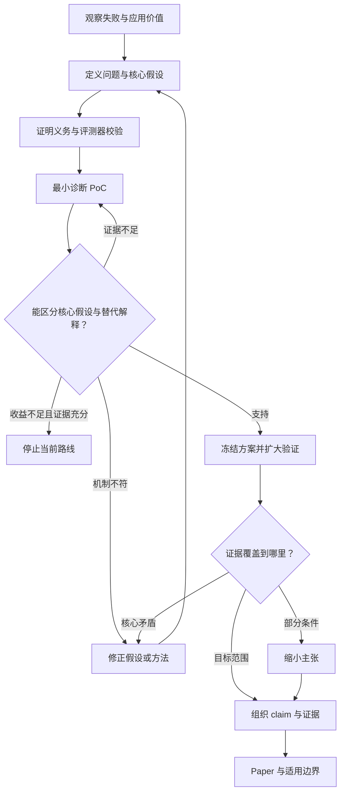

这篇论文最值得学习的是：**把“弱教师如何帮助强学生”收敛成“教师信息应该怎样进入学生的优化过程”，再用数学性质、学习曲线和失败诊断逐步限定答案。**

我已阅读正文与附录 A–K，并核查三篇最接近的原始工作。论文为 *Eliciting Weak-to-Strong Generalization with On-Policy Reverse Distillation*，arXiv v1 发布于 2026 年 9 月 8 日，共 38 页。[原论文](https://arxiv.org/pdf/2609.08798)

完整分析也整理为可复用文档：。

以下统一使用：

- **【原文】**：作者明确报告，附定位。
- **【反推】**：从成稿重建的研究逻辑，不代表真实研发历史。
- **【建议】**：新增的验证或规划。

原文没有公开完整的研发日志。因此，**“作者在论文中提出某个解释”不等于“可以确认作者事先提出并注册了这个假设”。** 本轮没有运行实验。

---

**1．这篇论文究竟在贡献什么？**

**【原文｜§1–2，Fig. 2】** OPRD 同时使用两种信息：

1. 学生自己的回答经过 verifier 评分，产生奖励梯度；
2. 弱教师训练前后的策略差异，提供一个方向参照。

方法把学生奖励梯度沿教师方向的分量放大，保留正交分量；学生没有独立的教师匹配目标。[§2，pp. 3–5](https://arxiv.org/pdf/2609.08798#page=3)

**【反推】核心 insight 可以概括为：**

> 教师提供的信息，可以用于决定学生自己的哪些更新分量值得加强，而不必规定学生最终应该匹配哪个分布。

| 要素本文的具体内容 |                                                            |
| --------- | ---------------------------------------------------------- |
| 研究对象      | 自回归语言模型的 reasoning post-training                           |
| 重要问题      | 复用小模型的训练收益，同时保留大模型继续提升的空间                                  |
| 输入        | 学生、任务 prompts 与 verifier、post-RL 教师及其 reference checkpoint |
| 输出        | 训练后的学生策略，以及学习速度、性能和成本证据                                    |
| 核心方法      | 用 teacher policy delta 对学生的 logit 梯度做方向缩放                  |
| 主要贡献类型    | **方法**；效率是主要收益，局部理论提供设计依据                                  |
| 实际验证范围    | 主要为同一 Qwen3 家族的 4B→8B，数学与程序可验证的推理任务                        |

它需要三类不同证据：

- **数学证据**：这个变换在明确条件下保留什么性质？
- **机制证据**：真实教师方向是否确实提供额外价值？
- **效果与成本证据**：这种价值是否转化为更快、更好的训练？

三者不能互相替代。矩阵正定不等于教师信息有用；实验分数更高也不等于机制已被证明。

一个重要边界是：**这里的“strong student”主要指容量和训练潜力更强。**

**【原文｜App. D.1】** 主实验选择中间教师 checkpoint，使其表现高于学生初始化、低于学生经过 GRPO 后的表现。因此，这些实验不能全部解释为“学生一开始已经比教师强，仍能向教师学习”。[App. D.1，p. 27](https://arxiv.org/pdf/2609.08798#page=27)

---

**2．idea 的起点：什么现象值得成为研究问题？**

**【原文｜§1、§3.2，Fig. 1】** 论文呈现的矛盾是：

- OPD 提供较快的早期提升，但随后常进入教师附近的平台；
- 单独 GRPO 学得较慢，却允许学生继续探索；
- 学生需要教师已经获得的收益，也需要发现教师尚未实现的改进。

**【反推】值得研究的问题因此不是笼统的“小模型能不能教大模型”，而是：**

> 为什么教师监督的早期帮助，没有持续转化成学生后期的独立进步？

但平台现象本身不能说明原因。最强的替代解释包括：基线超参数不合适、教师选得不好、训练时间不足、输出长度变化，以及比较预算不等。

从宽泛方向到具体问题，可以这样收敛：

| 收敛层级问题如何变化 |                                                       |
| ---------- | ----------------------------------------------------- |
| 大方向        | 如何复用已有模型，加速下一代模型训练？                                   |
| 应用场景       | 小型专家已经完成昂贵的 post-training                             |
| 可观察矛盾      | 教师匹配帮助早期学习，却可能限制后续提升                                  |
| 技术分解       | 转移最终行为还是训练变化？把信息用作目标还是更新参照？                           |
| 可检验问题      | 在同一学生、可靠 verifier 和匹配预算下，teacher delta 的方向缩放是否改善学习曲线？ |

**【原文｜§2.1】** 普通 OPD 在学生访问的前缀上匹配教师分布。在可实现的逐前缀 KL 最小化设定中，最优目标就是该教师分布。

**【反推】** 这说明目标匹配存在结构性约束，但不能直接推出“所有蒸馏方法的测试性能都不可能超过教师”。

核查最近工作后，这一点尤其重要：

| 原始工作已经做到什么OPRD 的实质区别                                         |                                                     |                                      |
| ------------------------------------------------------------ | --------------------------------------------------- | ------------------------------------ |
| [KDRL，2025-06](https://arxiv.org/html/2506.02208v1)，§3       | 联合 GRPO 与教师 KL，研究退火和奖励引导的 masking；已讨论教师匹配与正确回答之间的冲突 | OPRD 改动奖励梯度的方向分量                     |
| [Direct-OPD，2026-07](https://arxiv.org/html/2607.05394v1)，§2 | 将教师训练前后的 log-policy ratio 作为稠密隐式奖励，已经报告学生超过教师       | OPRD 继续使用独立 verifier 梯度，delta 只参与缩放  |
| [W2S-OPD，2026-07](https://arxiv.org/html/2607.26246v1)，§3    | 将弱模型对的 logit 差加到学生 base，构造 proxy teacher；也已报告超过弱教师  | OPRD 不优化该 proxy target，而是变换学生自己的奖励更新 |

这些工作均早于本文 v1；本文将后两篇称为 concurrent works。这里没有使用后续进展反过来解释作者当时的动机。

**【反推】因此，本文真正需要建立的区别是“教师变化如何进入优化”，而不是仅仅“转移 delta”或“超过教师”。**

---

**3．建立贯穿论文的 hypothesis structure**

**【反推｜核心假设 H★】**

> 当 verifier 已提供有效学习信号，弱教师的训练变化又含有可迁移结构时，用该变化调整学生自己的更新，可以加快奖励学习并支持后续超越教师；收益应来自教师方向的信息，而不只是梯度变大或计算增加。

下面的结构是事后重建。数学命题与作者明示的前提另行标注。

| 假设／前提为什么必要最强替代解释作者的检验推翻或限制它的观察当前支持     |               |                     |                            |                      |                    |
| -------------------------------------- | ------------- | ------------------- | -------------------------- | -------------------- | ------------------ |
| **P0：有可靠 verifier 和非零有效梯度。原文明示**       | 无梯度就没有东西可放大   | 方法失败其实源于格式无效、全组同奖   | §4.3，Fig. 4a 的困难学生负例       | 有效梯度缺失时只能判定前提失效      | 数学依赖明确，有负例         |
| **H1：目标匹配会妨碍部分学生改进。反推**                | 解释为何改变教师指导方式  | 平台只是调参不足            | KL 目标分析；Fig. 1、App. D/G 曲线 | 强匹配基线同样持续改进          | 支持特定设置，不是普遍能力上界    |
| **H2：teacher delta 是有信息的缩放方向。反推**      | 否则只是一般优化技巧    | 随机方向或更大学习率也有效       | Fig. 3、教师质量实验、App. H       | 范数匹配的打乱方向效果相同        | 部分支持，缺关键控制         |
| **H3：保持局部 logit surrogate 的零点。作者数学命题** | 支持设计的局部约束     | 把 logit 性质外推到共享参数训练 | App. A，Proposition A.1     | 超出固定回答、自由 logits 等条件 | 限定设定下成立            |
| **H4：正向先启动、负向逐步增强有益。原文理由，反推为假设**       | 支持默认 schedule | 普通退火或长度控制即可         | App. B，Figs. 6–7           | 同强度下优势消失，简单方案同样好     | 支持避免长期单边放大，不证明唯一最优 |
| **H5：获得实际学习加速。反推**                     | 构成方法价值        | 更多 tokens、计算或有效步长   | Tables 1–3；App. K          | 等时间、等 token 后收益消失    | 所测设置有系统性增益         |
| **H6：不只对一个任务／教师有效。反推**                 | 支撑专家整合叙事      | 同一家族与人工选择条件的局部效果    | 多任务、多教师、强到弱实验              | 跨家族、初始已强学生、新反馈形态失效   | 泛化范围仍有限            |

证据定位：[§3–4；App. A–K](https://arxiv.org/pdf/2609.08798)。

**【原文中的实验观察】** 后期对齐趋于正交、分支具有不同长度动态、换 reference 后平台被打破，以及学生风格更接近 GRPO。这些是成稿中的分析结果，**不能自动转写为已经验证的因果机制，也不能确定其真实发现时间。**

---

**4．从 idea 到方法：算法执行与研究决策分开看**

先看**算法执行流程**。

**【原文｜§2.2，Fig. 2】**

1. 学生自己生成一组回答。
2. verifier 评分，得到 advantage 和学生奖励梯度。
3. 教师与 reference 分别读取学生访问的前缀。
4. 提取教师训练变化的方向。
5. 放大学生梯度沿该方向的分量，再反向传播更新学生。

以奖励上升方向记号：

```math
g_t=A_t\nabla_{z_t}\log\pi_\theta(y_t\mid s_t),
```

```math
\Delta_t=\mathcal C(z_T-z_T^{\mathrm{ref}}), \qquad d_t=\frac{\Delta_t}{\|\Delta_t\|_2},
```

```math
\widetilde g_t = g_t+\lambda_t(d_t^\top g_t)d_t.
```

去均值消除不影响 softmax 的共同偏移；归一化避免直接按教师变化幅度决定放大量。

**当** **`d_t^\top g_t<0`** **时，校正加强的是学生反对教师的那个分量。** 它不会因为“与教师不同”就删除学生更新。实际实现使用 sampled token 与学生 top-10 的并集。[§2；App. C](https://arxiv.org/pdf/2609.08798)

再看**数学性质到底证明了什么**。

**【原文｜App. A】** 固定回答、advantage 和本步方向，将 logits 当成独立变量：

```math
J(z)=\sum_t A_t\log\pi(y_t\mid z_t).
```

令 `P_t=I+\lambda_td_td_t^\top`。当 `\lambda_t\ge0` 时，`P_t` 正定、可逆，因此：

```math
P_tg_t=0\iff g_t=0,
```

```math
g_t^\top P_tg_t = \|g_t\|^2+\lambda_t(d_t^\top g_t)^2.
```

在额外步长条件下，作者进一步证明单步上升下界。[App. A，p. 21](https://arxiv.org/pdf/2609.08798#page=21)

**【反推】这里有三个不能跨越的边界：**

- 任意单位方向都满足这些代数性质，因此证明没有说明真实教师方向优于随机方向。
- 自由 logits 的更新不等于共享参数、PPO clipping、AdamW 下的实际训练。
- 更大的单步下界伴随更紧的步长条件，不等于优于调好学习率的 GRPO 的全程收敛保证。

例如，原参数梯度中不同 token 的贡献可能相互抵消；分别缩放后，这种抵消未必保留。逐 token 可逆性不能直接证明整个参数空间的驻点不变。

然后才是**研究者形成方法的决策过程**。

**【反推】下表按逻辑依赖排序，不是作者研发时间线。**

| 已知 → 未知合理选择为什么选择这一步需要的新证据结果不同怎么办 |                         |             |                    |                           |
| -------------------------------- | ----------------------- | ----------- | ------------------ | ------------------------- |
| 教师有早期帮助 → 平台原因不明                 | OPD、GRPO、退火混合目标         | 先确认真实矛盾     | 公平基线的完整曲线          | 矛盾消失则重定义问题                |
| 最终教师混合多种偏好 → 应转移什么               | 最终 logits、前后 delta、上下文差 | 隔离部分原有偏好    | 方向替代与教师质量实验        | delta 无特异价值则简化            |
| delta 仍可能有偏差 → 怎样使用              | 稠密奖励、proxy、辅助损失、梯度变换    | 让学生奖励信号决定更新 | 局部证明与信息匹配对照        | 若新增 verifier 已解释收益，收缩机制主张 |
| 投影可实现 → 怎样缩放                     | 单分支、对称缩放、不同 schedule    | 兼顾早期引导与后期偏离 | 分支和同强度 schedule 对照 | 简单方案同样好就采用简单方案            |
| 主配置有效 → 能推广到哪里                   | 新任务、教师、模型或失败条件          | 每次只扩大一个主要外推 | 泛化、成本与边界实验         | 缩小 claim 或停止变体            |

一个有完整干预证据的具体案例是 **Color Cube 的 reference 选择**：

1. **失败现象【原文】**：step-105 教师配 step-0 reference，学生早期提升后停在 **52.5%**，低于 GRPO/KDRL。
2. **原因假设【原文解释】**：教师早期训练大幅缩短输出，delta 携带了这种变化，校正可能过度强化缩短。
3. **最小干预【原文】**：保持最终教师不变，把 reference 从 step-0 改为 step-30。
4. **可检验预测【反推】**：排除早期变化后，持续缩短或过早平台应减轻，后期表现应改善。
5. **结果【原文】**：平台被打破，达到 **89.5%**。
6. **修正判断【反推】**：reference 选择确实影响指导效果，但还不能证明长度是唯一原因。[§4.3，Fig. 4b–c](https://arxiv.org/pdf/2609.08798#page=10)

**【原文｜App. I】** 作者也明确承认：更换 reference 改动的是整个 delta，并没有单独剔除长度分量。

**【建议】** 下一步应加入长度匹配评测、显式长度控制，以及预先指定的多个 reference 对照。它们补充的是**因果隔离证据**，不是再找一个更高分 checkpoint。

---

**5．如果从零开始，最小 PoC 应怎样设计？**

先区分作者实际做过什么。

**【原文】** 成稿中可确认的较窄验证包括：

- App. B.2：正／负单分支 OPRD 各训练 **45 步**，观察不稳定性。
- §4.2：单任务上的方向、放大系数和教师 checkpoint 比较。
- §4.3：无有效梯度与 reference 选择的失败案例。
- App. D.1：跨 Qwen2.5→Qwen3 的 preliminary experiments，因候选教师及计算问题没有发展成完整验证。

这些不是作者公开的完整 PoC 历史。[相应附录](https://arxiv.org/pdf/2609.08798)

**【建议】第一项决定项目去留的假设应是：**

> 在奖励梯度已经有效时，真实 teacher delta 是否比没有教师、或破坏了方向信息的指导，更有效地加速学习？

这比先跑完整数学榜单更便宜，也更有诊断价值。

**任务与实现范围。**

- 第一任务选 **Knights & Knaves**：可以独立求解、按复杂度分层，方便区分格式失败与推理失败。
- 首轮优先保留论文的 **4B-Base→8B-Base**；先减少任务与配置，避免同时改变模型容量。
- 若只能用更小组合，应先检查非零奖励覆盖率，不能用一个几乎不会产生有效回答的学生来否定方法。
- 必须实现 rollout、verifier、教师/reference 查询、梯度修正和成本记录。多教师、风格分析、大规模 agent 环境可以暂缓。

本次查看的[官方仓库](https://github.com/raymin0223/on_policy_reverse_distillation)仍为占位内容，未见完整训练实现。因此本轮完成的是文稿层面的分析，没有完成 paper–code 一致性审计。

**关键对照。**

| 配置必须回答的问题                            |                           |
| ------------------------------------ | ------------------------- |
| OPRD：真实 delta                        | 方法是否有效？                   |
| GRPO：给予同等学习率调参预算                     | 是否只是基线步长偏小？               |
| OPRD：支持集内打乱 delta 的 token 对应，并匹配梯度范数 | 是否需要教师方向中的实际信息？           |
| OPD                                  | 教师匹配是否真的出现所讨论的平台？         |
| 退火 KDRL                              | 是否任何教师指导加 verifier 都同样有效？ |

若进一步声称“缩放优于直接优化同一 delta”，还必须加入**相同 delta、相同 verifier 的目标融合方案**。直接与没有独立 verifier 的方法比较，不能隔离指导形式的贡献。

正常与失败案例都要保留：双方能解、教师能解学生困难、教师易错学生可解、全组同奖、明显长度变化。不要只保留有利于 OPRD 的区域。

**先检查仪器，再解释结果。**

**【建议｜本轮仅规划】**

- 用独立求解器检查正确、错误、空答案、格式变体及异常实例。
- 分开记录 parser 有效率和语义正确率。
- 按问题结构去重，不能只保证生成 seed 不同。
- 检查 `\lambda=0` 退化为 GRPO，`g=0` 不产生校正，`\Delta=0` 安全跳过，正交时校正为零。
- 检查 reward 上升方向与 loss 最小化梯度的符号，尤其是正／负分支判定。
- 记录非零 advantage 比例、长度、截断率；没有有效学习信号时，先修复前提。

**数据分工与预算。**

| 数据用途允许做什么 |                             |
| --------- | --------------------------- |
| 探索数据      | 检查难度、长度、有效梯度和失败原因           |
| 候选选择数据    | 选择教师/reference、学习率、schedule |
| 最终测试数据    | 冻结方案后确认效果与成本，禁止继续调参         |

可先用约 **100–200 道分层探索题，每题 8 次采样**，估计可学性和波动。这是诊断起步量，不是“统计上足够”的声明。

训练先用 **30–50 次更新**筛查早期信号与稳定性。但原文 reasoning 的负分支 warm-up 为 **75 次更新**，所以这种短程实验不能回答“后期是否超越教师”。若早期信号成立，需要保留覆盖 warm-up 与教师交叉点的窗口，例如原文的 150 次更新。

预算应以真实采样与 tokens 核算。例如，规划为 32 prompts/update、每题 8 条 rollout：

- 30 次更新：每配置 7,680 条学生回答；
- 150 次更新：每配置 38,400 条。

还必须加上教师准备、评测和搜索成本。回答条数相同不代表计算量相同。

最终样本量应由希望辨别的最小有用差异决定。对同题配对差 `D_i`，标准误约为：

```math
SE(\bar D)\approx \frac{s_D}{\sqrt n}.
```

先导实验估计 `s_D`，再依据预先确定的最小有用收益扩大测试集。重复生成回答减少的是解码噪声，不能把少量题目变成大量独立题目。

**主指标与决策。**

主指标同时报告：固定预算正确率、达到预定质量所需的 tokens／GPU-hours。辅以学习曲线、末期性能、长度、截断和非零梯度比例。

| 结果决策                             |                                  |
| -------------------------------- | -------------------------------- |
| 真实 delta 优于打乱对照与调好的 GRPO，成本收益仍为正 | 继续，冻结方案后扩大                       |
| 与随机方向或更大学习率效果近似                  | 修改教师特异机制解释；必要时停止当前构造             |
| 大量无效输出或零梯度                       | 先修复可学性；若采用 bootstrap，所有方法共享并计入成本 |
| 只在部分 reference、任务或模型有效           | 缩小主张，明确选择条件                      |
| 窗口太短或不确定性跨越有用收益与无收益              | 暂时无法判断，按预定条件扩样                   |
| 仪器有效、对照公平、证据充分后仍无实际收益            | 停止当前方法路线，保留负结果                   |

---

**6．何时值得扩大成 paper 级实验？**

**【反推】** 当 PoC 已排除主要替代解释，并留下一个值得推广的现象，才值得扩大。某个 seed 赢分还不够。

先正确读取作者的主结果：

**【原文｜Tables 1–2】以下是五个训练 checkpoint 的平均，不是最终 checkpoint。**

| 设置GRPO／Mix-RLKDRLOPRD  |       |       |       |
| ---------------------- | ----- | ----- | ----- |
| 单教师数学平均                | 39.38 | 43.99 | 51.91 |
| 单教师四项 Reasoning Gym 平均 | 41.81 | 44.38 | 55.18 |
| 四专家整合平均                | 47.68 | 47.47 | 58.77 |

数学 Mean\@16 是平均采样正确率，不是“16 次中至少一次正确”的 pass\@16。[§3，Tables 1–2](https://arxiv.org/pdf/2609.08798#page=6)

每组扩大实验应有明确问题：

| 问题作者已完成仍需补充及其重要性  |                            |                                      |
| ----------------- | -------------------------- | ------------------------------------ |
| 效果是否存在？           | 多任务、公平初始化与 rollout 预算、学习曲线 | 独立训练重复；对稳健性主张必要                      |
| 是所声称的机制吗？         | 不同方向、教师质量、λ、分支分析           | 打乱方向、范数及学习率匹配；对机制结论必要                |
| 是 delta 的使用方式更好吗？ | 比较 Direct-OPD、W2S-OPD、KDRL | 同 delta、同 verifier 的融合对照；否则新信息与新形式混杂 |
| 是长度或更多预算吗？        | Base 模型复查、缩短回答也获益的任务、成本测量  | 等 token／等时间前沿；对实际效率主张必要              |
| 换条件是否成立？          | 多任务、多教师、强到弱                | 跨家族、初始已强学生、未训练任务；对更广主张必要             |
| 前提何时失效？           | 零梯度、长度偏差、reference 和单分支负例  | verifier 噪声、错误教师、近零 delta；开放反馈扩展前必要  |
| 实际使用值得吗？          | 固定工作量下时间和显存                | 真实任务 time-to-quality、教师与搜索成本摊销       |

**成本证据不能漏读，也不能扩大解释。**

**【原文｜App. K】** 在四张 B200、固定每回答 16,384 tokens 的受控设置下，OPRD 比 GRPO 每步时间增加 **11.9%**，峰值显存增加 **10.2%**。作者替换了真实奖励，并在 warm-up 后测量四步，以隔离方法开销。[Tables 9–10，pp. 37–38](https://arxiv.org/pdf/2609.08798#page=37)

**【反推】** 这支持固定工作量下的额外开销，不能直接当作真实任务的总成本比例。实际输出长度、达到目标质量的步数，以及教师是否已经存在，都会改变收益。

**重复训练与不确定性也要区分。**

**【原文｜App. D.3】** 作者没有做多 seed 训练，而是固定题目和模型，对回答池做 1,000 次重采样。因此误差条主要描述这些 checkpoint 上的回答采样波动。[Table 8，p. 29](https://arxiv.org/pdf/2609.08798#page=29)

**【建议】**

- 对同一道题比较方法，采用 paired comparison。
- 按题目或结构簇重采样，保留方法配对关系。
- 对最终候选、最强基线和关键控制重复训练，单独报告训练波动。
- 如果反复选教师、reference、schedule 和 checkpoint，应记录搜索预算，并用独立测试确认最终选择。

无需机械重复所有配置，但也不能只在选出赢者的数据上证明赢者。

---

**7．证据如何组织成论文？**

**【反推】** 本文的主要论证可以映射为：

| Claim对应设计对应证据合理结论 |                          |                   |                     |
| ----------------- | ------------------------ | ----------------- | ------------------- |
| 教师信息可以不作为直接匹配目标   | delta 方向与梯度投影            | §2、Fig. 2、App. A  | 明确的新优化接口及局部性质       |
| 能加快高容量学生学习        | on-policy、保留 verifier 更新 | Table 1、App. D    | 所测条件下更好的学习曲线        |
| 可以整合多个专家          | 按任务调用教师                  | Table 2 左、App. E  | 四项任务同时获益            |
| 设计选择有实际价值         | reference、归一化、分支安排       | Fig. 3、App. B/H/I | 有效设计及其失效条件          |
| 学生行为不完全追随教师       | 没有独立匹配损失                 | Fig. 5、App. J     | 风格与案例观察一致，不等于内部机制证明 |
| 附加成本可控            | frozen forward 与修正       | App. K            | 特定硬件与固定长度下成立        |

各部分承担不同的论证任务：

- **Introduction**：建立复用训练收益的价值，以及教师帮助与约束的矛盾。
- **Problem Formulation**：明确学生、教师、reference、verifier 和信息条件。
- **Method／Theory**：解释为何选择这种更新方式，以及精确保证什么。
- **Experiments**：证明效果，分开学习速度、最终表现和成本。
- **Analysis**：对抗替代解释，用失败和干预修正判断。
- **Limitations**：界定 verifier、reference、模型家族、规模和反馈形态的边界。

**【建议】主张应这样处理：**

- **保留**：所测设置的加速、具体梯度变换、固定 logit surrogate 的数学性质、已经观察到的失败条件。
- **收缩**：“驻点不变”限定变量空间；“不受教师限制”限定为不强制匹配教师并观察到超越；“更高效”明确成本口径。
- **作为未来工作**：frontier scale、真正跨代迁移、开放 agent 交互、递归自我改进。

**【反推】** 它的叙事覆盖“后训练收益如何跨模型复用”这个大问题，而实验先控制在同家族和可验证推理。这种范围管理值得学习，但应用愿景不能被写成已经验证的结论。

---

**8．我们可以复用的研究工作流**

**【建议】**

| 阶段需要解决的问题最小产物进入下一阶段的证据失败后的分支 |                 |                    |               |           |
| ---------------------------- | --------------- | ------------------ | ------------- | --------- |
| 观察                           | 是否存在有价值的真实失败？   | 可复查案例              | 强基线下仍出现       | 修基线或停止    |
| 定义                           | 对象、目标、资源是什么？    | Problem contract   | 可测且未被已有工作充分回答 | 换问题或缩范围   |
| 假设                           | 什么解释决定方法成立？     | 核心假设与替代解释          | 存在区分它们的实验     | 重写假设      |
| 数学／仪器                        | 保证什么，测量是否可靠？    | 证明义务、oracle 检查     | 条件明确、仪器可信     | 修复或收缩理论   |
| PoC                          | 核心现象及特异解释是否成立？  | 少任务、关键对照、成本记录      | 排除主要替代解释      | 改方法、扩样或停止 |
| 确认                           | 是否可重复而非选中？      | 冻结方案、独立测试          | 配对差与训练波动支持价值  | 缩小主张      |
| 扩展                           | 能推广到哪里？         | 每项外推对应实验           | 新条件下证据成立      | 保留限定结论    |
| Paper                        | 每项 claim 凭什么成立？ | Claim–evidence map | 主张均有证据定位      | 补证据或删主张   |



**最值得学习的三个研究动作【反推】**

1. **把大问题落到明确的技术接口。** 从弱到强学习，收敛到教师信息进入目标还是更新过程。
2. **先规定方法不应破坏什么。** 用局部数学约束方法空间，再验证方向信息是否真的有用。
3. **让失败改变设计与边界。** 零梯度、分支崩溃、reference 偏差都推动返工，而非一律归咎于调参。

**最不应直接照搬的两个做法【建议】**

1. 把局部 logit 证明扩大成真实神经网络的全局保证，把应用愿景扩大成已验证能力。
2. 让 checkpoint 平均、回答重采样和经过选择的教师设置，替代训练重复、独立测试与完整成本。

**如果只有最初研究方向，第一轮最该做的三件事【建议】**

1. **建立可诊断场景**：一个独立 verifier 能判定的小任务，测学生、教师与短程纯 RL，确认存在可学性和复用空间。
2. **拆解最近工作的接口**：并排写出各方法的输入信息、目标与更新方式，确定真正尚未回答的问题。
3. **注册可以失败的实验合同**：保留“教师有可迁移信息”“只是更新幅度更大”“只是长度／预算变化”三种解释，写好对照、数据分工和退出条件，再开始训练。