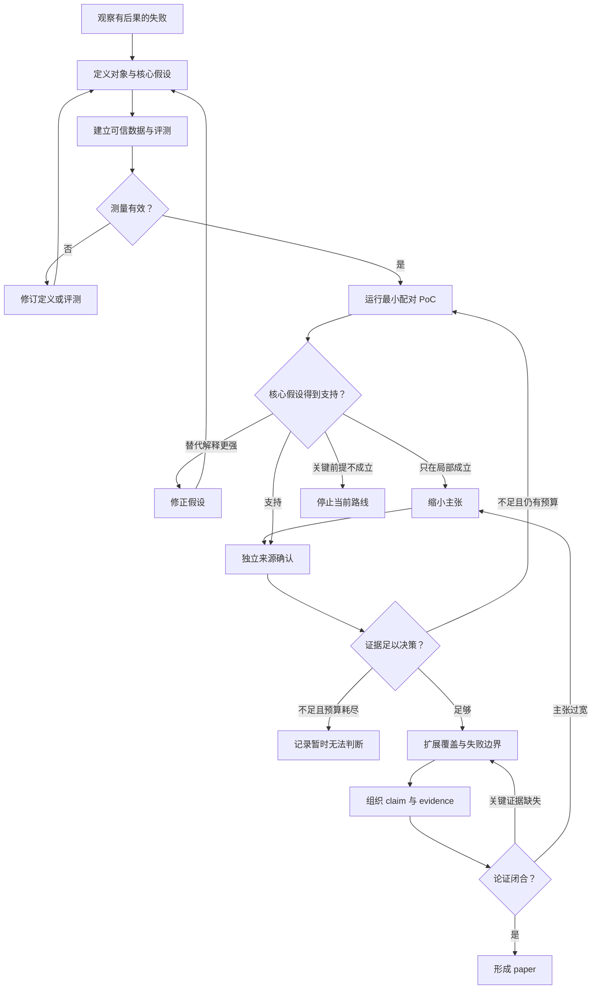

**这篇论文最值得学习的，是如何把“research agent 经常把 idea 做偏”这样的宽泛担忧，收敛为一个可定义、可标注、可检验的研究对象：方法规格是否足以支持忠实实现。**

论文是 **IdeaAMBIG: Benchmarking Implementation-Critical Gaps in Research-Idea Specifications**，作者为 Yiling Ma 等。以下以 **2026 年 9 月 9 日的 arXiv v1，74 页**为准；实验数字均为作者报告，本轮没有复跑实验。[论文原文](https://arxiv.org/pdf/2609.10539v1)

全文使用三个标记：

- **【原文】**：论文明确报告的定义、设计或结果，附位置。
- **【反推】**：根据最终论文重建的研究逻辑，不代表作者真实研发时间线。
- **【建议】**：如果从零开始研究，我建议采用的设计或补充证据。

---

**1．这篇论文贡献的是一个诊断基准，以及由它支持的实证发现。**

【原文】研究对象是 **implementation-facing research-method specification**：一段准备交给研究者或 coding agent 实现的**研究方法说明**。

核心问题是：

> 这段说明是否已经确定了核心方法，还是留下了必须靠实现者自行猜测的重要决策？

论文将前者称为 **codification-ready**。这里要求的是忠实实现一个初始方法或实验原型，不要求复现每个小数点，也不要求提前指定所有常规工程配置。判断标准是：两个合格实现者，能否因为说明中的缺失或歧义，合理地实现出**实质不同的核心方法**？[§3.1，pp.3–4；附录 E.5，pp.30–34](https://arxiv.org/html/2609.10539v1#S3.SS1)

【反推】核心 insight 可以概括为：

**“能写出可运行代码”与“实现了研究者所指的方法”，需要分别验证；而“发现需要澄清什么”与“知道缺口后提出澄清”，也需要分别测量。**

因此，其贡献类型应判断为：

- **主要类型：数据／基准。**
- **次要类型：实证诊断。**
- 问题形式化是任务定义；论文没有提供忠实实现或研究成功的理论保证。
- 它尚未提出并验证一个完整的自动澄清 research-agent 系统。

【原文】论文构造了 **660 个有证据支持的缺口实例**：163 个来自真实复现问题或 GitHub issues，497 个由完整参考规格进行受控修改得到。每条记录围绕一个目标缺口，并提供相应的修复依据。[§3.2–3.3；表3，p.12](https://arxiv.org/html/2609.10539v1#S3.SS2)

三个评测任务如下：

| 任务模型收到什么模型输出什么实际测量的能力           |                |                       |                   |
| ------------------------------- | -------------- | --------------------- | ----------------- |
| Readiness assessment            | 单独呈现的一份规格      | Ready／NotReady 和理由    | 是否知道现在能否开始忠实实现    |
| Defect localization             | 有缺口的规格         | 一个缺口描述及两级类别           | 能否找到具体未确定的决策      |
| Clarification action generation | 规格 **＋正确缺口描述** | 澄清问题或证据查找指令，以及预期获得的信息 | 已知缺口后，能否提出足够具体的行动 |

出处：[§3.1，p.4；图1，p.1](https://arxiv.org/html/2609.10539v1#S3.SS1)。

**边界必须先固定。**

【原文】这些输入是利用论文、代码、issues、复现报告等资料**事后重建的规格**，不是作者原始的 idea 交接记录；评测模型不能查看这些隐藏的来源材料。研究主要覆盖 AI／ML，采用单目标缺口和单次行动设定。[§3.2；附录 H，p.51](https://arxiv.org/html/2609.10539v1#A8)

【反推】所以，这篇论文可以回答“研究方法交给实现者前，哪些信息诊断能力仍不足”，不能据此回答：

- 一个 idea 是否新颖、值得研究；
- 自动科研最主要的总体失败原因是什么；
- 加入澄清模块后，最终论文质量会提高多少。

---

**2．idea 的合理起点，是“实现成功”与“方法忠实”之间的矛盾。**

【原文】图1给出一个很具体的例子：要求一个 dense FFN 与 MoE 的 **activated parameter count** 匹配。但是，哪些参数算 activated——共享部分、gate、被选中的 experts——并没有说明清楚。实现者可以各自写出正常运行的程序，却构造出不同的比较对象。[图1，p.1](https://arxiv.org/html/2609.10539v1#S1)

【反推】这个现象值得成为研究问题，因为它影响的是**实验究竟检验了什么**。如果 baseline 的匹配规则、损失函数、输入路由或评测协议由实现者自行补全，后续实验可能非常规范，但验证的是另一种方法。

它长期难以被充分测量，有三个原因：

1. **失败容易被归入 coding 能力。** 但有时实现者缺少的是决定方法身份的信息。
2. **“缺了什么”难以获得可信标签。** 作者没有写明，不等于某个审稿人喜欢的补充就是正确答案。
3. **真实资料同时包含多种问题。** 安装失败、资源不足、普通参数选择、方法歧义经常混杂。

【原文】论文因此排除环境、资源、运行时间、凭据等问题，只保留有来源证据和具体解决依据的 method-core gaps。附录 A.2 的人工审查中，100 个样本有 94 个被判断为规格层面的澄清，而非修改科学 idea 本身。[§3.2；附录 A.2，表4，p.12](https://arxiv.org/html/2609.10539v1#A1.SS2)

**与最接近的已有工作比较，才能确定这个问题的位置。**

下面三项均早于本文 v1；不将它们当作本文发表后的进展。

| 原始工作已经研究了什么与 IdeaAMBIG 的实质区别                                              |                                    |                                                                                    |
| ------------------------------------------------------------------------- | ---------------------------------- | ---------------------------------------------------------------------------------- |
| [The Ideation-Execution Gap，2025-06-25](https://arxiv.org/abs/2506.20803) | 让研究者执行人类或 LLM 产生的 ideas，再比较执行前后的评价 | 提供“idea 评价不能代替执行结果”的背景证据，但没有把执行落差归因到方法规格缺口。本文利用其中完成的项目作为部分数据来源，也不能反过来宣称解释了该研究的全部落差 |
| [SciConvBench，2026-05-18](https://arxiv.org/html/2605.18630v1)            | 通过多轮对话，补全或纠正计算科学任务要求，评价最终规格及对话依据   | 已经研究科学任务澄清。本文聚焦研究方法的忠实实现，并通过独立任务区分缺口发现与已知缺口后的行动生成                                  |
| [SpecBench，2026-05-28](https://arxiv.org/html/2605.30314v1)               | 根据初始 RFC、代码库和历史讨论，发现软件设计规格缺陷       | 已经研究实现之前的规格诊断。本文强调方法身份、证据支持的修复，以及受控的单缺口实例；模型输入也更受限                                 |

【反推】因此，本文的新意应放在**研究对象、实例构造和能力分解的组合**，不能宽泛地说它首次发现“实现前需要澄清”。

一个可复用的收敛过程是：

> 自动科研可靠性
> → idea 交给实现者时可能发生方法偏移
> → 其中哪些偏移来自规格欠定？
> → 能否构造“仅缺一个关键决策、且正确补充有证据”的实例？
> → 模型能否判断、定位，并提出针对该决策的澄清？

【反推】最终问题具有明确的对象、输入、输出和约束：

- **对象**：已经提出的方法机制。
- **输入**：自包含的方法规格。
- **输出**：就绪判断、具体缺口、澄清行动。
- **约束**：不能靠隐藏答案或无依据的方法选择来完成任务。
- **验证目标**：诊断是否命中了决定忠实实现的那个未决选择。

---

**3．贯穿论文的核心假设，应围绕“可诊断的信息缺口”建立。**

【反推】我将核心假设重建为：

> **研究方法规格中的关键欠定决策，是一种可独立测量、会影响忠实实现的障碍；在本文评测设定下，LLM 的突出困难是发现该决策，而在缺口被明确指出后，通常能够提出有效澄清。**

这里要区分研究问题与研究发现。

【原文】§4.2 明确列出三个 RQ，分别对应就绪判断、缺口定位和澄清。附录 D.5 将缺口信息可用性的比较称为预先指定的比较。

【反推】但论文没有提供足以还原整个项目起始假设及修订时间的研发日志。下面的 H1–H5 是**事后重建的论证结构**。“定位是瓶颈”是实验支持的发现，不能说作者最初已经知道答案。

| 假设对核心贡献为什么必要最强替代解释作者的检验什么会推翻或限制它当前支持程度 |                   |                             |                                                 |                              |                                 |
| -------------------------------------- | ----------------- | --------------------------- | ----------------------------------------------- | ---------------------------- | ------------------------------- |
| **H1 问题假设**：某些规格缺口会改变方法身份              | 否则测到的只是文档完整程度     | 被删除的是普通工程偏好，对目标方法没有实质影响     | method-core 筛选；material-divergence 标注规则；人工有效性审查 | 多种合理实现只有无关差异；补全后也没有改善忠实性     | 对筛选后的实例有支持；不能估计自然科研中的发生频率       |
| **H2 测量前提**：目标缺口与修复有可信依据，且可从输入诊断       | 否则模型可能被错误 gold 惩罚 | 规格还有另一个合理 blocker，或标签依赖隐藏知识 | 全量唯一目标审查；独立重标注；人类基线；judge 校准                    | 专家经常找到同等有效的替代缺口，或只能看答案后才认可目标 | 多种验证支持，但人工和自动判断仍有误差             |
| **H3 诊断假设**：缺口发现是重要瓶颈                  | 支撑论文最主要的实证发现      | 低分来自 taxonomy、评分规则或提示设计     | 同任务 End-to-End／Defect-Guided 比较；去 taxonomy 分析   | 普通提示就消除差距；统一评分后定位并不困难        | 对固定模型和协议支持较强；尚非所有 agent 系统的一般机制 |
| **H4 效果假设**：得到正确补充会改善忠实实现              | 证明基准测量的能力有下游意义    | 只提高文本评分；答案抄入规格后自然得分更高       | 50 个规格生成配对实例；20 个组件执行实例                         | 文本改善但目标方法仍实现错误；只有可运行率上升      | 有规格与组件级证据；没有完整科研结果证据            |
| **H5 范围假设**：现象不只来自一种数据来源或少数项目          | 支撑基准的复用价值         | 合成模板、某类方法或少数来源主导结果          | 真实／合成分报；13 个模型；来源聚类分析                           | 换来源、写法、方法类别后现象消失             | 有来源内稳健性；跨科学领域与自然早期 ideas 仍待验证   |

证据位置：[§3.4](https://arxiv.org/html/2609.10539v1#S3.SS4)、[附录 D.2–D.5](https://arxiv.org/html/2609.10539v1#A4)、[附录 E.2](https://arxiv.org/html/2609.10539v1#A5.SS2)、[附录 G](https://arxiv.org/html/2609.10539v1#A7)。

**三个数字口径尤其不能混淆。**

【原文】

- **9.6% Macro DRR** 要求同时找对缺口、一级类别和二级类别，不是纯定位准确率。
- **80.6% Macro-CAS** 是已经提供正确缺口后的澄清行动得分。
- **14% → 98% Ready rate** 是提供 oracle 信息后的**规格生成**结果，不是完整项目或论文复现成功率。[§4；附录 F](https://arxiv.org/html/2609.10539v1#S4)

【反推】这三个数字可以构成研究线索，但仅把它们并列，还不足以证明机制。真正重要的是后面的受控比较。

---

**4．从 idea 到评测设计，关键决策发生在“如何让问题可辨识”。**

先区分两个流程。

**【原文：论文的执行流程】**

数据构建时，先从资料中获取缺口或完整参考规格，建立欠缺／修复版本，再进行筛选和标注。评测时，三个任务分别运行；**Task 3 接收 gold defect，并不接收 Task 2 的模型预测**。其 EvidenceSeeking 输出也是查找指令，不代表论文实际执行了查找或完成了多轮交互。[图2；§3.1–3.2；附录 D.1](https://arxiv.org/html/2609.10539v1#A4.SS1)

**【反推：研究者形成这套设计的逻辑】**

论文没有给出完整的早期失败历史。下面按论证依赖重建，不能理解成作者确实依次尝试过这些方案。

| 已知什么／还不知道什么合理选择为什么选择这一设计需要的新证据结果不同后的分支 |                   |                         |                      |                    |
| -------------------------------------- | ----------------- | ----------------------- | -------------------- | ------------------ |
| idea 到执行存在落差；原因不明                      | 直接跑完整项目，或研究一个中间环节 | 聚焦交接规格，减少模型能力、资源和实验设计混杂 | 能指出具体未决选择及其后果        | 找不到方法层面的后果，就重新选问题  |
| 规格可能不完整；正确补充未知                         | 专家自由编答案，或寻找已解决案例  | 使用 issues、复现报告及代码中的解决依据 | 缺口与补充都能追溯到来源         | 证据不足的案例暂不进入 gold 集 |
| 自然案例有多个问题；错误归因困难                       | 自由枚举，或单目标诊断       | 先建立单目标单位，控制定位对象         | 修复目标后没有另一个独立 blocker | 修订、拆分，或删除实例        |
| 真实问题有价值；覆盖与对照不足                        | 扩大真实采集，或加入受控缺口    | 从完整参考规格只改变一个关键细节        | 人工确认有效、关键、可修复且自然     | 合成痕迹明显则修改构造方式或分开结论 |
| 模型总体表现差；不知道卡在哪                         | 一个总分，或拆成判断／定位／澄清  | 分解失败阶段，再用同任务信息干预验证      | 缺口信息改变表现，而非仅改变评分口径   | 调整瓶颈解释             |
| 文本结果改善；实际价值未知                          | 完整复现，或先实现有界组件     | 用低成本组件检查“运行”与“忠实”的区别    | 修复带来目标细节的实现改善        | 仅文本有效时，收缩下游主张      |

【原文】其中 taxonomy 的形成过程确实被记录：先借鉴需求工程中的三类缺陷，再进行候选挖掘、聚类、人工 open coding、类别合并及边界定义。论文没有声称这套 taxonomy 适用于所有科学领域。[附录 B.1，pp.15–16](https://arxiv.org/html/2609.10539v1#A2.SS1)

**一个具有完整干预证据的案例，是附录 D.2 的缺口提示实验。**

1. **失败现象——【原文】**：定位成绩低，但给定缺口的澄清成绩高。作者也明确指出：两个任务的输入、输出不同，不能直接归因。
2. **原因假设——【反推】**：模型可能有能力组织澄清，但没有确定应当澄清的正确决策。
3. **最小干预——【原文】**：固定 GPT-5.6-Sol、同一批真实 Task 3 实例和评测协议，只比较是否提供正确缺口描述；此处没有直接提供 gold resolution。
4. **可检验预测——【反推】**：如果发现缺口是主要障碍，正确缺口提示应显著提高针对性与充分性；避免无依据假设的能力不一定同步变化。
5. **结果——【原文】**：Macro-CAS 从 **13.6% 升至 80.6%**；Sufficiency 从 **8.6% 升至 80.4%**；No-Assumption 从 **96.3% 变为 95.7%**。来源聚类后的 CAS 差值区间为 **[59.0, 75.2] 个百分点**。
6. **修正判断——【反推】**：模型经常能谨慎地问问题，但问的对象不对或信息不足。正确的缺口信息具有很大的诊断价值；这仍没有揭示模型内部的认知机制，也没有解决如何自动获得该信息。

出处：[附录 D.2，p.23；表9，p.41；表14，p.43](https://arxiv.org/html/2609.10539v1#A4.SS2)。

再看一个具体失败样本，可以理解“有效澄清”为什么不能只看相关性。

【原文】TimeMixer 案例需要确定历史外部变量进入 `x_enc` 还是 `x_mark_enc`，还需要确定选择 `x_enc` 时的 channel-independence 设置。模型只询问输入路由，遗漏了后一个条件。因此，问题虽然相关、没有擅自决定答案，仍不足以使规格可实现。[表6，p.14；附录 A.4，p.15](https://arxiv.org/html/2609.10539v1#A1.SS4)

【建议】最小修正是让问题覆盖该条件依赖，然后检查：**回答者只回答被明确询问的内容，是否已经足够完成目标组件？** 论文没有报告这一具体问题改写后的新结果，不能补写成成功案例。

---

**5．如果从零开始，最小 PoC 应先验证“这个缺口真的值得测”。**

**作者实际报告了哪些小规模验证？**

【原文】这些是论文中的小规模验证，未必是作者研发早期的 PoC。

| 验证规模与目的已报告的主要结果 |                            |                                                        |
| --------------- | -------------------------- | ------------------------------------------------------ |
| 构念区分            | 100 个实例，判断是在澄清规格还是改变 idea  | 94% 属于规格层面；附录 A.2、表4                                   |
| 真实／合成盲审         | 各50个实例，检查有效性、关键性、可解决性和自然程度 | 两类均获得较高认可；§3.4、附录 G.2                                  |
| 去 taxonomy 定位   | 50 个真实实例                   | 原有联合标准10%，无类别要求的 blocker identification 40%；附录 D.3、表10 |
| Oracle 规格生成     | 50 个真实实例，配对比较              | Ready rate 14% → 98%；§4.4、表2                           |
| 可执行组件验证         | 20 个受控实例，排除大型训练等高成本任务      | 全部测试通过率45% → 85%；目标忠实度30% → 90%；附录 D.4、表11             |

来源：[附录 A](https://arxiv.org/html/2609.10539v1#A1)、[附录 D](https://arxiv.org/html/2609.10539v1#A4)、[附录 G](https://arxiv.org/html/2609.10539v1#A7)。

还要注意数据规模口径：660 是基准记录数；主实验的 Task 1 在真实和合成子集中各评测200份规格，Task 2／3 使用163个真实实例和固定的200个合成实例，并非所有任务都运行全部660条。[表1，p.6](https://arxiv.org/html/2609.10539v1#S4)

**【建议】从零开始时，第一轮先解决下面的问题。**

> 对有来源依据的关键缺口，修复是否会提高目标方法的忠实实现，而不是只提高文字完整度？

这是项目的第一道去留关口。若缺口与忠实性没有关系，再复杂的定位指标也难以支撑基准价值。

**先实现什么。**

必须有：

- 缺口规格、修复规格、来源证据之间的对应关系；
- 区分方法决策和普通工程选择的标注规则；
- 不依赖类别名称的 blocker 匹配；
- 小组件的目标忠实性判据；
- 能保存条件、输入、输出及人工判定的最小评测脚本。

可以暂缓完整十类 taxonomy、大规模爬取、13模型评测、多轮 agent 和完整论文复现。

**数据怎样选。**

【建议】若现在复做，可从本文真实实例和有参考实现的受控实例中选择。若回到只有方向的起点，就从已解决的复现问题和作者回复开始收集。

先导批次可取**约12个独立来源的案例家族**，让三种一级缺陷各有数个例子，并覆盖：

- 局部算法／损失定义；
- 数据预处理或输入路由；
- 评测计算或比较协议。

这个数量用于发现标注和测量失败，**不用于宣称精确成功率**。

每个家族至少准备：

1. **缺口版本**：有一个有证据支持的关键未决选择。
2. **修复版本**：只补足该选择。
3. **非关键编辑版本**：省略或改写普通工程信息，检查系统是否只是对“不够详细”敏感。

优先选择无需大型训练、可通过小输入或局部实现判断的案例。小任务的价值在于**能区分解释**，不是运行时间短本身。

**哪些对照不能省。**

【建议】先固定模型，用同样的澄清输出要求比较：

| 条件输入增加的信息排除什么解释 |                   |                    |
| --------------- | ----------------- | ------------------ |
| A：直接诊断／澄清       | 无                 | 建立原始能力             |
| B：通用检查提示        | 长度相近、无目标信息的方法检查提醒 | 改善是否只来自额外提醒或更多提示文字 |
| C：正确缺口提示        | 目标缺口描述，不给答案       | 检查缺口定位信息的价值        |

另外，用缺口／修复规格做**成对代码实现**，测目标忠实性。Ready 版本不可省，否则“全部判 NotReady”也会看起来很谨慎。

纯定位应先按是否命中 blocker 评分，taxonomy 准确率单独报告。

**怎样验证评测器真的测到了目标现象。**

【建议】

- 用正确参考实现检查测试不会误杀。
- 构造“能运行但采用错误方法决策”的版本，确认忠实性判据能识别。
- 用同义表达和等价实现检查评分不依赖措辞或代码形态。
- 标注者先只看规格，独立指出缺口；之后才看 gold 和来源证据。
- 对模型提出的非 gold 缺口进行复核；若确实成立，先修订实例，不能直接把它算作模型错误。

**指标与实际意义。**

【建议】主指标分别对应两个问题：

- 诊断：纯 blocker 命中率、同一任务下的澄清成功率差值。
- 下游：目标忠实度差值。

辅助报告 UnsafePass、OverFlag、请求是否充分、无依据假设、可运行率、调用和人工审查成本。

不应先任意规定“提高5个百分点就继续”。最小有意义收益应根据预期用途确定：节省一次方法返工，是否足以抵消新增澄清和审查成本？

**探索、选择与测试必须分开。**

【建议】

- **探索来源**：用于修订缺陷定义、标注指南、测试判据。
- **候选选择来源**：使用新的项目，选择提示或评分方案。
- **最终测试来源**：方案冻结后才打开，不再用于调整。

划分单位应是 repository／paper／project，而非单条实例。同一方法的不同缺口、修复版本及合成兄弟实例应留在同一区域。

原文报告了固定评测集和来源聚类，但没有清楚提供覆盖上述三种用途的完整隔离记录；不能将这些隔离自动视为已经完成。

**样本量与预算怎样决定。**

【建议】先导实验用于估计成对结果的不一致率、来源相关性及人工分歧。之后围绕预先确定的最小有意义差值，选择能让置信区间支持决策的测试规模。

如果区间仍同时覆盖“没有实际价值”和“值得继续”，结果应记为**暂时无法判断**，再按预算增加独立来源。

预算可以直接由条件数计算：两个模型、三个澄清条件、`n` 个缺口，需要约 `6n` 次生成；另选 `m` 个组件，用一个固定 coding 模型作成对实现，增加 `2m` 次代码生成。评判和人工复核应另计。无需第一轮就复现所有训练流程。

**去留分支。**

【建议】

- 正确补充提高忠实性，且定位仍明显困难：继续建立诊断基准。
- 通用检查提示已经大幅消除差距：保留规格问题，但收缩“能力瓶颈”的表述。
- 修复只改善文字，没有改善目标实现：检查文本指标，暂缓下游价值主张。
- 效果局限于某类局部操作：缩小任务范围。
- 目标无法稳定标注，或参考实现也不能确定方法：修订对象；仍不可辨识时停止该路线。
- 证据方向不明且预算耗尽：记录 inconclusive，不把它改写为成功或失败。

---

**6．值得扩大成 paper 级实验的条件，是核心对象和测量工具已经站住。**

【反推】对这篇 benchmark 论文，扩展应围绕“基准测得是否可信、发现覆盖多大范围、下游意义有多强”，而不是简单增加榜单。

| 要回答的问题作者完成了什么还需要什么，以及何时是必须项 |                         |                                                     |
| --------------------------- | ----------------------- | --------------------------------------------------- |
| **效果是否存在？**                 | 多模型主实验；真实／合成分报          | 更完整的逐例结果和复核有助于独立验证；继续扩大前先固定实例与评测版本                  |
| **是否真的是定位困难？**              | 同任务缺口信息干预；去 taxonomy 分析 | 若要量化 taxonomy 对定位过程的影响，必须使用相同样本、相同定位评分和相同评判方式       |
| **是否只是更多提示或预算？**            | 核心比较固定模型和解码协议           | 等长度通用提示及匹配输出预算可增强解释；若声称具体澄清方法优于 baseline，则公平预算是必须项  |
| **是否依赖来源、模型或领域？**           | 13模型；多来源；来源聚类与平衡估计      | 真正的来源留出、提示变体、新近或较少曝光的方法；跨领域主张必须另做跨领域验证              |
| **前提失效时会怎样？**               | 唯一目标审查；双缺口探索；错误案例       | 自然多缺口、相互依赖缺口、证据冲突或无法获取答案。面向真实部署时必须补                 |
| **收益是否值得实际使用？**             | Oracle 规格与组件验证          | 自主定位、实际获取信息、修订和实现的闭环，以及人工成本和最终科研结果；属于部署或系统效果主张的必须证据 |

相关实验：[§4](https://arxiv.org/html/2609.10539v1#S4)、[附录 D–G](https://arxiv.org/html/2609.10539v1#A4)。

**有两处需要特别收紧解释。**

【反推】第一，表10的 **10% → 40%** 同时改变了输出要求和成功标准。它说明“联合缺口＋类别任务的低分不能全部归结为找不到缺口”，但不能把30个百分点全部解释为 taxonomy 带来的认知负担。

【建议】应将原 Task 2 在相同50个样本上的缺口文本也按纯 blocker 标准重新评分，再与无 taxonomy 的输出比较。这样才能区分：

- 只是分类错误导致扣分；
- 分类要求本身干扰了定位。

【反推】第二，缺陷粒度与定位难度之间的关系是分层关联。粗粒度缺口可能同时更显眼、更常见或来自不同来源；这不足以建立“粒度导致失败”的因果机制。[附录 E.3，表16](https://arxiv.org/html/2609.10539v1#A5.SS3)

**重复运行、配对比较和不确定性估计，各自解决不同问题。**

- **【原文】配对比较**：50个 oracle 实例采用配对统计；二元指标使用 exact McNemar，另有 bootstrap 和多重比较校正。无依据假设率6%降到0%的差异，作者明确指出不显著，调整后 `p=0.250`。[表2；§4.4](https://arxiv.org/html/2609.10539v1#S4.SS4)
- **【原文】来源相关性**：作者按来源进行 bootstrap。领先两模型的六项比较中，五项不能支持稳定差异；缺口提示带来的大幅收益则保持稳健。[附录 D.5；表13–14](https://arxiv.org/html/2609.10539v1#A4.SS5)
- **【建议】生成随机性**：温度零不代表所有服务绝对可重复。若研究结论依赖生成或搜索，应在诊断子集重复运行；统计时不能把重复输出当成新增独立样本。
- **【建议】反复搜索候选**：若尝试许多 prompts 或多轮定位后选择最优方案，必须在未参与选择的来源上确认，否则选中的是噪声优势。
- **【建议】20个组件实验**：现有结果适合作为下游可行性证据。若要给出稳定效应大小，需要更多独立组件、配对不确定性以及逐例验证依据。

【反推】这些要求不意味着 benchmark 必须先完成一套自动科研系统。**对基准贡献必需的，是可信测量；对部署收益主张必需的，才是闭环系统证据。**

---

**7．证据组织成论文时，每项 claim 都应有明确的论证职责。**

【反推】本文的论证链可以整理为以下映射：

| 主要 claim对应设计关键证据位置应保留的结论范围 |                       |                         |                |
| -------------------------- | --------------------- | ----------------------- | -------------- |
| 方法交接前存在值得单独评估的规格就绪性        | 定义方法关键决策，排除普通工程选择     | §3.1；附录 A.2、E.5、H；图1    | 已提出方法的忠实初始实现   |
| 可以建立有依据的诊断基准               | 真实问题＋受控缺口；修复版本；唯一目标审查 | 图2；§3.2–3.4；表3、15、25、26 | 经筛选和重建的AI／ML规格 |
| 当前模型难以找到目标缺口               | 拆分任务，追加信息干预和无类别分析     | 表1、9、10、14              | 所评模型与协议下的诊断困难  |
| 正确澄清信息有下游价值                | Oracle 信息补充；规格与代码成对比较 | 表2、11；附录 G.3、D.4        | 文本就绪性及有界组件忠实性  |
| 结果不是少数来源支配                 | 来源聚类、来源平衡、配对比较        | 表12–14                  | 已评来源集合中的稳健性    |

**各章节为什么这样安排。**

【反推】

- **Introduction**：建立后果——方法规格欠定可能使实现偏离研究意图；明确这一中间环节值得测量。
- **Problem Formulation**：规定什么算缺口、什么不算，确定输入信息和成功条件。
- **Method／Benchmark Construction**：解释数据、参考答案、taxonomy 和质量控制如何构成可信测量工具。
- **Experiments**：展示三个能力的表现，并注明条件与样本口径。
- **Analysis**：排查分类负担、错误目标、澄清不充分、来源相关性等解释。
- **Limitations**：限定哪些结论仅在重建、单目标、oracle 或组件级设置下成立。

对 benchmark 论文，数据构造与评判协议就是核心技术内容。公式主要帮助固定指标，不能代替构念效度和下游验证。

**哪些主张应保留，哪些应收缩。**

【反推】可以保留：

- 定义并测量研究方法的 codification readiness 有价值。
- 在本文条件下，缺口发现明显不足，正确缺口信息能大幅改善澄清。
- 正确补充能够改善部分组件的忠实实现。

应收缩：

- “发现缺口是自动科研的主要瓶颈”
  → “它是本文规格诊断设置中的突出瓶颈”。
- “澄清能让科研实现成功率达到98%”
  → “oracle 信息使50个实例的生成规格就绪率达到98%”。
- “多缺口不会更难”
  → “该探索没有发现显著变难，但响应数量不对称，不能作普遍结论”。原文也明确承认这一限制。[Limitations；表17](https://arxiv.org/html/2609.10539v1#Sx1)

只能放入讨论或未来工作：

- 自动选择问人还是查资料；
- 多轮获取与核对证据；
- 减少实际研究返工和人工成本；
- 提升最终实验有效性或论文质量。

【反推】这篇论文的叙事有较大覆盖面，是因为它连接了“科学意图”与“实验实现”；验证范围仍可控，是因为它把单位限定为**一个具体方法决策**。这是值得学习的范围管理方式。

---

**8．可复用的工作流，是先建立可辨识的问题，再逐层扩大结论。**

下表全部是【建议】，根据本文案例提炼。

| 阶段需要解决的问题最小产物进入下一阶段的证据失败后的分支 |                  |                        |              |              |
| ---------------------------- | ---------------- | ---------------------- | ------------ | ------------ |
| 现象发现                         | 哪种失败影响了研究结果的含义？  | 数个有来源的失败案例             | 能指出具体方法偏移    | 换现象或放弃       |
| 问题定义                         | 什么是关键缺口，什么是普通选择？ | 定义、边界、正反例              | 专家能稳定区分      | 修订定义         |
| 假设登记                         | 哪个解释决定项目价值？      | 核心假设及替代解释              | 每个假设都有可反驳观察  | 缩小或拆分假设      |
| 测量验证                         | gold、输入与评测器可信吗？  | 小型配对数据、判据、盲审记录         | 能识别忠实与不忠实实现  | 修订数据或测量      |
| 最小 PoC                       | 缺口及其补充是否产生预期差异？  | 固定条件的成对结果              | 能区分主要替代解释    | 修正假设、缩小主张或停止 |
| 独立确认                         | 结果是否来自探索和候选选择？   | 留出来源的确认结果              | 效应和不确定性支持决策  | 新一轮探索或记为不确定  |
| Paper 级验证                    | 覆盖、边界和实际意义有多大？   | 按 claim 组织的扩展实验        | 每项主张均有对应证据   | 删除越界主张       |
| 论文组织                         | 读者能否检查论证链？       | 统一主稿及 claim–evidence 表 | 方法、结果、结论范围一致 | 返工论证或补关键证据   |

**最值得学习的三个研究动作——【反推】**

1. **用方法后果定义问题。** 关键不是说明写得详细，而是缺失是否会让两个实现者做出不同的方法。
2. **先解决测量可信度。** 来源证据、修复版本、替代缺口审查和人工校准，共同支撑基准价值。
3. **把任务间差异转化为可干预的比较。** 发现定位低、澄清高后，再固定任务比较缺口信息可用性，比单纯展示分数更有解释力。

**最不应直接照搬的两个做法——【建议】**

1. **不要让联合指标代替能力本身。** 缺口定位与 taxonomy 要分开分析；否则分数低的原因不清楚。
2. **不要把单目标、oracle 和组件级结果扩大成自然工作流收益。** 真正的 research agent 必须自己发现缺口、获取可靠信息，并承担澄清成本。

**如果我们只有最初的研究方向，第一轮最应该做的三件具体事情——【建议】**

1. **收集一小批已解决的真实方法分歧。** 每例写清“原说明、两种可能实现、为什么不同、解决依据”，先不急于建立大 taxonomy。
2. **制作关键缺口／修复／非关键编辑三种版本，交给独立研究者盲审。** 确认缺口可从输入诊断，而且确实影响目标方法。
3. **预先固定两个小实验。** 一个比较有无正确缺口提示时的澄清；另一个比较修复前后的组件忠实性。先写明什么结果会让我们继续、改假设或停止，再开始运行。