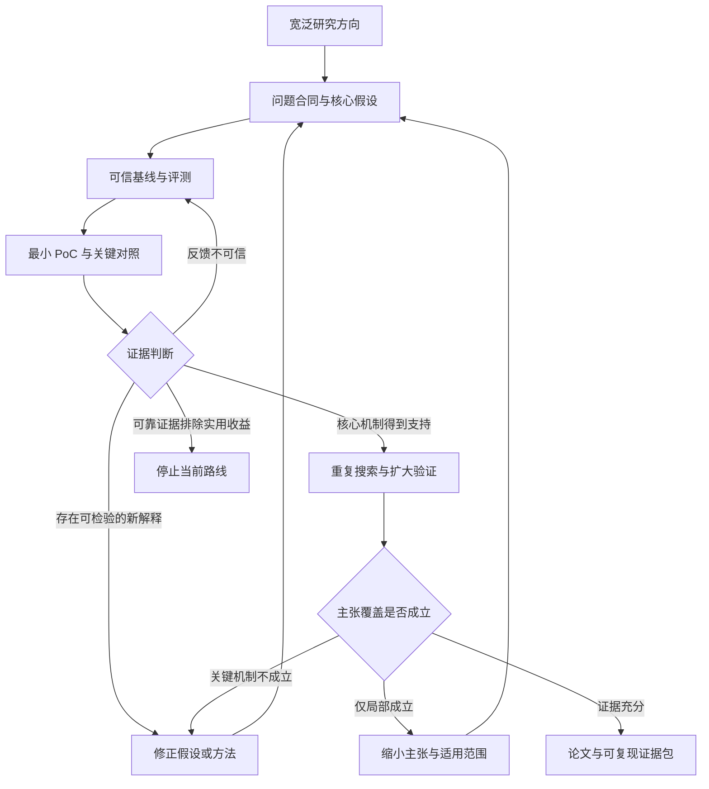

这篇论文最值得学习的，是**把一个长期研究目标，转化为能够积累经验、选择实验、修正方向的研究系统**。但阅读时必须区分两件事：**系统产生了有效方法的证据，比“这些成果确实由其记忆与选择机制带来”的证据更充分。**

论文是 **DeepScientist: Advancing Frontier-Pushing Scientific Findings Progressively**。我阅读了你提供的 57 页 ICLR 2026 版本，包括主文、补充实验及附带的生成论文；本轮没有运行代码或复现实验。下文页码统一指整个 PDF 的页码，避免与附带论文重新开始的页码混淆。[论文原文](https://proceedings.iclr.cc/paper_files/paper/2026/file/4f64494ecc3442f1c9261baa036378bc-Paper-Conference.pdf)

标记统一如下：

- **【原文】**：作者明确报告；不等于本轮独立复现确认。
- **【反推】**：根据最终论文重建的研究逻辑，包括我的证据判断；不代表真实研发历史。
- **【建议】**：如果从零开展研究，应增加或调整的工作。

---

**1．本文的主要贡献是一个持续科研系统，三个下游方法方向是检验它的载体。**

【原文】DeepScientist 从一个人类指定的问题、已有强方法及其代码出发，持续生成候选假设，选择值得实现的候选，执行实验，再把成功与失败写入 **Findings Memory**。其中只有超过基线的部分结果进入更深入的分析和论文生成阶段。核心设计见主文 §3、图2，以及附录 D。[§3与图2，PDF pp.3–5](https://proceedings.iclr.cc/paper_files/paper/2026/file/4f64494ecc3442f1c9261baa036378bc-Paper-Conference.pdf#page=3)

可以将其核心 insight 概括为：

> **科研系统需要优化“下一次实验投在哪里”，并让过去的实验改变未来的选择。**

【反推】这是一篇**系统贡献为主、方法设计与过程实证为辅**的论文。它不是理论论文，也不主要贡献一个新数据集。虽然采用 Bayesian Optimization 和 UCB 的语言，但没有据此建立科研搜索的收敛保证或 regret bound。

因此，需要三层证据：

| 证据层次要回答什么为什么必要 |                           |                |
| -------------- | ------------------------- | -------------- |
| 产出有效性          | 找到的方法是否正确、有效、可复现？         | 证明系统确实能产出有价值结果 |
| 系统有效性          | 相同预算下，是否比已有研究策略更容易找到这些结果？ | 证明新系统设计值得使用    |
| 机制有效性          | 收益是否来自记忆、选择和经验复用？         | 解释系统为什么有效      |

【原文】作者报告的代表性结果如下。这里保留原始数值，避免混淆相对提升与百分点：

| 任务起点或比较方法系统产出报告结果          |                 |        |                                                     |
| -------------------------- | --------------- | ------ | --------------------------------------------------- |
| Agent failure attribution  | All-at-Once     | A2P    | Algorithm-Generated 的 step accuracy：16.67% → 47.46% |
| 同上                         | All-at-Once     | A2P    | Hand-Crafted：12.07% → 29.31%                        |
| LLM inference acceleration | Token Recycling | ACRA   | 190.25 → 193.90 tokens/s                            |
| AI text detection          | Binoculars      | PA-TDT | AUROC：0.800 → 0.863；延迟：117 → 60 ms                  |

这些是特定评测配置下的报告结果，不能直接解释为整个领域的普遍优势。[主文§4.1、图3，PDF pp.5–7](https://proceedings.iclr.cc/paper_files/paper/2026/file/4f64494ecc3442f1c9261baa036378bc-Paper-Conference.pdf#page=5)

【原文】其实际运行依赖人工复现的基线、较强的规划与编程模型、16 张 H800，以及人工监督和结果检查。作者明确指出，高成功成本、反馈缓慢的研究场景不适合直接照搬这一模式。[§4、§4.3、附录A与F](https://proceedings.iclr.cc/paper_files/paper/2026/file/4f64494ecc3442f1c9261baa036378bc-Paper-Conference.pdf#page=15)

【反推】适用边界应写成：

> **在人类设定目标、基线与评测条件，并监督结果真实性的前提下，面向可通过代码进行较快实验反馈的研究任务，开展持续的方法搜索。**

这里的“自主”主要指研究流程中的生成与执行，不能理解为没有人工定义问题、准备环境和核查结果。

---

**2．idea 的起点，是“能生成研究内容”与“能持续推进明确问题”之间的落差。**

【原文】Introduction 提出的矛盾是：已有 AI Scientist 可以完成研究流程、生成论文，但缺少明确目标时，容易停留在已有知识的组合，产出未必能解决重要问题。作者因此把目标明确为：在固定计算预算下，发现能可靠超过强人类基线的方法。[§1，PDF p.2](https://proceedings.iclr.cc/paper_files/paper/2026/file/4f64494ecc3442f1c9261baa036378bc-Paper-Conference.pdf#page=2)

【反推】如果回到最初阶段，值得观察的现象可以是：

- 生成了很多 idea，但下一轮并没有明显更聪明。
- 不同尝试重复遭遇同类问题，失败没有形成可复用知识。
- 系统能写出“结果不错”的报告，却未必实现了预定实验。
- 偶尔得到一个好结果，但不知道继续增加预算是否仍会取得进展。

前三项分别指向**经验利用、实验选择、反馈可信性**；最后一项指向**持续发现能力**。它们比“让 AI 自动科研”更接近可研究的问题。

不过，不能直接接受本文对所有先行工作的概括。以下原始工作已经覆盖其中一些能力：

| 相关工作及时间原工作实际已有的能力与 DeepScientist 的实质关系                                                                                                                                             |                                                         |                                                     |
| ---------------------------------------------------------------------------------------------------------------------------------------------------------------------------------- | ------------------------------------------------------- | --------------------------------------------------- |
| [AI Scientist-v2，2025年4月](https://arxiv.org/html/2504.08066v1)                                                                                                                     | Experiment Manager、分阶段实验、agentic tree search、调试、消融及重复运行 | 不能把先行系统一概描述为一次性线性流水线；本文更强调围绕强基线的长期跨轮推进              |
| [AgentRxiv，2025年3月](https://arxiv.org/html/2503.18102v1)                                                                                                                           | 共享研究报告、累积前序发现、多个实验室协作；还做了移除历史研究访问的对照                    | “共享知识促进累积科研”已有直接先例；本文差异更集中于细粒度 Findings、失败记录和实验筛选   |
| [AlphaEvolve，2025年5月](https://storage.googleapis.com/deepmind-media/DeepMind.com/Blog/alphaevolve-a-gemini-powered-coding-agent-for-designing-advanced-algorithms/AlphaEvolve.pdf) | 用执行反馈持续进化程序，报告科学与实际计算问题中的新解                             | 不能简单归为没有科学发现的工程优化；本文增加了显式假设、文献分析及研究报告组织             |
| [Fast-DetectGPT，ICLR 2024](https://arxiv.org/html/2310.05130v3)                                                                                                                    | 用条件概率差异构造检测统计量，并提供归一化及解析计算                              | 是本文检测方向的直接起点；其真实公式需要独立核对，不能只依赖生成论文对“Gaussian 假设”的描述 |

时间上，DeepScientist 首版发表于 **2025年9月30日**；以上工作都早于首版。分析采用你提供的 2026 年会议版本，但不能将定稿中的补充实验倒推成作者最初已经完成的准备工作。[首版记录](https://arxiv.org/abs/2509.26603)

【反推】宽泛方向可以这样收敛：

| 收敛步骤问题表达 |                                                     |
| -------- | --------------------------------------------------- |
| 宽泛方向     | 让 AI 做科研                                            |
| 明确研究对象   | 让一个系统持续改进给定的强方法                                     |
| 找到瓶颈     | 实验昂贵，候选很多，反馈常不可靠，历史经验利用不足                           |
| 提出机制问题   | 结构化历史记录能否改善下一步候选生成和实验选择？                            |
| 形成可验证问题  | 相同模型、执行器与总预算下，使用真实实验记忆的策略，能否比无记忆、贪心或随机策略产出更好的已验证方法？ |

相应的问题合同应包含：

- **输入**：任务定义、基线代码、可执行评测、允许使用的知识、预算。
- **输出**：经过独立复验的方法及代码，以及支持或限制其主张的证据。
- **约束**：不能改变任务、泄露最终测试反馈、放宽正确性要求或遗漏失败成本。
- **研究对象**：一个根据历史实验决定下一次研究行动的策略。

【反推】真正改变的假设是：\*\*过去的科研尝试不是彼此独立的消耗品，而是能够改善后续决策的状态。\*\*这也是最应该被实验直接检验的部分。

---

**3．贯穿论文的核心假设，应围绕“经验是否提高发现效率”来建立。**

【反推】我建议这样重建核心假设：

> **在反馈可信且实验成本可承受的任务中，持续积累成功与失败，并据此选择后续实验，能够在相同总预算下，更可靠地产生可复验的方法改进。**

下面的 H 编号均为事后重建。作者明确提出了整体目标，但论文没有给出对应的预注册假设表，不能声称作者在运行前已经按这些条目组织研究。

| 假设对核心贡献为何必要最强替代解释作者提供的证据什么会推翻或限制它当前支持程度 |                      |                           |                                 |                          |                     |
| --------------------------------------- | -------------------- | ------------------------- | ------------------------------- | ------------------------ | ------------------- |
| **P0：实验反馈能反映真实实现与效果**，前提                | 错误反馈会污染记忆，后续“学习”失去意义 | 分数来自未完成运行、评测偏差或实现与描述不一致   | 独立重执行、人工检查；附录F                  | 冻结代码后不能复现，或方法与指标存在数学矛盾   | 有检查措施；仍存在具体一致性疑点    |
| **H1：原始候选中有效进展稀少**，问题假设                 | 说明为什么需要筛选与经验复用       | 失败主要来自执行器，未必来自 idea 本身    | 图4的候选漏斗；300个失败实现的人工分析           | 修复执行器后，简单搜索就足够有效         | 支持进展稀少；原因不能只归于假设质量  |
| **H2：候选估值能改善实验选择**，机制假设                 | 使昂贵验证集中在更值得尝试的候选上    | 筛选只偏好容易实现的候选；随机对照预算或候选不匹配 | 图4b的选择策略对照                      | 相同候选池与预算下不优于随机、贪心或可实现性排序 | 有初步支持，比较协议与图文一致性不足  |
| **H3：成功和失败记忆改善未来决策**，机制假设               | 是“持续积累经验”的核心         | 收益来自更多尝试、更长上下文或更强执行器      | 图5轨迹、共享记忆的扩展实验及案例叙述             | 移除、冻结或置换记忆后效果不变          | 缺少直接隔离记忆作用的因果对照     |
| **H4：系统在固定预算下产生更好的研究产出**，效果假设           | 证明系统整体有实用价值          | 只是大预算搜索后挑选赢家              | 三个任务的结果；生成论文评审                  | 匹配模型与预算后，不优于强研究代理基线      | 支持产出可行性；系统比较证据有限    |
| **H5：前序发现能成为后续进展的起点**，持续性假设             | 区别于一次偶然成功            | 后续成果彼此独立；轨迹只是事后组织         | T-Detect、TDT、PA-TDT 的报告轨迹；图1、图5 | 没有前序发现也能以相同效率得到后续结果      | 有过程案例，依赖关系未充分验证     |
| **H6：核心流程跨任务和模型仍可用**，泛化假设               | 支持系统性贡献而非单个任务脚本      | 优势只来自特定模型或易优化任务           | 三领域；附录E.1的轻量版本与GLM-4.6          | 换任务后失效，或只有更换库的表层优化       | 有广度支持，尚不足以外推到一般科学发现 |

对应原始证据集中在主文 §4.1–4.3、附录 E.1 与 F。[主文实验](https://proceedings.iclr.cc/paper_files/paper/2026/file/4f64494ecc3442f1c9261baa036378bc-Paper-Conference.pdf#page=5)、[补充实验与实现](https://proceedings.iclr.cc/paper_files/paper/2026/file/4f64494ecc3442f1c9261baa036378bc-Paper-Conference.pdf#page=20)

还要分清两类实验后的内容：

- **【原文·事后发现】**：约 60% 的失败实现因工程错误提前结束，来自对 300 个失败样本的分析。它揭示了执行瓶颈，不能自动验证“idea 质量很差”。
- **【原文·结果后的解释性假设】**：作者将扩展收益归因于共享知识，并使用了 “We hypothesize” 的表述。**共享知识导致扩展收益，是作者的解释，尚不是已经被隔离验证的机制。**[§4.3，PDF pp.8–10](https://proceedings.iclr.cc/paper_files/paper/2026/file/4f64494ecc3442f1c9261baa036378bc-Paper-Conference.pdf#page=8)

---

**4．方法运行流程与形成这套方法的研究流程，需要分开理解。**

这篇论文容易混淆，是因为它的算法本身就在“做研究”。

| 层次谁在做什么输出            |                        |             |
| -------------------- | ---------------------- | ----------- |
| DeepScientist 的执行流程  | 系统生成、选择、实现并总结研究候选      | 新方法、实验记录、论文 |
| 研究 DeepScientist 的流程 | 作者设计系统，并检验系统设计是否有效     | 关于自主科研系统的论证 |
| A2P 等产出方法的执行流程       | 例如根据失败日志预测责任 agent 和步骤 | 一个下游任务的答案   |

**【原文】DeepScientist 的一次运行循环如下。**

1. 从 Findings Memory 检索历史记录，分析已有方法的限制。
2. 生成候选假设及实现计划，登记为 **Idea Finding**。
3. LLM surrogate 给候选打三个分数：utility、quality、exploration，范围为 0–100。
4. 根据估值选择候选，进入 **Implement Finding**。
5. 在复制的基线仓库内实现，执行评测，将日志和结果写回记忆。
6. 超过基线的候选进入 **Progress Finding**，开展进一步分析与报告，再为下一轮提供知识。

正文给出的选择形式是：

```math
I_{t+1} =\arg\max_I \left(w_u v_u(I)+w_q v_q(I)+\kappa v_e(I)\right),
```

实验采用 `w_u=w_q=\kappa=1`，检索数量 `K=15`。[§3、附录D与F](https://proceedings.iclr.cc/paper_files/paper/2026/file/4f64494ecc3442f1c9261baa036378bc-Paper-Conference.pdf#page=4)

【反推】这里需要两个限定：

- `v_e` 是 LLM 给出的 exploration score，论文没有证明它是经过校准的 posterior uncertainty。
- 附录 D.2 将 ScientistAgent 的选择决策描述为式中 argmax 的操作对应物；仅凭文字不能确认每次都严格执行数值 argmax。

因此，最稳妥的理解是 **BO-inspired research selection**。不能从这条公式推导出系统已经具有标准 Bayesian Optimization 的理论保证。

**【反推】如果研究者从零设计这套系统，合理的决策顺序可以如下。**

| 决策已知什么 → 未知什么合理选择及选择理由需要的新证据结果不同时如何继续 |                         |                                             |                  |                    |
| ------------------------------------- | ----------------------- | ------------------------------------------- | ---------------- | ------------------ |
| 固定研究目标                                | 能生成内容 → 不知道能否解决明确问题     | 在开放选题与强基线改进中，先选后者，使进展可测量                    | 基线可复现，指标确实对应任务价值 | 基线不稳先修复；指标无效就重定义问题 |
| 设计研究状态                                | 历史记录很多 → 不知道哪些经验可复用     | 从完整对话、最终论文到结构化 Findings，选择后者保留假设、代码、结果与失败类型 | 检索到的记录是否改变下一步决策  | 无效则改变记录粒度或检索方式     |
| 分配验证预算                                | 实验昂贵 → 不知道哪个候选值得执行      | 比较随机、贪心、效用与探索混合                             | 相同候选池下的选择收益和成本   | 不优于简单策略就删减估值机制     |
| 保证反馈可信                                | 编程代理会报告完成 → 不知道实验是否真的完成 | 加入独立 runner 与可核对输出                          | 报告与真实运行的一致率      | 工程错误先修执行器，不能判假设错误  |
| 从局部结果到贡献                              | 超过一次基线 → 不知道为什么、是否能复现   | 先做针对性对照，再扩大评测与写作                            | 机制、泛化、成本及替代解释证据  | 只能证明局部效果就缩小主张      |
| 扩展并行搜索                                | 单路径可运行 → 不知道知识共享是否有益    | 比较共享与隔离的并行路径                                | 等预算下共享是否改善发现效率   | 只有吞吐提高，就报告并行吞吐优势   |

这张表是逻辑依赖图，不是作者研发日记。

**一个可以详细走通的具体案例：A2P 的步骤编号消融。**

【原文】附带的 A2P 论文报告：在 Algorithm-Generated 子集上，移除明确的步骤编号后，step accuracy 大幅下降，但 agent accuracy 基本保持。[A2P表3，PDF p.30](https://proceedings.iclr.cc/paper_files/paper/2026/file/4f64494ecc3442f1c9261baa036378bc-Paper-Conference.pdf#page=30)

| 条件Agent accuracyStep accuracy |        |        |
| ----------------------------- | ------ | ------ |
| A2P，无步骤编号                     | 64.29% | 17.78% |
| A2P，有步骤编号                     | 65.40% | 47.46% |

由此可以重建一轮研究：

1. **失败现象【原文】**：模型较能判断谁出了问题，却不能准确定位哪一步出了问题。
2. **原因假设【反推】**：瓶颈可能包括时间定位与输出索引，而不只是缺乏反事实推理。
3. **最小干预【原文】**：给对话轮次加上明确的 `Step {idx}` 标识。
4. **可检验预测【反推】**：若定位是瓶颈，step accuracy 应明显改善，agent accuracy 的变化应较小。
5. **实验结果【原文】**：步骤准确率提高 29.68 个百分点，agent 准确率提高 1.11 个百分点。
6. **修正判断【反推】**：结构化定位信息对这个系统非常重要；不能把全部收益归因于“因果推理框架”。

作者还报告，移除 Abduction 或 Prediction 后，step accuracy 分别降至 41.11% 和 40.32%。这支持这些提示组成部分在当前配置中的作用，但仍不证明 LLM 的反事实预测是真实可靠的因果推断。[A2P表2，PDF p.30](https://proceedings.iclr.cc/paper_files/paper/2026/file/4f64494ecc3442f1c9261baa036378bc-Paper-Conference.pdf#page=30)

【建议】接下来最有诊断价值的是一个 **2×2 对照**：

| 无明确编号有明确编号 |            |           |
| ---------- | ---------- | --------- |
| 普通归因提示     | 基础条件       | 测量编号本身的作用 |
| A2P 提示     | 测量因果提示单独作用 | 测量二者共同作用  |

同时统一推理预算，并检查 step index 的解析与编号规则。如果普通提示加编号就获得相近收益，A2P 的机制主张应收缩；如果 A2P 仍有额外收益，再检验其预测的修复能否在可执行环境中真正改变结局。

**这个案例检验的是系统产出的方法。它不能单独证明 Findings Memory 帮助 DeepScientist 找到了该方法。**

---

**5．从零开始的 PoC，应先验证反馈和选择，再验证完整科研循环。**

先列作者实际报告的较小规模验证。它们不是已经确认的“最早 PoC”。

| 【原文】验证规模与内容能说明什么不能说明什么  |                                                      |                   |                     |
| ----------------------- | ---------------------------------------------------- | ----------------- | ------------------- |
| 随机选择对照                  | 每任务随机尝试100个候选；§4.3、图4b                               | 初步考察选择价值          | 不能替代重复、等预算的完整搜索比较   |
| A2P局部评测                 | 126个 Algorithm-Generated、58个 Hand-Crafted；部分消融报告5次运行 | 下游归因方法的效果及组成部分    | 不能验证科研系统的记忆机制       |
| TDT现象分析                 | 200篇文档，滑动窗口统计及平稳性分析                                  | 为检测方法寻找可观测现象      | 不证明这种现象是普遍的生成机制     |
| Micronano-DeepScientist | 154个AlgoTune任务；报告120个任务超过基线，平均加速16.6×                | 轻量研究循环具备较广的程序优化能力 | 不等价于完整科研系统的广泛科学创新能力 |

上述内容见主文 §4.3、附录 E.1，以及附带 A2P、TDT 的实验部分。[补充实验](https://proceedings.iclr.cc/paper_files/paper/2026/file/4f64494ecc3442f1c9261baa036378bc-Paper-Conference.pdf#page=20)、[A2P设置](https://proceedings.iclr.cc/paper_files/paper/2026/file/4f64494ecc3442f1c9261baa036378bc-Paper-Conference.pdf#page=28)、[TDT现象分析](https://proceedings.iclr.cc/paper_files/paper/2026/file/4f64494ecc3442f1c9261baa036378bc-Paper-Conference.pdf#page=54)

【反推】随机对照还有一个需要澄清的地方：正文将其成功率称为 “effectively zero”，但图4b在文本检测和 agent 归因上画出了非零的随机对照柱。因此不能把它转述为“三个任务都严格 0/100”。

**【建议】第一道关口：检查我们测到的究竟是什么。**

这篇论文自身提供了一个特别有教育意义的例子。

【原文】T-Detect 写出的分数为：

```math
D_t(x;\nu)= \frac{d(x)} {\sqrt{\frac{\nu}{\nu-2}V(x)}}, \qquad \nu>2,
```

并把这项归一化称为全部核心改动。[T-Detect §3，PDF pp.38–39](https://proceedings.iclr.cc/paper_files/paper/2026/file/4f64494ecc3442f1c9261baa036378bc-Paper-Conference.pdf#page=38)

【反推·数学核对】在固定 `\nu`，且 `d(x)`、`V(x)` 与基线完全相同的条件下：

```math
D_t(x;\nu) = \sqrt{\frac{\nu-2}{\nu}} \underbrace{\frac{d(x)}{\sqrt{V(x)}}}_{D_{\mathrm{base}}(x)}.
```

这只是乘以一个对所有样本相同的正常数，样本排序保持不变。因此：

```math
\operatorname{AUROC}(D_t) = \operatorname{AUROC}(D_{\mathrm{base}}).
```

但其表4报告，单独加入该归一化后 AUROC 从 0.8127 变为 0.8176。[T-Detect表4，PDF p.42](https://proceedings.iclr.cc/paper_files/paper/2026/file/4f64494ecc3442f1c9261baa036378bc-Paper-Conference.pdf#page=42)

这说明**写出的机制不足以解释报告的结果**。需要检查实际实现是否还有样本相关变换、不同输入统计或其他变化。这里的判断针对单分数 AUROC；重新训练的 CT/SVR 组合另有参数与拟合因素，不能混为一谈。

【建议】这种问题应在启动大规模实验前解决。第一批检查包括：

- 原始基线在冻结环境中能否重现。
- 正确实现、明显错误实现和无改动实现，是否得到预期反馈。
- 运行超时或缺少输出时，是否会被误报为成功。
- 方法的数学变换是否可能改变目标指标。
- 最终输出是否能追溯到具体代码、输入、执行日志和评测版本。

代码未正确运行，应记录为 **IMPLEMENTATION\_FAILED / UNTESTED**；不能写成“假设被否定”。

**【建议】第二道关口：用固定候选池隔离选择策略的作用。**

最先决定项目去留的机制问题应是：

> **在执行器和候选质量相同的条件下，真实历史经验能否帮助选出更值得验证的候选？**

建议采用 **AlgoTune 的小子集**，因为它提供参考实现、输入生成器、正确性检查及计时框架，能把“有没有完成任务”和“是否更快”分开。[AlgoTune §2](https://arxiv.org/pdf/2507.15887)

一个可启动的先导配置是：

- 先使用官方 development tasks 调试流程。
- 从矩阵运算、图算法、信号处理、数值方法中各选一个任务。
- 例如 Cholesky factorization、articulation points、二维仿射变换、数值积分这些任务类型。
- 每任务先固定约16个候选，合计约64次候选执行。**这是控制先导成本的起点，不是统计功效保证。**
- 候选按预先固定的生成规则收集，保留全部结果，不能看完结果后再挑出“适合证明方法”的候选池。

这几个类别及示例均来自 AlgoTune 的任务定义。[AlgoTune表1](https://arxiv.org/pdf/2507.15887#page=5)

比较四种选择方式：

| 策略隔离的问题        |                      |
| -------------- | -------------------- |
| 真实记忆＋完整估值      | 待检验系统                |
| 无实验记忆＋相同估值流程   | 历史实验信息有没有增益          |
| 真实记忆＋只选预期收益最高者 | exploration 项是否有额外价值 |
| 随机选择           | 复杂选择是否优于最简单策略        |

所有策略面对同一候选池、同一初始历史。候选结果在被选中之前对策略隐藏，之后才允许写入记忆。使用相同执行结果进行回放，可以降低执行器波动造成的混淆。

**这一关只检验选择，不证明记忆能生成更好的新 idea。**

**【建议】第三道关口：开展前瞻的动态搜索。**

前一关出现可信信号后，再允许各策略生成新的候选，使历史影响真实未来。

可以先比较完整系统与上一关最强的简单对照：在四个未用于调试的新任务上，各做三条独立搜索轨迹，每条先限制十次候选执行。总计最多240次候选执行；先导结果用于估计波动和实际费用，再决定是否扩大。

必须实现的组件只有：

- 结构化研究记录；
- 候选生成与选择；
- 隔离的执行和评测；
- 真实结果回写；
- 预算及失败记录。

文献自动综述、论文写作、多角色复杂编排、跨机器大规模同步都可以暂缓。

**探索、选择和测试要分开。**

| 数据层允许用途不允许用途 |                  |                |
| ------------ | ---------------- | -------------- |
| 探索数据         | 调试实现、观察失败、形成机制假设 | 对外报告最终效果       |
| 候选选择数据       | 选程序、选参数、比较候选     | 被当作从未见过的测试     |
| 锁定测试数据       | 搜索结束后评价冻结的最终程序   | 在搜索期间反馈给记忆或生成器 |

任务层面也要分开调试任务与确认任务。即使每个任务内部有测试集，反复在同几个任务上调研究系统，仍可能造成系统级过拟合。

**指标和去留规则也应在扩大前明确。**

| 指标或观察用途          |                   |
| ---------------- | ----------------- |
| 正确性通过率           | 判断实验是否有效，阻止以错误换速度 |
| 最佳有效程序的性能—预算曲线   | 衡量搜索是否更快产生实际收益    |
| 达到预先定义的实用改进所需费用  | 将收益与使用成本联系起来      |
| 重复失败、重复候选比例      | 检查记忆是否减少无效重复      |
| 搜索选出的程序在锁定测试上的表现 | 检查开发集改善是否成立       |
| 实现错误与有效负结果的分别统计  | 区分工程瓶颈和研究假设失败     |

“实用改进”应根据先导中测得的计时波动、额外复杂度和使用场景确定，并在确认实验前冻结，不能看到自己的提升后再设阈值。

- **继续**：真实记忆的优势在重复轨迹及锁定测试中出现，且收益能覆盖新增成本。
- **修改**：候选选择有用，但实现错误消耗多数预算；先修执行器。
- **缩小主张**：只在某类任务或某种历史条件下有效。
- **暂时无法判断**：成功太稀少，置信区间仍覆盖有意义的正负效应。
- **停止当前路线**：反馈可信、对照公平且已有足够辨别能力时，核心记忆机制仍没有实用增益，也没有具体、可检验的修正方案。

样本量不能只按“跑了多少次”判断。举例说，若独立成功概率只有1%，100次均失败的概率仍约为36.6%；而真实科研轨迹还存在依赖。四个任务、三次轨迹只是先导规模，不能因为出现或没出现一个赢家就宣布成功或失败。

预算应包含规划与选择的模型费用、失败执行、正确执行和最终复验；不能只计算成功候选的成本。AlgoTune 上的成功首先支持程序优化搜索能力，真正的科学新颖性仍需另行验证。

---

**6．只有在 PoC 已排除主要替代解释后，才值得扩大为 paper 级实验。**

【建议】扩大不是单纯增加 benchmark 数量，而是补齐下面各个问题：

| 要回答的问题作者已经完成的工作尚需补充的关键证据对哪种主张必要 |                     |                           |            |
| ------------------------------- | ------------------- | ------------------------- | ---------- |
| 效果是否存在？                         | 三个领域的代表性方法；部分下游消融   | 冻结代码与协议后的独立复验             | 任何性能结论     |
| 记忆是否导致收益？                       | 历史轨迹、共享数据库、扩展观察     | 有无记忆、成功记录与失败记录、真实与置换记忆的对照 | “从经验中学习”   |
| 选择机制是否有效？                       | 随机候选对照              | 同候选池、同执行器、同预算；加入贪心和可实现性排序 | “更高搜索效率”   |
| 是否只是更强模型和更多计算？                  | 明确报告主模型和大规模资源       | 与强研究代理进行匹配模型、工具和预算的比较     | “系统优于已有方案” |
| 是否由额外标签或评测适配造成？                 | 部分跨数据集、跨模型评测        | 相同标签使用方式，锁定测试，搜索与测试隔离     | “机制带来泛化收益” |
| 共享知识是否解释扩展收益？                   | 一周内改变GPU数量；单GPU长期探索 | 相同总资源下共享与隔离比较；重复完整搜索      | “知识共享带来协同” |
| 科学价值是否成立？                       | 自动评审、三名专家评审         | 独立查重、核验代码与主张、检查完整证据       | “方法性科学发现”  |
| 成本是否值得？                         | GPU与API成本说明、部分下游延迟  | 全部失败和监督成本；性能—成本曲线         | “实际科研效率”   |

这些不是全部都必须补完才能保留论文。\*\*需要补什么，取决于保留什么 claim。\*\*保留一个系统可行性案例，所需证据少于宣称普遍提高科学发现效率。

其中三个问题尤其不能被“大量实验”掩盖。

**第一，方法描述必须能解释指标变化。**

前述 T-Detect 的正常数缩放与 AUROC 问题，是具体的一致性检查义务。它应在该产出被当作“新统计机制成立”的证据之前解决。它不自动推翻 A2P、ACRA 或其他产出。

**第二，标签利用与模型复杂度必须公平。**

【原文】TDT 使用开发集训练 RBF-kernel SVM，而标量基线在开发集上优化决策阈值。[TDT §4，PDF p.53](https://proceedings.iclr.cc/paper_files/paper/2026/file/4f64494ecc3442f1c9261baa036378bc-Paper-Conference.pdf#page=53)

【反推】阈值调整不改变标量分数的 AUROC，而学习非线性分类器可能改变排序。这两种适配方式不等价。

【建议】应让简单统计特征也使用相同训练数据与分类器，再比较 wavelet 特征。否则不能把全部提升归因于保留时序结构；“完全零样本检测”的表述也应收缩。

**第三，不能只重复最终赢家。**

【原文】A2P 的部分消融报告五次运行，但这与重复整个 DeepScientist 搜索过程是两种不同的实验。[A2P §4，PDF pp.28–29](https://proceedings.iclr.cc/paper_files/paper/2026/file/4f64494ecc3442f1c9261baa036378bc-Paper-Conference.pdf#page=28)

【建议】至少区分：

| 重复层次测量的不确定性 |                 |
| ----------- | --------------- |
| 重复评测同一冻结方法  | 推理随机性、计时噪声、样本波动 |
| 重复完整搜索轨迹    | 换一次搜索是否仍能找到有效方法 |

比较应尽量配对到相同任务、初始条件和预算。对搜索系统做不确定性估计时，应保留任务与轨迹的层次，不能把同一条历史中的数百个候选当作独立样本。

也不能因为 best-so-far 曲线持续上升，就认定系统在“学会科研”：**只保留历史最好结果的随机搜索，也会产生不下降的曲线。**

---

**7．证据组织成论文时，每个部分都应承担一个明确的论证任务。**

【反推】本文的叙事跨度较大：从持续科学进步这一目标，落到程序可执行的三个任务，再通过过程日志讨论自主科研系统的瓶颈。这种“宽问题、有限试验场”的组织方式值得学习。

但应保留各层证据之间的边界：

| 主要 claim对应设计对应证据位置可以保留到什么范围 |                        |              |                        |
| --------------------------- | ---------------------- | ------------ | ---------------------- |
| 能进行持续的目标导向研究                | 三阶段循环、Findings状态、仓库级执行 | §3、图2、附录D/F  | 系统流程及其运行案例             |
| 能产出改善强基线的方法                 | 选择后实现、验证后进一步分析         | §4.1、图3、附带论文 | 特定任务与配置下的报告结果；需处理一致性疑点 |
| 能不断利用已有发现继续推进               | 历史记忆和反馈回写              | 图1、图5、检测方法轨迹 | 存在累积推进的案例；记忆因果作用待验证    |
| 选择提高搜索效率                    | surrogate、acquisition  | 图4b          | 初步证据，需更强、重复且匹配预算的对照    |
| 增加资源提高发现产出                  | 并行实例、共享数据库             | 图6           | 所测条件下的扩展趋势             |
| 产出具备论文价值                    | 深入分析、自动及人工评审           | 表2–3、附录B/E.2 | 部分产出有研究价值；不能等同正式录用概率   |

上述映射所依据的图表集中在主文 §3–4。[主文方法与实验](https://proceedings.iclr.cc/paper_files/paper/2026/file/4f64494ecc3442f1c9261baa036378bc-Paper-Conference.pdf#page=3)

各部分在论证中应承担以下任务：

| 论文部分应解决的论证问题本文对应情况  |                      |                            |
| ------------------- | -------------------- | -------------------------- |
| Introduction        | 为什么“持续推进明确研究目标”值得研究？ | 从科学长期进展引出系统目标              |
| Problem Formulation | 什么算进展，输入、约束、预算是什么？   | 分散在§1和§3；“科学价值”与评测分数之间仍有距离 |
| Method              | 历史如何变成下一步行动？         | §3及附录D；要区分概念公式和实际调度        |
| Experiments         | 系统与产出分别是否有效？         | §4.1–4.2提供产出与评审证据          |
| Analysis            | 为什么成功、为什么失败、何时扩展有效？  | §4.3、图4–6                  |
| Limitations         | 哪些结论不能推广？            | §4.4、附录B/C及实现说明            |

【建议】以下主张可以保留或适度收缩：

- **可以保留**：在三个选定、可执行反馈的任务上运行了持续科研系统，并报告了多个有性能收益的产出。
- **应收缩**：“共享记忆导致扩展收益”，目前更适合作为机制解释和后续假设。
- **应收缩**：“近线性 scaling law”，目前是少量配置下的观察趋势，尚不是稳定规律。
- **只宜作为限定性讨论**：“两周相当于人类三年”。图1比较了历史研究轨迹；附录E.3补充的也是近似、小样本人类资源比较，不是控制了知识起点、人员、模型与算力的效率试验。[图1、附录E.3](https://proceedings.iclr.cc/paper_files/paper/2026/file/4f64494ecc3442f1c9261baa036378bc-Paper-Conference.pdf#page=21)

生成论文的评审结果也要准确解释：

【原文】表2的60%是自动评审中的**模拟接受率**。人类专家对五篇产出的平均评分为5.00，比较对象是 ICLR 2025 **全部投稿**的平均5.08。附录B.2同时明确指出：缺少充分验证、重要基线和深入分析。[表2–3及附录B](https://proceedings.iclr.cc/paper_files/paper/2026/file/4f64494ecc3442f1c9261baa036378bc-Paper-Conference.pdf#page=7)

【反推】因此，“能产出值得继续研究的 idea”和“能独立完成会议级证据链”仍有距离。

复现范围同样要明确：论文提供了[项目代码与日志入口](https://github.com/ResearAI/DeepScientist)，但原文的开放政策明确排除了 Analyze & Report 模块。不能将其概括为完整端到端流程全部开放。[Ethics Statement，PDF p.11](https://proceedings.iclr.cc/paper_files/paper/2026/file/4f64494ecc3442f1c9261baa036378bc-Paper-Conference.pdf#page=11)

---

**8．可复用的工作流，应让每次进入下一阶段都依赖证据，并保留返工与停止出口。**

以下均为【建议】。

| 阶段需要解决的问题最小产物进入下一阶段的证据失败后的分支 |              |                      |                 |                |
| ---------------------------- | ------------ | -------------------- | --------------- | -------------- |
| 方向收敛                         | 到底改善谁的什么问题？  | 一页问题合同               | 对象、输入输出、约束可说明   | 更换对象或缩小问题      |
| 建立测量                         | 评测能否测到真实现象？  | 可复现基线及评测检查记录         | 正确、错误、无变化案例都能区分 | 修复评测或实现        |
| 注册假设                         | 为什么预期方法会有效？  | 核心假设、替代解释、反驳条件       | 每个必要假设有区分性对照    | 改假设、删冗余设计      |
| 最小PoC                        | 核心机制是否值得投入？  | 小规模配对结果及原始日志         | 有可信、实用的方向性信号    | 修机制、修执行器或暂不能判断 |
| 前瞻验证                         | 是否能再次找到有效结果？ | 独立搜索轨迹和锁定测试          | 收益可重复，成本可接受     | 缩小适用范围或停止当前路线  |
| Paper级证据                     | 主要替代解释是否已排除？ | 效果、机制、泛化、成本证据包       | 每个核心claim有对应证据  | 回到缺失证据对应阶段     |
| 组织论文                         | 主张是否恰好覆盖证据？  | 统一主稿及claim–evidence表 | 结论可追溯，边界明确      | 降低主张或补关键实验     |



**这篇论文最值得学习的三个研究动作：**

1. \*\*把宏大方向固定到强基线与明确任务上。\*\*让研究进展具备可检查的对象，同时保留长期目标。
2. \*\*把实验记录变成后续研究状态。\*\*保存失败类型、实现和结果，使一次尝试能够影响下一次决策。
3. \*\*分析研究过程本身。\*\*候选漏斗、失败原因和资源分布，能够揭示“为什么没有进展”，比只展示最终赢家更有信息。

**最不应该直接照搬的两个做法：**

1. \*\*把理论术语、漂亮流程和自动评审分数当作科学有效性的替代证据。\*\*UCB、SCM、Student’s `t` 都需要对应的实现与验证义务。
2. \*\*只从成功产出组织故事。\*\*最佳结果、语义可视化和历史时间比较，都不能代替匹配预算、独立重复和机制对照。

**如果只有最初的“持续自主科研”方向，第一轮最应该做的三件具体事情：**

1. **写出唯一核心问题**：真实实验记忆是否改善固定预算下的下一步研究选择？同时列出无记忆、贪心和随机这三个最强的简单反方。
2. **在少数任务上建立可信反馈**：复现基线，检查超时、错误实现、无效变换和结果解析；先确认“成功”真的意味着完成了有效实验。
3. **冻结一个小候选池做配对选择实验**：隐藏结果、逐轮揭示反馈，观察历史是否改变选择并带来收益。只有这一步出现可信信号，才投入动态 idea 生成和更长的科研循环。