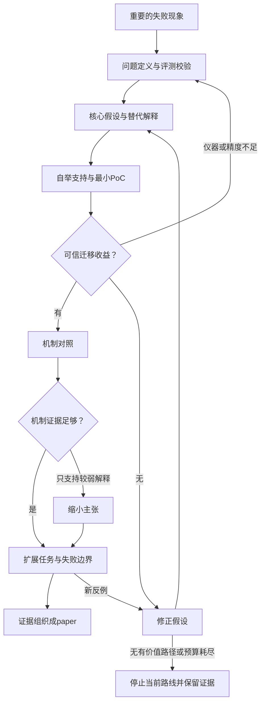

**这篇论文最值得学习的，是把“让 agent 更会探索”收敛成一个可以被证伪的问题：在一些交互任务上训练，能否提高模型在未参与训练的另一类任务中的决策能力？**

它对“跨任务表现迁移”提供了较好的实证支持；对“模型究竟学到了什么探索机制”，证据仍不充分。这个区别决定了我们如何设计 PoC，以及什么时候值得扩大实验。

完整分析已整理为：。

本文是 **Training a Generally Curious Agent（PAPRIKA），ICML 2025**。以下以链接目前提供的 **v4，2025-10-31，56页**为准，并核对了2025-02-24的v1。所有实验数字均为作者报告，本轮没有运行实验。[论文与版本记录](https://arxiv.org/abs/2502.17543)

以下统一使用 **【原文】、【反推】、【建议】**，分别表示原文明确报告、根据最终论文反推、我的改进建议。

---

**1．先确定：它究竟贡献什么？**

【原文】研究对象是通过文字与环境交互的 LLM agent。任务具有隐藏信息，模型需要根据反馈，在有限轮数内完成目标。作者设计了十类任务，包括 Twenty Questions、Wordle、Cellular Automata、客服、推理破案、Mastermind、Battleship、Minesweeper 和 bandit 等。（§2–3.1，表1，附录B）[问题与任务定义](https://arxiv.org/pdf/2502.17543v4#page=2)

【反推】核心问题可以写成：

> 不为每个未来任务训练专用策略，能否通过多种可控环境中的交互训练，学会一种可迁移的“获取信息—利用反馈—继续决策”的行为？

【原文】PAPRIKA 的主要做法是：

1. 用模型自身生成多条交互轨迹。
2. 根据成功与完成任务所需轮数，筛选较好轨迹、构造偏好对。
3. 先进行 SFT，再进行 RPO，即多轮 DPO 加 SFT 项。
4. 检验所学行为是否迁移到没有参与微调的任务组。
5. 另提出 curriculum，改善训练轨迹的采样分配。（§3–4）[方法](https://arxiv.org/pdf/2502.17543v4#page=4)

【反推】因此，它首先是**实证方法论文**，其次包含**采样效率贡献**。它不是理论论文，也不是以新优化公式为核心的论文：DPO、RPO 等组件已有来源。

这里的 curiosity 也有明确边界：它指**为完成当前任务而获取信息**。原文没有采用 intrinsic reward，也没有追求无目的的新奇性。（§1；附录A）[Curiosity 的定义](https://arxiv.org/pdf/2502.17543v4#page=16)

它需要的核心证据不是“加了模块以后分数更高”，而是：

| 贡献必须回答的问题 |                                    |
| --------- | ---------------------------------- |
| 交互训练方法    | 相同底座、相同测试预算下，表现是否改善？               |
| 可迁移能力     | 排除目标任务组的训练数据后，是否仍改善？               |
| 探索机制解释    | 改善来自更好的信息获取，还是格式、记忆、计数或最终判断？       |
| 数据效率      | 相同采样成本下，curriculum 是否比 uniform 更好？ |

**“未见任务”只表示未参加此次微调，不能证明预训练从未接触过相关游戏或知识。** 测试时参数冻结，但仍允许读取规则、行动和接收反馈。

---

**2．idea 的起点：什么现象值得变成研究问题？**

【原文】作者指出，语言能力并不自动带来可靠的交互决策能力。自然语料缺少合适的互动结构，真实世界采集昂贵，又不可能覆盖所有未来任务。已有工作能借助 UCB 等算法生成 bandit 训练数据，但复杂环境通常没有这样的专家算法。（§1、§3）[研究动机](https://arxiv.org/pdf/2502.17543v4#page=3)

【反推】值得研究的矛盾是：

> 模型能生成合理的下一句话，却不一定能选择一个行动，使后续决策获得更多有用证据。

它可能不会问问题，也可能看不懂反馈，或者理解了反馈却不能改变行动。这些原因必须区分。

我核查了四篇前置原始工作：

| 原始工作已经解决或发现什么PAPRIKA 的实质变化                                                                |                                    |                                         |
| ----------------------------------------------------------------------------------------- | ---------------------------------- | --------------------------------------- |
| [Can Large Language Models Explore In-Context?，2024](https://arxiv.org/html/2403.15371v3) | 研究现成模型的 bandit 探索；外部历史统计摘要对较好配置很重要 | 从提示与表示诊断，转向训练模型；也留下“只是更会整理历史”的替代解释      |
| [EVOLvE，2024 v1](https://arxiv.org/html/2410.06238v1)                                     | 用算法辅助和 UCB 轨迹蒸馏改善探索，检验不同 bandit 实例 | 不要求每类环境都有专家算法，并关注不同任务机制之间的迁移            |
| [Algorithm Distillation，2022](https://arxiv.org/html/2210.14215v1)                        | 模仿 RL 算法跨 episode 的学习历史，实现上下文内适应   | 利用预训练 LLM 自生成的交互轨迹优劣进行后训练；两者训练对象和适应形式不同 |
| [LMRL Gym，2023](https://arxiv.org/html/2311.18232v1)                                      | 已有多轮文字 RL 环境、信息获取任务及模拟器            | 扩展部分任务思路，重点验证跨组训练与整组留出泛化                |

不能把这些工作描述成“没有泛化”或“没有多轮交互”。本文改变的是**训练数据来源与泛化验证的范围**。

【反推】宽泛方向可以这样收敛：

| 层次收敛后的问题 |                     |
| -------- | ------------------- |
| 大方向      | 更自主的 LLM agent      |
| 能力对象     | 不完全信息下的主动信息获取       |
| 核心约束     | 无法为所有目标任务准备专家轨迹     |
| 干预位置     | 多任务交互后训练            |
| 可证伪问题    | 排除目标任务组训练数据，是否仍有收益？ |
| 实验约束     | 同底座、同预算、冻结参数、可信评分   |

输入是初始模型及训练环境；输出是微调后的策略。部署时，策略读取任务说明和历史，输出下一步行动。

【原文】公开稿也展示了证据扩展：v1 图3展示五个代表性任务组的 LOO；v4 图3扩展到十组并增加 single-group 对照，另有 Gemma-3 和标准 bandit 边界实验。[v1](https://arxiv.org/pdf/2502.17543v1#page=7)、[v4](https://arxiv.org/pdf/2502.17543v4#page=7)

【反推】这说明公开证据发生了变化，**不能据此还原作者内部研发顺序**。

---

**3．贯穿全文的 hypothesis structure**

【反推】核心假设可以重建为：

> **H\***：在底座能够偶尔产生有价值行为、评分能够区分真实优劣的条件下，多任务自生成交互训练可以学到可迁移的反馈条件决策行为，从而改善未参与微调的任务组表现。

这不是作者的预注册声明。原文明确提出了相关研究问题，但没有公开完整的假设形成时间线。

下表的实验与观察来自原文，假设拆解、替代解释和支持程度是我的重建。

| 假设及必要性最强替代解释作者的检验什么会限制或推翻它当前支持程度 |                     |                          |                  |                             |
| -------------------------------- | ------------------- | ------------------------ | ---------------- | --------------------------- |
| **前提P1：底座存在可学的成功行为**；否则自举没有来源    | 高分只是幸运或误判           | 表4 best-of-K；§6底座依赖      | 合理预算内没有可靠成功或优劣差异 | 在所测底座与任务上成立，不能外推到任意小模型      |
| **前提P2：评分与配对可信**；否则学习错误目标        | 环境泄漏答案，或胜负来自不同实例    | 程序环境、额外 judge、附录C/D      | 修复评测后主要收益消失      | 部分成立，作者报告残余 hacking 和扫雷配对问题 |
| **问题H1：需要专门的序列决策训练**             | 普通多轮格式训练就足够         | WildChat 对照，附录I.10       | 匹配预算的普通训练可解释全部收益 | 排除了一个 WildChat 配方，未排除所有替代方案 |
| **机制H2：更会获取、利用信息**               | 更少格式错误、更会计数或最终猜测    | 轮数图7/10；示例表6–8           | 固定最终决策器后收益消失     | 间接支持，机制隔离不足                 |
| **泛化H3：无需目标组训练也能改善**；这是核心贡献      | 只在近邻任务有效，或选择过程接触目标组 | LOO 图3/13；额外数据和变长 Wordle | 严格留出后无稳定收益       | 有条件支持：作者报告9/10组提升，Wordle例外  |
| **方法H4：偏好阶段有额外价值**               | 只是更多更新量             | SFT vs SFT→RPO，图17       | 匹配更新量的额外SFT同样有效  | 支持该配方增量，未证明RPO普遍必要          |
| **效率H5：相对变异度可指导采样**              | 只采到更容易或更短的任务        | 图4课程与uniform比较           | 等成本后无收益或跨组失效     | 一个任务族上的有限支持                 |

证据定位：[图3与主实验](https://arxiv.org/pdf/2502.17543v4#page=7)、[数据与评分前提](https://arxiv.org/pdf/2502.17543v4#page=41)、[RPO消融](https://arxiv.org/pdf/2502.17543v4#page=51)。

需要特别区分：

- **作者明确提出的问题**：能否跨组泛化、课程能否提高效率等。
- **本报告重建的机制假设**：改善是否来自反馈条件的信息获取。
- **实验发现**：Wordle 负迁移、标准 bandit 收益消退、特定 WildChat 配方退化。

最后一类不能自动变成“已验证的原因”。

---

**4．从 idea 到方法：研究决策与算法执行分别解释**

【反推】研究者可以按下面的逻辑推进。它不是虚构的研发时间线。

| 已知 → 未知合理选择为什么选择这一步需要的证据失败后的分支 |                |                  |                |                  |
| ------------------------------ | -------------- | ---------------- | -------------- | ---------------- |
| 交互表现差 → 缺知识还是缺反馈利用？            | 提示、统计摘要、训练     | 先定位问题，避免直接堆训练    | 同历史判断、格式率、反馈对照 | 改为表示或知识问题        |
| 真实环境昂贵 → 简单任务能否保留能力？           | 真实任务、程序任务、模拟对话 | 用可核对反馈控制问题       | 随机与合理策略能被区分    | 重做任务与评测          |
| 没有专家 → 自采样能否产生好行为？             | 专家蒸馏、自采样、搜索    | 自采样可跨环境使用        | 成功支持、有效偏好对、成本  | 调难度或底座；停止无支持的自举  |
| 有好轨迹 → SFT是否足够？                | SFT、RPO、在线RL   | 先建立简单方案，再验证负轨迹增量 | 匹配预算的SFT/RPO比较 | 简化方法或修复偏好标签      |
| 训练组进步 → 是否能迁移？                 | 同组新实例、整组留出     | 整组留出直接检验核心贡献     | 未见组收益与负迁移      | 缩小为组内方法或修正假设     |
| 迁移成立、采样昂贵 → 怎样分配预算？            | Uniform、课程     | 此时优化效率才有价值       | 等成本学习曲线        | 保留uniform，不必否定主线 |

【原文】作者确实记录了一些设计经验：Wordle 的 LLM 反馈不准确，改用程序；在 Twenty Questions 的 validation 上选择采样配置；每任务多个偏好对更容易出现 unintentional unalignment，因此采用一个偏好对。它们分布在附录B/C，部分没有完整的量化消融。[设计经验](https://arxiv.org/pdf/2502.17543v4#page=41)

**算法实际执行流程则更简单：**

【原文】训练时，采样完整轨迹，筛选成功轨迹用于 SFT，再构造优劣轨迹对进行 RPO；损失只计算 agent 输出 token。默认先 SFT 再 RPO。课程是额外的多轮采样方案。

测试时，冻结参数，反复执行“读取历史—生成行动—接收反馈”，直到成功或预算耗尽。（§2–3）

这里有两个不同的探索过程：**训练采样在寻找可学习轨迹，测试探索在寻找完成当前任务所需的信息。**

**具体走通一个案例：未训练过的 bandit 最佳臂选择。**

| 环节内容     |                                                      |
| -------- | ---------------------------------------------------- |
| 失败现象【原文】 | 经过20次采样，底座仍经常选错最佳臂                                   |
| 原因假设【反推】 | 可能缺少可迁移决策行为，也可能只是计数、历史整理或最终判断较差                      |
| 干预【原文】   | 用其他任务组训练的LOO模型替换底座，排除bandit训练数据                      |
| 预测【反推】   | 若学到可迁移行为，同规则、同预算下应改善                                 |
| 结果【原文】   | §4正文报告平均成功率从42.25%到62.25%；测试包含100个随机参数trial，每个配置4条轨迹 |
| 修正判断【反推】 | 支持跨组迁移；不能确定改善来自更优采样，也不能推出累计regret最优                  |
| 下一步【建议】  | 固定最终决策器比较采样；固定历史比较最终判断                               |

定位：[§4](https://arxiv.org/pdf/2502.17543v4#page=7)、[附录B.4.10](https://arxiv.org/pdf/2502.17543v4#page=40)。这里采用正文报告值，没有复算原始数据。

原文的整套训练干预并不是单机制的“最小手术”。而且附录J显示，在标准累计 regret 任务上，其优势随臂数增加而消失。这是限制结论的独立证据，不能拼成作者“失败—修改—成功”的历史。[图19](https://arxiv.org/pdf/2502.17543v4#page=52)

---

**5．从零开始，最小 PoC 应怎样设计？**

**先看作者实际的小规模验证。**

【原文】论文没有独立标记“PoC阶段”。最接近的小规模检查包括：

| 已报告检查能回答什么                           |                         |
| ------------------------------------ | ----------------------- |
| Twenty Questions 采样配置先导，使用validation | 哪种生成设置提供较有用的数据          |
| 20次采样的best-arm任务，100参数trial×4轨迹      | 是否出现可控随机决策迁移信号          |
| 课程实验：3轮，每轮250任务×20轨迹                 | 固定采样量下课程是否优于uniform     |
| 抽查200条成功轨迹                           | 残余环境错误是否存在；其中3条有hacking |

定位：附录B.4.10、C、D、H及图4。[相关附录](https://arxiv.org/pdf/2502.17543v4#page=40)

**我们应先验证的去留假设。**

【建议】优先问：

> 评分可靠、目标组隔离、推理预算匹配后，自生成交互训练是否产生可重复且有实际价值的迁移收益？

先通过三个门：**仪器有效 → 有数据支持 → 有迁移收益**。课程和大规模榜单可以后置。

**一个具体的三任务组配置。**

【建议】

| 角色任务诊断价值 |                             |                   |
| -------- | --------------------------- | ----------------- |
| 训练来源A    | Wordle，覆盖重复字母与不同词频          | 主动猜测、反馈约束、重复行动    |
| 训练来源B    | Cellular Automata，去重规则与输入组合 | 根据反馈修正候选，与猜词有不同结构 |
| 封存目标组    | 五臂bandit，20次采样，随机隐藏均值       | 从确定性任务迁移到随机反馈决策   |

这是“两类来源到一类目标”的可行性检验，不能代表通用泛化。Mastermind 可作下一阶段确认组；它不适合成为唯一的首轮指标，因为原文底座表现很低，容易出现 floor effect。

必须实现环境、轨迹日志、评分、偏好配对、SFT/RPO、action-token mask、冻结评估及成本记录。自动环境生成、多轮在线RL和UCB课程暂缓。

**不能省略的对照。**

【建议】

- 同底座、同提示、同 CoT 与 token/交互上限。
- 成功轨迹 SFT，以及匹配额外更新量的 SFT 分支。
- SFT→RPO。
- 底座和微调模型都加入准确的历史统计摘要。
- 所有模型统一的合法输出约束，分离格式收益。
- 随机策略、均匀探索后按经验均值选择，以及算法参照，校验评测器。

最关键的是两个机制实验：

**A．固定最终决策器，比较采样策略。**
让不同模型选择采样行动，最后都由同一个固定规则根据已观察数据选臂。若仍改善，更直接支持采集的信息质量提高。

**B．固定交互历史，比较最终决策模型。**
给各模型相同历史，包括“前期幸运、后续证据反转”等案例。如果只有这个实验改善，应将主张收缩到反馈整合或历史推断。

这两个实验能区分“问得更好”和“读得更好”，但单个 readout 仍不能穷尽全部信息价值。

**先检查仪器。**

【建议】至少核验：

- 正确答案、无效动作、预算耗尽能否正确判定。
- Wordle 重复字母等细节是否正确。
- Cellular Automata 的“匹配已有输入输出”是否被误当成“恢复真实规则”。
- 隐藏均值是否泄漏到 bandit 提示。
- 同一任务可否重放，正负轨迹是否来自可比配置。
- 环境 token 是否确实不参与训练损失。

五臂、无反馈、标签对称时，随机最终选择的期望成功率应为20%，可以作为简单校验。

**指标与预算。**

【建议】主指标用单次尝试平均成功率及绝对百分点差；另外报告 simple regret、格式错误、总 token、调用数和成功—预算曲线。Pass\@4 是额外尝试预算下的指标，不能替代单次能力。

采样可先从每来源约30个分层任务、每任务20条轨迹开始，约1,200条 episode，**只估计数据支持和成本**。之后是否扩大到每来源约200个任务，应由有效偏好对产率决定；这些数是首轮预算示例，不是效果检验已经足够的保证。

【原文】论文报告17,181条SFT轨迹与5,260个偏好对。[表4](https://arxiv.org/pdf/2502.17543v4#page=41)

【反推】依据表1及采样规则，一轮计划发起的原始轨迹量约为：

```math
(8426-1000)\times20+1000\times100=248{,}520.
```

所以“约22,500个训练条目”不能理解成只生成了22,500条轨迹。它也不是完整项目成本。

**数据隔离和统计单位。**

【建议】

| 数据用途  |                                      |
| ----- | ------------------------------------ |
| 探索集   | 调试环境、估计采样支持与成本                       |
| 候选选择集 | 训练来源的独立validation，选择有限超参数和checkpoint |
| 最终测试集 | 封存的新实例和随机参数，不能用于选模型                  |

同一个 bandit 参数下的4条轨迹不是4个独立任务。应以隐藏参数实例进行配对比较、估计区间；训练数据采样和训练seed的随机性另行重复。

先确定有实际价值的最小改善，再由先导方差确定确认样本量。区间太宽意味着暂无法判断；看过目标结果后修改方法，需要新的确认数据。

**结果如何分支。**

| 结果【建议】决策              |                 |
| --------------------- | --------------- |
| 留出组稳定改善，固定readout后仍有效 | 继续扩大机制和任务覆盖     |
| 只有固定history的判断改善      | 缩小为反馈整合能力       |
| SFT与RPO同样好            | 保留迁移贡献，收缩RPO必要性 |
| 统一格式后优势消失             | 修改问题定位          |
| 训练组改善，目标组在足够精度下无实际收益  | 当前迁移路线不受支持      |
| 数据支持不足、评分有问题或区间太宽     | 暂无法判断，先修复       |
| 预定预算内仍无有价值信号          | 停止当前路线，保留负结果    |

---

**6．何时值得扩大成 paper 级实验？**

【反推】扩大的条件是**核心迁移信号经得起基本对照**，而不是训练 loss 下降或出现几个漂亮案例。

| 问题作者完成的证据仍需补充什么 |                                    |                               |
| --------------- | ---------------------------------- | ----------------------------- |
| 效果存在吗？          | 多任务、同底座前后比较，多温度、平均成功率及pass\@k      | 完整数据生成与训练的独立重复、配对区间           |
| 真的跨任务吗？         | LOO、额外词表、变长Wordle                  | 更多不同反馈机制；变长Wordle主要是结构近邻      |
| 来自探索机制吗？        | 轮数与定性例子                            | 固定history/readout、反馈依赖和动作价值诊断 |
| 是否只是更多数据或训练？    | Full vs single、SFT vs RPO、WildChat | 匹配token、更新量、长度和推理预算           |
| 是否跨模型？          | Llama与Gemma的效果实验                   | 第二底座上的同样LOO协议                 |
| 是否评分或泄漏造成？      | 数据分离、程序环境、judge、人工抽查               | 分模型估计误判，可靠环境中复核收益             |
| 何时失败？           | Wordle、Mastermind、标准bandit边界       | 噪声、时域、臂数、均值差和任务距离的系统变化        |
| 实际值得用吗？         | 轮数、课程及部分费用报告                       | 质量—token—延迟—GPU成本曲线           |

主要定位：[§4](https://arxiv.org/pdf/2502.17543v4#page=6)、[附录I](https://arxiv.org/pdf/2502.17543v4#page=45)、[附录J](https://arxiv.org/pdf/2502.17543v4#page=52)。

【反推】“必须补什么”取决于要保留什么主张：

- 保留**这些任务上的经验迁移**：评分可信、目标组隔离和可靠效果估计不可省。
- 保留**探索机制改善**：机制干预不可省。
- 保留**多样性产生泛化**：等数据预算的来源任务对照不可省。
- 保留**高效率**：完整成本比较不可省。

真实用户部署、更多模型规模、自动环境生成可以增强完整性，但不必全部进入第一篇短时域方法论文。

【建议】重复搜索也必须纳入研究记录。反复试任务组合、温度和 checkpoint，然后只报告最优值，会产生选择偏差。多个评估seed不能代替多个独立训练。

另一个需要克制的地方是课程公式。原文以变异系数代表学习潜力，实际用轮数计算；**高变异可能来自环境噪声，并不必然代表可学习性**。UCB 的已有理论也不能自动保证 LLM 更新收益。若要强化这部分，需要检验代理量能否预测真实的后续学习改善。（§3.4；附录H）[课程定义](https://arxiv.org/pdf/2502.17543v4#page=5)

---

**7．证据如何组织成论文？**

【反推】主要 claim 应这样落地：

| Claim设计与证据合理结论 |                   |                    |
| -------------- | ----------------- | ------------------ |
| 自生成交互训练有效      | 采样、筛选、SFT→RPO；图2等 | 在所测任务和底座上改善        |
| 存在跨组迁移         | LOO；图3/13         | 多数组可迁移，有明确例外       |
| 交互更有效          | 图7/10、表6–8        | 与更有效交互一致，机制仍待识别    |
| RPO有增量         | 图17               | 在所报设置中有收益，尚非普遍必要   |
| 课程提高采样效率       | 图4、附录H            | 一个任务族中的有限验证        |
| 常规能力保留         | 表2                | 未见明显大幅退化，不是严格不退化证明 |

各部分的论证职责：

- **Introduction**：为什么主动获取信息重要，为什么任务专用训练不够。
- **Problem Formulation**：定义隐藏信息、任务组、预算，以及“未见”的含义。
- **Method**：解释数据和训练设计怎样处理这些困难。
- **Experiments**：分别检验效果、迁移与效率。
- **Analysis**：检验替代解释，将表现连接到行为。
- **Limitations**：明确底座支持、评分、配对与迁移边界。

【反推】可以保留的是“一个具有条件性跨组迁移的交互后训练方法”。需要收缩的是“普遍通用探索”“更多任务必然更好”“轮数减少证明探索最优”等表述。

增加任务组会持续改善泛化、在线RL一定更强、自动生成环境可替代人工、迁移到真实世界长期任务，都仍属于未来工作。（§6）[讨论](https://arxiv.org/pdf/2502.17543v4#page=9)

这篇论文的叙事范围可以很大，因为它问的是“如何学习面对新环境的行为”；验证范围则可以控制在一组短时域任务。**关键是让当前证据只承担当前承诺。**

---

**8．我们能复用的研究工作流**

以下为【建议】。

| 阶段需要解决的问题最小产物进入下一阶段的证据失败后的分支 |            |                     |               |            |
| ---------------------------- | ---------- | ------------------- | ------------- | ---------- |
| 观察                           | 失败是否稳定且重要？ | 可重放失败与正常例           | 排除明显评分、格式错误   | 修复仪器或放弃现象  |
| 定义                           | 到底要学会什么？   | 输入、输出、预算、边界         | 对照确实能测目标能力    | 改问题或表示     |
| 假设                           | 哪种解释值得验证？  | 核心假设及替代解释           | 有廉价区分实验       | 修正假设       |
| 自举先导                         | 有没有可学轨迹？   | 支持率、pair产率、成本       | 预算内有可信优劣数据    | 调难度、底座或停止  |
| 最小PoC                        | 同预算能否迁移？   | 留出组配对结果             | 稳定且有实际价值的收益   | 缩小主张或暂无法判断 |
| 机制核查                         | 收益来自什么？    | 固定history/readout对照 | 替代解释不能解释主要收益  | 修改机制解释     |
| 扩展                           | 哪些条件有效或失效？ | 任务、模型、成本和边界矩阵       | 证据覆盖明确范围      | 收缩或停止路线    |
| 成文                           | 主张与证据是否对应？ | Claim–evidence表及论文  | 每个headline有支撑 | 补必要证据或删除主张 |

下面是**研究流程**，不是算法运行流程：



**最值得学习的三个研究动作【反推】**

1. 把“通用能力”变成整类任务留出的检验，让主张真正可能失败。
2. 在扩大训练前，确认模型能产生可信、可学习的交互轨迹。
3. 用负迁移和边界实验限定贡献，而不只依赖总体平均分。

**最不应直接照搬的两个做法【建议】**

1. 将轮数、CoT观感或一个 WildChat 负结果，当成探索机制已经得到证明。
2. 把筛选后的数据量当作总成本，并默认模拟器、judge和偏好配对可靠。

**如果第一天只有“训练一个更好奇的agent”这个方向，最该做的三件事【建议】**

1. 写一页问题合同，明确目标能力、迁移边界和失败判据。
2. 建一个反馈可核验的 bandit 诊断环境，区分格式、信息获取与最终判断错误。
3. 在两个来源任务做自采样先导，测支持率和成本；冻结协议后比较 SFT 与 SFT→RPO，再决定是否扩大。