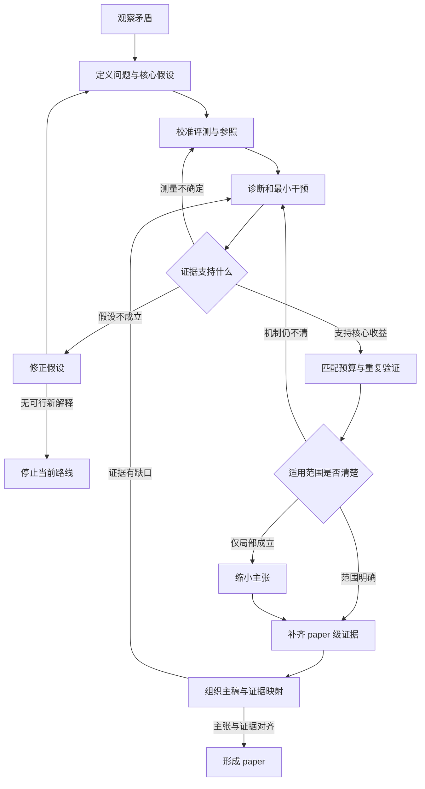

**这篇论文最值得学习的是：如何把一个算法之间的性能矛盾，转化为可测量的瓶颈，再用针对该瓶颈的干预建立方法贡献。**

论文

**这篇论文最值得学习的是：如何把一个算法比较中的矛盾，转化成可测量的机制问题，再通过针对性干预建立方法贡献。**

论文是 **VinePPO: Refining Credit Assignment in RL Training of LLMs**，发表于 ICML 2025。我阅读了 34 页正文与附录，并核对了四篇近邻原始工作。本轮没有运行训练或复现实验。[论文正式页面](https://proceedings.mlr.press/v267/kazemnejad25a.html)

完整逐项分析，包括更详细的假设表、实验对照、预算依据和返工分支：

下面围绕同一个核心贡献展开。统一使用：

- **【原文】**：作者明确报告的内容；作者的解释不一定已经得到验证。
- **【反推】**：我根据最终论文重建的研究逻辑，不代表真实研发历史。
- **【建议】**：如果重新开展研究，应补充的设计与证据。

---

**1．这篇论文究竟贡献什么？**

**【原文】研究对象**是：只有最终答案奖励的多步数学推理，如何进行有效的 RL post-training。

PPO 通常训练一个 value network，也叫 critic，预测模型从某个中间状态继续生成后能够获得多少奖励，再利用这些预测分配各步骤的训练权重。

作者发现：这个 critic 的估值和候选步骤排序并不可靠，于是提出 VinePPO，用 **Monte Carlo 续写估值**替换 critic。（§1、§4、§7）

**核心 insight 很具体：文本前缀可以重放。**

模型已经写到某一步时，把“题目＋当前前缀”重新输入模型，多次继续生成，就可以直接估计：

> 当前模型从这里继续，有多大概率最终答对？

比较前后状态的成功概率，就能估计该步骤对当前策略的帮助。[§4，公式 5–6](https://arxiv.org/html/2410.01679v2#S4)

**【反推】主要类型应判断为：实证方法论文，以诊断发现支撑方法，并附带效率贡献。**

它需要完成三层证据：

1. critic 确实存在与训练有关的缺陷。
2. MC 替代方案改善了学习，而不只是改善估值指标。
3. 改善值得额外的计算成本。

它不是一篇证明“精确 credit assignment 必然提升泛化”的理论论文。

**【原文】图 4 的 PPO 对比结果：**

| 模型数据集PPOVinePPO提升 |       |       |       |          |
| ----------------- | ----- | ----- | ----- | -------- |
| RhoMath 1.1B      | GSM8K | 50.1% | 53.4% | 3.3 个百分点 |
| RhoMath 1.1B      | MATH  | 18.1% | 23.0% | 4.9 个百分点 |
| DeepSeekMath 7B   | GSM8K | 78.9% | 80.1% | 1.2 个百分点 |
| DeepSeekMath 7B   | MATH  | 42.8% | 46.0% | 3.2 个百分点 |

这些结果采用作者自己的 SFT 初始化、解码协议和数据划分，其中 MATH 测试集为 500 题，不能直接与不同协议的其他论文成绩比较。（§5、图 4、附录 C.1/C.4）[实验设置](https://arxiv.org/html/2410.01679v2#S5)

**【反推】适用边界必须保留：**

- 两个数学模型、两个数学数据集。
- 最终答案可检查。
- 文本状态可从前缀恢复。
- 生成长度受限。
- 没有证明适用于所有 critic、开放域任务或带外部状态的 agent。

尤其要注意：**advantage 表示对当前策略的相对帮助，不是数学正确性的标签。**

---

**2．idea 的起点：怎样从宽泛方向收敛成研究问题？**

**【原文】§1 提出的矛盾是：**

长推理似乎需要细粒度 credit assignment；PPO 配置了 critic 来完成这项工作；但 outcome-supervised GRPO 等简化方法取消这种步骤区分，仍然能够表现良好。

**【反推】这个现象至少允许三种解释：**

1. 细粒度 credit assignment 在这些任务里并不重要。
2. 它很重要，但现有 critic 没有提供足够有效的信号。
3. 简化方法在计算、方差或优化稳定性上的优势，掩盖了细粒度信号的潜在收益。

值得研究的不是立即选中第二种解释，而是**构造能区分这些解释的实验**。

收敛过程可以这样重建：

| 层次问题表述 |                                |
| ------ | ------------------------------ |
| 宽泛方向   | 如何改善 LLM reasoning 的 RL 训练？    |
| 具体瓶颈   | 终局奖励如何分配给中间步骤？                 |
| 可测对象   | 当前策略下，每个前缀的价值及步骤 advantage     |
| 可干预问题  | 替换 critic 估值，是否改善更新与未见题表现？     |
| 实验约束   | 固定初始化、奖励、主训练数据和更新设置，另行核算辅助采样成本 |

**【反推】明确的问题合同是：**

- **输入**：SFT policy、训练题目、最终答案 reward、预算。
- **输出**：改进后的 policy，以及估值—更新—效果之间的证据。
- **目标**：提高未见题 Pass\@1，判断额外估值开销是否值得。
- **约束**：不引入人工步骤标签；估值来自目标策略；测试集不能参与选择。

四篇近邻原始工作决定了新颖性的合理边界：

| 原始工作已有内容VinePPO 的实质区别            |                                             |                                                                                         |
| -------------------------------- | ------------------------------------------- | --------------------------------------------------------------------------------------- |
| **TRPO，2015，§5.2**               | Vine 分支采样、从中间状态估计动作价值，依赖环境可重置               | 将该条件用于文本前缀，并接入 PPO post-training。[原文](https://proceedings.mlr.press/v37/schulman15.pdf) |
| **DeepSeekMath，2024，§4.1**       | GRPO 的组内基线；同时讨论 outcome/process supervision | 本文主要对比结果监督下的整段共享权重；不能说所有 GRPO 都没有步骤区分。[原文](https://arxiv.org/html/2402.03300#S4)        |
| **Back to Basics，ACL 2024，§2.3** | RLOO 使用其他回答构造 leave-one-out baseline        | RLOO 主要在整段回答层面比较；VinePPO 在中间前缀估值。[原文](https://aclanthology.org/2024.acl-long.662/)      |
| **Setlur 等，2024，§6**             | 已使用前缀 MC、步骤 advantage 和 per-step DPO        | VinePPO 聚焦当前策略的在线 PPO 估值替代，以及 critic 的系统诊断。[原文](https://arxiv.org/html/2406.14532v1#S6) |

**【反推】因此，本文的贡献不能写成“首次把 Monte Carlo 或步骤价值用于 LLM reasoning”。** 更准确的是：利用文本环境的可重置性，构造实用的在线估值替代方案，并研究它何时改善训练。

时间也需要分清：首稿发表于 **2024 年 10 月**，最终版于 **2025 年 6 月**修订。最终版讨论 DeepSeek-R1 等后续背景，不能倒推为作者最初形成 idea 的来源。[版本记录](https://arxiv.org/abs/2410.01679)

---

**3．贯穿论文的 hypothesis structure**

**【反推】一个核心假设可以写为：**

> 在可重放前缀、终局奖励可验证的数学推理任务中，当前策略的 MC 续写能提供比已训练 critic 更有用的步骤更新信号，使额外采样成本换来更好的未见题表现或训练效率。

它包含两层：**估值改善**与**学习改善**。第一层成立，不自动保证第二层。

下面的 H 编号是我的重建，并非作者的预注册假设。

| 假设为什么必要最强替代解释作者证据什么会限制或推翻它当前支持 |            |                               |                |                        |              |
| ------------------------------ | ---------- | ----------------------------- | -------------- | ---------------------- | ------------ |
| **H0，前提：前缀重放恢复目标续写分布**         | 否则 MC 测错对象 | checkpoint、温度、终止规则或外部状态不同     | §3–4 文本 MDP    | 重放后分布不同                | 在纯文本定义下成立    |
| **H1，问题：critic 在关键状态上不够可靠**    | 需要有值得替换的缺陷 | critic 未充分训练、状态分布不同、参照噪声      | 图 3、图 8、附录 D   | 同策略、强 critic、独立参照下差距消失 | 对所测配置有支持     |
| **H2，机制：低 K 的 MC 保留有用步骤差异**    | 否则成本不可接受   | 优势只来自容易估计的近 0/1 状态            | 图 3、图 8、K 消融   | 中间成功率或近似平局时失效          | 有支持，难状态证据可加强 |
| **H3，效果：信号改善能提升学习**            | 连接诊断与方法价值  | 更多算力、不同 return estimator、步骤分组 | 图 4、训练曲线、共享初始化 | 配对更新和预算匹配后收益消失         | 效果明确，唯一机制未闭合 |
| **H4，效率：额外续写成本值得**             | 支持实际使用     | 有利 target、实现或硬件差异             | 图 6、表 5        | 完整成本曲线下优势消失            | 特定设置支持       |
| **H5，泛化：收益超出单个设置**             | 避免单例结论     | 数学模型和数据分布相似                   | 两模型×两数据集、图 5   | 新种子、任务条件下消失            | 有限数学范围支持     |

[证据位置：§6–7](https://arxiv.org/html/2410.01679v2#S6)

还应区分两种“假设”：

- **【原文明确研究问题】**：改善 PPO credit assignment 能否改善训练。
- **【原文观察后的解释】**：§7 推测 critic 后段误差大，是因为前段更容易记忆、后段状态更多样；MC 后段误差小，是因为续写更确定。

**【反推】第二组尚不是已验证机制。** 需要控制长度、难度、成功概率，并直接测量状态新颖性或续写分布。不能把一条误差曲线直接翻译成“证明了 memorization 导致失败”。

---

**4．从 idea 到方法：两个流程分别是什么？**

**算法执行流程【原文】**

1. 从共同 SFT checkpoint 初始化 policy。
2. 采样题目与主推理轨迹，检查最终答案。
3. 将回答切成 reasoning steps。
4. 从各步骤前缀生成 `K` 条辅助续写。
5. 估计价值和 advantage。
6. 将步骤权重赋给该步骤的 tokens，进行 PPO 更新，再重复。

核心公式是：

```math
\widehat V_K(s)=\frac1K\sum_{k=1}^{K}R(\eta_k), \qquad \eta_k\sim\pi(\cdot\mid s),
```

```math
\widehat A(s_t,a_t) =r_t+\widehat V_K(s_{t+1})-\widehat V_K(s_t).
```

辅助续写只用于估值，没有直接加入 policy 更新训练集。默认 `K=9`，另测试 `K=1,3`。（§4、图 2、附录 B）

**研究形成流程【反推】**

| 当时已知尚未确定与可选方案下一步为什么这样选新证据与失败分支 |                       |                |                   |
| ------------------------------ | --------------------- | -------------- | ----------------- |
| 简化方法有效                         | CA 不重要，还是 critic 不好？  | 先检查 critic     | 若关键判断已可靠，转查其他瓶颈   |
| 发现估值误差                         | 只是数值偏移，还是影响步骤比较？      | 检查同父前缀候选排序     | 排序不受影响则收缩失败主张     |
| 可以重放前缀                         | 加强 critic、用 MC、训练过程奖励 | MC 能直接干预被怀疑的对象 | 估值改善但训练不改善，则修改 H3 |
| 全 token MC 昂贵                  | 减少 K、按步骤分组、选择部分状态     | 用分步估值控制成本      | 若粒度损失大，改分段或限制任务   |
| 小规模训练有收益                       | 是机制，还是预算？             | 做预算匹配与重复验证     | 只提高质量则撤回效率 claim  |

论文没有完整早期日志，因此不能说作者真实按此顺序开展研究。

**一个具体案例：附录 E.26**

**【原文】** 给定

```math
f(x)=2x-3,\qquad g(f(x))=5-4x,
```

要求 `g(4)`。模型在 s2 错误地转向“求 `x=4` 时的 `f(x)`”。作者给 s2 标记负 advantage，并指出应求满足 `f(x)=4` 的 `x`。（p.34）

**【反推】原因假设**：模型混淆了复合函数的内层输入与外层目标。正确关系是：

```math
2x-3=4\Rightarrow x=7/2\Rightarrow g(4)=-9.
```

**【建议】最小干预**：固定题目、模型和此前前缀，只把 s2 改成“先解 `f(x)=4`”；另加一个只改措辞的对照。

**【建议】预测**：修正数学关系的前缀，应比错误前缀和纯措辞改写带来更高的续写成功率。

**【原文实际结果】**：只有错误轨迹、负 advantage 和定位解释，**没有报告上述配对修复实验**。

所以修正后的判断是：这个例子支持“MC 可能定位影响当前策略成功率的步骤”，不能证明“修复此步必然使模型答对”。[附录 E.26–E.27](https://arxiv.org/pdf/2410.01679v2#page=34)

还有一个理论细节不能跳过：

**【原文】** PPO 基线使用 `\lambda=1,\gamma=1`，其 advantage 简化为：

```math
\widehat A_{\rm PPO}=R(\tau)-\widehat V_\phi(s_t).
```

**【反推】** 对固定且与动作抽样独立的 state baseline，baseline 项在理想 on-policy 梯度中的期望为零。因此：

> **critic 估值有偏，不足以推出该原始 policy gradient 有偏。**

它仍可能影响方差、有限样本权重和 clipped PPO 更新。VinePPO 还改变了后续回报的估计方式。因而需要分别论证“估值更准”“更新更有效”“泛化更好”。[附录 A.1](https://arxiv.org/pdf/2410.01679v2#page=14)

---

**5．如果从零开始，最小 PoC 怎么设计？**

**作者实际报告的小规模验证【原文】**

- 图 1：单例与 MATH 子集的 advantage 分布。
- §7：用 256 条续写构造状态价值参照，比较五个候选下一步。
- 图 7、D.11：1.1B 模型上的 `K=1,3,9` 消融。
- 附录 D.4：较短训练阶段的温度实验。
- 附录 E：正确关键步骤、错误步骤和反直觉案例。

这些是最终论文中的局部实验，不能自动称为作者最初的 PoC。

**建议的 PoC 分两阶段【建议】**

**第一阶段：冻结模型，先判断是否值得修 critic。**

从 GSM8K 非测试部分开始，因为分步和答案检查较简单。先人工检查约 40 道题，每题选择两个前缀，覆盖：

- 稳定可解；
- 稳定不可解；
- 成功率处于中间范围；
- 存在关键关系选择。

在**同一 frozen policy、同一前缀**上比较 critic 与 MC。评测参照必须来自独立续写，不能与被测小 `K` 样本混用。

必须保留正确步骤、错误步骤和无关措辞变化的对照。如果 GSM8K 缺少足够诊断现象，再加入 MATH 简单代数题，不能只挑有利案例。

**第二阶段：最短训练干预。**

核心三组即可：

- 健康 PPO；
- VinePPO；
- 一个整段基线，例如 RLOO。

先在固定 batch 或极短更新中控制三个混杂因素：

1. 固定 return 形式，只替换 learned/MC baseline。
2. 固定 baseline，比较单条实际回报与条件 MC 后续均值。
3. 固定分段边界，排除 token/step 粒度影响。

通过后，再做相同主轨迹预算和相同总预算的短训练比较。

**评测工具先检查什么？【建议】**

- 答案评测器能否处理等价分数、负号、缺失答案、多个答案和截断。
- 重放前缀是否保持策略、温度、tokenization 和终止规则一致。
- 小型可枚举文本树上的 MC 估值和 advantage 符号是否正确。
- 辅助续写是否意外进入训练损失。
- “最终答对”和“推理过程正确”是否被混为一谈。

**样本与预算依据【建议】**

一个先导起点是 80 个状态，每状态先用 32 条独立参照续写，另用 9 条估计续写：

```math
80\times(32+9)=3280\text{ 条续写}.
```

这是工程预算起点，不是统计充分性保证。只对接近决策边界的状态，按预设规则扩大参照样本。

**【反推】即使论文使用的 256 次 MC，也不是精确真值。** 二元奖励最坏标准误为：

```math
\sqrt{0.25/256}=0.03125.
```

单状态常规近似 95% 区间半宽约 0.061。因此，论文以“距参照 0.05 内算正确”的指标，需要参照误差敏感性检查。

**数据分离【建议】**

可从原训练池划出：

- 512 题训练与探索；
- 128 题选择候选和 checkpoint；
- 256 题锁定评估。

这些数量用于发现明显收益或失败，未必能检出 1–3 个百分点的小差异。最终应根据题目级配对差的方差、实际有意义的收益和预算扩大，而不是看到正数就宣布成功。

**决策规则【建议】**

| 结果决策                   |                 |
| ---------------------- | --------------- |
| 评测或参照不可靠               | 暂时无法判断，先修仪器     |
| critic 已足够好，MC 无步骤判断收益 | 停止当前替代动机或寻找适用条件 |
| 估值改善，但更新与测试不改善         | 修改机制假设          |
| 同主轨迹更好，同总预算不更好         | 保留质量贡献，收缩效率主张   |
| 只在特定条件成立               | 明确条件，缩小范围       |
| 配对对照通过，收益稳定且有实际意义      | 扩大为 paper 实验    |

---

**6．何时值得扩大成 paper 级实验？**

**【建议】扩大门槛是：测量可信、核心干预有收益、最强替代解释已得到初步排除。**

| 具体问题作者已有证据仍需补什么 |                       |                                        |
| --------------- | --------------------- | -------------------------------------- |
| 效果存在吗？          | 图 4、训练曲线、共享 SFT       | 训练种子分布、题目级配对区间                         |
| 来自所称机制吗？        | 估值、排序、K 消融            | 同策略控制；分离 baseline、return estimator 与粒度 |
| 只是更多预算吗？        | 同主 episode、同硬件墙钟对比    | 全部辅助 tokens、评分和搜索成本；完整成本曲线             |
| 基线足够强吗？         | PPO 调参、GRPO/RLOO 调 KL | 按方法匹配合理调参预算，检查参数跨模型迁移                  |
| 换条件仍成立吗？        | 两模型、两数学集、温度           | 若扩大主张，需要新领域、长度和失效条件                    |
| 实际使用值得吗？        | 图 6、表 5               | 预先确定的 time-to-target、多预算点、负结果          |

这里有三条容易误读的原文细节：

- **16 个评估随机种子不是 16 次独立训练。** 附录 C.4 是对同一 checkpoint 重复解码评估，也不是 pass\@16。
- **最高 3 倍速度是达到参考性能的时间优势。** MATH 上单次迭代反而更慢；表 5 中 1.1B 的 PPO/VinePPO 分别为 80/380 秒。
- **MATH 划分文字存在数目不一致。** C.1 写 12,500 个训练池样本，随后写 11,500 训练＋500 验证。复现需核对实际清单，不能擅自补齐。[附录 C](https://arxiv.org/pdf/2410.01679v2#page=14)

**【建议】必须补与增强完整性，要按 claim 区分。**

如果要声称“机制已经确定”，控制 return estimator 和步骤粒度是必要证据。如果只声称“这一整体方法在这些任务有效”，它们主要决定解释强度。

如果要声称跨领域有效，跨领域实验就是必要项；若只主张数学任务有效，则不必为宏大叙事强行堆领域。

统计上，应以题目为配对单位；同题多个前缀、重复解码不能当成独立题目。调参和 checkpoint 搜索需要独立选择集，最终配置还要在未参与选择的训练种子和测试题上确认。

---

**7．证据怎样组织成论文？**

**【反推】主要 claim 应形成以下映射：**

| Claim方法设计证据合理结论 |                           |             |                  |
| --------------- | ------------------------- | ----------- | ---------------- |
| critic 存在决策相关缺陷 | 独立 MC 参照与候选比较             | 图 3、图 8、§7  | 所测 critic 不够可靠   |
| 文本前缀支持直接估值      | 重放前缀、MC 均值                | §3–4、式 5–6  | 给定条件下估值方法成立      |
| 替代方案改善数学训练      | 共享初始化与 PPO 框架             | 图 4、训练曲线    | 所测配置的 Pass\@1 更高 |
| 额外计算可能值得        | K、批量推理、移除 critic          | 图 6–7、表 5   | 特定预算区间更有效        |
| 泛化关系更有利         | test–train、accuracy–KL 分析 | 图 5、D.7–D.8 | 经验关系更有利，尚非泛化定理   |

各部分的论证任务是：

- **Introduction**：提出矛盾，说明为什么需要研究这个中间对象。
- **Problem Formulation**：把“重要步骤”定义为特定策略下的 value/advantage；本文由 §3 承担。
- **Method／Theory**：解释估什么、怎么估、在哪里影响更新，以及成立条件。
- **Experiments**：说明有没有收益、花多少钱、比较是否公平。
- **Analysis**：检查机制、替代解释和失效条件。
- **Limitations**：约束模型、任务、奖励、状态恢复和统计范围。本文没有系统独立的 limitations 论证，可以加强。

**【反推】可保留的主张**是：特定数学设置的估值和训练收益，以及部分效率优势。

**应收缩的主张**包括：普遍修复 credit assignment、无偏 PPO 训练、通用泛化提升、普遍 3 倍速度。

**只能作为讨论或待证内容**包括：critic 后段失败完全由 memorization 引起、更多估值算力是普遍最优选择、直接推广到通用 agent。

这篇论文给宏大叙事提供的可控切口是：

> 强预训练模型的训练算力，是否应更多用于提高更新信号质量？

数学前缀 MC 是检验这一问题的具体场景。它可以连接广泛问题，但不替所有场景作证。

---

**8．我们可以复用的工作流**

以下均为 **【建议】**。

| 阶段需要解决的问题最小产物下一阶段所需证据失败分支 |                |              |                |              |
| ------------------------- | -------------- | ------------ | -------------- | ------------ |
| 现象定位                      | 有什么值得解释的矛盾？    | 成功/失败对比、替代解释 | 现象重复且有学习价值     | 换对象或停止       |
| 问题收敛                      | 改什么、测什么？       | 问题合同、核心假设    | 可设计区分解释的干预     | 修正假设         |
| 测量校准                      | 仪器测得准吗？        | 评测器、参照、数据划分  | 已知与边界案例可靠      | 修仪器          |
| 诊断 PoC                    | 原方法有什么有用处上的缺陷？ | 同策略前缀诊断      | 差异超出噪声并影响判断    | 缩小条件或停止      |
| 干预 PoC                    | 改估计能否改学习？      | 短训练、关键对照、成本账 | 锁定评估出现可重复收益    | 修改机制         |
| 证据扩展                      | 对什么条件成立？       | 泛化、失效、成本分析   | 主 claim 获得对应支持 | 缩小主张或补实验     |
| 论文成形                      | 叙事是否超出证据？      | 统一主稿、证据映射    | 核心链条可核查        | 删除 claim 或返工 |



**最值得学习的 3 个研究动作：**

1. 把“算法谁更强”转化为“哪个中间学习信号出了问题”。
2. 利用任务自身的可重置性质，让同一种测量既服务诊断，也成为方法组件。
3. 将额外计算成本纳入核心论证，解释提高每次更新质量是否值得。

**最不应直接照搬的 2 个做法：**

1. 不把“估值更准＋任务分数更高”自动写成机制已经证明。
2. 不把有限 MC 参照、重复解码和多个 benchmark 当作完整的统计与因果证据。

**只有最初方向时，第一轮最应该做的 3 件事：**

1. 写一页问题合同，注册“CA 不重要、critic 不够好、额外预算解释”三种竞争假设及各自反证。
2. 建立同策略前缀诊断集，从可人工理解的少量题目开始，先校准评测器与 MC 参照。
3. 注册最短配对干预，明确相同轨迹、相同总预算、独立选择集和停止条件，再决定是否进入完整训练。