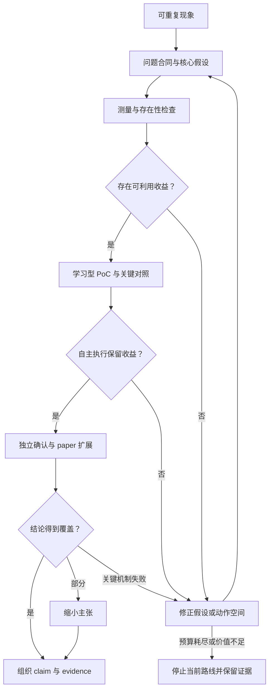

这篇论文最值得学习的研究动作是：**把“利用真实答案搜到好路径”，推进为“面对未知答案，也能低成本选择有用路径”的方法问题。**

已读完正文与附录，并核查最接近的原始工作。完整分析、实验规格和出处索引见：。

下文使用三个标记：

- **【原文】**：论文明确报告，附定位；不代表本轮独立复现。
- **【反推】**：根据最终论文重建研究逻辑，不是作者真实研发历史。
- **【建议】**：我提出的补充设计，本轮没有执行实验。

---

**1．先确定贡献：学习冻结 LLM 的计算路径**

【原文】论文是 **Dr.LLM: Dynamic Layer Routing in LLMs**。它为冻结的预训练 LLM 配置逐层 router，选择 **skip、execute、repeat**；利用离线 MCTS 搜索得到路径监督，部署时直接预测动作，无需在线搜索。[论文，§1、§3–4](https://proceedings.iclr.cc/paper_files/paper/2026/file/774164b966cc277c82a960934445140d-Paper-Conference.pdf)

【反推】其核心贡献可以收敛为：

> **冻结 LLM 中的有用层编辑，能否被一个轻量的状态条件策略学会，从而在未见问题上改善准确率与计算成本的组合？**

| 要素本文的具体对象  |                                |
| ---------- | ------------------------------ |
| 研究对象       | 已有 LLM 的层执行路径                  |
| 重要问题       | 固定路径不能灵活分配计算，而逐题搜索昂贵且可能需要真实答案  |
| 核心 insight | 用昂贵的离线搜索提供监督，将路径选择摊销成便宜的策略预测   |
| 学习阶段输入     | 问题、搜索所得动作标签；真实答案用于评价候选路径       |
| 部署阶段输入     | 新问题及模型可观测的隐藏状态                 |
| 输出         | 层动作路径，以及沿该路径生成的回答              |
| 核心约束       | 基础权重冻结；部署不使用真实答案或 MCTS；控制开销足够小 |

【反推】\*\*主要类型是方法论文，效率是重要的贡献维度。\*\*因此决定性证据是“自主路由的质量—成本表现”，而不是单独的分类指标、路径可视化或问题公式。本文没有准确率、最优性或泛化方面的理论保证。

它的适用边界也应明确：

- repeat 指同一层额外执行一次，总共两次；不是无限循环至收敛。
- §3.1 说明 router 每个输入序列调用一次，应理解为逐层选择、序列内复用路径。
- 多个 backbone 分别训练成功，不等于同一套 router 参数能直接跨模型迁移。
- 冻结基础权重仍需训练控制器、修改执行逻辑和处理缓存。
- 搜索允许路径长度达到 `2L`，不能据此保证每条部署路径都更省计算。

---

**2．idea 从哪里来：从固定深度的矛盾，收敛到可部署的选择问题**

【原文】论文的动机是：固定深度可能在简单输入上浪费计算，在困难输入上又缺乏增加有效计算的灵活性；既有适应方法可能需要再训练、牺牲准确率，或使用昂贵搜索。见 §1。

【反推】真正值得研究的现象是：

> **同一套冻结权重，仅改变层的执行方式，输出正确性与成本就可能改变。**

这里存在两个独立问题：

1. **存在性问题**：知道答案后，能否找到更好的路径？
2. **选择问题**：不知道答案时，能否选到有用路径？

前者可以支持 oracle 分析；要成为 Dr.LLM 这样的部署方法，必须进一步解决后者。

我核查了四篇最接近的原始工作：

| 原始工作已经解决什么Dr.LLM 需要推进什么                                     |                                                   |                              |
| ----------------------------------------------------------- | ------------------------------------------------- | ---------------------------- |
| [CoLa，2025](https://arxiv.org/html/2507.07996v1)，§3–5       | 在冻结模型上搜索跳层／重复层组合，用正确性选择路径                         | 将答案辅助搜索转为无需答案的部署策略           |
| [FlexiDepth，2025](https://arxiv.org/html/2503.23798v3)，§2–4 | 冻结原始权重，训练 router 与 adapter，实现 token 级跳层           | 采用搜索路径监督、序列级三动作路由，并包含 repeat |
| [LayerSkip，2024](https://arxiv.org/html/2404.16710v1)，§4    | 训练 early exit，并结合 self-speculative decoding 验证与纠正 | 在冻结原始基础权重的条件下编辑中间层执行路径       |
| [Recurrent Depth，2025](https://arxiv.org/abs/2502.05171)    | 通过专门架构与训练，实现 latent-space 的循环深度扩展                 | 将可变计算能力改造到现有固定深度模型上          |

【反推】两项重要修正：

- \*\*CoLa 已有长度惩罚。\*\*不能将 length-aware UCB 公式本身当成 Dr.LLM 的独创。
- \*\*FlexiDepth 也报告过保持或改善部分表现。\*\*研究问题不应建立在“前人都必须牺牲准确率”这一过强概括上。

这些工作均早于 Dr.LLM 的 2025 年 10 月首版；这里没有用后续进展倒推作者当时的知识。[Dr.LLM 版本记录](https://arxiv.org/abs/2510.12773)

【反推】宽泛方向可以这样逐步收敛：

| 收敛步骤得到的研究问题 |                        |
| ----------- | ---------------------- |
| 让 LLM 按需思考  | 能否调整内部计算？              |
| 限定为已有模型     | 不重新预训练，能否利用现有层？        |
| 限定动作与顺序     | 有限 skip／repeat 是否存在收益？ |
| 加入部署的信息约束   | 没有真实答案，如何选择路径？         |
| 加入实际成本约束    | 轻量策略能否保留收益，且控制成本不抵消节省？ |

**最后一行才是贯穿本文的方法问题。**

---

**3．建立 hypothesis structure：搜得到、学得会、部署有效，需要分别成立**

【反推】核心假设 `H^\star`：

> 冻结 LLM 中存在有用的层编辑；其价值能够从可观测状态中被预测，并通过离线监督学成低成本策略，在未见问题上保留实际收益。

以下编号是我的事后重建。论文 §5 明确列出准确率、计算效率和泛化问题，但没有预注册记录；“早层保留、中层跳过、晚层重复”是实验后报告的观察。

| 假设为什么必要最强替代解释作者检验什么会推翻或限制它当前支持 |                     |                          |                     |                            |                |
| ------------------------------ | ------------------- | ------------------------ | ------------------- | -------------------------- | -------------- |
| **P0：测量与信息边界有效**               | 否则所有收益都可能失真         | 判分误差、同源题泄漏、router 看到答案后缀 | 附录 B 判分规则；§5 测试划分说明 | 独立判分、按源题划分或仅问题输入后收益消失      | 有规则描述，完整核查记录不足 |
| **H1：有限编辑存在可利用收益**             | 没有机会就没有值得学习的目标      | 多次尝试与真实答案筛选造成 oracle 收益  | §4、Table 2          | 同预算随机搜索一样好，或收益仅存在于筛选后的样本   | 支持存在性，不能代替部署证据 |
| **H2：中间状态有额外价值**               | 支撑状态条件路由设计          | 深层表示只是更好的题型／难度编码         | Table 6             | 匹配题型、长度、容量和成本后，静态／题面策略同样好  | 支持特征选择，机制解释仍有限 |
| **H3：搜索收益可以被 router 学会**       | 这是从 oracle 分析到方法的关键 | 少数固定路径已经足够；标签指标掩盖轨迹误差    | Table 3；§3.2        | 自主执行没有收益，或固定路径达到同样效果       | 有下游点估计，关键对照仍缺  |
| **H4：repeat 有独立贡献**            | 若要声称“重复带来精炼”，必须成立   | 收益全部来自 skip，或只是更多计算      | Fig.4、Fig.11、附录 C   | 去掉 repeat 后同样好；同预算随机重复同样有效 | 证据不足，主要是相关观察   |
| **H5：运行收益抵消控制开销**              | 支撑效率与部署价值           | 输出更短、缓存或 batch 设置不同      | §5 计时；Table 7–8     | 统一设置后加速消失，或离线成本难以摊销        | 有运行证据，成本闭环不完整  |
| **H6：策略能迁移到新任务**               | 支撑超过训练任务的适用性        | 平均分掩盖局部损害                | Table 4             | 某类任务系统性退化                  | 支持有限迁移，不支持普遍无损 |

【反推】**机制观察不能自动变成机制证明。**“晚层经常被重复”只能说明路径分布；要证明重复导致推理精炼，还需要干预位置、次数、预算及相应对照。

---

**4．从 idea 到方法：研究决策流程与算法流程分别解释**

【反推】合理的研究决策链如下；这些是逻辑依赖，不是作者研发时间线。

| 已知 → 未知合理选择为什么选择下一步需要什么证据失败后如何继续 |                      |               |             |                         |
| -------------------------------- | -------------------- | ------------- | ----------- | ----------------------- |
| 默认路径可能非最优 → 不知机会类型               | 静态剪枝、只跳层、只重复、联合编辑    | 先识别收益来自哪里     | 逐题正确性转移与成本  | 只有 skip 有效，就收缩动作与主张     |
| 某些路径有效 → 不知部署如何选择                | 在线搜索、RL、离线监督         | 离线搜索能提供显式行为标签 | 教师与部署学生的收益差 | 学不会则改学习问题               |
| 可以得到标签 → 不知什么表示足够                | 固定路径、题面、当前状态         | 当前状态反映已执行的计算  | 特征对照、静态基线   | 题面足够就取消强状态解释            |
| execute 占多数 → 可能学成全部执行           | CE、重加权、focal、多有效路径监督 | 防止少数动作被掩盖     | 每类指标与下游效果   | 修改监督，不靠总体 accuracy 自我确认 |
| 局部任务有效 → 不知实际价值                  | 时延、批处理、OOD           | 检验是否超出实验室局部现象 | 同口径成本与失败分组  | 缩小范围或停止当前路线             |

【原文】附录 A 说明了作者分工，包括谁提出 OOD 和 Table 6，但没有完整早期日志。因此不能声称作者真实经历过上表所有失败。[附录 A，p.14](https://proceedings.iclr.cc/paper_files/paper/2026/file/774164b966cc277c82a960934445140d-Paper-Conference.pdf#page=14)

**具体案例：Table 6 的状态表示对照**

这是论文中最适合学习“失败—诊断—干预”的一个案例。

| 环节内容与来源性质 |                                                    |
| --------- | -------------------------------------------------- |
| 失败现象【原文】  | 第一层表示 router：ARC 70.9、DART 30.0，低于无路由模型的 73.5、35.2 |
| 原因假设【反推】  | 题面表示不足以反映不同计算位置上的状态                                |
| 最小干预【原文】  | 改用前一层隐藏状态                                          |
| 可检验预测【反推】 | 如果当前位置状态有用，下游表现应优于第一层表示策略                          |
| 结果【原文】    | ARC 74.5、DART 38.6，相对第一层表示分别提高 3.6、8.6 个百分点        |
| 修正判断【反推】  | 支持中间状态作为更有效的输入；还不能证明它识别了推理进度                       |

来源：[§6.5、Table 6，p.9](https://proceedings.iclr.cc/paper_files/paper/2026/file/774164b966cc277c82a960934445140d-Paper-Conference.pdf#page=9)。

【建议】进一步加入：题型／长度匹配、固定全局路径，以及同题不同合法前缀路径产生的状态。它们分别排除题型代理、静态结构规律及纯相关性解释。

**算法执行流程**

【原文】算法分三个阶段：

1. **离线搜索**：对有答案的问题搜索候选路径，评价正确性和长度，产生逐层动作标签。
2. **监督训练**：冻结基础模型，沿标签路径执行，用隐藏状态训练 router。teacher forcing 指执行标注动作。
3. **部署推理**：面对新问题，router 逐层预测动作，沿该路径生成回答，不运行 MCTS。

其运算可写为：

```math
H_\ell=B_\ell^{(y_\ell)}(H_{\ell-1}), \qquad y_\ell\in\{0,1,2\}.
```

0、1、2 分别表示跳过、执行一次、执行两次。\*\*这是运算定义，不是理论保证。\*\*搜索输出的 `\pi^\star` 也是预算内找到的候选，不代表已证明的全局最优路径。[§3–4、Algorithm 1](https://proceedings.iclr.cc/paper_files/paper/2026/file/774164b966cc277c82a960934445140d-Paper-Conference.pdf#page=3)

---

**5．如果从零开始：最小 PoC 应先检查“收益能否被学会”**

【原文】作者报告了 4k 条路径监督、约 961k 次离线推理，以及单张 A100 上少于四小时的 router 训练；还有 Table 6、Fig.5 和附录中的有限范围对照。[§4–5](https://proceedings.iclr.cc/paper_files/paper/2026/file/774164b966cc277c82a960934445140d-Paper-Conference.pdf#page=5)

【反推】这些不能被当作作者最初 PoC 的真实规模。尤其：

- 4k 是保留的监督样本量，不能代表全部研发成本。
- 搜索结果中的改善比例来自筛选集合，不能直接解释成任意新题的修复率。
- 四小时不包括完整搜索、候选选择和失败尝试。

【建议】\*\*首要去留假设是 H3：oracle 的路径机会能否被无答案的策略学会。\*\*先做很小的 H1 检查，然后尽快测试 H3。

**数据和预算草案**

先固定 **Llama-3.2-3B-Instruct**，对齐 Table 6；保留四类诊断任务：ARC-Easy、ARC-Challenge，以及 DART 来源中较低、较高难度的 MATH 问题。

| 集合启动规模建议用途 |                       |                    |
| ---------- | --------------------- | ------------------ |
| 探索         | 32–64 个唯一问题           | 检查判分、执行器、搜索及成本计数   |
| 训练         | 先 256 题，必要时扩至 512 或更多 | 学习路径策略，保留搜索失败记录    |
| 候选选择       | 约 128 个独立问题           | 选超参数和 checkpoint   |
| 锁定 PoC 测试  | 起步约 512 个独立问题         | 检验自主执行；是否扩样由先导方差决定 |

这些是**预算排程，不是统计充分性的承诺**。

DART-Math 围绕源问题生成多个解答，因此必须按源问题 ID／规范化题面分组，不能随机拆分答案记录。Dr.LLM 所称 DART 测试划分的详细来源仍需核对。[DART-Math 官方项目](https://github.com/hkust-nlp/dart-math)

**最小实现和关键对照**

【建议】必须实现冻结模型、三动作执行器、受限搜索、小型 router、自主推理、可靠判分与逐题成本记录。多模型、完整 OOD、大型服务优化可以暂缓。

对照分成两组：

| 检查对象不能省的对照  |                                                |
| ----------- | ---------------------------------------------- |
| 教师是否有价值     | 默认路径、单层编辑、MCTS、同候选评估预算的随机搜索                    |
| 学生是否有价值     | 无路由模型、固定全局路径、第一层表示 router、前层状态 router、成本匹配随机策略 |
| repeat 是否必要 | 若保留重复精炼主张，再加 skip-only、repeat-only             |

真实答案辅助选择的结果全部标为 oracle diagnostic，不与无答案部署方法混在一个排行榜里。

**先检查评测工具**

【建议】在读取收益之前完成：

- 全 execute 的包装模型应与原模型一致。
- 同一条显式展开路径与 router 执行器应一致。
- 开关 KV cache 后，同路径生成应一致；重复层要有正确的逻辑缓存位置。
- router 输入不得包含真实答案后缀。
- ARC 字母提取、数学等价式／错误式、格式异常等正反例应正确判分。
- 对错→对、对→错样本做盲审，区分真实修复、格式改善与评分器误判。

**指标与样本量**

【建议】主指标是下游正确率和成本，同时报告：

```math
\Delta =P(\text{错}\rightarrow\text{对}) -P(\text{对}\rightarrow\text{错}).
```

还要分别记录单次路径深度、生成 token 数、总 block 调用、prefill／decode 时延。router 标签 F1 是诊断指标；标签 accuracy 会被 execute 多数类抬高，而且有效路径不唯一。

若同题比较的结果差值为 `D_i\in\{-1,0,1\}`，设两种翻转的总概率为 `q`，则近似：

```math
SE(\widehat\Delta) \approx\sqrt{\frac{q-\Delta^2}{n}}.
```

**假如** `q=0.10,\Delta=0.02`，512 道独立题的近似 95% 区间半宽仍约为 2.7 个百分点。所以几百题观察到小幅正增益，并不足以确认成功；应由先导翻转率决定扩样。这是假设示例，不是论文实测数值。

搜索预算同样需要明确：64 题、每题最多 50 次候选评估，约为 3,200 次候选评估；随机搜索对照还需相近预算。GPU 时间需根据候选生成长度和路径成本测量。

**如何作决定**

【建议】预先约定以下分支：

- 教师都没有稳定收益：核对测量后，修改动作空间或停止当前路线。
- 教师有效、学生无效：修改状态、监督或轨迹覆盖。
- 学生有效、静态路径同样好：收缩为静态路径优化主张。
- 只有 skip 有效：取消“重复带来精炼”的核心解释。
- 准确率提高但成本增加：保留质量改进，重新评估效率主张。
- 区间同时包含实质收益和损害：当前无法判断，按预算扩样。
- 自主路由在独立题上保留收益，且通过关键对照：进入 paper 级实验。

---

**6．什么时候扩大实验：按尚未回答的问题扩展**

【建议】扩大实验的依据，应是最短证据链已成立，剩余不确定性主要在覆盖面、边界与公平比较。

| 要回答的问题作者已有证据必须补充或澄清 |                    |                                   |
| ------------------- | ------------------ | --------------------------------- |
| 效果存在吗？              | Table 3            | 逐题配对结果、有效样本量、不确定性及汇总口径            |
| 来自状态条件路由吗？          | Table 6            | 静态路径、成本匹配策略、教师—学生差距               |
| repeat 有独立价值吗？      | Fig.4、11           | 动作消融及预算匹配干预；若不补，应收缩机制主张           |
| 不是更多资源吗？            | 冻结 backbone、部分成本报告 | 搜索、训练、候选选择成本分账                    |
| 优于最接近的方法吗？          | Table 5            | 同 checkpoint、prompt、指标、生成预算和计算操作点 |
| 能泛化吗？               | Table 4            | 逐任务损失、数据谱系和独立选择协议                 |
| 实际划算吗？              | 时延与 Table 7–8      | 固定长度计时、服务负载、显存、尾时延及离线成本摊销         |
| 哪里失败？               | 部分附录分析             | 长上下文、错误累积、极端编辑与低路由一致性 batch       |

【反推】有三处证据问题尤其值得学习。

\*\*第一，Table 5 不能直接作为公平算力比较。\*\*它引用的 FlexiDepth 分数对应原论文中不同任务跳过不同层数的设置。例如 GSM8K、HumanEval 分别约为 10.42、9.55 层，并非统一跳过四层。因此所列分数差不能直接解释成同预算净优势。[Dr.LLM Table 5](https://proceedings.iclr.cc/paper_files/paper/2026/file/774164b966cc277c82a960934445140d-Paper-Conference.pdf#page=8)；[FlexiDepth Table 2](https://arxiv.org/html/2503.23798v3)

\*\*第二，Table 3 的累计层数需要澄清。\*\*例如某行 ARC、DART 分别为 106.9、320.0，而 Total 为 518.2。如果 Total 表示两任务合并后的每题均值，就无法由前两者加权得到。可能存在未说明的口径，不能自行假定后继续推导 FLOPs 收益。[Table 3](https://proceedings.iclr.cc/paper_files/paper/2026/file/774164b966cc277c82a960934445140d-Paper-Conference.pdf#page=7)

\*\*第三，focal loss 的图文存在冲突。\*\*附录文字称 focal 对少数动作必要，但 Fig.8 图例标为 weighted CE 的蓝线在相关指标上更高，repeat 非零曲线也为蓝线。需要核对日志或图例；不能直接采用“focal 唯一有效”的结论。[Fig.8、附录 D](https://proceedings.iclr.cc/paper_files/paper/2026/file/774164b966cc277c82a960934445140d-Paper-Conference.pdf#page=15)

这些问题限制相应主张，不等于完整方法效果已被推翻。

【建议】重复与不确定性估计应针对具体风险：

- **重复 MCTS**：检查偶然搜索成功与稳定机会的区别。
- **重复 router 训练**：检查初始化、数据顺序和选择最佳种子的影响。
- **同题配对比较**：使用配对差值、McNemar 或按问题 bootstrap；同源题按 cluster 处理。
- **锁定测试集**：避免反复看测试结果后修改方法。
- **分开报告指标**：SQuAD F1 与 accuracy 不应被无解释地合成“平均准确率”。

部署价值还需要一笔账：

```math
C_{\mathrm{total}}(N) =C_{\mathrm{search}}+C_{\mathrm{train}} +C_{\mathrm{selection}}+N C_{\mathrm{deployment}}.
```

只有知道这些成本，才能讨论推理节省需要多少请求才能抵消离线投入。

---

**7．证据怎样组织成论文：让主张覆盖面大，验证边界清楚**

【反推】主张与证据应这样对应：

| 主要主张方法设计证据位置应保留的结论边界 |                    |                    |                    |
| -------------------- | ------------------ | ------------------ | ------------------ |
| 无在线搜索的冻结模型路由         | 离线标签、小 router、自主执行 | §3–4、Fig.2–3       | 保留方法结构；无全局最优保证     |
| 搜索监督可以带来收益           | 行为监督与状态输入          | Table 2–3          | 限于报告设置；补静态与教师—学生对照 |
| 中间状态有价值              | 前层隐藏状态             | Table 6            | 支持特征选择；推理进度识别仍是解释  |
| 改善准确率与效率             | skip／repeat 和轻量控制  | Table 3、计时、Table 7 | 限于明确操作点和计算口径       |
| 可以迁移任务               | OOD 不再训练           | Table 4            | 有限迁移，不是普遍无损        |
| 晚层重复产生精炼             | 路由分布               | Fig.4、11           | 目前宜作为讨论，等待因果干预     |

【反推】各部分承担不同论证任务：

- **Introduction**：说明“搜到好路径”与“部署时会选路径”之间的缺口为何重要。
- **Problem Formulation**：定义离线／部署信息、动作约束和成本口径。本文相关内容分散在 §3、§4.1。
- **Method**：说明监督如何产生、策略如何学习、部署如何执行。
- **Experiments**：建立可信的测量、数据划分与公平对照。
- **Analysis**：排除替代解释，定位机制与失败条件。
- **Limitations**：交代分布、预算、动作空间和运行条件。本文未见独立而完整的局限性清单。
- **Conclusion**：只汇总已获得支持的范围。

【反推】值得学习的叙事方式是：**以冻结模型的可学习计算分配为大问题，用有限动作空间、两类训练任务和少数模型获得受控证据，再扩展任务与运行条件。**

需要收缩的表述包括：普遍无损、所有设置严格增益、统一跨模型迁移、4k 即低总成本，以及全面同预算优于前人。晚层精炼、通用计算阶段等解释，可保留为待检验的研究方向。

---

**8．可复用的研究工作流**

以下阶段表与流程图均为【建议】。

| 阶段需要解决的问题最小产物进入下一阶段的证据失败后的分支 |             |                      |               |               |
| ---------------------------- | ----------- | -------------------- | ------------- | ------------- |
| 现象定位                         | 默认路径哪里失效？   | 正常／失败样本              | 现象可重复，非测量错误   | 修复测量或更换问题     |
| 问题收敛                         | 去掉哪个现实限制？   | 输入、输出、预算合同           | 与最近工作有实质区别    | 收缩或停止重复路线     |
| 假设注册                         | 核心贡献依赖什么？   | 核心假设、替代解释            | 每项都有证伪观察      | 改写不可检验主张      |
| 存在性检查                        | 编辑空间有收益吗？   | 小型搜索与随机对照            | 机会稳定且有诊断价值    | 改动作空间或停止      |
| 学习型 PoC                      | 无答案能保留收益吗？  | router 与关键基线         | 自主执行通过关键对照    | 改监督／状态，或转静态主张 |
| 独立确认                         | 效果稳定、实际有用吗？ | 配对结果、区间、成本           | 支持继续投入        | 扩样、收缩或无法判断    |
| paper 扩展                     | 覆盖面与边界是什么？  | 公平比较、迁移、失败分析         | headline 均有证据 | 删除主张或返工       |
| 写作闭环                         | 论证能否被检查？    | 主稿与 claim–evidence 表 | 图表、结论与范围一致    | 补证据或发布有限结论    |



**最值得学习的三个研究动作**

1. 将 oracle 能力与部署能力拆开，分别提出假设。
2. 用 Table 6 这样的对照攻击替代解释，而不只扫描模块超参数。
3. 把效率落实到真实计时与批处理行为，同时追问离线成本。

**最不应该直接照搬的两个做法**

1. 未核对协议就引用跨论文分数，或将已发表图表视为无需检查的事实。
2. 将路由频率模式直接写成已证实的计算机制。

**只有最初方向时，第一轮最应该做的三件事**

1. 写一页问题合同：固定一个模型，定义部署可用信息、动作空间、质量与成本，并明确相对 CoLa、FlexiDepth 的新增问题。
2. 在 32–64 道分层唯一问题上规划最小存在性检查：默认路径、单层编辑、受限搜索及等预算随机对照，先验证判分、缓存与计数。
3. 存在稳定机会后，训练最小 router，首先比较前层状态、题面表示和固定路径；记录自主执行的错→对与对→错，再决定是否扩大。