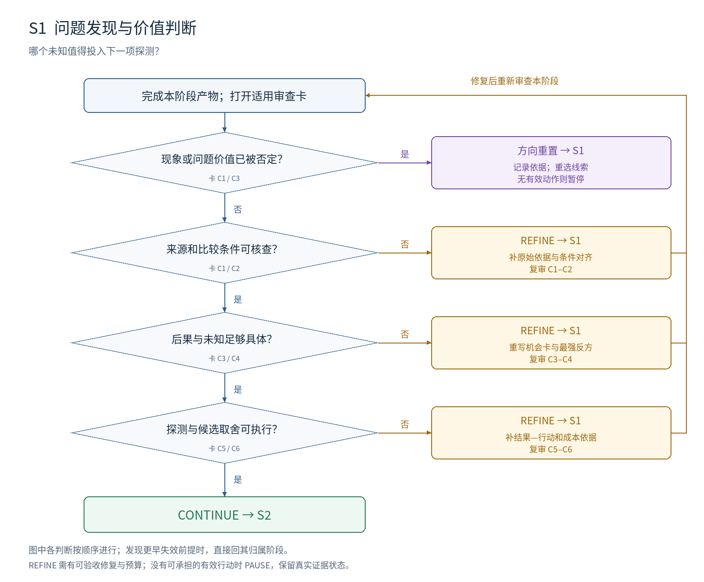

# S1：问题发现与价值判断

**本阶段要决定：哪个未知值得投入下一项探测？**

## 进入条件

研究方向与资源约束；原始文献、观察或可检查的理论构造。没有具体 idea 也可以进入。

## 按顺序做什么

1. 先写想获得的能力或想解释的现象，不写拟采用的模块。
2. 建线索表：预期、实际、条件、来源、解释、后果各一列；每条观察绑定来源位置。
3. 沿五个入口找问题：预期落差、指标失真、未经验证的前提、成功/失败边界、新能力改变旧约束。
4. 为每条线索写最强正常解释，做条件对齐；把仍存在的未知写成候选问题。
5. 为候选写最便宜的区分性探测，比较价值、可检验性和成本，选择下一项行动。

## 最小交付

- 问题机会卡：条件 C、预期 E、观察 O、未知 K、后果 D、反方 A、探测 T。
- 线索来源表与候选取舍记录；保留被排除候选的理由。

## 此时不要求什么

完整方法、最终效果、全面创新性审计。此时只需可信线索及值得探测的未知。

## 独有决策图

[查看可编辑 SVG](../diagrams/S1_decision.svg)

图中主线条件表示进入下一判断；侧向分支表示修复或跳到指定阶段。多目标框按所列失效对象选择一个实际目标，不能一次同时跳转。任何已发现的更早失效前提，均优先按回退归属表处理。

## 六张解释性审查卡

每张卡按主要贡献类型启用。执行前均未审核；每项结论需要本项目的证据定位。卡内所列是可能症状，不能据此假定项目确实有该问题。

### S1-C1 · 线索可核查

**为什么查：** 未经核查的叙述会把后续工作建在不存在的现象上。

**检查哪里：** 机会卡“观察”；来源表中的原文、记录或构造。

**怎么检查：** 打开每条决定性依据，核对实际报告的对象、条件和结论；区分原文、推断和建议。

**什么算有问题：** 只引用二手总结；把可能性写成事实；来源没有对应观察。

**期望产物：** 每个决定性观察有可回到原处的定位；未观察的可能性明确标为假设。

**最小修复：** 补原始依据，或把无依据断言降为待检验线索。

**如何验收：** 审核者能从定位重建观察，并指出哪些内容仍未知。

**失败后的动作与归属：** REFINE S1；若观察被否定且没有剩余价值，重置 S1 或关闭该分支。

**本轮填写：** 状态 [ ]；项目证据位置 [ ]；Issue ID [ ]；实际验收记录 [ ]。

### S1-C2 · 比较条件一致

**为什么查：** 不同任务、信息或资源造成的差异未必是科学矛盾。

**检查哪里：** 线索表“条件”；被比较方法的输入、预算、样本与指标。

**怎么检查：** 逐项对齐条件；不能对齐的差异先作为竞争解释。

**什么算有问题：** 把大模型和小模型、不同样本或不同资源下的分数直接称为矛盾。

**期望产物：** 明确剩余差异是在何种可比条件下出现；未对齐因素有标记。

**最小修复：** 补同条件比较，或将问题改为“该条件怎样影响结果”。

**如何验收：** 对每项差异，能说明已控制、需检验或不影响判断的依据。

**失败后的动作与归属：** REFINE S1；差异完全被正常条件解释时重新选择线索。

**本轮填写：** 状态 [ ]；项目证据位置 [ ]；Issue ID [ ]；实际验收记录 [ ]。

### S1-C3 · 价值对应具体后果

**为什么查：** 题目宏大与研究有价值不是同一个判断。

**检查哪里：** 机会卡“后果”；使用场景、理论限制或研究选择的依据。

**怎么检查：** 完成句子“若解决 K，谁能在什么条件下改变哪个决定”；检查支持依据。

**什么算有问题：** 只写热门、首次、提高智能；解决前后没有可辨认变化。

**期望产物：** 明确受影响的能力、解释或选择，以及当前缺口怎样阻碍它。

**最小修复：** 补后果链与具体场景；若只是方便实现，重新判断其科学价值。

**如何验收：** 即使去掉方法名字，读者仍能说清问题的重要性。

**失败后的动作与归属：** REFINE S1；后果不成立则重置方向或暂停。

**本轮填写：** 状态 [ ]；项目证据位置 [ ]；Issue ID [ ]；实际验收记录 [ ]。

### S1-C4 · 未知具体且未被原因预占

**为什么查：** 把拟做方法写进问题，会阻止发现其他解释。

**检查哪里：** 问题句；机会卡“未知”和“反方”。

**怎么检查：** 把“缺少模块 M”改写成可观察缺口；尝试用另一类机制解释同一现象。

**什么算有问题：** 问题是“如何加入 M”；删掉 M 后就无法说明研究对象。

**期望产物：** 问题描述独立于候选方法；至少一个合理反方可能成立。

**最小修复：** 重写现象和未知；暂不承诺造成现象的原因。

**如何验收：** 两个不同候选方案都能针对该问题提出可检查预测。

**失败后的动作与归属：** REFINE S1；不要求这时已经知道真正原因。

**本轮填写：** 状态 [ ]；项目证据位置 [ ]；Issue ID [ ]；实际验收记录 [ ]。

### S1-C5 · 下一项探测能改变决定

**为什么查：** 不能区分解释的活动只会增加材料，不会帮助选择方向。

**检查哪里：** 机会卡“探测”；所需数据、观察、干预或证明检查。

**怎么检查：** 分别写支持、反对和未决时会采取的动作；检查探测能否触发这些分支。

**什么算有问题：** 只写“多读论文”或“跑一个模型”；任何结果都继续原方案。

**期望产物：** 有可执行对象、所需条件、成本上限，以及结果到动作的对应。

**最小修复：** 换成定位明确的阅读核查、成对观察、干预或反例搜索。

**如何验收：** 审核者能指出哪种结果会取消、修改或推进当前候选。

**失败后的动作与归属：** REFINE S1；暂不可探测时暂停，不把不可测写成错误。

**本轮填写：** 状态 [ ]；项目证据位置 [ ]；Issue ID [ ]；实际验收记录 [ ]。

### S1-C6 · 选题取舍透明

**为什么查：** 只保留最喜欢的候选，会隐藏同样有价值但更便宜的路径。

**检查哪里：** 候选表、资源约束与选择理由。

**怎么检查：** 比较下一步的价值、区分能力与成本；只有一个候选时说明来源和局限。

**什么算有问题：** 以综合印象分排名；无法说明为什么值得花下一笔资源。

**期望产物：** 选中的候选有可信入口、重要未知和可承担动作；其他候选有保留或放弃理由。

**最小修复：** 缩小下一步行动，不必先缩小长期问题；补关键竞争候选。

**如何验收：** 另一位研究者能依据取舍记录理解选择；不要求同意个人偏好。

**失败后的动作与归属：** REFINE S1；全部无可承担动作则暂停或重置。

**本轮填写：** 状态 [ ]；项目证据位置 [ ]；Issue ID [ ]；实际验收记录 [ ]。

## 执行判断的顺序

| 顺序 | 判断 | 沿主线条件 | 另一分支及动作 |
| --- | --- | --- | --- |
| 1 | 现象或问题价值已被否定？ | 否 → 下一判断 | 是 → RESET S1；记录依据；重选线索；无有效动作则暂停 |
| 2 | 来源和比较条件可核查？ | 是 → 下一判断 | 否 → REFINE S1；补原始依据与条件对齐；复审 C1–C2 |
| 3 | 后果与未知足够具体？ | 是 → 下一判断 | 否 → REFINE S1；重写机会卡与最强反方；复审 C3–C4 |
| 4 | 探测与候选取舍可执行？ | 是 → 下一判断 | 否 → REFINE S1；补结果—行动和成本依据；复审 C5–C6 |
| 全部通过 | 全部适用必需项 MET、无上游阻塞 | CONTINUE → S2 | 预算不足时暂停，不降低判据 |

## 一次实际审查应如何表达（教学虚构）

教学虚构：机会卡只写“现有方法不可靠”。S1-C1/C4 判 GAP：无失败位置、条件和后果。修复为“在条件 C 的记录 E-03 中出现失败 F；它影响决定 D，可能由数据偏差 A 解释；探测 T 区分两者”。补齐原始依据后复审，留在 S1，不提前设计方法。

## 离开本阶段前的交接

填写 T1 审查结果与 T4 交接单：S1 有效输入和产物版本、开放 issue、证据状态、动作与目标、下一项工作及预算。回退先标记受影响依赖；阶段内修复按原 issue 验收后复审。
