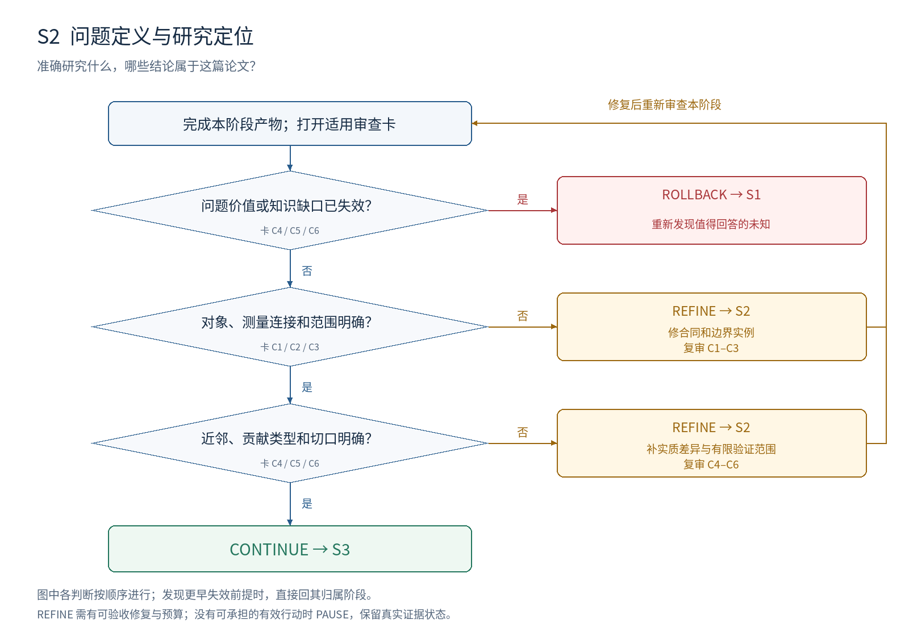

# S2：问题定义与研究定位

**本阶段要决定：准确研究什么，哪些结论属于这篇论文？**

## 进入条件

S1 机会卡及来源；候选贡献方向；已有工作检索记录。

## 按顺序做什么

1. 填写研究单位、输入、允许信息、可改变对象、目标、资源、比较对象与范围。
2. 把重要目标与可观测指标分开，写出两者连接所依赖的假设。
3. 构造范围内、范围外和边界实例，检查定义能否稳定分类。
4. 直接比较最接近的工作，记录相同条件下已解决和未解决的部分。
5. 确定主要贡献类型、核心主张和后续外推；把定义固定为可引用版本。

## 最小交付

- 问题合同：U/C/I/X/T/M/B/R/G/N/K 字段及边界实例。
- 近邻对照表、检索范围与主要贡献类型；核心和外推主张清单。

## 此时不要求什么

方法优于基线的结果；所有候选技术细节。定位在 S4 具体方法形成后还要复核。

## 独有决策图

[查看可编辑 SVG](../diagrams/S2_decision.svg)

图中主线条件表示进入下一判断；侧向分支表示修复或跳到指定阶段。多目标框按所列失效对象选择一个实际目标，不能一次同时跳转。任何已发现的更早失效前提，均优先按回退归属表处理。

## 六张解释性审查卡

每张卡按主要贡献类型启用。执行前均未审核；每项结论需要本项目的证据定位。卡内所列是可能症状，不能据此假定项目确实有该问题。

### S2-C1 · 对象与信息边界明确

**为什么查：** 不明确研究单位和可用信息，会让不同实现回答不同问题。

**检查哪里：** 问题合同 U/C/I/X；主稿“问题定义”。

**怎么检查：** 让审核者只按合同复述输入、输出、单位、动作和可用信息；列出不允许访问的量。

**什么算有问题：** 任务与样本混用；训练时可用的标签被默认部署时可用。

**期望产物：** 第三方能界定一次研究实例，判断方法是否使用了允许信息。

**最小修复：** 补字段和边界案例；明确训练、分析与使用阶段的信息差异。

**如何验收：** 对同一实例，作者与审核者对单位及允许信息的判断一致。

**失败后的动作与归属：** REFINE S2；所需条件改变问题价值时回 S1。

**本轮填写：** 状态 [ ]；项目证据位置 [ ]；Issue ID [ ]；实际验收记录 [ ]。

### S2-C2 · 目标与测量连接成立

**为什么查：** 代理分数变化不必然代表研究目标变化。

**检查哪里：** 合同 T/M；重要后果的依据。

**怎么检查：** 写“指标变化为何代表目标变化”；寻找指标改善而目标不改善的反例。

**什么算有问题：** 把运行成功等同任务正确；把局部忠实性等同完整能力。

**期望产物：** 解释连接条件，并标明连接本身是否需要在 S5–S7 验证。

**最小修复：** 更换或补充目标测量；未验证连接登记为承重假设。

**如何验收：** 审核者能区分直接目标证据、代理证据和仍欠缺的连接。

**失败后的动作与归属：** REFINE S2；目标即使测准也无意义时回 S1。

**本轮填写：** 状态 [ ]；项目证据位置 [ ]；Issue ID [ ]；实际验收记录 [ ]。

### S2-C3 · 范围可判定

**为什么查：** 事后改变范围容易把失败从主要主张中删除。

**检查哪里：** 合同 G/N；纳入、排除和边界实例。

**怎么检查：** 逐个检查实例是否属于核心范围，并记录排除理由是否与结果无关。

**什么算有问题：** 只写“复杂任务”；排除规则依赖方法是否答对。

**期望产物：** 纳入范围能在看结果前判断；核心范围和未来扩展分开。

**最小修复：** 将模糊形容词操作化；记录例外及其目标依据。

**如何验收：** 审核者用规则得到相同分组；任何争议都能定位具体条款。

**失败后的动作与归属：** REFINE S2；范围缩小后价值消失则回 S1。

**本轮填写：** 状态 [ ]；项目证据位置 [ ]；Issue ID [ ]；实际验收记录 [ ]。

### S2-C4 · 最近工作差异有依据

**为什么查：** 未搜到相同关键词不能证明未知问题尚未解决。

**检查哪里：** 近邻表；原论文的方法、条件与证据位置。

**怎么检查：** 按问题、机制和目标量分别检索；逐项比较任务、信息、约束、保证和证据范围。

**什么算有问题：** 只比论文标题；把同义表述当新问题；忽略更简单的已有答案。

**期望产物：** 明确在已核查范围内仍未回答的 K，并保留最强重合威胁。

**最小修复：** 补原文对照；区分新目标、不同条件、新对象和普通实现差异。

**如何验收：** 审核者能指出已有工作能覆盖什么，以及哪一项实质差异仍存在。

**失败后的动作与归属：** REFINE S2；同条件下已经充分回答且无新价值则回 S1。

**本轮填写：** 状态 [ ]；项目证据位置 [ ]；Issue ID [ ]；实际验收记录 [ ]。

### S2-C5 · 贡献类型与主张一致

**为什么查：** 方法、发现、资源和理论要求不同证据，不能临时换标准保留赢家。

**检查哪里：** 主要贡献类型；核心主张清单。

**怎么检查：** 用一句话写论文增加什么；逐条指定应使用效果、机制、构念或证明证据。

**什么算有问题：** 实际只有基准诊断却声称提出有效方法；无法区分主次贡献。

**期望产物：** 一个主要贡献类型及相应核心主张；次要贡献单独加义务。

**最小修复：** 明确贡献承诺；将目前没有依据的宏大外推列为后续候选。

**如何验收：** 每条核心主张能对应后续的验证类型，没有孤立的装饰性主张。

**失败后的动作与归属：** REFINE S2；重新定位后无可解释增量则回 S1。

**本轮填写：** 状态 [ ]；项目证据位置 [ ]；Issue ID [ ]；实际验收记录 [ ]。

### S2-C6 · 有限切口仍回答大问题

**为什么查：** 为了便宜而换成无关任务，不能验证原研究方向。

**检查哪里：** 资源 B、核心范围 G、下一步切口与机会卡。

**怎么检查：** 说明小范围验证保留哪个关键未知；列出需要的数据、观察或形式条件。

**什么算有问题：** 只选最易获得数据；没有解释小问题与长期目标的连接。

**期望产物：** 存在可承担的有限切口，并明确通过后能支持什么、仍不能支持什么。

**最小修复：** 收紧下一步范围；保留问题意义和必要条件，不预设全面泛化。

**如何验收：** 审核者能从小范围结果回到原问题的一项实质判断。

**失败后的动作与归属：** REFINE S2；当前约束不允许任何有效切口时回 S1 或暂停。

**本轮填写：** 状态 [ ]；项目证据位置 [ ]；Issue ID [ ]；实际验收记录 [ ]。

## 执行判断的顺序

| 顺序 | 判断 | 沿主线条件 | 另一分支及动作 |
| --- | --- | --- | --- |
| 1 | 问题价值或知识缺口已失效？ | 否 → 下一判断 | 是 → ROLLBACK S1；重新发现值得回答的未知 |
| 2 | 对象、测量连接和范围明确？ | 是 → 下一判断 | 否 → REFINE S2；修合同和边界实例；复审 C1–C3 |
| 3 | 近邻、贡献类型和切口明确？ | 是 → 下一判断 | 否 → REFINE S2；补实质差异与有限验证范围；复审 C4–C6 |
| 全部通过 | 全部适用必需项 MET、无上游阻塞 | CONTINUE → S3 | 预算不足时暂停，不降低判据 |

## 一次实际审查应如何表达（教学虚构）

教学虚构：合同把“失败任务”排除，但目标写“全部输入上的可靠性”。S2-C2/C3 判 CONFLICT。若目标仍是全部输入，修正分母与排除条件，留在 S2；若排除后才发现问题不再有重要后果，回 S1。

## 离开本阶段前的交接

填写 T1 审查结果与 T4 交接单：S2 有效输入和产物版本、开放 issue、证据状态、动作与目标、下一项工作及预算。回退先标记受影响依赖；阶段内修复按原 issue 验收后复审。
