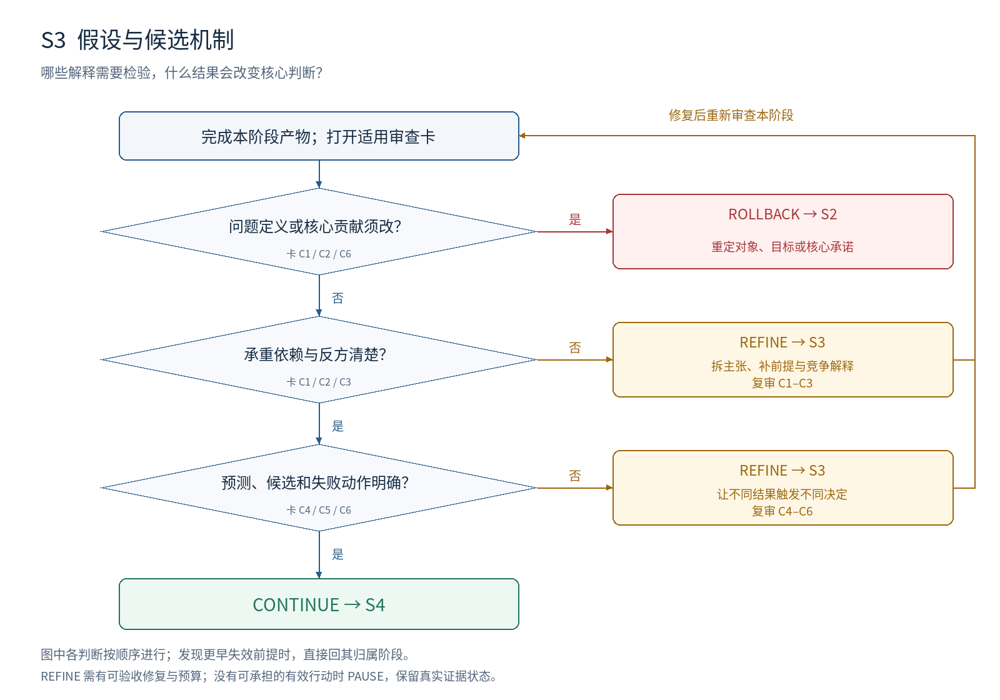

# S3：假设与候选机制

**本阶段要决定：哪些解释需要检验，什么结果会改变核心判断？**

## 进入条件

S2 问题合同、贡献类型、核心主张和近邻对照。

## 按顺序做什么

1. 从拟写的核心结论反向列出它必须依赖的前提，逐项编号 H1、H2 等。
2. 区分前提、机制、结果、可获得性、效率和范围；画清依赖关系。
3. 为承重假设提出最强替代解释，写出能区分双方的预测。
4. 根据预测提出最小技术或分析候选，同时保留强简单方案。
5. 登记支持、反驳、未决条件以及失败后要修改的对象。

## 最小交付

- 假设台账及依赖图；每条假设的证据类型、范围、反方和失败含义。
- 候选机制—预测—最小区分检查表。

## 此时不要求什么

经验假设已经为真、完整实验参数、最终跨场景收益。此阶段证明“值得且可以检验”。

## 独有决策图

[查看可编辑 SVG](../diagrams/S3_decision.svg)

图中主线条件表示进入下一判断；侧向分支表示修复或跳到指定阶段。多目标框按所列失效对象选择一个实际目标，不能一次同时跳转。任何已发现的更早失效前提，均优先按回退归属表处理。

## 六张解释性审查卡

每张卡按主要贡献类型启用。执行前均未审核；每项结论需要本项目的证据定位。卡内所列是可能症状，不能据此假定项目确实有该问题。

### S3-C1 · 承重主张完整且分层

**为什么查：** 一项高分不能同时证明机制、可学习性和泛化。

**检查哪里：** 核心主张清单；假设台账“类型”和“作用”。

**怎么检查：** 对每个拟保留结论问“什么必须先成立”；拆开具有不同证据需求的连接。

**什么算有问题：** 一个 H 同时承诺有效、便宜、可迁移；只登记最容易成功的结果。

**期望产物：** 每个核心结论可追到足够的前提与子假设；辅助猜测明确标为非核心。

**最小修复：** 拆复合命题、补隐藏前提，删除没有论证作用的装饰性条目。

**如何验收：** 遮住某一承重行后，能准确指出哪项结论失去依据。

**失败后的动作与归属：** REFINE S3；假设不再回答原目标则回 S2。

**本轮填写：** 状态 [ ]；项目证据位置 [ ]；Issue ID [ ]；实际验收记录 [ ]。

### S3-C2 · 依赖与可检验条件明确

**为什么查：** 前提不成立时，下游负结果未必能反驳机制。

**检查哪里：** 假设依赖图；数据支持、信息可得性与测量条件。

**怎么检查：** 沿每条依赖检查：父项失败后子项是否仍可解释；找循环依赖。

**什么算有问题：** 用最终效果证明前提，再用前提解释效果；验证所需对象无法定义。

**期望产物：** 依赖无自我支持；每项前提可检查、可证明或有清楚来源。

**最小修复：** 补前提检查，解除循环；将不能观察的量换成可检验表述。

**如何验收：** 对每个前提，能写出失败时哪些下游检验应标为无效或待重查。

**失败后的动作与归属：** REFINE S3；研究对象或允许信息必须重定义时回 S2。

**本轮填写：** 状态 [ ]；项目证据位置 [ ]；Issue ID [ ]；实际验收记录 [ ]。

### S3-C3 · 竞争解释真的可能赢

**为什么查：** 人为设置很弱的反方不能提高解释的可信度。

**检查哪里：** 台账“反方”；候选的不同预测。

**怎么检查：** 考虑资源、样本选择、测量偏差和另一机制；写出使反方更可信的观察。

**什么算有问题：** 反方只是主假设换名；只有主方法会被认真调优。

**期望产物：** 最强已知反方有可胜出的条件；对照允许它获得公平证据。

**最小修复：** 替换装饰性对照，按差异预测设计比较。

**如何验收：** 审核者能够描述至少一种反方胜出的合理情形。

**失败后的动作与归属：** REFINE S3；若所有答案都与问题目标无关则回 S2。

**本轮填写：** 状态 [ ]；项目证据位置 [ ]；Issue ID [ ]；实际验收记录 [ ]。

### S3-C4 · 反驳与未决条件明确

**为什么查：** 任何结果都能解释为成功的命题无法指导研究决策。

**检查哪里：** 每条假设的支持、反驳、未决与范围栏。

**怎么检查：** 尝试写出一个会取消主张的结果和一个仍无法判断的结果。

**什么算有问题：** 失败都归因模型太小；观察与理论命题之间没有检验桥梁。

**期望产物：** 经验假设有区分预测；理论条目有证明义务与可能反例；未知可保持未决。

**最小修复：** 收紧命题，注明作用条件；为反例或区分检验指定对象。

**如何验收：** 每条承重行均能明确三类结局及后果，不要求现在已有结论。

**失败后的动作与归属：** REFINE S3；概念本身无法操作化则回 S2。

**本轮填写：** 状态 [ ]；项目证据位置 [ ]；Issue ID [ ]；实际验收记录 [ ]。

### S3-C5 · 候选设计来自瓶颈

**为什么查：** 复杂模块堆叠容易让研究失去可解释的技术选择。

**检查哪里：** 候选表；瓶颈—设计—预测映射。

**怎么检查：** 对每个关键设计问“删掉或换成简单方案，哪项预测改变”。

**什么算有问题：** 组件只因流行而加入；没有更简单的合理比较。

**期望产物：** 每项关键设计针对一个明确瓶颈；工程便利与科学贡献分开标记。

**最小修复：** 简化候选；把不能解释的部件降为工程细节或删除。

**如何验收：** 作者能按预测说明为何先验证这个候选，而非仅展示架构复杂度。

**失败后的动作与归属：** REFINE S3；必须修改目标或约束才能合理化设计则回 S2。

**本轮填写：** 状态 [ ]；项目证据位置 [ ]；Issue ID [ ]；实际验收记录 [ ]。

### S3-C6 · 失败动作与优先次序预定

**为什么查：** 没有失败后果的台账会变成结果出现后的叙事工具。

**检查哪里：** 台账“失败含义”；拟验证顺序。

**怎么检查：** 按依赖和决策价值排序；区分修定义、换假设、改方法、重设计测量。

**什么算有问题：** 先做昂贵综合实验；所有条目失败后都写“继续优化”。

**期望产物：** 优先处理最能改变去留的承重前提；每条有失败动作和目标对象。

**最小修复：** 重排顺序，补结果到动作的对应；暂不强求精确实验预算。

**如何验收：** 审核者抽取任一核心 H，都能指出失败影响与后续归属。

**失败后的动作与归属：** REFINE S3；若核心贡献承诺必须改变则回 S2。

**本轮填写：** 状态 [ ]；项目证据位置 [ ]；Issue ID [ ]；实际验收记录 [ ]。

## 执行判断的顺序

| 顺序 | 判断 | 沿主线条件 | 另一分支及动作 |
| --- | --- | --- | --- |
| 1 | 问题定义或核心贡献须改？ | 否 → 下一判断 | 是 → ROLLBACK S2；重定对象、目标或核心承诺 |
| 2 | 承重依赖与反方清楚？ | 是 → 下一判断 | 否 → REFINE S3；拆主张、补前提与竞争解释；复审 C1–C3 |
| 3 | 预测、候选和失败动作明确？ | 是 → 下一判断 | 否 → REFINE S3；让不同结果触发不同决定；复审 C4–C6 |
| 全部通过 | 全部适用必需项 MET、无上游阻塞 | CONTINUE → S4 | 预算不足时暂停，不降低判据 |

## 一次实际审查应如何表达（教学虚构）

教学虚构：H1 写“方法有效且原因是组件 A”。S3-C1/C3 要求拆成结果与机制两行：整体改善可支持结果；等预算替代 A 的比较才有机会区分机制。拆分并补预测后留在 S3 复审，不把两行都标为已支持。

## 离开本阶段前的交接

填写 T1 审查结果与 T4 交接单：S3 有效输入和产物版本、开放 issue、证据状态、动作与目标、下一项工作及预算。回退先标记受影响依赖；阶段内修复按原 issue 验收后复审。
