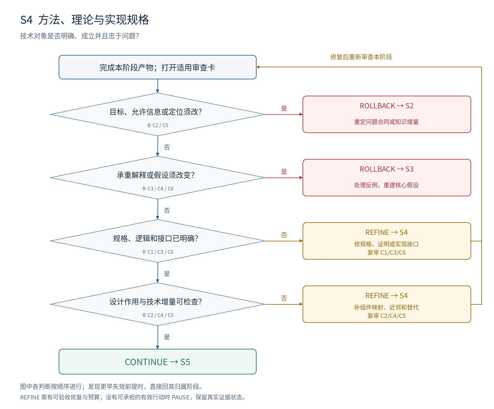

# S4：方法、理论与实现规格

**本阶段要决定：技术对象是否明确、成立并且忠于问题？**

## 进入条件

S3 假设及预测；S2 信息、资源与范围合同；最近技术近邻。

## 按顺序做什么

1. 选出用于下一轮验证的技术对象，写输入、状态、更新、输出和终止规则。
2. 列清训练、构建、分析、验证、使用各阶段可访问的信息。
3. 给每个核心组件关联假设与替代方案；把工程默认值单列。
4. 对实际声称的理论命题检查定义、量词、假设、证明与反例。
5. 用具体实例走通规格，复核技术近邻，冻结可供忠实实现的版本。

## 最小交付

- 方法/分析/构建规格；关键例子与异常条件；信息访问表。
- 组件—假设映射；适用的证明记录；技术近邻差异。

## 此时不要求什么

所有经验收益、全面泛化、生产级工程优化。没有理论主张时无需人为增加定理。

## 独有决策图

[查看可编辑 SVG](../diagrams/S4_decision.svg)

图中主线条件表示进入下一判断；侧向分支表示修复或跳到指定阶段。多目标框按所列失效对象选择一个实际目标，不能一次同时跳转。任何已发现的更早失效前提，均优先按回退归属表处理。

## 六张解释性审查卡

每张卡按主要贡献类型启用。执行前均未审核；每项结论需要本项目的证据定位。卡内所列是可能症状，不能据此假定项目确实有该问题。

### S4-C1 · 方法身份无关键歧义

**为什么查：** 能运行的实现可能执行了不同核心方法。

**检查哪里：** 方法规格中的选择、更新、采样、归一化与终止规则。

**怎么检查：** 审核者按规格走一例；列出所有影响方法身份的自由选择。

**什么算有问题：** “最优”“自适应”“融合”等词没有操作定义；异常情况可导致不同算法。

**期望产物：** 核心步骤、状态和输入输出明确；常规默认值可追溯但不必穷尽优化。

**最小修复：** 补定义、实例或伪代码的自然语言解释；明确优先级和异常处理。

**如何验收：** 另一实现者无需猜测核心决策即可复述同一方法。

**失败后的动作与归属：** REFINE S4；需更换核心解释则回 S3。

**本轮填写：** 状态 [ ]；项目证据位置 [ ]；Issue ID [ ]；实际验收记录 [ ]。

### S4-C2 · 信息与资源合法可得

**为什么查：** 诊断时知道答案不代表实际使用时能获得答案。

**检查哪里：** 信息访问表；S2 的允许信息和资源。

**怎么检查：** 沿数据流检查标签、未来反馈、搜索结果或参考答案何时可见。

**什么算有问题：** 验证/使用信息泄漏到决策；需要不可访问的状态。

**期望产物：** 诊断 oracle、构建监督和使用时策略分开；实际方案满足问题合同。

**最小修复：** 在现有合同下改技术实现；若只能改变合同，记录对原问题的影响。

**如何验收：** 每次信息访问有来源和阶段；使用时不依赖被禁止的量。

**失败后的动作与归属：** REFINE S4；需要改变允许信息或目标则回 S2。

**本轮填写：** 状态 [ ]；项目证据位置 [ ]；Issue ID [ ]；实际验收记录 [ ]。

### S4-C3 · 核心逻辑和证明成立

**为什么查：** 定义、局部性质和实际保证之间可能缺失关键推理。

**检查哪里：** 命题、证明、变量域、量词、条件和应用位置。

**怎么检查：** 逐步核对推出关系；代入退化情形；检查证明条件是否覆盖所声称应用。

**什么算有问题：** 局部命题写成全局保证；关键步骤无依据；已知反例未处理。

**期望产物：** 被依赖的核心推导没有已知阻塞缺口；其余猜想明确标记。

**最小修复：** 补证明或缩小命题；只在不改变上游核心假设时本阶段修复。

**如何验收：** 审核者能检查每个关键推理及其条件；无证明主张时记录不适用理由。

**失败后的动作与归属：** REFINE S4；反例推翻承重假设则回 S3；对象定义需改则回 S2。

**本轮填写：** 状态 [ ]；项目证据位置 [ ]；Issue ID [ ]；实际验收记录 [ ]。

### S4-C4 · 设计与假设连接

**为什么查：** 方法有效也未必说明作者给出的设计理由成立。

**检查哪里：** 组件映射；与简单方案的差异。

**怎么检查：** 逐个组件写预期作用、适用条件和替代；标记哪些是核心研究主张。

**什么算有问题：** 所有组件都被声称必不可少；没有设计对应的可比较预测。

**期望产物：** 关键组件有可区分作用；整套效果和组件贡献是不同验证义务。

**最小修复：** 删减无作用部件；补替代方案和后续检验义务。

**如何验收：** 对每项关键改动，能指出它改变哪条假设的预测。

**失败后的动作与归属：** REFINE S4；设计需要新的机制假设则回 S3。

**本轮填写：** 状态 [ ]；项目证据位置 [ ]；Issue ID [ ]；实际验收记录 [ ]。

### S4-C5 · 具体技术增量可定位

**为什么查：** 问题定位未重合不代表提出的方法没有已有等价物。

**检查哪里：** 技术近邻表；数学对象、步骤和信息结构。

**怎么检查：** 去掉名字逐项对照；检查是否只是重参数化、调参或既有方法的实现。

**什么算有问题：** 只有命名不同；新增步骤不改变行为却承诺能力提升。

**期望产物：** 明确新对象、适用条件或可验证能力的实质差异，并报告重合部分。

**最小修复：** 补等价性分析；调整具体构造或诚实界定贡献。

**如何验收：** 审核者能指出差异在哪里，以及什么证据能验证其价值。

**失败后的动作与归属：** REFINE S4；需改核心技术路线则回 S3；贡献类型/知识增量失效则回 S2。

**本轮填写：** 状态 [ ]；项目证据位置 [ ]；Issue ID [ ]；实际验收记录 [ ]。

### S4-C6 · 规格能被忠实检验

**为什么查：** 未处理的实现前提会让后续实验测不到提出的方法。

**检查哪里：** 手工走例、关键接口、所需样本与依赖。

**怎么检查：** 从输入到输出完成一例；检查必要动作可执行、对象非空、学习信号可能存在。

**什么算有问题：** 方法只在文字中闭合；必要中间量无来源；缩小后必定退化。

**期望产物：** 至少有可忠实核查的实例或形式对象；关键实现风险已定位。

**最小修复：** 修接口或构造；把需实际测量的前提交给 S5，不假定它已通过。

**如何验收：** 走例与规格一致，S5 能据此准备检查；没有用例冒充总体有效。

**失败后的动作与归属：** REFINE S4；必要前提不可能成立且需换解释则回 S3。

**本轮填写：** 状态 [ ]；项目证据位置 [ ]；Issue ID [ ]；实际验收记录 [ ]。

## 执行判断的顺序

| 顺序 | 判断 | 沿主线条件 | 另一分支及动作 |
| --- | --- | --- | --- |
| 1 | 目标、允许信息或定位须改？ | 否 → 下一判断 | 是 → ROLLBACK S2；重定问题合同或知识增量 |
| 2 | 承重解释或假设须改变？ | 否 → 下一判断 | 是 → ROLLBACK S3；处理反例，重建核心假设 |
| 3 | 规格、逻辑和接口已明确？ | 是 → 下一判断 | 否 → REFINE S4；修规格、证明或实现接口；复审 C1/C3/C6 |
| 4 | 设计作用与技术增量可检查？ | 是 → 下一判断 | 否 → REFINE S4；补组件映射、近邻和替代；复审 C2/C4/C5 |
| 全部通过 | 全部适用必需项 MET、无上游阻塞 | CONTINUE → S5 | 预算不足时暂停，不降低判据 |

## 一次实际审查应如何表达（教学虚构）

教学虚构：规格写“选择最优候选”，没有定义依据。若已有允许信息足以定义选择规则，S4-C1 要求补足规格并本阶段复审；若规则必须读取 S2 禁止的答案，S4-C2 要求回 S2，不能把答案访问写成默认实现。

## 离开本阶段前的交接

填写 T1 审查结果与 T4 交接单：S4 有效输入和产物版本、开放 issue、证据状态、动作与目标、下一项工作及预算。回退先标记受影响依赖；阶段内修复按原 issue 验收后复审。
