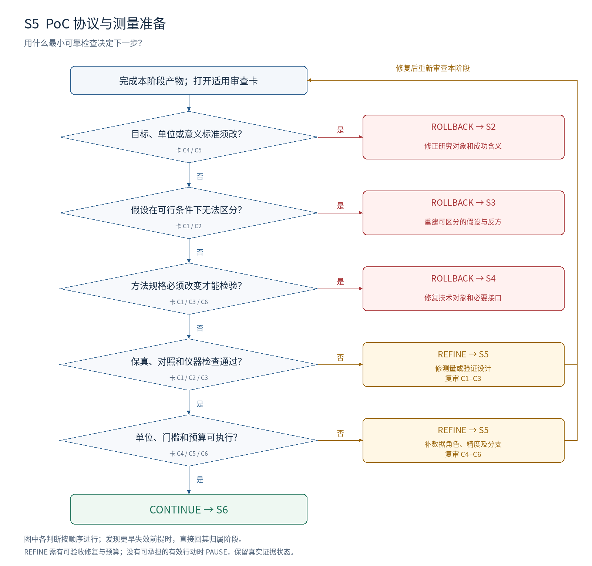

# S5：PoC 协议与测量准备

**本阶段要决定：用什么最小可靠检查决定下一步？**

## 进入条件

S4 冻结规格；S3 决定性假设和依赖；可用数据、测量工具与预算。

## 按顺序做什么

1. 选择最先影响去留的承重假设，保留它生效必需的条件。
2. 为主要解释与反方设计区分性比较；固定信息、资源和候选选择方式。
3. 检查实现与测量：已知正反例、参考依据、标签来源、等价变换与关键接口。
4. 确定独立单位、探索/选择/确认数据角色、主量、意义门槛、精度和查看结果规则。
5. 填结果—行动表及成本上限；检查前提通过后冻结协议，再进入正式 PoC。

## 最小交付

- T3 PoC 决策合同；仪器检查记录；数据角色和独立单位表。
- 比较清单、门槛依据、未决处理、成本上限与正式运行顺序。

## 此时不要求什么

主效果为正；完整论文基准集。可以做准备性探测，但不得把用于选协议的数据当独立确认。

## 独有决策图

[查看可编辑 SVG](../diagrams/S5_decision.svg)

图中主线条件表示进入下一判断；侧向分支表示修复或跳到指定阶段。多目标框按所列失效对象选择一个实际目标，不能一次同时跳转。任何已发现的更早失效前提，均优先按回退归属表处理。

## 六张解释性审查卡

每张卡按主要贡献类型启用。执行前均未审核；每项结论需要本项目的证据定位。卡内所列是可能症状，不能据此假定项目确实有该问题。

### S5-C1 · PoC 保留目标机制

**为什么查：** 快速运行并不保证检验的是原假设。

**检查哪里：** PoC 范围；模型、数据、时间窗口、形式条件与前提检查。

**怎么检查：** 逐条标出机制触发条件；说明每次缩小保留什么、移除了什么。

**什么算有问题：** 无可学习信号；时间窗口短于机制生效；用不相关任务代替目标。

**期望产物：** 规模足够小且仍能区分承重假设；保真依据可检查。

**最小修复：** 换缩小方式或补准备性探测；保留其探索身份。

**如何验收：** 审核者能将每个必要条件映射到协议中的实现或证明检查。

**失败后的动作与归属：** REFINE S5；方法无法提供必要条件则回 S4；假设不可区分则回 S3。

**本轮填写：** 状态 [ ]；项目证据位置 [ ]；Issue ID [ ]；实际验收记录 [ ]。

### S5-C2 · 对照能区分竞争解释

**为什么查：** 综合分数可能只反映更多信息、预算或更强实现。

**检查哪里：** 比较清单；主方法、简单基线、反方和关键干预。

**怎么检查：** 对每项比较写“只要哪项因素变化”；列出不可保持相等的差异及处理。

**什么算有问题：** 只比弱基线；消融同时改多个关键因素；去掉组件后资源大幅变化。

**期望产物：** 核心比较能回答预定问题；公平性限制公开，无法隔离时收紧机制主张。

**最小修复：** 补最强简单对照或资源匹配；用额外比较区分剩余混杂。

**如何验收：** 反方有公平胜出机会；预期结果能对应 S3 的不同预测。

**失败后的动作与归属：** REFINE S5；所有可行对照预测相同时回 S3；目标比较定义错则回 S2。

**本轮填写：** 状态 [ ]；项目证据位置 [ ]；Issue ID [ ]；实际验收记录 [ ]。

### S5-C3 · 仪器与参照可信

**为什么查：** 错误标签、度量或实现会制造正负两种假结果。

**检查哪里：** 仪器记录；标签依据；规格到实现的核对；参照误差。

**怎么检查：** 检查已知正例、负例、退化或等价输入；核对关键输出和参照来源。

**什么算有问题：** 用待评对象自己的判断充当真值；指标对无关变换改变；实现偏离规格。

**期望产物：** 决定性测量通过针对性检查；剩余参照误差有范围和处理办法。

**最小修复：** 修测量或实现映射；无法修复时改变检查对象或取得独立参照。

**如何验收：** 保存预期与实际输出；关键检查一致，已知偏差不会被隐去。

**失败后的动作与归属：** REFINE S5；必须改变方法规格则回 S4；构念需重定义则回 S2。

**本轮填写：** 状态 [ ]；项目证据位置 [ ]；Issue ID [ ]；实际验收记录 [ ]。

### S5-C4 · 独立单位和数据用途清楚

**为什么查：** 相关样本和反复选赢家会夸大精度与外推范围。

**检查哪里：** 数据清单；分组键；候选选择与确认规则。

**怎么检查：** 写清一次独立变化是什么；追踪同来源、同任务、同训练/搜索过程的关联。

**什么算有问题：** 多次评估当多次训练；同一项目拆分泄漏；在确认集上反复改方法。

**期望产物：** 独立单位匹配主张；探索、选择、确认角色明确；依赖被保留。

**最小修复：** 按来源/任务/完整运行分组；预留或新收确认信息；注明重复查看处理。

**如何验收：** 审核者能从记录重建各样本用途，确认集不会参与候选选择。

**失败后的动作与归属：** REFINE S5；统计对象与问题单位冲突则回 S2。

**本轮填写：** 状态 [ ]；项目证据位置 [ ]；Issue ID [ ]；实际验收记录 [ ]。

### S5-C5 · 判断门槛有意义且可达到

**为什么查：** 显著性、微小增益和实际价值不能相互替代。

**检查哪里：** T3 的主量、门槛来源、区间/证明标准与结果—行动表。

**怎么检查：** 分别写支持、反对、未决规则；检查资源下的精度能否区分有意义变化。

**什么算有问题：** 只要求分数变大；看结果后选门槛；精度不足却计划输出强结论。

**期望产物：** 门槛来自后果或理论预测；分析和查看规则预定；未决有合法出口。

**最小修复：** 调整精度、预算或允许结论；探索性试验只承诺探索性判断。

**如何验收：** 用假想的三类结果走规则，得到不同且一致的行动，不依赖事后解释。

**失败后的动作与归属：** REFINE S5；有意义变化本身无法定义则回 S2。

**本轮填写：** 状态 [ ]；项目证据位置 [ ]；Issue ID [ ]；实际验收记录 [ ]。

### S5-C6 · 成本与行动协议可执行

**为什么查：** 无上限循环和不记失败成本会扭曲研究投资判断。

**检查哪里：** 预算、运行顺序、停止/重试规则与所需材料。

**怎么检查：** 先跑前提和便宜的区分检查；计入构建、筛选、失败、训练/搜索和使用成本。

**什么算有问题：** 没有运行上限；失败总是免费重试；成功后才讨论下一步。

**期望产物：** 每个检查有输入、产物、成本上限和分支行动；资源满足最小计划。

**最小修复：** 缩减非决定性比较；明确无效运行重试和升级预算的条件。

**如何验收：** 执行者仅按合同即可知道先做什么、何时停、交付什么；不需要猜主要决策。

**失败后的动作与归属：** REFINE S5；无法忠实实施方法则回 S4；无可承担行动则暂停。

**本轮填写：** 状态 [ ]；项目证据位置 [ ]；Issue ID [ ]；实际验收记录 [ ]。

## 执行判断的顺序

| 顺序 | 判断 | 沿主线条件 | 另一分支及动作 |
| --- | --- | --- | --- |
| 1 | 目标、单位或意义标准须改？ | 否 → 下一判断 | 是 → ROLLBACK S2；修正研究对象和成功含义 |
| 2 | 假设在可行条件下无法区分？ | 否 → 下一判断 | 是 → ROLLBACK S3；重建可区分的假设与反方 |
| 3 | 方法规格必须改变才能检验？ | 否 → 下一判断 | 是 → ROLLBACK S4；修复技术对象和必要接口 |
| 4 | 保真、对照和仪器检查通过？ | 是 → 下一判断 | 否 → REFINE S5；修测量或验证设计；复审 C1–C3 |
| 5 | 单位、门槛和预算可执行？ | 是 → 下一判断 | 否 → REFINE S5；补数据角色、精度及分支；复审 C4–C6 |
| 全部通过 | 全部适用必需项 MET、无上游阻塞 | CONTINUE → S6 | 预算不足时暂停，不降低判据 |

## 一次实际审查应如何表达（教学虚构）

教学虚构：方案写“先用 10 个最容易的实例验证机制”，却没有机制触发条件。S5-C1 判 GAP。期望列出触发条件、这些实例为何覆盖它、缩小后什么会消失。若换一组实例即可保真，留在 S5；若该方法在任何可行条件下都缺少必要信号，回 S4 或 S3。

## 离开本阶段前的交接

填写 T1 审查结果与 T4 交接单：S5 有效输入和产物版本、开放 issue、证据状态、动作与目标、下一项工作及预算。回退先标记受影响依赖；阶段内修复按原 issue 验收后复审。
