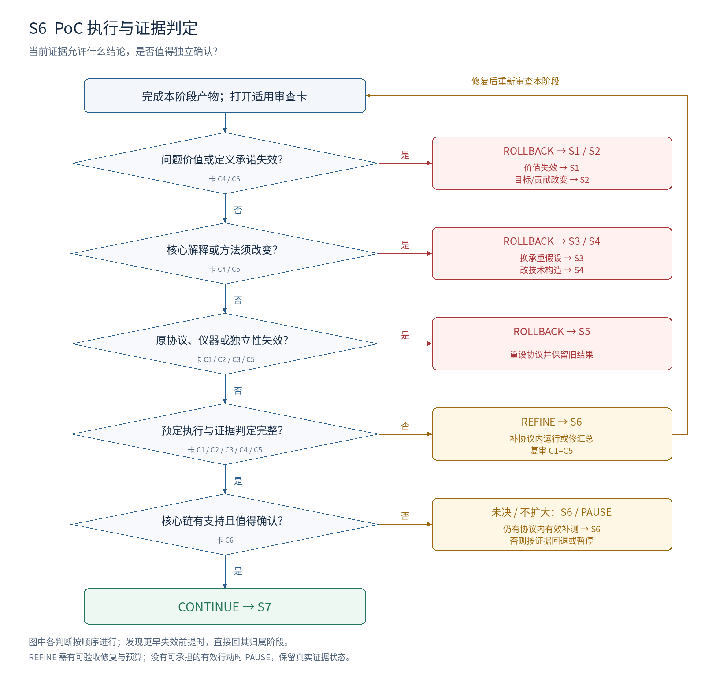

# S6：PoC 执行与证据判定

**本阶段要决定：当前证据允许什么结论，是否值得独立确认？**

## 进入条件

S5 冻结协议及仪器记录；S4 方法版本；尚未用于该确认的数据或运行。

## 按顺序做什么

1. 按顺序实际执行并记录方法、数据、配置、分析版本及所有运行结局。
2. 先判执行与测量有效性，再解释效果；偏离协议的部分单列。
3. 按照预定规则计算结果、不确定性、损害和成本，不事后挑赢家。
4. 逐条更新假设，区分效果、机制、可获得性和范围的支持。
5. 选择继续、补已计划证据或回到具体上游对象；给出可交接的决定记录。

## 最小交付

- 运行台账与原始证据定位；每条假设的限定状态；协议偏离记录。
- 有效结论、剩余反方、成本、下一行动及其具体阶段。

## 此时不要求什么

所有领域覆盖；把局部证据包装成最终论文。负结果可以有价值，但更换贡献要重新定位。

## 独有决策图

[查看可编辑 SVG](../diagrams/S6_decision.svg)

图中主线条件表示进入下一判断；侧向分支表示修复或跳到指定阶段。多目标框按所列失效对象选择一个实际目标，不能一次同时跳转。任何已发现的更早失效前提，均优先按回退归属表处理。

## 六张解释性审查卡

每张卡按主要贡献类型启用。执行前均未审核；每项结论需要本项目的证据定位。卡内所列是可能症状，不能据此假定项目确实有该问题。

### S6-C1 · 实际执行和来源可追溯

**为什么查：** 计划、日志片段和完整有效运行是不同证据。

**检查哪里：** 运行台账；原始产物；方法/数据/配置版本。

**怎么检查：** 抽查决定性数字能否回到实际产物；逐项核对预定检查完成情况。

**什么算有问题：** 只有截图无源记录；未完成任务被写成负结果；旧版本结果贴给新方法。

**期望产物：** 所有关键结果有真实运行身份与来源；未完成、无效和有效结果分开。

**最小修复：** 补执行记录或完成已规定检查；缺失证据保持未测。

**如何验收：** 审核者可从结果追到输入与原始输出，不把计划当执行。

**失败后的动作与归属：** REFINE S6；仪器无效回 S5；必须修改方法则回 S4。

**本轮填写：** 状态 [ ]；项目证据位置 [ ]；Issue ID [ ]；实际验收记录 [ ]。

### S6-C2 · 协议执行没有选择性偏离

**为什么查：** 事后调整指标和样本会改变结果所能支持的强度。

**检查哪里：** 冻结协议；实际运行、选择和分析记录。

**怎么检查：** 逐项对照主量、分组、停止规则和候选选择；列出全部偏离。

**什么算有问题：** 只报告成功子集；换主指标后仍称预先确认；额外查看后不调整解释。

**期望产物：** 预定分析完整报告；探索性变化单独标注，不沿用原确认身份。

**最小修复：** 按原协议补汇总；需要新协议时保留旧结果，另开版本和独立确认。

**如何验收：** 审核者能区分原协议结果与后续探索，失败不被删除。

**失败后的动作与归属：** REFINE S6 处理执行遗漏；主协议要改回 S5；研究目标变了回 S2。

**本轮填写：** 状态 [ ]；项目证据位置 [ ]；Issue ID [ ]；实际验收记录 [ ]。

### S6-C3 · 数值解释匹配精度

**为什么查：** 点估计高、未显著和确证无效不能画等号。

**检查哪里：** 效应、区间、分组单位、意义门槛与计算记录。

**怎么检查：** 重新计算核心对比；检查不确定性是否针对正确单位；套用事前规则。

**什么算有问题：** 把跨门槛区间写成支持；把小样本未显著写成没有机制。

**期望产物：** 每项结论注明条件和不确定性；支持、反驳与未决区别明确。

**最小修复：** 修汇总或补协议已允许的重复；若精度设计有缺陷，重设协议。

**如何验收：** 使用同一原始证据可重得相同判断；无效数据不进入科学裁决。

**失败后的动作与归属：** REFINE S6 修计算/预定补测；精度或分析原则失效回 S5。

**本轮填写：** 状态 [ ]；项目证据位置 [ ]；Issue ID [ ]；实际验收记录 [ ]。

### S6-C4 · 证据层次与主张对应

**为什么查：** 结果改善不会自动说明机制正确或能够部署。

**检查哪里：** 假设台账；效果、机制、可获得性与范围的证据栏。

**怎么检查：** 逐条问本项证据排除了什么解释、没有排除什么；检查信息边界。

**什么算有问题：** oracle 上界写成可实现收益；一个综合分数给所有假设通过。

**期望产物：** 只更新被实际检验的行；未检验机制保持未测或未决。

**最小修复：** 拆开结论；保留真实支持范围；缺少核心义务时按归属补设计。

**如何验收：** 每个状态变化都能定位匹配比较；不借用不相干结果。

**失败后的动作与归属：** REFINE S6 修误判；缺决定性比较回 S5；需换核心假设回 S3。

**本轮填写：** 状态 [ ]；项目证据位置 [ ]；Issue ID [ ]；实际验收记录 [ ]。

### S6-C5 · 负结果与替代解释受到认真处理

**为什么查：** 无效实验和机制反证需要不同修复，不能统一称为不成功。

**检查哪里：** 失败分类；前提检查；最强反方对比。

**怎么检查：** 依次检查前提、测量、实现和比较；仅在有效证据下讨论科学反证。

**什么算有问题：** 失败一律怪实现；支持反方的结果被解释成继续原方法的理由。

**期望产物：** 说明有效负结果否定哪一段连接，哪些替代解释仍未排除。

**最小修复：** 补已有协议缺口；需改仪器、方法或解释时分别回归其阶段。

**如何验收：** 每个失败标签有依据与后果；仍不充分时保留未决。

**失败后的动作与归属：** 执行缺口 REFINE S6；测量回 S5，方法回 S4，承重解释回 S3。

**本轮填写：** 状态 [ ]；项目证据位置 [ ]；Issue ID [ ]；实际验收记录 [ ]。

### S6-C6 · 下一笔投入由证据支持

**为什么查：** 沉没成本和论文愿望不能充当扩大理由。

**检查哪里：** 限定贡献、剩余未知、成本与下一行动。

**怎么检查：** 检查最短核心链是否有足够支持；说明独立确认会改变哪个重要判断。

**什么算有问题：** 结果未决却直接铺开基准；方法主张失败后悄悄改成发现论文。

**期望产物：** 明确继续所依赖的贡献和风险；暂停、转向与继续都有证据依据。

**最小修复：** 选择最小必要行动；改变贡献类型先回 S2，价值消失回 S1。

**如何验收：** 交接记录写明 action、目标阶段、原因、所需产物与预算。

**失败后的动作与归属：** 核心链有支持且全部关口通过才 CONTINUE S7；否则按归属修复、回退或暂停。

**本轮填写：** 状态 [ ]；项目证据位置 [ ]；Issue ID [ ]；实际验收记录 [ ]。

## 执行判断的顺序

| 顺序 | 判断 | 沿主线条件 | 另一分支及动作 |
| --- | --- | --- | --- |
| 1 | 问题价值或定义承诺失效？ | 否 → 下一判断 | 是 → ROLLBACK S1 / S2；价值失效 → S1；目标/贡献改变 → S2 |
| 2 | 核心解释或方法须改变？ | 否 → 下一判断 | 是 → ROLLBACK S3 / S4；换承重假设 → S3；改技术构造 → S4 |
| 3 | 原协议、仪器或独立性失效？ | 否 → 下一判断 | 是 → ROLLBACK S5；重设协议并保留旧结果 |
| 4 | 预定执行与证据判定完整？ | 是 → 下一判断 | 否 → REFINE S6；补协议内运行或修汇总；复审 C1–C5 |
| 5 | 核心链有支持且值得确认？ | 是 → 下一判断 | 否 → REFINE S6（协议内有效补测）；需改上游则 ROLLBACK；无有效动作则 PAUSE；仍有协议内有效补测 → S6；否则按证据回退或暂停 |
| 全部通过 | 全部适用必需项 MET、无上游阻塞 | CONTINUE → S7 | 预算不足时暂停，不降低判据 |

## 一次实际审查应如何表达（教学虚构）

教学虚构：主表漏计了失败运行。先对照协议：若协议已要求全部计入而汇总漏行，S6-C2/C3 本阶段重算；若协议从未规定分母且选择依赖结果，回 S5；若真实目标其实被改成“成功运行中的表现”，回 S2。相同症状可能有不同归属，必须定位原因。

## 离开本阶段前的交接

填写 T1 审查结果与 T4 交接单：S6 有效输入和产物版本、开放 issue、证据状态、动作与目标、下一项工作及预算。回退先标记受影响依赖；阶段内修复按原 issue 验收后复审。
