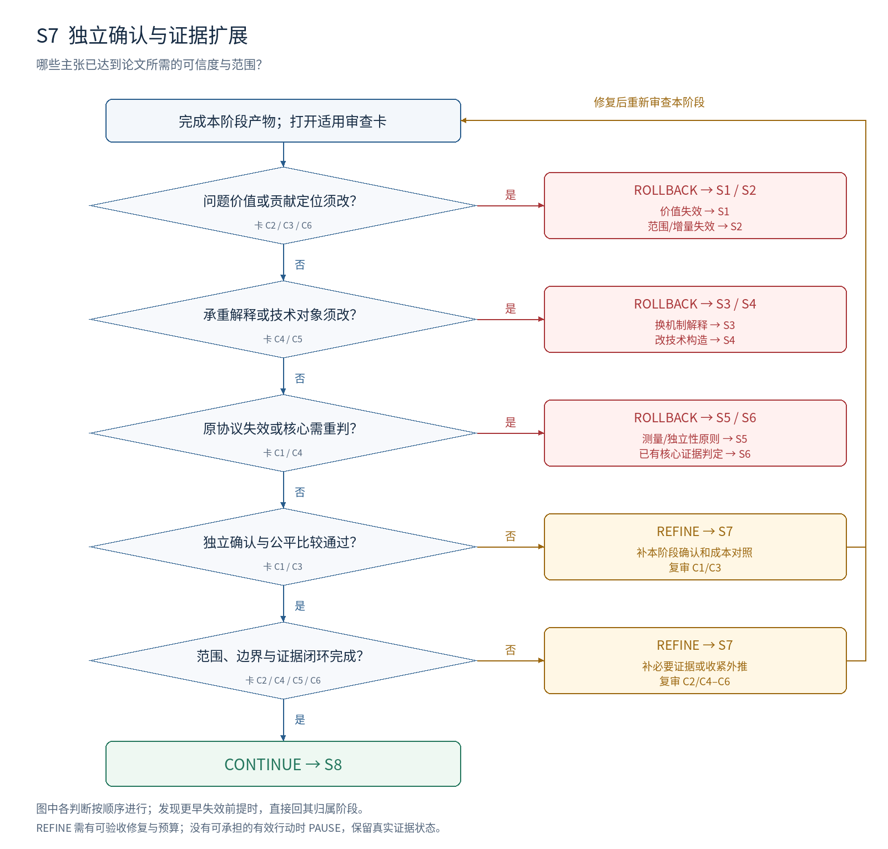

# S7：独立确认与证据扩展

**本阶段要决定：哪些主张已达到论文所需的可信度与范围？**

## 进入条件

S6 限定结论、冻结候选和剩余解释；拟保留的论文主张。

## 按顺序做什么

1. 先确认核心结果：固定候选与比较，再使用独立信息或新的适当重复。
2. 为拟保留的每条扩展主张写验证义务；按同样标准准备新增测量与协议。
3. 选择由主张要求的任务、模型、来源、条件或证明范围，不堆重复榜单。
4. 加入边界、损害、完整成本和强基线，区分评估、训练与完整搜索的随机性。
5. 更新主张—证据矩阵；决定保留、收缩外推还是回退核心前提。

## 最小交付

- 论文证据矩阵；独立确认记录；范围、边界、成本和失败材料。
- 保留的主张版本；未支持外推清单及全部必要回退记录。

## 此时不要求什么

普遍胜过所有方法；与主张无关的额外实验；为了规整结果而删除核心失败。

## 独有决策图

[查看可编辑 SVG](../diagrams/S7_decision.svg)

图中主线条件表示进入下一判断；侧向分支表示修复或跳到指定阶段。多目标框按所列失效对象选择一个实际目标，不能一次同时跳转。任何已发现的更早失效前提，均优先按回退归属表处理。

## 六张解释性审查卡

每张卡按主要贡献类型启用。执行前均未审核；每项结论需要本项目的证据定位。卡内所列是可能症状，不能据此假定项目确实有该问题。

### S7-C1 · 确认独立于候选选择

**为什么查：** 在挑选赢家的材料上重复评估，不是对选择过程的独立确认。

**检查哪里：** 候选冻结时间；数据角色；确认与选择记录。

**怎么检查：** 追踪确认信息是否参与选候选、调方法或设主结论；确认重复针对哪层随机性。

**什么算有问题：** 只换评测随机种子却声称训练稳健；继续在确认集调候选。

**期望产物：** 确认设计匹配主张；选择和确认用途分离，重复层级明确。

**最小修复：** 冻结版本，获取适当独立信息；理论主张改用独立推导或证明核查义务。

**如何验收：** 确认结果有未参与该选择的信息来源或独立复核记录；剩余依赖如实说明。

**失败后的动作与归属：** REFINE S7 补本阶段确认；原测量/独立性原则失效回 S5；核心需重判回 S6。

**本轮填写：** 状态 [ ]；项目证据位置 [ ]；Issue ID [ ]；实际验收记录 [ ]。

### S7-C2 · 每条扩展都有必要证据

**为什么查：** 增加实验数量不等于覆盖论文承诺的范围。

**检查哪里：** 拟保留主张；证据矩阵的对象、范围和结论栏。

**怎么检查：** 逐条问主张量词覆盖什么；将具体实验、证明或资源核查映射过去。

**什么算有问题：** 一个任务写普遍有效；多张同类榜单替代跨来源验证。

**期望产物：** 所有保留主张有匹配范围；未支持部分明确撤回或列为未来问题。

**最小修复：** 补决定性范围检查，或收缩本阶段提出的外推。

**如何验收：** 删除任何证据行时，能指出哪些主张受影响；没有空挂的核心承诺。

**失败后的动作与归属：** REFINE S7；核心范围或贡献类型须改则回 S2。

**本轮填写：** 状态 [ ]；项目证据位置 [ ]；Issue ID [ ]；实际验收记录 [ ]。

### S7-C3 · 强基线与资源公平

**为什么查：** 扩展后的优势可能来自弱比较或未计算的额外资源。

**检查哪里：** 基线设置；调优资源；训练、构建、使用与搜索成本。

**怎么检查：** 核对近邻方案、实现质量及关键资源；解释不能相等的条件。

**什么算有问题：** 只计使用成本却声称全流程更便宜；基线没有获得合理调优。

**期望产物：** 比较对象与主张相称；质量—成本和信息差异可复核。

**最小修复：** 补强基线，记录全成本或收紧效率主张。

**如何验收：** 审核者能重建比较口径，并判断资源差异是否足以解释结果。

**失败后的动作与归属：** REFINE S7；底层成本/测量原则错回 S5；知识增量消失回 S2。

**本轮填写：** 状态 [ ]；项目证据位置 [ ]；Issue ID [ ]；实际验收记录 [ ]。

### S7-C4 · 边界与失败不会被平均掩盖

**为什么查：** 总体均值可能隐藏关键分组受损和使用条件失效。

**检查哪里：** 分组结果；失败案例；异常条件；反例检查。

**怎么检查：** 按主张相关条件检查损害与失效，不按好看结果重新定义组。

**什么算有问题：** 只报总均值；核心目标组受损但被归入局限；失败样本无去向。

**期望产物：** 重要边界与损害有记录；核心失败被重新裁决，外推失败被如实限制。

**最小修复：** 补有依据的分组或反例；对新增探索标明身份并独立确认关键发现。

**如何验收：** 读者能看见主要成功与失败条件，以及它们怎样改变主张。

**失败后的动作与归属：** REFINE S7 补边界；核心结果需重判回 S6，机制反例回 S3，方法缺陷回 S4。

**本轮填写：** 状态 [ ]；项目证据位置 [ ]；Issue ID [ ]；实际验收记录 [ ]。

### S7-C5 · 机制、部署与局部理论不混用

**为什么查：** 论文范围扩大时，早期限定容易被不知不觉抹去。

**检查哪里：** 机制结论、使用时条件、理论应用范围与相应证据。

**怎么检查：** 逐句核查“因为”“能够”“一般”分别由什么证据支撑。

**什么算有问题：** 可搜索到方案写成能学习到；局部定理解释未覆盖的实际现象。

**期望产物：** 不同层次各有适用证据；非核心解释可以保留为探索，但身份清楚。

**最小修复：** 补匹配比较或撤回解释性措辞；核心连接失效必须回上游。

**如何验收：** 主张范围不超过证据的对象、信息条件和逻辑强度。

**失败后的动作与归属：** REFINE S7 修本阶段外推；改假设回 S3，改技术对象回 S4，改定位回 S2。

**本轮填写：** 状态 [ ]；项目证据位置 [ ]；Issue ID [ ]；实际验收记录 [ ]。

### S7-C6 · 论文证据形成可交付闭环

**为什么查：** 零散成果不足以让写作阶段知道哪些话可以成立。

**检查哪里：** 完整矩阵；开放问题；结果版本；拟交付论文主线。

**怎么检查：** 按核心结论遍历依赖，核查全部到期义务及未解决阻塞。

**什么算有问题：** 只交最佳表格；失败、限制和版本散落；仍欠核心证据却进入润色。

**期望产物：** 核心结论、必要机制/构念/证明、范围和成本可追溯；阻塞项已清楚裁决。

**最小修复：** 补材料索引和缺失核查；本阶段外推可合理收缩。

**如何验收：** S8 接收者可依据矩阵写出准确主张，无需猜哪些结果有效。

**失败后的动作与归属：** 全部关口通过 CONTINUE S8；当前缺口 REFINE S7；基础证据问题回实际归属阶段。

**本轮填写：** 状态 [ ]；项目证据位置 [ ]；Issue ID [ ]；实际验收记录 [ ]。

## 执行判断的顺序

| 顺序 | 判断 | 沿主线条件 | 另一分支及动作 |
| --- | --- | --- | --- |
| 1 | 问题价值或贡献定位须改？ | 否 → 下一判断 | 是 → ROLLBACK S1 / S2；价值失效 → S1；范围/增量失效 → S2 |
| 2 | 承重解释或技术对象须改？ | 否 → 下一判断 | 是 → ROLLBACK S3 / S4；换机制解释 → S3；改技术构造 → S4 |
| 3 | 原协议失效或核心需重判？ | 否 → 下一判断 | 是 → ROLLBACK S5 / S6；测量/独立性原则 → S5；已有核心证据判定 → S6 |
| 4 | 独立确认与公平比较通过？ | 是 → 下一判断 | 否 → REFINE S7；补本阶段确认和成本对照；复审 C1/C3 |
| 5 | 范围、边界与证据闭环完成？ | 是 → 下一判断 | 否 → REFINE S7；补必要证据或收紧外推；复审 C2/C4–C6 |
| 全部通过 | 全部适用必需项 MET、无上游阻塞 | CONTINUE → S8 | 预算不足时暂停，不降低判据 |

## 一次实际审查应如何表达（教学虚构）

教学虚构：扩展阶段仍使用挑选候选的同一批实例。S7-C1 判 GAP/CONFLICT，要求冻结候选并取得未用于选择的信息。若只是本阶段确认没完成，留在 S7；若发现连 S6 的独立性依据都无效，回 S5，再重判受影响证据。

## 离开本阶段前的交接

填写 T1 审查结果与 T4 交接单：S7 有效输入和产物版本、开放 issue、证据状态、动作与目标、下一项工作及预算。回退先标记受影响依赖；阶段内修复按原 issue 验收后复审。
