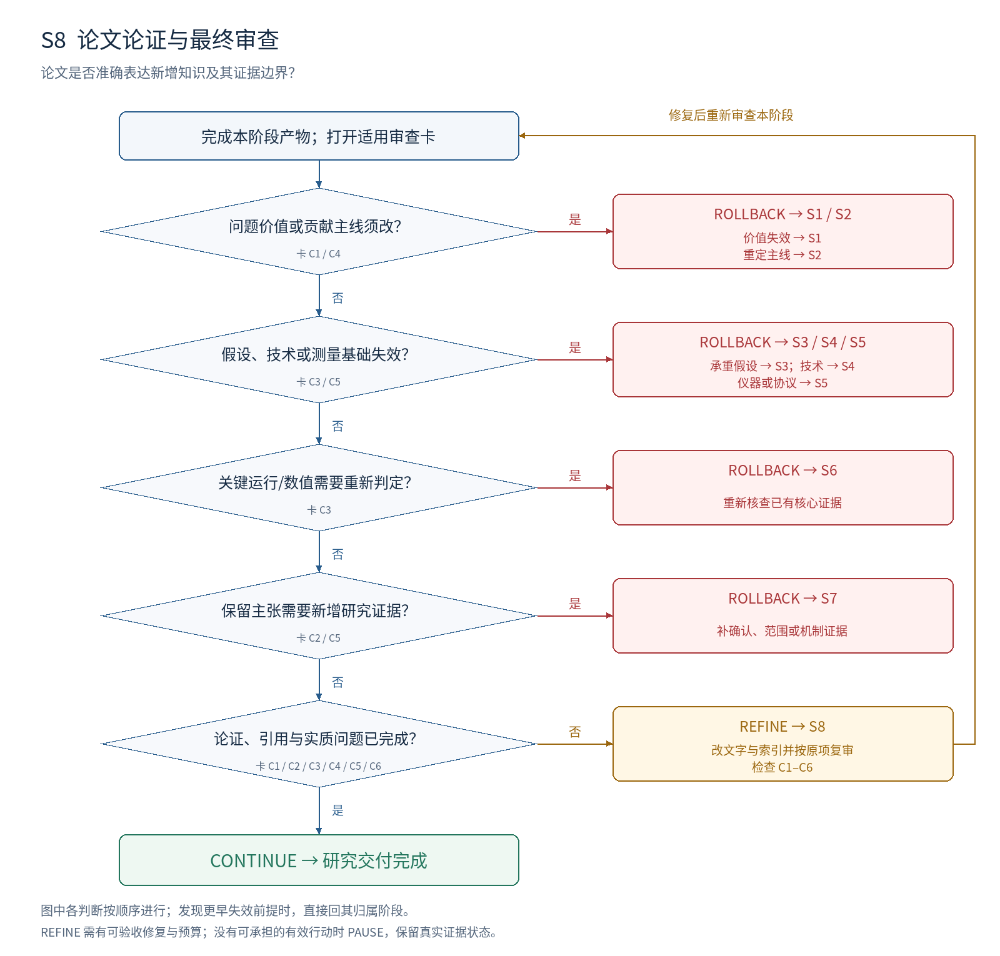

# S8：论文论证与最终审查

**本阶段要决定：论文是否准确表达新增知识及其证据边界？**

## 进入条件

S7 证据矩阵；各阶段有效版本；持续维护的统一主稿。

## 按顺序做什么

1. 写清问题、已有认识、具体增量、技术选择、证据与边界之间的论证。
2. 为摘要、引言、结果解释和结论中的主要主张编号并绑定证据。
3. 核对术语、量词、样本、单位、方法、证明和版本，检查跨章节一致性。
4. 从原始材料重新计算或独立核查决定性结果；处理复核发现。
5. 完成表达和材料索引；核心证据不足时按归属回退，全部通过后交付。

## 最小交付

- 统一论文；主张—证据映射；关键复核记录；可追溯材料索引。
- 最终审查与交接单，注明完成的是研究交付而非录用保证。

## 此时不要求什么

真实会议录用结论；没有依据的接受概率；补写看似完整的结果。

## 独有决策图

[查看可编辑 SVG](../diagrams/S8_decision.svg)

图中主线条件表示进入下一判断；侧向分支表示修复或跳到指定阶段。多目标框按所列失效对象选择一个实际目标，不能一次同时跳转。任何已发现的更早失效前提，均优先按回退归属表处理。

## 六张解释性审查卡

每张卡按主要贡献类型启用。执行前均未审核；每项结论需要本项目的证据定位。卡内所列是可能症状，不能据此假定项目确实有该问题。

### S8-C1 · 论文主线解释知识增量

**为什么查：** 读者需要知道答案改变了什么认识，而不仅看到工作量。

**检查哪里：** 摘要；引言问题和贡献段；结论。

**怎么检查：** 各用一句话写问题、已有答案、缺口、新答案和证据；检查彼此是否对接。

**什么算有问题：** 动机、方法和结果分别解决不同问题；贡献只列做了多少实验。

**期望产物：** 一个清晰主线贯穿全文，具体增量可从近邻和证据中检查。

**最小修复：** 重组论证与贡献句；如果必须改研究定位才能成立，回上游。

**如何验收：** 不看宣传形容词，读者仍能准确复述新增知识与适用条件。

**失败后的动作与归属：** REFINE S8 改表达；核心定位需改回 S2；问题价值失效回 S1。

**本轮填写：** 状态 [ ]；项目证据位置 [ ]；Issue ID [ ]；实际验收记录 [ ]。

### S8-C2 · 每个主要主张有范围匹配的证据

**为什么查：** 写作最容易把探索、相关性或局部支持提升为确定保证。

**检查哪里：** 摘要/引言/结论的 claim ID；矩阵证据与限制。

**怎么检查：** 标出“所有、因为、保证、更好”等词；逐条核查其对象、范围和逻辑强度。

**什么算有问题：** 把假设写成事实；结果范围和结论量词不一致。

**期望产物：** 每条主要主张定位到匹配证据；不确定结论保留相应语气和条件。

**最小修复：** 修词与量词；要保留更强主张就补相应证据。

**如何验收：** 逐条比对后，读者不会从句子推出证据未允许的结论。

**失败后的动作与归属：** REFINE S8 修措辞；需要新证据回 S7；核心贡献改变回 S2。

**本轮填写：** 状态 [ ]；项目证据位置 [ ]；Issue ID [ ]；实际验收记录 [ ]。

### S8-C3 · 数字、方法与证明相互一致

**为什么查：** 准确叙事仍可能建立在错误汇总或版本混用上。

**检查哪里：** 主要图表；原始记录；公式；代码/规格版本。

**怎么检查：** 独立重算决定性数值；核对分母、单位、样本和命题依赖。

**什么算有问题：** 主表与日志不符；方法描述对应新版本，结果来自旧版本。

**期望产物：** 关键结果可重算或检查，版本与范围一致；差异有公开解释。

**最小修复：** 先定位差异的归属：文字、汇总、测量、技术对象或假设。

**如何验收：** 复核记录给输入、步骤、结果和差异处理，不能仅“另一人同意”。

**失败后的动作与归属：** 笔误 REFINE S8；证据汇总回 S6，测量回 S5，技术对象回 S4，承重命题回 S3。

**本轮填写：** 状态 [ ]；项目证据位置 [ ]；Issue ID [ ]；实际验收记录 [ ]。

### S8-C4 · 相关工作与引用准确

**为什么查：** 不准确的近邻描述会制造虚假的新颖性和动机。

**检查哪里：** 相关工作；技术比较；引用所在句及原文位置。

**怎么检查：** 核查决定性引用真正支持什么；确认未省略会改变结论的已有能力。

**什么算有问题：** 引用只支持背景却被用来证明缺口；批评了近邻并不存在的限制。

**期望产物：** 他人工作和本工作差异被准确表述，检索边界清楚。

**最小修复：** 修引用与比较；如实更新重合威胁及其影响。

**如何验收：** 审核者可回到原文复核关键定位；结论不依赖错误转述。

**失败后的动作与归属：** REFINE S8 修引用；增量因此失效回 S2，具体技术需重构回 S4。

**本轮填写：** 状态 [ ]；项目证据位置 [ ]；Issue ID [ ]；实际验收记录 [ ]。

### S8-C5 · 可复查性与局限完整

**为什么查：** 读者无法重建过程时，难以评估结论的适用性。

**检查哪里：** 方法说明；数据/证明/记录索引；局限与失败段。

**怎么检查：** 模拟一位新读者重建核心检查：哪些步骤、条件或材料仍缺失。

**什么算有问题：** 关键设置只有作者知道；失败没有报告；局限与主张互相矛盾。

**期望产物：** 必要条件与材料可定位；不可开放材料明确限制及可替代核查路径。

**最小修复：** 补说明、索引和边界；材料缺失影响证据时重新取得或收紧主张。

**如何验收：** 读者能复查关键推理，或明确知道不可复查部分怎样限制结论。

**失败后的动作与归属：** REFINE S8 补表达索引；缺失实际证据回 S6/S7；规格欠缺回 S4。

**本轮填写：** 状态 [ ]；项目证据位置 [ ]；Issue ID [ ]；实际验收记录 [ ]。

### S8-C6 · 关闭的是实质问题

**为什么查：** 不断换审稿措辞或用综合评分结束审核会掩盖未解决缺口。

**检查哪里：** 开放 issue、验收记录、版本与最后交接单。

**怎么检查：** 先按原验收条件逐条复审；再检查新修改有没有引入实质矛盾。

**什么算有问题：** 换个 reviewer 就算独立验证；核心问题未修却以总分通过。

**期望产物：** 所有适用必需项 MET；非阻塞建议与科学缺口分开；保留历史和失败。

**最小修复：** 完成具体修复与复核；循环耗尽时暂停或回退，不降低标准。

**如何验收：** 交接者可逐条确认关闭依据、有效版本、保留主张和局限。

**失败后的动作与归属：** 全部通过后完成交付；本阶段缺口 REFINE S8；上游失效按对象回退。

**本轮填写：** 状态 [ ]；项目证据位置 [ ]；Issue ID [ ]；实际验收记录 [ ]。

## 执行判断的顺序

| 顺序 | 判断 | 沿主线条件 | 另一分支及动作 |
| --- | --- | --- | --- |
| 1 | 问题价值或贡献主线须改？ | 否 → 下一判断 | 是 → ROLLBACK S1 / S2；价值失效 → S1；重定主线 → S2 |
| 2 | 假设、技术或测量基础失效？ | 否 → 下一判断 | 是 → ROLLBACK S3 / S4 / S5；承重假设 → S3；技术 → S4；仪器或协议 → S5 |
| 3 | 关键运行/数值需要重新判定？ | 否 → 下一判断 | 是 → ROLLBACK S6；重新核查已有核心证据 |
| 4 | 保留主张需要新增研究证据？ | 否 → 下一判断 | 是 → ROLLBACK S7；补确认、范围或机制证据 |
| 5 | 论证、引用与实质问题已完成？ | 是 → 下一判断 | 否 → REFINE S8；改文字与索引并按原项复审；检查 C1–C6 |
| 全部通过 | 全部适用必需项 MET、无上游阻塞 | CONTINUE → 完成研究交付 | 预算不足时暂停，不降低判据 |

## 一次实际审查应如何表达（教学虚构）

教学虚构：摘要写“全面提高能力”，证据只支持预定范围 G。若 G 本来就是核心范围，S8-C2 要求改成范围匹配的表述并留在 S8；若作者坚持保留更广主张，需要回 S7 获得证据；若广泛能力才是唯一有价值的贡献且已被否定，则回 S2 重定主线。

## 离开本阶段前的交接

填写 T1 审查结果与 T4 交接单：S8 有效输入和产物版本、开放 issue、证据状态、动作与目标、下一项工作及预算。回退先标记受影响依赖；阶段内修复按原 issue 验收后复审。
