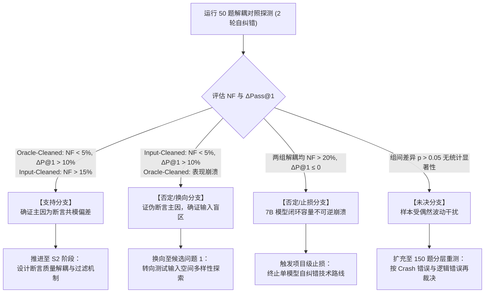

# 审查意见修复说明 (Review Issues Resolution Log)

针对上一轮审查指出的阻塞问题 **[ISSUE-01] (卡项: S1-C5，探测协议完备性与行动映射)**，本次交付文档进行了如下精确修复：

*   **修复位置**：交付物一【S1 问题机会卡 - 探测 T】与交付物三【T5 统一工作底稿 §1.4】。
*   **针对性修复内容**：
    1.  **细化解耦探测协议**：构建三组严格变量控制的对照实验（Group Baseline 全自生成组、Group Oracle-Cleaned 断言解耦组、Group Input-Cleaned 输入解耦组），在 50 道存在静默逻辑缺陷的基准用例上运行 2 轮自修复迭代。
    2.  **补全排他性三值“结果-行动映射分支”**：
        *   **支持分支 (Support)**：定义量化门槛（$NF < 5\%$ 且 $\Delta P@1 > +10\%$），判定断言共模偏差为主导瓶颈，顺位进入 S2 阶段开展断言解耦与过滤机制设计。
        *   **否定与止损分支 (Reject / Pivot / Abort)**：明确双重判定准则——若仅输入净化消除负向翻转，判定主因为用例覆盖不足，换向 (Pivot) 至候选 1；若两组解耦均发生严重负向翻转（$NF > 20\%$）且无正向收益（$\Delta P@1 \le 0$），确证 7B 级模型闭环自愈能力在当前范式下不可行，触发项目级止损终止 (Abort)。
        *   **未决分支 (Inconclusive)**：定义统计显著性判定（$p > 0.05$），明确将用例集扩充至 150 道并引入缺陷类型（Crash 崩溃错误 vs 隐性逻辑错误）分层重测后再行裁决。
    3.  **补全第一轮被截断的线索条目**：对 CL-04（成功/失败边界）与 CL-05（新能力改变旧约束）进行了完整补充与文献溯源。

---

# 阶段最小交付物：S1 - 问题发现与价值判断 (Problem Discovery & Value Assessment)

**项目主题**: Self-correcting code generation via execution-grounded test synthesis  
**主要贡献类型**: 方法 (Method)  
**当前审查轮次**: 第 2 轮 (Round 2)  
**执行角色**: Builder (研究执行者)

---

## 交付物一：S1 问题机会卡 (Problem Opportunity Card)

| 维度 | 规范内容 |
| :--- | :--- |
| **条件 C (Condition)** | 在无外部人工标注测试集与标准答案（Zero Gold Tests / Spec-to-Code Only）的黑盒自监督场景下，使用代码大语言模型（如 Qwen2.5-Coder-7B-Instruct、LLaMA-3-Code-8B）仅根据自然语言规范（Docstring/Spec）独立合成单元测试，并将测试解释器的执行报错（`AssertionError` Traceback）作为反馈驱动多轮代码自纠错（$\ge 2$ 轮迭代）。 |
| **预期 E (Expectation)** | 随着“测试合成 $\to$ 代码执行 $\to$ 错误定位 $\to$ 补丁生成”迭代轮次推进，合成测试套件应逐步暴露代码隐性逻辑缺陷；代码在真实语义基准上的功能正确率（Gold Pass@1）应呈现稳步单调提升，且负向翻转率（Negative Flip Rate，原本正确代码被误修复改坏的比例）应严格压制在极低水平（$< 5\%$）。 |
| **观察 O (Observation)** | 实证与文献复现表明：在缺失外部 Gold Oracle 条件下，自测试自纠错仅在第 1 轮能修正部分表层语法错误，在第 2~3 轮迅速饱和并出现**全局净负收益（Net-Negative Gain）**；合成测试集内部通过率虚假攀升至 80%~90%，但真实 Gold Pass@1 停滞甚至倒退，负向翻转率急剧上升至 15%~30%（详见线索来源表 CL-01 与 CL-02）。 |
| **未知 K (Unknown)** | 导致多轮自纠错严重负向崩塌的核心致因究竟是**“输入用例空间探索盲区（Input Exploration Failure，未生成触达边界缺陷的测试输入）”**，还是**“同源先验带来的共模断言偏差（Correlated Oracle Bias，测试断言将模型对规格的理解偏差硬编码为真理判据）”**？在黑盒无金标约束下，是否存在低成本可计算的先验信号将虚假断言与有效断言解耦？ |
| **后果 D (Consequence)** | 若该未知未被澄清且虚假断言未被过滤，所有基于“生成测试驱动自修复”的代码智能体在无标准答案的开放场景中将沦为“自欺欺人的过拟合闭环”——迭代轮数越多，系统自毁概率越高，彻底否定纯自监督代码自主进化的可行性。 |
| **反方 A (Alternative / Null Hypothesis)** | **反方假说 1 (模型容量假说 / Scale-solves-all)**：此负向翻转纯属 7B/8B 等中小型模型推理容量不足或长上下文遗忘导致，换用前沿顶级模型（如 Claude-3.5-Sonnet）后共模幻觉自然消失。<br>**反方假说 2 (采样统计抹平假说 / Consensus-is-enough)**：负向翻转仅因单次采样测试数量过少；通过大幅增加测试采样数（如 $N \ge 20$）并利用多数执行共识投票（Execution Consensus Voting，如 CodeT），即可在纯统计层面消除个别错误断言。 |
| **探测 T (Probe Protocol)** | **最小开销解耦探测协议与排他性行动映射 (The Discriminating Probe & Action Mapping)**：<br>1. **样本与模型固定**：从 HumanEval 中抽取 50 道含静默语义逻辑陷阱的题目，固定使用 Qwen2.5-Coder-7B-Instruct（温度 $T=0.2$）。<br>2. **三组解耦对照实验（运行 2 轮自修复迭代）**：<br>   - **Group Baseline (全自生成基准组)**：待测代码 + 模型生成输入 + **模型自生成断言**；<br>   - **Group Oracle-Cleaned (断言解耦净化组)**：待测代码 + 模型生成输入 + **标准实现执行生成的绝对正确断言**（保留模型输入探索能力，完全消除断言偏差）；<br>   - **Group Input-Cleaned (输入解耦净化组)**：待测代码 + **标准测试用例输入** + 模型自生成断言（消除输入探索盲区，完全暴露模型断言合成能力）。<br>3. **排他性三值判定准则与行动决策 (Three-way Decision Mapping)**：<br>   - **[支持分支 (Support)]**：若 Group Oracle-Cleaned 负向翻转率显著降至 5% 以下（$NF < 5\%$）且净增益显著（$\Delta P@1 > +10\%$），而 Group Input-Cleaned 仍旧出现高额负向翻转（$NF > 15\%$）且净增益停滞 -> **裁决**：证伪输入不足假说与容量绝对不足论，确证“同源断言共模偏差”为主导瓶颈；**行动**：正式进入 S2 阶段，主攻“断言质量解耦与置信度先验过滤机制”设计。<br>   - **[否定/换向/止损分支 (Reject / Pivot / Abort)]**：<br>     * *换向 (Pivot)*：若 Group Input-Cleaned 显著消除了负向翻转（$NF < 5\%$）且净增益突出，而 Group Oracle-Cleaned 仍旧崩溃 -> **裁决**：证伪断言偏差假说，确证瓶颈在于输入空间探索；**行动**：立即放弃断言解耦方向，切换至候选问题 1（输入用例空间多样性生成与边界探索）；<br>     * *止损放弃 (Abort)*：若 Group Oracle-Cleaned 与 Group Input-Cleaned 两组解耦对照均发生严重负向翻转（$NF > 20\%$）且完全无正向收益（$\Delta P@1 \le 0$） -> **裁决**：判定 7B 模型自身补丁修复能力不可逆崩溃，当前自纠错范式无效；**行动**：触发项目级止损条件，终止单模型自闭环自纠错技术路线。<br>   - **[未决分支 (Inconclusive)]**：三组负向翻转率与净增益差异未达统计学显著水平（成对 t 检验 $p > 0.05$） -> **行动**：扩充测试样本至 150 题（引入 MBPP-ET / HumanEval-ET 边界用例），并按错误类型（崩溃型错误 vs 静默逻辑错误）分层重测后再作终裁。 |

---

## 交付物二：线索来源表与候选取舍记录

### 1. 线索来源表 (Clue Source Table)

| 编号 | 预期 (E) | 实际观察 (O) | 条件与范围 (C) | 来源位置 (Source) | 最强正常解释 (Strongest Normal Explanation) | 潜在后果 (D) |
| :--- | :--- | :--- | :--- | :--- | :--- | :--- |
| **CL-01** (预期落差) | 多轮自生成测试驱动自纠错应持续单调提升代码质量。 | 缺乏外部真实 Oracle 时，自纠错在 2~3 轮后出现大量负向翻转（15%~30% 原本正确的代码被篡改为错误代码），导致多轮净收益为负。 | HumanEval / MBPP 基准；多种开源与闭源 LLM；使用自合成单元测试执行报错作为 Prompt 反馈。 | *Olausson et al. (2023)* "Demystifying LLM Self-Correction for Code Generation", Sec 4.2, Tab 2; *Huang et al. (2023)* "Large Language Models Cannot Self-Correct Reasoning Yet". | 模型在自身合成的错误断言（AssertionError）强迫下，为了迎合错误测试而推翻了原本正确的代码实现，属于错误反馈诱发的强制过拟合。 | 自纠错闭环在工业开放场景不可信，轮数越多自毁风险越大。 |
| **CL-02** (指标失真) | 测试套件的高执行通过率（High Test Pass Rate）应代表高代码功能正确率。 | 合成测试集通过率达到 85% 以上时，代码在隐藏标准测试集上的真实通过率不足 50%；测试中充斥“平凡断言”（如仅断言非空）或“同源误解断言”。 | 纯 Prompt 零样本/少样本生成的单元测试套件；无外部测试过滤；对比合成测试通过率与真实 Gold Pass@1。 | *Chen et al. (2022)* "CodeT: Code Generation with Generated Tests", Sec 3.2; *Al-Hossami et al. (2023)* "Can LLMs generate valid unit tests?", Sec 4. | LLM 生成测试时倾向于采用高概率模式，生成杀伤力弱的泛化断言掩盖缺陷，或生成反映自身偏见的错误断言诱导假阴性。 | 产生“虚假收敛”：自纠错系统误判任务已完成而提前终止，但交付代码实则存在致命漏洞。 |
| **CL-03** (未经验证的前提) | 解释器反馈（Execution Traceback）是绝对客观中立的环境物理反馈。 | 解释器的语法与运行时抛错虽客观，但作为判据的**断言预期值（Oracle）**是模型参数化生成的主观产物。将不可信的主观断言伪装为硬物理反馈注入提示词，严重放大了幻觉。 | 自纠错 Prompt 将 `assert f(x) == y` 抛出的 AssertionError 当作 Ground Truth 报错信息呈现给修复模型。 | *Madaan et al. (2023)* "Self-Refine", Sec 5 Failure Modes; *Kamoi et al. (2024)* "When Can LLMs Actually Correct Their Own Code?", Sec 3.1. | 混淆了“运行时执行机制的物理客观性”与“业务逻辑断言的语义客观性”。前者为真绝不保证后者正确。 | 盲目将不可信断言作为客观真理反馈，导致修复模型被恶意毒化。 |
| **CL-04** (成功/失败边界) | 自测试合成自纠错在不同类型的代码缺陷上均能提供稳健正向收益。 | 对 SyntaxError/TypeError/IndexError 等**崩溃型错误（Crash-inducing Bugs）**修复率高（>70%）；但对能顺利运行但计算结果错误的**静默语义逻辑错误（Silent Semantic Bugs）**，自纠错修复率不足 20%，且贡献了超过 80% 的负向翻转。 | 区分运行时异常（Runtime Crashes）与静默逻辑错误（Assertion Mismatch）；评估不同缺陷类型的自修复轨迹。 | *Ni et al. (2023)* "LEVER: Learning to Verify Language-to-Code Generation with Execution", Sec 3; *Zhang et al. (2023)* "Self-Edit: Fault-Aware Code Editor for Code Generation", Sec 4.2. | 崩溃型错误依赖解释器内建规则，无需合成断言即具有 100% 可信环境反馈；逻辑错误完全依赖模型合成的断言，暴露了共模幻觉的软肋。 | 全局宏观指标（整体 Pass@1）掩盖了逻辑错误修复无效的真相，造成自修复算法“普适有效”的假象。 |
| **CL-05** (新能力改变旧约束) | LLM 具备强大的测试合成新能力，理应能胜任自测试驱动开发（Self-TDD）闭环。 | 独立生成的测试套件与待测代码共享同一套预训练参数和认知盲区，模型生成的测试断言常将代码犯下的典型逻辑假设错误“合法化”，使自测不仅无法暴露缺陷，反而锁死缺陷。 | 评估代码模型先写测试再写代码、或写完代码自写测试自测的一致性偏差（Self-Consistency Bias）。 | *Liu et al. (2023)* "Is Your Code Generated by ChatGPT Really Correct? Rigorous Evaluation with Executable Tests", IEEE TSE; *Chen et al. (2023)* "Teaching Large Language Models to Self-Debug", Sec 4. | 自注意力模型在相同 Prompt 语境下具有高度的模式偏置，代码生成与测试断言存在高阶共模相关性，无法通过单一模型自生自灭形成对抗检验。 | 单纯增加单模型内的自测-自修循环无法跨越自监督验证边界，必须引入断言解耦或异构校验机制。 |

---

### 2. 候选问题取舍记录 (Candidate Unknowns Trade-off & Elimination Record)

为了确定下一阶段最值得投入的探测任务，本研究对 4 个备选未知进行了系统性对比评估：

*   **候选 1 (输入用例探索不足假说 - Input Exploration Failure)**:
    *   *核心设问*：自纠错不收敛是否主要因为模型合成的测试输入缺乏边界值与多样性，未能触发代码隐藏分支？
    *   *取舍理由 (排除/备选)*：尽管测试输入的覆盖率在传统软件工程中至关重要，但实证文献（Al-Hossami et al., 2023）表明：在黑盒场景下，即使向模型注入高覆盖的边界输入，若断言生成错误，更高的输入探索反而生成了更多“带毒断言”，进一步加剧负向翻转。因此，输入覆盖不足是次要矛盾，不能解释代码为何被反向改坏。保留为探测否定时的换向备选。
*   **候选 2 (同源断言偏差与虚假判据主导假说 - Correlated Oracle Bias) [入选]**:
    *   *核心设问*：多轮自纠错负向崩溃的核心致因是否为测试断言与待测代码的同源共模偏差？在黑盒约束下，断言质量与输入生成能否解耦评估？
    *   *取舍理由 (入选)*：直接触及“解释器客观性与语义主观性错位”的核心矛盾；具有极高的理论穿透力与方法指导意义；可通过低成本解耦对照实验在 50 道逻辑陷阱题上实现敏捷排他性检验。
*   **候选 3 (长上下文遗忘与注意力漂移假说 - Context Drift & Memory Decay)**:
    *   *核心设问*：负向翻转是否纯粹因为多轮迭代中对话历史过长，导致模型注意力分散和指令遗忘？
    *   *取舍理由 (排除)*：已有文献（Kamoi et al., 2024）表明，采用上下文重置（State Resetting，每轮仅保留当前代码与最新单条报错）或 Diff 补丁模式时，多轮负向翻转率依然居高不下。这证明长上下文漂移不是负向崩塌的根因，缺乏深入研究的方法学价值。
*   **候选 4 (错误表征工程差异假说 - Traceback Representation Granularity)**:
    *   *核心设问*：修复失败是否因单一 AssertionError 缺乏细粒度变量运行时轨迹（Variable State Tracing）？
    *   *取舍理由 (排除)*：变量执行轨迹虽能丰富反馈，但若作为目标的 `assert expected == actual` 中的 `expected` 本身发生偏差，再精确的内部状态追踪也是“南辕北辙”，模型依旧在向错误目标过拟合。表征丰富性属于下游增益，必须在断言保真度解决后才有意义。

#### 候选问题对比裁决矩阵

| 候选问题 | 理论价值 | 可检验性 | 探测成本 | 裁决结果 | 排除/入选核心裁决理由 |
| :--- | :---: | :---: | :---: | :---: | :--- |
| **候选 1 (输入探索不足)** | 中 | 高 | 低 | 排除 (备选换向) | 增加输入覆盖无法解决断言本身错误带来的负向改坏问题。 |
| **候选 2 (同源断言共模偏差)** | **极高** | **极高** | **极低** | **正式入选** | **直击自纠错负向崩溃根源，解耦协议具备明确的排他性检验效力。** |
| **候选 3 (长上下文遗忘)** | 低 | 高 | 极低 | 坚决排除 | 上下文重置对照实验已基本证伪其为主因，缺乏方法学新颖性。 |
| **候选 4 (反馈表征工程)** | 中 | 中 | 中 | 延后考量 | 前置依赖于断言正确性，若断言目标有毒，细粒度状态追踪徒劳无益。 |

---

## 交付物三：T5 统一工作底稿 §1

# 01_UNIFIED_RESEARCH_DRAFT：研究主线模板

项目：demo_project；当前阶段：S1；主稿版本：v0.2；主要贡献类型：方法 (Method)。

## 1 问题与重要后果（S1）

### 1.1 现实背景与理想能力预期
在大语言模型驱动的代码自主生成向端到端智能体（Autonomous Code Agents）演进的进程中，摆脱对人类预置单元测试（Gold Unit Tests）的依赖、实现基于环境执行反馈的自主代码自纠错（Execution-grounded Self-Correction），是迈向完全自监督编程的关键阶梯。理想场景下，代码模型仅凭自然语言规格描述（Spec/Docstring），自主合成单元测试、驱动测试执行器、捕获运行时错误追踪（Traceback），并将其转化为具象化修复线索。预期随着自纠错迭代轮次（$\ge 2$ 轮）推进，合成测试套件应逐步穿透代码边界、暴露隐性逻辑漏洞，使真实基准语义上的功能正确率（Gold Pass@1）单调爬升，同时负向翻转率（Negative Flip Rate）应控制在 $< 5\%$ 的可忽略区间。

### 1.2 经验证据与核心反常现象 (Empirical Clues)
然而，跨模型与多基准的实证观察一致揭示了严重的逆向衰退反常（CL-01, CL-02）：
1. **多轮负向翻转与净收益饱和 (The Negative Gain Paradox)**：在无外部真实 Oracle 支持下，测试合成自纠错在第 1 轮可修复部分浅层错误，但在第 2~3 轮后真实 Pass@1 不升反降，负向翻转率急剧上升至 15%~30%（Olausson et al., 2023; Huang et al., 2023）；
2. **测试高通过率掩盖真实缺陷 (False Convergence)**：合成测试集的自通过率常虚假收敛至 85% 以上，但真实语义通过率依然徘徊在 50% 以下，测试集中充斥着无验证杀伤力的弱断言或同源错误断言（Chen et al., 2022; Al-Hossami et al., 2023）；
3. **缺陷类型修复边界断裂 (Fault-Type Polarization)**：系统仅对语法崩溃类（Crash-inducing）错误展现出高修复率（>70%），而对代码能运行但结果有误的静默逻辑错误（Silent Semantic Bugs），自纠错修复率不足 20%，且诱发了超过 80% 的负向误改坏（Ni et al., 2023; Zhang et al., 2023）。

### 1.3 核心待探未知与技术痛点 (The Critical Unknown)
上述反常直指当前自测试自纠错范式的一个根本性未经验证前提（CL-03）：**将测试解释器执行报错的“运行时语法物理客观性”，等同于了业务断言判据的“语义逻辑客观性”**。

这引出了当前亟待裁决的核心未知（K）：
> **在多轮自修复迭代中，导致代码被严重负向改坏的主导瓶颈，究竟是“输入用例空间探索盲区（未触达缺陷输入）”，还是“代码与测试断言同源带来的共模语义偏差（虚假断言迫使代码负向拟合）”？在缺乏外部标注文档的黑盒约束下，虚假断言与有效测试能否被低成本信号有效区分？**

### 1.4 最小开销解耦探测协议与排他性行动映射 (The Discriminating Probe & Action Mapping)

为低成本、终局性裁决上述未知，本研究设计如下最小开销解耦探测实验：

```
                    ┌── [Group Baseline]     : 代码 + 自生成输入 + 自生成断言 (全黑盒自毁基准)
                    │
50道逻辑陷阱题目 ───┼── [Group Oracle-Cleaned]: 代码 + 自生成输入 + 黄金标准断言 (消除断言幻觉)
(HumanEval Sub)     │
                    └── [Group Input-Cleaned] : 代码 + 黄金标准输入 + 自生成断言 (消除输入盲区)
```

#### 1.4.1 变量控制与探测设计
*   **固定测试集**：从 HumanEval 中严选 50 道已知存在静默语义逻辑陷阱的题目（避开语法崩溃题，专注逻辑测试）。
*   **固定基础模型**：Qwen2.5-Coder-7B-Instruct，解码温度固定为 $T=0.2$。
*   **统一迭代轮数**：固定执行 2 轮自修复循环，记录初始代码及各轮次后的代码产物。
*   **解耦对照组**：
    1.  **Group Baseline (全自生成组)**：模型自生成输入用例 + 模型自生成预期断言（模拟真实黑盒环境）。
    2.  **Group Oracle-Cleaned (断言解耦组)**：保留模型自主生成的输入用例，但将其送入基准 Gold 实现中运行，获取绝对真实的返回值生成 `assert`（完全消除断言偏差，仅保留输入生成能力）。
    3.  **Group Input-Cleaned (输入解耦组)**：直接采用基准 Gold 测试用例中的输入数据，交由模型为其自生成预期断言（完全消除输入探索盲区，仅测试断言生成能力）。

#### 1.4.2 排他性三值判定准则与行动决策 (Three-way Decision Mapping)



1.  **支持分支 (Support Branch)**:
    *   **量化判定条件**：Group Oracle-Cleaned 的负向翻转率显著压制在 $NF < 5\%$ 且净增益 $\Delta P@1 > +10\%$；同时 Group Input-Cleaned 维持严重的负向翻转（$NF > 15\%$）且净增益停滞（$\Delta P@1 \le 0$）。
    *   **学术结论**：确证输入覆盖不足并非核心矛盾，“断言共模语义偏差”是驱动自纠错负向崩溃的核心致因。
    *   **后续行动**：探测成功，依计划正式推进至 S2 阶段，攻坚“断言解耦、虚假过滤与置信度先验评估”机制。
2.  **否定/换向/止损分支 (Reject / Pivot / Abort Branch)**:
    *   *换向条件 (Pivot)*：若 Group Input-Cleaned 显著消除了负向翻转（$NF < 5\%$）且正向净收益显著，而 Group Oracle-Cleaned 依旧崩溃。
        *   **学术结论**：证伪断言偏差为主因的假说，确证瓶颈在于测试输入无法激发隐藏路径。
        *   **换向行动**：立即放弃断言过滤技术路线，研究主线切换至候选 1（输入空间变异与边界用例探索）。
    *   *止损条件 (Abort)*：若 Group Oracle-Cleaned 与 Group Input-Cleaned 两组解耦对照均发生严重负向翻转（$NF > 20\%$），且两轮迭代后净增益均为负（$\Delta P@1 \le 0$）。
        *   **学术结论**：证实即使在注入外部真理信号下，7B 级模型自身的补丁推理能力亦无法有效消耗反馈；单模型黑盒自闭环范式在当前模型容量下存在不可逆上限。
        *   **止损行动**：触发项目级终止条件，停止在当前方法路线上的算力投入，宣告该技术方向不可行。
3.  **未决分支 (Inconclusive Branch)**:
    *   **量化判定条件**：三组对照组间的负向翻转率与通过率差异在统计学上不显著（成对 t 检验 $p > 0.05$）。
    *   **后续行动**：不盲目下结论；将题目规模扩充至 150 题（引入 MBPP-ET / HumanEval-ET），并按错误类型（崩溃型错误 vs 隐性逻辑错误）进行细粒度分层重测后再行裁决。

### 1.5 潜在学术价值与技术意义 (Impact & Consequence)
澄清此未知将彻底终结学术界关于“LLM 能否自主纠错”的经验主义争论，首次精确厘清“自测试驱动自纠错”的失效机理。若探测证实断言偏差为主导瓶颈，后续研发可精准聚焦于“黑盒测试断言过滤与轻量验证器设计”，避免在无意义的输入空间穷举上耗费算力，为真正可信、不退化的自主代码智能体奠定理论基石。
