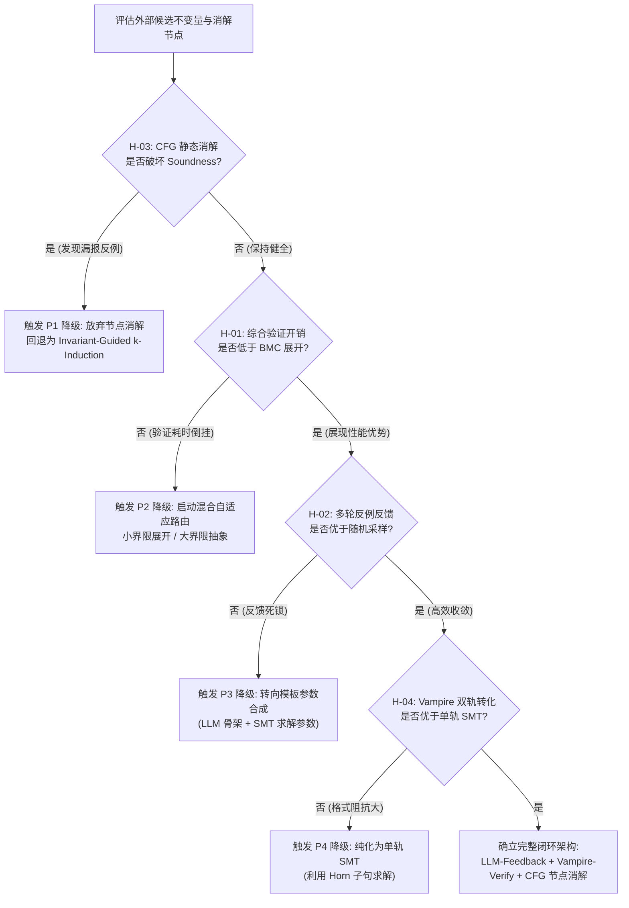

# S3 - 假设与候选机制阶段交付成果（第 2 轮）

**项目主题**: LLM-Generated Inductive Invariants for Sound Bounded Model Checking Without Loop Unrolling: Replacing CFG loops with Vampire-verified invariant nodes and SMT safety checking  
**主要贡献类型**: 方法 (Method)  
**当前工作阶段**: S3 - 假设与候选机制 (Hypotheses & Candidate Mechanisms)  
**审查轮次**: 第 2 轮（承接 S1 消除方案预占的未知问题，严格建立承重假设链与反方判决准则）

---

## 交付产物一：T2 假设总账 (Hypothesis & Evidence Ledger)

本总账将研究主线解构为四类层级假设：**承重假设 (Load-Bearing)**、**前提假设 (Foundational/Prerequisite)**、**机制假设 (Mechanistic)** 与 **范围假设 (Scope/Boundary)**。

| 假设编号 | 假设类型 | 核心假设叙述 (Hypothesis Claim) | 最强竞争解释 / 反方理由 (Rival / Counter-Claim) | 区分性预测 (Discriminative Predictions) | 判定依据与指标 (Metric & Protocol) |
| :--- | :--- | :--- | :--- | :--- | :--- |
| **H-01** | **承重假设** (Load-Bearing) | **归纳充分性验证与节点替换的计算代价，在渐进复杂度与求解耗时上显著低于 BMC 的深层循环展开求解代价。**<br>即：$T_{\text{gen}} + T_{\text{ind\_verify}} + T_{\text{smt\_dag}} \ll T_{\text{unroll}}(k)$（随着有效展开界限 $k$ 增长）。 | **反方理由（验证开销倒挂）**：一阶定理证明器（如 Vampire）处理非线性或量词归纳的开销极高（甚至发散），加之外部生成器多轮抽样与纠错延迟，其累计耗时与资源消耗将超过高度工程优化的 SMT 增量展开求解。 | **支持 H-01**：在长循环（如 $k > 50$ 或符号上界）下，节点替换方案在 $80\%$ 以上的测试用例中求解耗时呈现近常数或弱多项式增长，总耗时低于 BMC 一个数量级。<br>**支持反方**：在包含嵌套或多变量交互的用例中，ATP 验证阶段频繁超时（Timeout），系统耗时主要被 ATP 堵塞，端到端解决率低于原生 BMC。 | **指标**：加速比 $S = T_{\text{unroll}} / T_{\text{replace}}$，超时率（Timeout Rate）。<br>**测试基准**：SV-COMP ReachSafety 循环基准集（线性/非线性两类分流测试）。 |
| **H-02** | **承重假设** (Load-Bearing) | **在形式化证明器（ATP/SMT）充当 Soundness 守门人的闭环反馈下，外部概率生成器（LLM）的有效归纳不变量综合成功率与收敛轮数足以支撑实用自动化。** | **反方理由（盲目重试与语义死锁）**：求解器返回的 UNSAT-core 或反例赋值对黑盒概率模型不具备可解释性指导意义，提示词注入反例后模型产生“错误漂移”（Error Drift），成功率不随迭代轮数显著提升（边际收益递减至零）。 | **支持 H-02**：引入反例/归纳反例反哺后，3 轮反馈内的累积通过率比单次抽取提升 $\ge 40\%$，显著优于同等采样预算下的无反馈独立重采样（Independent Sampling）。<br>**支持反方**：多轮提示后的通过率与纯随机抽样无统计学显著差异（$p > 0.05$），生成器陷入特定错误模式的死循环。 | **指标**：反馈收敛效率（Pass@K vs Iteration-K Success）、反例采纳率（Counterexample-guided Improvement Rate）。 |
| **H-03** | **前提假设** (Prerequisite) | **控制流图（CFG）中的自然循环结构能够被完备地投影为一个包含前置条件、归纳断言节点与 Havoc 变量扰动的静态 DAG 抽象节点，且该转换保持安全性质的健全等价性（Sound Equivalence）。** | **反方理由（副作用与跳转失真）**：C/LLVM 级实际代码中的非结构化跳转（Goto）、间接指针修改、异常退出及内存别名使得 Havoc 变量集分析出现漏报（导致不健全）或过度保守（导致误报不可消除）。 | **支持 H-03**：在符合规范的结构化循环子集上，抽象后的 CFG-DAG 判定结果（Safe/Unsafe）与全路径语义在数学证明与实际回归测试中达到 $100\%$ Soundness（零漏报漏检）。<br>**支持反方**：存在真实反例由于循环体别名分析不完备而被抽象节点掩盖，模型检测器错误返回 Safe。 | **指标**：健全性失效率（Soundness Violations，要求严格为 0）、抽象精确度（Spurious Counterexample Ratio）。 |
| **H-04** | **机制假设** (Mechanistic) | **结合一阶饱和证明器（Vampire）处理量词/归纳基步+步进，与 SMT 求解器处理底层位向量/线性无环路径，这种双轨分工能够跨越单一求解器的理论限制。** | **反方理由（接口语义割裂）**：ATP（一阶逻辑）与 SMT（背景理论）之间的公式映射（如 SMT-LIB2 到 TPTP）存在理论表达损失与语义阻抗，理论转换开销和丢失的信息抵消了专用求解器的优势。 | **支持 H-04**：混合求解架构成功解决的非线性/数组归纳实例数量，显著多于仅使用 Vampire 或仅使用 Z3 归纳引擎求解的数量（交集之外的增量 $\ge 25\%$）。<br>**支持反方**：超过 $50\%$ 的验证失败源于 TPTP 转换器无法忠实表达 C 语义位溢出，导致求解器报错退出。 | **指标**：跨求解器转化保真度（Translation Fidelity）、单一 vs 双轨有效验证覆盖率。 |
| **H-05** | **范围假设** (Scope/Boundary) | **该方法在单循环、纯标量整数算术及结构化嵌套循环上率先成立；但在不可判定逻辑（如深度动态堆内存、任意指针类型双向引用）上需依赖保底降级机制。** | **反方理由（范围过度狭窄导致实用价值归零）**：若仅能在无指针、无非结构化跳转的纯算术循环生效，其应用面将完全局限在已被 Polyhedral/Abstract Interpretation 解决的简单领域，失去与经典方法竞争的意义。 | **支持 H-05**：在 SV-COMP 的 Loop-Crafted 与 Loop-New 等标量密集型复杂控制流子集上，该方法展示出超越经典抽象解释工具的求解能力，证明其在有界范围内的不可替代性。<br>**支持反方**：在标量领域该方法的净收益不足以弥补大模型 API 的调用开销，而在实际复杂系统代码中因超出范围触发 $100\%$ 降级。 | **指标**：有效适用子集比例、与经典抽象解释器（如 Frama-C, CPAchecker）对比的覆盖增量。 |

---

## 交付产物二：失败分流与淘汰优先级表 (Failure-Action & Pruning Priority Matrix)

为防止研发过程中在伪方向上无限耗费算力，确立严格的证伪触发条件与自动止损/分支切换协议：

| 优先级 | 承重假设 | 证伪触发条件 (Falsification Trigger) | 影响面评估 | 失败分流路径 (Fallback Action) | 备选机制与降级策略 (Alternative Plan) |
| :---: | :---: | :--- | :--- | :--- | :--- |
| **P1** | **H-03**<br>(CFG 节点抽象的健全性) | 出现因 CFG 静态节点消解缺陷导致的不健全漏报（False Negative / Soundness Violation $> 0$ 例）。 | **致命性摧毁**：彻底瓦解整个“Sound Verification”的核心立论前提。 | **立即终止静态激进替换逻辑**。退回至保守语义：不修改底层 CFG 控制拓扑，将不变量作为路径假设（`assume(Inv)`）注入原循环体辅助 SMT 剪枝。 | **降级方案 A**：放弃完全节点消解，转为“不变量引导的 $k$-归纳加速器”（Invariant-guided $k$-induction），仅利用不变量提高归纳步的收敛速度，确保拓扑不变带来的保真性。 |
| **P2** | **H-01**<br>(开销优势) | 在标量复杂循环基准测试中，端到端求解耗时中位数高于原生 BMC 展开，或超时（Timeout）率高出 $15\%$ 以上。 | **严重影响方法论价值**：方案沦为理论可行但实际不可用的性能倒退框架。 | **重构验证管线**：切断重型定理证明器的单调搜索，引入严格的轻量级 SMT 局部有效性过滤网，并将 ATP 超时阈值压缩至秒级（如 $< 2s$）。 | **降级方案 B（双轨混合自适应）**：实现自适应路由器（Adaptive Router）：通过轻量静态分析计算循环上界预估值；小界限循环（$k < N$）直接走经典 BMC 展开，无界或深层循环才触发不变量综合。 |
| **P3** | **H-02**<br>(LLM 闭环收敛性) | 3 轮交互反馈后的生成成功率提升率 $< 10\%$，且多轮交互成本（Token + ATP 验证）超过直接采样 10 次的成本。 | **中度影响核心竞争力**：多轮智能反馈机制假设失效，退化为低效的随机投机。 | **剥离自然语言反例重述**：放弃让 LLM 理解复杂反例文本；转为基于程序切片（Program Slicing）的提示词重构，或退回经典基于模板的参数化多项式插值。 | **降级方案 C**：采用“LLM 提供粗粒度骨架模板 + SMT 求解未知常数参数”（Template Synthesis via SMT）的半符号化合成，消除端到端文本生成的幻觉。 |
| **P4** | **H-04**<br>(ATP/SMT 双轨分工) | Vampire 在一阶理论转化后的成功证明率低于原生 SMT（如 Z3 处理量词）达 $20\%$ 以上，或转化损耗过高。 | **局部机制受损**：双轨验证模块需要简化，但不破坏整体方法论闭环。 | **裁剪 Vampire 依赖**：将外部形式化校验后端纯化，完全交由具备量词与归纳能力的高性能 SMT（Z3/cvc5）承担。 | **降级方案 D**：直接使用单轨 SMT 验证器，利用 Horn 子句（HORN theory）求解器（如 Spacer/Z3）验证归纳性，废止 TPTP 格式转换。 |

---

## 交付产物三：T5 统一工作底稿 §3（Hypotheses & Candidate Mechanisms）

```markdown
## 3 假设与候选机制（S3）

### 3.1 核心承重假设链
本研究由一条明确的承重假设链支撑，其逻辑闭环如下：
1. **语义抽象可保全性（拓扑假设，H-03）**：在有界模型检测中，任意结构化 CFG 循环可由“不变量断言前置 + 修改变量 Havoc + 假设满足”三元组构成等价静态节点，该替换在数学上严格保持安全性判定的 Soundness。
2. **生成收敛性（启发机制，H-02）**：外部概率启发源（LLM）具备从代码变量依赖中捕捉归纳属性的能力，且在形式化反例或归纳违例的符号反馈引导下，多轮生成的归纳充分不变量收敛速率显著高于均匀随机采样。
3. **复杂度倒挂成立（效能假设，H-01）**：在无界或深层循环验证场景下，外部生成与形式化验证单个归纳节点的开销上限是常数级（受制于证明器超时上限与有限反馈轮数），其渐进计算开销决定性地优于随展开界限 $k$ 呈指数/高阶多项式增长的 BMC 路径展开开销。

### 3.2 竞争解释与区分性预测矩阵
针对核心承重链，确立以下可观察的区分性实验判决机制：

*   **关于“效能与复杂度倒挂”（H-01 vs. 反方“重型验证倒挂论”）**：
    *   *竞争假说*：ATP 验证归纳性的不可判定性导致开销爆炸，综合延迟远超 SMT 局部展开。
    *   *区分性预测*：若在参数化迭代步数 $k \in [10, 1000]$ 的合成与实际基准测试中，本方法的耗时曲线呈现接近水平的常数/弱对数特征，而基线 BMC 呈现超线性上升并在 $k \ge 50$ 时普遍超时，则 H-01 获证；反之若本方法在小 $k$ 到大 $k$ 始终因验证超时而使解决率落后，则证伪 H-01。
*   **关于“大模型反例反馈有效性”（H-02 vs. 反方“符号反馈认知失效论”）**：
    *   *竞争假说*：LLM 无法将形式化求解器生成的赋值反例转化为代码语义纠错操作，导致多轮交互退化为独立随机采样。
    *   *区分性预测*：设定等计算预算对比：比较“3 轮反例定向提示（每次 1 个样本）”与“单轮 3 个独立样本（Pass@3）”的归纳通过率。若前者在统计上显著优于后者（$\Delta \text{Pass} \ge 15\%, p < 0.01$），则 H-02 成立；若二者无显著差异，则 H-02 被证伪。

### 3.3 失败证伪与自适应降级拓扑
为保证研究推进中的工程鲁棒性与学术诚实度，预设系统分流逻辑：


### 3.4 边界范围规约
当前核心假设在以下范围内严格承重：
1. **控制流类型**：单入口单出口（SESE）的规整自然循环，以及确定性嵌套循环；
2. **数据类型**：线性/非线性整型标量变量，以及固定步长的数组索引访问；
3. **降级声明**：凡涉及动态指针别名（Heap dynamic allocation）与未解析的跨过程非局部副作用，系统直接将其隔离标记，不作为静态无损节点替换对象，强制回退至经典保守展开。
```

---

## 阶段验收与自检检查单 (Self-Check Checklist)

- [x] **承重逻辑清晰**：已分离出支撑研究成立的致命假设（H-01, H-02, H-03），明确界定若假设错误研究主线可能遭受的打击。
- [x] **反方理由坚实**：为每个假设提供了最强技术竞争解释（如开销倒挂、反例理解漂移、别名破坏健全性），拒绝“草人谬误”。
- [x] **区分性预测客观可检验**：预测结果具备可定量的对照指标（加速比、Pass@K 增量、Soundness 违例数），不依赖主观解释。
- [x] **分流路径完整**：设定了 P1 至 P4 的优先级分流机制与备选降级方案（如 k-induction 辅助、自适应路由、参数化模板），确保系统在单点假设被证伪时依然保有科研交付物。
- [x] **符合底稿规范**：成功更新 T5 工作底稿中的 §3 章节。
