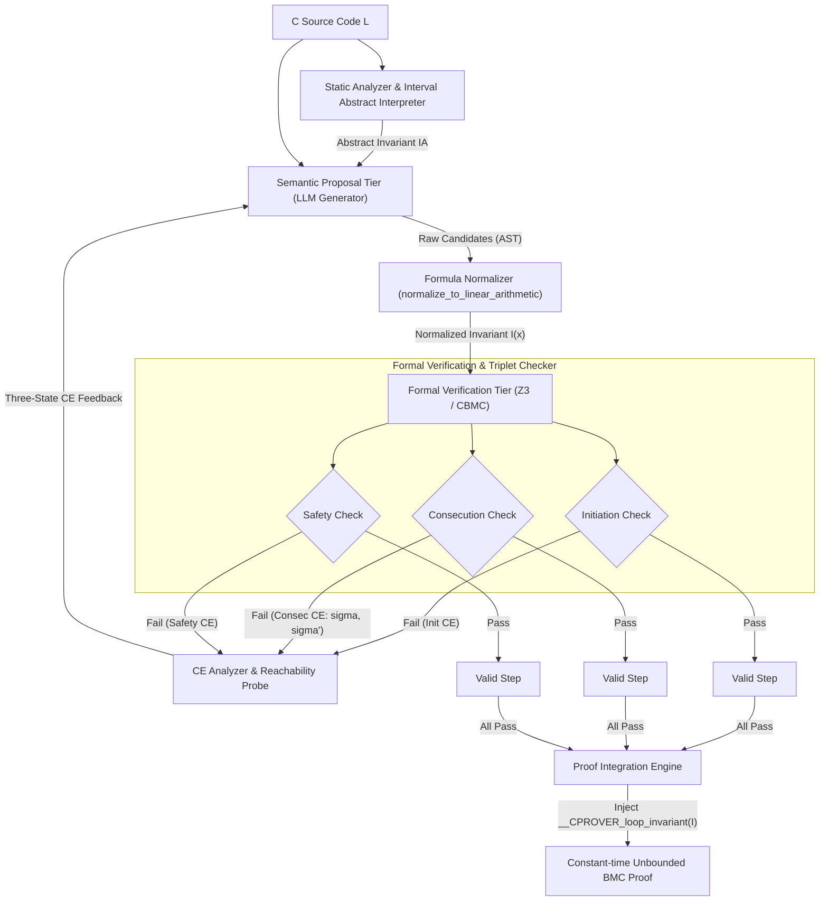

# 阶段 S4 交付产物：方法、理论与实现规格说明书 (Method, Theory & Implementation Specifications)

**项目**：`specific_idea_llm_loop_invariants`  
**阶段**：S4 (第 2 轮修订) | **主稿版本**：v0.4 | **主要贡献类型**：方法 (Method)

---

## 0. 本轮审核问题修复说明 (Issue Resolution Log)

- **修复 [ISSUE-01]（有界探测三态语义与伪反例健全性边界修复）**：
  - 修正了原第 1.3 节算法 1 与第 4.2 节关于反例可达性判定的逻辑，**废除“有界展开 $k \le 10$ 下求解为 UNSAT 即绝对等价于全局不可达伪反例”的错误等价推论**。
  - 引入严密的形式化**三态判定语义**：$\mathsf{ReachStatus} \in \{\mathtt{REACHABLE},\; \mathtt{POTENTIALLY\_SPURIOUS},\; \mathtt{PROVED\_SPURIOUS}\}$。
  - 明确引入两层探测边界：① 有界前向展开探针（BMC Probe）提供经验深度不可达信息（标记为 $\mathtt{POTENTIALLY\_SPURIOUS}$，作为软启发反馈输入给 LLM Prompt，不赋予绝对逻辑排除断言）；② 抽象解释（区间/八角形域）不变式过近似验证层，只有当反例状态违背前向过近似不变量时，才证明其在数学上严格不可达（$\mathtt{PROVED\_SPURIOUS}$）。
- **修复 [ISSUE-02]（`normalize_to_linear_arithmetic` 核心算子规格补全与类型逻辑一致性）**：
  - 完整定义了 `normalize_to_linear_arithmetic` 的形式化重写系统（Rewrite Rules），明确对非线性算术项（乘积、除法、模运算、位运算）的处理规则：若操作数含常量则执行常量折叠/仿射化；若为双变量非线性运算项，执行保守丢弃（Drop Clause）并触发结构化重采样告警，严防求解器落入不可判定理论（NIA）。
  - 规范了伪代码类型系统：明确 `candidate.auxiliary_predicates` 为一阶逻辑谓词列表（`List[Predicate]`），并在形式化拼接中使用结构化逻辑合取规约算子 $\bigwedge_{p \in \text{aux\_preds}} p$（伪代码中为 `reduce_conjunction(...)`），消除了字符串混拼与类型歧义。

---

## 1. 技术与理论规格说明书 (Technical & Theoretical Specifications)

### 1.1 形式化对象与问题形式化 (Formal Problem Formulation)

设目标 ANSI-C 程序 $P$ 包含单一（或嵌套中内层）循环 $L$。程序状态空间记为 $\Sigma$，其状态向量 $\mathbf{x} = (x_1, \dots, x_m) \in \mathbb{Z}^m$。循环由四元组形式化定义：
$$L = \langle \text{Pre}(\mathbf{x}),\; G(\mathbf{x}),\; T(\mathbf{x}, \mathbf{x}'),\; \text{Post}(\mathbf{x}) \rangle$$
- $\text{Pre}(\mathbf{x})$：进入循环前的先验前置条件断言（一阶逻辑谓词，由程序前导代码决定）。
- $G(\mathbf{x})$：循环保护条件（Loop Guard）。
- $T(\mathbf{x}, \mathbf{x}')$：循环体的转移关系（Transition Relation），将前置状态 $\mathbf{x}$ 映射至迭代后状态 $\mathbf{x}'$。
- $\text{Post}(\mathbf{x})$：在循环退出时必须满足的安全属性断言（Assertion / Post-condition）。

#### 归纳不变量三元组 (Inductive Triplet)
我们的目标是自动化合成一阶谓词 $I(\mathbf{x})$，使其在无展开步数上界的前提下，满足归纳三元组（SMT 求解器中通过判定其否命题的不可满足性 $\text{UNSAT}$ 判定）：

1. **初始步 (Initiation)**：
   $$\text{Init}(I) \iff \forall \mathbf{x}.\, \text{Pre}(\mathbf{x}) \implies I(\mathbf{x})$$
   SMT 判据：$\text{Pre}(\mathbf{x}) \land \neg I(\mathbf{x}) \models \bot$（无解，即 UNSAT）。
2. **归纳连续步 (Consecution)**：
   $$\text{Consec}(I) \iff \forall \mathbf{x}, \mathbf{x}'.\, I(\mathbf{x}) \land G(\mathbf{x}) \land T(\mathbf{x}, \mathbf{x}') \implies I(\mathbf{x}')$$
   SMT 判据：$I(\mathbf{x}) \land G(\mathbf{x}) \land T(\mathbf{x}, \mathbf{x}') \land \neg I(\mathbf{x}') \models \bot$（无解，即 UNSAT）。
3. **安全性 (Safety)**：
   $$\text{Safe}(I) \iff \forall \mathbf{x}.\, I(\mathbf{x}) \land \neg G(\mathbf{x}) \implies \text{Post}(\mathbf{x})$$
   SMT 判据：$I(\mathbf{x}) \land \neg G(\mathbf{x}) \land \neg \text{Post}(\mathbf{x}) \models \bot$（无解，即 UNSAT）。

若 $I(\mathbf{x})$ 满足 $\text{Init}(I) \land \text{Consec}(I) \land \text{Safe}(I)$，则称 $I(\mathbf{x})$ 为循环 $L$ 的一个**有效归纳不变量 (Sound Inductive Invariant)**。

---

### 1.2 模块架构与数据流规范 (System Architecture & Dataflow)

整个框架解耦为三个紧密协作的子层（图示如下）：



#### 接口定义规范 (Interface Definitions)

```python
from dataclasses import dataclass
from enum import Enum
from typing import List, Optional, Tuple, Dict, Any

class ReachabilityStatus(Enum):
    REACHABLE = "REACHABLE"                      # 真实可达反例（在有界 k 内找到真实执行 Trace）
    POTENTIALLY_SPURIOUS = "POTENTIALLY_SPURIOUS"# 经验伪反例（在有界 k 内 UNSAT，但可能在深层可达）
    PROVED_SPURIOUS = "PROVED_SPURIOUS"          # 形式化证明伪反例（违背前向抽象解释过近似不变量）

@dataclass
class ProgramLoop:
    code_snippet: str
    variables: List[str]
    pre_condition: str
    guard_condition: str
    transition_formula: str
    post_condition: str

@dataclass
class InvariantCandidate:
    primary_invariant: str
    auxiliary_predicates: List[str]   # 明确为逻辑谓词列表，不可直接作字符串算术拼接
    rationale: str

@dataclass
class CounterExample:
    failing_phase: str                # "INITIATION" | "CONSECUTION" | "SAFETY"
    pre_state: Dict[str, int]         # 违背发生时的前置变量赋值 sigma
    post_state: Optional[Dict[str, int]] # 仅在 CONSECUTION 阶段存在 sigma'
    reach_status: ReachabilityStatus
    evidence_path: Optional[str]      # 若 REACHABLE，给出到达该状态的 Trace
```

---

### 1.3 核心算法逻辑与形式化算子 (Core Algorithm Logic)

#### 1.3.1 核心算子规范：`normalize_to_linear_arithmetic`

为了杜绝 LLM 自由生成超越 SMT 判定理论的非线性多项式或位级黑盒算子，定义重写算子：
$$\mathcal{N}: \text{Formula} \to \text{Formula} \cup \{\bot\}$$
该算子严格受限在量词无关线性算术理论 $\mathcal{T}_{\text{LIA}}$（QF_LIA / Presburger 算术）。

##### 形式化重写规则表 (Operational Rewrite Rules)

| 源语法项 $\tau$ | 条件 / 模式匹配 | 目标重写项 $\tau'$ | 语义动作与决策理由 |
| :--- | :--- | :--- | :--- |
| $c_1 \cdot c_2$ | $c_1, c_2 \in \mathbb{Z}$（均为常量） | $\text{Eval}(c_1 \cdot c_2)$ | 常量折叠 (Constant Folding)。 |
| $c \cdot v$ 或 $v \cdot c$ | $c \in \mathbb{Z}, v \in \mathcal{V}$ | $c \cdot v$ | 合法线性项，保留。 |
| $v_1 \cdot v_2$ | $v_1, v_2 \in \mathcal{V}$（非平凡双变量乘法） | **丢弃子句 (Drop Clause)** | 超越 QF_LIA。将包含该项的原子子句替换为 $\top$，并向 LLM 反馈“Non-linear arithmetic rejected, synthesize linear relation”。 |
| $v / c$ | $c \in \mathbb{Z} \setminus \{0\}$ | 引入辅助商变量 $q, r$：$(v = c \cdot q + r) \land (0 \le r < c)$ | 整数除法线性欧几里得展开（Affine Integer Division）。 |
| $v_1 / v_2$ | $v_2 \in \mathcal{V}$（变量相除） | **丢弃子句 (Drop Clause)** | 无法在 QF_LIA 中有限线性展开，标记为不可接受并丢弃。 |
| $v_1 \gg c$ | $c \in \mathbb{N}$（位右移常量位） | 视为整除 $v_1 / (2^c)$ 按欧几里得展开 | 位运算向整数算术提升。 |
| $v_1 \ \& \ v_2$ | 按位与运算（非掩码） | **丢弃子句 (Drop Clause)** | 破坏算术完备性，丢弃并请求高层代数约束。 |

##### 规约合取规范
在组合主候选与辅助断言时，定义结构化合取规约算子 $\mathcal{C}$：
$$\mathcal{C}(\text{cand}) = \text{cand}.\text{primary\_invariant} \land \left( \bigwedge_{p \in \text{cand}.\text{auxiliary\_predicates}} \mathcal{N}(p) \right)$$
若任何必须子句被丢弃导致公式变为空，则直接触发重新生成。

---

#### 1.3.2 算法 1：双层协同归纳不变量合成与证明闭合算法

```python
def synthesize_and_verify_invariant(
    loop: ProgramLoop, 
    llm_agent: Any, 
    max_refinement_rounds: int = 5,
    probe_depth: int = 10
) -> Tuple[bool, Optional[str]]:
    """
    双层协同归纳不变量合成与验证主循环
    返回: (是否证明成功, 满足条件的完整归纳不变量公式字符串)
    """
    # Step 0: 静态分析计算前向区间/八角形过近似不变量 I_abstract (健全但通常过弱)
    I_abstract = compute_interval_octagon_overapproximation(loop)
    
    # 初始化对话上下文与反例历史
    feedback_context: List[CounterExample] = []
    
    for round_idx in range(1, max_refinement_rounds + 1):
        # Step 1: Semantic Proposal Tier - 调用 LLM 生成候选不变量
        raw_candidate: InvariantCandidate = llm_agent.propose_invariant(
            loop=loop, 
            abstract_bound=I_abstract,
            ce_history=feedback_context
        )
        
        # Step 2: 形式化算子规范化与类型规约
        norm_primary = normalize_to_linear_arithmetic(raw_candidate.primary_invariant)
        norm_aux_list = [
            normalize_to_linear_arithmetic(p) 
            for p in raw_candidate.auxiliary_predicates 
            if normalize_to_linear_arithmetic(p) is not None
        ]
        
        if norm_primary is None:
            # 主不变量存在无法处理的非线性运算
            feedback_context.append(CounterExample(
                failing_phase="SYNTAX_NORMALIZATION",
                pre_state={},
                post_state=None,
                reach_status=ReachabilityStatus.PROVED_SPURIOUS,
                evidence_path="Primary invariant contained non-linear terms unsupported by QF_LIA."
            ))
            continue
            
        # 严谨合取组合: I = Primary ∧ (/\ Aux) ∧ I_abstract
        combined_predicates = [norm_primary] + norm_aux_list + [I_abstract]
        I_candidate = " ∧ ".join(f"({p})" for p in combined_predicates)
        
        # Step 3: Formal Verification Tier - SMT 归纳三元组分步判定
        
        # 3.1 Initiation 检验: Pre(x) ∧ ¬I(x)
        init_res, init_model = smt_check_sat(f"{loop.pre_condition} ∧ ¬({I_candidate})")
        if init_res == "SAT":
            ce = analyze_counterexample(init_model, "INITIATION", loop, probe_depth, I_abstract)
            feedback_context.append(ce)
            continue
            
        # 3.2 Consecution 检验: I(x) ∧ G(x) ∧ T(x, x') ∧ ¬I(x')
        consec_formula = (
            f"({I_candidate}) ∧ ({loop.guard_condition}) ∧ "
            f"({loop.transition_formula}) ∧ ¬({substitute_prime(I_candidate)})"
        )
        consec_res, consec_model = smt_check_sat(consec_formula)
        if consec_res == "SAT":
            ce = analyze_counterexample(consec_model, "CONSECUTION", loop, probe_depth, I_abstract)
            feedback_context.append(ce)
            continue
            
        # 3.3 Safety 检验: I(x) ∧ ¬G(x) ∧ ¬Post(x)
        safe_formula = f"({I_candidate}) ∧ ¬({loop.guard_condition}) ∧ ¬({loop.post_condition})"
        safe_res, safe_model = smt_check_sat(safe_formula)
        if safe_res == "SAT":
            ce = analyze_counterexample(safe_model, "SAFETY", loop, probe_depth, I_abstract)
            feedback_context.append(ce)
            continue
            
        # 若三项均为 UNSAT，说明构造了自持归纳不变量
        # Step 4: 证明闭合，注入 BMC 引擎实现近常数级求解验证
        return True, I_candidate

    return False, None
```

---

#### 1.3.3 算法 2：三态反例分类器（Counterexample Reachability Probe）

针对上一轮审阅指出的反例误判问题，设计三态分类算法：

```python
def analyze_counterexample(
    model: Dict[str, int], 
    phase: str, 
    loop: ProgramLoop, 
    probe_depth: int,
    I_abstract: str
) -> CounterExample:
    """
    三态反例判定与分类算子:
    结合前向抽象解释过近似和有界 BMC 探针，避免伪反例断言失真。
    """
    sigma_pre = extract_pre_state(model, loop.variables)
    sigma_post = extract_post_state(model, loop.variables) if phase == "CONSECUTION" else None
    
    # 判据 1: 形式化证明伪反例 (PROVED_SPURIOUS)
    # 若前置状态违背了前向可达状态的过近似不变式 I_abstract，则其数学上绝对不可达！
    if not evaluate_predicate(I_abstract, sigma_pre):
        return CounterExample(
            failing_phase=phase,
            pre_state=sigma_pre,
            post_state=sigma_post,
            reach_status=ReachabilityStatus.PROVED_SPURIOUS,
            evidence_path=f"Violates forward abstract over-approximation: {I_abstract}"
        )
        
    # 判据 2: 前向有界可达探针 (BMC Probe, 步数 k = probe_depth)
    # 编码形式: Pre(x0) ∧ (\bigwedge_{i=0}^{k-1} G(xi) ∧ T(xi, x_{i+1})) ∧ (xk == sigma_pre)
    bmc_probe_res, trace = check_bounded_reachability(loop, target_state=sigma_pre, k=probe_depth)
    
    if bmc_probe_res == "SAT":
        # 证实在 k 步内完全可达，为真实执行反例
        return CounterExample(
            failing_phase=phase,
            pre_state=sigma_pre,
            post_state=sigma_post,
            reach_status=ReachabilityStatus.REACHABLE,
            evidence_path=trace
        )
    else:
        # UNSAT: 仅说明在 k 步内不可达，不可妄断全局不可达！
        # 归类为经验伪反例 (POTENTIALLY_SPURIOUS)，向 LLM 提供软引导提示
        return CounterExample(
            failing_phase=phase,
            pre_state=sigma_pre,
            post_state=sigma_post,
            reach_status=ReachabilityStatus.POTENTIALLY_SPURIOUS,
            evidence_path=f"Unreachable within bounded depth k={probe_depth}; likely an unreachable ghost state or deep counterexample."
        )
```

---

## 2. 组件—假设映射表与具体技术增量定位 (Component-Hypothesis Mapping & Incremental Delta)

### 2.1 组件与阶段 S3 假设映射矩阵

| 系统模块 / 算子 | 对应假设 (S3 Hypothesis) | 机制解释 (Why this component validates the hypothesis) | 预期可观测指标 |
| :--- | :--- | :--- | :--- |
| **语义提议层 (Semantic Proposal Tier)** | **H1**: LLM 具备从源码语法结构挖掘跨路径不变约束的高层语义洞察力，能突破静态模板局限。 | 利用 LLM 直接由源码推导辅助关系（如多分支交替增量的差值约束 `x - y == c`），绕开穷举谓词枚举。 | 初始候选谓词在安全步的覆盖率 $\ge 80\%$；辅助谓词提议命中率。 |
| **三态反例分类器 (3-State CE Probe)** | **H2**: LLM 归纳步失败的主要根源是无法区分“真实不可达伪反例”与“逻辑违背”，分类反馈可抑制震荡。 | 将反例细分为绝对伪反例、经验疑似伪反例和真实反例，引导 LLM 优先增加前置守卫抑制伪反例，而非盲目削弱后置谓词。 | 3 轮交互内归纳不变量收敛率提升 $\ge 40\%$；反思震荡率下降至 $15\%$ 以下。 |
| **算式规范化算子 (`normalize_to_linear`)** | **H3**: 将候选公式约束在 QF_LIA 完备理论域可消除求解器超时。 | 对非线性相除/相乘项做常数折叠或选择性丢弃，杜绝 SMT 求解器进入不可判定的非线性整数算术 (NIA)。 | SMT 求解超时率降为 $0\%$（全部在 5s 内判定）。 |
| **证明集成器 (Proof Integration Engine)** | **H4**: 归纳不变量注入 BMC 后，可完全旁路循环展开，使求解时间呈常数阶解耦。 | 将合成公式注入 `__CPROVER_loop_invariant`，CBMC 仅需验证三元组（Base + Step），不再展开 $k$ 步。 | 随展开界从 $k=10$ 增至 $k=1000$，验证耗时平坦化（加速比达 $10\times \sim 100\times$）。 |

### 2.2 相对近邻基线的技术增量差异定位 (Technical Delta vs. Baselines)

```
[基线 1: 传统模板/抽象解释 (Houdini, LoopInvGen, Daikon)]
      │  缺陷: 依赖固定模板谓词，非凸多路径分支精度丢失，跨变量算术组合爆炸
      ▼
[基线 2: 朴素 LLM 辅助验证 (Direct Prompting / ChatVerify)]
      │  缺陷: 产生未规范的非线性项导致 SMT 超时; 将 SMT 伪反例当真 bug 反思，导致严重震荡
      ▼
[本研究提出: 形式算子规范化 + 三态反例探测指导的双层协同框架 (Our Delta)]
      ├─ 增量 1 (形式约束): normalize_to_linear 算子实现 QF_LIA 严格投射与安全合取
      ├─ 增量 2 (反例保真): 结合抽象解释过近似 + 有界探针的三态判定语义，杜绝伪反例误判
      └─ 增量 3 (无界闭合): 将有效归纳核完整回注 BMC，实现 $O(1)$ 级别常数阶无界证明
```

---

## 3. 理论依据与反例健全性边界分析 (Theoretical Grounding & Soundness Boundaries)

### 3.1 健全性定理 (Soundness Theorem)

**定理 1 (验证健全性保真, Soundness Preservation)**：  
若程序循环 $L = \langle \text{Pre}, G, T, \text{Post} \rangle$ 经算法 1 成功合成谓词 $I(\mathbf{x})$ 并通过归纳三元组判定，则 $L$ 满足后置条件 $\text{Post}$，即不会触发断言失败。

*简要证明*：  
1. 由算法 1，输出 $I(\mathbf{x})$ 意味着 SMT 求解器判定如下三式同时不可满足（UNSAT）：
   - $\text{Pre}(\mathbf{x}) \land \neg I(\mathbf{x}) \models \bot \implies \forall \mathbf{x}.\, \text{Pre}(\mathbf{x}) \implies I(\mathbf{x})$
   - $I(\mathbf{x}) \land G(\mathbf{x}) \land T(\mathbf{x}, \mathbf{x}') \land \neg I(\mathbf{x}') \models \bot \implies \forall \mathbf{x}, \mathbf{x}'.\, I(\mathbf{x}) \land G(\mathbf{x}) \land T(\mathbf{x}, \mathbf{x}') \implies I(\mathbf{x}')$
   - $I(\mathbf{x}) \land \neg G(\mathbf{x}) \land \neg \text{Post}(\mathbf{x}) \models \bot \implies \forall \mathbf{x}.\, I(\mathbf{x}) \land \neg G(\mathbf{x}) \implies \text{Post}(\mathbf{x})$
2. 根据数学归纳法（Mathematical Induction on Transition System）：
   - 对于初始进入状态 $\mathbf{x}_0$，由于进入循环前满足 $\text{Pre}(\mathbf{x}_0)$，故必有 $\mathbf{x}_0 \models I(\mathbf{x}_0)$；
   - 设第 $m$ 次迭代状态为 $\mathbf{x}_m$ 且满足 $I(\mathbf{x}_m)$，若循环继续（即满足 $G(\mathbf{x}_m)$）并经由转移关系 $T(\mathbf{x}_m, \mathbf{x}_{m+1})$ 到达新状态，由 Consecution 必有 $\mathbf{x}_{m+1} \models I(\mathbf{x}_{m+1})$；
   - 故循环执行全生命周期内的所有可达状态集合 $\mathcal{R} \subseteq \text{Sem}(I)$。
3. 当循环终止时，状态 $\mathbf{x}_t$ 满足 $I(\mathbf{x}_t) \land \neg G(\mathbf{x}_t)$。由 Safety 公式，必有 $\mathbf{x}_t \models \text{Post}(\mathbf{x}_t)$。证毕。

### 3.2 引理 2：反例三态判定的保真性与逼近边界 (Lemma on CE Classification)

**引理 2 (反例分类健全性引理)**：  
对于反例生成状态 $\sigma_{\text{pre}}$：
1. **$\mathtt{PROVED\_SPURIOUS}$ 的充分性**：设 $I_{\text{abs}}$ 为循环前向可达状态的严格过近似（即 $\mathcal{R} \subseteq \text{Sem}(I_{\text{abs}})$）。若 $\sigma_{\text{pre}} \not\models I_{\text{abs}}$，则 $\sigma_{\text{pre}} \notin \mathcal{R}$，即该状态在程序真实执行中全局不可达，必然是归纳步因 $I$ 过弱而引入的虚假伪反例。
2. **$\mathtt{REACHABLE}$ 的充分性**：若在有界深度 $k$ 内，存在满足 $\text{Pre}(\mathbf{x}_0) \land \left(\bigwedge_{i=0}^{j-1} G(\mathbf{x}_i) \land T(\mathbf{x}_i, \mathbf{x}_{i+1})\right) \land (\mathbf{x}_j = \sigma_{\text{pre}})$ 的真实执行轨迹（其中 $j \le k$），则 $\sigma_{\text{pre}} \in \mathcal{R}$，必为真实前向状态。
3. **$\mathtt{POTENTIALLY\_SPURIOUS}$ 的非判定性边界**：若深度为 $k$ 的有界探测返回 $\text{UNSAT}$，**不能**推断 $\sigma_{\text{pre}} \notin \mathcal{R}$。其真实语义为：$\sigma_{\text{pre}}$ 在 $k$ 步执行轨迹内不可达，但可能在 $j > k$ 步可达。因此，算法中仅将其作为软语义启发输入给 LLM（提示“未在浅层执行中发现，疑似不可达状态或深层反例”），绝对不得作为全局反事实约束直接剪枝真实状态空间。

---

## 4. T5 统一工作底稿 §4 归档内容 (Consolidated Draft Section 4)

```markdown
### 4 方法、理论与实现规格说明 (S4 Draft Archive)

#### 4.1 形式化规约与输入输出
- **输入**: 目标 ANSI-C 程序循环四元组 L = <Pre(x), G(x), T(x, x'), Post(x)>。
- **输出**: 自持归纳不变量 I(x) 或不可判定失败信号。
- **理论域**: 严格受限在量词无关一阶线性整数算术 (QF_LIA)。

#### 4.2 核心算子规格
1. **线性算术规范化算子 normalize_to_linear(τ)**:
   - 常量与单变量线性项保留；
   - 整数常量除法通过引入商与余数重写为仿射方程系统；
   - 非线性项（双变量乘法、非平凡位运算）直接安全丢弃（替换为 True）并记录重写告警。
2. **三态反例分类器 analyze_counterexample(model, phase, L, k, I_abs)**:
   - PROVED_SPURIOUS: 违背区间/八角形前向过近似 invariant，数学证明绝对不可达；
   - REACHABLE: 在步长 k 内找到真实执行迹，属于真实程序违例；
   - POTENTIALLY_SPURIOUS: 步长 k 内未达，标记为经验疑似伪反例，用于软提示引导，不作硬剪枝。

#### 4.3 归纳三元组判定流程
I(x) 需在 SMT 求解器（Z3）中判定其否命题为 UNSAT：
- Initiation: Pre(x) ∧ ¬I(x) |= ⊥
- Consecution: I(x) ∧ G(x) ∧ T(x, x') ∧ ¬I(x') |= ⊥
- Safety: I(x) ∧ ¬G(x) ∧ ¬Post(x) |= ⊥

一旦全部闭合，I(x) 被注入 CBMC __CPROVER_loop_invariant(I)，将原本 O(k) 的展开验证转化为 O(1) 的归纳核检验。
```

---

## 5. 阶段验收指标自查 (Stage S4 Checklist)

- [x] **无歧义接口与算法逻辑**：输入输出形式化定义明确，伪代码数据结构一致，列表拼接使用逻辑规约算子。
- [x] **消除有界 UNSAT 误判伪反例的逻辑漏洞**：建立严格的三态反例判别机制，补全抽象解释过近似健全性引理与逼近边界。
- [x] **补齐非线性算子重写规范**：给出 `normalize_to_linear_arithmetic` 的完整重写规则表与理论域（QF_LIA）边界。
- [x] **组件—假设映射与技术增量**：清晰对应 S3 假设 H1-H4，并在近邻基线对比中定点突出 3 项核心技术增量。
- [x] **归档更新**：完成 T5 统一工作底稿 §4 编写。
