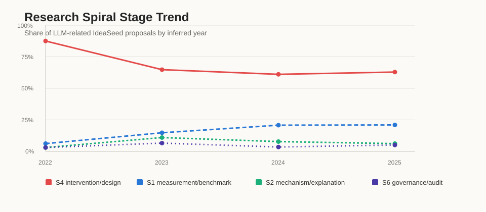
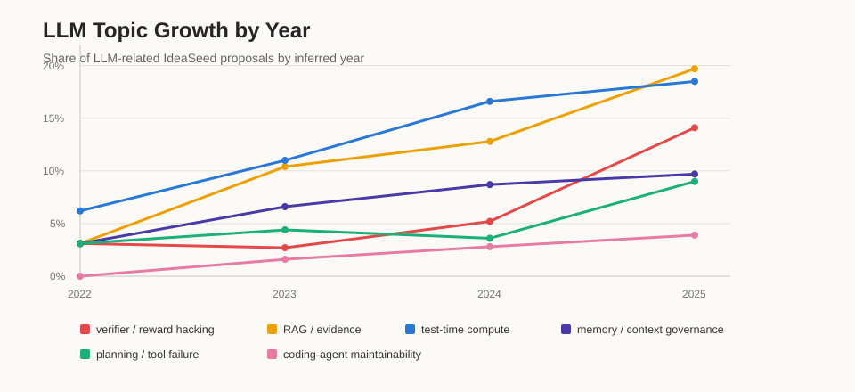
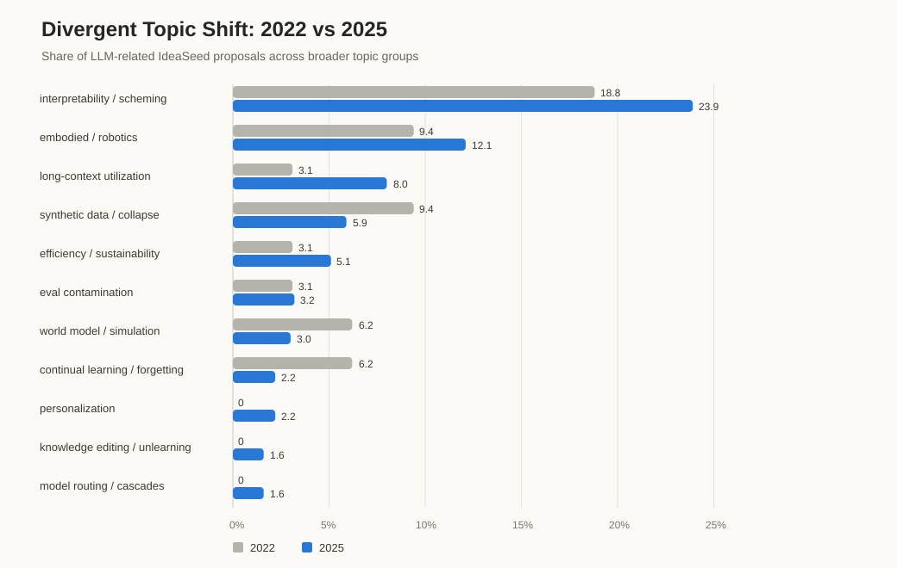

# LLM Agent Research Topic Map

This repository is a research-direction map for LLM agents and adjacent evaluation
problems. It turns an analysis of 11,683 research ideas into paper-scale topic sketches
with falsifiable questions, minimal experiments, and explicit truth-source requirements.

The main planning file is [`38_topics.txt`](./38_topics.txt). The latest working draft is
[`readme_draft.md`](./readme_draft.md); content before its `=======before` marker is the
current analysis, and content after the marker is older context. The generated topic
index is [`topics/README.md`](./topics/README.md).

**As of 2026-08-13 the map is managed as a portfolio system**: a full audit
([`portfolio_2026-08.md`](./portfolio_2026-08.md)) judged all 41 topics against the fresh
corpus/industry evidence and live novelty sweeps — 9 active leads, 11 support, 10 on hold,
11 retired (folders kept as design notes). The fast track is
[`position_paper_pipeline_2026-08.md`](./position_paper_pipeline_2026-08.md): ranked
position-paper candidates buildable from already-verified evidence with no new
experiments, each carrying a novelty ledger against named prior occupants and a mapped
venue window (nearest confirmed: ICSE 2027 NIER Oct 23; FAccT 2027 Nov 3; ICML position
track ~Jan 2027). Despite the historical filename, the
current topic set contains 41 candidates: 36 topics across B1-B6 and T5, 4 narrower T3
topics, and 1 topic (H1.1) in a new H1 family. Two topics were added from post-hoc scans rather
than the original `38_topics.txt` corpus analysis: B1.6 from
[`trend_scan_2026-08.md`](./trend_scan_2026-08.md) (its method twin `arXiv:2607.12340` read in
full, topic revised to install-time publisher-trust gating), and H1.1 from
[`industry_signal_scan_2026-08.md`](./industry_signal_scan_2026-08.md) — the first member of a
new **H1 family (human skill dependency / de-skilling under AI assistance)**, an axis orthogonal
to every existing B/T family: those study whether the AI system's signals can be trusted; H1
studies what happens to the *human's* own capability under sustained AI assistance. H1.1's five
grounding papers (incl. Shen & Tamkin `arXiv:2601.20245`, the Anthropic skill-formation RCT) were
read during sketch construction — see its README/digest.

## Current Thesis

The scarce resource is shifting from **model capability** to **trusted signals**. The
central question is no longer only "can the model do X?" but "can we trust the signal that
says whether it did X?"

That shift explains the fastest-growing areas in the local analysis:

- verifier / reward-hacking signals grew fastest, reaching 14.1% of 2025 LLM-related
  proposals in the analyzed subset;
- RAG/evidence and test-time compute are the largest crowded areas, at 19.7% and 18.5%;
- measurement/benchmark work is still rising, but the next scarce layer is mechanism,
  boundary, attribution, and cost-aware allocation.

The near-term filter is conservative: a direction is attractive only if it has mechanical
ground truth, a currently binding constraint, and no structural incumbent advantage.

## Overall Architecture

[LLM research spiral and architecture map](https://github.com/skill-stability/possible_autoresearch/blob/97cdf786bad3141c8883c7639690da867a44ded5/research_plan_lifelong.png)

The architecture uses a research spiral rather than a linear roadmap. Mature topics rarely
stop at "find a phenomenon" or "build a benchmark"; the stronger pattern is to move from
measurement into mechanism, boundary, intervention, scale, and governance:

```text
S0 phenomenon/capability discovery
  -> S1 measurement/evaluation
  -> S2 mechanism/explanation
  -> S3 failure boundary
  -> S4 intervention/control/design
  -> S5 cost and scale
  -> S6 governance/deployment loop
```

The planning rule is therefore: do not propose another unified agent framework. Pick one
deployment-critical failure mechanism, measure when it appears, explain why it happens,
intervene minimally, and define the boundary where the intervention fails.

This gives the topic families a lifecycle interpretation:

| Route | Starts from | Spiral move |
|---|---|---|
| Verifier / reward hacking science | verifier pass/fail | audit verifier invariance, expose shortcuts, and turn verifier checks into CI for RLVR, coding, and tool-use agents |
| Planning failure attribution | planning benchmarks | move from end-to-end success to layer-wise diagnosis across plan, tool visibility, execution, observation, and recovery |
| Constraint-preserving memory | long context and compaction | treat memory as a durable control channel, preserving policy and authority constraints under compression |
| Budget-aware test-time compute | more thinking/sampling/verifying | allocate tokens, rollouts, verifier calls, and tool calls under fixed cost instead of simply scaling compute |
| Design-constraint compliance | tests pass | check whether patches satisfy review-derived design intent, architecture conventions, and maintainability constraints |
| Evidence-state-aware RAG | top-k retrieval | reason over support, contradiction, insufficiency, staleness, and source credibility before acting |
| Execution-grounded ideation | LLM-generated ideas | evaluate ideas after execution while preserving diversity and avoiding bridge/synthesis collapse |
| Capability-controlled runtime | tool schemas | distinguish tool visibility from authority, and test runtime capability boundaries |
| Enterprise contextual integrity | workflow agents | balance task utility against internal-context leakage and selective disclosure policies |
| Provenance-aware trajectory safety | single-turn guards | track instruction, memory, artifact, and tool-output lineage across long-horizon agent actions |

## Evidence Charts

The planning notes include three chart artifacts. The static SVG versions render directly
in GitHub Markdown; the original HTML snippets are kept as source artifacts.







Source snippets:

- [`llm_research_spiral_stage_trend.html`](./llm_research_spiral_stage_trend.html):
  spiral-stage shares over time. S4 intervention/design remains dominant, while S1
  measurement rises from 6.2% to 21.0%.
- [`llm_topic_growth_by_year.html`](./llm_topic_growth_by_year.html): topic-share growth
  from 2022 to 2025. Verifier/reward hacking is the sharpest riser; RAG/evidence and
  test-time compute are the largest crowded themes.
- [`divergent_topic_shift_2022_vs_2025.html`](./divergent_topic_shift_2022_vs_2025.html):
  broader topic shifts, including interpretability/scheming, long-context utilization,
  synthetic data/model collapse, and newer smaller categories.

## Positioning Map

[Red/blue ocean positioning map](https://github.com/skill-stability/possible_autoresearch/blob/97cdf786bad3141c8883c7639690da867a44ded5/red_blue_ocean_map_v2_corrected.png)

The corrected ocean map separates three kinds of red sea:

- **Industrial enclosure**: scheming and interpretability mainlines are high-impact, but
  frontier labs hold the strongest assets: weights, training processes, and deployment
  traffic. The defensible academic edge is external audit, cross-vendor comparison, and
  longitudinal drift tracking.
- **Low-barrier crowding**: RAG/evidence and test-time scaling are large because they are
  easy to enter. Narrow openings remain, but generic variants are low-leverage.
- **Narrative fatigue**: broad prompt-engineering, generic multi-agent, and broad memory
  framework papers are retreating unless reduced to a single checkable mechanism.

The current map keeps the topic families as candidates, but the latest draft narrows the
near-term bet: B1/B2/B3/B4 remain the strongest strategic areas; B5/B6 are higher-risk
unless a clean truth source or deployment accident unlocks them.

## Spiral Stage Axis

[Topics on spiral stage axis](https://github.com/skill-stability/possible_autoresearch/blob/97cdf786bad3141c8883c7639690da867a44ded5/topics_on_spiral_stage_axis.png)

The spiral-stage axis uses this progression:

| Stage | Meaning |
|---|---|
| S0 | Phenomenon |
| S1 | Measurement |
| S2 | Mechanism |
| S3 | Boundary |
| S4 | Intervention |
| S5 | Scale |
| S6 | Governance |

The strongest opening is the shift from S1 measurement into S2/S3 mechanism and boundary
work: benchmarks are abundant, but failure attribution, verifier adequacy, and
cost-sensitive decision rules are still undersupplied.

## Near-Term Priorities

This ranking follows the updated draft's 3-6 month lens and submission-window constraint.

| Rank | Direction | Current read |
|---:|---|---|
| 1 | **Planning/execution failure attribution** | Best near-term fit. Fault localization and mutation-testing language is nearly absent in the analyzed corpus, making this a defensible SE-style angle. |
| 2 | **Verifier/test-oracle adequacy for agents and coding** | Fastest-growing signal. Generic RLVR verifier fuzzing is already crowded, so the opening is agent/tool-use/coding verifiers with executable ground truth. |
| 3 | **Design-constraint compliance for coding agents** | Good FSE-style topic, but likely needs a new dataset or review-derived constraint catalog. |
| 4 | **Budget-aware test-time compute** | Important, but best used as a submechanism inside failure attribution or verifier selection rather than as a standalone scaling paper. |
| 5 | **Memory/context governance** | Real and safety-relevant, but the obvious pinning-style repairs are already being filled. Remaining value is in sharper mechanisms and boundaries. |
| 6 | **RAG/evidence-state work** | Important but heavily crowded and weakly aligned with the mechanical-truth angle here. |
| 7 | **Research-ideation diversity** | Useful as a meta-filter, but short-cycle execution is hard because strong versions require expensive human execution studies. |
| 8 | **Enterprise CI / provenance safety** | Plausible but needs enterprise environments or proprietary deployment traces. |

## Submission Window

The draft treats the next practical windows as:

| Venue | Status in the draft |
|---|---|
| ICSE 2027 | Already closed for new submissions |
| ASE 2026 | Already closed |
| NeurIPS 2026 | Already closed |
| AAAI 2027 | August 1, 2026 deadline; too tight for a new direction |
| **ICLR 2027** | Expected around late September 2026 |
| **FSE 2027** | October 2, 2026 deadline; strongest SE-aligned target |

The practical implication is that a new 3-6 month project should either close an existing
failure-attribution line for FSE 2027 or immediately carve a narrow agent/coding verifier
adequacy angle for ICLR 2027.

## Selection Criteria

The current filter is:

1. **Mechanical truth**: final ground truth should come from execution state, hidden
   tests, controlled fault injection, replay outcomes, static analysis, known mixture
   ratios, or payoff functions, not final LLM judgment.
2. **Binding constraint**: the problem should already hurt through failures, cost,
   deployment pressure, regulation, or benchmark/reward exploitation.
3. **No incumbent lockout**: frontier labs should not have an overwhelming structural
   advantage, or the work should be something they have little incentive to publish.

This filter downgrades several tempting cold areas. Agent bargaining, agent identity, and
synthetic-corpus forensics may become important, but without a clean truth source they are
currently better monitored than pursued as immediate papers.

## Topic Families

| Family | Focus | Topics | Active after 2026-08 audit |
|---|---|---:|---|
| B1 | Verifier sufficiency in agent and coding tasks | 6 | 3 (lead: B1.2) |
| B2 | Failure attribution across plan, tool, and execution layers | 5 | 3 (lead: B2.1, absorbing B2.2/B2.3) |
| B3 | Cross-version behavioral drift and longitudinal audits | 5 | 4 (leads: B3.3, B3.4) |
| B4 | Test-time compute and verification budget economics | 6 | 4 (lead: B4.2; +B4.6 serving economics, 2026-08-13) |
| B5 | Agent-to-agent bargaining and manipulation mechanisms | 5 | 0 (B5.1 on hold; rest retired) |
| B6 | Synthetic-corpus contamination mechanisms | 5 | 1 (B6.2, refreshed) |
| T5 | Coding-agent design constraint compliance | 5 | 3 (leads: T5.1, T5.2) |
| T3 | Memory constraint retention under context compaction | 4 | 2 (lead: T3.2) |
| H1 | Human skill dependency and de-skilling under AI assistance | 1 | 1 (lead: H1.1) |
| B7 | Agent memory/skill lifecycle economics (added 2026-08-13) | 2 | 2 (B7.1 backbone depreciation, B7.2 poison half-life) |
| B8 | Agent-protocol governance and conformance (added 2026-08-13) | 1 | 1 (B8.1 spec-drift, 3-month scoop gate) |

Full verdicts and rationale: [`portfolio_2026-08.md`](./portfolio_2026-08.md).

Each topic folder contains:

- `README.md`: human-readable research sketch.
- `digest.md`: structured digest with problem, claim, method, evidence, and risk fields.

## Caveat

The analysis depends on a local corpus and year proxy: proposal years were inferred from
citation-key years in proposal text, and 2026 is too sparse to interpret. The 2025 subset
is treated as the latest stable signal. Percentages are directional, not definitive.

The discussion of `2607.01233` is also used cautiously. Its core finding that LLMs
overproduce bridge/synthesis ideas is useful as a meta-filter, but the paper's setting is
narrow, LLM-assisted, and not a universal law for all research brainstorming.

## Repository Layout

```text
.
├── 38_topics.txt
├── README.md
├── divergent_topic_shift_2022_vs_2025.html
├── divergent_topic_shift_2022_vs_2025.svg
├── llm_research_spiral_stage_trend.html
├── llm_research_spiral_stage_trend.svg
├── llm_topic_growth_by_year.html
├── llm_topic_growth_by_year.svg
├── readme_draft.md
├── red_blue_ocean_map_v2_corrected.png
├── research_plan_lifelong.png
├── topics_on_spiral_stage_axis.png
└── topics/
    ├── README.md
    └── <topic-id>_<slug>/
        ├── README.md
        └── digest.md
```
