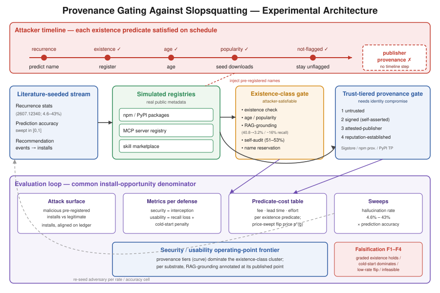

# 存在性由攻击者控制：跨软件包、MCP 与技能注册表的来源门控以抵御 Slopsquatting

## 摘要

大语言模型（LLM）编码助手与自主智能体会推荐软件包、MCP 服务器与智能体技能（agent skill），并越来越多地在缺乏人工审查的情况下直接安装它们。由于这些系统会以稳定且可预测复现（recurrence）的速率幻觉出看似合理但并不存在的名称，攻击者可以预先注册（pre-register）一个被预测到的名称，将一次生成错误转化为代码执行——即 slopsquatting 攻击。当前面向智能体的注册表所采用的防御机制，其信任判定都建立在**存在性类谓词（existence-class predicate）**之上：名称能否解析、构件是否足够旧、下载量是否足够高、是否未被标记。我们的论点是：这类谓词的失败是**构造性（by construction）的，而非实现性（by implementation）的**——攻击者控制注册**何时**开始，因此能按自己的时间表满足存在性、年龄与流行度。我们将这一点从定义性断言转化为量化结论。我们构建了一个完全模拟、无需专有数据的实验框架，它（1）从已发布的名称复现统计数据中播种（seed）一个 squatting 攻击者，（2）用真实公开元数据实例化三类注册表基底——npm/PyPI 软件包、MCP 服务器、智能体技能市场（agent-skill marketplace），以及（3）在一个共同的安装机会分母（common install-opportunity denominator）上，在 4.6% 到 43% 的幻觉率扫描（sweep）范围内测量每种防御的安全性/可用性工作点。我们将存在性类防御（存在性检查、位于其已发布 40.8%→3.2% 拦截 / 约 16% 召回损失点的 RAG-grounding、准确率 51–53% 的自审计（self-audit）、名称预留（name reservation））与一个**信任分层的安装时来源门（trust-tiered install-time provenance gate）**（未信任 / 已签名 / 已认证发布者 / 已建立声誉）进行对比——后者的接受条件是攻击者在不攻陷可信身份的前提下无法满足的。本文的核心产物是一张按谓词类别的注册成本表（registration-cost-per-predicate-class table），表明每个存在性谓词都可被廉价且可预测地满足；以及一条工作点前沿（operating-point frontier），在其上来源门主导（dominate）存在性类的簇。我们还报告了价格扫描的血统获取（lineage-acquisition）敏感性分析（购买一个已老化、已合格的身份）、来源门自身的失效模式，以及四条印在文中的可证伪条件。

## 1. 引言——立场

大语言模型如今直接参与软件供应链决策：它们生成 import、推荐依赖、命名 MCP 服务器、发出安装命令，而智能体框架越来越多地在无人参与的情况下据此行动。这一实践已从 npm 和 PyPI 蔓延到当下正被建立、但仅有存在性门控或毫无门控的 MCP 注册表与智能体技能市场。然而，LLM 会反复输出看似合理却指向不存在构件的名称。《Skills That Don't Exist》（arXiv:2607.12340）测得幻觉技能推荐率在不同设置下为 36.0/36.9/43.1%，共 5,669 个不同的幻觉名称，自审计准确率仅 51–53%，并且——关键在于——具有**可预测的复现性**：相同的捏造名称会在独立运行中再次出现。后续的前沿模型队列研究（Churilov，arXiv:2605.17062）报告该速率在 2026 年模型上压缩至 4.6–6.1%，而可复现、可注册的结构依然存在。复现正是攻击者预注册所需的量，也是一个现实模拟播种攻击者所需的量。

防御文献用**存在性类谓词**回应这一威胁。注册表运营者与智能体框架检查名称能否解析、软件包是否足够旧或足够流行、是否未被标记；slopsquatting 系统综述背书了*存在性校验（existence validation）*，而 2607.12340 本身以名称预留与 RAG-grounding 收尾。这些谓词无一例外都是*已注册构件*的属性。我们的论点是：这是放置信任判定的错误位置：

> **存在性可由攻击者按构造满足；来源不能。** 一个预测出名称并提早注册的攻击者，能*按自己的时间表*让存在性、年龄与流行度成真。把一个名称对照真实索引进行 grounding 也无济于事——攻击者注册的那个被 grounding 的名称*本身就是真实的*。只有一个攻击者在不攻陷**可信发布者身份（trusted publisher identity）**前提下无法满足的谓词——密码学来源（cryptographic provenance）——才能把信任判定移出攻击者的时钟。

审稿人会反驳"已注册的名称当然存在"是同义反复（tautology）。这一点我们承认——而这恰恰说明贡献不在于这个真理，而在于其**量化的经济学与工作点对比**。我们追问：给定已发布的复现分布，攻击者以多低的成本、多长的前置时间（lead time）能满足每个*分级（graded）*存在性谓词（不只是存在性，还有年龄 ≥ N 天、下载量 ≥ K、未被标记）；以及在*同一次*模拟攻击上，信任分层来源门相对存在性类防御达到了怎样的安全性/可用性点。历史依赖门（history-dependent gate，年龄、来源链接、维护者历史）之所以有趣，在于它们把攻击者的**时序（timing）**问题转化为**资源获取（resource-acquisition）**问题：当从预测到受害者安装的前置时间很短时，任何新注册都来不及成熟，于是唯一路径是*获取一个已合格的身份*——这需要现金，且对来源而言需要攻陷一个可信发布者。因此，某谓词是否可被攻击者满足，是一个*在预算下的可达性（reachability under a budget）*问题，而这正是我们所认证（certify）的。

**贡献。**
- **C1.** 一个由文献播种的 slopsquatting 竞速模拟器：一个从已发布名称复现统计中抽取的攻击者、三类由真实公开元数据构建的注册表基底（npm/PyPI、MCP 服务器、智能体技能市场），以及一个把攻击者探测、推荐、注册事件与安装对齐到单一分母上的共同安装机会账本（common install-opportunity ledger）。不需要任何专有或带信任标注的数据。
- **C2.** 一项按谓词类别的注册成本分析，证明每个存在性谓词（存在性、年龄、流行度、未被标记、RAG-grounded）都可被廉价且可预测地满足，其中攻击者成本取自真实注册表机制，并对身份获取路径附以价格扫描敏感性分析。
- **C3.** 一个信任分层的安装时来源门（未信任 / 已签名 / 已认证发布者 / 已建立声誉），带有测得的安全性/可用性工作点，并在其已发布强度下与四个已发布的存在性类基线正面对比。
- **C4.** 三类注册表的推广：存在性失败 / 来源成立的*结构*在软件包、MCP 服务器与技能市场上复现，以按类别的工作点而非单一汇总阈值来报告。

*图1：实验架构。一条由文献播种的推荐流馈入模拟的三基底注册表。一个存在性类门（存在性 / 年龄 / 流行度 / RAG-grounding / 自审计 / 预留）与一个信任分层来源门各自对每个安装请求作出判定。攻击者时间线（顶部）显示每个存在性谓词都按预测→注册→老化→植入下载→保持未标记的时间表被如期满足；唯一没有任何时间线步骤能满足的检查是发布者来源。评估回路（底部）在同一条拦截率对召回损失的分母上，跨幻觉率扫描对每种防御打分。*

## 2. 背景与相关工作

**软件包幻觉测量。** Spracklen 等（《We Have a Package for You!》，USENIX Security 2025）量化幻觉普遍性并对比生成时缓解手段（RAG、自我修正、微调）。Krishna 等（《Importing Phantoms》）对照时间索引的注册表记录刻画各模型/语言/任务下的速率。Churilov（《The Range Shrinks, the Threat Remains》，arXiv:2605.17062）在 2026 前沿模型上复现并分离出普遍幻觉、可注册的名称。Zhao 等（HFUZZER）以基于短语的模糊测试暴露幻觉。这些工作确立了攻击面与我们据以播种的复现结构；但无一评估针对可选择注册时序之攻击者的安装时门控。

**锚点与方法孪生（method twin）。** 《Skills That Don't Exist》（arXiv:2607.12340）提供了我们攻击者的名称分布与三个基线工作点，并以推荐名称预留与 RAG-grounding（二者皆为存在性类）作为未来安装时防御收尾。我们正是接手这一未来工作，并表明：只要攻击者先预测并注册，其推荐的预留就是防御者输掉的竞速，而该论文自身的复现统计使这种攻击可行。

**基于注册表的检测与来源——承认与主张（concede-and-claim）。** ConfuGuard（Jiang、Çakar、Lysenko 与 Davis，arXiv:2502.20528）通过名称嵌入 + 元数据 + 基于流行度的信任来检测软件包混淆；Hillah 等（arXiv:2606.13918）从 PyPI 元数据校准每个 import 的幻觉概率；二者都依赖固定的注册表证据与对成熟软件包的相似度，因而无法告诉我们哪些信号能在攻击者控制的时序下存活。在来源方面，McCann（《Cryptographic Registry Provenance》，arXiv:2605.03309）通过签名与安装时验证将发布者/注册表身份绑定到构件，而**可信 MCP 注册表（Trustworthy MCP Registry）**（Future Internet 18(5):243，doi 10.3390/fi18050243）为 MCP 服务器指定了基于 Sigstore 的签名/认证架构。*我们承认其机制*：我们不发明密码学来源，并将这些工作作为参考"如何做"引用。*我们的增量（delta）*是：（a）使来源从"仅供建议"变为"非可选"的按构造被击败（defeated-by-construction）的演示；（b）信任分层**策略**及其测得的工作点——一个带显式安全性/可用性曲线的分级门，这是单层、仅限 MCP 的 Sigstore 门所不具备的；以及（c）跨三类注册表的推广，附以这些工作从未做过的正面前沿对比。

**智能体中介的威胁。** 近期工作表明，恶意持久化技能能在不触碰权重或提示词的情况下，将良性编码智能体引向攻击者控制的依赖，证实依赖选择是可被主动操纵的，而非仅仅是被动的模型错误。操作系统软件包管理器的先例——Sigstore、npm 来源认证、PyPI 可信发布（trusted publishing）——是我们证明存在性→签名→发布者信任这一转变可部署的存在性证据；面向智能体的注册表只是停滞在存在性上，而软件包管理器早已迈进。

## 3. 威胁模型与攻击者可满足性论证

**设定。** 生态系统 $\mathcal{E}=\{\mathrm{npm},\mathrm{PyPI},\mathrm{MCP},\mathrm{skill}\}$。对每个 $e$，公开注册表快照 $\mathcal{R}_e$ 携带模式 $\mathcal{X}_e$ 中安装时可观测的元数据。已发布统计 $\theta$ 描述幻觉名称的频率与复现；$Q_\theta$ 是模拟攻击者的播种分布；$H\subseteq[0,1]$ 是被扫描的幻觉率区间（4.6%–43%）。

**攻击者。** 对每个 $\rho\in H$，模拟器发出安装事件 $\mathcal{D}_\rho=\mathcal{A}_\rho\cup\mathcal{L}_\rho$：由 $Q_\theta$ 抽取的幻觉名称引发的对抗性安装 $\mathcal{A}_\rho$，以及真实记录的合法安装 $\mathcal{L}_\rho$。攻击者在时刻 $t_0$ 观察到一个被预测的名称，为每个攻击事件 $i$ 选择**注册计划** $\gamma\in\Gamma_i$，该计划决定安装时元数据 $x_i^\gamma$——存在性、累积年龄、植入的流行度。无法仅凭注册时序获得的属性（例如可信发布者密钥下的签名）由攻击者的实际能力固定。攻击者的力量恰恰在于：它控制时钟**何时**启动，而 $Q_\theta$ 中的复现告诉它哪些名称值得预注册。

**谓词抗性。** 安装时谓词为 $p:\mathcal{X}_e\to\{0,1\}$（$1$=安装，$0$=拦截）。事件级*时序抗性（timing resistance）*为
$$u_p(i)=1-\max_{\gamma\in\Gamma_i}p(x_i^\gamma),$$
即 $u_p(i)=1$ 当且仅当**没有**任何可行计划能使 $p$ 接受攻击 $i$。在 $\rho$ 处的经验率为 $U_p(\rho)=|\mathcal{A}_\rho|^{-1}\sum_{i\in\mathcal{A}_\rho}u_p(i)$。存在性、年龄与流行度为**负对照（negative control）** $\mathcal{P}_{\mathrm{neg}}$：模拟器允许足够早的计划满足它们，因此 $u_p\equiv 0$ 按构造成立——它们被排除在任何时序抗性主张之外。信任分层来源谓词是一个*候选*，用同一定义评估，不预设其抗性；本文的发现是它落在 $U_p$ 轴的何处，而非公理式地断定其为 1。

**注册成本表（核心产物）。** 对每个存在性谓词类，我们从真实注册表机制中列出攻击者满足它的成本：注册费、累积所需前置时间（年龄 ≥ N 天）、植入所需成本/努力（下载量 ≥ K），以及复现分布是否使其*可预注册*。分级谓词（年龄 ≥ 90 天、下载量 ≥ 10k）施加*真实但低*的成本，而非零成本；此表如实报告该成本。若某个复合分级谓词确实昂贵，则报告为部分存在性侧防御（可证伪条件 F1）。

**时序何时变为获取。** 对历史依赖门与短前置时间 $L$，任何新注册都无法在 $L$ 内成熟，于是唯一路径是获取一个已合格的血统——一个老化的账户、一个带维护者历史的命名空间。此路径耗费现金并消耗稀缺的可转让身份容量。我们**不**依赖一个（并不存在的）市场数据集：我们在一个声明的单调阶梯上扫描假定的单笔转让价格 $\rho_{\mathrm{acq}}$，并报告**翻转价格（flip price）** $p^*(g)$——门在预算内仍可达的最大转让价格。来源的翻转价格在性质上不同：在不攻陷发布者的情况下，"一个在可信发布者密钥下的签名"不存在市场价格。

## 4. 信任分层来源门

该门根据安装时呈现的最强来源证据，将每个安装请求归入四个层级之一：

1. **未信任（Untrusted）**——名称能解析，无签名。（存在性类；可被攻击者满足。）
2. **已签名（Signed）**——构件带有效签名，但签名身份为自我声明。将门槛提高到"持有一个密钥"，而攻击者可自行生成——故仅此层*不*充分，我们对此加以测量。
3. **已认证发布者（Attested-publisher）**——签名可链接到由可信权威认证的身份（Sigstore 无密钥身份、npm 来源认证、PyPI 可信发布）。攻击者在不攻陷可信身份提供方或真实发布者 CI 的前提下无法满足。
4. **已建立声誉（Reputation-established）**——已认证发布者且积累了不可转让的声誉历史。

安装时判定在配置层级及以上准入。每层的安全价值是攻击者满足它的成本（身份攻陷，而非注册时序）；可用性成本是**合法发布者摩擦（legitimate-publisher friction）**——对真实安装的误拦率，以及关键的，对尚未积累认证或声誉的合法新发布者的**冷启动惩罚（cold-start penalty）**。此门并非万能：§7 测量这些摩擦，并将安全主张限定为"把门槛从免费提高到身份攻陷"，绝非"不可破解"。

## 5. 实验设置

**模拟器（C1）。** 一个按 §3 播种的事件级模拟器。三个基底：（i）来自公开元数据转储的 npm + PyPI（名称、年龄、下载量、版本历史）；（ii）来自公开注册表列表的 MCP 服务器；（iii）来自公开技能注册表列表的智能体技能市场模式。攻击者按 2607.12340 已发布的复现结构（就已公开的范围）播种；由于可能仅有汇总率是公开的，**攻击者预测准确率是一条显式扫描轴 $[0,1]$**，我们将前沿报告为其函数——只要预测准确率非可忽略，立场即成立，而复现的存在本身就确立了这一点。一个模拟器参数（软件包年龄 / 下载量中位分布）对照真实注册表数据加以验证，以证明基底与现实相符。

**防御，全部在模拟器内以已发布强度重新实现。**
1. 存在性检查（名称能解析）——负对照。
2. RAG-grounding（名称存在于真实索引中）——重新实现并**对照**已发布的 40.8%→3.2% 拦截 / 约 16% 召回损失点加以*验证*；复现该点即验证模拟器，任何偏离本身也被报告。
3. 自审计（LLM 复查其推荐）——位于已发布的 51–53% 准确率。
4. 名称预留（防御者预先预留被预测名称）——一场对攻击者的竞速，仅由信息隔离的防御者候选名单驱动；我们刻意让此基线*轻量且明确标注为证据受限*，因为不存在独立的预测流，并将其结果作为竞速结果而非一个调优系统来报告。
5. **信任分层来源门**（§4）。
6. *边界比较器（标注为非注册表原生）：* 一个推荐绑定的授权信封（provider-signed envelope + witnessed publisher commitment），仅用于标记有效防护是否需要注册表原生元数据之外的信息——绝不计为注册表原生防御。

**测量（C2–C4）。** 对每个防御 × 基底 × 速率：**安全** = 被拦截的恶意预注册安装比例（攻击拦截率）；**可用性** = 合法安装召回损失 + 来源冷启动惩罚；**谓词成本表**；幻觉率扫描 4.6%–43%。已发布数字仅作为注释出现；每个绘制的竞争者都在*同一次*模拟攻击、同一条安装机会分母上被测量。

**可证伪条件（印于文中）。**
- **F1.** 若某个复合分级存在性谓词（严格年龄 + 真实下载 + 未标记）以与来源相当的低可用性成本拦截被播种的攻击者，则"存在性按构造失败"被实质削弱——一个重要的负面结果，予以报告。
- **F2.** 若来源门的冷启动摩擦压过其安全收益，则来源并非可用的改进；前沿主张失败。
- **F3.** 若结果在低速率端（4.6%）翻转——攻击者产出崩塌至存在性检查已够用——则紧迫性与速率稳健性主张双双削弱。
- **F4.** 若真实注册表元数据显示中位年龄/下载门槛使攻击者无法在现实前置时间内跨越，则预注册攻击不切实际，SC2 软化。

## 6. 研究问题与预期结果

我们将评估收敛为四个问题，每个都是一个产出 JSON 裁定的可实现模块；块自助（block-bootstrap）置信区间用 10,000 次重采样，主种子 `20260813`。

- **RQ1（谓词可满足性与成本）。** 对每个存在性谓词类，攻击者满足它的成本与前置时间是多少，时序抗性率 $U_p(\rho)$ 为何？*预期：*存在性/年龄/流行度的 $U_p\approx 0$ 贯穿整个扫描；成本表显示各项在现实前置时间内均可满足。此题裁定"按构造"主张及 F1/F4。
- **RQ2（安全性/可用性前沿）。** 按基底与速率，信任分层来源门是否在拦截率对召回损失上主导存在性类簇？*预期：*已认证发布者层与声誉层主导；仅已签名层不主导（量化为何自我声明签名不充分）。RAG-grounding 复现于其已发布点附近，验证模拟器。
- **RQ3（速率稳健性）。** 该排序是否在 4.6%–43% 扫描及攻击者预测准确率扫描下存活？*预期：*该*结构*（存在性同类失败）对速率稳健；仅攻击者产出随速率缩放。此题裁定 F3。
- **RQ4（来源失效模式与冷启动）。** 每层的合法发布者冷启动拦截率是多少，密钥攻陷 / 自我认证 / 发布者 typosquatting 如何劣化该门？*预期：*可测量的冷启动摩擦，由声誉层与安全性权衡；主张被限定为"免费 → 身份攻陷"。此题裁定 F2。

血统获取路径（§3）仅作为一项带区间价格与所报告翻转价格 $p^*(g)$ 的**价格扫描敏感性分析**进入 RQ1/RQ2，绝不作为一个依赖市场数据的主张。MCP 与技能基底以按类别工作点报告，并附以显式的稀疏性告诫；在可识别覆盖率薄弱之处，结果以命名场景报告，而非汇入无条件主张。

## 7. 讨论与效度威胁

**来源失效模式。** 被攻陷的签名密钥、自我认证的"发布者"、被 typosquatting 的发布者身份，以及合法新发布者的冷启动，都是真实存在的；§4/RQ4 测量冷启动成本，我们据此限定安全主张。来源把攻击者的问题从*免费的注册时序*转移到*身份攻陷*——一个复现分布无从帮助的、性质更高的门槛——而非转移到不可能。

**模拟的外部效度。** 攻击者从已发布复现播种，基线设于其已发布最佳，预测准确率为一条被报告的轴，因此"来源获胜"是相对一个强的、文献锚定的攻击者被测量的，而非一个稻草人。RAG-grounding 重新实现与其已发布工作点的一致，是一项显式的模拟器效度检查。血统获取价格扫描以一个报告的翻转价格替代（并不存在的）市场数据集，因此没有任何结论依赖不可获得的数据。

**按类别的告诫。** 软件包有丰富的下载/版本历史；MCP 服务器与技能更新、更稀疏。推广主张是存在性失败 / 来源成立的*结构*复现，而非某个阈值可迁移；我们按类别报告工作点。

**部署路径。** 对运营者而言：操作系统软件包管理器的转变（Sigstore、npm 来源、PyPI 可信发布）是模板；面向智能体的注册表可采用带分级冷启动宽限的已认证发布者门控，用我们的前沿来选择层级。

## 8. 结论

存在性、年龄与流行度，是一个预测出复现幻觉名称的攻击者能按自己时间表变为真的属性；对攻击者注册的名称进行 grounding 无济于事。信任判定必须从*存在性*移向*来源*——一个攻击者在不攻陷可信身份前提下无法满足的谓词——无论是软件包索引、MCP 注册表还是技能市场，皆是如此。我们让这一论证可测量：一个文献播种的模拟器、一张证明存在性谓词可被廉价满足的注册成本表，以及一条信任分层来源门主导存在性类簇的工作点前沿，且在已发布幻觉率区间上稳健。注册表必须以来源门控，而非以存在性门控。
