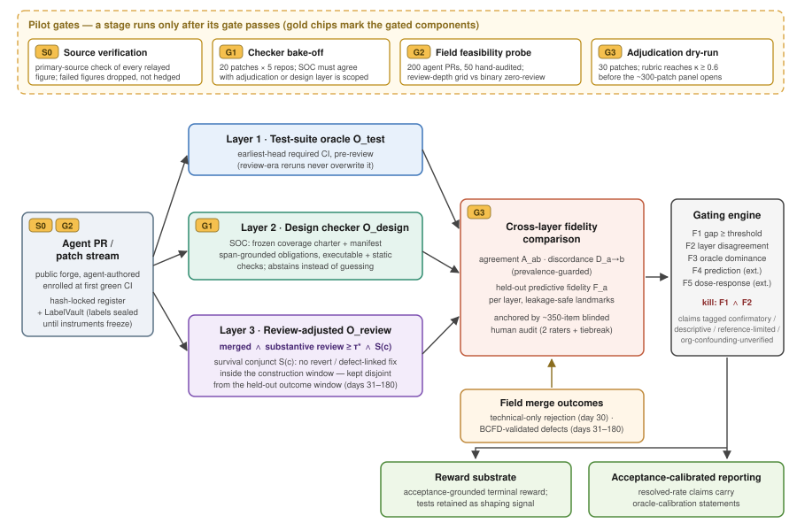

# 绿色测试不等于验收：面向编码智能体补丁的分阶段跨层验收谕示比较研究

## 摘要

编码智能体（coding agent）生成的补丁越来越多地能够通过仓库测试，却仍然不被接收补丁的项目所接受。已有工作只孤立地测量了这一问题的单一层面：基准内部的测试过拟合与"侥幸通过"、基准对齐问题上的设计约束违反、智能体拉取请求（PR）的合并与拒绝动态、以及合并后存活情况。此前没有任何研究对相互竞争的*验收谕示（acceptance oracle）本身*——评审前测试通过（pre-review test-pass）、原始合并（raw merge）、评审校正验收（review-adjusted acceptance）——就一致性以及对独立验证的平台日志现场结局的留出预测保真度进行比较。我们提出一个分阶段的测量框架，恰好交付这一比较。哈希锁定的入组登记册（enrollment register）与标签保险库（LabelVault）在任何结局标签打开之前固定抽样框架；冻结的规范义务检查器（Specification-Obligation Checker, SOC）对绿色测试未覆盖的源显式设计义务进行评分；反向确认现场缺陷（BCFD）程序针对组织性混杂验证合并后缺陷标签；评审校正谕示——已合并 ∧ 获得实质性评审 ∧ 在构建窗口内存活——与测试通过和原始合并在时间上不相交的拒绝与缺陷结局上进行比较。设计是显式分阶段的：Stage-0 一手来源核验闸门和三个试点闸门（检查器对决、现场可行性探测、裁定试运行）先于核心研究执行；核心研究的人工裁定预算固定在约 350 个盲评条目；完整的 24 问题、多小组计划保留为预注册扩展，而非施工计划。证伪集 F1–F5——包括"绿色测试实际上就是验收"从而立场死亡的显式条件——被编码进门控引擎。预期产出是一个经现场验证的答案：哪一个验收层应当充当编码智能体的奖励与评测基底（reward substrate）。

## 1 引言

自主编码智能体将 issue 描述转化为仓库级补丁，运行持续集成（CI），并在极少人工干预下提交 PR。随着智能体越来越擅长满足可见测试，绿色 CI 结果所携带的信息越来越少：补丁是否尊重被省略的情形、兼容性承诺、架构约束或仓库特有期望，均无从得知。然而整个领域仍将"解决了"操作化为"测试通过"：基准解决率、以测试结果为可验证奖励的强化学习（RLVR）、以及见绿即自动合并的部署闸门，都把这一代理指标硬编码了进去。

"验证器是不完美代理"这一诊断已不再新颖，我们也不主张它。*Verification Horizon* 论证 [8] 指出验证器与智能体共同演化、不存在静态的银弹验证器，并认为"用户是最忠实的验证器"——但它提供的是论证而非测量，无法回答评审条件化的验收是否真的比强化后的测试套件更能预测质量。在实验室一侧，缺口本身已被测量过：在与 SWE-bench 对齐的 issue 上，绿色但违反设计约束的补丁已被大规模记录——不到一半的"已解决"issue 满足经验证的设计约束，且正确性与设计满足近似独立 [9]；ReactBench 及其 React-Doctor 验证器为 React 仓库提供了公开的"绿色但未过静态验证器"测量工具 [10]；UTBoost 在强化套件下暴露约 31% 的侥幸通过 [6]；80.2% 的智能体 PR 测试文件携带弱谕示或无谕示信号 [7]。在现场一侧，挖掘研究刻画了智能体 PR 的合并、拒绝与评审行为 [12, 13, 14, 21]，合并结局可以以 AUC 0.96 被预测 [19]，合并后存活也已被追踪 [15, 16]。

上述每一项结果都孤立地测量一个层面。没有一项回答那个决定智能体应当以什么为训练与评测对象的问题：**当各层不一致时，哪一个验收信号——评审前测试通过、原始合并、还是评审校正验收——最忠实地追踪经验证的真实平台日志下游结局？** 这一经现场验证（针对独立核实的缺陷与拒绝结局）的跨层谕示保真度比较，连同它所许可的处方——应以哪一层作为奖励基底——就是本文的贡献。我们明确不主张"首次测量绿色但不可接受补丁"——该实验室发现属于 [9] 与 [10]；我们的患病率估计是其*现场验证、设计加权*的对应物，是谕示比较的一个输入，而非头条。

三个测量障碍使这一比较变得困难。第一，构建任何检查器时验收都是不可观测的，针对维护者结局调参的检查器会污染自身验证。第二，合并后的回滚（revert）、修改与缺陷报告可能反映组织性原因（重构、所有权变更、依赖升级）而非补丁缺陷，原始遥测无法充当真值。第三，实质性评审在语料库尺度上是潜变量：原始合并混淆了认真评估与橡皮图章，原始拒绝混淆了技术异议与项目约束——35.7% 的智能体 PR 拒绝在起因上与智能体无关 [13]，28.3% 的智能体 PR 零评审即刻合并 [21]。本框架分别以冻结且清单锁定的检查器、隔离的缺陷标签验证程序、以及评审合取项经盲评人工裁定校准且存活合取项与留出结局在时间上不相交的评审校正谕示来应对。

本设计的上一版本从计划中的核心悄然膨胀为一个 15,000–20,000 条目的裁定计划。本版本恢复了分阶段纪律：Stage-0 一手来源核验闸门与试点闸门 G1–G3 首先运行；核心研究（RQ8 与 RQ19–RQ24，人工裁定预算固定约 350 条目，单一 BCFD 参考臂加部分可识别界）是最小可发表单元；完整多小组计划保留为明确标注的预注册扩展。证伪集 F1–F5——包括立场本身死亡的条件——被编码进门控引擎，使设计可以输。

## 2 贡献

1. **经平台日志现场验证的跨层谕示保真度比较。** 我们就一致性、方向性不一致、以及针对（i）仅技术性维护者拒绝与（ii）经验证的合并后缺陷标签的留出预测保真度，比较评审前测试通过、原始合并与评审校正验收——这是单层先前工作 [6, 7, 9, 10, 12–16, 19, 21] 无法完成、也是 Verification Horizon 论证 [8] 所需要却不具备的数据。
2. **带泄漏安全存活合取项的评审校正验收谕示。** O_review = 已合并 ∧ 实质性评审（审计锚定、阈值锁定）∧ 在与所有留出结局不相交的构建窗口内存活——以及将其用作终端奖励基底的处方，测试保留为塑形（shaping）信号。
3. **经现场验证、设计加权的"绿色但不可接受"患病率。** 对全绿智能体 PR 的概率抽样、盲评人工审计，以冻结义务章程（SOC）限定范围，给出 [9, 10] 实验室发现的现场对应物——承认其在实验室测量上的优先权，主张现场估计量、迁移机制与验证链。
4. **一个分阶段、可证伪的核验协议。** Stage-0 来源核验，带预先规定降级模式的试点闸门 G1–G3，锁定的登记册与标签保险库，带部分可识别界的单臂 BCFD 验证，以及带显式死亡条件和可发表阴性分支的证伪集 F1–F5。

## 3 形式化问题定义

设实验室数据集为 D_L = {(x_i, p_i, T_i, C_i)}，其中 x_i 描述真实仓库任务，p_i 为智能体生成的补丁，T_i ∈ {0,1} 表示仓库测试套件是否通过，C_i ∈ {0,1} 表示设计/义务检查器是否标记该补丁。φ(x_i, p_i) ∈ R^d 为任务与补丁特征。当 U_i = T_i·C_i = 1 时，该次运行"在检查器代理下绿色但不可接受"，条件比率为 ρ_L = Pr(C=1 | T=1)。

设现场数据集为 D_F = {(z_j, M_j, R_j, S_j^(c), Y_j)}，其中 z_j 含可观测的任务、补丁、仓库与 PR 属性；M_j ∈ {0,1} 表示在第 30 天界标前合并；R_j ∈ {0,1} 表示实质性、非橡皮图章评审；S_j^(c) ∈ {0,1} 表示通过预先规定的*构建窗口*存活（合并到第 30 天之间无回滚、无触及补丁的缺陷关联修改）；Y_j 为在第 31–180 天测得的留出合并后结局——存活、回滚与经验证的缺陷报告。未合并 PR 的合并后变量为未定义，绝不推定为不良结局。

在变量可观测处比较三个验收层：

O_test = T，O_merge = M，**O_review = M · R · S^(c)**。

O_review 仅当补丁被合并、获得实质性评审**且**通过构建窗口存活时才接受它。该定义*同时*用于形式化与操作化：操作编码为 `review_adjusted_acceptance = raw_merge(day30) ∧ (review_signal ≥ τ*) ∧ S_c`，其中 τ* 是审计锁定的评审阈值（§7.2），`S_c` 仅由构建窗口内的平台事件计算。构建窗口合取项 S^(c) 与留出结局窗口（第 31–180 天）在设计上不相交，防止结局泄漏。（此前草稿在操作定义中丢掉了 S^(c)；本版本将二者调和一致。）

研究的三项产出：

1. **患病率。** 由盲评概率抽样审计估计的设计加权现场患病率 Pr(裁定的章程内义务违反 | T=1)，以检查器校正患病率作为可扩展的次要估计。
2. **预测（扩展）。** f(φ(x,p)) ≈ Pr(U=1 | T=1, φ)，特征族相对表面协变量残差化。
3. **谕示比较（主要）。** 对每一对 O^a, O^b：一致率 A_ab = Pr(O^a = O^b) 与方向性不一致 D_{a→b} = Pr(O^a=1, O^b=0)；对每一层，在时间不相交数据上以预先规定的严格适当损失 ℓ 计算留出预测保真度 F_a = −E[ℓ(Y, g_a(O^a, z))]。主估计量是联合刻画 ({A_ab, D_{a→b}}, {F_a})：各层在何处一致、在何处分歧、哪一层最忠实地预测独立现场结局。O_test 与 O_merge 均不被指定为真值。

## 4 挑战

U 只能通过 C 观测，而 C 的效度不可预设；确立 C 预测 Y 需要可信的桥接样本，尽管实验室与现场总体最初是分离的。实验室到现场的分布偏移会使未经共同支撑与条件稳定性检验的迁移估计失效。各层编码不同的误差来源：O_test 遗漏测试未行使的性质；O_merge 把技术可接受性与容量、优先级、契合度混在一起；O_review 依赖于把实质性评审与橡皮图章分开，并保持 S^(c) 与 Y 不相交。一致性统计量对边际患病率敏感，且 M=0 时合并后结局未定义；比较 F_a 因此需要对齐的总体、无泄漏的时间窗口和显式的选择处理——否则表观的保真度差异反映的是可观测性而非测量质量。

## 5 分阶段核验协议与试点闸门

研究分阶段进行：昂贵阶段在其廉价闸门通过之前不得运行，且任何闸门失败都不允许无声发生。每个闸门有预先规定的降级模式。

**Stage-0——一手来源核验闸门（硬阻断）。** 每个经转述的动机数字在进入草稿前对照一手文献核验：定位来源；确认数字、分母与队列与我们将要陈述的一致；把来源自身的局限提取进我们的威胁章节。核验失败的数字直接删除，而非弱化表述。已核验的后备集（[6]、[7]、[13]、[21]）单独就足以支撑动机。对公开工具（ReactBench [10]、[9] 的设计合规语料）Stage-0 另做新颖性差量审计，其结论固定相关工作的措辞与可复用组件。

**G1——检查器对决（20 补丁 × 5 仓库）。** 所有机械化层——现成深度静态分析（CodeQL/Semgrep 最大深度）、可得处的强化套件（UTBoost 式 [6]）、以及 SOC 义务检查器（§7.1）——在 20 补丁试点上运行。SOC 必须在试点上产出与裁定一致的判定，否则设计层收缩到其可运行的仓库子集（如实报告，不得无声降级为 linter）。*裁定成本：20 条目。*

**G2——现场可行性探测（200 个 PR，50 个人工审核）。** 用 AIDev 系语料 [12, 13] 的识别启发式拉取 200 个候选智能体 PR；对 50 个人工审核测量识别精确率，并统计评审元数据的丰富度。若不足 60% 的 PR 携带足以支撑分级评审深度信号的元数据，评审合取项塌缩为二元零评审切分——最粗的校正，而支配性主张（F3）正是按能在其上成立来设计的。G2 同时测量强推（force-push）后最早头部 CI 状态的可恢复性；若覆盖不足，测试层按预先规定携带观测逆概率权重并做通过/失败双向定界。*裁定成本：50 次轻量识别审核（非完整补丁裁定）。*

**G3——裁定试运行（30 补丁，κ ≥ 0.6）。** 裁定量规从 [13] 的拒绝原因分类法起草；两名评审员在 30 个补丁上校准；主小组开启前要求评分者间 κ ≥ 0.6。失败则迭代量规，而非硬开小组。*裁定成本：30 条目。*

**核心研究（最小可发表单元）。** RQ8（现场患病率）与 RQ19–RQ24（评审测量与跨层谕示比较），核心样本规模：约 300 补丁的分层盲评审计小组（两评审员 + 决胜；每个补丁编码章程内违反、评审实质与可接受性）、机器规模遥测队列、以及带部分可识别界的**单一** BCFD 参考臂（§7.3）。人工裁定总预算：**20（G1）+ 30（G3）+ 约 300（小组）≈ 350 个盲评条目**，另加 50 次 G2 轻量审核。

**扩展计划（预注册、明确标注；非施工计划）。** 完整 24-RQ 设计——抽取验证小组（RQ1–2）、1,200/1,000/1,500 规模的实验室判别与迁移桥（RQ3–4、RQ7、RQ9）、行为关联与预测器计划（RQ5–6、RQ11–14）、带重放库的双臂隔离 BCFD 验证（RQ15–18）——合计 15,000–20,000 个裁定条目、至少 8 个相互隔离的小组，保留为后续注册报告的预注册理想形态。核心结果绝不依赖扩展阶段。

## 6 方法概览

框架在首次绿色 CI 处摄取 PR 工件——issue、失败轨迹、仓库政策、补丁、测试结果、评审记录、处置与合并后信号——置于哈希锁定的主登记册之下，其 LabelVault 在对应工具冻结之前拒绝提供结局标签。产出为：章程限定的"绿色但不可接受"现场患病率；经验证的合并后缺陷标签；以及测试通过、原始合并与评审校正验收针对现场结局的跨层比较——馈入门控引擎，为每项主张赋予 {确证性, 描述性, 参考受限, 组织混杂未验证} 之一的状态，并评估证伪集 F1–F5。

*图1：分阶段测量架构总览。智能体 PR 在首次绿色 CI 处经哈希锁定登记册进入，由三个验收层评分——测试套件（最早头部、评审前）、冻结的 SOC 设计检查器、以及评审校正谕示 O_review = 已合并 ∧ 实质性评审 ∧ 构建窗口内存活。各层判定与现场合并结局及 BCFD 验证的缺陷标签在跨层保真度比较中汇合，由约 350 条目的盲评人工审计锚定；门控引擎评估证伪谓词 F1–F5 并输出奖励基底处方。试点闸门 Stage-0 与 G1–G3（顶部条带）必须先通过，其标记的阶段方可运行。*

设计上的分隔防止循环验证：检查器构建、人工裁定、维护者行为与合并后核验相互隔离；测量闸门只限制依赖受影响工具的主张。

## 7 方法

### 7.1 规范义务检查器（SOC）

通过 CI 只证明被执行测试所行使并断言的行为。SOC 测量其余的源显式义务空间：它把 issue、轨迹与仓库政策中的显式陈述编译为跨度锚定（span-grounded）的原子义务，以可执行或静态检查评估之，并把抽取保真度、构念覆盖、评估器精度、现场迁移与行为关联分离开来，使一项性质的证据不能替代另一项。

预注册的*覆盖章程*按语义验收相关性与来源显式性界定范围：必需/禁止行为、保持与回归约束、API 与兼容性承诺、设计契约与不变式、范围边界、受支持配置。评估需要不可得环境的主张产生评估器*弃权*而非从构念中消失。章程发布冻结的义务类型*覆盖清单*；只有清单内类型计入主违反分数，清单外抽取进入独立流。实现前锁定清单，使现场评分总体与人工裁定总体在类型上同一。

每条义务记录携带类型、受辖工件、必需谓词、触发条件、配置、精确出处跨度与评估模式；每个实质字段必须锚定在被引用的跨度上，未解析实体产生显式弃权。可执行义务由必须演示规定父行为的生成测试评估；不可执行义务由 AST 与差异规则评估。违反阈值在盲评实验室标签上选定并在任何现场标签打开前锁定。

在**核心**中，SOC 在 G1 对决规模上演练，然后冻结地在现场队列上作为*描述性第三层*与审计并行运行：核心的患病率估计量（RQ8）依赖盲评人工审计而非 SOC 通过性能闸门。完整的抽取验证计划（240 个留出源包、约 1,200 条主张、双重标注；RQ1–2）、1,200 补丁实验室判别语料（RQ3）、1,000-PR 迁移桥（RQ4）、1,500-PR 检查器效度审计（RQ7）以及 g-computation 误分类校正（RQ9）均为**扩展**阶段。

### 7.2 评审校正验收层

实质性评审可以人工编码但在语料库尺度上是潜变量，原始合并混淆评估与橡皮图章。核心分三步构建评审合取项。（i）量规——issue 特定的推理、一次修改请求、或一次非平凡的人工编辑——在 G3 校准（κ ≥ 0.6）。（ii）约 300 补丁审计小组在完整合并前记录上对评审实质双重编码，对 CI 状态、处置与结局设盲；该审计是橡皮图章患病率主张（RQ21）的唯一证据基础。（iii）分级评审深度信号（评审者数、评论深度、评审时延、修改请求——可得性经 G2 核实）锚定到审计标签；操作阈值 τ* 固定为在按仓库与时间不相交的审计切分上单侧 95% 界满足 PPV ≥ 0.90 与灵敏度 ≥ 0.60 的最低值，然后在合并、拒绝或缺陷结局打开之前锁定。若无阈值合格，阈值化验收降为描述性灵敏度曲线；若 G2 的深度网格检查失败，合取项降级为预先规定的二元零评审切分。完整的 2,400 线程双重编码分类器计划（基于嵌入、交叉拟合；规模化 RQ19）是**扩展**工具；核心的 RQ19 实例即上述审计锚定代理。

操作谕示为
`review_adjusted_acceptance = raw_merge(day30) ∧ (review_signal ≥ τ*) ∧ S_c`，
其中 `S_c` = 合并到第 30 天之间无回滚、无触及补丁行的缺陷关联修改——与形式化 O_review = M·R·S^(c) 严格一致。评审前测试通过取自最初提交头部上最早完成的必需运行；首次人工评审事件之后生成的运行绝不替换它（防泄漏），缺失的初始头部状态以交替赋通过/失败定界。

### 7.3 反向确认现场缺陷标签（BCFD）——单臂核心

合并后遥测不揭示补丁*为何*被回滚或修改；把原始遥测当缺陷标签会污染所有下游比较。BCFD 标签把发现与核验分离。发现裁定员依预注册的语义关联量规，从回滚、关联缺陷报告与重叠修改中组合候选缺陷标签。在**核心**中，单一证据隔离参考臂——只接收不可变的合并前工件，绝不接收发现指控——核验来自审计小组的已合并 PR 中发现阳性与发现阴性的分层子样本，组织控制框架（大范围重构、依赖升级、所有权转移）作为设计好的假阳性探针抽样。未解决案例绝不编码为无缺陷：它们加宽部分可识别界，且所有下游保真度比较（RQ22–23）在所得误分类区域上报告。核心 BCFD 主张相应地是有界的而非点识别的。带独立可执行与静态臂、遥测独立灵敏度样本以及 600 案例盲评历史重放库的双臂设计（RQ15–18）推迟到**扩展**，届时把界升级为经验证的点估计。

### 7.4 绿色不可接受性预测器（扩展）

双目标预测器计划——对裁定义务违反的调查加权分层组 lasso、对仅技术性拒绝的离散时间竞争风险模型，候选特征族（需求歧义、依赖广度、复杂度增量、测试代码比）相对表面协变量残差化并做 1,000 次自助稳定性选择（RQ11–14）——按原设计保留，但整体排入扩展：它复用核心标签与特征，不给核心增加任何闸门。

### 7.5 门控引擎与证伪集

每个 RQ 携带机器可检验的通过谓词，标签效度条款为每项下游主张赋予 {确证性, 描述性, 参考受限, 组织混杂未验证} 状态。在逐 RQ 闸门之上，引擎编码研究级证伪集：

- **F1（缺口可忽略）。** 裁定校准的"绿色但不可接受"率在*每一个*被测层上 < 5%（RQ8 上界）。缺口可忽略。
- **F2（层冗余）。** 每个更深层与测试层的一致性均达 κ > 0.8（RQ20）。分层验收对强化套件毫无增益；UTBoost 的梯级 [6] 就是梯子顶端。
- **F3（谕示支配失败）。** *最粗*评审校正（二元零评审切分、S_c 取 w=30）在留出保真度上未能同时胜过原始合并与评审前测试通过（RQ22 加 RQ23 界）。**可发表阴性分支：** 缺口成立而 F3 触发时，报告为"评审校正未能挽救合并信号；'人类不是奖励模型'的告诫在经验上成立"，围绕层不一致工具重新表述——同样的会议，诚实的反转。
- **F4（缺口不可预测——扩展）。** 最优同轨预测器 AUROC < 0.65，或实验室到现场迁移 AUROC < 0.60：桥失败；分轨结果仍可报告，头条降级。
- **F5（成熟度获胜——扩展）。** 各层缺口率随模型层级与推理预算带来的绿色率增益成比例下降：成熟度假说胜过结构性立场。

**死亡条件（显式编码，非暗示）：** F1 ∧ F2 ⇒ 套件强化后绿色测试实际上*就是*验收；立场、谕示与论文俱亡；管线退役并入套件强化工具。{缺口在 ≥1 层 ≥ 15%，κ < 0.8 层不一致，最粗校正支配} 中任意两项支撑一篇完整论文；三项全部成立支撑最强版本。

## 8 实验

### 8.1 设置（核心规模）

所有分析使用单一主抽样框架：一个预注册代码托管生态的入组期公共仓库全枚举，合格条件为活跃维护、配置必需状态检查 CI、接受外部贡献、含 ≥1 个智能体 PR（识别启发式经 G2 审核）。任何结局标签打开前，哈希锁定的主登记册记录合格性、抽样概率、队列成员与嵌套、隔离分配、权重、智能体框架/模型版本与全部阈值；LabelVault 在对应工具冻结前拒绝提供结局标签。

核心数据集：**（D-core-1）** 首次绿色 CI 入组队列，平台规模机器入组（约 6,000 个 PR 的遥测；遥测廉价——人工标签才是受限资源）；**（D-core-2）** 全绿层中抽取的约 300-PR 分层盲评审计小组（违反、评审实质、可接受性编码；两评审员 + 决胜）；**（D-core-3）** 扩展层队列，含不可变最早头部 CI 状态、第 30 天处置、构建窗口事件与第 31–180 天随访（机器遥测，约 12,000 PR）；**（D-core-4）** BCFD 核心核验子样本（单臂、组织控制框架、部分可识别界）；**（D-core-5）** 评审活动队列（约 8,000 PR，遥测 + 审计锚定评审信号），用于 RQ24。基线：评审前测试通过、原始合并、批准计数与修改请求规则、原始合并后遥测、以及仓库-时间-表面预测器；PatchDiff-only 与迁移的差异+表面比较器在扩展中加入。

核心研究问题（沿用预注册完整设计的编号）：

- **RQ8：** 现场中经独立裁定的"绿色但不可接受"PR 的设计加权患病率是多少？
- **RQ19：** 实质性评审能否以可迁移的高 PPV 阈值可复现地测量（核心：审计锚定信号；扩展：规模化分类器）？
- **RQ20：** 经患病率防护后，评审前测试通过、原始合并与评审校正验收在何处不一致？
- **RQ21：** 原始合并在缺乏经独立裁定的实质性评审时发生的频率多高？
- **RQ22：** 评审校正验收是否比更早的层更好地预测留出的合并后结局？
- **RQ23：** 保真度排序对有界选择偏倚是否稳健？
- **RQ24：** 上游的、文本隔离的评审信号是否比评审前测试通过更好地预测后续技术性拒绝？

### 8.2 RQ8——"绿色但不可接受"患病率（核心）

约 300-PR 审计小组提供双重裁定的、章程限定的补丁级违反标签；纳入与无应答权重恢复首次绿色 CI 处的全绿现场总体；参考定义不含任何 SOC 派生标签。未解决案例留在部分可识别界内。*通过谓词：* 估计患病率 ≥ 0.10 且单侧 95% 下界 > 0.05（在 n ≈ 300 下对预期效应量可达；报告设计加权有效样本量）。该估计仅推广到源显式章程内义务——不推广到未成文的维护者期望。*指标：* 设计加权患病率、标准误、有效 n、单侧下界、分层率。

### 8.3 RQ19——实质性评审测量（核心实例）

审计锚定的分级评审信号在留出的已审计线程上评估（小组内按仓库与时间不相交切分），以批准计数与修改请求规则作为无内容基线。*通过谓词：* 锁定 τ* 处单侧 95% 下界 PPV ≥ 0.90 且灵敏度 ≥ 0.60；对规则基线有优势；否则进入仅描述模式并给出灵敏度曲线。*指标：* PPV、灵敏度、校准、编码者一致性（κ）、基线差量。

### 8.4 RQ20——验收层不一致（核心）

在 D-core-3 上，最早头部测试通过、第 30 天原始合并与评审校正验收的联合分布始终完整报告。仅当两个设计加权失败患病率均落于 [0.10, 0.90] 时加权 κ 才是确证性统计量；否则以两个格元条件不一致比例（测试绿但未合并；测试红但已合并）为确证。因 O_review 嵌套于合并之内，合并对评审的一致性为描述性。*通过谓词：* 适用时 κ ≤ 0.40，否则至少一个条件不一致比例 ≥ 0.15 且下界 > 0.10；测试绿 PR 中评审校正失败率 ≥ 0.15。F2 在本 RQ 的输出上评估。

### 8.5 RQ21——无实质性评审的合并（核心）

在审计小组的已合并层内，经裁定的量规阴性评审的设计加权患病率估计橡皮图章合并；低于阈值的信号值未经审计确认绝不计为证据。*通过谓词：* 单侧 95% 下界 ≥ 0.10。*指标：* 审计患病率、界、有效 n、κ、信号-审计交叉表。

### 8.6 RQ22——验收层的预测保真度（核心主问题）

在 D-core-3 上以第 31–180 天随访估计交叉拟合、校准的 Brier 分数与时间依赖判别，采用双重稳健的合并与删失权重、共同支撑限制、以及来自单臂验证的 BCFD 部分可识别区域。在已合并随访内，评审校正验收与评审前测试通过比较（原始合并在该子集内为常量）；在父队列层面，评审校正验收与原始合并就点识别复合结局"已合并且 BCFD 阳性"比较（未合并 PR 对该复合结局按定义为阴性，而非被推定）。*通过谓词：* 评审校正验收相对评审前测试通过、且（当可识别时）相对原始合并将 Brier 降低 ≥ 10%——并在 BCFD 误分类区域全域上保持。支配性检验另在*最粗*校正（二元零评审、w = 30）下运行：这就是 F3 谓词。

### 8.7 RQ23——对选择偏倚的稳健性（核心）

枚举未测选择优势比界为 2 的全部可容许选择模型；保留最小的评审校正改进。*通过谓词：* 最坏情形改进保持为正。若父队列加权不可识别，原始合并比较仅以界报告并排除出确证性结论。

### 8.8 RQ24——上游评审信号与技术性拒绝（核心）

在 D-core-5 上，于首次绿色 CI 后 24/48/72 小时界标处，分级评审信号（仅由严格先于构成拒绝的语言的评论计算，并做拒绝维护者泄漏消融）与最早头部测试通过在处置未决风险集上按设计加权时间依赖 AUC 比较。*通过谓词：* tdAUC 优势 ≥ 0.05 且配对下界 > 0，并在更早界标与泄漏消融下保持。

### 8.9 扩展计划（预注册；明确标注——非核心施工计划）

其余 RQ 仅在核心冻结后作为后续注册报告运行：RQ1–2（240 个留出源包上的抽取可靠性与章程覆盖）、RQ3–4（1,200 补丁实验室判别；1,000-PR 迁移桥）、RQ5–7（行为关联与 1,500-PR 检查器效度审计）、RQ9（g-computation 患病率一致性，±0.05 等效边界）、RQ10–14（BCFD 收敛与双目标预测器计划）、RQ15–18（双臂隔离 BCFD 验证、600 案例重放库、组织控制上限：未解决质量 ≤ 0.20、最坏假阳性 ≤ 0.10）。扩展累计裁定：15,000–20,000 条目、至少 8 个隔离小组——只有作为有资助的多团队努力才可行，这正是它作为扩展的原因。全部扩展阈值、边界与灵敏度区域已在登记册中锁定。

## 9 相关工作

### 9.1 具名对立面：有论证而无测量

**Verification Horizon** [8] 是奖励侧与我们同格最近的占位者：它论证验证器与智能体共同演化、静态验证器无银弹、"用户是最忠实的验证器"。我们完全承认这一诊断——它是我们的前提，不是我们的主张。[8] 所不包含的是测量：没有验收缺口数据，没有谕示构造，也无法回答评审条件化验收在真实日志上是否胜过强化测试套件的预测。本文恰好补足该论证所需的数据：跨层一致性矩阵与针对经验证现场结局的逐层留出保真度比较（RQ20、RQ22–24）。

### 9.2 方法孪生：实验室中已测得的"绿色但违反设计"

**"Does Pass Rate Tell the Whole Story?"** [9] 在与 SWE-bench-Verified/Pro 对齐的 495 个 issue 上验证了 1,787 条从真实 PR 挖出的设计约束，发现不到一半的"已解决"issue 满足它们，且正确性与设计满足近似独立。**ReactBench / React-Doctor** [10] 提供公开工具——隐藏的 fail-to-pass 测试加上覆盖 50+ React 仓库、400 规则钉扎的静态验证器——已在规模上演示"绿色但未过验证器"。我们承认两者的优先权：*绿色测试会放行违反设计的补丁这一实验室发现是他们的，我们不做任何"首次测量"主张。* 我们存续的差量是操作性的：概率抽样下带盲评人工审计验证与设计权重的现场患病率（RQ8）；[9, 10] 因从不离开基准而无需的迁移机制；以及把违反层用作跨层*谕示*比较的一个输入——这二者均未进行。

### 9.3 轨迹级合规是不同的估计量

**AgentLTL** [11] 在*轨迹*层面检查工具使用型智能体的时序逻辑合规——智能体的过程是否服从规定的时序结构。我们的估计量始终是*工件与验收层面*的：所产补丁及项目验收行为的性质，与产生它的过程无关。二者互补——过程合规的轨迹可以产出不可接受的补丁，反之亦然——我们不测量轨迹合规。

### 9.4 生成补丁的基于测试的评测

SWE-bench [1] 把 issue 解决框定为编辑真实仓库以满足测试；EvalPlus [2] 通过测试增强强化功能评测；PatchDiff [3] 暴露看似可行补丁与开发者补丁的行为分歧（7.8% / 29.6%）；Ahmed 等 [4] 记录 SWE-bench 上的测试过拟合；SpecBench [5] 分离可见测试与留出组合测试以暴露奖励攻击；UTBoost [6] 经测试增强揭示约 31% 侥幸通过；All Smoke, No Alarm [7] 表明 80.2% 的智能体 PR 测试文件携带弱/无谕示信号。Ye 等 [25] 以生成的随机测试评估修复补丁；Martinez 与 Franch [24] 刻画 SWE-bench 排行榜生态。这一脉络强化或审计*测试*这一梯级；它不曾将该梯级与合并或评审层验收在现场结局上比较——梯级间比较正是我们的增量。

### 9.5 智能体 PR、评审与合并后质量的现场研究

AIDev [12] 确立智能体 PR 语料脉络；Peralta 等 [13] 还原合并/拒绝理由（35.7% 的拒绝起因与智能体无关）；Abujadallah 等 [14] 构建拒绝原因分类法；零评审分析 [21] 发现 28.3% 的智能体 PR 即刻合并；"These Aren't the Reviews You're Looking For" [20] 测量评审质量；Mazloomzadeh 等 [22] 与 Watanabe 等 [17] 刻画智能体贡献模式；Lenarduzzi 等 [23] 研究人类 PR 中代码质量与接受的关系。结局侧，Cynthia 等 [15] 以差分 SonarQube 发现合并后质量问题；Rahman 与 Shihab [16] 追踪存活（其队列中智能体代码存活*更久*——我们的设计将这一张力当作经验问题而非尴尬）；ReDef [18] 贡献回滚锚定的缺陷标签，我们的 BCFD 程序将其扩展为针对组织性混杂验证标签构造本身。智能体 PR 合并预测达到 AUC 0.96 [19]——但它预测的是*合并*层而不问该层是否追踪质量；我们的 RQ12（扩展）把估计量锐化为竞争风险下的仅技术性拒绝，而核心回答 [19] 留下的问题：哪一层值得被预测。上述工作均以描述方式测量单层；没有一项把各层作为相互竞争的谕示在经验证的下游结局上比较。

## 10 效度威胁

**构念：** "验收"在各层间有意变换所指；每项结果按层标注，实验室/现场构念经桥接（扩展）而非混同。章程范围不含未成文的维护者期望——如实声明为未测成分。**内部：** 循环性以结构方式破除（LabelVault、隔离、审计锚定评审、隔离 BCFD、初始头部防泄漏）；存活合取项 S^(c) 与结局窗口不相交。**外部：** 单一托管生态；智能体识别启发式有损（G2 测量损失）；核心 BCFD 主张在扩展的双臂验证之前是界而非点。**统计：** n ≈ 300 审计条目能支撑核心谓词但撑不起细分层；分层结果为描述性。

## 11 结论

可靠评估编码智能体补丁需要绿色测试与未校正合并之外的证据——这一论证已在记录中 [8]；缺的是能裁决它的测量。本分阶段设计交付了跨层比较——测试套件、设计检查器、带存活合取项的评审校正验收——针对经验证的现场结局，并且是在一个真正可执行的核心规模上（约 350 条目的裁定预算、试点闸门、编码化证伪），完整多小组计划保留为预注册扩展。若核心谓词通过，本领域将获得一个可辩护的验收信号和一个具体的奖励基底处方：以验收为基底的终端奖励、以测试为塑形。若 F1 ∧ F2 成立，则套件强化后绿色测试实际上就是验收，我们也会如实说出。无论哪个方向，这个问题都将从被争论转为被测量。

## 参考文献

1. C. E. Jimenez, J. Yang, A. Wettig, S. Yao, K. Pei, O. Press, K. Narasimhan. *SWE-bench: Can Language Models Resolve Real-World GitHub Issues?* ICLR 2024. arXiv:2310.06770.
2. J. Liu, C. S. Xia, Y. Wang, L. Zhang. *Is Your Code Generated by ChatGPT Really Correct? Rigorous Evaluation of Large Language Models for Code Generation.* NeurIPS 2023 (EvalPlus).
3. Y. Wang, M. Pradel, Z. Liu. *Are "Solved Issues" in SWE-bench Really Solved Correctly? An Empirical Study.* ICSE 2026. arXiv:2503.15223 (PatchDiff).
4. T. Ahmed et al. *Investigating Test Overfitting on SWE-bench.* FSE 2026 (IVR). arXiv:2511.16858.
5. B. Zhao et al. *SpecBench: Measuring Reward Hacking in Long-Horizon Coding Agents.* arXiv:2605.21384.
6. *UTBoost: Rigorous Test-Case Augmentation for Coding-Agent Evaluation.* arXiv:2506.09289.
7. *All Smoke, No Alarm: Weak Oracle Signals in Agent-Authored Pull-Request Tests.* arXiv:2606.18168.
8. *The Verification Horizon: Verifiers, Agents, and the Limits of Static Checking.* arXiv:2606.26300.
9. *Does Pass Rate Tell the Whole Story? Evaluating Design Constraint Compliance in LLM-based Issue Resolution.* arXiv:2604.05955.
10. *ReactBench / React-Doctor.* 公开基准与 400 规则钉扎静态验证器，覆盖 50+ React 仓库（millionco）；隐藏 fail-to-pass 测试。
11. *AgentLTL: Temporal-Logic Compliance Checking for Tool-Using Agents.* arXiv:2607.02599.
12. H. Li et al. *The Rise of AI Teammates in Software Engineering (SE) 3.0* (AIDev 数据集).
13. S. R. O. Peralta et al. *Why Are Agentic Pull Requests Merged or Rejected? An Empirical Study.* arXiv:2605.22534.
14. M. Abujadallah et al. *Understanding the Rejection of Fixes Generated by Agentic Pull Requests — Insights from the AIDev Dataset.* MSR 2026. arXiv:2606.13468.
15. S. T. Cynthia et al. *Beyond Bug Fixes: An Empirical Investigation of Post-Merge Code Quality Issues in Agent-Generated Pull Requests.* arXiv:2601.20109.
16. M. Rahman, E. Shihab. *Will It Survive? Deciphering the Fate of AI-Generated Code in Open Source.* arXiv:2601.16809.
17. Watanabe et al. *On the Use of Agentic Coding.* TOSEM. arXiv:2509.14745.
18. Nam et al. *ReDef.* FSE 2026.
19. *Let's Make Every PR Meaningful: Predicting Agentic Pull-Request Merges.* arXiv:2601.18749.
20. *These Aren't the Reviews You're Looking For.* arXiv:2605.02273.
21. *Immediate Merges of Agentic Pull Requests: A Zero-Review Analysis.* arXiv:2601.00753.
22. Mazloomzadeh et al. *How Do AI Coding Agents Contribute to Software Development?*
23. V. Lenarduzzi et al. *Does Code Quality Affect Pull Request Acceptance? An Empirical Study.*
24. Martinez, Franch. *What's in a Benchmark? The Case of SWE-Bench in Automated Program Repair.*
25. Ye et al. *Automated Patch Assessment for Program Repair at Scale.*
