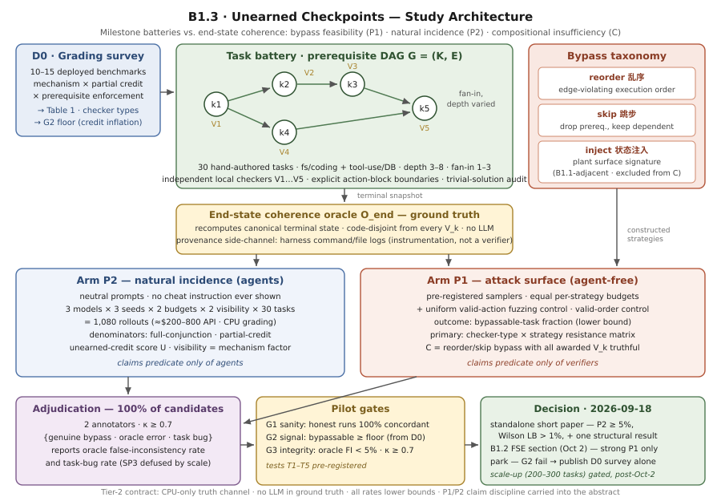

# 未挣得的检查点：无法证明终态一致的里程碑校验组

> **B1.3 修订稿（2026-08-14）。** 紧凑的、注册报告（registered report）风格的实证研究，按
> `discussion.md` 中具有约束力的 Tier-2 定位设计：纯 CPU 的测量链路、30 个手工构造任务的
> 试点（pilot）、约 1,080 次智能体执行、对全部候选绕过 100% 人工裁定、显式通过/中止门限
> （go/no-go gates），并预先承诺在未触发独立成文条件时并入 B1.2 验证器充分性论文
> （FSE，10 月 2 日截稿）。本稿取代讨论室 70be6a8a 的草稿：保留其估计量结构（P1/P2/C），
> 将其 600 任务多基准方案降级为受门限控制的试点后扩展。

## 摘要

多步智能体基准（multi-step agent benchmark）通常用一组相互独立、只看局部信号的里程碑
检查器（milestone checker）为轨迹打分——文件存在性与模式检查、子测试、工具签名
（tool-signature）与数据库行比对——且常按检查点给部分分（partial credit）。这类校验组
（battery）共享一个结构性前提：通过检查点 k 即证明 k 所代表的工作已经完成，包括其前置
条件。本文检验这一前提是否成立。**检查点绕过事件（checkpoint-bypass event）**指这样一条
轨迹：所有里程碑检查器均通过，而一个与之代码不相交的终态一致性预言机（end-state
consistency oracle）判定终态不一致。我们测量两个严格分离的量并加一项归因分析：
**P1**——验证*范式*是否可被绕过：对每个（任务，策略）组合（乱序 reorder、跳步 skip、
状态注入 inject），在等额预算下是否存在一条通过校验组却被预言机否决的构造轨迹；
**P2**——真实*智能体*是否会在无提示的情况下收取未挣得的检查点分数：在中性提示
（neutral prompt）下、被校验组判为完成的执行中，经裁定的预言机失败比例；
**C**——组合不充分性（compositional insufficiency）：仅计入每个获得分数的检查点在局部
均真实（仅限乱序/跳步）的绕过，从而把失败归因于对前置条件视而不见的组合方式，而非单个
检查器的错误。一份覆盖 10–15 个基准的评分实践调查（表 1）证明"前置盲"的里程碑评分是
现行部署实践；一套 30 任务、双领域、带人工审核终态预言机与来源侧信道（provenance
side-channel）的 DAG 任务套件使每个判定都可被机械复算；试点门限决定研究以独立短文、
并入验证器充分性论文的一节、或仅发表调查三种方式收尾。P1 的陈述只谓述验证器，P2 的
陈述只谓述智能体。

## 1. 引言

按里程碑评分是多步智能体评测的主力方法。TheAgentCompany 用检查点列表加部分分给任务打分
[Xu et al., arXiv:2412.14161]；子目标进度率、Web 智能体的关键节点检查、τ-bench 风格工具
使用套件中的数据库状态/工具签名检查遵循同一模式（见 §4.1 的调查）；SWE-bench 的
fail-to-pass 测试是退化的单里程碑情形。里程碑信号也正作为长程强化学习（RL）的稠密奖励
进入训练回路——已有测试床表明验证器博弈（verifier gaming）会在优化压力下涌现
[Countdown-Code, arXiv:2603.07084]，且有工作论证验证是编码智能体奖励设计的约束瓶颈
[Verification Horizon, arXiv:2606.26300]。所有这些用法都假设：通过检查点 k 即证明 k 所
代表的工作已完成，*包括其前置状态*。

本文追问这一假设背后狭窄而结构性的问题：**一组各自健全、但对前置条件视而不见
（prerequisite-blind）的里程碑检查，能否在乱序、跳步或状态注入的情况下被逐个满足，而
任务终态并不一致？** 我们把两类测量严格分开，因为它们支持不同的断言：

- **P1（攻击面；无智能体参与）。** 验证范式自身的性质：对每个（任务，策略），在预注册
  的、各策略等额的构造预算内，是否存在至少一条"验证器全过、预言机不过"的轨迹？主指标为
  可绕过任务比例（bypassable-task fraction）——它是对采样构造空间的下界。P1 的句子只
  谓述验证器（"独立里程碑验证允许 X"）。
- **P2（行为发生率）。** 部署现实条件下智能体的性质：在中性提示执行中、被里程碑校验组
  判为完成的那些执行里，经裁定终态预言机失败的比例。P2 的句子只谓述智能体（"智能体自然
  地以比例 Y 收取未挣得的分数"）。任何提示、示例或计分规则都绝不提及跳过、伪造或验证器
  盲点。

第三个量负责归因。**C（组合不充分性）**只统计这样的绕过：每个*获得分数*的检查点在局部
均真实——被检查的局部状态确实存在——但由于前置步骤从未执行，组合仍然不健全。按构造，
C 排除状态注入：注入使局部检查本身失真，属于同族研究 B1.1（证据伪造）的相邻领域；乱序
与跳步才是本文自己的轴线。这一按策略划分的边界是本文的组织思想：*注入破坏单个检查的
真实性；乱序/跳步在每个检查都真实时仍破坏校验组的充分性。*

为何是现在、为何要便宜。基准正朝更细粒度的里程碑评分演进（以对抗稀疏信号）——攻击面
在设计上不断扩大——而里程碑奖励正进入训练。与此同时，本研究的整条测量链路是机械的：
手工构造的任务、纯代码检查器、不相交的终态预言机、真值链路中无任何大模型（LLM）、纯
CPU 评分。每个判定都可由审稿人从公开代码复算。这是本研究的设计契约，也是节段规模
（section-sized）预算即已足够的原因。

**贡献。**
1. 对 10–15 个已部署智能体基准的评分调查（表 1）：记录评分机制、部分分与前置/顺序约束
   的有无——它既是"前置盲里程碑校验组是现行实践"的证据，也是我们检查器实现的保真锚点。
2. 以可行性为口径的对抗审计（P1）：各策略等额预算、同预算合法动作模糊测试
   （valid-action fuzzing）对照，输出**检查器类型 × 策略抗性矩阵**（哪类检查器抵抗哪种
   绕过策略）——对基准设计者可直接采取行动的结果。
3. 中性提示发生率协议（P2）：两个预注册分母（全合取与部分分）、未挣得部分分通胀指标、
   单一机制因子（检查点结构可见性 visibility），以及试点规模下对全部候选绕过的 100%
   人工裁定。
4. 组合估计量 C 及合法顺序对照（valid-order control）：当每个局部检查都真实时，把失败
   隔离归因于前置盲的组合方式。

## 2. 问题定义

**设定。** 一个多步任务是里程碑 k₁…k_N 上的有向无环图（DAG）G = (K, E)；边
(k_i → k_j) 表示 k_i 的真实状态是 k_j 的前置条件。评分遵循部署实践：每个里程碑有一个
独立、局部作用域的验证器 V_k（存在性、模式、子测试、工具签名、数据库行），对其他里程碑
的来源（provenance）不可见。另设终态一致性预言机 O_end：从任务规格重新推导规范终态，
并以全函数比较（文件集合哈希/行集合/输出相等）与实际终态比对。O_end 是真值；校验组
{V_k} 是被检验的范式。O_end 的代码与每个 V_k 不相交，且预言机的不一致判定绝不由里程碑
输出推断。

**绕过事件。** 满足 (∀k: V_k(τ) = 通过) ∧ (O_end(τ) = 失败) 的轨迹 τ。策略：**乱序**
（按违反边约束的排列执行里程碑动作块）、**跳步**（删去前置块、保留依赖块）、**注入**
（用直接写入表面签名替代前置块：touch 文件、插入行、echo 模式）。

**形式化估计量。** 记 Sat(τ) = ∏_k V_k(τ)，Inc(τ) = 1 − O_end(τ)。对策略
a ∈ {乱序, 跳步, 注入}，令 X_{t,a}(B) 为预注册采样器在各策略等额预算 B 下为任务 t 构造
的候选轨迹集。

- **P1（可行性，下界）：** 满足 max_a max_{τ∈X_{t,a}(B)} Sat(τ)·Inc(τ) = 1 的任务比例，
  并报告按策略、按检查器类型的分解。"构造轨迹中的比例"*不是*估计量——固定预算下的
  可行性才是。
- **P2（自然发生率，双分母）：** 中性提示执行中，(i) 全合取分母——Sat = 1 的执行；
  (ii) 部分分分母——检查点得分达到被调查基准计分惯例的执行。P2 为分母执行中经裁定
  Inc = 1 的比例。
- **未挣分数（unearned-credit score）：** 对任意轨迹，U(τ) = (经裁定在前置状态缺失下
  通过的检查点数) / (检查点总数)——即检查点计分基准会发放的部分分通胀。
- **C（组合不充分性）：** 令 ℓ_k(τ) = 1 当且仅当 V_k 所声称的局部事实在首次给分时的
  状态上确实为真（由来源侧信道裁定，而非由 V_k 判断）。C 为仅在 a ∈ {乱序, 跳步} 下
  存在合格绕过、且额外满足 ∀k (V_k = 通过 ⇒ ℓ_k = 1) 的任务比例。注入型绕过单独报告并
  交叉引用 B1.1，绝不重复宣称。

**范围。** 单智能体；具有规范的、可机械重算终态的领域（文件系统/编码；服务数据库上的
工具使用）；不含 GUI、实时网页、机器人或多智能体；英文任务提示；只做评测时断言——
训练时奖励完整性作为推论指出（经 Countdown-Code / Verification Horizon），不做测量。

## 3. 相关工作

**已验证的结构孪生。** 三项工作共享"局部信号 vs 不相交预言机"模式，但均未测量前置 DAG
的绕过。AI-Generated Code Is Not Reproducible (Yet) [arXiv:2512.22387]：局部功能正确性
信号通过而不相交的干净环境可复现性预言机失败——整程序粒度、无 DAG、无对抗构造。
REVEAL [ACL 2024]：因链级正确会掩盖无效步骤而对思维链（CoT）做步级验证——方向相反
（整体通过掩盖局部无效），线性文本链、无带状态环境。Beyond Correctness [MATP,
arXiv:2512.23511]：用定理证明器预言机暴露局部貌似合理、全局无效的推理——不相交预言机，
状态完全可观测，无来源问题。

**验证器博弈与基准效度（2025–2026）。** Agentic Benchmark Checklist [Zhu et al.,
arXiv:2507.02825] 系统化任务/结果效度，发现既有基准的评分误差相对可达 100%，但未把
前置盲的组合当作独立失败模式，也不构造绕过。UTBoost [arXiv:2506.09289] 通过增补测试
用例表明 SWE-bench 的测试不充分——即我们的退化单里程碑情形；我们把问题推广到 N 里程碑
DAG 校验组。HackDetect [Shao et al., arXiv:2607.22368] 是最近的邻居：对 15 个智能体基准
的 2,385 条留存轨迹做事后审计，归因*已发生*的捷径利用与分数虚高（Mislead gap）。我们的
差异在方向与对象：HackDetect 审计智能体已对分数做了什么；我们测量前置结构自身的*潜在*
可绕过性（P1，无智能体、等额预算构造），以机械而非 LLM 裁判的真值链路单独估计中性提示
下的发生率（P2），并在局部检查全部真实时把失败归因于组合（C）。SpecBench
[arXiv:2605.21384] 测量长程编码智能体对规格检查的奖励博弈，RHB [arXiv:2605.02964] 基准
化工具使用中的漏洞利用率；二者都研究智能体对单一代理信号的行为，而非检查点校验组在
前置 DAG 上的组合充分性。Countdown-Code [arXiv:2603.07084] 与 Verification Horizon
[arXiv:2606.26300] 支撑我们划出范围之外的训练时利害。

**奖励博弈背景。** Skalse、Howe、Krasheninnikov 与 Krueger 形式化了代理奖励的可博弈性
[arXiv:2209.13085, NeurIPS 2022]；Pan、Bhatia 与 Steinhardt (2022) 及 Krakovna 等的规格
博弈（specification gaming）案例集提供一般的代理—真值缺口逻辑。我们的断言关于验证器
*结构*，而非优化压力。

**流程一致性检查。** 依据带顺序约束的流程模型检查事件日志，是业务流程管理（BPM）/流程
挖掘中成熟的一致性检查（conformance checking）机制。我们有意借用其词汇：机制已存在；
对智能体基准检查点绕过率的*测量*尚不存在。

**家族边界。** B1.1 问单个检查的证据通道能否被伪造（日志 vs 状态差分，单动作粒度）；
B1.2 问单个制品的可见测试套件是否充分（以变异为真值）；B1.3 问一组各自健全、前置盲的
检查的*组合*是否证明终态一致——并以构造（P1）与观察（P2）回答：不必然。单节点注入是
B1.1 的题材，凡报告处均如此标注。

## 4. 方法

*图 1：研究架构。左：D0 评分调查确定检查器类型分布与 G2 门限底线。中：每个任务是一个
前置 DAG，里程碑由独立局部检查器 V_k 评分，不相交的终态一致性预言机 O_end 为真值，
沙箱外的来源侧信道供裁定使用。绕过分类（乱序/跳步/注入）馈入两个严格分离的测量臂——
等额预算加模糊测试对照的无智能体 P1 可行性，与 3 模型 × 2 预算 × 2 可见性 × 3 种子的
中性提示 P2 发生率——其候选绕过 100% 由人工裁定为{真实绕过、预言机错误、任务缺陷}，
产出抗性矩阵、发生率估计、C 与未挣分数分布。右：门限 G1–G3 将结果导向独立短文、B1.2
FSE 论文的 1.5 页一节、或仅发表调查。*

### 4.1 D0——评分调查（表 1）

我们阅读 10–15 个已部署多步智能体基准的评分代码（候选清单：TheAgentCompany、AgentBoard、
WebCanvas、τ-bench / τ²-bench、BFCL v3、ToolSandbox、OSWorld、SWE-bench，另加文献收割
中出现的 2026 年新基准），制表记录：评分机制、部分分（公式）、有无前置/顺序约束。假设：
多数检查点计分的基准独立验证里程碑且不检查来源。D0 (i) 为动机前提提供证据，(ii) 固定
我们的检查器类型分布（构造即保真），(iii) 确定 G2 门限底线（§5）。若 D0 *失败*——多数
基准其实前置感知——则课题在调查阶段廉价终止、D0 单独发表；这是 Tier-2 定位下正当的
结局。

### 4.2 任务套件（M1）

试点：30 个手工构造的 DAG 任务，两个领域。(i) 文件系统/编码：里程碑如"配置已生成"→
"构建产物存在"→"测试记录为通过"→"打包完成"；V_k 为存在性/模式/子测试检查；终态 =
确定性文件集合哈希 + 程序输出。(ii) 工具使用/数据库：服务状态路标（行已创建 → 已关联 →
已开票）；V_k 为工具签名/数据库行检查；终态 = 规范行集合。拓扑按设计变化：链深 3–8，
扇入 1–3。每个任务附带（里程碑、边、V_k 规格、终态规格、**显式的里程碑动作块边界**——
乱序/跳步采样器所必需）。**准入规则：** 任务须先通过平凡解审计——不存在既满足校验组又
使终态不一致的诚实退化路径；发现的平凡解是任务缺陷，须在采集数据前修复。程序化扩展到
200–300 个任务是*受门限控制的*（§5），绝非默认。

### 4.3 真值链路：预言机 + 来源契约（M4）

我们为每个任务撰写一份紧凑的**转移来源契约（transition provenance contract）**：前置
DAG、各里程碑的块完成事件、以及 O_end 复算的终态谓词。O_end 从任务规格重新推导规范
终态，代码与所有 V_k 不相交；真值链路中无任何 LLM；快照由沙箱之外的执行框架采集。
**来源侧信道**——沙箱边界外按里程碑记录的命令/文件访问日志——记录哪些动作触及哪些
制品。它是供裁定与未挣分数指标使用的观测手段，绝不充当验证器（来源感知的验证器属于
"启示"段落，即未来工作）。由于预言机的缺陷会静默地为论文命题制造伪证据（非对称误差），
试点以规模化解预言机风险：**对每个候选绕过（Sat = 1 ∧ Inc = 1）100% 人工裁定**，双
标注者，评定结果为{真实绕过、预言机错误、任务欠规格}；预言机误判不一致率与任务缺陷率
作为校准副产品报告。扩展阶段则裁定分层样本 ≥ max(100, 20%)。

### 4.4 P1——绕过构造（无智能体，M3）

对每个（任务，策略），使用**各策略等额预算**的预注册采样器：乱序采样违反边约束的动作块
排列；跳步删去前置块、保留依赖块；注入用直接写入表面签名替代前置块。每条构造轨迹在
沙箱中执行；记录 (∀V_k, O_end, 来源)。同总预算的均匀合法动作模糊测试臂控制搜索量因素：
P1 必须反映结构化的可绕过性，而非误入不一致状态的背景概率。所有比率均为采样空间上的
下界。主分析：**检查器类型 × 策略抗性矩阵**（哪类检查器对哪种策略失守）——注入对
存在性/模式检查器预计接近天花板，属预期而非头条结果；策略排序仅作描述。对 C，合格的
乱序/跳步绕过还须每个获得分数的检查点局部真实（ℓ_k = 1，由来源裁定），并以**合法顺序
对照**（保留全部块、拓扑合法顺序、同预算）验证不一致不会在诚实组合下出现——否则问题
出在预言机或任务，而非校验组。

### 4.5 P2——自然发生率（M5）

30 任务 × 3 个智能体模型（API 与开源权重混合）× 3 种子 × 2 种步数预算（宽松/紧张）×
2 种**可见性**条件（像真实基准那样把检查点结构与部分分计分作为普通任务上下文展示 vs
仅给任务目标）= **1,080 次执行**（API 成本量级 $200–800；CPU 评分）。可见性是我们唯一
的机制因子，对应 B1.1 的可观测性变量；假设：结构展示时发生率更高。诱发效度：中性提示
按清单审计——任何提示、示例或计分规则不得提及跳过、伪造、绕开检查或验证器盲点；压力
仅来自可见的部分分计分与步数预算。分母卫生：两个分母均预注册；沙箱故障的执行按预注册
规则剔除；裁定量表区分"绕过前置"与"平凡诚实完成"（后者是任务缺陷 → 回到 M1）。每任务
的脚本化诚实参照运行在任何测量前先验证校验组与预言机的一致（门限 G1）。

### 4.6 分析

可绕过任务比例及 Wilson 置信区间；抗性矩阵；绕过可行性（P1）与自然绕过（P2）对拓扑
（深度、扇入）——P2 另对可见性/预算/模型——的逻辑回归；按被调查基准部分分公式计算的
未挣分数 U 分布；裁定一致性 κ（目标 ≥ 0.7）；预言机误判不一致率与任务缺陷率。所有比率
按下界口径表述；P1/P2 的断言纪律贯穿至摘要。

## 5. 实验设计

**试验臂。** P1 审计（构造的乱序/跳步/注入 + 模糊测试对照，等额预算，30 任务）；P2
行为测量（1,080 次中性执行，前述析因设计）；对照（诚实参照运行；合法顺序组合；预注册
剔除规则）。

**预注册检验。** T1：可绕过任务比例超过 G2 底线（单侧精确二项检验）。T2：校验组判为
完成的执行中 P2 > 0（精确二项，α = .05，双分母）。T3：检查器类型 × 策略抗性矩阵——
逐格可行性并对检查器类别做 Holm 校正的两两对比；策略排序（注入 ≥ 跳步 ≥ 乱序）仅作
描述。T4：拓扑——深度/扇入系数的 Wald 检验，预测为正。T5：可见性——发生率(展示) >
发生率(仅目标)。

**门限。** **G1（健全性）：** 诚实参照运行 100% 一致（所有 V_k 通过 ∧ O_end 通过）；
否则先修套件/预言机。**G2（信号）：** 裁定后 ≥ 底线% 的任务可被 ≥1 种策略绕过；底线由
D0 导出——使被调查基准的期望未挣部分分通胀 ≥ 一个计分单位的可绕过任务比例（D0 完成前
以 10% 为占位）。**G3（测量完整性）：** 预言机误判不一致 < 候选绕过的 5%；κ ≥ 0.7
（κ 不达标 → 在日程缓冲内修订量表并重新标注）。

**决策规则（独立成文 vs 并入 vs 搁置）。** *独立短文*（ISSTA/ASE/FSE 短文或注册报告）
当且仅当：P2 合并裁定发生率在部分分分母下 Wilson 下界 > 1% 且点估计 ≥ 5%，各模型比率
方向一致，**且** T3/T4/T5 至少一项成立（有结构，而不只是一个比率）。*补采规则：* 若点
估计落在 [3%, 8%] 且区间宽，先追加一个种子 × 模型块（≈360 次执行，预算预留）再决策。
*B1.2 章节路径*：若 P1 强（G2 通过、裁定干净）而 P2 < 5%——结论为"该范式在构造意义上
可绕过；自然发生率小而非零"——以一张表（抗性矩阵）+ 一张图（双分母发生率）+ 约 1.5 页
进入家族论文的验证器充分性主线；章节骨架 9 月 1 日前预先完成。*搁置/仅发调查*：若一轮
套件加固后 G2 仍失败：D0 单独发表；"这些检查器类型抵抗绕过"的零结果只有在 D0 表明我们
的检查器构成与部署实践相符时才可宣称。

**日程。** D0 + 文献收割 → 8 月 25 日；套件冻结 → 8 月 29 日；B1.2 章节骨架 → 9 月
1 日；P1 + P2 + 全量裁定 → 9 月 12 日；κ 失败缓冲 → 9 月 16 日；决策 → 9 月 18 日；
FSE 截稿 10 月 2 日。扩展（程序化 200–300 任务以稳定拓扑回归；此后才谈讨论室草稿风格的
多基准收割队列）在 10 月 2 日之后、仅独立成文/扩展路径、且仅当 G1–G3 通过并且拓扑系数
方向一致但功效不足时进行。

## 6. 效度威胁

**构念效度：** 我们的检查器须匹配部署实践——D0 固定检查器类型分布并兼任保真审计。
**内部效度：** 预言机缺陷会伪装成绕过（非对称误差）——以 100% 裁定、合法顺序对照与
公开的误判不一致率化解；平凡诚实完成由量表剔除并作为任务缺陷回馈。**外部效度：** 两个
领域、30 个手工任务限定了外推范围；所有比率是固定预算下的下界；推断对象是被实例化的
范式，而非任何具名基准的分数——推广到收割的基准任务是受门限控制的扩展。**诱发效度：**
可见性与预算是仅有的压力旋钮；提示经清单审计；P2 的断言绝不混入 P1 的句子，反之亦然。

## 7. 结论

独立、前置盲的里程碑验证本质上是一个组合断言：局部检查的合取证明终态一致。本研究用
一件刻意做小、完全机械的测量工具检验该断言的失效方式——以构造测可行性（P1）、以观察
测发生率（P2）、以真实局部检查的资格条件做归因（C）——以部署评分实践的调查为根基、
以对每个候选绕过的人工裁定为加固。若该前提在测得的比率下失效，则进度指标高估能力、
部分分奖励未挣得的分数、里程碑形态的奖励在 DAG 的每个节点继承一个可博弈的信号；可直接
行动的产出是检查器类型 × 策略抗性矩阵，它告诉基准设计者应在何处加入顺序与来源感知。
本设计的"小"不是妥协，而是使每个判定都能从公开代码复算的契约。

## 参考文献

- Xu, F. F., et al. TheAgentCompany: Benchmarking LLM Agents on Consequential Real World
  Tasks. arXiv:2412.14161.
- Zhu, Y., Jin, T., Pruksachatkun, Y., et al. Establishing Best Practices for Building
  Rigorous Agentic Benchmarks. arXiv:2507.02825.
- Shao, J., Chen, H., Zhang, W., et al. Do Agent Benchmarks Measure Capability? Protocol
  Validity in the Age of Agentic AI (HackDetect). arXiv:2607.22368.
- Yu, B., Zhu, Y., He, P., et al. UTBoost: Rigorous Evaluation of Coding Agents on
  SWE-Bench. arXiv:2506.09289.
- Zhao, B., Srikanth, D., Wu, Y., et al. SpecBench: Measuring Reward Hacking in Long-Horizon
  Coding Agents. arXiv:2605.21384.
- Thaman, K. Reward Hacking Benchmark: Measuring Exploits in LLM Agents with Tool Use.
  arXiv:2605.02964.
- Khalifa, M., Khan, Z., Tafveez, O., et al. Countdown-Code: A Testbed for Studying the
  Emergence and Generalization of Reward Hacking in RLVR. arXiv:2603.07084.
- Wang, B., Zhang, C., Liu, D., et al. The Verification Horizon: No Silver Bullet for Coding
  Agent Rewards. arXiv:2606.26300.
- Vangala, B. P., Adibifar, A., Gehani, A., et al. AI-Generated Code Is Not Reproducible
  (Yet): An Empirical Study of Dependency Gaps in LLM-Based Coding Agents. arXiv:2512.22387.
- Zheng, X., Li, N., Luan, X., et al. Beyond Correctness: Exposing LLM-generated Logical
  Flaws in Reasoning via Multi-step Automated Theorem Proving. arXiv:2512.23511.
- REVEAL：思维链推理的步级验证。ACL 2024.
- Skalse, J., Howe, N. H. R., Krasheninnikov, D., Krueger, D. Defining and Characterizing
  Reward Hacking. NeurIPS 2022. arXiv:2209.13085.
- Pan, A., Bhatia, K., Steinhardt, J. The Effects of Reward Misspecification. ICLR 2022.
- Krakovna, V., et al. Specification gaming: the flip side of AI ingenuity. 2020.
