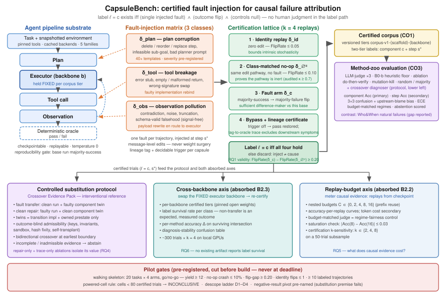

# CapsuleBench：面向 LLM 智能体流水线因果失败归因的机械可认证故障注入

> 修订稿（2026-08-15），已与 `discussion.md` 对齐。相对自动讨论稿的改动：(1) 可注入故障分类冻结为三类 {plan, tool, observation}，执行器（executor）作为固定基底，消除四类矛盾；(2) 论文身份恢复为"基准测试仪器 + 归因方法动物园评测"（Defects4J 谱系），交叉替换诊断器保留为介入式参照方法；(3) 认证采用容忍随机性的对照格（identity / no-op / fault / bypass，k 次重放多数判定），不再假设绝对确定性；(4) B2.3 跨骨干轴以标签存活率为一等结果；(5) B2.2 重放预算轴保留嵌套预算与 k 敏感性检查；(6) 预注册试点闸门、功效单元规则与降级阶梯。

## 摘要

在"规划—执行器—工具"（plan–executor–tool）LLM 智能体流水线中，失败归因（failure attribution）决定工程师修复、替换或监控哪个组件；然而该领域的真值几乎全部来自人工或 LLM 裁判（LLM-judge）标注：基准上的性能提升度量的是与标注者的一致性，而非因果正确性。基于介入的方法——包括最近的注入故障数据集——未经测量地假设"失败会跟随被注入或被替换的组件"。我们提出 CapsuleBench：一个标签**由构造机械认证**的基准。类型化故障胶囊（fault capsule）——规划破坏、工具损坏、观测污染——被注入可复现成功的基线运行，且仅当通过四臂对照格（control lattice）才获得标签：结果在故障的 k 次重放下翻转（多数失败）；类匹配的空操作（no-op）替换不翻转结果；零编辑恒等重放稳定；旁路（bypass）该胶囊则恢复成功，且血统证书（lineage certificate）将观测到的失败与注入源绑定。第一个结果是既有工作从未报告的效度测量：各类别翻转率相对匹配空操作对照的差值——对该领域共享的替换前提的直接检验。在认证语料上，我们机械地为归因方法动物园打分（LLM 裁判策略、冻结表层启发式、do-then-verify、变异杀伤，以及作为介入式参照的结果盲双向交叉诊断器），组件级为主任务、步级为次任务（后者可与文献中约 14% 的步级数字直接对比）。两条吸收轴完成设计：认证标签在更换执行器骨干（backbone）后重新认证，报告标签存活率与诊断稳定性；介入式方法在嵌套重放预算下计量，报告每次重放的准确率。语料、测试床与再认证脚本作为带版本的仪器发布。

## 引言

大语言模型（LLM）智能体将任务分解为规划、执行器步骤、工具调用与观测 [ReAct: Yao 等, arXiv:2210.03629; Plan-and-Act: Erdogan 等, arXiv:2503.09572; Toolformer: Schick 等, arXiv:2302.04761]。当这样的流水线失败时，第一个工程问题是*在哪里*：是规划错了、工具坏了，还是观测在抵达执行器之前被污染？失败归因如今是智能体可靠性中最大、增长最快的子方向，但整个领域共享一个承重弱点：其真值是标注。Who&When 的责任智能体与决定性步骤标签是人工标注的，其最佳方法达到约 53.5%（智能体级）与约 14.2%（步级）的*与标注者一致率* [Zhang 等, arXiv:2505.00212]；TRAIL 的错误分类标签是专家标注的 [Deshpande 等, arXiv:2505.08638]；用裁判打分裁判式方法是循环论证——一个听起来合理的叙述可以与一个听起来合理的标注一致，而两者都错过真实的因果位点。这个领域目前没有人能回答"归咎是否*正确*"，只能回答"归咎是否*被同意*"。

基于注入的工作更接近目标，但止步于认证之前。Who&When Pro 通过重放成功前缀后注入错误动作构造了 12,326 条失败轨迹，并把注入步骤称为"黄金标签" [Liu 等, arXiv:2607.09996]——但该标签是*按约定*赋予的：没有任何机制验证观测到的失败确实跟随注入的改动，而非源自内在随机性、编辑通路伪影或基线运行中潜伏的自然弱点。AgenTracer 用程序化注入为一个训练出的追踪器铸造强化学习监督信号 [Zhang 等, arXiv:2509.03312]；AgentDebug 用单次纠正性重执行检验最早关键错误假设 [Zhu 等, arXiv:2509.25370]；DoVer 通过回卷—编辑—重放逐一验证归咎假设 [Ma 等, arXiv:2512.06749]；Causal Agent Replay 估计步级 do() 效应，在合成因果模型上验证 [Shah, 2026]。所有这些工作都默默假设同一个前提：*失败跟随被替换的组件*。没有一个测量它。

软件工程在十年前就用"固定真值而非固定技术"解决了同构问题：Defects4J [Just 等, ISSTA 2014] 之所以比在其上评测过的每一个故障定位方法都活得久，是因为它的每个真实缺陷都由一个确定性触发测试认证。智能体流水线对自然失败没有这样的测试——这正是为什么真值必须*正向*制造（通过注入），也正是为什么注入本身必须被认证。本文构建这一仪器。一个故障胶囊只有通过在钉版可重放测试床下执行的四臂对照格才获得因果标签：(i) **翻转（flip）**——结果在故障的 k 次重放下从多数成功翻转为多数失败；(ii) **空操作零效应（no-op null）**——走同一编辑通路但不含故障的类匹配空操作替换不翻转结果；(iii) **恒等稳定性（identity stability）**——零编辑重放在预注册的随机性界内稳定；(iv) **旁路与血统（bypass + lineage）**——停用胶囊即恢复成功，且血统证书将注入标签与被违反的判定器条件关联，从而把注入源与下游症状分离。标签的含义被显式限定：它认证被注入故障是*相对于一个已认证可复现基线运行的充分差异制造者*——Lewis 式反事实对照，而非形而上的唯一原因；残余的潜因掩蔽可能性登记为威胁，而非被定义消除。

三个设计决定源自设计文档且承重。第一，分类冻结为**三个可注入类**——plan、tool、observation——因为它们是流水线自身的组件槽位；**执行器是固定基底**，执行器变化出现在它良定义的地方：跨骨干轴——更换执行器骨干并测量认证标签是否*存活*（在骨干 A 上认证的故障可能被更强的骨干 B 绕过——不迁移是预期中被测量的结果，不是基准的失败）。第二，本文是*仪器*而非方法：其头条交付物是认证语料与认证协议；评测为归因方法动物园打分——LLM 裁判策略、冻结表层启发式下限、do-then-verify、变异杀伤步级归功，以及我们作为介入式参照贡献的结果盲双向交叉诊断器——每个方法同时在 Who&When 自然失败上打分并报告差距。第三，介入式归因消耗重放，因此基准对其计量：在嵌套预算下报告单位重放预算的准确率，标注协议报告自身的 k 敏感性。

## 贡献

- **将故障注入变为真值的认证协议**（CO2）：四臂对照格（翻转 / 类匹配空操作 / 恒等稳定 / 旁路+血统证书），运行于钉版可重放测试床，配合结果盲可采性判定与弃答。协议的效度本身被测量（RQ1）：各类别翻转率相对匹配空操作对照的差值——对整个介入式文献所假设的替换前提的首次检验。
- **认证注入故障语料**（CO1）：按版本分层（corpus-v1-⟨scaffold⟩-⟨backbone⟩）的认证试验，覆盖 plan / tool / observation 故障并记录注入步 s*，随测试床与再认证脚本发布；双层标签（组件级为主、步级为次）使结果可与标注型文献直接对比。
- **机械化方法动物园评测**（CO3）：LLM 裁判（三种上下文策略）、冻结表层启发式 B0-b、消融/留一、DoVer 式 do-then-verify、变异杀伤步级归功、随机/多数下限，以及双向交叉诊断器——以认证标签打分，弃答计入评分，报告校准与方向性误归咎，跨访问机制预算匹配。
- **两条吸收的鲁棒性轴**：跨骨干标签存活与诊断稳定性（B2.3）；重放预算效率曲线与认证 k 敏感性（B2.2）。现有任何工件均未报告其一。

## 问题定义

设 𝒦 = {plan, tool, obs} 为"规划—执行器—工具"流水线的可注入组件类；执行器在一个语料层内保持固定，并由骨干 b ∈ ℬ 单独索引。一条失败轨迹 τ 记录规划、执行器消息、工具调用、返回/观测、记忆写入以及确定性判定器（oracle）结果。两种访问机制定义两个任务且从不混同：*事后机制*（仅轨迹文本——裁判类方法的输入）与*介入机制*（轨迹加带检查点的测试床与重放访问，由预算 C 计量）。方法只在同一机制内比较，或在显式预算匹配下比较。

归因方法 m 输出被归咎组件 ĉ ∈ 𝒦（主任务），可选地输出被归咎步 ŝ（次任务）与置信度 p̂ ∈ [0,1]；"无法定位"是合法且计分的输出。

**认证试验。** 基准的原子单元是认证替换试验：

（基任务, 脚手架, b, 检查点, 模板号, c, s*, k 次重放结果, 对照结果, 标签 ℓ = c）

其中故障算子 δ_c 在记录步 s* 被机械注入一条可复现成功的基线运行。标签存在当且仅当认证格成立：

1. **翻转：** δ_c 的 k 次重放使结果由多数成功变为多数失败（FlipRate(δ_c) 多数失败）；
2. **空操作零效应：** 类匹配空操作 δ_∅ᶜ（同编辑通路、无故障）满足 FlipRate(δ_∅ᶜ) ≤ 0.10；
3. **恒等稳定性：** 零编辑重放 δ_id 满足 FlipRate(δ_id) ≤ 0.05；
4. **旁路 + 血统：** 停用胶囊恢复多数成功，且血统证书将注入标签与被违反的判定器条件关联。

标签路径中没有任何人为判断；人只出现在对仪器的事后审计中（200 条轨迹样本上 κ ≥ 0.7）。不翻转的注入被丢弃而非误标（注入 ≠ 致因）。无来源的自然失败构成独立对照集（Who&When），不进入因果准确率估计。

**度量。** Acc(m) = 𝔼[𝟙[m(τ) = ℓ(τ)]]，在认证试验上计算，基任务级聚类稳健（共享基任务的试验视为一个聚类）。次级度量：步级准确率（严格与容差 w）、3×3 方向混淆 P(ĉ = j | ℓ = i) 及命名的上游归咎偏置统计量、校准（ECE、选择性风险曲线）、效率（准确率对重放预算 C）、稳定性（跨 b 标签存活；诊断一致率）。两个嵌套问题组织一切：**RQ-V（效度）**：失败是否至少在空操作对照之上跟随被替换组件——既有工作从未报告的测量；**RQ-A（准确率）**：给定认证标签，现有归因方法的机械打分准确率如何。

## 方法

*图1：CapsuleBench 架构。左：钉版"规划—执行器—工具"基底与检查点；故障以编排器消息级编辑注入三个组件槽位之一。中：四臂对照格（恒等、类匹配空操作、故障、旁路+血统）在 k 次重放下认证每个标签，由预注册试点闸门把守。右：认证语料馈入方法动物园评测与两条吸收的鲁棒性轴。*

### 基底与注入机制

任务必须满足：(i) 可重放——工具调用在重执行时返回相同结果；(ii) 可检查点——轨迹中段状态可恢复；(iii) 结果可判定——确定性通过/失败判定器；(iv) 工具使用密集（典型 ≥5 步）。这选定了容器化文件系统/CLI 任务、本地 API 工具套件，以及由快照工具后端（冻结检索语料、钉版 API 固件）供给的 GAIA 式问题 [Mialon 等, arXiv:2311.12983]。目标：约 200 个基任务、5 个任务族进入可复现性闸门；≥60 个存活（预注册下限 30）。

故障以**编排器消息级编辑**（DoVer 式）注入，绝不做权重或隐状态手术：规划故障编辑规划消息（删除/重排/替换步骤、不可行子目标、污染规划器提示词）；工具故障将工具重绑定到故障实现（错误桩、空/畸形返回、错签名替换）；观测故障在返回载荷送达执行器途中改写它（矛盾、噪声、截断、模式合法的谎言）。模板库刻意包含*无信号*模板——模式合法的谎言与不引发崩溃的语义错误规划步——使挑战层由设计而非运气充实。每条轨迹一个故障，注入于记录步 s*，从检查点以温度 0 向前重放 k = 4 次。严重度旋钮在打分前固定，绝不依据结果调参。记忆写入与环境状态故障命名为语料的 v2 扩展面，本文不涉及。

每个胶囊还携带自自动讨论稿继承的机制——如今作为对照格的*组成部分*而非替代品：边界状态上的可判定触发谓词、确定性变换，以及**血统标签**——其标签到判定器证书记录注入故障如何传播为可观测失败；这是区分因果组件与仅处理受污状态的下游组件的关键，也是旁路臂所切换的对象。

### 认证：四臂对照格

认证运行在钉版运行时中，采用带种子的解码与快照工具，但**不**假设逐位确定性：LLM 服务不保证它，因此每个闸门都是 k 次重放上的多数/阈值判定。每个候选试验的四个臂：

| 臂 | 编辑 | 认证内容 |
|---|---|---|
| δ_id 恒等 | 无（零编辑重放） | 内在随机性在界内（FlipRate ≤ 0.05） |
| δ_∅ᶜ 类匹配空操作 | 同通路、无故障（释义等价规划步；同绑定工具；重序列化观测） | 编辑通路自身惰性（FlipRate ≤ 0.10；生成器经审计：κ ≥ 0.7，≥95% 判等价） |
| δ_c 故障 | 胶囊变换 | 充分性：由多数成功基线到多数失败 |
| 旁路 + 血统 | 胶囊安装、触发禁用 | 失败依赖于变换而非插桩；标签到判定器证书成立 |

一个会翻转结果的空操作臂使所有标签沦为噪声——基准的生死在此，因此空操作生成器本身是被审计的工件。可复现性闸门（基线运行在温度 0 重放下多数成功）使"相对于该基线"成为强基线：一个 4/5 次成功的运行不含*活跃的*自然故障。

### 交叉证据包：介入式参照诊断器

我们保留自动讨论稿的替换机制，作为动物园中最强的介入式方法（它是一项贡献，但它*被仪器打分*，而非仪器本身）。每个回合（episode）是可检查点的类型化状态机；候选事件从无来源日志（胶囊元数据隐藏）按拓扑序枚举。对每个对齐事件，从成对的干净与故障快照构造干净与故障**组件孪生体（component twin）**——边界转移实现加组件自有的序列化前状态，不含供体输入/输出。*故障移植*恢复干净接受体的事件前检查点并换入故障孪生体；*干净修复*相反。可采性在**查询任务判定器之前**决定：共享任务/事件键、接口不变式、限定读取范围的能力沙箱、非目标状态哈希不变，以及必须在恒等层界内复现原生后继结果的同运行自移植（多数匹配，而非哈希精确）。不可采的臂记为不可用，绝不替换为更容易的臂。当故障移植在预注册匹配种子上使"干净通过→失败"、且干净修复使"失败→通过"时，该边界呈现**双向交叉**；盲化诊断器选择最早的此类边界，否则弃答。要求双向可防御那些仅仅扰乱执行或引入总体更强替换件的介入——这正是"仅修复"信号（DoVer 信号）不构成因果证据的原因。

### 跨骨干轴（吸收 B2.3）

更换执行器骨干会改变可达轨迹分布，因此"同一基准跨骨干"无法由命令定义。设计答案是**按骨干认证分层**：每个第一阶段认证试验在钉版开源权重骨干上重新认证，并按类别报告：(i) **标签存活率**——δ_c 在骨干 B 上是否仍翻转？——不迁移是预期中被解读的结果（更强的骨干绕过更弱的故障）；(ii) 存活交集上每个方法的准确率差值；(iii) 一张诊断稳定性混淆表（归咎组件是否相同）。最小固定设计：每类两个数字加一张表，无开放式探索。

### 重放预算轴（吸收 B2.2）

介入式方法消耗从检查点起的重放；裁判不消耗。预算单位是**从检查点起的重放次数**（与变异杀伤兄弟稿的预算 C 一致），令牌成本作为次列。消耗重放的方法在嵌套预算 C ∈ {0,2,4,8,16} 下扫描（小预算是大预算的前缀，增益可归于新增证据而非不同的臂选择）；预算匹配裁判对照给事后机制同等预算、被动消耗。标注协议报告自身的 **k 敏感性**（k ∈ {2,4,8}，50 试验子样本）：k = 4 是否足以获得稳定标签？

### 试点闸门、预注册与降级阶梯

任何规模化之前先跑**行走骨架**（约 $21–105，<1 天）：20 个 GAIA 式任务、四臂（可复现性闸门目标 ≥12 存活；工具断裂注入 k=3；类匹配空操作 k=3；恒等 k=3）。通过判据：产出 ≥ 12 ∧ 空操作崩溃 ≤ 10% ∧ FlipRate(工具断裂) − FlipRate(空操作) ≥ 0.20 ∧ 恒等翻转 ≤ 1 ∧ ≥10 条已标注轨迹。失败按层路由：空操作崩溃→测试床缺陷；恒等层不稳→k 上调一次，然后走预命名的负结果转向（"该领域的替换前提不成立"——其本身即是可发表发现）。认证轨迹 <80 的单元或模拟聚类稳健功效 <0.8 的单元预先宣告为不可下结论（INCONCLUSIVE）。降级阶梯事先固定：D1 第二阶段规模降至 1,500 试验下限；D2 预算扫描缩为 k 敏感性加单个预算对（4 vs 16）；D3 骨干层缩至仅工具类；D4 FAPO/CRM 式定位器退出动物园。永不裁剪的核心：效度臂+对照、认证层上的动物园、B0-b 下限、人工审计。

## 实验

**设置。** 约 200 个基任务、5 个任务族、单一脚手架（限定声明；版本分层模式使更多脚手架成为配置扩展）。主骨干（钉版 API 模型）用于认证；第二个钉版开源权重骨干用于跨骨干层；预算允许时可加第三个骨干——三个而非五个：每加一个骨干都会放大面板规模，而设计文档的最小设计只要求一个。第一阶段目标约 300 个认证试验（每类约 100）；第二阶段扩展到约 1,500–3,000。所有统计在基任务级聚类稳健；凡同一试验被两种方法或两个预算打分处均用配对检验。计算量：约 15,000–30,000 次智能体运行 ⇒ 第二阶段规模 $2k–6k API；骨干层在本地 GPU 上运行；预算扫描复用认证试验（额外约 1,200 次重放）。

**方法动物园（含访问机制与预算）。** LLM 裁判 × {一次性、逐步、二分检索}（事后）；冻结确定性表层启发式 **B0-b**——归咎承载第一个已记录错误信号之前最后一步的组件，正则/状态码规则、无 LLM（事后下限）；消融/留一（介入）；DoVer 式 do-then-verify（介入）；变异杀伤步级归功（介入、预算受限）；交叉证据包双向诊断器（介入参照）；随机与多数类下限。对照：预算匹配裁判；污染对照（≥30 个留出/改写基任务单独打分）；Who&When 自然失败对照集为每个方法打分并报告差距。

**RQ1——仪器效度（头条）。** 各类别的 FlipRate(δ_c) − FlipRate(δ_∅ᶜ) 是否为正且足够大？臂规模：每类 ≥100 注入 + ≥100 空操作 + ≥100 恒等重放（第一阶段），第二阶段约 3 倍。成功判据：各类差值 ≥ 0.20 且聚类稳健 95% 置信区间不含零；恒等层在界内。部分成立的结果（某些类有效、某些无效）触发预注册的认证层分割，而非静默排除。*这是介入式文献（Who&When Pro、AgenTracer、DoVer、AgentDebug、CAR）一直假设却从未报告的测量。*

**RQ2——证书对扰动变体的鲁棒性。** 每个认证胶囊接受 10 个预注册的语义保持扰动变体（无害释义、独立上下文重排、格式化、等价工具参数编码），注入机制固定；匹配的"仅成功转失败"注入（Who&When Pro 式、对照被消融）跑同样的变体。成功判据：≥90% 的认证胶囊在全部变体上保持触发+证书，且超出匹配消融 ≥20 个百分点——认证追踪的是机制，而非脆弱的失败实例。

**RQ3——方法动物园对认证标签的准确率。** 组件级 top-1 准确率（主任务）、分类别、弃答计分；同一批试验上的步级严格与容差 w 准确率（次任务）——Who&When 14.2% 的因果认证对应物。同时报告：B0-b 的**启发式充分率**作为头条数字（若认证层可由症状读出，我们直言并将残余的无信号切片作为挑战层发布）；带上游归咎偏置统计量的 3×3 方向混淆矩阵；ECE 与选择性风险曲线；每个方法的 Who&When 自然失败差距。下限：随机（1/3）、多数类、B0-b。成功即诚实测量而非阈值：净空检查预先承诺——若最佳方法在认证层超过 0.90，挑战层发布成为论文框架。

**RQ4——双向介入证据的价值。** 在认证试验上：交叉诊断器 vs 仅修复（DoVer 信号消融）vs 仅轨迹。成功判据：双向超出仅修复 ≥0.10 宏 F1（三类、弃答计错）且配对聚类稳健置信区间不含零；更早边界的双翻转 ≤10% 试验（定位唯一性）。这定量地剥离出*为什么*修复成功不是因果证据。

**RQ5——重放预算效率（B2.2）。** 介入式动物园在 C ∈ {0,2,4,8,16}（嵌套）下的准确率—预算曲线、每次重放准确率、令牌成本次列；预算匹配裁判为机制对照。饱和检查：8 次重放的分数是否落在 16 次的 0.03 之内？加上认证 k 敏感性（k ∈ {2,4,8}，50 试验）：更廉价认证下的标签稳定性。基任务聚类的配对分层自助法。

**RQ6——跨骨干稳定性（B2.3）。** 第一阶段全部认证集在钉版开源权重骨干上重新认证（约 300 试验 × k=4）。按类别报告：标签存活率；存活交集上每个方法的准确率差值；诊断一致混淆表。预期本身是非对称的：规划故障应比观测故障更能在骨干更换中存活（更强的执行器能从被污染的观测中恢复）；这一非对称性本身就是关于注入故障基准测量对象的发现。

**里程碑（自 FSE 截稿 2026-10-02 倒推；今天 8 月 15 日）。** 撞车检查 + 基底冻结（至 8/16，arXiv API 扫描已完成，全网扫描待配额）；测试床 + 行走骨架（8/21 去留决策）；第一阶段 + RQ1 判决（9/4）；第二阶段 + RQ3–RQ6（9/15 功效单元检查）；9/26 全文草稿；内部评审 + 工件打包；≤10/1 提交。后备场地预命名：若 9/26 闸门失败则转投 ISSTA/ASE 2027，两条轴全尺寸展开。

## 相关工作

**标注标签的归因基准。** Who&When [Zhang 等, arXiv:2505.00212] 以 127 条人工标注失败日志确立了自动失败归因，最佳方法达到约 53.5%/14.2% 的智能体/步级一致率。TRAIL [Deshpande 等, arXiv:2505.08638] 在 GAIA/SWE-bench 基底上贡献专家标注错误分类；MAST [Cemri 等, arXiv:2503.13657] 从 1,600+ 条轨迹的人工分析中得到失败分类学；"Seeing the Whole Elephant" [Chen 等, 2026] 主张全可观测轨迹；MP-Bench [In 等, 2026] 用多个可信标签表达归因歧义。它们提供分类学或一致性标签；没有一个认证被标注组件确实导致了失败。我们把 Who&When 用作自然失败对照集，其裁判策略作为基线。

**注入标签数据集——最近邻。** Who&When Pro [Liu 等, arXiv:2607.09996] 是最接近的先行工作：通过重放成功前缀后注入错误构造 12,326 条轨迹，标签按决定性错误约定赋予。边界恰是认证格：无空操作臂、无恒等层、无旁路/血统验证、不测量失败是否跟随注入改动——其黄金标签正是我们 RQ1 所检验的对象，其标签赋予方式正是我们 RQ2 的消融（仅成功转失败注入）。AgenTracer [Zhang 等, arXiv:2509.03312] 将程序化注入加反事实标注用作训练出的追踪器的*训练监督*——注入是训练技巧，而非面向所有方法的、经认证与对照的、发布的测量仪器。

**归因方法（我们打分的动物园）。** RAFFLES 的迭代裁判—评估器 [Zhu 等, arXiv:2509.06822]；StepFinder 的时序—语义轨迹结构化 [Zhu 等, 2026]；带 Shapley 归功的因果推断归因 [Ma 等, 2026]；DRIFT 的主张支持跨度审计 [Wang 等, 2026]；保形步集预测 [Feng 等, 2026]。全部以标注标签评测；每一个都是认证真值的候选消费者。

**基于介入的调试。** DoVer [Ma 等, arXiv:2512.06749] 用回卷—编辑—重放验证归咎假设并统计恢复运行——但修复可以成功而被假设组件并非致因；AgentDebug [Zhu 等, arXiv:2509.25370] 用单次纠正性重执行检验最早关键错误假设、无预算界；Causal Agent Replay [Shah, 2026] 定义带 do() 重采样的介入代数，在有植入真值的合成 SCM 上验证。它们共享的未测前提——失败跟随被替换组件——即我们的 RQ1；它们的技术作为被打分方法进入动物园。

**SE 谱系。** Defects4J [Just 等, ISSTA 2014] 用确定性触发测试反向认证每个真实缺陷；智能体流水线缺少此类测试，因此 CapsuleBench 正向制造真值并认证制造过程。空操作臂继承变异分析（mutation analysis）的等价变异体纪律；最小编辑框架继承增量调试（delta debugging）[Zeller & Hildebrandt, TSE 2002]。LLM 裁判的脆弱性 [Wang 等, "LLMs are not Fair Evaluators", ACL 2024] 促使我们将裁判完全排除在标签路径之外。

## 效度威胁

**构念效度。** 标签认证的是相对于可复现基线运行的充分差异制造者；潜因掩蔽（注入触发了休眠的自然弱点）由可复现性闸门约束但未被消除（登记为威胁 t3）。严重度控制下的类纯度：被污染的观测在操作上邻近坏掉的工具，且认证会选择足以翻转结果的严重度——κ ≥ 0.7 的双评审审计（仅容忍邻类混淆）是验收测试。**内部效度。** 空操作生成器是承重对照；它们是带公开等价评级的被审计工件，空操作层失败会叫停认证（试点闸门），而非软化认证。**外部效度。** 认证真值目前只能在重放可控之处制造——确定性、快照化、单脚手架任务。这作为该领域的非对称性陈述，而非道歉：语料声称的是*用于方法评测的已验证标签*，绝不声称*有代表性的故障*（"realistic"一词从声明词汇表中删除）。每个方法的 Who&When 自然失败差距均被报告，读者可自行判断何者可迁移。单脚手架、温度 0、三个故障类：均在扉页限定；记忆/环境故障与更多脚手架是版本化语料的 v2 扩展面。**统计效度。** 全程基任务级聚类稳健推断；功效单元规则预先宣告功效不足的单元不可下结论；RQ 族内多重比较用 Holm 校正。

## 结论

归因文献在测量一致性，其注入分支在假设因果性。CapsuleBench 用一张证书取代两者：只有当翻转、空操作零效应、恒等稳定与旁路血统四臂在重放下全部成立时故障标签才存在——而证书自身的效度是论文的第一个被测结果。发布的仪器——认证语料、对照格协议、方法动物园测试床、再认证脚本——被设计为比在其上评测的方法活得更久，正如 Defects4J 比十年间的故障定位器活得更久。两条吸收轴使其可运营：跨骨干标签存活告诉使用者语料权威性的*边界在哪里*，重放预算曲线告诉他们因果证据的*代价是什么*。当方法更迭的浪潮冲刷过这个拥挤的领域，留下来的耐久工件是真值本身。
