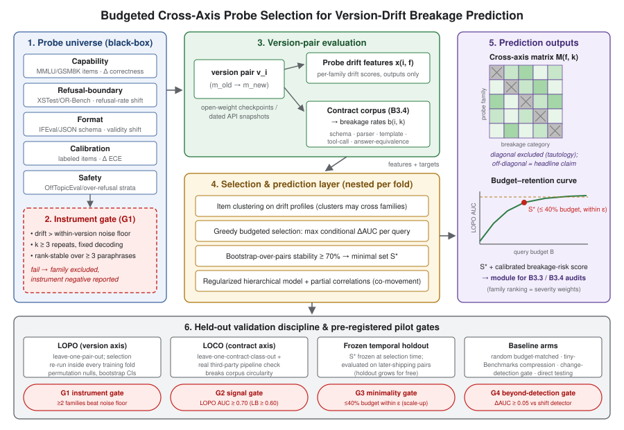

# 哪些探针能预测破坏？面向 LLM 版本漂移审计的预算化跨轴探针集设计

*修订稿（2026-08-14），取代自动生成初稿 "Cross-Axis Probe Drift for Budgeted Prediction of LLM Contract Breakage"。本文定位为 B3.3（静默变更率）与 B3.4（契约破坏率）两项 Tier-1 课题的**测量仪器设计伴随篇（instrument-design companion）**：B3.4 提供破坏真值，本文提供模型侧预测与探针选择层。仅在第 7 节预注册的触发条件全部满足时才作为独立论文投稿。*

## 摘要

大模型提供方按自己的节奏发布新版本，而一次升级可能悄然破坏下游系统所依赖的模式校验（schema）、解析器（parser）与工具调用（tool-call）接口。现有黑盒监测器只能检测模型"是否变了"；直接兼容性框架则以全额成本重跑应用契约测试；两者之间的运营问题无人回答：**哪些廉价行为探针（probe），以及最少多少条，能预测一次未见过的升级会在功能上破坏什么？** 我们设计了一个五族探针电池（probe battery）——能力（capability）、拒答边界（refusal-boundary）、格式（format）、校准（calibration）、安全（safety）——并评估其漂移信号对分类别功能性破坏（模式校验失败、解析器异常、工具调用不可执行）的预测力；破坏真值来自在真实版本对上运行的共享契约语料库。三重纪律将"预测"与同义反复及过拟合分离：(i) **仪器门**（instrument gate）要求每族漂移先超过版本内采样噪声底线、且在改写（paraphrase）下保持秩稳定，之后才允许任何预测性主张；(ii) 完全嵌套的留一版本对交叉验证（leave-one-version-pair-out, LOPO），探针选择在每个训练折内部重跑，另加随新版本发布不断增长的冻结集时间保留验证；(iii) **跨轴预测矩阵**（cross-axis prediction matrix），其近同义反复的对角线（格式探针预测格式破坏）被排除出标题性主张，并辅以留一契约类交叉验证（leave-one-contract-class-out, LOCO），证明所选探针集能泛化到选择时未见过的契约类。预算化贪心选择加自助稳定性给出查询预算–保留率曲线，并与预算匹配的随机子集、基准压缩基线、仅变化检测门以及等成本直接契约测试对比。试点在 4–6 个不可变开源权重版本对上进行、与 B3.4 共享契约语料库，并以预注册的通过/终止门控决定是否扩展到 15–25 对。交付物是一件经过审计的早警仪器——或一个诚实的否定结论：廉价探针无法预报破坏，审计者必须直接运行契约测试套件。

## 1. 引言

大语言模型如今是被外部管理的依赖项。提供方升级 API 端点背后的模型——或团队更换开源权重检查点——所有针对旧版本调好的下游流水线随之继承这次变更：提示模板、输出解析器、JSON 模式契约、工具调用填充器、内容审核包装层。纵向审计表明升级会大幅且不均匀地改变各任务行为 [Chen et al. 2023]；针对演化 LLM API 的回归研究发现大多数"提示×模型"组合在更新后精度下降 [Ma et al. 2024]。2026 年的文献从两个方向响应。黑盒**变化检测器**——行为审计检验 [Richter et al. 2024]、端点指纹（endpoint fingerprinting）[Leshin et al. 2026]、语言学特征检验 [Dima et al. 2025]、基于秩的均匀性检验 [arXiv:2506.06975]、对数概率追踪 [arXiv:2512.03816]、模型替换审计 [Cai et al. 2025]——告诉集成方模型"变了"。部署治理框架——生产契约门控 [Chishti et al. 2026]、可信模型迁移 [Casey et al. 2026]——直接重跑应用自身的契约测试，代价由应用承担。实践界的"金丝雀提示"（canary prompt）回放工具已自带手工挑选的探针族，但从未验证金丝雀漂移能预测任何下游后果。

这两条战线之间存在一个未被回答的测量问题。检测便宜但对后果盲目：对每次无害微调都报警的检测器会无谓拖延采用；对杀死解析器的格式漂移保持沉默的检测器则给出虚假安心。直接契约测试后果精确但昂贵、且只能覆盖可枚举的契约：集成方的私有流水线不在任何人的测试套件里。如果一小组行为探针——对每个新版本运行一次——能**预测**功能性破坏的比率与类别，审计者就获得一件分诊仪器：探针安静，跳过全量重测；探针报警，且知道该跑哪类重测。这种预测信号是否存在、哪些行为轴承载它、多少查询足以保留它，都是尚无发表工作回答的实证问题。

可信地回答这些问题需要防住三种具体失效模式，而这些防线正是本文的技术内容。

**同义反复（tautology）。** 格式探针本身就是微型格式契约；它"预测"格式破坏是压缩而非发现。我们的标题性估计量是探针族×破坏类别预测矩阵的**非对角元**：拒答边界漂移能否预报工具调用破坏？能力漂移能否预报解析器失败？对角单元照报但排除出主张。对称地，针对某一契约语料库选出的探针集可能只是记住了该语料库；因此我们同时在留一契约类（LOCO）与留一版本对（LOPO）下评估，并在真实第三方流水线上抽查。

**未经验证的仪器。** 一个漂移分数若不超过模型自身的采样噪声、或在探针条目改写下翻转符号，就毫无意义。任何预测主张之前，每族必须通过预注册的仪器门：跨版本漂移在多数试点版本对上超过版本内噪声底线，且在 ≥3 个改写变体间秩稳定。

**小样本过拟合。** 独立单元是版本对而非契约行，而版本对至多约 25 个。我们预注册刻意收窄的模型类（正则化层次逻辑回归），在每个留一对训练折内部重跑**全部**选择，用自助法量化选择稳定性，并将选定探针集冻结、在其后发布的版本对上评估——一个随提供方发版免费增长的时间保留集。

**贡献。**
1. 一个经过验证的五族黑盒探针电池：每族配备漂移仪器、版本内噪声底线协议与改写稳定性证书（现有金丝雀工具缺失的仪器层）。
2. 首个将探针族漂移与分类别功能性破坏在真实 LLM 版本对上联系起来的预测性评估：完全嵌套的 LOPO 与 LOCO 协议，跨轴预测矩阵且对角线排除出主张。
3. 查询预算化的最小性分析：条件增益贪心选择加自助稳定性，产出预算–保留率曲线与冻结最小集 S*（在其后发布的版本对上验证），并与预算匹配随机子集及基准压缩基线对比。
4. 可插拔模块契约与发布工件（探针库、缓存输出、选择代码），可被契约破坏审计（B3.4）与静默变更审计（B3.3）直接消费，并以预注册门控决定合并或独立发表。

## 2. 相关工作

**黑盒变化检测。** Richter 等的序贯审计检验 [arXiv:2410.19406]、基于秩的均匀性检验 [arXiv:2506.06975]、Dima 等的语言学特征等价检验 [arXiv:2504.12335]、Leshin 等的 Stability Monitor 端点指纹 [arXiv:2603.19022]、API 更新的对数概率签名追踪 [arXiv:2512.03816]、模型等同性检验 [Gao et al., arXiv:2410.20247]、模型替换审计 [Cai et al., arXiv:2504.04715]——都在判定接口背后的模型**是否**变了。没有一个按下游后果排序行为轴、或预测哪些集成会破坏。我们把这类检验用作组件（仅变化检测基线 A7），在其上构建预测层；超越检测门 G4 要求探针电池以预注册幅度胜过它。

**漂移证据与 LLM API 回归测试。** Chen, Zaharia & Zou [arXiv:2307.09009] 记录了托管快照间的大幅任务波动；Ma 等 [arXiv:2311.11123, CAIN 2024] 重构了演化 LLM API 的回归测试并量化了普遍的提示回归；Xie 等 [2021] 度量 NLP 模型更新中的负翻转；输出漂移研究量化了受监管工作流上的跨提供方不稳定性 [arXiv:2511.07585]。这些工作记录破坏；无一检验廉价探针能否在未见升级上**预报**破坏。

**部署治理与直接测试。** Chishti 等的供应链门控 [arXiv:2604.27789] 与 Casey 等的模型退役迁移框架 [arXiv:2604.27082] 直接评估应用契约；DriftBench/SkillGuard 将智能体技能漂移视为契约违反 [arXiv:2605.10990]；实践界金丝雀回放工具附带固定探针集但无预测性验证。它们分别是我们的成本对照（直接测试）与动机：探针电池必须显著便宜于契约套件**且**泛化到未枚举契约，否则没有存在的理由——这一零假设被明确陈述并检验。

**高效评估与测试最小化。** tinyBenchmarks [Polo et al. 2024] 与 EssenceBench 式压缩选择在**单一时间点**保持分数保真的最小条目子集；PredictaBoard [Pacchiardi et al. 2025] 预测实例级错误；经典回归测试选择与套件最小化 [Yoo & Harman 2012; Rothermel & Harrold] 在白盒覆盖率与确定性判定器（oracle）下优化同一最小性准则。我们把最小性逻辑移植到黑盒、随机、按轴结构化的漂移预测场景——并将基准压缩保留为显式基线（A4）：若仅压缩能力条目即可匹配我们的按轴选择，则轴结构一无所加。

**单轴仪器。** IFEval [Zhou et al. 2023]、JSONSchemaBench [Geng et al. 2025]、模式强化学习 [Cong et al. 2025]、格式限制效应 [Tam et al. 2024]、XSTest [Röttger et al. 2024]、HarmBench [Mazeika et al. 2024]、置信度诱导 [Xiong et al. 2024]，以及 OpenReview 语料库仪器（RefusalIndex、B-Calibration、OffTopicEval、TARE 改写脆性）为五族提供条目池与打分规范。它们静态地测量行为；我们问的是这些测量的**变化**是否携带跨版本预测信息。

**空白。** 尚无工作对 LLM 版本对执行按轴分解的黑盒探针族漂移与功能性下游破坏真值的对比，同时给出预算化最小性分析、并在版本轴与契约轴上均做留出验证。我们的主张是这一复合预测协议——既不是"首个最小测试套件"（对 SE 文献不成立），也不是"首个漂移检测器"（对检测文献不成立）。

## 3. 问题定义

**设定。** 版本对 v = (m⁻, m⁺) 是仅可通过输入输出查询的升级前/后模型对（不可变开源权重检查点，或两端点同时在线的带日期 API 快照）。观测版本对集合 𝒱 = {vᵢ} 按时间划分为开发集 𝒱_dev 与随时间增长的时间保留集 𝒱_temp（选择冻结后发布的版本对）。

**探针。** 探针电池 𝒫 划分为五族 F = {能力, 拒答边界, 格式, 校准, 安全}。族 f 有条目集 Q_f；每条对两个模型各施测 k ≥ 3 次重复、固定解码，另设版本内重复臂以估计采样噪声底线。漂移表示 x_{i,f} 仅由输出计算。对任意子集 S ⊆ ⋃_f Q_f，查询成本 c(S) = |S|（含重复次数），故最小性以查询数而非族数计价。

**破坏真值。** 契约语料库 𝒞（规范来源为 B3.4 的仿真生产语料库）划分为契约类；类别集 𝒦 = {模式校验失败, 解析器异常, 模板破坏, 工具调用不可执行, 判定式答案等价破坏}。对契约 c、类别 k、版本对 vᵢ：y_{i,c,k} = 1 当且仅当 c 在 m⁻ 下通过而在 m⁺ 下于类别 k 失败；目标是分类破坏率 b_{i,k} = mean_c y_{i,c,k}。原始输出差异幅度仅作描述统计——破坏按定义是功能性的。

**估计量。**
- *预测:* A_k(S) = 由 x_{i,S} 预测 b_{i,k} 的样本外性能（报警用 AUC，幅度用 R²），以 LOPO 估计（**所有**选择、拟合、调参均在训练折内部），并另以 LOCO 估计（被留出契约类的契约从选择与拟合中全部移除）。
- *跨轴矩阵:* M_{f,k} = A_k(Q_f) − max{R_k(c(Q_f)), G_k}，其中 R_k 为预算匹配随机子集基线、G_k 为仅变化检测预测器（全局漂移幅度，不含族身份）。axis(f) = axis(k) 的单元构成近同义反复对角线，照报但排除出标题性主张；主要估计量是非对角元集合。
- *最小性:* 预算–保留率曲线 A(B) = max_{c(S)≤B} mean_k A_k(S)（选择逐折嵌套），最小集 S* = argmin c(S) s.t. A(S) ≥ A(full) − ε，ε 预注册为 max(0.03 AUC, 全电池自助置信区间半宽)——绝不在数据分辨率之下宣称最小性。

**约束。** 仅黑盒输出（无权重、无梯度、不要求对数概率）；任何选择或调参不得接触被留出的版本对、被留出的契约类或 𝒱_temp。

## 4. 方法

*图1：预算化跨轴探针选择流水线总览。探针族在使用前先对照版本内噪声底线与改写不稳定性进行验证；版本对评估产出分类功能性破坏率；嵌套贪心选择加稳定性自助给出预算–保留率曲线与最小集 S*；验证纪律（LOPO、LOCO、冻结时间保留、对角线被排除的跨轴矩阵）与试点门控 G1–G4 守卫每一条主张。*

### 4.1 探针电池与仪器验证（SP1，门 G1）

每族由条目池与漂移仪器配对：
1. **能力** — MMLU/GSM8K/BBH 式条目，格式鲁棒打分（归一化后抽取答案；剥除代码围栏后执行）；漂移 = 逐条配对正确性差分的带符号聚合。
2. **拒答边界** — 从 XSTest / OR-Bench 分层的边界条目；漂移 = 拒答率差分加不依赖比率的 RefusalIndex 式秩移位。
3. **格式** — IFEval 式指令格式条目 + JSON 模式任务；漂移 = 模式合法率/结构匹配率变化（跨改写集测量）。
4. **校准** — 带标签条目；漂移 = ECE / 语义校准误差变化（自由生成采用 B-Calibration 式）。
5. **安全** — 近危害与策略条件化出界提示（OffTopicEval 式）+ 伪有害过度拒答条目；漂移 = 分层接受/拒绝率变化。

*先验证仪器，再谈预测。* 对每族：(a) **噪声底线** — 版本内重复运行（同一模型、重新采样；固定与重采样解码）给出漂移分数的零分布；某版本对上的跨版本漂移仅当超过该零分布 95 分位才计为信号；(b) **改写稳定性** — 每条目 ≥3 个改写变体；族漂移须跨变体秩稳定（跨版本对 Kendall τ ≥ 预注册阈值）。任一检查不通过的族被排除出预测并作为仪器阴性报告。此即门 **G1**。

### 4.2 跨轴破坏预测（SP2，SP3）

*单元与模型。* 分析单元为（版本对×契约类）；独立单元为版本对。预注册单一小模型类：L1/L2 正则化层次逻辑（报警）与线性（幅度）模型，版本对层随机效应；契约类效应吸收基线脆性。除预注册网格外不做模型搜索，仅用内折交叉验证调参。

*共动下的归因。* 各族共同移动（安全与拒答、能力与格式）。RQ1 的族级回答使用标准化系数、偏相关（每族对其余四族+全局漂移幅度取条件）与自助稳定性选择（某族仅当在 ≥70% 的按对自助复本中被选中才算"有预测力"）。诚实的可能结论——"一个相关簇有预测力，但没有任何单一族有"——是可报告的结果，不是失败。

*跨轴矩阵。* 对每个（族 f, 类别 k）：嵌套 LOPO 的 A_k(Q_f) 对比预算匹配随机子集与变化检测门。对角单元（格式→格式模式类、安全→拒答邻近类，依预注册的轴映射）排除出标题性主张。非对角元是科学载荷：探针预报与其表面不相似的破坏。

*守卫契约轴。* 所有标题数字同时在 LOCO 下计算：被留出类的契约从选择与拟合中移除后冷启动预测。只能预测留出版本对、不能预测留出契约类的探针集是压缩测试套件，将如实报告。作为外部效度抽查（SP6，尽力而为），在一个试点版本对上运行 1–2 个带自有测试的真实开源流水线作为语料库外破坏点。

### 4.3 预算化最小性（SP4）与冻结集时间验证

*选择。* 条目按漂移剖面相关性聚类（聚类可跨族边界）。在每个 LOPO 训练折内部，对聚类做以"每查询条件 AUC 增益"为准则的贪心前向选择；某聚类仅当在 ≥70% 自助复本中被选中才进入 S*。扫描预算 B 得预算–保留率曲线；S* 是在 ε 内最便宜的子集。

*两个粒度都回答。* RQ1（哪族有预测力）在族级回答并做偏相关校正；RQ2（该买哪些条目）在条目簇级回答——明确是同一问题的两个视角，族级科学不被悄悄换成工程。

*冻结集时间验证。* S* 及其预测器在选择时刻冻结，在其后发布的每个版本对上原封不动评估（𝒱_temp 免费增长）。这是最具部署可信度的数字：集成方实际会如此使用这件仪器。

*构成敏感性。* 族排序继承语料库构成，故在重加权契约类混合（等权、JSON 偏重、工具调用偏重）下重算排序。经得起重加权的排序是发现；经不起的是 B3.4 语料库的性质，将如实报告。

### 4.4 模块契约（B3.3/B3.4 接口）

输入：符合声明模式（版本对 id、契约类、破坏率、来源）的任意集合——规范来源为 B3.4 语料库，替代来源为 B3.3 的分类别行为差分。输出：(i) 带不确定度的族级预测排序；(ii) 选定最小探针集及其查询预算；(iii) 对未来版本对的校准破坏风险分数；(iv) 按 B3.3 变更日志分类法记录的逐族漂移，使静默变更类别无需新运行即可加权严重度。发布：探针库（含改写变体）、全部缓存模型输出、选择/评估代码与冻结的 S*。

## 5. 实验设计

**实验臂。**
- A1：每族单独（五臂）——逐族预测基线。
- A2：完整五族电池——上界。
- A3：最小集 S*（稳定性选择、冻结做时间验证）。
- A4：仅在能力条目内做 tinyBenchmarks/EssenceBench 式压缩——通用基准压缩是否已足够？
- A5：与 S* 预算匹配的随机子集（10 次抽样）——选择价值对照。
- A6：忽略族结构的原始聚合输出差异幅度。
- A7：仅变化检测门（arXiv:2506.06975 式基于秩的均匀性检验）——超越检测还剩多少预测信息？
- A8：查询预算匹配的直接契约测试——"何必用探针"对照；探针集须比全量契约套件便宜 ≥10×（标题成本比）且胜过预算匹配的部分直接测试，否则诚实结论就是"直接跑契约套件"。

**数据。**
- *试点（与 B3.4 试点同排期）：* 4–6 个不可变开源权重版本对——Llama-2→Llama-3、Qwen1.5→Qwen2→Qwen2.5、Mistral v0.1→v0.2→v0.3——约 500 探针条目（稳定性臂 ×3 改写），真值 = B3.4 试点语料库（约 10 个契约类）。在 B3.4 自身运行之外约 1.8 万次生成；因真值共享，边际成本很小。
- *扩展（门控后）：* 15–25 对，加入更多开源权重谱系与两端点同时在线的带日期 API 快照（交错查询窗口；全部原始输出缓存并发布，使分析在端点下线后依然可复现）。约 1,500 探针条目、约 20 个契约类、约 20–65 万次生成（2–4 张 A100 级 GPU + 数千美元级 API 预算）。API 版本对是加分项而非承重项：所有门控与时间保留验证仅凭开源权重版本对即具备功效。

**指标。** LOPO 与 LOCO 的 AUC / R²（按对自助置信区间与置换零分布）；逐族 Spearman ρ、偏相关、稳定性选择频率；非对角跨轴 AUC；ΔAUC(S* vs 全电池)；预算–保留率曲线；噪声底线超越率与改写 Kendall τ；冻结集时间保留 AUC；标题成本比（S* vs 全量契约套件）。

**预注册门控。**
- **G1（仪器，试点）：** ≥2 族在 ≥70% 试点版本对上漂移超噪声底线且改写秩稳定。失败 → 探针无法可靠测量漂移；在 B3.4 内发表仪器阴性结果；终止。
- **G2（信号，试点→扩展）：** 全电池 LOPO AUC 点估计 ≥ 0.70 **且**自助下界 ≥ 0.60（置换 p < 0.05）。失败 → 转否定结论（"廉价探针无法预报契约破坏"）并入 B3.4。
- **G3（最小性，仅扩展期）：** 存在 ≤40% 全预算的子集落在 ε 内。失败 → "没有免费午餐：各轴信号互不冗余"——反压缩发现，仍可报告。试点期 G3 仅具方向性。
- **G4（超越检测）：** A2 须以 ΔAUC ≥ 0.05 胜过 A7。失败 → 相对已发表漂移检测器的贡献不成立；无论其余门控如何，独立成文路线终止。
在查询任何模型之前，先以模拟功效检查（在试点"对×类"布局上注入可信效应量的合成破坏）确定探针库规模。

**研究问题。** RQ1：偏相关校正共动后，哪个探针族的漂移能预测功能性破坏？RQ2：在 ε 内最便宜的探针子集是什么？数据驱动选择是否尊重手工分类法？RQ3：测得漂移是否超噪声且经得起改写？RQ4：非对角（跨轴）预测信号是否存在？RQ5：选定集是否可迁移——到留出契约类、到其后发布的版本对、到另一提供方的谱系？

## 6. 局限与威胁

*样本量。* 即使扩展后 n ≤ 25 对；仅靠预注册的小模型类、嵌套选择、置换推断与增长的时间保留集维持估计诚实，且试点结论对 RQ2/RQ4 明确只具方向性。*语料库依赖。* 真值是仿真生产语料库；构成敏感性重加权与 SP6 真实流水线抽查能约束但不能消除该威胁。*同轴泄漏。* 定义"对角"单元的轴映射为手工声明并预注册；欢迎以该映射对任何非对角主张做对抗性审读。*API 消亡。* 带日期 API 端点会下线；全部原始输出缓存并发布，使每项分析在下线后可复现。*构念狭窄。* 功能性破坏忽略格式合法输出内部的静默语义退化；该构念属于 B3.3 的静默变更仪器——本模块为其供给输入，但不替代它。

## 7. 定位与发表触发条件（预注册）

**默认 = 合并。** 若 B3.4 按期推进且扩展语料库达到 ≥10 版本对，本工作作为 B3.4 论文的模型侧预测+最小探针集模块发表（共享语料库、一篇论文），并附协商底线：预算–保留率曲线与跨轴矩阵须作为正文主图出现，否则独立路线重新开启。B3.3 将族排序用作静默变更类别的严重度权重。**独立成文触发（三者齐备）：** (i) G1–G2 通过且跨轴矩阵显示非平凡的非对角信号；(ii) B3.4 延误一个投稿周期或语料库缩水至 ~8 对以下；(iii) 邻域核查保持干净（无已发表的探针→破坏预测器——截至本稿已对照 2026 年邻域验证）。**终止/吸收：** G1 或 G4 失败 → 至多一节内容+发布探针库并入 B3.4。

## 8. 结论

"哪些探针预测破坏、多少条足够？"这个问题悬置在变化检测与直接契约测试之间、无人认领。本设计以如下方式回答它：仪器先验证后使用；预测只在版本轴与契约轴双重样本外评估；同义反复单元按构造排除；最小性以查询计价并经冻结时间保留集认证；预注册门控把每种失效模式都转化为诚实、可发表的发现。无论结局如何——一件廉价早警仪器、一个反压缩结论、或一个"只有契约套件能预报契约破坏"的论证——审计社区都获得一个可以据此行动的决策，而 B3.3/B3.4 审计获得让其测量面向未来的那一层。

## 参考文献

- Lingjiao Chen, Matei Zaharia, James Zou. How Is ChatGPT's Behavior Changing over Time? arXiv:2307.09009, 2023.
- Wanqin Ma, Chenyang Yang, Christian Kästner. (Why) Is My Prompt Getting Worse? Rethinking Regression Testing for Evolving LLM APIs. CAIN 2024; arXiv:2311.11123.
- Leo Richter, Xuanli He, Pasquale Minervini, Matt J. Kusner. An Auditing Test to Detect Behavioral Shift in Language Models. arXiv:2410.19406, 2024.
- Rank-based uniformity test for behavioral shift in black-box LLM APIs. arXiv:2506.06975, 2025.
- Logprob-based tracking of model updates behind LLM APIs. arXiv:2512.03816, 2025.
- Irena Gao, Percy Liang, Carlos Guestrin. Model Equality Testing: Which Model Is This API Serving? arXiv:2410.20247, 2024.
- Will Cai, Tianneng Shi, Xuandong Zhao, Dawn Song. Are You Getting What You Pay For? Auditing Model Substitution in LLM APIs. arXiv:2504.04715, 2025.
- Alden Dima, James Foulds, Shimei Pan, Philip Feldman. You've Changed: Detecting Modification of Black-Box Large Language Models. arXiv:2504.12335, 2025.
- Jonah Leshin et al. Behavioral Fingerprints for LLM Endpoint Stability and Identity. arXiv:2603.19022, 2026.
- Mohd Sameen Chishti et al. Test Before You Deploy: Governing Updates in the LLM Supply Chain. arXiv:2604.27789, 2026.
- Emma Casey, David Roberts, David Sim, Ian Beaver. When Your LLM Reaches End-of-Life: A Framework for Confident Model Migration in Production Systems. arXiv:2604.27082, 2026.
- Skill Drift Is Contract Violation: Proactive Maintenance for LLM Agent Skill Libraries (SkillGuard / DriftBench). arXiv:2605.10990, 2026.
- LLM Output Drift: Cross-Provider Validation & Mitigation for Financial Workflows. arXiv:2511.07585, 2025.
- Yuqing Xie et al. Regression Bugs Are In Your Model! Measuring, Reducing and Analyzing Regressions in NLP Model Updates. 2021.
- Felipe Maia Polo et al. tinyBenchmarks: Evaluating LLMs with Fewer Examples. ICML 2024.
- Lorenzo Pacchiardi et al. PredictaBoard: Benchmarking LLM Score Predictability. arXiv:2502.14445, 2025.
- Shin Yoo, Mark Harman. Regression Testing Minimization, Selection and Prioritization: A Survey. Software Testing, Verification and Reliability 22(2), 2012.
- Jeffrey Zhou et al. Instruction-Following Evaluation for Large Language Models (IFEval). arXiv:2311.07911, 2023.
- Saibo Geng et al. JSONSchemaBench: A Rigorous Benchmark of Structured Outputs for Language Models. arXiv:2501.10868, 2025.
- Xin Cong et al. Learning to Generate Structured Output with Schema Reinforcement Learning. arXiv:2502.18878, 2025.
- Zhi Rui Tam et al. Let Me Speak Freely? A Study on the Impact of Format Restrictions on Performance of Large Language Models. EMNLP Industry 2024.
- Paul Röttger et al. XSTest: A Test Suite for Identifying Exaggerated Safety Behaviours in Large Language Models. NAACL 2024.
- Mantas Mazeika et al. HarmBench: A Standardized Evaluation Framework for Automated Red Teaming and Robust Refusal. ICML 2024.
- Miao Xiong et al. Can LLMs Express Their Uncertainty? An Empirical Evaluation of Confidence Elicitation in LLMs. ICLR 2024.
- PromptCanary：带格式/推理/安全/事实/工具使用探针的金丝雀提示回放工具（实践界软件，2026）——作为未经验证的邻近实践引用。
- OpenReview 语料库仪器：EssenceBench [lZlZjSxdio]；RefusalIndex [9gJBhkLRat]；OffTopicEval [EcIyiJrajc]；B-Calibration [0sCyk9Tr5J]；TARE [YEBDvqsniH]；ProSafePrune [QkHKaPfRAB]；BiasSimilarity-BSM [EveruzAsGI]；WeightDiff [6As4wfTB77]。
