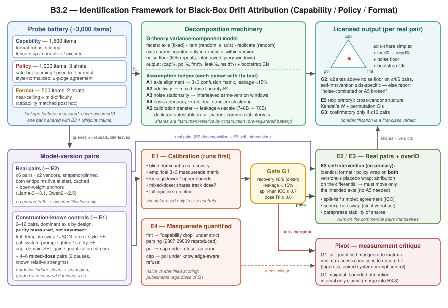

# 能力、政策还是格式？黑盒 LLM 版本漂移归因的可识别性框架

## 摘要

当一个已部署的语言模型被升级后，下游行为随之改变——但*为什么*？是模型变聪明或变笨了（能力，capability），是对齐政策移动了（政策，policy），还是仅仅输出风格漂移了（格式，format）？三者的区分决定了正确的应对方式：修解析器、重审合规、还是重新跑基准。现有的纵向审计只报告混合在一起的漂移数字，把三者混为一谈；该领域被引最多的漂移审计甚至把一次 markdown 围栏（fencing）变更误记为能力退化。我们证明：朴素的"升级的方差份额"问题按其原始表述是不可识别的（unidentifiable）——份额是测量工具（instrument）的属性，且每个来源都可以伪装（masquerade）成另一个来源——因此我们把可识别性本身作为交付物。框架包含四部分：（i）在预注册的三轴探针题库上建立概化理论（generalizability theory, G-theory）测量模型，轴份额相对于声明的"可容许观测全域"定义，并连同泄漏（leakage）、残差与噪声底（noise floor）项一起报告；（ii）显式的识别假设台账 A1–A5，每条假设配对一个经验检验或界，其中包括仅可部分检验的校准迁移假设；（iii）在构造已知（construction-known）、纯度实测的控制版本对上校准：盲态主导轴恢复、混合剂量恢复，以及在受控条件下复现已被记录的误归因的伪装量化实验；（iv）过度识别（overidentification）检查——分半一致性、评分规则替换，以及可直接在商业版本对上运行的对称自干预（self-intervention）控制。一个预注册的顺序闸门决定结局：闸门通过则得到首个经验证的黑盒漂移归因工具；若如伪装分析所预测的那样失败，则得到量化的测量学批判——报告中的"能力漂移"有多少个百分点可被纯格式或纯政策干预复现。两种结局都会修正混合漂移审计的解读方式。预算：约 60 万次缓存生成，覆盖 ≥6 个商业与开放权重版本对及约 15 个控制对；API 费用 $2–5k，加约 300 GPU 小时。

## 1. 引言

语言模型 API 通过频繁的版本升级演进，而提供商很少披露一次版本变更改了什么。对构建在这些 API 上的应用而言，即使提示词与下游代码不变，升级也会改变输出：回归（regression）可能盖过总体收益并阻碍新版本采用（Lai et al., 2023; Xie et al., 2021; Cai et al., 2022），企业已经维护专门的提示词迁移（prompt migration）流程以求在模型演进中存活（Tripathi et al., 2025）。最新的供应链治理工作用覆盖功能、格式与安全回归的风险类别测试套件来治理静默更新——并明确把"如何检测并*解释*模型漂移"列为开放问题（arXiv:2604.27789, 2026）。检测（detection）已基本解决：黑盒变更检测在实用查询预算下已经可行（Gao et al., ICLR 2025; arXiv:2602.11083; arXiv:2604.27405）。而解释——*把变化归因到原因*——尚未解决。

经典纵向审计（Chen, Zaharia & Zou, 2023）说明了利害所在。它报告的 GPT 快照间代码生成"退化"，部分是新增的 markdown 围栏破坏了可执行性检查所致：一次**格式**变更被按**能力**损失计分，而这是该领域被引最多的漂移论文。反向的伪装同样真实：把拒答按错误计分时，政策收紧被记为能力下降；一个如今"知道答案"的模型不再拒答时，能力提升被读作政策放松。被告知"是格式"而真相是"政策"的集成方，比只收到混合警报更糟。

我们提出这些审计跳过的问题：**在什么条件下，把黑盒版本对漂移分解为能力、政策、格式三个分量才是可识别的？** 三个观察塑造了我们的回答。第一，方差份额是工具属性而非模型属性：把题库中的格式题翻倍，格式份额就会移动。任何诚实的分解必须是*工具相对*（instrument-relative）的，题库作为声明的可容许观测全域被预注册——这正是概化理论（Cronbach et al., 1972）六十年前针对同一问题所做的动作。第二，三个轴是经由多对一映射被观测的潜在原因；没有额外假设，三因模型从行为差量上不可识别。因此我们把假设写成台账（A1–A5），并给每条配上检验或界。第三，在真正关心的商业版本对上不存在真值，可识别性必须先在构造已知的控制对上挣得，再通过无需真值的过度识别检验在真实对上*核查*——最重要的是直接施加于商业端点自身的对称自干预控制。

本文的贡献是一个**识别框架——假设台账、纯度实测的构造已知校准、伪装证伪实验、以及过度识别检查——用于黑盒漂移归因，并在三个轴上实例化。** 框架而非"三轴三分法"才是主张；若残差有结构，基（basis）显式可扩展。设计预注册了一个具有两种可发表结局的顺序闸门：（a）校准通过，领域获得首个经验证的黑盒漂移归因工具，把纵向审计从"有东西变了"升级为"变的是哪一类、比例多少、不确定性多大"；（b）若如伪装分析预测的那样失败，研究交付量化的伪装证据——纯格式干预能复现多少个百分点的"能力漂移"——这直接修正 Chen et al. 一类审计的读法，并给出恢复识别所需的最小访问条件（如 logprobs、成对系统提示控制）。结局（b）不是安慰奖，而是同一贡献的、对可识别性诚实的版本。

为什么要归因而不是处处使用格式鲁棒评分？鲁棒评分能去除格式对能力*测量*的污染，但无法报告*格式本身漂移了*——而这恰恰是下游解析器被破坏的原因。格式漂移是一等结论，而不仅是干扰项。

## 2. 相关工作

**漂移现象及其误测量。** Chen, Zaharia & Zou（arXiv:2307.09009）测量了 GPT 快照间的任务漂移、拒答变化与代码格式错误，但报告的是混合差量；其 markdown/可执行性事件是我们动机的种子，其逐任务仪表盘是我们的朴素基线。模型更新回归在实例层面以负翻转（negative flip）度量并被缓解——蒸馏、集成、门控融合、兼容适配器（Xie et al., 2021; Cai et al., 2022; Lai et al., 2023; Echterhoff et al., 2024）——都把漂移当作待抑制的无差别误差，而非归因对象。提示词迁移案例研究（Tripathi et al., arXiv:2507.05573）记录了跨 GPT 升级的运维破坏。

**检测而非归因（2025–2026 近邻）。** 模型相等性检验（Model Equality Testing; Gao et al., ICLR 2025）把"API 是否在服务所声称的模型"化为双样本检验；B3IT（arXiv:2602.11083）仅凭输出即可低成本检测 API 模型变更；模型内可靠变化检测（arXiv:2604.27405）区分变化与噪声。这些回答*是否*变了；我们把此类检验用作漂移-噪声闸门，并回答变的是*哪一类*。"Test Before You Deploy"（arXiv:2604.27789）以功能/格式/安全的风险类别测试套件治理静默更新——与我们研究的三分法相同——但各类别独立测试，未问跨类别归因是否可识别；它把漂移解释列为开放问题。模型替换审计（arXiv:2504.04715）解决的是二元身份问题；基于 logprob 的更新追踪（arXiv:2512.03816）给出变化点但需要 logprob 访问，违反我们的黑盒底线。

**白盒访问下的归因（边界）。** Abliteration 通过移除拒答方向把代码 LLM 的拒答与能力分离（arXiv:2606.05396）——正是我们的政策/能力区分，但需要权重；经由影响函数与逐 token KL 的训练阶段归因同样需要管线或 logit 访问。这些工作证实了*给定访问权限时*构念可分离；我们的问题是在黑盒底线处还剩下什么。

**题库所依赖的单轴构念。** XSTest（Röttger et al., 2024）与 OR-Bench（Cui et al., 2025）把过度拒答与真正的安全分开；它们同时警示政策与表层词形在训练中是耦合的——这是反对假设探针纯净的理由。IFEval（Zhou et al., 2023）提供可验证的指令遵循题；EvalPlus（Liu et al., 2023）提供执行鲁棒的能力评分；评判式测量中的长度/风格偏差证据是我们的政策评判器只看风格归一化回复的原因。

**工具依赖与方差分解。** FormatSpread（Sclar et al., 2024）、模板集成（Voronov et al., 2024）与多提示评测（Mizrahi et al., 2024）表明分数强烈依赖格式选择——但那是单模型单时点的工具敏感性，不是跨版本归因。统计处理提供误差条、基准方差核算与评测管线因素的混合效应分解（Miller, arXiv:2411.00640; Madaan et al., 2025; Messing, arXiv:2604.11581; Biderman et al., 2024）：它们分解的是*评测*方差，不是*模型变化*方差，且都不把份额绑定到识别检验上。Schaeffer et al.（NeurIPS 2023）把所谓涌现能力归因于度量选择——与我们针对混合漂移分数所做的是同一个动作。经典概化理论（Cronbach et al., 1972）通过声明可容许观测全域，命名并解决了"份额依赖于侧面设计"问题；我们直接引入其形式体系，盲源分离（BSS/ICA）的可识别性结果则为"从混合物中恢复潜因需要假设"提供形式类比。

**空白。** 没有已有工作在黑盒版本对上完成能力/政策/格式分解，同时具备构造已知控制作为真值、显式识别假设台账、以及在目标对自身上运行的过度识别检验。最接近的工作要么依赖白盒访问归因，要么只检测不归因，要么把风格当作干扰而非被归因的分量。

## 3. 问题设定与测量模型

**设定。** 来自同一提供商的版本对 \(p=(M_p^-, M_p^+)\)，两端均可黑盒查询：无权重、无 logits、无训练数据、不信任变更日志。预注册探针题库 \(B\)：轴 \(a\in\{\text{cap},\text{pol},\text{fmt}\}\)，题目 \(i\) 嵌套于轴（声明数量约 1,500/1,000/500），每题每版本 \(k\ge 5\) 次重复，固定解码，交错窗口查询。逐题配对差量 \(y_i\) 来自格式鲁棒的能力评分器、三分类（遵从/拒答/含糊）政策分类器与格式特征提取器。

**G-theory 分解。** 我们用层次方差分量（概化）模型对 \(y_{ir}\) 建模，侧面（facet）为：轴（固定）、题目（随机、嵌套于轴）、重复（随机）：
\[ y_{ir} = \mu + \delta_{a(i)} + u_i + \varepsilon_{ir}, \qquad \operatorname{Var}(y) = \sum_a \sigma^2_a + \sigma^2_{\text{item}} + \sigma^2_{\text{rep}}. \]
漂移的**轴份额**是该轴题库可归属的方差分量中*超出版本内噪声底* \(\sigma^2_{\text{rep}}\)（由重复与交错的同版本窗口估计）的部分，与两个一等余项一起在单纯形（simplex）上归一化：**泄漏份额**（跨轴回归：能力差量被题目格式特征差量解释的部分；政策分类被表层词汇线索解释的部分）与**未归属残差**。每对报告 \((\text{cap}\%, \text{pol}\%, \text{fmt}\%, \text{leak}\%, \text{resid}\%, \text{噪声底})\)，附 1,000 次重采样的题目自助 CI。由于题库即声明的可容许观测全域，份额*在构造上*即工具相对——G-theory 让这种依赖显式化而非隐藏——份额对题库重加权的敏感性是被报告的分析结果，而非隐患。

**伪装矩阵。** 在任何实验之前，先在纸面上推导哪些（真实原因 → 被测轴）混淆在哪些评分规则下可能发生：严格解析下格式→能力（Chen et al. 事件）；拒答按错误计分下政策→能力；知识感知拒答下能力→政策；拒答套话加载到风格特征上导致政策→格式。这四个具名伪装成为实验（第 5 节 E4）：管线必须可证明地击败它们——否则论文将精确量化为何不能。

## 4. 识别框架

*图1：识别框架总览。左：共享探针题库（能力/政策/格式，含泄漏测量特征）与其查询的两类版本对。中：带 A1–A5 假设台账的 G-theory 分解与顺序闸门 G1。下：验证臂——构造已知控制上的盲态主导轴恢复、混合剂量追踪、伪装量化。右：输出——每对的轴份额单纯形（含泄漏/残差/噪声项），或闸门失败时预注册的测量学批判转向。*

### 4.1 假设台账（每条假设配对其检验）

- **A1（探针-轴对齐）。** 每个题库主要加载于其轴；跨轴泄漏以 \(\lambda\) 为界。*检验：* 控制对上的经验 3×3 混淆矩阵与泄漏份额（E1）；要求实测泄漏下界均值 < 15%。泄漏由声明表层特征上的线性跨轴回归估计，因而是**下界**；随机森林跨轴预测器提供非线性上界探测，两界之差作为不确定性的一部分报告。
- **A2（可加性）。** 轴效应在题目层面近似可加。*检验：* 混合剂量控制上的交互项与剂量-响应线性 \(R^2\)。
- **A3（噪声平稳性）。** 版本内方差跨查询窗口稳定。*检验：* 交错窗口；同版本窗口间漂移必须落在基于重复的噪声底之内。
- **A4（基的充分性）。** 残差份额小且无结构。*检验：* 残差大小 + 题目级残差聚类；出现有结构的残差因子（如冗长度/推理风格）时触发基扩展，绝不静默吸收进最近的轴。
- **A5（校准迁移）。** 在开放权重控制上估计的泄漏界可迁移到商业对。*声明为无法完全检验的假设。* *部分检验：* 在 7–8B 控制上校准，在可得的最大开放权重对（70B 级）上验证，报告泄漏随规模的变化；若泄漏随规模增长，商业归因区间按实测最差泄漏加宽。

### 4.2 面向近似正交性的工具设计

能力题以格式鲁棒方式评分（去围栏、归一化、经 EvalPlus 式执行框架），使格式无法移动能力分数。格式题分两层：预验证的双版本近天花板集合（使能力无法移动格式特征），以及**中等难度层**（能力事后统计匹配）——因为纯天花板预筛恰恰会欠采样格式与能力交互的区域。政策题分层（貌似不安全实则安全 / 伪有害 / 真有害，借鉴 XSTest 与 OR-Bench 的构造），使收紧与放松可分。政策评判器只看风格归一化回复（剥离套话、截断长度）；报告双评判模型的替换一致性，并对每个版本各 600 题分层样本做人工验证；仅在评判一致处主张政策份额。残差泄漏*实测，绝不假设为零*。题库与兄弟课题 B3.1 共享（同一语料、不相交的主张：B3.1 预测破坏，我们归因构成）。

### 4.3 纯度实测的构造已知控制对

控制对标注为**主导轴 + 实测纯度**而非"纯净"，按难度阶梯排列：
- *格式：* 同权重 + 聊天模板替换 / JSON 强制 / markdown 强制解码（干净端），然后风格 SFT（纠缠端）。
- *政策：* 同权重 + 系统提示政策收紧（最便宜、最纯的杠杆），然后按已发表配方做安全 SFT（纠缠端：政策与表层形式的训练耦合是预期且被测量的）。
- *能力：* 数学/领域 SFT（增益方向）；量化（quantization）作为带标签的**压力用例**置于主统计之外（它同样可测地改变风格）。

对每个控制先*测量*其对另外两轴的副作用差量（如政策提示诱发的套话风格移动），并以**实测**主导轴为准评分恢复。**混合剂量对**以 2–3 种相对强度复合两种已知变更；管线必须恢复出追踪构造剂量的份额——纯对恢复是必要条件，但远非充分。基于模拟的功效检查在任何 SFT 之前确定控制数量；模拟器仅是设计工具，不构成证据。

### 4.4 每一对（包括真实对）上的过度识别检查

因为真值恰恰在最要紧处缺失，每个归因都附带内部一致性检查——有效的分解必过、伪造的分解必挂：
1. **分半题库一致性：** 不相交的题目半集必须给出相同的单纯形点（ICC ≥ 0.7）。
2. **评分规则替换：** 严格 vs 鲁棒解析器必须翻转*朴素*归因，但不得翻转模型的归因。
3. **自干预控制（共同主实验，直接运行在商业对上）：** 把*完全相同*的格式约束包装（及另行的系统提示政策包装）施加到**两个**版本上，在*差分*响应上检验归因；空操作包装（空白/无害前缀）作为安慰剂，使版本间不对称的提示敏感性加载到安慰剂上并被扣除。有效管线只移动目标轴的份额。
4. **同义改写稳定性。**

### 4.5 裁定逻辑

仅当校准中顺序闸门（第 5 节 G1）通过*且*该对自身的过度识别检查通过时，该对的归因才**获得许可**；否则该对收到**量化的不可识别裁定**，列明哪条假设的检验失败、失败了多少。不可识别是一等的、可发表的结论——框架从不强行给出份额。

## 5. 实验设计

**E1 — 可识别性校准（闸门实验，最先运行）。** 9–12 个构造已知控制对（每轴 ≥3，按难度阶梯）+ 4–6 个混合剂量对，全部在开放权重 7–8B 模型上，另加 70B 级迁移锚点（A5）。盲态主导轴恢复、完整 3×3 混淆（伪装）矩阵、泄漏上下界、剂量-响应 \(R^2\)。下游一切以 E1 为条件。

**E2 — 真实对分解。** ≥6 个版本对，最小可行配置为 ≥2 个商业厂商（快照固定端点，研究开始时两版本均在线，交错并立即查询，全部原始输出缓存以供发布）+ 2 个开放权重系列（如 Llama-3→3.1、Qwen2→2.5）承担可复现性。输出：每对的轴份额单纯形及完整不确定性核算。

**E3 — 自干预控制（共同主实验）。** 对每个真实对执行 §4.4(3) 的对称包装 + 安慰剂设计：在*目标对自身*上的归因效度证据——唯一不依赖 A5 的检查。

**E4 — 伪装量化（无论 G1 结果如何均可发表）。** 把纯格式控制送入朴素严格解析框架并量化假"能力下降"（在受控条件下复现 Chen et al. 事件）；把纯政策控制送入拒答按错误计分；把能力增益控制对照拒答指标。然后展示识别管线把每种伪装压到噪声底以下——或报告差多少。

**E5 — 探索性跨厂商结构。** 描述性单纯形比较、Kendall's W 秩一致（置换 CI）、按厂商聚类。除非真实对达到 ≥10 个，否则明确为探索性；种子的跨厂商问题以结构*描述*而非假设*确认*的形式存续。

**基线。** 混合总差量（Chen et al. 式单一数字）；仅拒答率审计；仅基准差量审计；二轴消融（能力+政策、无格式轴——第三轴是否改变归因？）。

**规模与成本。** 约 3,000 探针题 × 2 版本 × 5 重复 ≈ 每对 3 万次调用；6 个真实对 + 约 15 个控制/剂量对 ≈ 40–60 万次生成。$2–5k API + 约 250–350 GPU 小时（开放权重推理 + 约 12 次小型 SFT 控制）+ 约 40 标注人时；1–2 名研究者，2–3 个月。首要可行性风险是研究中途快照下线；缓解：仅选择开始时两端点均在线的对、立即交错查询、全量缓存。

**顺序预注册闸门。**
- **G1（可识别性闸门，E1 后）：** *干净阶梯*控制上盲恢复 ≥8/9（对 \(p_0=1/3\) 的二项检验；安全 SFT 与量化作为带标签压力用例排除在外、在完整阶梯上报告），泄漏下界均值 <15%，分半 ICC ≥0.7，剂量 \(R^2\) ≥0.6；阈值连同 CI 报告，并由预注册功效模拟定规模。*通过* → 全规模 E2/E3。*边缘*（恢复 6–7/9 或泄漏 15–25%）→ "有界归因"：仅区间型主张。*失败* → 转向，不做全规模 E2。
- **G2（真实对信号闸门）：** ≥4/6 个真实对上至少两个轴超出噪声底且 E3 具轴特异性；失败将如实报告为"漂移由噪声主导或 A5 失效"，不被隐藏。
- **G3（结构闸门）：** 仅当 ≥10 对时评估；否则 E5 保持描述性。

**G1 失败时的转向（把内部风险变为生产力）。** 论文成为测量学批判：在 A1–A5 下黑盒三路漂移分解不可识别；此处是量化当前审计实践中格式变更如何被记为能力变更的伪装矩阵（E4）；此处是恢复识别所需的最小访问条件（logprobs、成对系统提示控制、提供商签署的变更说明）。组合决策规则：G1 强通过 + E3 特异性 → 独立机制论文，供 B3.3/B3.4 引用消费；边缘 → 并入 B3.3 作为其机制章节；失败 → 紧凑批判或附控制对配方的警示章节。

## 6. 局限与威胁

*工具相对性不可消除：* 份额是关于声明题库的主张，我们报告对重加权的敏感性而非假装不存在。*A5 是承重且不可完全检验的假设：* 泄漏-规模阶梯只能约束、不能验证向前沿模型的迁移；商业归因因此带加宽区间，E3 提供唯一的直接真实对证据。*泄漏估计是下界*（线性特征回归）；非线性上界探测框住但无法闭合缺口。*评判器介导的政策评分*引入评判偏差；风格归一化、双评判一致性与逐版本人工验证可缓解但不能消除。*基不完备*是活风险：有结构的残差触发分类学扩展，把三个轴强加于更高维的变化必然导致误归因——这正是残差作为一等报告项的原因。*快照可得性*约束 E2；最小可行配置与开放权重锚点已预注册，研究不会静默缩水。

## 7. 结论

漂移分解的科学重心是可识别性，而非分解本身。朴素方差拆分不可识别——格式/能力/政策伪装真实存在，且已被记录在该领域被引最多的审计中——因此我们交付一个识别框架：带检验的假设台账、纯度实测的构造已知控制对、混合剂量恢复、伪装证伪，以及直接运行在商业对自身上的过度识别检查。预注册闸门把课题的内部风险转化为双结局设计：或是把纵向审计从"有东西变了"升级为"变的是哪一类"的、经验证的黑盒漂移归因工具；或是修正混合漂移数字读法的量化测量学批判。无论哪种，下游审计者都将得到他们目前缺少的东西：对一次版本变更改了什么的诚实交代——以及对何时这个问题无法从外部回答的诚实交代。

## 参考文献

- Chen, L., Zaharia, M., Zou, J. (2023). How Is ChatGPT's Behavior Changing over Time? arXiv:2307.09009.
- Gao, I., et al. (2025). Model Equality Testing: Which Model Is This API Serving? ICLR 2025.
- arXiv:2602.11083 (2026). Token-Efficient Change Detection in LLM APIs (B3IT).
- arXiv:2604.27405 (2026). Beyond the Mean: Within-Model Reliable Change Detection for LLM Evaluation.
- arXiv:2604.27789 (2026). Test Before You Deploy: Governing Updates in the LLM Supply Chain.
- arXiv:2504.04715 (2025). Model-substitution auditing for black-box APIs.
- arXiv:2512.03816 (2025). Logprob-based tracking of API model updates.
- arXiv:2606.05396 (2026). Willing but Unable: Separating Refusal from Capability in Code LLMs via Abliteration.
- Tripathi, S., et al. (2025). Prompt Migration: Stabilizing GenAI Applications with Evolving Large Language Models. arXiv:2507.05573.
- Lai, Y.-A., et al. (2023). Improving Prediction Backward-Compatibility in NLP Model Upgrade with Gated Fusion. arXiv:2302.02080.
- Xie, Y., et al. (2021). Regression Bugs Are In Your Model! ACL 2021.
- Cai, D., et al. (2022). Measuring and Reducing Model Update Regression in Structured Prediction for NLP. NeurIPS 2022.
- Echterhoff, J., et al. (2024). MUSCLE: A Model Update Strategy for Compatible LLM Evolution. arXiv:2407.09435.
- Sclar, M., et al. (2024). Quantifying Language Models' Sensitivity to Spurious Features in Prompt Design. arXiv:2310.11324.
- Voronov, A., et al. (2024). Mind Your Format. Findings of ACL 2024.
- Mizrahi, M., et al. (2024). State of What Art? A Call for Multi-Prompt LLM Evaluation. TACL.
- Miller, E. (2024). Adding Error Bars to Evals. arXiv:2411.00640.
- Madaan, L., et al. (2025). Quantifying Variance in Evaluation Benchmarks.
- Messing, S. (2026). Hidden Measurement Error in LLM Pipelines Distorts Annotation, Evaluation, and Benchmarking. arXiv:2604.11581.
- Zhou, J., et al. (2023). Instruction-Following Evaluation for Large Language Models (IFEval). arXiv:2311.07911.
- Röttger, P., et al. (2024). XSTest. NAACL 2024.
- Cui, J., et al. (2025). OR-Bench: An Over-Refusal Benchmark for Large Language Models. ICML 2025.
- Liu, J., et al. (2023). Is Your Code Generated by ChatGPT Really Correct? (EvalPlus). NeurIPS 2023.
- Schaeffer, R., et al. (2023). Are Emergent Abilities of Large Language Models a Mirage? NeurIPS 2023.
- Raji, I. D., et al. (2021). AI and the Everything in the Whole Wide World Benchmark. NeurIPS Datasets & Benchmarks 2021.
- Biderman, S., et al. (2024). Lessons from the Trenches on Reproducible Evaluation of Language Models. arXiv:2405.14782.
- Cronbach, L. J., et al. (1972). The Dependability of Behavioral Measurements. Wiley.
