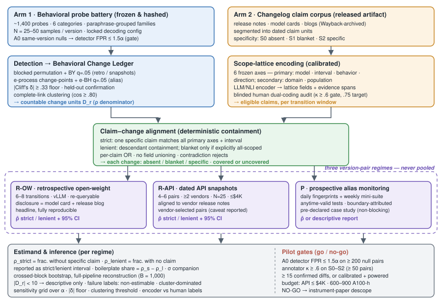

# 设计性无记录？——以厂商变更日志为对照测量 LLM 的静默行为变更

## 摘要

已部署的大语言模型（LLM）在不断变化：厂商发布新版本、更新托管快照，并对浮动别名（alias）背后的模型进行静默修改。近年的研究已经能够检测 API 行为*是否*发生了变化；但尚无公开发表的测量工具回答：*厂商自己的变更日志（changelog）究竟覆盖了多大比例的可检测变更*。我们定义并估计**行为变更披露缺口**（behavioral-change disclosure gap）ρ：在由冻结的、预注册的黑盒探针电池（probe battery）检测到的跨版本行为差异中，没有任何厂商撰写的变更日志声明（claim）在其声明范围内覆盖该差异的比例。由于对"已记录"设单一阈值在两个方向上都可被操纵，披露按三级具体度（specificity）量表打分——缺失（S0 absent）、笼统（S1 blanket）、具体（S2 specific）——ρ 始终以**严格/宽松区间**（strict/lenient interval）报告（严格：仅具体声明构成覆盖；宽松：范围足够明确的笼统声明也构成覆盖），二者之差本身量化了披露中的套话成分。检测采用带同版本零假设校准的、留出确认（held-out confirmation）的纯样本检验，并以确定性全连接聚类（complete-link clustering）将证据个体化为可计数的变更单元；对齐则通过一个经校准的自动编码器把变更日志声明与检测到的变更映射到冻结的六轴范围格（scope lattice），并以盲法人工双编码审计；推断采用带全流程重建的交叉分块自助法（crossed-block bootstrap）。估计在三种证据价值不同的版本对体制（regime）下**分别产出、绝不合并（never pooled）**：回溯性开放权重发布（头条结果，完全可复现）、并行提供的带日期 API 快照（现实但由厂商自选）、以及对可变别名的前瞻性监测（无偏但受日历约束的案例研究）。该工具、一份公开发布的变更日志声明语料库、种子重放与仿真验证、以及分体制的 ρ 估计，把"变更日志不完整"从轶事变成一个经校准、部分可识别、可复现的测量。

## 1. 引言

大语言模型如今作为外部托管的依赖被消费。控制变更的一方——厂商——同时也是变更公开记录（变更日志、发布说明、模型卡）的唯一作者。下游集成者需要判断既有评测是否仍然有效，安全审计者想知道拒答行为的变更是否与能力提升以同样的比例被披露，监管者需要把欧盟《AI 法案》（EU AI Act）GPAI 条款下的上市后监测义务落到实处——目前他们都只能把这份记录当作完整的。没有任何公开数字说明它到底有多完整。

产出这个数字的原料已经齐备。Chen 等 [1] 表明"同一个" GPT 服务在带日期快照之间显著漂移。2024–2026 年的黑盒审计工作使变更检测越来越便宜且严谨：语言学特征双样本检验 [2]、任意时刻有效（anytime-valid）的序贯行为偏移检验 [3]、基于参考模型的秩均匀性检验 [4]、对生产端点的对数概率追踪（log probability tracking）[5]、以及紧查询预算下的省 token 变更检测 [6]；模型内可靠变化方法把真实偏移与评测随机噪声分离 [7]；替换审计追问你是否得到了你付费的模型 [8]。这些都回答*行为是否、在哪里变了*。没有一项把检测到的变更与厂商的披露文本对齐。反过来，透明度文献——模型卡 [9]、基础模型透明度指数（FMTI）及其后续 [10, 11, 12]、透明度报告 [13]、文档结构分析 [14]、审计留痕提案 [15]——评分的是厂商*说了什么*，缺少测量模型跨版本*做了什么*的一臂。夹在中间的问责问题是开放的：**当黑盒探针电池在两个版本之间检测到一处行为差异时，厂商变更日志里是否存在一条声明，其声明范围覆盖该差异？**

本文构建回答该问题的测量工具并报告相应估计量（estimand）。三个设计承诺把测量与轶事区分开：

**（一）估计量承认自身的条件性。** ρ 相对于冻结探针套件 P 与预注册分析配置 θ（含多重校正的显著性水平、效应量下限、覆盖规则）定义。它估计的是*套件可见变更*中的静默比例；对套件看不见的变更不置一词。可辩护的主张是未披露变更*数量*的下界——"至少有这么多被测到的变更未被披露"——而绝非总量估计。由于手写探针取材于变更日志词汇本身，套件对厂商常谈论的那类变更*更*敏感，这使 ρ 偏向低估——对问责性主张而言是保守方向。

**（二）"已记录"是谱系，不是布尔值。** 厂商既写"提升了模型质量与安全性"，也写"修复了医疗剂量问题上的过度拒答"。宽松匹配器让一句笼统话记录一切（构造上 ρ→0）；严格匹配器让几乎一切无记录（构造上 ρ→1）。因此我们对每条声明编码具体度（S0 缺失 / S1 笼统 / S2 具体），并联合报告 ρ_strict（仅 S2 构成覆盖）与 ρ_lenient（S1∨S2 构成覆盖）；ρ_strict − ρ_lenient 本身即是发现——披露中的套话份额。

**（三）体制是证据类别，绝不合并。** 回溯性开放权重版本对可无限重查询，作为头条锚点；并行提供的带日期 API 快照真实但由厂商自选（厂商选择为这些过渡打上日期，可能偏向记录更完善的过渡——作为限制条件报告，跨体制对比升格为具名的次要发现）；对可变别名的前瞻性监测无偏但无法排期，因此预先声明为案例研究，其缺席不使研究失效。每个估计都按体制分别产出，并带依赖感知的不确定性。

**贡献。**（1）ρ 估计量及其可识别性声明：部分可识别、以严格/宽松区间夹住、分体制的 LLM 版本过渡披露缺口率，附对少差异过渡仍有定义的 σ 伴随指标（每探针静默差异数）。（2）双臂测量工具：行为变更台账（ledger）在不依赖 logits 或参考模型的条件下把留出确认的黑盒检验结果转化为可计数变更单元；变更日志声明语料库 + 冻结范围格把声明–变更对齐化归为可审计的包含判定，由经校准的自动编码器执行、以盲法人工双编码审计。（3）分体制的交叉分块推断与全流程重建，经种子重放与预注册依赖仿真网格验证，并带诚实失败标签（`non-estimable` 不可估、`cluster-dominated` 簇主导）。（4）工件（artifacts）：冻结的约 1,400 探针电池、带日期的多厂商变更日志声明语料库（今日尚无此数据集）、原始响应档案、以及带敏感性网格的分体制 ρ 估计。

## 2. 相关工作

**行为漂移与黑盒 API 审计。** Chen 等 [1] 确立了 GPT-3.5/4 跨快照漂移；Ma 等 [16] 把演化 API 的回归问题重构为测试问题。检测机制此后趋于成熟：语言学特征双样本检验 [2]、带容忍度的任意时刻有效序贯偏移审计 [3]、基于可信本地参考的秩均匀性检验 [4]、对已部署端点的连续对数概率追踪 [5]、省 token 变更检测 [6]；Cacioli 等 [7] 把模型内可靠变化与评测噪声分离。替换审计 [8] 问的是二元身份问题——所served的模型是否为所宣称的——并得出纯软件验证脆弱、需要 TEE 的结论。**边界：**这整条线止步于检测、定位或验证变更。没有任何一项读入厂商披露文本、分类披露具体度、或估计检测到的变更被覆盖的比例——即本文定义的量 ρ。我们*复用*这条线：[5] 作为前瞻臂的边界检测，[3] 的任意时刻有效机制用于连续监测，纯检测流水线作为我们的基线。（预注册的投稿前阻塞性检查：全文审读 [5] 与 [6] 是否含任何非正式的"检测 vs 公告"对比；若有，我们的增量陈述收窄为经校准的对齐臂、具体度分类法与 ρ 估计量，正文将如实说明。）

**对抗性范围界定。** Zhang 等 [17] 表明知情厂商可以伪造指纹类审计。主动隐匿变更的厂商能击败任何黑盒审计；我们的估计量针对*非对抗但记录不足*的厂商——事故记录表明这是常态。宽行为电池也比窄统计指纹更难伪造，且头条体制（开放权重对、公开带日期快照）中对抗性隐匿不可信。测得非对抗情形的 ρ，是论证对抗情形重要性的前提。

**透明度与文档。** 模型卡 [9] 与 FMTI [10, 11, 12] 评估披露实践；透明度报告 [13]、AI Transparency Atlas [14] 与审计留痕提案 [15] 将其结构化。它们对照清单为文档打分，而非对照被测行为。我们补上缺失的行为臂，并反向继承其"披露实践高度异质"的发现——这正是具体度量表的动机。

**模型更新的治理。** Chishti 等 [18] 为 LLM 供应链提出部署方兼容性规则与部署前测试；Yang 等 [19] 编目使静默变更代价高昂的隐性需求；安全补丁工作 [20] 表明厂商自身也在版本间迭代。可复现性研究警示仅基础设施就能移动输出：数值非确定性 [21] 与单样本评测噪声 [22] 正是我们检测器必须校准对照的零假设。"愿意但无能"分析 [23] 表明拒答与能力可独立移动，这促使我们在归因变更类别时把拒答族端点与能力族端点分开。

**软件工程中的文档忠实度。** 发布说明研究与生成器（如 ARENA [24]）已在传统软件中确认：已交付的变更经常不出现在发布说明中——这是"文档忠实度可测量"的最近概念先例。我们把该问题移植到"差异"只能行为化观测的场景。

**对齐机制。** 声明–变更匹配被实例化为结构化包含加校准蕴含（entailment），对标 NLI/事实核查流水线 [25]。所主张的新颖性在于估计量、范围格表示与校准协议——**不是**新的蕴含模型；匹配器有意采用现成组件。

## 3. 问题定义

令 R = {ow, api, alias} 索引三种体制。对体制 r，V_r 为其版本过渡集合，P 为冻结的探针电池（各体制共享；在任何过渡后测量之前冻结并哈希），θ =（α、多重校正、效应下限、覆盖规则）为预注册分析配置。对过渡 v = (v⁻, v⁺) 与探针 p，观测为 N 样本响应集对 X_{r,v,p} = (Y_{r,v⁻,p}, Y_{r,v⁺,p})。可复现检测程序 Δ（第 4.1 节）把它们映射为有限的、已个体化的检测变更集合 D_r。估计量**以 (P, θ, Δ) 为条件**，针对被检测到的变更，而非厂商内部的潜在变更。

令 C_r 为适用于 r 的厂商公开声明集合，每条声明具有具体度 s(c) ∈ {blanket, specific} 与编码化范围。M(c, d) ∈ {0,1} 表示声明 c 的声明范围是否覆盖检测变更 d（第 4.2 节）。每个 d 依优先级 specific > blanket > absent 获得披露类别：

L_r(d) = specific，若 ∃c: M(c,d)=1 且 s(c)=specific；blanket，若无此类具体声明但 ∃c: M(c,d)=1 且 s(c)=blanket；否则 absent。

令 π_{r,k} 为 D_r 中类别 k 的占比：

- **ρ_r^strict = π_{r,absent} + π_{r,blanket}** —— 未被任何*具体*声明覆盖的比例；
- **ρ_r^lenient = π_{r,absent}** —— 未被任何声明覆盖的比例。

每体制报告输出：O_r = (π_{r,absent}, π_{r,blanket}, π_{r,specific}, ρ_r^strict, ρ_r^lenient, 依赖感知区间)，外加无条件伴随量 **σ_r =（静默变更数）/ |P|**，它对每个过渡都有定义。|D_r| < 10 的过渡仅作描述性报告（完整差异清单 + 标签），不进入比率估计。不合并约束是硬性的：O_r 对每个 r 分别估计；绝不构造任何跨体制平均。

**可识别性声明（正文原样陈述）：** ρ 估计的是*套件可见*变更中的静默比例。它既非全部变更真实静默比例的上界，也非下界；它支持的主张是未披露变更*数量*的下界。由于探针电池部分取材于变更日志词汇（第 5.1 节），检测功效向"可披露类"变更倾斜，使 ρ 偏向低估——对问责性结论是保守的。

**挑战。**（i）D_r 须从随机黑盒输出推断，而"同版本"变异本身就包含负载相关路由、批处理与推理栈非确定性 [21, 22]——零假设必须由同版本重采样估计，不能假设。（ii）M(c,d) 必须可复现地跨越悬殊的粒度（"安全性改进" vs 剂量问题上实测 +9 个百分点的过度拒答偏移）——若人类在 S0/S1/S2 上无法达成一致（κ < 0.6），该指标就没有立足之地。（iii）共享模板的探针、共享谱系的过渡、重复采样彼此依赖；条目级区间将反保守。（iv）理想对象——同一别名在静默更新前后的状态——转瞬即逝；任何获取策略都在真实性与可得性之间权衡，这正是体制必须分开的原因。

## 4. 方法

*图1：双臂披露缺口测量工具：探针电池臂（检测 → 台账）、变更日志语料臂（声明 → 范围格）、校准对齐产出 缺失/笼统/具体 覆盖标签，以及带试点闸门的分体制严格/宽松 ρ 估计。*

### 4.1 第一臂——行为变更台账

**探针与采集。** 约 1,400 个探针横跨六类——事实问答、拒答/安全、指令遵循/格式、推理/数学、工具调用、延迟/成本——分层抽取自 MMLU、GSM8K、TruthfulQA（事实/推理）、XSTest + HarmBench（拒答与过度拒答）、IFEval（指令/格式）、BFCL（工具调用），另加约 200 个手写探针，瞄准变更日志实际描述的行为（人设/语气、默认格式、拒答模板、JSON 模式严格性），并从变更日志语料中挖掘词汇，使 ρ_strict < 1 成为可达。探针组织为同义改写分组的探针族；每个探针 =（提示词、锁定解码配置、响应特征提取器）。每探针每版本 N = 25–50 个样本，用该版本默认解码；特征：精确答案、拒答标志（分类器）、格式合规标志、响应长度、以及 API 返回时的首 token top-k 对数概率。电池在任何过渡后测量之前冻结并哈希。

**零假设校准（闸门 A0）。** 同版本零假设对——同一端点跨多日、多负载条件的重采样——估计检测器假阳性率。由于零假设窗口*期间*的静默更新会污染它，零假设窗口本身以对数概率/指纹追踪器 [5] 监测；任何不连续即作废该窗口。在 ≥ 200 个零假设探针对上，检测器 FPR 必须 ≤ 1.5×α，且实测 FPR 与每个头条数字并排报告。

**检测与确认。** 对每个（过渡、探针族、端点）：回溯与快照对采用分块置换检验（按同义改写组与重复分块），以 Benjamini–Yekutieli 在 q = 0.05 控制多重性；固定节奏的别名监测采用任意时刻有效 e 过程变化点检验加 e-BH（q = 0.05）[3]。检测额外要求效应下限 |Cliff's δ| ≥ 0.33（预注册于 θ；敏感性分析取 0.2 与 0.5）。发现样本上被拒绝的候选在留出的新样本上复检；仅留出确认的单元进入个体化。

**个体化（先确认后聚类）。** 每个确认单元是一个节点，键为（体制、谱系、区间、探针族、端点、效应方向），携带同义改写组上的标准化带符号效应。冻结的端点等价映射声明哪些端点是同一构念的冗余指标。仅当体制、谱系、区间、方向一致且端点同属一个等价类时，两节点硬兼容；相似度 = 共同适用改写组上的余弦（要求 ≥ 2 组重叠）；在阈值 0.80 下做确定性全连接凝聚（平局按字典序破除；禁止事后人工拆并；禁止传递性桥接合并）。所得聚类即 ρ 分母中的可计数变更；敏感性分母取阈值 0.70/0.90 及未聚类单节点。

### 4.2 第二臂——变更日志声明语料库与范围格对齐

**语料库。** 我们抓取并存档（含 Wayback 历史快照）目标厂商的发布说明、变更日志、模型卡与发布博客；分割为带日期的声明单元；标注每条声明的类别与具体度（S1 笼统 / S2 具体；S0 即无合格声明）。语料库作为工件发布——目前尚无此类数据集。

**范围格。** 声明与台账记录编码到冻结的六轴格上：厂商/模型、生效区间、行为族/端点、效应方向（主轴）；任务/领域、受影响人群（次轴）。类别节点为终端值集合；包含即子集检验；区间包含要求声明所述窗口包含台账区间；父子关系、同义词与终端值在匹配前冻结。

**覆盖规则（给定编码后确定性）。** *具体度：*无模型且时间合格的声明则为 absent；有合格声明但均无行为谓词则为 blanket；至少一条有行为谓词则为 specific。*严格覆盖：*单条具体合格声明在每个主轴上陈述相同的非顶节点（允许冻结同义词）、包含区间、并在记录非顶的每个次轴上匹配。*宽松覆盖：*单条合格声明在后代关系下包含该记录（顶值仅允许出现在次轴）；笼统声明仅当其证据片段明确将范围界定为匹配模型与区间的全部输出/行为时才计入。任一已陈述轴上的矛盾即拒绝覆盖；多条声明按逐条 OR 组合——不同声明的字段绝不并集成合成匹配。

**校准编码（自动化优先、人工审计）。** 人工编码全部声明与记录既不可扩展也非贡献所在。LLM/NLI 编码器把声明文本与结构化"差异卡"（类别、方向、效应量、示例响应对）映射为带引用证据片段的格字段。校准：约 250 对分层声明–变更开发集由两名人工编码员盲法双编码并仲裁（试点闸门：S0/S1/S2 上 κ ≥ 0.6；格字段目标 κ ≥ 0.75）；仅当自动编码器的字段级一致性达到人–人水平、且端到端覆盖判定在留出划分上 macro-F1 ≥ 0.8 时才被采纳；分歧标记与低置信个案（目标 ≤ 15%）转人工仲裁。保留关键词/BM25 匹配器与无约束自由文本 NLI 判官作为基线，量化结构的贡献。全部编码、证据片段与仲裁随工件发布。

### 4.3 分体制缺口推断

对每个体制 r 与规则 q 分别：ρ̂(r,q) =（规则 q 下未覆盖的聚类数）/（聚类总数），分母按具体度类别分解，并在预注册类别权重（非原始探针计数）下报告各类别比率 ρ_c。不确定性必须尊重依赖：探针成族、变更成过渡、重复样本同行。自助框架在检验前冻结：ow/api 体制先重采样谱系、再在谱系内重采样过渡块，与独立重采样的探针族块交叉，把笛卡尔重数施加到原始采集单元；alias 体制以平稳时间块与探针族块交叉重采样。**每个重复都重跑全流程**——检验、确认、聚类、对齐（仅自动编码器）、ρ——从重采样的原始单元出发，从而传播变更选择与个体化的不确定性；原始聚类绝不充当重采样单元。

主区间为 B = 1,000 外层重复的 95% 百分位区间。嵌套百分位-t（学生化）变体——外层×内层、带每重复标准误——对真实采集数据计算上不可行，因此在仿真研究（第 6 节 RQ5）中评估，仅当百分位覆盖在仿真中不足时才用于真实队列；这一弱化如实披露而非隐藏。重复仅当检出 ≥ 1 个变更才有效；有效重复 < 95% 时区间报告为 **non-estimable（不可估）**——绝不静默替换为条目级区间。留一过渡诊断标记 **cluster-dominated（簇主导）** 估计（任何单次删除使 ρ̂ 移动 > 0.10）。

## 5. 测量队列、预算与闸门

### 5.1 按现实定尺寸的三体制

- **R-OW（回溯、开放权重；头条）。** 6–8 个过渡，两端点均可下载且有带日期的厂商披露文本（发布博客 + 模型卡），候选：Llama-3.1→3.3、Qwen-2.5→Qwen-3、DeepSeek-V3→V3.1、Mistral 版本化发布、Gemma-2→3——每对的披露文本在**队列冻结前**核实存在且有日期。端点本地部署（vLLM）：采样完全可控、可无限重查询。注意此处披露文体（模型卡、博客）比 API 变更日志更丰富——这是体制绝不合并的理由之一。
- **R-API（回溯、带日期快照）。** 来自 ≥ 2 家厂商的 4–6 对并行提供的带日期快照，对齐到快照间窗口的发布说明；快照可用性与退役日期在冻结时核实（快照会被下线）。报告选择性限制：厂商选择了为这些过渡打日期。
- **P（前瞻、别名监测；案例研究）。** 对 2–3 家厂商的浮动别名做每日指纹/对数概率追踪 [5] 加每周 150 探针小套件，采用任意时刻有效序贯检验使连续监测不膨胀错误率 [3]。差异仅当被指纹稳定区段夹住时才归因到窗口；否则记"边界不确定"并从 ρ 排除。冻结前捕获的任何边界成为案例研究；其缺席预先声明为不阻塞。

### 5.2 预算与算力

开放权重：约 14 端点 × 1,400 探针 × 50 样本 ≈ 100 万条短生成（约 5 亿 token）；约 600–900 A100 小时，由 2–3 个大模型对主导（回退：放弃 70B 级对，仅跑 ≤ 14B——估计量是披露忠实度而非能力）。API 臂封顶 **$4K**：每探针 N = 25，必要时对数封顶为 4，限速礼貌查询。标注：两名编码员 + 一名仲裁者共约 60–80 小时，把不依赖差异的变更日志具体度标注前置到全量运行之前。原始响应、指纹与变更日志语料冻结并发布（数十 GB）。

### 5.3 试点闸门（go/no-go）

试点 = 1 个开放权重过渡（8B 级）+ 1 对 API 快照，300 探针小套件，N = 25。**GO 需要：**（i）A0 检测器在 ≥ 200 个同版本零假设对上 FPR ≤ 1.5×α；（ii）两个过渡合计 ≥ 15 个留出确认差异，**或**检测器可证校准（A0 通过）且对合成注入差异有高功效——被校准工具测得的"安静过渡"世界是可发表的阴性结果（"这些版本对的披露完整度高"），不是失败；（iii）两名标注员在 ≥ 50 个差异–声明对上对 S0/S1/S2 达到 κ ≥ 0.6。**NO-GO 回退：**降格为测量工具论文（检测器 + 语料库 + 校准 + 仅开放权重 ρ），改投下一投稿窗口，让前瞻臂成长为真正的纵向臂。

## 6. 实验

验证实验（RQ1–RQ5）在有真值的构造数据上考核工具；RQ6 与头条分析在真实队列上运行。所有比较在相同输入上配对；所有随机性预置种子。

**RQ1——枚举有效性（种子重放）。** 重放 360 个盲注入的种子行为突变 + 360 个匹配零机会（每体制各 120；合成数据，规模廉价），按变更族与效应量分层，密封清单单侧计分。成功标准：体制均衡的种子召回 ≥ 0.80 且经验 FDP ≤ 0.10，并比采集匹配的聚合偏移检测器加留一探针族定位高 ≥ 0.15 召回（配对置换检验，Holm 校正）。

**RQ2——个体化可复现性。** 90 个采集目标（每体制 30 个，≥ 20 端点），用新鲜随机样本做两次独立采集。成功标准：重复聚类 ARI ≥ 0.75，且比一遍式逐端点检验高 ≥ 0.15（聚类级自助）。

**RQ3——对齐有效性（留出）。** 300 个留出声明–变更对（每体制 100），按具体度与覆盖极性分层，金标 = 三专家盲法共识。成功标准：三类具体度 macro-F1 ≥ 0.80；每规则下平衡准确率 ≥ 0.85；各项比无约束自由文本 NLI 及关键词/BM25 高 ≥ 0.10（配对分层自助）。该 N 依标注预算选定；各类标准误（约 0.05）随结果报告。

**RQ4——编码信度。** 150 对，4 名受训编码员，结构化 vs 自由式随机交叉设计（含洗脱期）。成功标准：格字段与具体度的 Krippendorff α ≥ 0.75；结构化 − 自由式 α ≥ 0.10；仲裁率 ≤ 15%。

**RQ5——区间校准（仿真）。** 预注册网格：3 体制 × 2 规则 × ICC ∈ {0, .1, .25, .5} × 3 个簇规模模板（由真实队列参数化）× 真值 ρ ∈ {.2, .5, .8} × 3 种披露混合；每格 2,000 次仿真。成功标准：交叉分块覆盖在每格 ≥ 0.90（同时评估百分位与百分位-t 变体，预先承诺对真实队列采用其中校准更优者），而条目级自助在 ≥ 1 个 ICC ≥ 0.1 的格中低于 0.90。

**RQ6——真实队列估计的稳健性。** 在真实队列（6–8 个 ow 过渡、4–6 对 api、alias 案例研究）上：按体制 × 规则报告留一过渡 ρ 偏差；报告最大偏差，任何被单次删除移动 > 0.10 的估计标记为 **cluster-dominated** 而非稳定。θ 敏感性网格：α ∈ {0.01, 0.05}、|δ| ∈ {0.2, 0.33, 0.5}、聚类阈值 ∈ {0.70, 0.80, 0.90, 单节点}、自动编码器 vs 人工仲裁标签。

**头条分析。** 分体制的 π（缺失/笼统/具体）、带交叉分块区间的 ρ_strict/ρ_lenient、σ 伴随量、按类别比率 ρ_c（拒答/安全类与能力类对比）、套话份额 ρ_strict − ρ_lenient，以及具名次要发现：API 变更日志是否比开放权重发布说明更稀疏？A0 的检测器 FPR 与每个头条数字并排印出。

## 7. 局限、伦理与效度威胁

**部分可识别。** ρ 以 (P, θ, Δ) 为条件；论文措辞确保该工具不会被错误引用为"X% 的全部变更是秘密的"。**对抗性厂商**依设计不在范围内 [17]；估计量针对记录不足，而非隐匿。**文体混杂：**开放权重的"变更日志"是模型卡与博客；跨体制比较作为披露体制间的对比报告，绝不合并。**基础设施 vs 模型变更：**部分检测差异可能反映服务栈而非权重变化 [21]；台账记录该歧义，别名臂的指纹夹逼部分控制之。**服务条款/法律：**仅对公开端点做限速礼貌探测；正文按厂商聚合与类别粒度报告，厂商级细节置于附录；引用善意评测安全港（safe harbor）语境 [26]；去匿名发布前做法律审查。**标注规模：**人工标签界定对齐臂的效度上限；全部 κ、F1 与仲裁统计随工件发布，自动编码器绝不被信任超出其实测一致性。

## 8. 结论

如今人人都能检测出已部署模型变了；本工作测量的是有没有人被告知。通过冻结探针套件、用严格与宽松两种读法夹住"已记录"、拒绝合并采集体制、并同时校准检测器（同版本零假设）与对齐器（盲法人工双编码），披露缺口 ρ 成为监管者、集成者或审计者可以引用的数字——附带不确定性、条件性与失败标签。变更日志声明语料库与探针电池公开发布，使厂商未来的披露忠实度可被纵向追踪；此处预先声明为案例研究的前瞻别名臂，将自然成为长期测量工具。

## 参考文献

[1] L. Chen, M. Zaharia, J. Zou. How Is ChatGPT's Behavior Changing over Time? arXiv:2307.09009, 2023.
[2] A. Dima, J. Foulds, S. Pan, P. Feldman. You've Changed: Detecting Modification of Black-Box Large Language Models. 2024.
[3] L. Richter, X. Ding, A. Weller, et al. An Auditing Test to Detect Behavioral Shift in Language Models. 2025.
[4] X. Zhu, et al. Auditing Black-Box LLM APIs with a Rank-Based Uniformity Test. arXiv:2506.06975, 2025.
[5] T. Chauvin, et al. Log Probability Tracking of LLM APIs. arXiv:2512.03816, 2025.
[6] T. Chauvin, et al. Token-Efficient Change Detection in LLM APIs. arXiv:2602.11083, 2026.
[7] J.-P. Cacioli, et al. Beyond the Mean: Within-Model Reliable Change Detection for LLM Evaluation. arXiv:2604.27405, 2026.
[8] W. Cai, et al. Are You Getting What You Pay For? Auditing Model Substitution in LLM APIs. arXiv:2504.04715, 2025.
[9] M. Mitchell, et al. Model Cards for Model Reporting. FAT* 2019.
[10] S. Longpre, et al. The Foundation Model Transparency Index. arXiv:2310.12941, 2023.
[11] R. Bommasani, et al. The 2024 Foundation Model Transparency Index. arXiv:2407.12929, 2024.
[12] S. Longpre, et al. The 2025 Foundation Model Transparency Index. 2025.
[13] R. Bommasani, K. Klyman, S. Longpre, et al. Foundation Model Transparency Reports. arXiv:2402.16268, 2024.
[14] A. Mamirov, et al. AI Transparency Atlas: Framework, Scoring, and Real-Time Model Card Evaluation Pipeline. 2026.
[15] V. Ojewale, et al. Audit Trails for Accountability in Large Language Models. 2026.
[16] W. Ma, et al. (Why) Is My Prompt Getting Worse? Rethinking Regression Testing for Evolving LLM APIs. arXiv:2311.11123.
[17] J. Zhang, et al. Your "Pro" LLM Subscription May Actually Be "Free": Exposing Fingerprint Spoofing Risks in LLM Inference Services. arXiv:2606.16100, 2026.
[18] M. S. Chishti, et al. Test Before You Deploy: Governing Updates in the LLM Supply Chain. arXiv:2604.27789, 2026.
[19] C. Yang, et al. What Prompts Don't Say: Understanding and Managing Underspecification in LLM Prompts. 2025.
[20] H. Arif, et al. Patching LLM Like Software: A Lightweight Method for Improving Safety Policy in Large Language Models. arXiv:2511.08484, 2025.
[21] J. Yuan, et al. Understanding and Mitigating Numerical Sources of Nondeterminism in LLM Inference. 2025.
[22] Y. Song, G. Wang, S. Li, B. Y. Lin. The Good, The Bad, and The Greedy: Evaluation of LLMs Should Not Ignore Non-Determinism. arXiv:2407.10457, 2024.
[23] C. Carleo, et al. Willing but Unable: Separating Refusal from Capability in Code LLMs via Abliteration. arXiv:2606.05396, 2026.
[24] L. Moreno, et al. ARENA: An Approach for the Automated Generation of Release Notes. IEEE TSE, 2017.
[25] J. Thorne, et al. FEVER: A Large-Scale Dataset for Fact Extraction and VERification. NAACL 2018.
[26] S. Longpre, et al. A Safe Harbor for AI Evaluation and Red Teaming. arXiv:2403.04893, 2024.
[27] Z. Liu, et al. Modeling Dependent Structure for Utterances in ASR Evaluation. arXiv:2209.05281, 2022.（依赖感知区间的分块自助先例）
