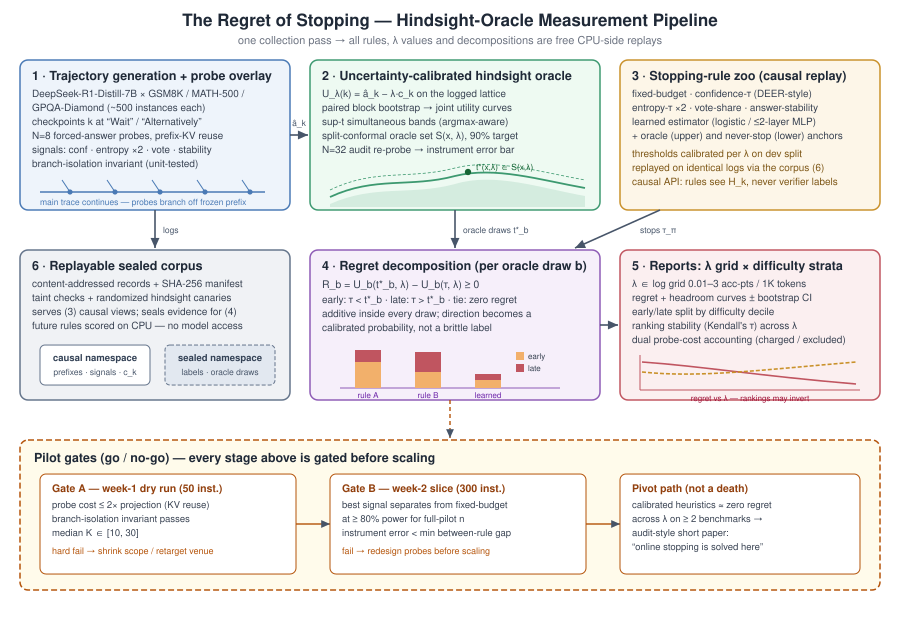

# 停止的遗憾：测试时停止规则的事后神谕评估（The Regret of Stopping: Hindsight-Oracle Evaluation of Test-Time Stopping Rules）

## 摘要

推理模型隐式或显式地决定何时停止思考。不断涌现的测试时停止规则（test-time stopping rules）——置信度阈值、熵监控、答案稳定性检验、学习型停止器——几乎都只通过聚合的准确率–token 权衡来评估。这种评估只能让规则之间互相比较，却无法回答部署者的问题：任何规则距离*可达*最优还有多远？剩余效用又损失在何处？我们提出一个针对测试时停止的事后神谕遗憾（hindsight-oracle regret）框架。对每条被记录的推理轨迹，在推理转折检查点（checkpoint）处的强制作答探针（forced-answer probe）在事后重建逐检查点的准确率–成本效用曲线；事后最优停止点不被当作真值，而是被视为一个*不确定对象*：用配对块自助法（paired block bootstrap）估计效用带，用分裂共形校准（split-conformal calibration）构造置信集合，以纠正对噪声检查点估计取最大值所引入的选择偏差。每个候选规则的阈值在开发集上按成本权重逐一校准，然后在完全相同的记录轨迹上进行因果重放（causal replay）；其遗憾在每个校准神谕抽样内被加性分解为过早停止（stop-too-early）与过晚停止（stop-too-late）两部分，并在可解释的"准确率每千 token"成本网格上按任务难度分层报告为曲线。试点研究（一个开源推理模型、三个可机械验证的基准、约 1,500 条轨迹、约 2.4×10⁵ 次探针生成）测量六个校准规则族及一个小型学习式边际效用估计器的神谕差距，直接回答"继续思考的边际收益能否被在线估计"。全部检查点级日志将作为可重放、防泄漏的语料库（corpus）发布：任何未来的停止规则都可离线获得遗憾评分，无需访问模型。

## 1. 引言

测试时扩展（test-time scaling）使语言模型通过生成更长的思维链，把额外的推理计算转化为准确率 [Snell et al., 2024; Guo et al., 2025]。但继续思考的边际效用并非始终为正：偏好更短的采样链可以优于更长的链 [Hassid et al., 2025]；过度思考（overthinking）会实际损害智能体任务的结果 [Cuadron et al., 2025]；正确的中间解会被后续推理覆盖 [Song et al., 2025; Chen et al., 2024]；一项最新的系统性研究发现，推理 token 的边际回报递减、在高预算下甚至为负，且最优思考长度随问题难度变化 [Zhou et al., 2026]。简言之，停止是一个后果重大的逐实例决策，围绕它已形成一个高效推理子领域 [Sui et al., 2025]。

停止规则本身已经数量众多：推理转折处的置信度触发早退 [Yang et al., 2025]、对数概率边际刹车 [Song et al., 2025]、答案稳定化监控 [Fu et al., 2024]、在校准风险下比较的学习型停止器 [Dong et al., 2026]。缺失的是对**任何规则距离可达前沿有多远**的度量。已发表的规则用最终准确率和 token 节省来评估——这是规则之间的互相比较。成本感知评估 [Zhou et al., 2026; Dong et al., 2026] 把它细化为等成本或等风险比较，但参照物仍是其他规则或聚合的预算扫描。今天的部署者在挑选停止规则时，无法判断剩余空间是可达效用的 2% 还是 40%——问题是基本已解还是刚刚开始——也无法判断某个规则的损失是来自价值到来之前的过早停止，还是来自为不再有帮助的思考继续付费。

回答这些问题需要一个不同的估计对象（estimand）：**相对事后神谕的逐实例遗憾**。对于答案可机械验证的记录轨迹，在每个推理检查点处的强制作答探针可以在事后重建"若在此停止模型会取得的准确率"；结合汇率 λ 下的累计 token 成本，得到该轨迹的效用曲线及其事后最优停止点 t*(λ)。一个规则的遗憾就是其停止点与 t* 之间的效用差，而该差可精确分解为过早停止质量与过晚停止质量——即该实例上思考不足与过度思考的量化代价。

有两个障碍使这一估计对象一直未被测量，它们构成了我们贡献的骨架。第一，**神谕是一个构造物，不是真值**：逐检查点准确率由有限个探针估计，检查点估计因共享同一轨迹而相关，而 t* 是对噪声量取的 argmax——这个最大值存在向上偏差，会机械地抬高每个规则的测量遗憾。因此我们把神谕当作不确定对象处理：配对块自助法保留跨检查点相关性；同时带（sup-t band）控制整条效用曲线上的不确定性；针对不相交的更高预算审计探针做分裂共形校准，得到合理神谕检查点的置信*集合*，而非脆弱的插入式 argmax。遗憾及其早/晚归因在每个校准神谕抽样内部计算，使参照物的不确定性传播进每一个报告数字。第二，**比较必须严格配对且无泄漏**：所有规则通过一个只暴露检查点前缀可观测量的因果接口，在完全相同的记录轨迹上重放；验证器标签与神谕状态被封存；语料库公开发布，使未来规则可离线获得遗憾评分。

该框架是一件测量仪器，我们也按仪器来验证它——探针干预有效性、神谕集合对审计探针的覆盖率、分解的穷尽性、重放的可复现性、泄漏金丝雀（canary）——但论文的主要交付物是实证的：三个基准上六个校准规则族在 λ 上的遗憾曲线；每个规则的损失按任务难度十分位分解为早/晚质量；通过逐检查点信号 AUROC 与一个刻意做小的学习式估计器，直接检验轨迹中段可观测量是否携带足以在线估计边际效用的信号；以及可重放语料库本身。

**贡献。**
1. **估计对象。** 测试时停止规则的逐实例、按成本索引的事后神谕遗憾，及其精确的早/晚分解——没有任何已发表的停止评估报告过这一量（我们对照最接近的成本感知评估 [Zhou et al., 2026; Dong et al., 2026] 加以核实）。
2. **仪器。** 不确定性校准的神谕构造（配对块自助法、sup-t 带、共形神谕集合），把"距神谕的距离"从噪声伪影转化为带仪器误差棒的可测量，并附强制作答探针干预的双管齐下有效性协议。
3. **发现（试点）。** 在一个开源推理模型 × 三个可验证基准上，六个规则族与一个学习式边际效用估计器的校准遗憾曲线、剩余空间估计、以及早/晚 × 难度分解。
4. **制品。** 检查点级、验证器标注、因果封存的重放语料库：任何未来停止规则无需 GPU 即可在相同轨迹上获得遗憾评分。

## 2. 相关工作

**过度思考与停止的价值。** Chen et al. [2024] 记录了 o1 类模型的过度思考并定义结果/过程效率指标；Wang et al. [2025] 研究互补的思考不足（underthinking）失败；Cuadron et al. [2025] 表明过度思考损害智能体结果；Hassid et al. [2025] 发现更短的采样链更优；Sui et al. [2025] 综述高效推理领域。这些工作确立了"继续思考可能带来负的边际效用"——使停止遗憾值得测量的前提——但都没有定义逐实例的神谕相对遗憾，也没有把损失归因于过早或过晚停止。

**测试时扩展与长度控制。** Snell et al. [2024] 按难度在策略间分配测试时计算；s1 的预算强制（budget forcing）[Muennighoff et al., 2025] 与 L1 的长度控制强化学习 [Aggarwal & Welleck, 2025] 施加 token 预算；DeepSeek-R1 [Guo et al., 2025] 训练长推理。它们控制*思考多少*，却以预算下的聚合准确率评估，把轨迹内的停止当作既定。

**在线停止规则——被测对象。** DEER 在推理转折处于试探答案置信度高时退出 [Yang et al., 2025]；ThinkBrake 监控句界处指向 `</think>` 的对数概率边际，并报告事后最优的句界停止可在削减 72% 思考 token 的同时提升 8% 准确率——这是一个神谕剩余空间数字，但只是插入式聚合值，没有不确定性、逐实例分辨率、成本权重索引或分解 [Song et al., 2025]。Certaindex 监控答案稳定化用于早退与调度 [Fu et al., 2024]。Dong et al. [2026] 在等丢失正确率风险下、带服务感知成本核算地比较学习型与标量早退——方法学上最接近我们的评估；但其参照物是等风险下的竞争规则集合，而非逐实例事后最优，其协议不产生遗憾幅度或早/晚归因。上述所有规则都是我们框架的*输入*：每一个都成为在公共日志上被评分的一个臂（arm）。

**自适应并行采样（边界）。** ESC [Li et al., 2024]、Adaptive-Consistency [Aggarwal et al., 2023]、CGES [Aghazadeh et al., 2025]、RASC [Wan et al., 2024] 与 DeepConf [Fu et al., 2025] 停止的是*采样*——并行轴。我们限定在串行轴（何时停止一条链）；用于测量的探针样本是对所有规则同等计费的固定覆盖层（§4.1），没有规则获得免费的并行计算。验证器投入分配与跨轴汇率（思考 vs 采样 vs 验证）同样是另外的问题；我们的 λ 机制可被它们消费，但不解决它们。

**成本感知评估——关键毗邻工作。** Zhou et al. [2026] 提出成本感知评估框架，展示边际效用递减与随难度变化的最优思考长度。其分析是聚合的：群体层面的预算级准确率–成本曲线。我们的差异，精确表述：(i) 形式对象是相对*不确定性校准的*事后最优的*逐实例*遗憾，它把"规则 A 胜过规则 B"变成"规则 A 留下了 X% 的可达效用未取，且主要因为在难例上停得太晚"；(ii) 我们测量边际效用从部分轨迹信号的*在线可估性*；(iii) 我们发布一个可重放语料库，他们的停止程序——以及任何未来程序——都可在其上获得遗憾评分。

**与最优停止理论的关系。** "遗憾"一词会带入在线学习的预期；我们的量不是那个。R_λ 是相对固定记录轨迹实现的*事后*（先知式，prophet-style，竞争分析意义上的）遗憾，不是跨回合累积的无遗憾学习（no-regret learning）遗憾。经典最优停止与最优臂预算分配是形式上的祖先，但其机制不能直接迁移：收益过程（逐检查点准确率）既非马尔可夫也不可观测——策略只看到代理信号（置信度、熵、一致性），这正是可估性问题（§5.3，RQ-M3）必须诉诸实证的原因。校准（calibration）研究是我们预期的主导失败信号——自信地答错的中间答案——的自然透镜。

## 3. 问题形式化

**轨迹与检查点。** 对答案可机械验证的任务实例 x，模型生成一条推理轨迹，在推理转折检查点 k = 1,…,K（段落断点；"Wait"、"Alternatively" 等反思 token）处分段。每个检查点记录：累计 token 成本 c_k；在线可观测信号历史 H_k（答案区间平均对数概率、两个预注册熵变体、探针间众数答案投票份额、答案稳定性指标、它们的增量，以及 c_k——绝不含验证器标签）；以及从冻结前缀分支出的 N 个强制作答探针，逐一经验证器标注，给出探针准确率估计 â_k ∈ [0,1]。

**效用与神谕。** 固定汇率 λ（每千 token 的准确率点数），在对数间隔的 7 点网格 λ ∈ [0.01, 3] 上扫描。在 k 处停止的效用为

U_λ(k) = â_k − λ·c_k，

事后最优检查点 t*(x,λ) 取记录格点上 U_λ 的最早最大化者。三个自由度被显式化而非隐藏：(i) 遗憾**相对记录检查点格点**定义——它是连续时间遗憾的下界，并用 2 倍粗格点消融报告离散化敏感性；(ii) 每个主结论都是**关于 λ 的曲线**，绝不是单点 λ 的标量；(iii) â_k 携带二项噪声（N=8 时约 ±0.17 标准误），且 t* 是对约 20 个噪声值取的最大值，插入式神谕效用存在向上偏差——§4.2 用对 t* 的校准不确定性取代插入式估计。

**作为校准策略类的停止规则。** 规则 π 把 H_k 映到 {停止, 继续}；其停止点 τ_π(x) 必须是可观测滤链（filtration）的停时（不得访问未来检查点或验证器标签）。每个启发式族都在保留的开发集上按 λ 通过最小化开发集遗憾校准阈值，因此比较发生在策略类之间，而非任意阈值选取之间。

**逐记录轨迹的遗憾。** 在随机解码下 τ_π 与 t* 都是随机的；因此遗憾定义在记录轨迹（可重放对象）上，使所有规则比较成为相同日志上的严格配对离线重放，种子方差单独量化（在 200 实例子样本上重复采集 3 次）：

R_λ(π; x) = U_λ(t*(x,λ)) − U_λ(τ_π(x)) ≥ 0。

**分解。** 遗憾按 τ_π − t* 的符号精确拆分：过早停止质量（τ_π < t*：模型在价值到来前被打断）与过晚停止质量（τ_π > t*：过度思考的量化代价），并有一个零遗憾的平局分量。在神谕不确定性下（§4.2），拆分在每个校准神谕抽样内计算，故分解逐抽样保持可加，方向成为概率而非脆弱标签。主要输出：λ 上的平均遗憾曲线、归一化剩余空间（遗憾 ÷ 神谕对永不停止的差距）、按任务难度十分位（逐实例基线通过率）的早/晚拆分。

**探针成本核算。** 探针是所有规则共享的测量覆盖层。信号消费探针统计量（投票份额、稳定性）的规则不获得免费并行计算：我们报告两种核算——探针成本对所有规则计入 c_k，以及对所有规则一律不计——并检查结论在两种核算下稳定。

## 4. 测量框架

*图1：停止遗憾测量流水线：带探针覆盖层的轨迹生成 → 不确定性校准的事后神谕构造 → 校准停止规则动物园的因果重放 → 在 λ 网格与难度分层上的逐抽样遗憾分解 → 发布的可重放语料库，各阶段由 go/no-go 试点闸门把守。*

### 4.1 轨迹记录与探针覆盖层

插桩解码在转折标记处（沿用 DEER 的转折点洞见）分段思维链。在 K ≈ 10–30 个检查点中的每一个，以温度 0.6、复用前缀 KV 缓存，从共享前缀分支出 N = 8 个强制作答探针（"…Final answer:"），主轨迹继续生成、不受修改。**分支隔离不变量：**主轨迹绝不见到探针 token；单元测试断言探针开/关时主轨迹 token 逐一相同。每个检查点记录：带验证器标签的探针答案（→ â_k）、预注册信号集（置信度一种：答案区间平均对数概率；熵两种：答案区间均值、末 64 token 趋势斜率；投票份额一种；稳定性指标一种）、以及 c_k。信号定义在全量采集前冻结，以杜绝"分叉花园"式分析。所有在线信号都源自同一批 8 个探针分支；不存在额外生成。

### 4.2 不确定性校准的事后神谕

神谕不得被当作真值。检查点准确率由 N 个探针估计、经共享轨迹跨 k 相关、并进入一个 argmax——这三点使插入式 t* 同时错报遗憾幅度与方向。

- **联合估计。** 配对块自助法重采样匹配的探针种子块——所有检查点使用相同的重采样块索引——产出整条效用曲线 U_b(·,λ) 的联合抽样，在不假设单调性的前提下保留跨检查点相关。
- **同时带。** sup-t（max-t）带控制整个检查点集合上的族错误不确定性，即恰好覆盖 argmax 所执行的那个比较。
- **共形神谕集合。** 针对*不相交的更高预算审计探针*（N = 32，每基准 100 实例子样本）做分裂共形校准，把带转化为目标覆盖率 90% 的合理神谕检查点置信集合 S(x,λ)，并给出神谕抽样的校准权重。N=32 重探针同时经验地界定"噪声均值取最大"的膨胀：其引起的平均遗憾偏移作为仪器误差棒报告，且仅当该误差小于最小规则间遗憾差距时仪器才算通过（§5.4，闸门 B）。

### 4.3 探针干预有效性

检查点 k 处的强制作答可能系统性地不同于真正停止的模型会给出的答案。双管齐下检验：(a) *终端一致性*——最后一个检查点上分支探针 vs 自然最终答案，便宜，覆盖全部实例；(b) *真实终止*——在 100 实例 × 5 检查点子样本上，真的在 k 处停止生成并重新引出答案，其准确率与分支探针 â_k 比较；这是唯一直接的轨迹中段检验，预算约 500 次中等长度生成（噪声级成本）。

### 4.4 校准的停止规则动物园

在相同日志上重放的臂（采集一次通过；增臂免费）：固定预算扫描（在检查点 j 停止）；置信度阈值（DEER 式）；两个预注册熵阈值；投票份额阈值（一致性家族）；答案稳定性（连续两个众数答案一致，TrimR 式）；学习式边际效用估计器（§5.3），仅两个冻结架构（逻辑回归；≤2 层 MLP），从 H_k 预测带符号的继续增益——一个被测条件，刻意封顶，使论文保持仪器身份而非又一个停止方法；外加神谕（上锚）与永不停止（下锚）。每个阈值族按 λ 在开发集上校准；测试遗憾在不相交的评估集上报告。

### 4.5 遗憾评分与分解

对每个（规则, 实例, λ）：因果重放规则得到 τ；对每个校准神谕抽样 b 计算遗憾 U_b(t*_b,λ) − U_b(τ,λ)，并按早（τ < t*_b）、晚（τ > t*_b）、平局归类。抽样级分量互斥且逐抽样精确加和为该抽样遗憾，因此加权平均保持可加性，同时神谕不确定性表现为软方向概率。聚合：每（规则, λ, 难度十分位）的平均遗憾 ± 自助 95% 置信区间；归一化剩余空间；配对逐实例差的 Wilcoxon 符号秩检验并对规则对做 Holm–Bonferroni 校正；跨 λ 排名稳定性用 Kendall's τ。

### 4.6 可重放封存语料库

每条轨迹序列化为带版本、内容寻址（content-addressed）的记录，含两个命名空间：**因果命名空间**（逐检查点前缀文本、许可信号、时间、成本、生成元数据，按序排列使 k 处视图不含 k 之后引入的任何信息）与**封存命名空间**（验证器标签、探针结果、神谕抽样）。沙箱化的顺序 API 只揭示当前检查点及之前的因果记录，接受一次不可撤销的 STOP；评分仅在其后接入封存命名空间。SHA-256 清单、模式污点检查（源自封存数据的字段被拒于因果视图之外）、随机化事后金丝雀（只写入封存元数据的平衡比特；因果特征分类器必须停留在随机水平，而封存访问的阳性对照必须检出）共同保证可复现与防泄漏。任何可用因果特征表达的未来规则都可在 CPU 上获得遗憾评分，无需模型访问。

## 5. 实验设计

### 5.1 任务、模型与规模

*试点（赶截稿的论文）：* DeepSeek-R1-Distill-Qwen-7B × {GSM8K（数值精确匹配）、MATH-500（表达式等价）、GPQA-Diamond（多选）} × 每个约 500 实例；K ≈ 20 检查点 × N = 8 探针 ≈ 2.4×10⁵ 次短探针生成 + 1,500 条完整轨迹；带前缀 KV 复用约 100–300 A100 小时（约 1 节点周）。验证完全机械化；零人工标注。难度标签 = 逐实例基线通过率。*第二阶段（截稿后或后备场地）：* 增加 1 个开源 32B 级模型（若 N=4 与 N=8 的投票份额相关 > 0.95 则用 N=4），增加 AIME 2024/25（描述性）与 LiveCodeBench。分析是纯 CPU 的离线重放；记录之后新增规则、λ 值与分解均为零成本。

### 5.2 仪器验证（I 系列）

在试点数据加合成压力用例上运行、按现实预算压缩的框架审计：

- **I1——神谕覆盖。** 在 N=32 审计子样本上：名义 90% 的同时带族覆盖率落在 [0.85, 0.95] 且比独立逐检查点带更接近名义值；共形神谕集合对审计 argmax 的包含率 ≥ 0.85，且相对单例插入式估计的配对优势 ≥ 0.10。
- **I2——分解穷尽性。** 在全部实证元组加 50,000 个合成边界元组（精确平局、相邻最优、极端概率、抵消）上：float64 下 |直接遗憾 − (早+晚+平)| ≤ 1e−10，零违例。
- **I3——重放可复现性。** 六个确定性参考规则 × 100 次重跑 × 2 个干净环境：停止索引与评分张量对 SHA-256 清单逐位一致。
- **I4——泄漏金丝雀。** 因果 API 分类器（逻辑回归、梯度提升树、MLP；按轨迹分组交叉拟合）对封存金丝雀比特 AUC 处于随机水平 [0.45, 0.55]；封存访问阳性对照 ≥ 0.95。
- **I5——干预有效性。** §4.3 的终端一致性与真实终止检验；不一致连同 N=32 重探针界一起作为仪器误差报告。

### 5.3 主研究问题（M 系列）

- **RQ-M1（剩余空间）。** 每个校准规则族的平均遗憾与归一化剩余空间随 λ 的曲线，附仪器误差棒。这是面向部署者的*那个*数字：当前最好的规则留下了多大比例的可达效用？
- **RQ-M2（遗憾在哪里）。** 每（规则, λ, 难度十分位）的早/晚分解：主导失败是否从高 λ 的过晚停止翻转为低 λ 的过早停止？神谕差距是否随难度增大 [参照 Zhou et al., 2026 与 Snell et al., 2024 的难度依赖性]？
- **RQ-M3（在线可估性）。** 各冻结信号对验证器标签的逐检查点 AUROC 随检查点序号的变化（信息衰减/累积曲线）；两个冻结学习式估计器的遗憾；估计器的留一基准迁移。这直接回答种子问题：继续思考的边际收益能否在线估计？最好的在线信息规则能收复神谕差距的多少？
- **RQ-M4（排名稳定性）。** 规则排名跨 λ、跨两种探针成本核算的 Kendall's τ；随 λ 反转的排名本身就是部署相关的发现 [参照 Dong et al., 2026 的分域结论]。

### 5.4 试点闸门与后备方案

- **闸门 A（第 1 周试运行，50 实例）：** 探针成本 ≤ 预测的 2 倍；分支隔离不变量通过；检查点数中位数 K ∈ [10, 30]。硬失败（成本 > 4 倍）→ 缩至 2 基准 × 300 实例。若试运行未在预先承诺的日历触发点前通过，则改投后备场地并扩展到第二阶段规模——不得在截稿压力下重新谈判。
- **闸门 B（第 2 周切片，300 实例）：** (a) 基于功效的信号闸门——最佳信号与固定预算的遗憾分离必须在全试点样本量下以 ≥80% 功效可检出，否则在线可估性主张空洞，结果以阴性简报发表；(b) 仪器分辨率闸门——N=32 仪器误差必须小于最小规则间遗憾差距，否则在扩规模前重新设计探针。
- **转向而非死亡：** 若校准启发式在 ≥2 个基准上跨 λ 与零遗憾统计不可区分，论文转向审计式发现（"该范围内在线停止已解决"）——不同但可发表的主张。

## 6. 局限

单模型试点范围：结论量化的是一个开源 7B 推理模型；语料库重放设计即扩展性论证——评估新模型只需重新采集，评估新规则完全不需要 GPU——第二个模型在评审期并行推进以供最终稿或后备场地。遗憾相对格点定义（是连续时间遗憾的下界；敏感性另报）。强制作答探针是带有效性协议的干预，不是等价性证明。机械验证器限定任务域：需要裁判评分的自由生成任务会把裁判噪声引入 â_k。神谕集合的覆盖保证以审计探针协议为条件。串行轴范围：并行采样预算分配与验证器投入分配被有意排除在外。

## 7. 结论

我们把测试时停止的评估重新框定在部署者真正面对的问题上：不是哪个规则赢得两两准确率–token 比较，而是每个规则放弃了多少可达效用、在哪里、为什么。框架的估计对象——逐实例、按成本索引、不确定性校准的事后神谕遗憾及其精确早/晚分解——把过度思考文献的聚合警告变成实例级的会计核算，其试点直接回答边际效用是否可在线估计。由于记录之后的每次科学迭代都是 CPU 端重放，发布的语料库把即将到来的停止规则论文浪潮从互不可比的一次性评估，转化为共同的、防泄漏的遗憾排行榜上的条目。如果校准启发式最终贴近神谕，那也是发现——这个领域可以停止再写停止规则；如果不是，分解会指出剩余效用在哪里，语料库会指出哪些想法取走了它。

## 参考文献

- Aggarwal, P., Madaan, A., Yang, Y., Mausam. *Let's Sample Step by Step: Adaptive-Consistency for Efficient Reasoning and Coding with LLMs.* arXiv:2305.11860, 2023.
- Aggarwal, P., Welleck, S. *L1: Controlling How Long A Reasoning Model Thinks With Reinforcement Learning.* arXiv:2503.04697, 2025.
- Aghazadeh, E., et al. *CGES: Confidence-Guided Early Stopping for Efficient and Accurate Self-Consistency.* arXiv:2511.02603, 2025.
- Chen, X., et al. *Do NOT Think That Much for 2+3=? On the Overthinking of o1-Like LLMs.* arXiv:2412.21187, 2024.
- Cuadron, A., et al. *The Danger of Overthinking: Examining the Reasoning-Action Dilemma in Agentic Tasks.* arXiv:2502.08235, 2025.
- Dong, Z., et al. *When Does Learning to Stop Help? A Cost-Aware Study of Early Exits in Reasoning Models.* arXiv:2606.30852, 2026.
- Fu, Y., et al. *Efficiently Scaling LLM Reasoning with Certaindex.* arXiv:2412.20993, 2024.
- Fu, Y., et al. *Deep Think with Confidence.* arXiv:2508.15260, 2025.
- Guo, D., et al. *DeepSeek-R1: Incentivizing Reasoning Capability in LLMs via Reinforcement Learning.* arXiv:2501.12948, 2025.
- Hassid, M., et al. *Don't Overthink It: Preferring Shorter Thinking Chains for Improved LLM Reasoning.* arXiv:2505.17813, 2025.
- Li, Y., et al. *Escape Sky-high Cost: Early-stopping Self-Consistency for Multi-step Reasoning.* arXiv:2401.10480, 2024.
- Lightman, H., et al. *Let's Verify Step by Step.* arXiv:2305.20050, 2023.
- Muennighoff, N., et al. *s1: Simple Test-Time Scaling.* arXiv:2501.19393, 2025.
- Snell, C., Lee, J., Xu, K., Kumar, A. *Scaling LLM Test-Time Compute Optimally Can Be More Effective than Scaling Model Parameters.* arXiv:2408.03314, 2024.
- Song, S., et al. *ThinkBrake: Efficient Reasoning via Log-Probability Margin Guided Decoding.* arXiv:2510.00546, 2025.
- Sui, Y., et al. *Stop Overthinking: A Survey on Efficient Reasoning for Large Language Models.* arXiv:2503.16419, 2025.
- Wan, G., et al. *Reasoning Aware Self-Consistency: Leveraging Reasoning Paths for Efficient LLM Sampling.* arXiv:2408.17017, 2024.
- Wang, Y., et al. *Thoughts Are All Over the Place: On the Underthinking of o1-Like LLMs.* arXiv:2501.18585, 2025.
- Yang, C., et al. *Dynamic Early Exit in Reasoning Models.* arXiv:2504.15895, 2025.
- Zhou, S., et al. *When More Thinking Hurts: Overthinking in LLM Test-Time Compute Scaling.* arXiv:2604.10739, 2026.
