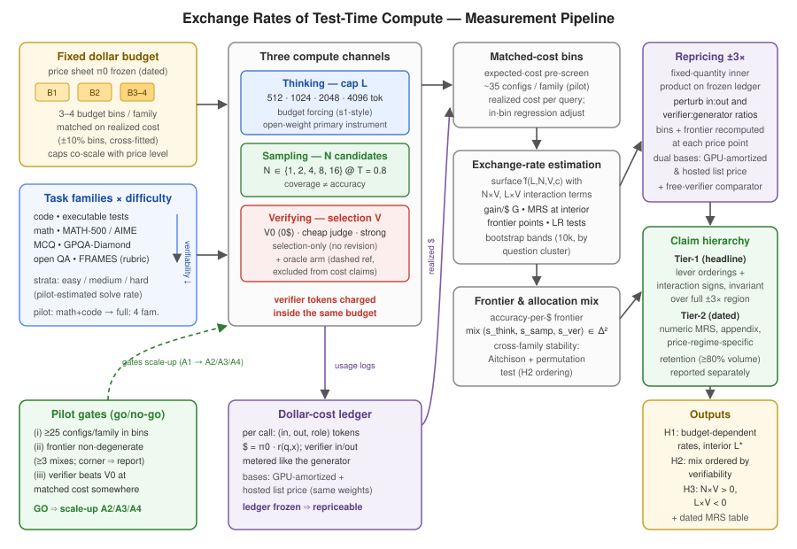

# 测试时计算的兑换率：固定美元预算下的思考、采样与验证

*修订稿（v2，2026-08-14）。取代自动讨论生成的初稿 "Dollar-Matched Substitution Rates for Joint Reasoning, Sampling, and Costed Verification"，并按 `discussion.md` 中预注册的设计重新收敛范围。本稿为预结果注册报告（pre-results registered report）：所有实验章节陈述已冻结的设计，数据按里程碑计划（§6.5）落地。*

## 摘要

部署中的语言模型系统通过三个杠杆用测试时计算（test-time compute）购买可靠性：加长思维链推理（"思考"，thinking）、抽取更多候选样本（"采样"，sampling），以及付费调用评判器在候选中做选择（"验证"，verifying）。厂商如今已发布单杠杆的准确率-成本曲线——推理强度档位（reasoning-effort tiers）与多智能体采样扩展——而近期研究也在两杠杆预算内权衡思考与验证、或采样与改道。然而，尚无研究估计三方替代结构；且几乎所有已有工作把验证器视为免费，尽管验证器的 token 消耗的正是它要优化的那份预算。我们在单一固定美元预算下测量思考、采样与基于验证器的选择三者之间的兑换率（exchange rates），并把验证器自身的 token 计入同一预算。在 (L, N, V) 网格上的配置——思考 token 上限、样本数、付费验证器档位，外加一个零成本的神谕选择（oracle selection）参照臂——在匹配实际成本的分箱（±10%）内进行比较，覆盖按可验证性排序的四个任务族：代码、竞赛数学、研究生水平选择题与开放式问答。我们从带有显式 N×V 与 L×V 交互项的拟合准确率曲面中估计每美元边际准确率、成对替代率，以及带配置构成的准确率-每美元有效前沿。由于"一美元"是价目表的产物，我们采用两层声明层级：Tier-1 头条结论（杠杆排序与交互符号）必须在冻结 token 台账的定量重定价（fixed-quantity repricing）下、于 ±3× 价格比扰动区域内保持不变；Tier-2 数值替代率则作为注明日期、依赖价格制度的估计发布。设计预注册了三个假设：兑换率随预算水平变化且思考存在内部最优；前沿构成随任务可验证性有序变化；交互非可加（N×V 互补，L×V 替代）。其结果是对任何单杠杆成本曲线都无法回答的部署问题——下一个边际美元该买哪个杠杆——的首个测量答案。

## 1 引言

测试时计算已成为短期内提升语言模型可靠性的主要手段，且其成本结构已经公开化：厂商评测越来越多地按*单个*杠杆报告准确率对推理成本的曲线。当前厂商文档给出了跨推理强度档位的分数-成本曲线，以及并行多智能体配置（扩展采样尝试数量）的曲线 [OpenAI-GPT5.6-2026]。研究文献同样呈单杠杆结构：预算强制（budget forcing）控制思考长度 [Muennighoff 等, 2501.19393; Aggarwal & Welleck, 2503.04697]，重复采样扩展覆盖率 [Brown 等, 2407.21787; Wang 等, 2203.11171]，验证器引导的选择把覆盖率转化为准确率 [Lightman 等, 2305.20050; Zhang 等, 2408.15240]。

然而，单杠杆成本曲线无法回答分配问题。边际美元该买更长的推理轨迹、再来一个候选、还是更强的评判器，取决于任何单杠杆图表都不测量的量：杠杆之间的*交互*。在 N=1 时验证器一文不值；更长的候选评判起来更贵；没有选择机制的额外采样买到的是覆盖率而非准确率。近期的两杠杆研究证实这些耦合确实起作用——思考与验证互相权衡 [Think-Again-or-Longer, 2606.19808]，生成与生成式验证互相权衡 [Singhi 等, 2504.01005]，采样与改道在单位成本边际价值规则下互相权衡 [Resample-or-Reroute, 2607.08665]——但每项研究都固定了第三个杠杆，且几乎全部以 token 或 FLOPs 计价预算、不给验证器自身的消耗计费。把验证当作免费在部署意义上尤其误导：验证器 token 从同一预算中扣款，一个不计价的评判器可以在账单上抹掉它在基准上挣得的准确率。

**本文直接测量三方兑换率。**在固定美元预算与冻结的注明日期价目表（price sheet）下，我们对思考 token 上限 L、样本数 N 与付费验证器档位 V 做网格扫描——把验证器的输入与输出 token 计入同一预算——并只在匹配实际成本的分箱内比较配置。按可验证性排序的四个任务族（带可执行测试的代码、竞赛数学、研究生选择题、开放式问答）让我们检验：当正确性越来越难检查时，有效前沿的构成是否随之移动。预注册三个假设：**H1** 兑换率随预算水平变化，思考长度存在内部最优；**H2** 前沿构成因任务族而异并按可验证性有序（代码最重验证，开放问答最轻）；**H3** 交互非可加，N×V 为正（互补），L×V 为负（替代）。

以美元计价的结果会立刻招致一个反驳：一美元只是某张价目表的意见。我们把这个反驳变成设计约束。每次运行都记录为可在不重跑推理的前提下重新定价的 token 级台账（ledger），并把结论分为两层。**Tier-1** 结论——按每美元边际准确率的杠杆排序与交互符号，按（任务族，预算箱）报告——必须在输入:输出与验证器:生成器价格比围绕冻结价目表 ±3× 扰动时保持不变，且须同时在 GPU 小时摊销价与同一开放权重模型的托管商列表价（hosted list price）两种价格基准下成立。**Tier-2** 结论——数值替代率——作为注明日期的附录表格发布，并明确标注依赖定价制度。全文中"验证"意指*由付费评判器对 N 个候选做事后选择*；带反馈的顺序修订循环不在范围内，列为未来工作。

**贡献。**
1. **三杠杆、验证器计价、以美元计价的测量设计**：在 (L, N, V) 网格上的匹配实际成本分箱，验证器自身 token 计入预算，另设零成本神谕选择臂以区分覆盖率与选择质量。
2. **带稳健性层级的兑换率估计量**：每美元边际准确率、成对替代率、N×V / L×V 交互符号，仅在存在匹配成本支撑处报告；Tier-1 排序/符号须在 ±3× 定量重定价与双价格基准下存活。
3. **前沿配置构成的跨任务族稳定性分析**：在成分单纯形上（Aitchison 距离置换检验）检验"验证占比"是否跟随任务可验证性——包括一个诚实的不对称性：开放式问答没有免费的多数投票代理，这本身就是"哪里验证美元不可避免"的发现。
4. **预注册、有预算、带闸门的实验计划**（试点 go/no-go 三个可证伪闸门；约 1,100–1,550 A100 小时加上限 $2K 的 API 复现），规模保证可执行，所有降规模决定均预先声明。

## 2 相关工作

**计算最优的测试时扩展。** Snell 等 [2408.03314] 在匹配 FLOPs 下按题目难度在提议器/验证器策略间分配计算；Wu 等 [2408.00724] 权衡模型规模与推理策略；Liu 等 [2502.06703] 把分析扩展到策略模型、过程奖励模型（PRM）与难度；Zhang 等 [2410.22480] 学习采样配置的混合；自适应分配见 [2602.01070]。*边界：*这些工作在 FLOP/token 预算下优化策略选择；验证器成本不是被计价的杠杆，没有美元度量，推理长度也未被联合变动。

**重复采样与聚合。**自一致性（self-consistency）[2203.11171] 及其调用规模分析 [Chen 等, 2403.02419] 刻画多数聚合；Brown 等 [2407.21787] 表明覆盖率随 N 对数线性增长，且大 N 时瓶颈是选择而非覆盖；Zhao 等 [2502.01839] 用自验证扩展采样。*边界：*采样轴的变动固定了推理长度且聚合不计费；覆盖率 ≠ 可交付准确率——把前者转化为后者的付费选择器正是我们要计量的对象。

**验证及其成本。**过程监督 [2305.20050]、生成式验证器 [2408.15240] 与基于验证器扩展的理论 [Setlur 等, 2502.12118] 提升选择质量，但把验证器计算当作准确率控制而非支出。与本文更近的是 2025–2026 年开始为验证计价的一条线：Singhi 等 [2504.01005] 在求解与生成式验证间划分 token 等价计算；选择性验证在预算内权衡思考与检查 [2606.19808]；非对称验证表明在深度搜索中验证器调用可主导准确率-成本前沿 [2510.06135]；验证粒度按计算效率调节 [2606.19354]。*边界：*上述每一项都是**两杠杆**分析（固定 L 变动 N/V，或固定 N 变动 L/V），以 token 计价、限于单一任务族；没有一项估计三方联合曲面、以美元为全部杠杆计价、或检验价格比稳健性。

**长度控制与推理经济学。**预算强制 [s1, 2501.19393]、长度控制强化学习 [L1, 2503.04697]、token 预算估计 [2412.18547] 与过度思考（overthinking）文献 [2412.21187；思考长度的逆缩放, 2507.14417；成本感知评测, 2604.10739] 确立了思考杠杆存在内部最优、成本归一化评测已成主流——但只针对一个杠杆。Cost-of-Pass [Erol 等, 2504.13359] 按每解决一题的美元数为整条管线排名，[2511.23455] 记录推理价格-性能趋势；预算感知决策规则见 [2607.08665; 2607.26828]。*边界：*管线级经济学不把支出分解为可替代的杠杆；单一价目表的分析无法说明哪些结论是定价的伪影。

**为什么这个交叉积不是增量工作。**上述工作的并集给出三条单轴成本曲线、若干两杠杆 token 预算研究和一个管线级美元指标。替代率是*联合*量：它们存在于任何单轴或固定第三杠杆的研究在原则上都无法估计的交互项（N×V, L×V）之中，且当验证器计入预算时，其美元计价本身就会改变。这些交互的测得符号模式、其对预算水平的依赖、以及跨任务族与跨价目表的稳定性，是新信息而非既有曲线的汇总。厂商发布的单杠杆成本图 [OpenAI-GPT5.6-2026] 使这一空缺具有操作意义：运营者已经能看到每个杠杆自己的曲线，却仍算不出杠杆之间的兑换率。

## 3 问题定义

设 T = {code, math, MCQ, openQA} 为按直接可验证性递减排序的任务族，各有实例分布 D_t 与本族结果度量 Y_t（代码为选择后 pass@1；数学与选择题为精确匹配准确率；开放问答为量规评分），各族在本族单位下分别分析。

一个配置为 q = (L, N, V)：思考 token 上限 L ∈ {512, 1024, 2048, 4096}（预算强制），样本数 N ∈ {1, 2, 4, 8, 16}（温度 T=0.8），选择程序 V ∈ {V0, V_cheap, V_strong}：V0 为零验证美元的聚合（在存在答案等价关系处为多数投票；开放问答为首个样本——见 §4.4）、廉价小模型评判器、强评判器。验证器仅在 N 个候选上做*选择*（不修订、不再生成）。每个网格点均运行零成本神谕选择器 V_orc 作为上界参照，并从所有成本比较与估计量中排除。

每次运行产生 token 台账 r(q, x)（生成器输入/输出 token；验证器读取候选的输入 token 与产出评判的输出 token）。给定注明日期的价格向量 π，实际成本为 C_π(q, x) = π · r(q, x)：验证器由此被计入同一预算。对箱心 b，匹配成本集为 Q_b = { q : |C̄_π(q) − b| / b ≤ 0.10 }（按期望实际成本），任何被报告的对比都要求其全部配置位于同一箱。

准确率曲面 μ_t(L, N, V) = E_x[ Y_t(q, x) ] 按族用带显式 N×V 与 L×V 交互项的单调样条/GAM 拟合。估计量：

- **每美元边际收益**（对可行的单步杠杆移动 δ_a，a ∈ {L, N, V}）：
  G_t,a(q) = [ μ_t(q ⊕ δ_a) − μ_t(q) ] / [ C̄_π(q ⊕ δ_a) − C̄_π(q) ]，
  分母是该移动真实的跨箱成本增量（绝不使用箱内微小的残余错配）。
- **兑换率（边际替代率，MRS）**：MRS_t,a→b(q) = G_t,a(q) / G_t,b(q)，仅在拥有 ≥3 个相邻网格单元的前沿内部点报告；边缘单元只给定性的支配性陈述。
- **交互符号**：匹配成本下的双重差分 I_t,ab(q) = μ_t(q ⊕ δ_a ⊕ δ_b) − μ_t(q ⊕ δ_a) − μ_t(q ⊕ δ_b) + μ_t(q)，用曲面交互项的似然比检验。
- **前沿与构成**：每（族，箱）的非支配 (成本, 准确率) 集及其分配构成 (s_think, s_sample, s_verify) ∈ Δ²——按杠杆角色划分的实际支出份额，是单纯形上的无量纲点，可用 Aitchison 距离做度量不变的跨族比较。

**声明层级。**设 P(π0) = { π : 1/3 ≤ (π_j/π_k)/(π0_j/π0_k) ≤ 3 } 为围绕冻结价目表 π0 的扰动区域。**Tier-1（头条）**：按 G 的杠杆排序与交互符号（按族、按箱）——仅当对每个 π ∈ P(π0) 均不变、*且*在 GPU 摊销价与托管列表价两种基准下同时成立时才报告。**Tier-2（注明日期）**：π0 下的数值 MRS，发布于标注"依赖定价制度"的注明日期附录。未通过全域不变、但在 ≥80% 对数价格体积上成立的结论单独作为*保持型（retention）*结论报告，绝不进入头条。

**假设。** H1：G 排序随预算箱改变，且 G_t,L 在内部 L* 处过零（过度思考）。H2：有效集上的 s_verify 按 code > math > MCQ > openQA 有序。H3：I_t,NV > 0 且 I_t,LV < 0。

## 4 方法

*图1：兑换率测量流水线总览。预算分箱与三个计算通道（思考 L、采样 N、验证 V）进入匹配成本估计，验证器自身成本在预算之内；对冻结台账的 ±3× 重定价把 Tier-1 头条结论与注明日期的 Tier-2 数值分开；试点闸门控制规模扩张。*

### 4.1 美元成本核算（M1）

每次调用记录（输入 token、输出 token、角色 ∈ {生成器, 验证器}、模型），来自引擎的用量字段；美元由**实验开始时冻结的价目表**（作为注明日期的工件发布）相乘得到。开放权重定价有两个基准：主基准 = GPU 小时摊销价（试点期间实测利用率；公式公开），次基准 = 同一权重的托管商列表价（冻结时核实）。验证器调用同样计量：它读取的候选是输入 token，产出的评判是输出 token。所有结果同时以归一化输出 token 等价单位报告，使分析与任何具体美元数解耦。执行后台账即冻结；所有重定价分析都是定量内积，无需新推理。（v1 稿中的包独占设备秒计量、算力阶梯与串行化重放降级为附录中的核算变体；token 计量的美元才是从业者被实际计费的可部署单位。）

### 4.2 网格、预算与匹配成本分箱（M2, SP4, SP6）

名义网格为 4 × 5 × 3 = 60 个单元加神谕臂，再乘以每族 3–4 个预算水平。由于实际成本是随机的（模型无法被强制恰好输出 L 个 token），匹配预算是一个*经验*性质：试点 token 统计（A0 臂）估计每个单元的期望成本，期望成本预筛只保留匹配成本箱成员（试点每族约 35 个配置），并逐查询记录实际成本、在箱内做回归调整。分箱使用交叉拟合的成本估计，同一批观测绝不既定义又利用同一个箱。网格经济学被当作设计问题：N×V 与 L×V 项的可识别性在扩张*之前*用试点数据做模拟功效检验；L 与 N 保持倍增网格（不加密），因为约束在于交互识别而非曲线光滑度。

### 4.3 曲面拟合与兑换率估计（M5, SP2）

每（族，预算箱）：非支配 (平均实际成本, 准确率) 集；在 log L 上单调平滑、N 作有序因子差分的拟合曲面；在前沿内部点用局部有限差分求 MRS；用最大曲率定位拐点并给出自举分布（按题目聚类的 10,000 次重采样）。任何在样条平滑扰动下不稳的形状描述都从摘要中降级。跨族稳定性：对匹配箱上有效集分配构成做 Aitchison 距离置换检验（10,000 次置换，Holm 校正 α=0.05）。交互符号：对 N×V 与 L×V 项做似然比检验（H3）。

### 4.4 验证器带与评分卫生（SP5）

验证器质量是混杂因素：弱评判器会让验证杠杆显得差。因此我们报告的是*带*而不是点：零美元下限 V0、廉价与强评判器臂、以及每个网格点的神谕上限——神谕把"没有可选的覆盖"与"选择失败"区分开。V0 按族操作化：数学/选择题用精确答案等价；代码用公开测试的通过集等价（无评判成本）；开放问答**没有多数投票臂**——V0 是首个样本，因为聚类自由文本需要评判器，会把验证成本泄漏进"免费"臂。这一不对称性作为发现报告：在验证困难之处，选择没有免费代理。开放问答的评分使用与所有预算内验证器不相交的量规评判器，并做 200 题双人工审计（目标 κ ≥ 0.7）；评分分歧传入开放问答的误差棒。温度是注册的范围条件（T=0.8），在试点最优分配处做 T ∈ {0.6, 1.0} 单点探针以界定敏感性。

### 4.5 价格稳健性分析（SP1）

对每个候选 Tier-1 结论，把冻结台账在 P(π0) 上重定价：在对数网格上扰动输入:输出与验证器:生成器价格比，并在观察到排序或符号变化处加密；每个价格点上重新计算分箱、可比性与前沿隶属。只有在全区域内排序/符号不变、且两个价格基准下都成立时，结论才具头条资格；在 ≥80% 对数价格体积上成立的结论作为保持型结论报告。由于预算上限与总体价格水平同尺度缩放，全部价格的共同缩放在构造上被排除；真正的风险只在相对价格，而这正是扰动所覆盖的。

## 5 实验设计

**任务套件（M3），控制污染并保留难尾：**代码 = HumanEval+ 加截止后 LiveCodeBench 切片，按测试执行评分；数学 = MATH-500 加 AIME 2024/2025 难尾；选择题 = GPQA-Diamond；开放问答 = FRAMES（备选 SimpleQA 子集）。试点：数学 + 代码，各约 300 题；全量阶段：四族，基准允许处 ≥500 题。题目按难度（试点估计的解出率）分层，兑换率按难度层与合并两种口径报告——H1 的内部最优预计随难度移动。

**模型：**试点 = 一个 7–14B 级、思考长度可控的开放权重推理模型（s1 式预算强制；冻结时确定检查点）；全量阶段加一个约 70B 开放权重模型（缩减网格）与一个商业 API 模型（单预算水平上的粗 (N, V) 平面）——API 臂承担列表价的真实性，上限 $2K。思考长度只能在开放权重上精确控制（SP3）；API 臂因此只复现 (N, V) 平面，此局限明文声明。

**实验臂：**

| 臂 | 内容 | 角色 |
|---|---|---|
| A0 校准 | token 统计；价目表冻结；评分审计（200 开放问答题，2 名标注员） | 成本预筛；评分效度 |
| A1 试点网格 | 7–14B 模型 × {数学, 代码} × 约 35 个匹配成本配置 × 300 题 | H1 首次估计；go/no-go |
| A2 全网格 | 四族；≥500 题；3–4 个预算；更密分箱 | H1–H3 头条 |
| A3 规模稳健性 | 约 70B 模型，缩减网格 | Tier-1 排序稳健性 |
| A4 API 复现 | 商业 API，粗 (N, V) 平面，单预算，≤$2K | 美元真实性（最先可砍） |
| A5 基线策略 | 单样本下限；纯长 CoT；纯自一致性；best-of-N+验证器；试点冻结的难度条件分配（Snell 式近似复现）——匹配预算下 | 把前沿与既有策略对齐 |

**研究问题（各自映射到一个决定）：** **RQ1**（H1）：G 排序是否随预算箱改变，G_L 是否在内部 L* 过零？**RQ2**（H2）：有效集的 s_verify 是否按族可验证性有序？**RQ3**（H3）：N×V 与 L×V 的符号是否如注册（LR 检验 α=0.05）？**RQ4**（效度）：台账与引擎用量导出是否在 1% 内对账，开放问答评分是否达 κ ≥ 0.7？**RQ5**（稳健性）：哪些 Tier-1 结论在整个 ±3× 区域与双价格基准下存活；哪些降为保持型；在既有工作的免费验证器核算惯例下（重定价比较臂：验证器价格清零）结论如何移动——精确量化"验证器免费"扭曲了什么？

**计算与费用：** A1 ≈ 1–2×10⁸ token ⇒ 约 100–150 A100 小时（vLLM，1 节点，4–6 天）；A2 ≈ 1–1.5×10⁹ token ⇒ 约 700–1,000 A100 小时（约 1.5 周，单台 8 卡节点）；A3 ≈ 300–400 A100 小时；A4 ≤ $2K API；标注约 15–20 小时。合计约 1,100–1,550 A100 小时 + ≤$2K：整月一台专用节点，须于 8 月 15 日前预订（列名阻塞项）。

**试点 go/no-go（8 月 27 日）：**GO 当且仅当 (i) 匹配成本箱充实（每族 ≥25 个配置落于 ±10% 内）；(ii) 试点前沿非退化（有效集上 ≥3 个不同分配构成）——若某杠杆在所有预算下处处支配，则角点解本身可发表（"兑换率问题存在角点解"），前提是神谕臂显示选择仍有余量；(iii) 验证器臂在匹配成本下的某处胜过 V0（否则换一次验证器并重跑 V 切片；再否则降为两臂论文）。NO-GO ⇒ 转 ICML 2027 备选路径，并立即发布试点预印本以确立优先权（ICLR 预印本政策于 CFP 发布时核实）。

**里程碑（对准 ICLR 2027，摘要 9 月 18 日 / 全文 9 月 25 日）：** 8 月 13–17 日：阻塞项（GPU 预订、API 预算）、价格冻结、A0、相邻工作扫描刷新、厂商图表核实（结果决定引言用完整版还是降级版——当前稿采用降级版，仅引用公开图表所示内容）；8 月 18–27 日：A1 + 模拟功效检验，go/no-go；8 月 28 日–9 月 10 日：A2（A5 随跑）、A4 提前、A3 视容量；9 月 10–16 日：分析 + 图表 + 成稿；9 月 18 日摘要（措辞对富前沿与角点解两种结果均真实："我们刻画兑换率何时非恒定、何时恒定"）；9 月 25 日全文（A3 可在此周落地；摘要措辞不依赖 A3）。若 A1 未能在 8 月 22 日前启动，放弃 ICLR、改投 ICML 2027，试点立即以预印本发布。

## 6 局限与范围

(1) "验证" = 仅选择；带反馈的修订循环是未来工作。(2) 数值兑换率注明日期：Tier-2 数字在构造上就是 2026 年 8 月定价制度的产物，这正是头条被限定为重定价不变的排序与符号的原因。(3) 思考长度只能在开放权重上精确控制；API 复现只覆盖 (N, V) 平面。(4) 温度是范围条件（T=0.8），仅设两点探针，不作为轴。(5) 开放问答族没有免费聚合臂；其兑换率以付费选择为条件，我们论证这正是与部署相关的情形。(6) 带审计声明抽取的长文事实性——v1 稿的第四族——被推迟：其测量误差模型本身就是一篇论文，与兑换率估计量耦合会让评分器偏差伪装成杠杆效应。

## 7 结论

单杠杆成本曲线——如今厂商自己也在发布——无法告诉运营者下一个边际美元买什么，因为替代关系存在于思考、采样与验证之间的交互之中，且评判器自己的 token 正是从被优化的预算中扣款。本工作预注册并执行首个三方、验证器计价、以美元计价的测试时计算兑换率测量，其声明层级经得起对任何美元计价结果的必然反驳：头条排序与交互符号必须对 ±3× 价格比扰动、以及对 GPU 摊销价与托管列表价的选择保持不变。无论结果是随预算变化、构成因族而异的前沿（H1–H3），还是一个角点解，其产出都以测得的兑换率取代口口相传的分配经验——并在单杠杆图表固化为它们无力支撑的分配建议之前，确立三方框架。

## 参考文献

- Aggarwal, P., Welleck, S. L1: Controlling How Long a Reasoning Model Thinks with RL. arXiv:2503.04697.
- Brown, B., et al. Large Language Monkeys: Scaling Inference Compute with Repeated Sampling. arXiv:2407.21787.
- Chen, L., et al. Are More LLM Calls All You Need? arXiv:2403.02419.
- Chen, X., et al. Do NOT Think That Much for 2+3=? arXiv:2412.21187.
- Erol, M. H., et al. Cost-of-Pass: An Economic Framework for Evaluating Language Models. arXiv:2504.13359.
- Han, T., et al. Token-Budget-Aware LLM Reasoning. arXiv:2412.18547.
- Lightman, H., et al. Let's Verify Step by Step. arXiv:2305.20050.
- Liu, R., et al. Can 1B LLM Surpass 405B LLM? Rethinking Compute-Optimal Test-Time Scaling. arXiv:2502.06703.
- Muennighoff, N., et al. s1: Simple Test-Time Scaling. arXiv:2501.19393.
- OpenAI. GPT-5.6 发布材料：跨推理强度档位与多智能体（"ultra"）配置的分数-成本/延迟图。openai.com/index/gpt-5-6/, 2026.（仅定性引用；具体转述数字在核实前不使用）
- Setlur, A., et al. Scaling Test-Time Compute Without Verification or RL is Suboptimal. arXiv:2502.12118.
- Singhi, N., et al. When To Solve, When To Verify. arXiv:2504.01005.
- Snell, C., et al. Scaling LLM Test-Time Compute Optimally Can Be More Effective than Scaling Model Parameters. arXiv:2408.03314.
- Wang, X., et al. Self-Consistency Improves Chain of Thought Reasoning in Language Models. arXiv:2203.11171.
- Wu, Y., et al. Inference Scaling Laws: An Empirical Analysis of Compute-Optimal Inference. arXiv:2408.00724.
- Zhang, K., et al. Scaling LLM Inference with Optimized Sample Compute Allocation. arXiv:2410.22480.
- Zhang, L., et al. Generative Verifiers: Reward Modeling as Next-Token Prediction. arXiv:2408.15240.
- Zhao, E., et al. Sample, Scrutinize and Scale. arXiv:2502.01839.
- Think Again or Think Longer? Selective Verification for Budget-Aware Reasoning. arXiv:2606.19808.
- Resample or Reroute? Budget-Aware Test-Time Decision Making. arXiv:2607.08665.
- Pushing Test-Time Scaling Limits of Deep Search with Asymmetric Verification. arXiv:2510.06135.
- Granularity-Regulated Adaptive Computational Efficiency for Optimal Verification in Test-Time Scaling. arXiv:2606.19354.
- The Art of Scaling Test-Time Compute（综述）. arXiv:2512.02008.
- What If We Allocate Test-Time Compute Adaptively? arXiv:2602.01070.
- 思考长度逆缩放 arXiv:2507.14417；成本感知评测 arXiv:2604.10739。（定稿前核实确切标题）
