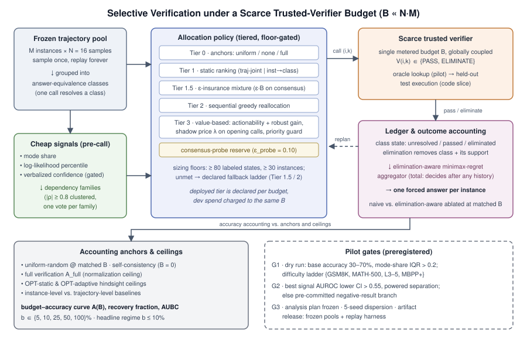

# 哪些轨迹值得校验？稀缺可信校验器预算下的候选选择性检查

## 摘要

测试时扩展（test-time scaling）为每个任务实例采样大量候选轨迹，而在候选之间进行可靠选择日益依赖可信校验（trusted verification）——可执行测试、真值判分器或强判官模型——其单次调用成本决定了只能检查一小部分候选。现有工作计量的是这条流水线错误的一侧：生成端预算分配、校验器不完美性理论、逐项升级（per-item escalation）都假设校验要么免费、要么有噪但全量、要么按任务计费而非全局共享。我们形式化其互补问题：给定 M 个实例、每个实例 N 条已采样轨迹构成的冻结池（frozen pool），轨迹按答案等价类（answer-equivalence class）分组，并给定一个在所有实例间共享的全局预算 B ≪ N·M 次可信校验调用，需要决定校验哪些答案类，以及如何把已校验结果（包括失败检查产生的排除证据）与未校验的廉价信号组合成每个实例一个强制输出的最终答案。我们的贡献：(i) 一项先于策略设计的诊断——免校验信号（众数份额 mode share、序列对数似然、口头置信度 verbalized confidence）究竟能否为预算导向，测量各信号的判别力以及"自信却错误的共识"质量占比，后者是任何按信号排序的静态策略的恢复上界；(ii) 一个分层的分配策略族（tiered policy family），从两种粒度的静态信号排序、ε-保险混合（ε-insurance）、序贯贪心再分配，直到带跨实例影子定价（shadow pricing）与共识探针预留（consensus-probe reserve）的价值型策略——每一层仅在其预登记数据下限满足时部署；(iii) 一条排除感知（elimination-aware）、依赖封顶（dependency-capped）的聚合规则，在部分证据下保持全定义；(iv) 事后最优静态与自适应上界（OPT-static / OPT-adaptive），分解可达空间。评估在完全相同的冻结池上重放所有策略（两个数学数据集 × 两个开源 7–8B 模型，N = 16，约 6.4 万条生成，另有可裁剪的代码执行切片），预算比例扫描 5–100%，以均匀分配与全量校验为锚点，附带预登记闸门与预先承诺的负结果分支。全部数据池、信号、标签与重放框架随文发布。

## 1. 引言

现代推理与代码生成流水线通过采样多个候选解并从中选择来提高准确率。当由可信校验器——单元测试执行、真值判分器、或其裁决被接受的强判官——直接检查候选时，选择最为可靠。但校验正在成为被计量的资源：沙箱执行、对全部 N 个候选的过程奖励打分、判官复审都是随 N 线性增长的成本，且判官往往是比生成器更大的模型。手握沙箱配额的部署者面临一个文献尚未回答的问题：*在一批 M 个实例上已经采样的 N·M 条轨迹中，哪 B ≪ N·M 条值得花掉校验调用？*

已有工作为相邻的资源做预算。生成端分配决定每个输入采多少样、花多少算力（Snell et al., 2024; Damani et al., 2024; Aggarwal et al., 2023）。校验器不完美性理论分析对*每个*候选都打分的有噪校验器——变量是信任而非稀缺。逐项升级与级联框架，包括 Anytime Verified Agents（TMLR 2026），在单个任务内、按任务预算分配校验，不存在跨实例耦合。代价敏感搜索如 Adaptive Generate-Rank-Verify（Dughmi et al., 2026）在"廉价分数与正确性单调相关"的假设下最小化单提示内找到首个通过校验候选的成本。与我们最接近的是 Zhang 等的预算化实例级校验的异方差信号分析（heteroskedastic signals, arXiv:2606.15841, 2026）——这是一个警示性结论：信号质量的异质性从结构上限制了按不确定性排序的检查相对简单基线的收益。上述工作均未覆盖定义我们设定的组合：在*同一批实例的相互竞争轨迹*上的*全局耦合*预算，其中一次调用解决一个答案等价类，失败调用产生聚合必须利用的排除证据，且即使预算耗尽而无任何通过，也必须为每个实例强制给出最终答案。

核心的经验张力开宗明义而非被假设掉：价值最高的调用恰恰位于廉价信号显示"确信"之处——全部 N 个样本一致同意某个错误答案的共识错误实例，对不确定性排序不可见，对多数投票致命。免校验信号能否在这种对抗性结构的代理误差下为稀缺预算导向，先验不可知；这正是我们的预算–准确率曲线要裁决的问题，并附带预登记的证伪条件：若"廉价信号无法胜过均匀分配"，该结论本身即为报告的发现。

**贡献。**
1. **问题形式化。** 冻结轨迹池上的选择性校验：答案类级调用、全局耦合预算、排除感知的强制聚合，以及以均匀分配与全量校验为锚点归一化的预算–准确率曲线评估，并给出事后最优静态与自适应上界。
2. **先诊断、后设计。** 各信号相对校验标签的判别力（AUROC 及置信区间），以及决定性的"已校验为错但高共识"类的质量占比表——它是所有按信号排序的静态策略的上界。
3. **一个分层、按下限闸门部署的策略族。** 轨迹全局与"实例→答案类"两种粒度的静态排序；改编自生成端预算文献的按难度条件化与阈值升级基线；为高共识实例预留预算的 ε-保险混合；序贯贪心再分配；顶层是带依赖封顶行动度（actionability）、跨实例影子定价与"面向错误"共识探针预留的价值型分配器——仅在预登记标注数据下限满足时部署，否则按声明的回退阶梯执行。
4. **排除感知的全定义聚合。** 依赖封顶的极小极大支持遗憾（minimax support regret）规则：在*任意*校验历史后都能输出答案，通过的类享有词典序优先，被否证的类连同其廉价支持一并移除，并对删除任一单个信号族保持稳健。
5. **发布的资源。** 冻结池（答案、信号、标签、成本）与分配重放框架，使策略研究无需重新生成。

## 2. 相关工作

**采样与测试时扩展（资源不同）。** 自一致性（self-consistency）不经校验选择最频繁的采样答案（Wang et al., ICLR 2023），同时提供我们的零预算锚点与最廉价信号。重复采样研究刻画校验充足或近似时覆盖率的扩展规律（Brown et al., 2024; Zhao et al., 2025）。计算最优测试时扩展（Snell et al., 2024）与自适应采样（Aggarwal et al., 2023）分配的是*生成*；Damani et al.（2024）按预测边际收益分配算力。均不对已采样池的校验进行计量。

**习得与生成式校验（信任模型不同）。** 结果监督与过程监督校验器对候选排序（Cobbe et al., 2021; Lightman et al., 2023）；CodeT 生成测试用例为代码候选打分（Chen et al., 2022）。这些工作构造校验信号；我们分配的是裁决已被信任的校验器的调用。校验器不完美性理论把信任作为变量、调用次数作为结果；我们的设定是其对偶——完美裁决、硬调用上限——校验噪声扫描是两个体制间的设计桥梁。

**预算化与选择性校验（最近邻）。** 三项 2026 年工作占据相邻格点并锐化我们的增量。(a) 预算化 LLM 校验的异方差信号分析（arXiv:2606.15841）按置信度信号在实例间分配固定检查预算，并证明信号质量异质性限制可得收益；它工作在实例粒度、每实例一次检查，无答案类、无排除证据、无序贯再分配——其负结论正是我们"诊断先行 + 负结果分支"设计存在的理由。(b) Anytime Verified Agents（TMLR 2026）将不确定性估计与选择性校验级联结合，但采用*按任务*预算：没有全局耦合，因此"难实例的第二个类 vs. 下一个实例的首次检查"——我们的核心权衡——不会出现。(c) Adaptive Generate-Rank-Verify（Dughmi et al., arXiv:2605.17609）是单提示内代价敏感的首个通过搜索，依赖分数–正确性单调假设；我们的诊断恰恰测量违反该单调性的共识错误质量占比，且我们的聚合必须在无任何通过时也做出决定。Best-of-Evidence（Zhang et al., arXiv:2607.20950，视觉-语言领域）通过候选–因子图在*单个*候选池内分配部分证据查询；我们的预算在实例*之间*耦合决策。通用轨迹校验框架（LLM-as-a-Verifier, arXiv:2607.05391）提供校验器，但不配给它。

**形式化先祖（对象不同）。** 主动测试（active testing）与标签高效评估按信息量分配稀缺真值标签（Kossen et al., 2021）；固定预算最优臂识别（best-arm identification）为识别单个最优臂分配拉取。我们的增量在部署对象：一次调用解决结构化池内的一个答案等价类；收益是聚合后的批准确率；排除效应与跨实例耦合在独立同分布主动测试中没有对应物。FrugalGPT（Chen et al., 2023）按价格在模型间路由；Trust-or-Escalate 式逐项升级忽略预算耦合，作为基线纳入。

**主题族内边界。** 对抗性姊妹课题（B1.5）允许生成器针对检查器优化；我们保持生成器非策略性，且我们的前沿是加入对手后任何分配策略的上界——非对抗情形必须先解决。停止规则计量*思考*（生成预算）；我们计量生成之后的*检查*，两者在流水线中组合但不共享机制。系统级服务经济学（serving economics，每解决任务美元成本）同样不在范围内：我们的估计对象是轨迹选择——预算下校验哪些类、精确率/召回率如何——而非基础设施吞吐。

**隐藏孪生预案（预先承诺）。** 若投稿前出现关于轨迹池耦合预算选择性校验的直接先行工作，我们将在首篇论文不太可能同时具备的三个组件上重新定位——作为测量轴的排除感知聚合、对照事后上界的序贯再分配、数学↔代码迁移——并将其作为锚点引用，而非在优先权上竞争。[VERIFY：投稿前两周重跑近邻检索；写作时对照一手来源核对上述所有引文年份与编号。]

## 3. 问题定义

设 𝕀 = {1,…,M} 为冻结实例集。实例 i 有 N 条采样轨迹，划分为答案等价类 𝒞ᵢ = {c_{i1},…,c_{iK_i}}，K_i ≤ N（数学任务用精确匹配分类；代码任务用冻结探针输入的输出等价分类，探针套件在任何校验之前固定）。类 c_{ik} 的廉价证据 x_{ik} 包括其众数份额 m_{ik} = (1/N)·Σⱼ 1[τ_{ij} ∈ c_{ik}]、其成员轨迹的序列对数似然实例内百分位与口头置信度；所有信号在任何校验调用之前计算并冻结。设 y_{ik} ∈ {0,1} 为类 c_{ik} 未知的正确性。

可信校验器实现 V(i,k) = y_{ik}：一次调用解决整个类——阳性识别出正确类；阴性*排除*该类，这是信息而非浪费。序贯策略 π 观察冻结证据 X 与既往调用历史 H_t，选择一个未查询的 (i,k) 或停止，受单一全局约束 |S_π| ≤ B，其中 B ≪ Σᵢ K_i。任何实例都没有独立配额：每次调用都挤占其他所有实例的潜在调用。分配结束后，全定义聚合规则 δ 从混合证据——通过、排除与未校验廉价信号——为每个实例输出一个类，即使无任何调用通过或所有类均被排除。

首要对象是预算–准确率曲线 A(B) = (1/M)·Σᵢ y_{i,δ(i)}，并报告导出量：预算恢复率 (A(B) − A(0)) / (A_full − A(0))，其中 A(0) 为自一致性锚点，A_full = (1/M)·Σᵢ maxₖ y_{ik} 为全量校验上界；预算曲线下面积（AUBC）；以及作为次要比率的每调用准确率（原始比率非单调且在 B = 0 处无定义，故永不作为首要指标）。两个事后上界约束所有策略：OPT-static——事后最优的大小为 B 的固定查询集；OPT-adaptive——事后最优的序贯支出；两者之差本身度量自适应性的价值。预算按每个数据集–模型对扫描 b = B/(N·M) ∈ {5, 10, 25, 50, 100}%，以 b ∈ {5, 10}% 为首要稀缺体制。

**难点。** 代理信号的误差结构性地对抗策略：高众数份额、高似然或高置信不必然意味着正确，而校验本可拯救的共识错误实例，恰是信号标注"确定——跳过我"的地方。调用价值依赖历史（通过解决一个实例；排除重塑幸存候选集），因此分配无法按实例分解，聚合也不能退化为选取得分最高的未校验类。

## 4. 方法

*图1：稀缺可信校验器预算下的选择性校验：冻结轨迹池分组为答案类，廉价信号被抽取并按依赖族封顶，分层分配策略（由预登记数据下限闸门控制）通过计量校验器花费耦合预算 B，排除感知的全定义聚合器为每个实例强制输出一个答案；均匀分配、全量校验与事后最优上界锚定预算–准确率核算，试点闸门守护每个阶段。*

### 4.1 信号抽取与依赖族

每个实例形成三个类级分数——众数份额、对数似然实例内百分位均值、口头置信度百分位均值——各自在该实例的类间做秩归一化，另有导出的实例级特征（答案类熵、前二投票差、类数）。在开发划分上，对实例–类观测的绝对 Spearman 相关做阈值 0.8 的全连接聚类，得到**依赖族（dependency families）**并在评估前冻结。一个族只投一票——其成员秩归一化投票的均值——因此复制一个相关信号无法制造佐证。口头置信度是唯一需要额外生成的信号（每条轨迹一次简短引出）；仅当其试运行 AUROC 置信下界超过 0.55 才保留到试点之后。

**诊断交付物（实验 1，闸控一切下游）：** 各信号相对校验标注类正确性的 AUROC（DeLong 区间），以及**共识错误质量占比表**——在各众数份额阈值之上、其众数类被校验为错误的实例比例。该质量占比是所有按信号排序的静态策略恢复率的上界，并决定 ε-保险与共识探针机制是承重的还是闲置的。

### 4.2 分层分配策略族

策略按所需数据排序；每层仅在其预登记要求成立时部署，且部署层被公开声明而非静默选择。

**第 0 层——锚点。** 匹配 B 的均匀随机分配（所有断言的对照）；零校验（自一致性）；全量校验。

**第 1 层——静态信号排序（无标签）。** 两种粒度的最不确定优先：*轨迹全局*（对全部 N·M 个候选排序）与*实例→答案类*（先排实例，再优先校验最大的未解决类——单次调用信息量最大，因为近重复检查被支配）。两个改编基线揭示相邻表述的损失：按难度条件化的实例排序（生成端分配风格，仅实例级）与逐项置信度阈值升级（无预算耦合）。实例级与轨迹级的对比是头条比较之一：轨迹级信号是否在实例难度之外仍有价值？

**第 1.5 层——ε-保险混合。** 将 (1−ε)·B 花在最不确定优先上，ε·B 均匀花在高共识实例上，ε ∈ {0, 0.1, 0.25}。这把共识错误诊断转化为设计：若诊断出的质量占比显著，纯不确定性排序在可证明地浪费恢复空间，最优 ε 将偏离零。

**第 2 层——序贯贪心再分配。** 每次把一个调用花在当前最有价值的目标上，观察结果，通过则标记实例已解决，重排幸存者（被排除的类释放其支持，可能抬升同实例兄弟类或另一实例）。对照两个 OPT 上界打分；OPT-adaptive − OPT-static 之差说明在加入任何学习机制之前，序贯性本身值多少。

**第 3 层——带影子定价的价值型分配（下限闸控）。** 当开发数据充足时，调用按其对最终准确率的期望影响而非原始信号顺序估值。(i) **行动度（actionability）：** 对每个未校验类，在账本上模拟两种校验结果，并在全族视图与每个留一族视图中重跑聚合器；跨视图的翻转比例与平均支持差移位给出依赖封顶的决策敏感度分数——相关族的一致不被计为独立证据。(ii) **价值模型：** 交叉拟合的类正确性模型与排除概率模型*仅*用计入同一预算的校验结果训练（B = B_dev + B_eval，B_dev ≤ 0.4·B，评估始终保留 ≥ 0.6·B），实例级折叠与保守置信下端点；单步稳健增益为每个候选调用打分。(iii) **影子价格：** 每次重规划时，对未服务实例的首次调用必须越过 λ = 边际可负担未服务实例的增益，使跨实例机会成本显式化；优先级守卫仅当没有未服务实例提供更高的价格出清价值密度时才允许对已服务实例重复调用；当没有调用具有正稳健增益时提前停止。(iv) **共识探针预留：** 评估预算的 ε_probe = 0.10 用于探查全族一致、低行动度、高单族支持的类，按次名分歧度与开发导出的校准差先验排序——瞄准的正是价值排序不可见的自信错误共识。

**回退阶梯（预登记，化解规模风险）。** 第 3 层要求 ≥ 80 个标注开发状态、覆盖 ≥ 30 个不同实例。在最小预算下该下限可能失败——在 1.6 万槽位对的 b = 5% 处，规划算术只剩约 100 个状态、约 34 个实例，即零冗余。因此阶梯预先声明：下限满足 → 第 3 层为部署策略；不满足 → 第 1.5/2 层（按行动度排序、深度 1、共识预留保留）*即为该预算下的头条策略*，如实报告——而非降格的脚注——并披露触发下限的预算。论文的断言绑定于部署阶梯，故每个预算都有明确、可评估的头条对象。

### 4.3 排除感知的全定义聚合

每个类处于未解决、已通过或已排除三态之一。若有类通过，通过类构成合格集；否则所有未被排除的类合格——被排除的类*连同其廉价支持*被移除，因此失败调用永久重塑投票。在全族视图与每个非空留一族视图上，类支持为所含族票的均值；被选类最小化最坏视图支持遗憾（平局：全视图支持，再按规范标识符）。规则全定义：在任何历史后都能决定，包括全部被排除的实例（取最后被排除的类，即解决顺序下最弱的否证）与单族情形（单一封顶票）。朴素聚合器（有已验证正确则取之，否则原始多数票）在匹配 B 下对所有策略消融，分离排除证据（丢弃失败消融）与族封顶（独立三票消融）的价值。

### 4.4 校验器现实性与成本核算

试点校验器为真值查表——可信且执行免费——把分配质量与校验器质量隔离；"试点校验器同时是评估真值"的循环性在架构上被约束（信号在调用前冻结；校验结果只触达选择与聚合），并在代码切片中被*打破*：那里的可信校验器是保留单元测试执行，而评估使用完整测试套件。逐调用成本（墙钟、CPU）被测量，使现实校验器可报告每美元准确率；以率 ρ 翻转裁决的噪声扫描向校验器不完美性理论研究的有噪体制架桥。开发支出、引出支出与审计支出始终计入并对照同一总预算报告。

## 5. 实验设计

**冻结池。** 主体（冻结范围）：GSM8K（固定 500 实例子样）与 MATH-500 × Qwen2.5-7B-Instruct 与 Llama-3.1-8B-Instruct，N = 16——约 6.4 万条生成（单卡 A100/H100 + vLLM 约 1–2 天）加闸控的置信度引出；真值校验为查表。可裁剪的附加切片：HumanEval+（164）与 MBPP+（378），以保留测试执行为可信校验器。本文明确不含：N = 64 扩展、超出合成 ρ 扫描的 PRM 噪声扫描、完整数学↔代码迁移矩阵。生成之后的一切都是相同池上的 CPU 重放：采样一次，永久分配。

**试点闸门（预登记）。**
- *G1（第 1 周，50 实例试运行）：* 只保留基础准确率 ∈ [30%, 70%] 且众数份额四分位距 > 0.2 的数据集–模型对；若四对全败，沿预命名难度阶梯 {GSM8K, MATH-500 全集, MATH-500 L3–5, MBPP+} 行走，必要时降至更弱模型档（3B 级）——作为记录在案的设计选择，因为问题表述与模型无关。隐藏孪生文献检索在此运行，并在投稿前两周复跑。
- *G2（池完成时）：* 保留对上最佳信号 AUROC 置信下界 > 0.55，且 b = 25% 处选择性 vs. 均匀的分离检验功效 ≥ 80%。若 G2 在功效充足下失败，论文以反向断言推进——*廉价信号无法比均匀分配更好地为可信校验预算导向*——这一结论与所有升级流水线的工作假设相抵触，并携带相同的工件发布。
- *G3：* 在完整重放网格之前冻结分析计划（检验族、主配置）；主配置 5 个种子 × 完整策略网格，其余 2 个种子。

**研究问题。**
- **RQ1（诊断）。** 各信号相对校验标签的 AUROC 是多少？共识错误质量占比多大？（决定一切下游。）
- **RQ2（恢复）。** 在 b ∈ {5, 10}%，部署阶梯相对匹配总支出的均匀分配恢复全量校验差距的多少？阳性判据：预算恢复率 ≥ 0.5 且相对均匀的差距下界 ≥ 0.10（配对自助法，逐对方向一致）。假设绑定于每个预算的*部署*层——含回退——消除了前稿的回退/假设文本不匹配。
- **RQ3（粒度与耦合）。** "实例→答案类"排序是否胜过轨迹全局排序，且两者均胜过无耦合的逐项阈值基线？
- **RQ4（轨迹信号 vs. 实例信号）。** 匹配 B 下，类感知分配是否胜过按难度条件化的实例排序？
- **RQ5（自适应性）。** 匹配 B 下序贯贪心 vs. 静态；两者对照 OPT-static 与 OPT-adaptive；报告 OPT 差作为自适应性的价值。
- **RQ6（保险与共识探查）。** 当诊断出的共识错误质量占比非平凡时，ε > 0 是否胜过 ε = 0？前提（始终可评估）：受审计预留上探针 ELIMINATE 率 ≥ 0.10（精确二项检验）。靶向差距（条件性）：去相关靶向 vs. 等规模随机探查，实例内配对；当多族/可迁移性前提不成立时按描述性报告——承载盲区断言的是前提，而非差距。
- **RQ7（聚合）。** 匹配调用下排除感知 vs. 朴素；丢弃失败与独立投票消融；无通过条件下与自一致性的比较。
- **RQ8（价值机制，条件于下限）。** 在第 3 层部署之处：其相对第 1.5/2 层回退的差距，加影子价格（λ = 0）与前瞻（深度 1）消融——为学习组件归因，永不替代 RQ2。

**分析。** 每个预算处相对均匀的配对 McNemar 与 1 万次重采样配对自助法，声明族内 Holm–Bonferroni 校正；确证性断言要求逐对方向一致；功效不足的条件分析报告为诊断性，永不作确证。所有重放种子固定并记录。

**工件发布（交付物，非事后补充）。** 冻结池（答案、信号、校验标签、成本）、重放框架与全部策略/聚合器配置随投稿发布；闸门树的每个分支——阳性、阴性或重定位——都发布同一资源。

## 6. 局限

单一模型规模（7–8B，视阶梯结果而定）；真值循环性仅在代码切片中被完全打破；口头置信度可能过不了闸门；共识靶向差距在 4 对池上可能只能描述性评估；事后上界受限于重放（它们约束这些池上的策略，而非总体）。2026 年的实例级极限结论（arXiv:2606.15841）预言信号异质性可能封顶我们的收益；我们的设计将该结果作为可报告的分支而非威胁。

## 7. 结论

选择性校验把测试时扩展重新框定在部署中真正稀缺的资源上：可信裁决。我们提出耦合预算、答案类级的分配问题；先测量廉价信号究竟能否为预算导向；部署从均匀到影子定价价值分配的下限闸控策略阶梯；并通过排除感知的全定义聚合器强制决策——一切都在冻结、公开发布、每个策略皆为重放的池上进行。无论曲线显示什么——恢复，或一次功效充足的拒绝——结论都有约束力：要么小而准的预算捕获全量校验的大部分，要么廉价信号的自信错误结构使均匀检查不可战胜，而已部署的升级流水线应当知道自己身处哪个世界。
