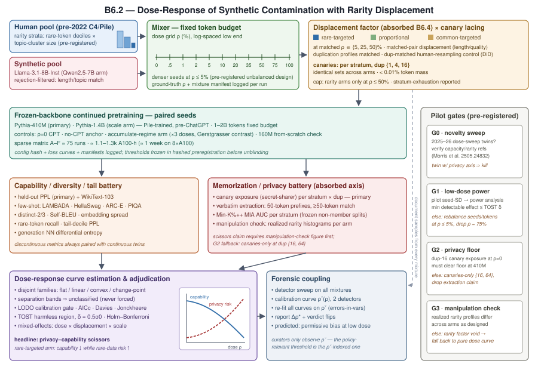

# 隐私-能力剪刀差：合成语料污染的剂量反应与稀有数据置换

## 摘要

网络规模的训练语料正日益混入机器生成文本，但本应指导语料策展者的两条研究线并不相通：模型坍塌（model collapse）研究在极端剂量下改变递归训练的"代数"，而记忆化（memorization）研究只测量"给定语料"的隐私风险。二者都没有回答策展者真正面对的问题——在测得的合成占比 ρ 下，会造成多大伤害、何种伤害、是否存在实践上安全的区间？我们提出一项受控持续预训练（continued pretraining, CPT）研究：把单代训练内的合成占比作为"剂量"（ρ ∈ {0, 0.5, 1, 2, 5, 10, 20, 35, 50, 75, 100}%，低剂量端对数间隔），并且关键地，把"合成文本置换了人类数据的哪个稀有度层"作为第二个设计因子。组织性假说是：污染与记忆化消耗同一预算——在固定记忆容量（约 3.6 比特/参数；Morris et al., 2025）之下，熵贫、截尾的合成文本置换稀有人类数据时，既降低能力与长尾覆盖，又使幸存的稀有样本相对更"稀有"，从而被更强地记忆、更易被提取。由此预测**隐私-能力剪刀差（privacy-capability scissors）**：在固定剂量下，稀有定向置换降低稀有词元召回率，同时抬高残余稀有层数据上的金丝雀暴露度（canary exposure）与成员推断（membership inference, MIA）AUC。设计采用冻结的 ChatGPT 之前的骨干模型（Pythia-410M/1.4B）、来源清洁的 2022 年前人类语料池、配对的置换臂与重复度匹配的重采样对照、受控重复度 {1, 4, 16} 的分层金丝雀，以及预注册的曲线族裁决（平坦/线性/凸性/变点，支撑互斥，含显式"无法分类"结论与低剂量"统计无害区"的等效性检验）。取证耦合分析在检测器估计剂量 ρˆ 上重估全部曲线，报告检测误差如何移动阈值裁决。总预算约 1.1–1.3k A100 小时（约 75 次训练），由预注册的试点闸门把关。交付物是可迁移的测量协议与"伤害形状"裁决，而非某个神奇阈值。

## 1. 引言

2022 年后的网络语料已被可测量地混入大模型生成文本（Liang et al., 2024），而来源过滤的失效快于检测的进步。两条成熟的研究线环绕这一事实却未回答核心问题。模型坍塌线表明：对生成数据的*递归*训练会丢失分布尾部（Shumailov et al., 2023/Nature 2024），且结论强烈依赖训练机制——当真实与合成数据*累积*而非相互替换时坍塌可被避免（Gerstgrasser et al., 2024）；而可解回归设定中的理论预测：即使很小的合成占比也会改变缩放律，且不存在严格安全剂量（Dohmatob et al., 2024a; 2024b）。记忆化线表明：语言模型按重复度、模型规模与样本稀有度成比例地记忆训练数据（Carlini et al., 2021; 2022），去重可缓解隐私风险（Lee et al., 2021; Kandpal et al., 2022），而激发本文的结果是：模型具有约 3.6 比特/参数的近似固定记忆容量，稀有/非典型数据不成比例地填充它（Morris et al., 2025）。

两条线都没有给出*单代内的剂量反应曲线*：在固定算力、固定词元预算、固定来源下，测得的合成占比 ρ 与下游伤害之间的函数关系。检测工作（如语料级占比估计；Liang et al., 2024）告诉策展者合成文本"有多少"；没有任何工作告诉他们"多少有害"、伤害是单调还是阈值式，以及检测噪声如何扭曲这一裁决。也没有任何工作把污染剂量与混合语料中幸存人类数据的*隐私*耦合起来。

本文的组织性主张是：**污染与记忆化是同一预算的两面**。合成文本相对人类文本熵更低、尾部被截断（Guo et al., 2024; Shi et al., 2025）。混入合成文本 (a) 降低训练信号的有效多样性，损害能力与尾部覆盖；(b) 改变固定记忆预算被什么填充：当合成文本置换*稀有*人类数据时，幸存的稀有样本相对训练分布变得更稀有——按稀有度驱动的记忆机制（Morris et al., 2025; Carlini et al., 2022）——会被*更强地*记忆。因此，即使总体能力在退化，污染仍可能提高残余少数群体数据的逐样本隐私风险。我们把预测的签名称为**隐私-能力剪刀差**：固定剂量下，稀有定向置换降低稀有词元召回率，同时抬高幸存稀有层上的金丝雀暴露度与 MIA AUC。这正是稀有度必须作为混合语料的*设计因子*（合成词元置换哪个层）而非协变量的机制性理由。

我们的贡献：

1. **无混杂的剂量轴。** 在冻结的 ChatGPT 之前骨干与来源清洁的 2022 年前人类语料池上做持续预训练面板，ρ 精确已知、从 0.5% 到 100% 对数间隔、固定词元预算、低剂量端加密复制——使"3% 可容忍吗？"在原则上可回答，ρ = 100% 锚定坍塌文献。
2. **稀有度置换作为处理，重复度作为受控变量。** 在匹配 ρ 下的稀有定向 vs 常见定向 vs 按比例置换，重复度剖面匹配，并配以重复度匹配的人类重采样对照，使置换效应与重复效应可分别识别（直接呼应 Lee et al., 2021; Kandpal et al., 2022）。
3. **双结局电池与预注册的形状裁决。** 能力/多样性/尾部指标与隐私电池（受控重复度 {1, 4, 16} 的分层金丝雀、逐字提取、校准的成员推断）共同输入四族曲线裁决——平坦/线性/凸性/变点，支撑互斥——含显式"无法分类"结论与等效性（TOST/ROPE）判据，使"统计无害"的低剂量区是可能的*发现*而非假设。
4. **取证耦合。** 全部曲线在检测器估计剂量 ρˆ 上重估（两个黑盒检测器的校准曲线 ρˆ(ρ)），报告阈值移动 Δρ* 与裁决翻转；预测方向：检测噪声使政策偏向宽松。

主张的范围是诚实的：估计对象是"≤1.4B 规模、固定预算、冻结骨干持续预训练下的剂量反应"，规模迁移只以趋势测量（两个骨干 + 160M 从头训练机制检查，并借鉴 ICLR 2026 小代理运行有效性结果），不宣称已解决。交付物是协议、曲线族与检测器偏差方向——不是某一个数字。

## 2. 相关工作

**模型坍塌与递归训练。** Shumailov et al. (2023; Nature 2024) 确立了代际重训下的尾部丢失；Alemohammad et al. (2024) 给出自消费图像循环的质量/多样性衰减；Seddik et al. (2024) 给出统计刻画；Bertrand et al. (2024) 给出迭代重训的稳定性条件；Borji (2024) 给出统计学解读。Gerstgrasser et al. (2024) 表明数据累积（accumulate）而非替换（replace）时坍塌可避免，Kazdan et al. (2024) 刻画了中间机制。Dohmatob et al. (2024a; 2024b) 为我们的问题提供了最锋利的不利先验：在可解设定中，小的合成占比也会改变缩放律，坍塌可以是"强"的——即理论预测*不存在安全阈值*。Shi et al. (2025) 把坍塌重述为由数据熵下降驱动的"泛化→记忆化"转变。以上工作改变的都是代数或机制；没有人在语言模型规模上扫描受控的单代内占比网格并统计裁决"平坦 vs 单调 vs 阈值"。我们并且*把累积-替换之争设计进实验*而非争论它：等合成词元量的匹配累积臂把 Gerstgrasser 对比放到我们的剂量轴上。

**数据混合与作为资产的合成数据。** DoReMi (Xie et al., 2023) 表明混合比例在人类域轴上因果地影响质量；数据混合律工作拟合人类混合的比例-损失函数；合成持续预训练（Yang et al., 2024）是我们"伤害框架"轴的收益框架反面，并提供 CPT 协议模板；Chen et al. (2024) 与 Havrilla et al. (2024) 研究合成数据多样性/质量效应。它们都未把合成占比当作带阈值问题的伤害剂量，也未触及隐私。

**记忆化、重复与隐私。** Carlini et al. (2019; 2021; 2022) 确立了金丝雀暴露度、训练数据提取，以及记忆化随重复度、模型规模与上下文的缩放。Zhang et al. (2023) 定义了反事实记忆化。Lee et al. (2021) 与 Kandpal et al. (2022) 表明去重降低记忆化与隐私风险——这正是本设计显式控制重复度的原因，否则稀有度置换效应可能只是伪装的重复效应。LLM 预训练数据上的成员推断困难且对校准敏感（Duan et al., 2024）；我们采用 Min-K%/Min-K%++ 式校准分数（Shi et al., 2023），对冻结的分层非成员集合评估。Morris et al. (2025) 测得约 3.6 比特/参数的固定容量且稀有数据不成比例地被记忆——这是剪刀差预测的定量引擎；若容量数字变化，动机可优雅降级，因为稀有度-记忆化方向已被独立确立（Carlini et al., 2022）。没有先前工作把污染作为处理、把*残余人类数据*的记忆化作为结局。

**取证。** 黑盒 AI 文本检测器对文档打分（DandR 式可恢复性；Binoculars 式困惑度对比），Liang et al. (2024) 估计语料级 AI 修改占比；检测止步于*存在性*。我们把它耦合到*伤害*：剂量反应曲线的实际使用者只能观测 ρˆ，因此我们把检测误差传播进阈值裁决。

**一句话定位。** 先前工作改变代数（坍塌）、机制（累积/替换）或域权重（DoReMi）并只读能力；我们改变单代内合成占比 × 被置换层的稀有度，并在残余人类数据上读取能力、多样性与隐私伤害——一个受控设计，两族耦合伤害。

## 3. 问题定义

设第 i 次训练的混合语料为 Tᵢ = Hᵢ ∪ Sᵢ，合成占比 ρᵢ = |Sᵢ|/|Tᵢ|（按词元加权）已知，由冻结骨干 p₀（其原始语料早于 ChatGPT）持续预训练得到。每个人类文档 x ∈ Hᵢ 带有预注册的稀有度层 z(x)——由 (i) 稀有词元密度十分位与 (ii) 主题簇规模指派——以及受控重复数 mᵢ(x)。置换条件 dᵢ ∈ {rare, common, proportional} 规定在匹配 ρ 下合成词元置换哪些层；各条件的重复度剖面匹配。

每次训练的结局：能力 Cᵢ、多样性/尾部 Vᵢ、分层隐私风险 Rᵢ(·)（金丝雀暴露度、提取率、MIA AUC）。相对于匹配重复度配置 u 的 ρ=0 CPT 对照，目标曲线为

f_C(ρ, d, u) = 𝔼[C₀,ᵤ − Cᵢ | ρᵢ = ρ, dᵢ = d, uᵢ = u]，f_V 同理；

f_P(ρ, d, u; s) = 𝔼[Rᵢ(s) | ρᵢ = ρ, dᵢ = d, uᵢ = u]（对层 s），

重复度只通过设计对比进入。每条曲线在*互斥*支撑上裁决为族 κ ∈ {平坦, 线性, 凸性, 变点}，或在预测校准闸门不通过时判为"无法分类"。置换效应是相对按比例臂的匹配剂量对比：Δ_f^disp(ρ, d, u) = f(ρ, d, u) − f(ρ, proportional, u)。剪刀差假说是固定 ρ 下的合取：Δ^disp_{f_V}(ρ, rare) > 0（尾部覆盖更差）且 Δ^disp_{f_P}(ρ, rare; rare) > 0（幸存稀有数据隐私风险更高），并用重采样对照的双重差分（difference-in-differences, DiD）扣除可归因于重复度的份额。**统计无害区**定义为剂量网格上使全部主要终点在预注册界限 δ = 0.5σ₀（σ₀ 为 ρ=0 的种子标准差）下通过 TOST 等效性检验（相对 ρ = 0）的最大前缀。全部结论限定于 p₀ 下的单代 CPT；实践推断变体以检测器估计 ρˆ ~ q(ρˆ | ρ) 替换 ρ，且必须传播该误差。

## 4. 方法

*图1：剂量反应流水线总览：来源清洁语料池构建与稀有度分层、带置换臂与金丝雀掺入的污染剂量网格、冻结骨干配对种子持续预训练（CPT）、能力/隐私双探针电池、含等效性检验的四族曲线裁决，以及取证剂量估计耦合——由预注册试点闸门 G0–G3 把关。*

### 4.1 语料构建：池、分层、剂量、金丝雀

**语料池。** 人类池 = 固定的 2022 年前 C4/Pile 切片（按日期来源清洁；残余污染在第 6 节定界），按 (i) 底部十分位频率词元密度与 (ii) 主题簇规模（少数域代理）分层，任何训练前预注册。合成池 = Llama-3.1-8B-Instruct 对*不相交*切片的重生成/续写，经拒绝过滤匹配长度/主题边际分布；第二生成器（Qwen2.5-7B-Instruct）用于稳健性臂。

**剂量网格。** ρ ∈ {0, 0.5, 1, 2, 5, 10, 20, 35, 50, 75, 100}%，总词元预算固定；5% 以下对数间隔——因为阈值问题就住在那里；ρ = 100% 锚定坍塌端点。试点子集 {0, 1, 5, 10, 25, 50, 100}%。

**置换因子（吸收 B6.4）。** 在 ρ ∈ {5, 25, 50}% 下，合成词元置换 (a) 稀有层、(b) 常见层、或 (c) 按比例采样的人类文档。配对置换（每个被置换的稀有文档与保留的常见文档在长度/质量代理上配对）使该因子与长度、主题、质量正交；(a)–(c) 的重复度剖面匹配；该因子封顶于 ρ ≤ 50%（超过后残余稀有池退化），并逐格报告实际层耗尽比例。每个置换臂配一个**重复度匹配的人类重采样对照**——用人类填充复现合成臂的重数直方图——通过双重差分把稀有度置换与重复效应分离（Lee et al., 2021; Kandpal et al., 2022）。

**金丝雀掺入。** 分层金丝雀（文体与所在层匹配）按受控重复度 {1, 4, 16} 注入，各臂集合一致，总质量 < 0.01% 词元——因此金丝雀的稀有度相对于*幸存*人类分布定义，而幸存分布正是处理本身。

### 4.2 训练协议

冻结骨干持续预训练：同一起始检查点（Pythia-410M 为主；Pythia-1.4B 规模臂——均为 Pile 训练、早于 ChatGPT），同一超参数，固定预算（试点 1B / 扩展 2B 词元），跨剂量共享的配对种子（试点 2 / 扩展 3），且*在 ρ ≤ 5% 加密复制*（预注册的不平衡设计——在种子噪声地板威胁可识别性之处购买低剂量功效）。对照：ρ=0 CPT 对照（主参照）、无 CPT 冻结骨干（锚定 CPT 漂移）、等合成词元量的**累积机制臂**（三个剂量点，把 Gerstgrasser 对比放上剂量轴）。逐次记录配置哈希、损失曲线与混合清单。

### 4.3 结局电池

**能力/多样性/尾部。** 干净留出困惑度（人类验证切片，预注册主终点）+ WikiText-103；lm-eval-harness 少样本（LAMBADA、HellaSwag、ARC-E、PIQA）；对 5k 条留出人类提示续写计算 distinct-2/3、Self-BLEU、平均成对嵌入距离；稀有词元召回率与尾部十分位困惑度；生成的最近邻微分熵。每个不连续指标都配一个连续对应物；阈值裁决绝不单独依赖不连续指标。

**记忆化/隐私（吸收轴）。** (i) 金丝雀暴露度（secret-sharer 协议；Carlini et al., 2019），按层 × 重复度 × 剂量 × 置换臂——*主要*隐私终点，因为其暴露由构造控制；(ii) 逐字提取：对训练集稀有层文档的 50 词元前缀做贪心 + 采样续写，≥50 词元匹配（常数依 Carlini et al., 2021/2022）；(iii) 校准 MIA：分层 Min-K%++ AUC，对*任何训练前冻结*的分层成员/非成员划分评估，非成员取自同一来源清洁切片（校准注意事项依 Duan et al., 2024）。**操纵检查**——各臂幸存语料的实际稀有度直方图——是任何剪刀差断言之前必须给出的图。

### 4.4 曲线拟合与裁决

逐指标，以 σ₀ 标准化：四个候选族在**互斥支撑**上——平坦（严格常数）；线性（端点位移 ≥ 0.10σ₀）；凸性/单调（样条或二次，弦偏离曲率 ≥ 0.10σ₀）；单折点分段（折点位移 ≥ 0.10σ₀，折点两侧各 ≥ 2 个剂量点）。参数落入分离带 ⇒ **无法分类**，绝不强行贴标签；仅当留一剂量（leave-one-dose-out）校准闸门通过（合并 RMSE ≤ 0.15σ₀；90% 预测区间覆盖 ∈ [0.85, 0.95]）才解释族概率。互补的频率学电池（预注册）：AICc 比较、Davies 变点检验、Jonckheere–Terpstra 单调趋势、以界限 δ = 0.5σ₀ 定义统计无害区的 **TOST 等效性检验**（相对 ρ=0）、跨电池 Holm–Bonferroni 校正；针对因子问题的剂量 × 置换 × 规模混合效应模型。阈值与先验在非零剂量结局揭盲前冻结于带哈希的预注册文件。

### 4.5 取证耦合

两个黑盒检测器（DandR 式可恢复性分数；Binoculars 式困惑度对比分数）扫过每个混合语料的固定文档样本，得到每个检测器的校准曲线 ρˆ(ρ)。4.4 节全部模型在 ρˆ 上重拟合；报告阈值移动 Δρ*、等效区移动与任何族裁决翻转。预测方向（可证伪）：ρˆ 的向均值回归会压平低剂量曲线并使政策偏向宽松。检测误差以变量误差（errors-in-variables）方式在贝叶斯拟合内传播，而非插入式代入。

## 5. 实验设计

**稀疏运行矩阵（约 75 次训练，不是全因子）。**

| 臂 | 设计 | 运行数 |
|---|---|---|
| A：剂量曲线 | 11 剂量 × 按比例 × Pythia-410M × 生成器 1 × 3 种子（试点：7 × 2） | 33 |
| B：置换 | {rare, common} × ρ ∈ {5, 25, 50}% × 3 种子（+ 重采样对照） | 18 |
| C：规模趋势 | Pythia-1.4B × ρ ∈ {0, 5, 25, 50, 100}% × 2 种子 | 10 |
| D：生成器 2 | Qwen2.5-7B × ρ ∈ {5, 25, 50}% × 2 种子 | 6 |
| E：对照 | 无 CPT、累积臂 × 3 剂量、额外 ρ=0 种子 | ≈8 |
| F：机制检查 | 160M 从头训练，3 点子网格 | ≈6 |

**算力。** 410M × 1–2B 词元 ≈ 5–12 A100 小时/次；1.4B ≈ 35 A100 小时/次；训练 ≈ 900 A100 小时；合成生成（vLLM，8B 生成器，1.5–2B 词元）≈ 150–300 A100 小时；评测 + MIA/提取 ≈ 50 GPU 小时。**总计 ≈ 1.1–1.3k A100 小时**——单台 8×A100 节点约 6–7 天墙钟时间，可尴尬并行。这就是审计要求的可行性包络；数千次从头训练的替代方案在设计上即被排除。

**通过/终止闸门（预注册）。**
- **G0（任何训练前）：** 2025–26 单代内剂量扫描论文的新颖性排查；核验容量/稀有度引文集。存在无稀有度/隐私轴的近孪生剂量扫描 ⇒ 收缩到吸收贡献；存在*带*该轴的孪生 ⇒ 课题终止——先查再跑。
- **G1（试点）：** 由 14 次试点运行的种子级标准差做功效分析；最小可检低剂量效应必须 ≤ TOST 界限，否则重新配置预算（在 ρ ≤ 5% 增加种子/词元，删 ρ = 75%）。
- **G2（试点）：** 隐私可测性——ρ = 0 臂中重复度 16 的金丝雀暴露度必须在 410M 上越过检测地板；否则隐私轴按预声明优雅降级为仅金丝雀（重复度 {16, 64}），并放弃自然文档提取断言。
- **G3：** 置换操纵检查——各臂实际稀有度剖面必须如设计般不同；否则稀有度因子无效，论文回落到纯剂量反应核心（仍是种子课题的最小实验，仍可发表）。

**研究问题。**
1. **RQ1（形状）：** 各主要终点的 f(ρ) 最佳描述族是哪一个——平坦/线性/凸性/变点/无法分类？在 δ = 0.5σ₀ 的 TOST 下是否存在统计无害的低剂量区？
2. **RQ2（剪刀差）：** 匹配 ρ 下，扣除重复度匹配重采样的双重差分后，稀有定向置换是否抬高幸存稀有层的金丝雀暴露度与 Min-K%++ AUC、同时降低稀有词元召回率？
3. **RQ3（机制）：** 等合成词元量的累积臂位于替换机制剂量曲线之上、之下还是曲线之外（单代内的 Gerstgrasser 对比）？
4. **RQ4（取证）：** 在 ρˆ 上重估会把阈值/等效裁决移动多远（Δρ*）、朝哪个方向？
5. **RQ5（迁移趋势）：** 1.4B 与 160M 从头训练臂是否保持 410M 的曲线族与剪刀差符号（仅趋势断言）？

**证伪条件。** 若稀有定向臂在 DiD 后与按比例臂不可分（近 G3），剪刀差不成立；若 G1 再平衡后低剂量格仍 TOST 不可判，则阈值故事以信息性方式失败——报告为"该规模下不可回答"，这本身为领域的代理设计定界；若任何正剂量下平坦族从未胜出，则 Dohmatob 的"无安全剂量"预测得到*支持*。

## 6. 局限与威胁

**估计对象范围。** ≤1.4B 的固定骨干 CPT、固定预算：不是从头训练的生产曲线。160M 从头检查与小代理有效性文献（降学习率保排序；ICLR 2026）缓解但不消除；我们只主张趋势，不主张迁移的阈值。**"清洁"池的残余污染：** 2022 年前来源定界但不清零合成内容；任何残余都会把低剂量对比衰减向"平坦"——我们报告 ρ=0 池的基于检测器的上界，并把无害区估计视为宽度保守而非位置保守。**小规模下的隐私地板：** 记忆化随模型规模增长；G2 预先声明优雅降级路径，而非在分析时才发现。**生成器特异性：** 两个生成器、各一个家族；阈值*数字*限定于生成器/规模，协议与形状裁决才是可迁移的主张。**变点可识别性：** 11 个剂量点加种子噪声下，凸性与分段可能不可分——"无法分类"是诚实的报告，功效分析为其编列预算。

## 7. 结论

我们把语料污染从检测问题重构为剂量反应问题，并通过固定记忆预算机制把它与混合语料中幸存人类数据的隐私耦合。该设计在小团队可诚实执行的规模上回答策展者的问题：对数间隔的单代内剂量网格、作为设计因子的稀有度置换、受控的重复度、带显式无害区检验的裁决式形状结论、累积机制锚点，以及传播进政策裁决的检测器误差。若剪刀差预测成立，"我的语料污染了多少？"将变成共享一条答案曲线的两个问题：你损失多少能力，以及你最稀有的人类数据变得多容易被提取。

## 参考文献

- Alemohammad, S. et al. (2024). Self-Consuming Generative Models Go MAD. ICLR 2024.
- Bertrand, Q. et al. (2024). On the Stability of Iterative Retraining of Generative Models on Their Own Data. ICLR 2024.
- Borji, A. (2024). A Note on Shumailov et al. (2024). arXiv:2410.12954.
- Carlini, N. et al. (2019). The Secret Sharer: Evaluating and Testing Unintended Memorization in Neural Networks. USENIX Security.
- Carlini, N. et al. (2021). Extracting Training Data from Large Language Models. USENIX Security.
- Carlini, N. et al. (2022). Quantifying Memorization Across Neural Language Models. arXiv:2202.07646; ICLR 2023.
- Chen, H. et al. (2024). On the Diversity of Synthetic Data and Its Impact on Training Large Language Models. arXiv:2410.15226.
- Dohmatob, E., Feng, Y., Kempe, J. (2024a). Model Collapse Demystified: The Case of Regression. arXiv:2402.07712.
- Dohmatob, E. et al. (2024b). Strong Model Collapse. arXiv:2410.04840.
- Duan, M., Suri, A., Mireshghallah, N. et al. (2024). Do Membership Inference Attacks Work on Large Language Models? arXiv:2402.07841; COLM 2024.
- Gerstgrasser, M. et al. (2024). Is Model Collapse Inevitable? Breaking the Curse of Recursion by Accumulating Real and Synthetic Data. arXiv:2404.01413.
- Guo, Y. et al. (2024). The Curious Decline of Linguistic Diversity: Training Language Models on Synthetic Text. NAACL Findings 2024.
- Havrilla, A. et al. (2024). Surveying the Effects of Quality, Diversity, and Complexity in Synthetic Data from Large Language Models. arXiv:2412.02980.
- Kandpal, N., Wallace, E., Raffel, C. (2022). Deduplicating Training Data Mitigates Privacy Risks in Language Models. arXiv:2202.06539; ICML 2022.
- Kazdan, J. et al. (2024). Collapse or Thrive? Perils and Promises of Synthetic Data in a Self-Generating World. arXiv:2410.16713.
- Lee, K. et al. (2021). Deduplicating Training Data Makes Language Models Better. arXiv:2107.06499; ACL 2022.
- Liang, W. et al. (2024). Monitoring AI-Modified Content at Scale. arXiv:2403.07183; ICML 2024.
- Morris, J. X. et al. (2025). How Much Do Language Models Memorize? arXiv:2505.24832.
- Seddik, M. E. A. et al. (2024). How Bad Is Training on Synthetic Data? A Statistical Analysis of Language Model Collapse. arXiv:2404.05090.
- Shi, L. et al. (2025). A Closer Look at Model Collapse: From a Generalization-to-Memorization Perspective. NeurIPS 2025 (arXiv preprint).
- Shi, W. et al. (2023). Detecting Pretraining Data from Large Language Models (Min-K%). arXiv:2310.16789.
- Shumailov, I. et al. (2023/2024). The Curse of Recursion: Training on Generated Data Makes Models Forget. arXiv:2305.17493; Nature 631 (2024).
- Xie, S. M. et al. (2023). DoReMi: Optimizing Data Mixtures Speeds Up Language Model Pretraining. NeurIPS 2023.
- Yang, Z. et al. (2024). Synthetic Continued Pretraining. arXiv:2409.07431.
- Zhang, C. et al. (2023). Counterfactual Memorization in Neural Language Models. NeurIPS 2023.
