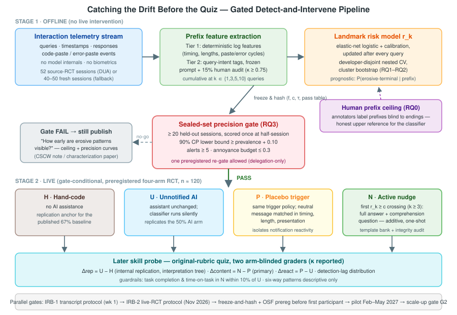

# 在测验之前抓住漂移：基于前缀的技能侵蚀型 AI 交互模式实时检测与安慰剂对照的恰时干预

*修订稿 v2 — 2026-08-14。取代自动讨论产出的初稿；统一了形式化问题定义与实验设计，恢复了四臂内部复现、决策分析式门槛，以及 discussion.md 规定的五条相关工作线。*

## 摘要

AI 编程辅助（AI coding assistance）可以加速任务完成，却可能削弱开发者监督生成代码所需的理解能力。一项针对 52 名开发者学习陌生 Python 库的随机对照实验（randomized controlled trial, RCT；Shen & Tamkin, arXiv:2601.20245）表明：AI 辅助组在事后概念与调试测验上比手写组低 17 个百分点（50% 对 67%，d = 0.738），并识别出六种交互模式——三种委托型（delegation-style）模式得分低于 40%，三种寻求理解型模式得分为 65–86%。然而这些模式是对完整会话的事后（hindsight）标注；文献中没有任何工作检验"向侵蚀型模式的漂移"是否能在行为流中被足够早地检测到并加以干预。我们提出对该 RCT 的一个带门槛的两阶段因果扩展。第一阶段（离线）仅从查询流前缀（query-stream prefix）学习一个预后风险评分（prognostic risk score）r_k——即"若不加干预，会话最终落入侵蚀型模式"的概率——不使用模型内部信息、不使用生物信号，以按开发者切分的交叉验证（developer-disjoint cross-fitting）对照人类前缀标注上限与基率基线加以验证。随后冻结模型与阈值，在一个密封门槛集（sealed gate set）上一次性评估；只有当告警精确率的保守置信下界超过一个以基率为锚、由决策分析推导的阈值时，才授权进入真人实验。第二阶段（在线、门槛通过后）是预注册的四臂试验——手写、无通知 AI 辅助、安慰剂触发通知（placebo trigger）、主动触发的一次性附加型理解提问（comprehension nudge）——在内部复现已发表的手写对 AI 差距，把提问内容效应与通知反应性（notification reactivity）分离，并沿用原论文测验量表、盲评打分。该设计把复合赌注串行化：门槛失败仍能产出"侵蚀型模式最早何时可见"的首次刻画；门槛通过则产出首个以 AI 交互模式为感知状态、以技能形成为远端结局的闭环恰时自适应干预（just-in-time adaptive intervention, JITAI）回路。

## 1. 引言

AI 编程助手如今被广泛用于涉及陌生库的任务，这在"即时任务进展"与"评估、调试和维护代码所需知识的形成"之间制造了张力。至少在一个受控设定中，因果事实已无争议：在 Shen & Tamkin 的随机试验中，52 名有 Python 经验但从未接触 Trio 异步库的开发者在有/无 AI 辅助下完成任务，AI 辅助组在随后的概念、代码阅读与调试测验上低 17 个百分点，且平均并无显著省时。关键在于，伤害并不均匀：对会话录像的事后定性编码识别出六种交互模式，结局跟随的是模式而非"是否使用 AI"——完全委托、渐进依赖、迭代式 AI 调试得分低于 40%，而先生成后追问、代码+解释混合查询、纯概念性提问得分为 65–86%。

一个既能预测结局、又在行为中可见的模式，本身就是"检测并干预"的邀请。然而现有的每一种测量都是事后的：基础 RCT 标注完整录像；观察性工作只能在回溯中、在群体层面检测"AI 提示签名"（AI-prompt signature）；问卷与脑电（EEG）研究测量的是下游状态而非交互流本身。如果侵蚀型漂移只有在测验之后才能命名，助手在最要紧的时刻便无能为力。悬而未决的问题——被基础论文的框架提出、却无人尝试——是：侵蚀型会话的早期行为签名能否从部分会话前缀中被识别，而基于这种识别的行动能否保住学习。

有两个失败模式使这件事比看上去更难。其一，模式分类学是对整段会话的事后总结：学习者在第三次查询时可能真的尚未"定型"。因此检测器必须估计一个预后风险——"若不加干预，会话最终落入侵蚀型模式"的概率——而不是诊断性标签；其上限是一个经验问题，我们通过让人类标注者在看不到会话结尾的情况下标注前缀来直接测量。其二，由检测触发的干预可能因错误的原因"有效"：仅仅打断本身就会改变行为（通知反应性），而一个把助手变差的干预不过是重新推导出手写组。我们的设计对两者都设置了对照：匹配的安慰剂通知，与预注册的任务完成度护栏。

因此我们把检测与干预当作一个单一的、以证据为门槛的流程，具有三个性质。（i）仅前缀感知：风险模型只读取日志代理可见的内容——查询文本、时间戳、回复文本、粘贴/报错事件——从不读取模型内部信息或生物信号，因此该工具可被任何一方部署，包括不拥有模型的审计者。（ii）密封统计门槛：模型、阈值与决策表在密封会话集被一次性打分之前即冻结并哈希（freeze-and-hash）；只有当告警精确率的保守置信下界超过一个由观测到的侵蚀基率与显式"打扰预算"（annoyance budget）推导出的阈值——而非任意常数——真人研究才开启。（iii）自带效度检查的四臂在线试验：手写臂与无通知 AI 臂在内部复现已发表的 50%/67% 对比，之后才解释干预对比；安慰剂触发臂把提问内容与反应性分离。

这一计划是刻意串行化的。若门槛失败，离线阶段仍交付对"侵蚀型模式在人类与统计意义上最早何时可见"的首次量化——一个可发表、具直接设计意涵的刻画。若门槛通过，在线试验交付首个闭环恰时回路：其调节变量（tailoring variable）是 AI 交互模式，其远端结局是在与已发表基线直接可比的量表上测得的技能形成。

## 2. 贡献

1. **面向技能侵蚀型 AI 交互的、仅用前缀的预后风险模型**：以防泄漏的按开发者切分验证，同时对照基率基线与实测的人类前缀标注上限（human prefix-labeling ceiling）——后者本身是一个新的科学量（这些模式究竟最早何时可见？）。
2. **决策分析式的密封集授权门槛**：把小样本告警精确率转化为可审计的通过/不通过规则（以基率为锚的置信下界，加显式打扰预算），并预注册为任何真人干预的伦理前提。
3. **门槛条件下的四臂随机评估**：同时（a）内部复现已发表的手写对 AI 技能形成差距，（b）估计一次性附加型理解提问的效应，（c）通过在时机、长度、呈现上完全匹配的安慰剂把提问内容与通知反应性分离。
4. **有边界的新颖性**：我们引入并致谢 JITAI 词汇（调节变量、近端/远端结局）与智能辅导系统（intelligent tutoring systems, ITS）的闭环传统；贡献在于把该回路移植到"助手本身就是侵蚀源"的场景，且感知只靠零硬件的查询日志特征。

## 3. 问题定义

设一次会话为开发者 i 在 AI 助手辅助下就陌生库任务产生的有序查询流 Q_i = (q_i1, …, q_iT_i)，L_i ∈ {0,1} 为基础论文已发表编码协议对完整会话赋予的事后标签（侵蚀型终局 对 保护型终局）。对前缀长度 k，记 Q_i^(k) = (q_i1, …, q_ik)。

**第一阶段（离线，检测）。** 学习 f: Q^(k) → [0,1]，产生校准的预后风险 r_ik = f(Q_i^(k)) ≈ P(L_i = 1 | Q_i^(k))，仅使用前缀可观测特征（无模型内部信息、无未来查询、无全会话统计量）。给定阈值 c，告警为 L̂_ik = 𝟙[r_ik ≥ c]。评估在前缀长度 k ∈ {1,3,5,10}（按查询数）与流逝时间检查点 {10, 20, 30} 分钟处报告精确率与召回率，对照（a）基率基线，与（b）人类前缀上限：标注者在看不到会话结尾的情况下标注同样前缀所达到的与终局标签的一致度。

**门槛。** 设 p̂ 为开发集上的侵蚀标签基率；精确率在一个按开发者切分、由冻结的 (f, c) 在半程检查点一次性打分的密封门槛集上计算。真人研究被授权当且仅当

G = 𝟙[ π̲₉₀ ≥ p̂ + 0.10 且 a ≥ 5 且 FPB ≤ 0.3 ] = 1，

其中 π̲₉₀ 是门槛集告警精确率的单侧 90% Clopper–Pearson 置信下界，a 为被告警会话数，FPB 为误报负担（false-positive burden）——每个保护型终局会话的期望告警次数（打扰预算）。设计目标精确率仍为 0.70，但仅当基率决策分析支持时才保留；门槛本身锚定于实测基率，而非常数。

**第二阶段（在线，干预；仅当 G = 1）。** 参与者被随机分入四个并行臂 A_j ∈ {H, U, P, N}：手写（H）、无通知 AI 辅助（U）、安慰剂触发（P）、主动触发（N）。冻结的分类器在所有 AI 臂中静默运行；在 P 与 N 中，风险首次越过阈值（下限 k ≥ 3 次查询）时，每会话至多一次地触发：匹配的中性通知（P），或一次性附加型理解提问（N）——助手给出完整回答后附加一个针对性的理解问题；不扣留任何内容。设 Y_j 为盲评的原量表测验分数，μ_a = E[Y_j | A_j = a]，预注册估计量为：

- **复现（效度前提）：** Δ_rep = μ_U − μ_H，预期为负，方向上复现已发表的 50%/67% 差距；
- **主要：** Δ_content = μ_N − μ_P（超越反应性的提问内容效应），意向性分析（intention-to-treat, ITT）与触发前被标记子组各报一次；
- **次要：** Δ_react = μ_P − μ_U（通知反应性）与 Δ_policy = μ_N − μ_U（总策略效应）；
- **过程终点：** 检测滞后（首次告警的查询序号与钟表时间），以及预注册护栏——N 臂的任务完成度与在任务时间须保持在 U 臂的 10% 以内。

**解释树（预注册）。** 若 Δ_rep 未能方向性复现，所有干预对比仅作估计性报告，且复现失败本身即为头条发现；只有当复现成立、护栏干净、且 Δ_content > 0 达到预注册界限时，才宣称干预有效。

## 4. 挑战

**C1 —— 从事后标签到前缀的标签迁移（最难的部分）。** 真值是整段会话的事后标签；用它训练前缀模型等于假设终局标签"早已成立"，而这对会漂移或自我纠正的学习者是错的。我们三路进攻：把目标重述为终局模式风险（使"尚未定型"成为概率质量而非标签噪声）；在 30 个会话的子集上测量人类前缀上限（任何分类器的诚实分母，且本身是可报告的结果）；以及前缀时刻效度检验——在第 k 步被标记的会话须在其后续行为上有差异。

**C2 —— 特征太薄。** 分类学来自丰富的定性阅读；日志代理看到的远少于此。两层特征化（确定性日志特征；冻结提示词的 LLM 意图标注，附 15% 人工抽检，κ ≥ 0.75）加上"仅确定性特征"消融，用实验回答信号可以多薄，而非假设。

**C3 —— 小样本推断。** 只有几十个会话时，精确率点估计就是噪声。所有开发期推断均为按开发者的整管线重跑聚类自助法（cluster bootstrap）；门槛用密封集一次性打分上的精确二项下界；六分类退为描述性附录（科学单元是侵蚀/保护二分类，也正是干预所需要的）。

**C4 —— 因错误原因"有效"的干预。** 仅打断本身就会改变行为；扣留答案则重新推导出手写臂。因此：只做附加型提问、每会话一次、匹配安慰剂、完成度/时间护栏——能同时穿过这三关的效应，才可归于作用在进行中会话上的内容。

**C5 —— 回路的非平稳性。** 一次触发的提问会改变其后的特征流。试点中"每会话一次"的上限约束了它；微随机化（micro-randomized）时机设计留给扩量阶段。

## 5. 方法

*图1：系统总览。交互遥测（查询、时间戳、回复、粘贴/报错事件）被转化为前缀特征与逐查询校准风险评分 r_k。模型、阈值与决策表冻结并哈希后，在密封门槛集上一次性评估；只有通过才开启预注册的四臂在线研究（手写 / 无通知 AI / 安慰剂触发 / 主动提问），并以原量表技能探测、盲评打分完成验证。IRB 审查与冻结-哈希预注册作为显式门槛与离线阶段并行推进。*

### 5.1 数据：双来源计划，无单点故障

**来源 A（争取但不依赖）：** 通过与作者签订数据使用协议（data-use agreement, DUA）获取基础 RCT 的 52 份会话转录；第 1 周发出请求，答复截止日预注册（2026-09-15）。

**来源 B（后备，到期自动启动）：** 在轻量的"转录收集"IRB 协议（独立于、且快于在线 RCT 协议）下，在复刻任务上新采集 40–50 个 AI 辅助会话；这些会话同时充当内部复现的第一批数据。复刻材料与原任务/测验的每一处偏差均记录在案。

所有可用会话合并后按开发者切分为开发集（目标 ≥ 40 会话）与密封门槛集（≥ 20 会话），采用对结局盲的分块哈希，平衡任务族、经验与来源。两名标注者按已发表的六模式协议编码全部会话（侵蚀/保护二分类上要求 κ ≥ 0.7；分歧仲裁）。这纠正了前稿 20 开发/32 门槛的分配——那种分法既饿死了模型，又使门槛的精确率要求在统计上不可达。

### 5.2 仅用前缀的风险模型

每个前缀处的累积特征：完整方案请求、解释/测试请求、混合请求、概念性提问的计数与滚动比例（第二层意图标注）；代码粘贴后接报错粘贴的循环（迭代调试的"马脚"）；拿到代码后是否追问；用户自写的诊断细节；查询数、长度、查询间隔、流逝时间（第一层确定性特征）。会话加权的弹性网络逻辑回归（elastic-net logistic）界标模型（landmark model）加 Platt 校准在每次查询后估计 r_k；无论前缀多少，每个会话贡献相同总权重。超参数与校准由嵌套的留一开发者交叉验证选择；在此样本量下不用深度模型。阈值 c 仅在折内训练数据上选择，瞄准门槛的工作点并受打扰预算约束。

### 5.3 冻结、密封与门槛

开发期分析（RQ1–RQ2）算完后，在全部开发会话上拟合最终的 (f, c) 并冻结：序列化、连同 τ、特征规格、剔除规则与完整枚举的 (a, t) 通过表一起写入哈希清单。随后密封门槛会话在半程检查点被一次性打分。门槛判据即第 3 节的决策分析规则：基率锚定的 90% 下界、最小告警数、打扰预算。零告警是预注册的不通过。允许一次预注册的重新过门（收窄为仅检测委托型模式）；第二次失败则宣告实时前提在本课题范围内不成立，课题转向回溯式会话审计工具。

### 5.4 在线四臂试验（门槛条件下）

按筛选测验分数分层随机化入 H/U/P/N；AI 臂分配对参与者隐藏（基于事后说明的部分披露，经 IRB 批准）。分类器在 U、P、N 中静默运行；任何消息发出前即冻结触发时刻的风险，因此被标记子组在三个 AI 臂中都是处理前定义的。主动提问是纯附加型、模板库优先：助手正常作答后，附加一个针对刚交付代码的理解问题，由 LLM 从经过审核的模板库实例化，并带确定性回退；试点期 100% 触发事件接受相关性与时机审计（干预完整性指标）。安慰剂在触发策略、时机、长度与呈现上完全匹配，内容为中性文本。测验由两名对分组盲的评分者按原量表打分（报告 κ）；分析为带基线协变量（经验、筛选分）的协方差分析（ANCOVA），聚类稳健标准误，多重插补（50 组数据集、Rubin 规则）及 δ 调整的非随机缺失（MNAR）临界点敏感性分析。

**功效与定位。** 每臂 n = 30 时，复现对比对已发表的 d = 0.738 有约 80% 功效；干预对比只对大幅挽回效应有功效，因此试点预注册为"估计 + 门槛"——报告 Δ_content 的置信区间，且仅当点估计超过基础差距的 40% 且护栏干净时才进入扩量——绝不作为小效应的验证性检验。扩量（n ≈ 120–160，微随机化时机设计）继承全部冻结机制。

### 5.5 伦理、IRB 与时间线

两份协议流水线推进：（i）转录收集（最小风险；知情同意的日志记录；仅来源 B 需要），立即提交；（ii）在线 RCT（轻度信息不对称——参与者知道会话被记录、有 AI 助手参与，但直到事后说明才知道分组及提问由算法触发），2026-11-15 提交，假设 2–3 个月加急审查 [需核实本地 IRB 时延]，2027 年 2 月开跑。招募：Prolific/Upwork，1 年以上 Python 经验、无 Trio 经验，筛选测验内嵌熟悉度陷阱题；超募 20%（四臂 120 人，招 144）；报酬每 2–2.5 小时会话 100–150 美元。预算包络：参与者+标注约 3.5–5 万美元，约 6–8 人月，算力可忽略。日程：离线数据集 + G0（标签、κ）至 2026-10-31；分类器 + 人类上限 + 门槛 G1 至 2027-01-15（允许一次重过门，吸收至 3 月 1 日；CHI 2028 的余量可覆盖）；首名在线参与者前完成冻结-哈希 + OSF 预注册；试点 2027 年 2–5 月；G2（复现 + 护栏）2027-05-31；扩量 2027 年 6–8 月；2027 年 9 月投稿 CHI 2028，CSCW/AIES 为后备。一篇不依赖新数据的 FAccT 2027 立场论文（position paper，截稿 2026-11-03）论证规范性主张——技能侵蚀对承受者在决策时刻不可见，事后测量在结构上偏袒厂商——以已发表证据与本门槛化设计为建设性提案；任何早期离线曲线只作附录加分项，绝不承重。

## 6. 实验

**RQ0（上限）。** 侵蚀型模式对人类最早何时可见？标注者在看不到结尾的情况下标注 30 个开发集会话在 k ∈ {1,3,5,10} 处的前缀；其与终局标签的一致度即前缀上限，按 k 报告。指标：人类相对终局标签的精确率/召回率。角色：RQ1 的上参照，兼独立发现。

**RQ1（检测）。** 防泄漏流程能否在半程以有用的精确率识别侵蚀型终局会话？开发集上嵌套留一开发者交叉验证；聚类自助（以开发者为重抽样单元、每次重跑全管线）下界须达基率 + 0.10 的富集；成功 = 在 k ≤ 中位会话长度一半处达标。指标：各 k 与各时间检查点上的精确率、召回率、触发数、富集度。

**RQ2（概率预后）。** 风险评分在每个锁定检查点（10/20/30 分钟）上，会话加权 Brier 分数是否优于折内训练基率预测器？成功：相对 Brier 降幅下界 > 0.10，Holm 校正。消融：仅确定性特征 对 加意图标注；正则化开/关；校准开/关；按查询数 对 按时间的检查点。

**RQ3（门槛）。** 密封门槛集是否支持授权？冻结的 (f, c) 一次性打分；按预注册 (a, t) 通过表依第 3 节规则裁决。指标：告警数、真阳性数、精确率、单侧 90% Clopper–Pearson 下界、FPB。只有通过才开启 RQ4–RQ6。

**RQ4（复现）。** μ_U − μ_H 是否方向性复现已发表的 −17 分差距？决定解释树走向；鉴于基础论文的影响力，任一结果都有信息量。

**RQ5（干预，主要）。** 主动提问在原量表测验上是否优于安慰剂？ITT 与触发前被标记子组的 ANCOVA 对比，带多重插补与临界点敏感性；效度主张要求护栏（完成度、在任务时间在 U 的 10% 以内）成立。

**RQ6（反应性与滞后）。** Δ_react、Δ_policy、检测滞后分布，及探索性的滞后 × 收益关系。六分类模式细分仅入描述性附录。

**失败产物（预先承诺）。** G1 硬失败 → 《侵蚀型 AI 交互模式最早何时可见？一项前缀标注上限研究》（CSCW note，由 RQ0–RQ2 构成）。G2 复现失败 → 《AI 辅助技能形成效应的预注册复现》——无论结果如何都有价值。

## 7. 相关工作

**第一线——因果前提及其邻域。** Shen & Tamkin（arXiv:2601.20245）提供基础 RCT、分类学、测验工具与 50%/67% 基线；其标签是对完整会话的事后编码，其未来工作看向纵向消退而非会话内检测。Kosmyna 等（arXiv:2506.08872，预印本）以 EEG、回忆与所有权测量在论文写作场景佐证同一方向——不同领域与工具，仅作方向收敛引用。Becker 等（arXiv:2507.09089，METR）表明资深维护者在真实 issue 上被 2025 年早期 AI 工具拖慢——针对专家的生产率结局，在此仅作背景：它削弱"AI 辅助是无条件的生产率红利"，但不涉及学习或前缀。Aouad、Lykouris 与 Zhong（arXiv:2605.11350）提供"为什么早期重要"的理论：异质的 AI 素养经复利效应导致技能两极分化；若复利经由早期交互差异展开，早期干预正是该模型预言的杠杆（模型是他们的，推断是我们的动机性推断）。

**第二线——AI 依赖的行为签名。** Yao（arXiv:2606.06253）在竞赛编程平台数据中检测出"AI 提示签名"（首次通过率高、调试重试少），并表明禁用 AI 的评测关卡能筛选出持久技能——信号确在行为中的最近存在性证明，但为观察性、群体层面、回溯式，且无闭环。Cao & Huang（PACMHCI CSCW2 2022；本轮核实未完成——ACM 数字图书馆不可访问）发现实时行为代理（注视）优于回溯自评对依赖的测量；传感器与结局都不同——零硬件查询日志特征能否达到注视级信号，正是我们的 C2 风险，无人检验过。

**第三线——JITAI：回路模板，明确致谢。** 移动健康的 JITAI 文献（Nahum-Shani 等，Health Psychology 2018；Klasnja 等的微随机化 HeartSteps 试验 [需核实精确文献]）形式化了决策点、调节变量、近端/远端结局与时机随机化。没有任何 JITAI 工作感知 AI 交互模式或以技能形成为目标；我们引入其词汇——调节变量 r_k、近端结局 = 提问后的模式转变、远端结局 = 测验分数——而非重新发明回路，并据此为新颖性划界。

**第四线——恰当依赖与认知强制。** Buçinca 等的认知强制函数（cognitive forcing functions）[需核实文献] 表明基于打断的提示能以用户体验代价换取决策质量提升——带 RCT 证据的最近干预类别，也是我们安慰剂担忧的直接先例：其效应部分经由摩擦实现，而这正是我们的匹配安慰剂所要剥离的。自动化偏差/恰当依赖传统（Lee & See）解释了为何"委托"是产品的快乐路径。

**第五线——ITS 与学习者建模；及设计基准对手。** 智能辅导系统数十年来运行闭环学习者建模（认知辅导器；贝叶斯知识追踪，Corbett & Anderson 1995）——但它们建模的是专用辅导器内课程技能的掌握。无人把该回路移植到真实工作中的 AI 助手使用模式上——在那里"辅导器"正是造成侵蚀的同一工具；点明这一谱系可预先挡下"这不过是重新发现知识追踪"的批评。最后，Agents-That-Teach（Mehra 等，arXiv:2607.06101）是当前的设计原则式答案——通过教学式脚手架把附带学习（incidental learning）设计回 AI 辅助开发，开环（open-loop）地施加于所有用户、不以任何实测学习者状态为条件。这种立场会向已处于保护型模式的用户征税，且无法得知其原则在会话中途是否奏效。我们是闭环互补：先测量、有条件地干预、并在确立伤害的同一份测验上验证；若其设计被证明是自适应的，我们恰好补上其自适应所需的测量层。

## 8. 局限与效度威胁

基础效应仅出自一个实验室与 n = 52；我们的复现臂对其重新检验而非假设，且复现失败被预注册为头条结果。人类前缀上限可能很低——若人类无法从半程会话判断模式，任何分类器也不能；因此上限是主要测量而非麻烦。众包招募人群可能偏离基础论文人群；筛选陷阱与偏差记录约束但不消除这一可比性威胁。试点在安慰剂对比之外无法区分理解机制与投入机制；机制主张封顶为"存在内容效应"。本设定继承基础论文自己的警示——与智能体式（agentic）编程产品不同；对委托能力更强的场景，结果可能是下界。引用状态：六个 arXiv 锚点已于 2026-08-14 经 arXiv API 核实；ACM 出版物与凭记忆的文献（Cao & Huang；JITAI 经典；Buçinca；Lee & See）带有显式核实欠账，投稿前必须清偿。

## 9. 结论

AI 辅助下的技能侵蚀是真实的、由模式介导的，而且——迄今为止——只在事后可见。本文的赌注是：漂移可以在测验之前的查询流中被抓住，而且只有在纪律约束下才值得宣称抓住了它：任何人都能部署的仅前缀感知、任何真人被干预前的密封决策分析门槛、吃掉反应性叙事的安慰剂、以及让基线保持诚实的内部复现。门槛的任一分支都产出该领域缺失的知识：或是这些模式最早何时可见，或是一次性、附加型、恰时的提问能否在不打扰从不需要它的用户的前提下，买回 17 分理解损失的一部分。

## 参考文献

1. Judy Hanwen Shen & Alex Tamkin. *How AI Impacts Skill Formation.* arXiv:2601.20245 (2026). [2026-08-14 经 arXiv API 核实]
2. Nataliya Kosmyna et al. *Your Brain on ChatGPT: Accumulation of Cognitive Debt when Using an AI Assistant for Essay Writing Task.* arXiv:2506.08872 (2025, 预印本). [已核实]
3. Joel Becker et al. *Measuring the Impact of Early-2025 AI on Experienced Open-Source Developer Productivity.* arXiv:2507.09089 (2025). [已核实]
4. Song Yao. *When the Scaffold Stays On: AI, Practice Style, and Screening in Elite Skill Formation.* arXiv:2606.06253 (2026). [已核实]
5. Ali Aouad, Thodoris Lykouris & Zhong. *Human-AI Productivity Paradoxes: Modeling the Interplay of Skill, Effort, and AI Assistance.* arXiv:2605.11350 (2026). [已核实]
6. Rohit Mehra et al. *Agents That Teach: Towards Designing Incidental Learning Back into AI-Assisted Software Development.* arXiv:2607.06101 (2026). [已核实]
7. Shiye Cao & Chien-Ming Huang. 注视作为 AI 辅助决策中依赖的实时代理. PACMHCI 6(CSCW2), 2022. [待核实——全文未获取；ACM DL 403]
8. Inbal Nahum-Shani et al. *Just-in-Time Adaptive Interventions (JITAIs) in Mobile Health.* Health Psychology, 2018. [待核实精确条目]
9. Predrag Klasnja et al. 微随机化试验 / HeartSteps. [待核实精确条目]
10. Zana Buçinca, Maja B. Malaya & Krzysztof Z. Gajos. *To Trust or to Think: Cognitive Forcing Functions Reduce Overreliance on AI.* PACMHCI (CSCW), 2021. [待核实]
11. John D. Lee & Katrina A. See. *Trust in Automation: Designing for Appropriate Reliance.* Human Factors, 2004. [待核实]
12. Albert T. Corbett & John R. Anderson. *Knowledge Tracing: Modeling the Acquisition of Procedural Knowledge.* UMUAI, 1995. [待核实]
