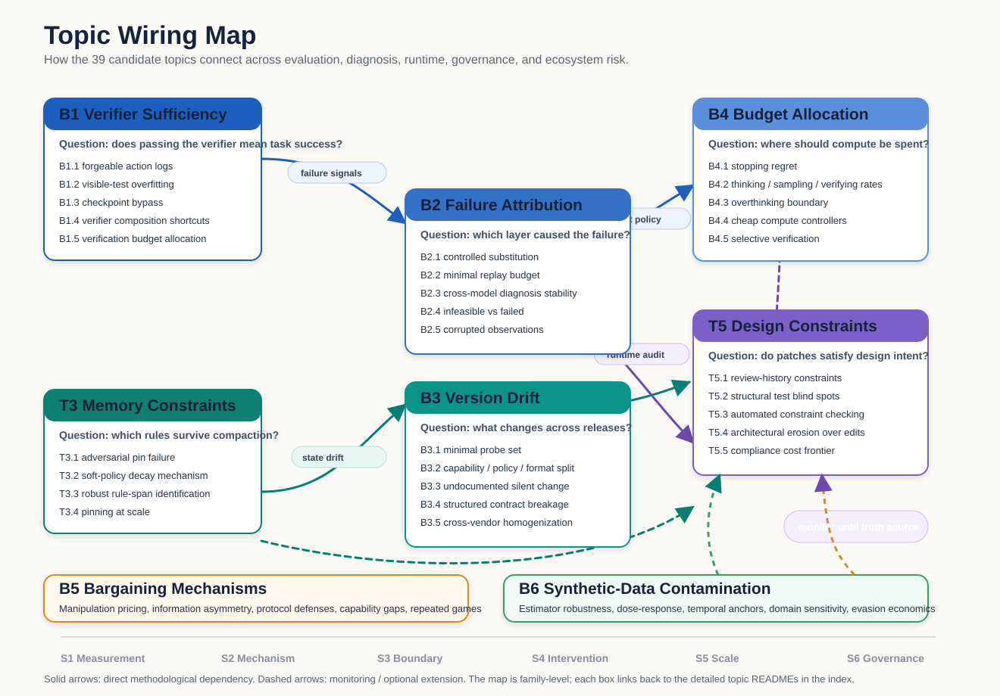

# Research Topics Index

Source: `38_topics.txt` + 2026-08-13 occupancy sweeps (B4.6 / B7.x / B8.1)
Topic folders: 45 (on disk; 24 active, 10 on hold, 11 retired — see `../portfolio_2026-08.md`)

**Status system (2026-08 audit):** every topic now carries a tier from the 2026-08-13
portfolio audit. Retired folders stay on disk as design notes; the audit rationale for
every verdict is in [`../portfolio_2026-08.md`](../portfolio_2026-08.md), and the
fast-track (no-new-experiments) position-paper candidates are in
[`../position_paper_pipeline_2026-08.md`](../position_paper_pipeline_2026-08.md).

Note: B1.6 was added after the `38_topics.txt`/`trend_scan_2026-08.md` cross-corpus scan
surfaced hallucinated skill/tool recommendation as a fresh, mechanically-checkable gap; it is
not sourced from `38_topics.txt`. Its method twin, `arXiv:2607.12340`, was read in full and
the topic reframed to install-time publisher-trust gating. The 2026-08-13 audit then
**retired its experimental form** (delta reduced to the original authors' stated future
work; required trust-annotated registry data doesn't exist) — its position-paper form
survives as Candidate 2 in `../position_paper_pipeline_2026-08.md`.

Note: source contains 39 numbered entries; requested expectation was 38.

## Topic Wiring

The map groups the 39 topic folders into research families and shows how they depend on
each other. The strongest near-term path runs from **B1 verifier sufficiency** into **B2
failure attribution** and **B4 budget allocation**. A second path runs from **T3 memory
constraints** into **B3 version drift** and **T5 design constraints**. **B5 bargaining**
and **B6 contamination** are retained as monitored ecosystem-risk lines until their truth
sources become cleaner.

## Linked Topics — by portfolio tier (2026-08 audit)

### Tier 1 — Active leads (9)

Execution-oracle cluster → FSE 2027 (Oct 2, 2026):

- [B1.2 可见测试过拟合的出现边界](./B1.2_when_do_coding_agents_start_gaming_the_test_suite_coverage_thres/README.md) [边界] — KEEP-TOP
- [T5.1 从评审历史挖掘隐式约束](./T5.1_mining_the_unwritten_rules_extracting_implicit_design_constraint/README.md) [证据] — KEEP-TOP
- [T5.2 测试盲区的结构分析](./T5.2_why_tests_cannot_see_design_a_structural_account_of_what_test_su/README.md) [机制] — KEEP-TOP
- [B2.1 受控替换归因协议](./B2.1_causal_failure_attribution_via_controlled_component_substitution/README.md) [证据] — KEEP-TOP（吸收 B2.3 的跨模型轴、B2.2 的 replay 预算节；先做 scoop check）

External-audit cluster → ICLR 2027 (~late Sep 2026):

- [B3.3 静默变更率](./B3.3_undocumented_by_design_measuring_silent_behavioral_change_agains/README.md) [证据+矛盾] — KEEP-TOP
- [B3.4 下游契约破坏度量](./B3.4_how_many_prompts_break_per_upgrade_contract_breakage_rates_for_s/README.md) [证据] — KEEP-TOP
- [B4.2 思考-采样-验证的兑换率](./B4.2_exchange_rates_between_thinking_sampling_and_verifying_under_a_f/README.md) [证据] — KEEP-TOP（厂商图表已公开单一切片，须抢在拥挤前发）

Mechanism / human-axis:

- [T3.2 软政策-硬规范衰减不对称的机制](./T3.2_why_soft_policies_rot_faster_salience_framing_and_the_asymmetric/README.md) [机制] — KEEP-TOP
- [H1.1 技能侵蚀的实时预警与即时干预](./H1.1_catching_the_drift_before_the_quiz_real_time_interaction_p/README.md) [证据+机制] — KEEP-TOP（CHI/CSCW/AIES 时钟；position 版为 pipeline 文档 Candidate 1）

### Tier 2 — Active support (15)

- [B1.1 工具日志可伪造性](./B1.1_satisfying_the_log_skipping_the_work_forgeable_action_traces_in/README.md) [证据+机制]
- [B1.3 多步任务的检查点绕过](./B1.3_milestone_satisfaction_without_prerequisite_state_checkpoint_byp/README.md) [证据]
- [B2.4 不可解性作为归因类别](./B2.4_failed_or_infeasible_calibrated_unsolvability_detection_as_a_fir/README.md) [边界]
- [B2.5 观测污染的归因盲区](./B2.5_when_the_evidence_lies_attribution_under_corrupted_tool_observat/README.md) [机制]
- [B3.1 探针集的充分性设计](./B3.1_what_probes_predict_breakage_minimal_probe_set_design_for_versio/README.md) [证据]（最强形态是并入 B3.3/B3.4）
- [B3.2 漂移的方差分解](./B3.2_capability_policy_or_format_decomposing_behavioral_drift_across/README.md) [机制]
- [B4.1 停止规则的遗憾度量](./B4.1_the_regret_of_stopping_online_marginal_utility_estimation_for_te/README.md) [资源]
- [B4.5 校验调用的选择性分配](./B4.5_which_trajectories_deserve_verification_selective_checking_under/README.md) [资源]
- [T3.3 约束识别问题](./T3.3_which_spans_are_the_rules_adversarially_robust_identification_of/README.md) [边界]
- [T5.4 多轮编辑下的架构侵蚀](./T5.4_architectural_erosion_under_sequential_agent_edits_a_longitudina/README.md) [证据+机制]
- [B6.2 污染-退化的剂量反应曲线](./B6.2_dose_response_of_corpus_contamination_coupling_measured_syntheti/README.md) [机制]（经稀有度-记忆化结果刷新；吸收 B6.4 的分域/稀有度因子）

2026-08-13 新增（四个趋势簇 occupancy sweep 的幸存角度；原簇核心均已 CROWDED/TAKEN，
逐簇判定见 `../trend_scan_2026-08.md` §6）：

- [B7.1 换骨干后的技能库折旧](./B7.1_port_prune_or_relearn_skill_library_depreciation_across_backbone/README.md) [证据]（四者中最强；首个代际重放结果后可提 Tier 1）
- [B4.6 验证感知的推理服务经济学](./B4.6_verification_aware_serving_economics_for_coding_agents/README.md) [证据]（TraceLab 公开 trace 使小组可行；测量阶段可独立成文）
- [B7.2 投毒半衰期存活分析](./B7.2_poison_half_life_survival_analysis_of_agent_memory_poisoning_und/README.md) [证据+机制]（laundering-放大假设；无需新攻击）
- [B8.1 规范漂移差分一致性](./B8.1_spec_drift_differential_conformance_for_agent_interoperability_p/README.md) [证据]（月级 scoop 时钟：3 个月内无 clause-diff 探针管线则降级 Tier 3）

### Tier 3 — Hold / monitor (10)

各自等待的解锁条件见 `../portfolio_2026-08.md` Tier 3 表。

- [B1.5 校验预算的对抗性分配](./B1.5_spot_check_or_probe_allocating_a_fixed_verification_budget_again/README.md) [资源]
- [B2.2 归因的最小 replay 预算](./B2.2_how_few_replays_suffice_budget_bounded_localization_of_decisive/README.md) [资源]
- [B3.5 跨厂商漂移同步性](./B3.5_do_all_models_drift_the_same_way_cross_vendor_homogenization_of/README.md) [矛盾]
- [B4.4 廉价控制器蒸馏](./B4.4_can_a_frozen_probe_replace_self_report_cheap_controllers_for_com/README.md) [资源]
- [B5.1 操纵战术的福利计价目录](./B5.1_pricing_manipulation_surplus_transfer_per_linguistic_tactic_in_c/README.md) [证据]（B5 家族唯一保留的再入口）
- [B6.1 未知生成器下的估计鲁棒边界](./B6.1_estimating_contamination_from_generators_you_have_never_seen_rob/README.md) [边界]
- [B6.4 分域污染的差异脆弱性](./B6.4_not_all_data_degrades_equally_domain_selective_effects_of_synthe/README.md) [证据]（并入 B6.2 作为设计因子）
- [T3.1 Pinning 的对抗失效边界](./T3.1_breaking_the_pin_adversarial_limits_of_constraint_protection_und/README.md) [边界]
- [T5.3 约束 verifier 原型与人类评审对齐](./T5.3_checking_design_cards_precision_and_recall_of_automated_constrai/README.md) [证据]
- [T5.5 合规的代价前沿](./T5.5_the_price_of_compliance_utility_constraint_frontiers_for_design/README.md) [资源]

### Tier 4 — Retired (11)

保留在磁盘上作为设计笔记；退休理由（occupied/outdated/unfeasible/vacuous）见
`../portfolio_2026-08.md` Tier 4 节。

- [B1.4 verifier 组合的健全性算术](./B1.4_two_sound_checks_one_unsound_gate_emergent_shortcuts_under_verif/README.md) — vacuous
- [B1.6 幻觉技能调用的注册表拦截](./B1.6_recommending_ghosts_registry_grounded_gating_of_hallucinated_ski/README.md) — occupied（position 版仍活跃：pipeline Candidate 2）
- [B2.3 归因的跨模型稳定性](./B2.3_does_the_diagnosis_survive_a_model_swap_cross_backbone_stability/README.md) — 并入 B2.1
- [B4.3 过度思考的难度翻转点](./B4.3_where_thinking_starts_to_hurt_difficulty_conditioned_boundaries/README.md) — occupied+outdated
- [B5.2 信息结构决定的可剥削边界](./B5.2_when_does_asymmetry_become_exploitation_information_structure_an/README.md) — outdated
- [B5.3 协议层与模型层防御的分工边界](./B5.3_what_mechanism_design_can_and_cannot_fix_protocol_layer_versus_m/README.md) — occupied（对抗鲁棒性框架取代）
- [B5.4 能力差距下的代理剥削](./B5.4_weak_principal_strong_adversary_surplus_loss_as_a_function_of_ca/README.md) — unfeasible（无约束绑定）
- [B5.5 重复博弈中的剥削持续性](./B5.5_does_reputation_self_correct_exploitation_repeated_bargaining_dy/README.md) — outdated（叙事疲劳区）
- [B6.3 预 2022 锚点的校准方法学](./B6.3_the_certified_human_anchor_temporal_holdout_validation_for_corpu/README.md) — unfeasible（结构性过期）
- [B6.5 语料级估计的策略稳健性](./B6.5_is_corpus_level_estimation_strategy_proof_the_economics_of_evasi/README.md) — unfeasible
- [T3.4 规模化 pinning 的开销边界](./T3.4_pinning_at_scale_token_overhead_versus_violation_trade_offs_unde/README.md) — occupied-imminent
