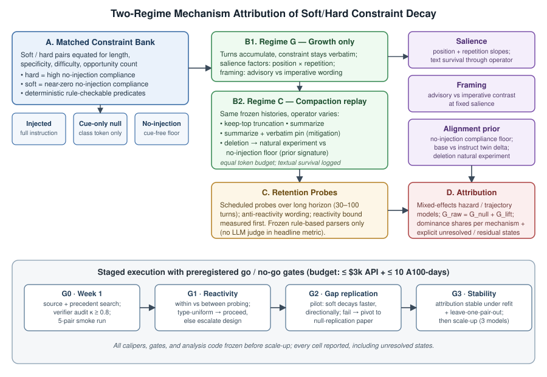

# 为什么软政策衰减得更快：将上下文约束的不对称衰减归因于显著性、措辞框架或对齐先验

## 摘要

已部署的 LLM 智能体（agent）承载两个层级的行为约束：仅存在于上下文窗口中的软组织政策（soft policies，如语气、范围、业务规则），以及在对齐训练中被额外强化到模型权重里的硬安全规范（hard norms）。近期测量报告显示，随着交互变长和上下文被压实（context compaction），软约束丧失行为约束力的速度远快于硬规范——Governance Decay 报告压实条件下软/硬差异达 8.3 倍——但现有工作只测量或缓解这一不对称，从未解释它。我们提出首个针对软/硬衰减不对称的受控机制归因（mechanism attribution）研究。在一组长度、具体性和规则可检验合规性均已配平的软/硬约束对上——类别成员资格由无注入合规率（no-injection compliance）操作性定义，而非由措辞定义——我们在两种体制下对显著性（salience：位置、重复次数）和措辞框架（framing：建议式与命令式措辞）进行因子化操纵：其一为自然上下文增长（约束逐字保留在上下文中），其二为反事实压实重放（counterfactual compaction replay，同一冻结历史在匹配 token 预算下经 keep-top 截断、无约束摘要、逐字钉扎摘要与删除算子重新探测）。对齐先验（alignment prior）无法被操纵，因此通过三个测量代理进行三角验证：无注入合规底线、base 与 instruct 孪生模型差值，以及一项预注册的压实-删除自然实验（constraint 文本被删除后，软约束的依从应崩落至无注入底线，而硬规范的依从应几乎不动）。所有主指标合规均由冻结的规则解析器打分；探针反应性（probe reactivity）在主实验前经验性定界；研究按预注册阶段执行，配有通过/中止门槛（go/no-go gates）与明确的预算包络。产出是对软/硬衰减差距在显著性、措辞框架、先验与压实算子文本存活之间的优势度分解，并按机制逐一给出缓解措施含义：若显著性主导，钉扎与重述可以修复衰减；若先验主导，任何提示工程都无能为力，持久的软政策需要训练期支持。

## 1. 引言

长时运行的 LLM 智能体受上下文内指令治理。其中一部分指令——拒绝行为、避害规范——是*硬的*（hard）：它们在对齐训练中被强化进模型权重，上下文只是对它们的重述。另一部分——"始终向客户披露你是 AI"、"未经法务审查不得报价"、风格与范围规则——是*软的*（soft）：上下文窗口是它们唯一的存在之处。因此，任何对上下文的操作对软政策都是生存性威胁，而对权重支撑的规范则不然。这种不对称是结构性的，而生产系统恰恰生活在它的咬合处：任何运行足够久的智能体都必须压实其历史，而压实算子从构造上就会删除或改写约束文本。

这一现象已不再是传闻。Governance Decay [Anon., 2026] 在其 ConstraintRot 基准上测量了压实引发的违规，报告软组织政策的衰减比硬安全规范大 8.3 倍；Omission Constraints Decay While Commission Constraints Persist [Gamage, 2026] 记录了上下文增长下的相关类别不对称：随对话深度增加，禁止型（prohibition）合规从 73% 跌至 33%，而要求型（requirement）合规保持不变；Lost in Compaction [Wang et al., 2026] 显示生产压实器平均只保留约 17% 的会话约束，且保留率系统性地依赖于约束措辞与注入位置。缓解手段同样成熟：钉扎系统提示、压实后重注入政策、每 k 轮重述。缺失的是*为什么*。没有任何现有研究将软/硬不对称归因到机制，因此已上线的修复都是盲打：重新钉扎治疗的是显著性问题，但如果不对称由措辞语域或对齐先验本身驱动，显著性修复就治错了病，并将静默失效——与此同时硬规范的审计信号一路绿灯。

候选机制有三：

1. **显著性（salience）。** 约束在上下文中的突出程度——位置、重复次数，以及在压实下其文本经过算子的字面存活——随历史增长与重写而侵蚀。
2. **措辞框架（framing）。** 陈述约束所用的措辞语域（建议式"我们希望你……"与命令式"你绝不能……"）调制其对行为的长期约束力。
3. **对齐先验（alignment prior）。** 硬规范有权重级强化背书；软政策仅存在于上下文。软政策的可衰减面是整条约束；硬规范的可衰减面只是其上下文重述。

这些机制蕴含不同的修复方案、不同的失效模式与不同的研究议程。然而在所有部署场景中它们是混杂的：硬规范通常措辞命令式*且*位置显著*且*被权重强化。只有在配平约束对上的受控操纵才能分离它们——而第三种机制永远无法被操纵、只能被测量，因此设计必须是显式不对称的：两个实验因子、一个三角验证的协变量，且对先验的归因须表述为排除式诊断（diagnosis of exclusion），并以其最强的准实验证据定界。

本文贡献该设计及其分阶段执行方案：

- **两体制、机制因子化设计。** 体制 G（仅增长）：约束逐字保留在上下文中，轮次不断累积；衰减反映注意力/行为漂移。体制 C（压实）：同一冻结历史在匹配 token 预算下经 keep-top 截断、无约束摘要、逐字钉扎摘要或删除后重新探测；衰减额外反映约束文本经过算子的存活——这是*算子*的属性，我们将其记录为测量中介变量（mediator），而不与模型侧显著性混为一谈。
- **配平约束对上的操作性类别对比。** "硬"由可测量的无注入合规率定义（模型未被告知也已在执行），而非由措辞定义；软/硬对在主题、长度、句法与规则可检验性上配平，因此类别因子不是表面形式混杂。措辞随后在类别*内部*被操纵，这正是措辞框架得以与类别成员资格分离的原因。
- **压实-删除自然实验升格为共同头条。** 当算子彻底删除约束文本时，机制 3 给出尖锐、可证伪的预测：软约束依从崩落至其无注入底线；硬规范依从几乎不动。这是"承载硬规范的是先验而非可见文本"的最干净演示——同时也满足了删除测试必须对照实测无注入基线（而非假设底线）的要求。
- **缓解臂纳入机制设计之内。** 从业者已在使用的钉扎-修复方案（逐字钉扎、每 k 轮重述）作为对照因子设计的独立实验臂运行，使机制结论直接为现有缓解措施重新定价。
- **分阶段、有门槛、有预算的计划。** 在任何扩量之前，先以 40 对约束、2 个模型进行试点，配四道预注册通过/中止门槛（来源核实与先例检索；探针反应性定界；方向性差距复现；归因稳定性），预算包络明确（≤$3k API、≤10 A100-天、≤60 标注人时）。探针反应性——测量工具刷新其所测量的显著性——*最先*被经验定界，因为它是下游一切效度的闸门。

我们刻意不宣称能点识别（point-identify）对齐先验。先验只作为有界证据被归因：在显著性与措辞操纵之后仍存活的残余类别差距，由无注入底线、base-instruct 孪生差值与删除自然实验加以佐证；所有无法解析的状态按"未解析"报告，而不被折算为支持。

## 2. 相关工作

**什么在衰减。** 指令遵循的多轮退化已在总体层面确立：Laban et al. [2025] 显示多轮性能急剧下降；Luz de Araujo et al. [2026] 显示人设保真与指令遵循在 100+ 轮对话中退化；Li et al. [2024] 在八轮内测得系统指令漂移并将其与注意力衰减关联；LIFBench [Wu et al., 2024] 与 Multi-IF [He et al., 2024] 量化长上下文与多轮指令不稳定性；SysBench [Qin et al., 2024] 测量多轮系统消息约束违规。这些工作均未按约束类别分层，也未做机制归因。

**类别不对称衰减（直接前驱）。** Gamage [2026]（arXiv:2604.20911）确立了增长条件下的省略/执行（omission/commission）分歧，并通过 token 配平填充控制完成了*部分*机制分解：将 62–100% 的稀释效应归于模式语义内容而非 token 体量。Governance Decay（arXiv:2606.22528）确立了 8.3 倍软/硬压实不对称、压实-驱逐攻击（Compaction-Eviction Attack）与约束钉扎（Constraint Pinning）防御。Lost in Compaction [Wang et al., 2026]（arXiv:2608.11242）测量会话约束经生产压实器的存活率，显示保留依赖措辞与注入位置；一个压缩场景基准 [2512.17920] 在压缩下分离约束合规与语义准确性。这些工作测量、攻击或修补该不对称；但没有一个在配平软/硬设计上因子化操纵显著性与措辞，没有一个在同一历史上分离仅增长衰减与压实损失，也没有一个将对齐先验解释与替代机制对检。最接近的部分重叠——约束*经压实器存活*对位置/措辞的敏感性 [2608.11242]——属于显著性的算子侧；我们的设计将算子存活记录为中介变量，并追问那个仍未被提出的问题：当文本命运被固定时，*模型*为何守住硬规范却丢掉软政策？

**孤立研究的候选机制。** 显著性：Lost in the Middle [Liu et al., 2023]（位置）；Prompt Repetition [Leviathan et al., 2025]（重复）；漂移的注意力衰减解释 [Li et al., 2024]。措辞框架：礼貌与语域对模型行为的影响 [Yin et al., 2024]；2026 年的框架敏感性研究确认措辞语域会移动模型决策。先验：浅层安全对齐 [Qi et al., 2024] 与表层安全对齐假说（SSAH）[Li & Kim, 2024] 刻画权重级先验之薄；Instruction Hierarchy [Wallace et al., 2024] 将特权排序训练进权重。每条线只研究一个机制，因此看不见、更无法解释类别不对称。

**工具装置。** IFEval [Zhou et al., 2023] 提供了我们机械打分所推广的规则可检验验证范式；MemGPT [Packer et al., 2023] 与上下文压缩文献定义了体制 C 所实例化的算子族；LIMA [Zhou et al., 2023] 为对齐诱导行为的 base-instruct 代理提供动机。

**空白。** 每个要素都各自存在——类别不对称衰减测量、单机制研究、压实算子、钉扎修复——但没有任何工作在一个配平设计中比较软/硬衰减、因子化操纵显著性与措辞、在同一历史上分离增长与压实，并以无注入基线对照的删除对比检验先验解释。这一合取即本研究。

## 3. 问题设定

设约束对 （c_S, c_H） 在主题、长度（token 数 ±10%）、句法与验证器类型上配平，类别按操作性定义：A∅_H ≥ α_H 且 A∅_S ≤ α_S，其中 A∅_k 为无注入合规率（约束从未被陈述时模型的自发依从），α_H、α_S 为预注册阈值。每段对话是条件 e = (m, i, k, r, s, f, q) 下的轮次序列：模型 m、约束对 i、类别 k ∈ {S, H}、体制 r ∈ {G, C_κ}（压实算子 κ）、显著性 s（位置 × 重复）、措辞框架 f ∈ {建议式, 命令式}、可见性 q ∈ {存在, 已删除, 从未注入}。

合规 d_i^k(y_t) ∈ {0,1} 由冻结的确定性规则打分；主指标不允许评审模型（judge model）。以 A_e(t) 为逐轮依从概率，衰减为 D_e(t₀,t) = A_e(t₀) − A_e(t)，类别不对称为匹配条件上的 Γ = D_S − D_H。类别 k 的压实增量效应为跨压实事件的双重差分 J_k = [A_C,k(t⁻) − A_C,k(t⁺)] − [A_G,k(t⁻) − A_G,k(t⁺)]，故 J_S − J_H 将类别依赖的压实损失从增长衰减中分离。删除对比 R_k(t) = A_{q=已删除,k}(t) − A_{q=从未注入,k}(t) 一律对照实测无注入基线 A_{q=从未注入,k} 解释，绝不对照假设底线。归因目标是将 Γ 的方差分解到 {显著性, 措辞框架, 先验代理协变量, 算子存活, 残差}，仅当某机制的受控对比有效（operative）、可与其他机制区分、且与其预注册可证伪预测一致时才记入该机制。

## 4. 方法

*图1：两体制机制归因架构。配平软/硬约束库（实验臂：注入、仅类别线索空白、无注入）馈入两种处理体制——仅增长与反事实压实重放（keep-top、摘要、摘要+钉扎、删除）——由冻结规则解析器探测；混合效应归因阶段将类别差距分解为显著性、措辞框架与对齐先验份额。整条流水线在预注册门槛 G0–G3 与固定预算包络内执行。*

### 4.1 配平约束对库（构念效度的关键）

约束库含 40 个软/硬对（试点：20 对），软侧取自操作政策类与偏好类约束，硬侧取自标准拒绝/格式约束，全部限定为具有 IFEval 风格规则可检验合规判据的行为。配平要求：同一主题域、token 长度 ±10%、同一验证器类型；每个成员三种措辞变体（建议式/标准/命令式），经嵌入阈值加人工审核筛查语义等价。验收门槛：独立评审员能识别每对成员的*类别*，但无法区分其*难度*。类别标签随后对照无注入测量组（4.4 节）做操作性验证；成员在 A∅ 上不分离的对被重新标注或剔除——一条模型不会自发执行的"硬"约束不过是一条措辞命令式的软约束。

我们明言已知代价：将软约束限定为机械可检验谓词会收窄构念——分级的语气政策代表性不足。LLM 评审的软约束作为单独报告的次级层运行，配 10% 人工审核（κ ≥ 0.8），绝不进入主指标。

### 4.2 处理：两种体制，一套框架

**体制 G（仅增长）。** 约束置于 {系统头部, 系统尾部, 对话中段} 之一，在计划轮次重述 {1, 3, 5} 次，采用某一措辞变体；对话运行 30 轮（试点）/100 轮（扩量），以 LMSYS-Chat-1M 干扰轮填充；各显著性单元的总上下文 token 经长度配平填充保持恒定。约束文本全程逐字在场，故此处衰减为模型侧漂移。

**体制 C（压实重放）。** 在计划检查点，指定算子重写转录：`keep-top`（逐字保留系统提示 + 最近 k 轮）、`summarize`（对被驱逐区段应用固定摘要提示）、`delete`（删除约束子句，其余内容同样摘要）。压实臂在压实后 token 预算上配平。每次压实后约束文本逐字存活/被改写/被删除的状态记录为**文本存活中介变量**：在 `summarize` 下，存活在单元内自然变异，我们在中介分析中利用这一变异而非假装单元同质。这是设计对算子-模型歧义的回答：存活式显著性（算子属性）与注意力式显著性（模型属性）被分开估计。

**缓解臂（置于因子设计之外、对照其分析）。** `summarize+pin`（约束子句经摘要逐字钉扎）与 `每 k 轮重述` 实例化从业者已在使用的两种修复。每种机制结论都对它们给出预测：显著性主导的衰减被两者大幅修复；措辞框架主导的衰减除非同时强化措辞否则两者都修不了；先验主导的衰减两者都修不了。

### 4.3 探测与机械打分，附实测反应性界

每 5 轮以反应性规避规则（不含约束关键词或主题词）撰写的探针提示测一次依从。因为探测本身可能刷新约束显著性，反应性校准*最先*运行：在 4 个标记单元（约 480 段对话）上，对比对话内探测与对话间探测（在每个探测深度截断的新对话）。若差值小且类别均匀，施加全局校正；若类别依赖，主对比升级为对话间探测，并由预注册削减（本次投稿砍掉 `summarize` 算子）支付代价。主指标的违规检测仅用规则——格式、词面与拒绝触发检查器，经盲标签一次性验证（精确一致率 ≥ 0.95）后冻结。

### 4.4 机制分解与先验三角验证

轨迹模型为离散时间风险模型（discrete-time hazard，cloglog 连接；事件 = 首次持续违规；右删失），混合效应：hazard ~ 轮次 × 类别 × 措辞 × 显著性 × 算子 + (1|约束对) + (1|模型)，以约束对级无注入合规为条件。软/硬差距即类别×轮次系数；机制份额来自被操纵因子上的优势度分析（dominance analysis）/偏 R²，并以混合效应逻辑斯蒂轨迹重拟合作为预注册敏感性分析（两种框架必须方向一致；不一致时如实报告，不静默调和）。

为可解释性，我们在一个约束对子集上保留仅线索空白臂（cue-only null）的分解恒等式：以 C_{k,注入} 与 C_{k,空白} 为完整注入与仅类别线索脚手架下的合规率，G_raw = G_null + G_lift 将原始类别差距拆为线索关联的类别支持与可见指令增益。G_null 严格作为含道义线索的先验支持*上界*报告。

对齐先验本身经三个测量工具三角验证，皆不可操纵，各有可证伪特征：

1. **无注入底线 A∅_k。** 同时是操作性类别定义；作为连续协变量进入模型，故"先验强度"按约束计而非按标签计。
2. **Base-instruct 孪生差值。** 在一对开放权重模型上，A∅_instruct − A∅_base 将对齐诱导的自发执行从预训练语料规律中分离。
3. **压实-删除自然实验（共同头条对比，预注册）。** `delete` 算子移除约束子句后：机制 3 的预测是 A_{已删除,S} → A∅_S（软约束崩落至底线），而硬规范依从几乎不动——因为先验在执行它。若硬规范依从也向其底线崩落，先验解释被证伪，不对称必须由显著性/措辞承载；若删除后软约束依从仍然偏高，则在任何机制主张之前先诊断残留上下文泄漏。

对先验的归因是排除式诊断——在被操纵因子与算子存活被偏析后仍存活的类别差距——表述为上界，并由工具 1–3 佐证（或不佐证）。我们不部署识别性无法验证的免线索肯定塔；当证据无法将先验与残余谓词结构分离时，账本写"未解析"，且若这就是结局，这个词会出现在最终论文的摘要里。

## 5. 实验设计：分阶段、有门槛、有预算

**试点（第 1–3 周）。** 2 个模型（1 个前沿 API 快照、1 个开放权重 instruct）× 类别(2) × 措辞(2：建议式/命令式) × 位置(2) × 重复(2：1/3) × 算子(2：无/keep-top) = 64 单元，20 对嵌套（每半分式 10 对），3 个种子，30 轮——每模型约 1,900–2,300 段对话。与类别的二阶、三阶交互可估计；更高阶交互按声明设计混叠。

**门槛（预注册，附指名削减）。**
- **G0（第 1 周）：** 追溯 8.3 倍/不对称报告来源（现已解析：arXiv:2606.22528、2604.20911）并完成先例检索；验证器套件在审核样本上 κ ≥ 0.8；5 对冒烟运行。
- **G1（第 2–3 周）：** 反应性校准。差值小且类别均匀 → 维持对话内探测。类别依赖 → 升级为对话间探测，并从本次投稿削减 `summarize` 算子。
- **G2（第 3–4 周）：** 仅增长单元中方向性差距复现（软半衰期 < 硬半衰期）且至少一个因子×类别交互可检出。失败 → 论文转向"不对称传闻在配平测量下不成立"，本身即可发表的阴性结果。
- **G3（第 5 周）：** 归因在 Weibull 重拟合与留一对出（leave-one-pair-out）下稳定。

**扩量（第 4–6 周）。** 3 个模型（2 个带日期 API 快照 + 1 个含 base 孪生的开放权重 instruct），措辞三水平，重复 {1,3,5}，`summarize` 算子以文本存活为测量中介，缓解臂，分式子集上 100 轮时程；共约 2 万段对话。超出 3 个模型的家族级泛化明确推迟。

**预算包络。** ≤$3k API + ≤10 A100-天 + ≤60 标注人时。全部分析代码、约束对库、阈值与门槛判据在扩量前冻结并哈希；所有单元均报告。

**研究问题。** RQ1：软/硬衰减不对称在配平、机械打分的约束对上（仅增长）能否方向性复现？RQ2：显著性与措辞操纵能弥合多少差距（增强后的软约束能否追平标准硬约束）？RQ3：压实是否在增长之外增加类别依赖损失（J_S − J_H > 0），其中多少由文本经算子存活所中介？RQ4：删除自然实验是否呈现先验特征（软 → 底线，硬 ≈ 不动）？RQ5：拟合风险差距中哪些机制份额占优，且是否稳定（G3）？RQ6：钉扎-修复缓解臂的表现是否符合胜出机制的预测？

## 6. 效度威胁

**构念。** 机械可检验的软约束对分级语气政策覆盖不足；LLM 评审层单独报告，绝不进入主指标。类别为操作性定义（无注入合规），故"硬"相对于模型而言；按模型报告类别标签。**内部。** 先验从构造上即为相关性证据；我们以三个工具定界并将归因表述为排除。探针反应性被测量而非被假设消失，并作为设计闸门。`summarize` 下的文本存活由算子随机决定；它被建模为中介变量而非被平均掉。**外部。** 三个模型、两个家族；生产黑盒压实器超出范围（第三层级，已声明）；脚本化算子的选择旨在括住生产行为（截断、摘要、钉扎）。**统计。** 因子设计为声明的分式设计；风险与逻辑斯蒂框架须方向一致；所有阈值预注册；一切未解析状态按未解析发表。

## 7. 结论

软/硬约束衰减不对称已被测量、被攻击、被修补——但从未被解释。本研究将其转化为配平约束对上的机制归因问题：两个实验因子（显著性、措辞框架）、一个三角验证协变量（对齐先验）、同一历史上的两种体制（增长、压实）、由结果定价的缓解臂，以及一份门槛使每种失败模式成为声明转向而非静默转向的分阶段执行计划。无论哪种机制胜出，答案都可执行：显著性胜出则给出放置与钉扎指南；措辞框架胜出则给出措辞指南；而若先验胜出，则得到"提示级政策天生二等"的阴性结论——那种情况下，持久的软政策需要训练期强化，而生产环境中每一个仅靠上下文的治理栈都在靠借来的时间运转。

## 参考文献

- Yeran Gamage. Omission Constraints Decay While Commission Constraints Persist in Long-Context LLM Agents. arXiv:2604.20911, 2026.
- Anonymous. Governance Decay: How Context Compaction Silently Erases Safety Constraints in Long-Horizon LLM Agents. arXiv:2606.22528, 2026.
- Zhiqi Wang, Yichi Zhang, Dongwon Lee, Yuchen Yang. Lost in Compaction: Evaluating Side-Constraint Loss under Context Compaction. arXiv:2608.11242, 2026.
- Anonymous. Separating Constraint Compliance from Semantic Accuracy: A Benchmark for Instruction-Following Under Compression. arXiv:2512.17920, 2025.
- Philippe Laban et al. LLMs Get Lost in Multi-Turn Conversation. arXiv:2505.06120, 2025.
- Pedro Henrique Luz de Araujo et al. Persistent Personas? Role-Playing, Instruction Following, and Safety in Extended Interactions. EACL 2026; arXiv:2512.12775.
- Kenneth Li et al. Measuring and Controlling Instruction (In)Stability in Language Model Dialogs. COLM 2024; arXiv:2402.10962.
- Nelson F. Liu et al. Lost in the Middle: How Language Models Use Long Contexts. TACL 2024; arXiv:2307.03172.
- Yaniv Leviathan, Matan Kalman, Yossi Matias. Prompt Repetition Improves Non-Reasoning LLMs. arXiv:2512.14982, 2025.
- Xiangyu Qi et al. Safety Alignment Should Be Made More Than Just a Few Tokens Deep. arXiv:2406.05946, 2024.
- Jianwei Li, Jung-Eun Kim. Superficial Safety Alignment Hypothesis. ICLR 2026; arXiv:2410.10862.
- Eric Wallace et al. The Instruction Hierarchy: Training LLMs to Prioritize Privileged Instructions. arXiv:2404.13208, 2024.
- Jeffrey Zhou et al. Instruction-Following Evaluation for Large Language Models (IFEval). arXiv:2311.07911, 2023.
- Yanzhao Qin et al. SysBench: Can Large Language Models Follow System Messages? arXiv:2408.10943, 2024.
- Xiaodong Wu et al. LIFBench: Evaluating Instruction Following in Long-Context Scenarios. arXiv:2411.07037, 2024.
- Yun He et al. Multi-IF: Benchmarking LLMs on Multi-Turn and Multilingual Instruction Following. arXiv:2410.15553, 2024.
- Charles Packer et al. MemGPT: Towards LLMs as Operating Systems. arXiv:2310.08560, 2023.
- Chunting Zhou et al. LIMA: Less Is More for Alignment. arXiv:2305.11206, 2023.
- Ziqi Yin et al. Should We Respect LLMs? A Cross-Lingual Study on Prompt Politeness. SICon 2024.
