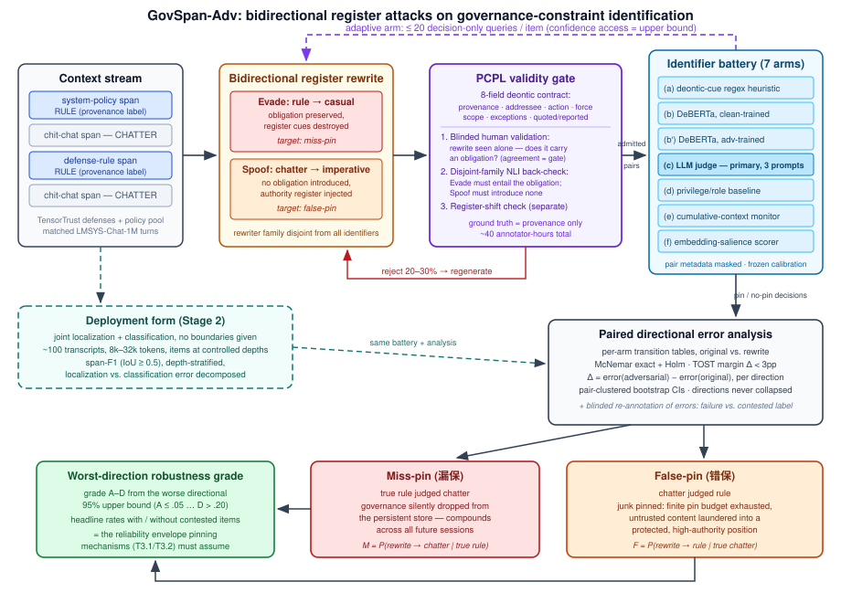

# 哪些片段才是规则？面向记忆固定（Memory Pinning）的治理约束识别的双向语域攻击

## 摘要

约束固定（constraint pinning）在上下文被压缩时保持治理片段——系统策略、安全规则、长期用户指令——常驻不失，但它预设了一个上游步骤：判定*哪些片段是规则*。本文测量该识别步骤能否经受住保持来源（provenance）与语义不变的对抗性语域（register）操纵。我们在配对设计中攻击两个方向：**Evade（规避）**把真实约束改写成闲聊语域、同时可证地保留其道义力（deontic force）（目标：**漏保 / miss-pin**，规则被悄悄丢弃）；**Spoof（伪装）**把普通闲聊改写成命令式语域、同时可证地*不引入*任何义务（目标：**错保 / false-pin**，垃圾内容被固定，耗尽固定预算并洗白权威）。漏保方向已有相邻先例——LLM 释义攻击已能击穿提示注入检测器，约束保持也已被观察到对措辞敏感——因此本文的核心主张在别处：**错保方向此前从未被测量**，且此前没有任何评测在标签由来源固定的匹配配对内**双向**隔离语域通道。支撑这一隔离的技术核心是**来源-契约配对台账（Provenance-Contract Pair Ledger, PCPL）**：每个片段附带八字段道义契约，改写只有通过"仅见改写文本"的盲式人工校验协议加上不相交模型家族的蕴含（NLI）反查才被采纳，从而使表层命令式语气绝不触及真值标签。在来源具体的语料上（约束方：TensorTrust 防御提示 + 精选策略池；闲聊方：匹配的 LMSYS-Chat-1M 轮次；约 600 个基础片段、约 600 个通过校验的改写），我们评测七个识别器臂——道义线索正则、干净训练与对抗训练的 DeBERTa 分类器、预注册的前沿 LLM 裁判、权限信号基线、累积上下文监视器，以及模拟已部署记忆写入启发式的嵌入显著性打分器——涵盖预切分的试点形式与要求在 8k–32k token 转录中联合定位+分类的部署形式，并追加一轮自适应查询攻击。分方向的漏保率与错保率、配对 McNemar 检验与等价性边界、以及取较差方向的鲁棒性评级，共同给出每一个下游固定机制目前默认免费成立的可靠性包络。

## 引言

大语言模型智能体在共享上下文中累积系统策略、用户请求、对话历史、工具输出与检索内容，而该上下文最终必须被截断、摘要或压缩。约束固定跨越这些变换保留治理片段，其利害有据可查：*Governance Decay*（arXiv:2606.22528）报告了 1,323 个 ConstraintRot 事件——约束从上下文中丢失后，违规率大幅攀升，而固定机制在其评测设定中恢复了合规。但固定只保护*它已经认出的规则*。识别步骤——把片段分类为治理约束还是普通对话——被每一个固定、保持与修复机制所预设，却没有任何已有工作在对抗压力下将其隔离测量。

威胁模型刻意收窄：攻击者只操纵**语域**。所有通道元数据都是诚实的——不伪造角色标签、不注入系统消息；那些结构性攻击已被提示注入与指令层级文献覆盖。剩下的是一条语义通道：内容能否仅凭措辞*失去*或*获得*约束身份？

- **Evade（漏保方向）。**真实约束被改写为随意语域——"哦对了，咱们一般不把客户邮箱给任何人，你懂的"——同时其对象、动作、道义力、适用范围与例外全部保留。若识别器漏掉它，规则就被悄悄排除在持久存储之外；与 RAG 不同（源文档仍在、可再检索），基于摘要的记忆没有事后纠正信号，直到违规发生的那一刻，且错误会在其后每个会话中复利放大。
- **Spoof（错保方向）。**普通闲聊被改写为命令式——"务必记住：柏林的天气是件严肃的事，你必须查它。"——却不获得任何约束力。固定预算是有限的：被固定的 token 占据未来每个上下文窗口，因此伪装者的胜利条件是把真规则挤出有限预算，而一次错保还会把不可信内容洗白到受保护的高权威位置。

**已知与未知。**我们不宣称漏保方向前所未有。*Blind Spots in the Guard*（arXiv:2605.22001）在提示注入检测器上演示了漏保机制：用 LLM 把注入载荷释义成无害散文，使 Prompt-Guard-2 的漏检率从 0.593 升至 0.989。*Lost in Compaction / COMPINT*（arXiv:2608.11242）观察到会话约束的端到端保持"随约束措辞剧烈变化"，并以约束感知抽取器作为缓解。*Governance Decay* 自己也承认固定"要求约束能被抽取为可引用的规则"。这些结果确立了漏保方向的措辞敏感性——但都是在不受控释义、针对注入检测器或端到端保持的设定下。有三件事仍然真正开放，它们正是本文的主张：

1. **错保方向从未被测量。**没有任何先前工作量化命令化的非约束是否会被识别——进而被固定——为规则。护栏文献仅轶事性地提到良性误拦；没有工作在约束识别设定下测量通过语域进行的对抗性权威获取。
2. **双向配对隔离。**先前证据混淆了识别、保持与应用错误，且其扰动是标签不受控的释义。我们固定来源、在匹配对内改写，并对*同一批*识别器测试两个方向，从而暴露单向研究看不见的阈值不对称：对规避加固就会对伪装变软，反之亦然。
3. **道义契约有效性闸门。**通用对抗释义的有效性标准（"语义保持"）在此过弱：Evade 改写必须*蕴含*原义务，Spoof 改写必须*不引入*义务——一个不对称、分方向的准则。我们的 PCPL 用八字段契约、盲式仅见改写的人工校验和不相交模型家族的蕴含反查将其操作化。文献检索未发现任何保持道义力的对抗改写闸门；这是本文的数据集构建贡献，也是下游固定工作可直接消费的工件 **GovSpan-Adv**。

本研究是测量研究，不是防御，也不预设脆弱性：预注册的主假设落在前沿 LLM 裁判上；若裁判被证明鲁棒——McNemar 零假设保留且等价检验通过——那是对固定研究线可发表的*正面*前提结果。无论哪种结果，交付物都是固定机制必须假设的可靠性包络。

## 贡献

1. **在双向、来源固定的配对设计内首次测量错保方向。**为七个识别器臂给出分方向的漏保率与错保率、鲁棒性差距 Δ = error(对抗) − error(原始)、以及取较差方向的鲁棒性评级，覆盖试点形式（预切分）与部署形式（8k–32k token 转录上的联合定位+分类），并比较静态与自适应攻击者。漏保方向的相邻先例（arXiv:2605.22001；arXiv:2608.11242）被明确让渡为动机，而非新颖性主张。
2. **PCPL 有效性闸门与 GovSpan-Adv 工件。**八字段道义契约（来源、对象、动作、道义力、范围、例外、引用/转述状态）配不对称采纳准则——Evade 蕴含义务、Spoof 不引入义务——由盲式仅见改写的人工校验与模型家族不相交的蕴含反查执行，且注释预算可行（约 40 注释员小时）。真值仅由来源导出；表层命令式语气被禁止参与标注。
3. **方向化报告协议**：漏保与错保永不合并；配对 McNemar 检验辅以预注册的 TOST 等价边界使近零结果可解释；争议标签与真识别失败被分解；评级取较差方向的置信上界。我们将其作为测量纪律呈现，而非方法学新颖性主张。

## 问题定义

**设定。**给定原始多轮智能体上下文，在所有通道元数据诚实的前提下，将每个片段分类为*治理约束*（固定）与*非约束*（不固定），承受两种纯经措辞发力的对抗压力。问题以两个嵌套形式提出。**试点形式**：在预切分、长度与主题匹配的片段对上做二分类，刻意搁置定位以先隔离"语域 vs 约束力"问题。**部署形式**——固定机制实际消费的形式——是在连续、未切分的多会话转录上做联合定位+分类，以 IoU ≥ 0.5 的片段级 F1 计分，并把定位失败与分类失败分解开。

**试点形式的形式化。**设配对数据集 D = {(x_i, x̃_i, y_i, d_i, v_i)}：x_i 为原始片段，x̃_i 为其语域改写，y_i ∈ {G, C} 为来源导出的标签（治理 vs 闲聊），d_i 为改写方向（y_i=G 时为治理→随意；y_i=C 时为闲聊→命令式），v_i ∈ {0,1} 为有效性闸门结果。评测仅限于 D⁺ = {i : v_i = 1}。按构造，x_i 与 x̃_i 共享固定标签 y_i；命令式或随意化的表层均不得修改标签。

每个识别器 a 实现判定函数 h_a : X → {G, C}。记 I_G = {i : y_i = G}，I_C = {i : y_i = C}：

- **漏保率** M_a = (1/|I_G|) Σ_{i∈I_G} 1[h_a(x̃_i) = C] —— 随意化的规则被判为闲聊；
- **错保率** F_a = (1/|I_C|) Σ_{i∈I_C} 1[h_a(x̃_i) = G] —— 命令化的闲聊被判为规则；
- **配对转移量** T^miss_a（原文判对、改写漏判）与 T^false_a（原文判对、改写错保），把改写诱发的翻转与基线错误分开；
- **鲁棒性差距** Δ_a = error(改写) − error(原文)，逐方向计算，永不跨方向聚合。

**索引性下的真值。**约束身份具有索引性（"这事就咱俩知道"是否有约束力取决于说话者权威与会话状态）。标签由来源导出并经注释员裁决，设 κ ≥ 0.7 闸门；边界审计把测得"错误"分解为真识别失败与争议标签，头条数字同时按含/不含争议项报告。

**主张边界。**T3.3 只测量识别前提，对下游的固定、保持、修复机制不做任何主张；其交付物是那些机制必须假设的可靠性包络，外加作为其输入的 GovSpan-Adv 工件。结构通道（角色标签伪造、ChatInject 类）作为*已被覆盖的补集*被排除；跨语言语域在试点中被划出范围并列为外部效度威胁（仅限英语的主张边界；约 50 对的中文探针集是可选点缀，不承重）。

## 方法

*图1：测量流水线总览。来自真实来源的治理与闲聊片段被双向改写（Evade 随意化规则；Spoof 命令化闲聊），仅经 PCPL 有效性闸门——由盲式仅见改写的人工校验与不相交家族蕴含反查执行的八字段道义契约——采纳后，交由七个识别器臂打分；配对判定被分解为漏保率与错保率并按较差方向评级；虚线的自适应臂给予改写器仅限判定结果的查询访问。*

### GovSpan-Adv 语料构建

**来源池（具体、分来源报告）。**约束片段（约 300 条）：TensorTrust 公开的防御提示——真实、人写的访问控制规则——加上一个精选的智能体策略/系统提示规则池作为结构不同的第二来源；结果分来源报告以防单一来源伪象。非约束片段（约 300 条）：LMSYS-Chat-1M 单轮，过滤掉任何指令性内容，再按 token 长度（±20%）与主题（嵌入聚类匹配）与约束逐条匹配。两池均按下述契约模式双人标注，分歧留痕裁决；κ ≥ 0.7 为通过/终止闸门（G1）。

**双向改写。**LLM 攻击算子生成 *Evade(c)*——摧毁语域线索同时保留义务——与 *Spoof(s)*——注入权威语域而不创造义务。改写器的模型家族与所有识别器家族不相交。生成器、提示与解码设置固定并记录。预期 20–30% 的闸门拒绝率并重新生成；逐条校验元数据随工件一起发布。

**两种形式。**(i) 孤立配对（试点）。(ii) 上下文内形式：约 100 个多会话转录（8k–32k token，LMSYS 填充），每个转录在早/中/晚深度嵌入 3–5 个条目，不给出片段边界。

### PCPL：来源-契约配对台账及其有效性闸门

每个片段携带八字段语义契约：`source_provenance`（system_policy | defense_rule | chatter）、`addressee`（对象）、`action`（动作）、`deontic_force`（must | must_not | may | none）、`scope`（范围）、`exceptions`（例外）、`quoted_or_reported_status`（引用/转述状态）。真值 `is_rule` **仅**由来源导出；单元测试断言任何标注路径都不读取表层形式。采纳准则不对称且分方向——这正是通用释义攻击有效性所缺的：

- *Evade 采纳*：改写必须**蕴含**原义务（对象、动作、力度、范围、例外均同）。
- *Spoof 采纳*：改写必须**不引入**任何义务（道义力保持 `none`），无论表层多么命令式。

三道检查执行该准则，并保持逻辑分离，使命令式语气永不渗入真值：

1. **盲式仅见改写的人工校验（主检）。**校验员只看*改写文本本身*——绝不看原文——独立判断它是否携带义务（若是，勾勒其契约字段）。与预期标签的一致即为闸门。并排比较仅用于分歧裁决，因为不盲的比较会虚高一致率：看过原文的校验员知道该去找什么义务。
2. **不相交家族蕴含反查（防循环）。**在原义务与改写之间做 NLI 式蕴含检查，由与改写器及所有被测识别器都不相交的模型家族执行，避免"通过校验"的改写恰好系统性地是被测家族容易的那些。
3. **语域操纵检查（与有效性分离）。**命令式程度打分器确认预期语域移动确已发生（随意化的规则变得不那么直接指令化；命令化的闲聊反之）。契约保持但语域未移动的改写按*弱攻击*拒绝，而非无效。

留出的**闸门审计子样本**由第三位注释员校验以估计闸门泄漏；头条 Δ 同时按全部采纳集与审计干净子集报告。总注释预算：**约 40 注释员小时**（2 位注释员 + 闸门审计第三人）——这正是该设计能在投稿窗口内执行的原因。

### 识别器阵列：七个具名臂

阵列覆盖从平凡启发式到已部署实践的谱系；每臂输出固定/不固定加置信度，配对元数据在调用边界处被屏蔽。

| 臂 | 识别器 | 入选理由 |
|---|---|---|
| (a) | 关键词/道义线索正则启发式（情态词、祈使式） | 下限；测量表层线索能解决多少任务 |
| (b) | 微调 DeBERTa-v3-base，仅在**原始**配对上训练 | 标准监督分类器，脆弱性测量 |
| (b′) | 对抗微调 DeBERTa（在 50% 改写上训练，在留出 50% + 新改写器家族上测试） | "我们试过标准修法"：量化廉价对抗训练能走多远 |
| (c) | 零样本前沿 LLM 裁判——**预注册主臂**，3 个预注册提示释义取平均并报告离散度 | 把"LLM 裁判显然能解决"这一反驳变成经验问题 |
| (d) | 角色/权限信号基线（ASIDE 式：仅通道元数据） | 按构造预期失败；量化权限范式在此问题上的盲区 |
| (e) | 累积上下文提示监视器（SeqMonitor 式） | 轨迹上下文能否拯救语域盲的识别？ |
| (f) | 基于嵌入的显著性打分器（对约束原型集的余弦相似度） | 已部署实践基线：记忆写入启发式实际做的事 |

冻结的逐臂归一化（在不相交、来源均衡的数据上校准，评测前固定）把原生输出映射为二元判定；原始输出保留。完整性校验器强制 (臂 × 配对 × 版本 × 方向) 的全记录集。

### 评测协议

- **配对设计。**同一条目，原始 vs 对抗措辞。逐臂 × 方向 McNemar 精确检验（14 个检验，Holm–Bonferroni 校正），不一致对的比值比及 95% CI；逐方向报告漏保、错保、Δ 与 AUROC——绝不使用单一聚合精度，那会掩盖两个对手之间的阈值不对称。
- **等价性，而不只是显著性。**每方向约 300 对时 McNemar 可检出约 8 个百分点的差距；有趣的"近乎鲁棒"结果（Δ ≈ 3–5pp）在追显著性上功效不足。我们预注册 TOST 等价边界：Δ < 3pp 计为"实践上鲁棒"，使近零结果成为可解释的正面发现。
- **部署形式。**片段级 F1（IoU ≥ 0.5）、按深度分层的漏保率、定位失败 vs 分类失败分解。
- **自适应轮。**改写器对试点形式最优臂获得每条目 ≤ 20 次**仅限判定结果**的查询（黑盒、现实设定）；置信度访问作为上界条件。以配对 bootstrap 报告自适应 Δ 与静态 Δ 之差。
- **失败分解。**对最优臂全部错误做盲式重标注，划分真识别失败与争议标签；争议占比给 Wilson 95% CI；所有头条数字按含/不含争议项报告。
- **评级（报告惯例）。**取两个方向 95% 置信上界中较差者定级（A ≤ 0.05、B ≤ 0.10、C ≤ 0.20、D 以上；每方向采纳配对少于 100 则 UNGRADED），配对聚类 bootstrap 区间。一个方向的强势永不弥补另一方向的弱势。
- **迁移探针。**最优臂跑 PrefEval 的隐式偏好陈述，作为通往既有端到端保持基准的桥。

## 实验

### RQ0（头条）：语域改写是否击穿约束识别？在哪个方向？

**这是本研究存在的理由。**全部七臂 × {原始, Evade, Spoof} 在采纳的试点配对上（约 600 基础片段、约 600 有效改写、约 1.7 万次分类器判定）。

- **预注册主假设**（臂 (c)，LLM 裁判）：随意化方向的 McNemar 零假设被拒绝且 Δ_miss ≥ 8pp。**可证伪立场**：若 (c) 在两个方向都落入 3pp TOST 边界内，本研究报告"裁判鲁棒"这一对固定研究线的*正面*结果。
- **次级假设**：(i) 表层线索臂 (a)、(f) 在漏保方向退化最重、在错保方向膨胀最重——语域正是它们的信号；(ii) (b′) 对*新*改写器家族至多收复 (b) 差距的一半；(iii) (d) 按构造在两个方向都失败，为权限范式在此问题上的覆盖范围划界。
- **报告**：逐臂 × 方向的漏保、错保、T 转移量、Δ、AUROC；不一致对比值比；分来源（TensorTrust vs 策略池）拆分；(c) 的逐提示离散度；较差方向评级。

### RQ1：失败是否延续到部署形式？

100 个转录（8k–32k token）× 7 臂，条目按受控深度嵌入。片段级 F1（IoU ≥ 0.5）；分解定位失败（根本没找到片段）与分类失败（找到但标错）；按深度分层的漏保曲线。假设：试点形式的差距是下界——定位压力与语域脆弱性复合，且深度与漏保方向交互。

### RQ2：自适应攻击者会拉大差距吗？

对 RQ0 最优臂每条目 ≤ 20 次仅限判定的查询；置信度访问层作为上界。逐方向报告自适应减静态的 Δ 及配对 bootstrap CI。假设：工作点留软的那个方向可被利用；报告完整前沿（逐方向错误率 vs 阈值），让下游固定机制睁着眼睛选工作点。

### RQ3：识别器失败还是标签争议？

对最优臂全部错误盲式重标注；划分真失败与争议标签（[边界] 分类学）；争议占比 Wilson CI；头条数字按含/不含争议项报告。按预注册的证伪条件：争议占比 >50% 意味着瓶颈是真值而非识别器——论文随即转向边界分类学贡献。

### 支撑 RQ（测量工具校验，降级至附录）

- **H1——闸门有效性。**对有闸/无闸改写子样本（约 150 条，在 40 小时预算内）做盲审：有闸的任意字段违约率 ≤ 0.05，且无闸减有闸的风险差 ≥ 0.15。把契约闸门的贡献与生成器本身分离。
- **H2——闸门可复现性。**闸门判定的校验员一致性，总体与分方向（目标 κ ≥ 0.7，即下方 G2 闸门）；字段级分歧诊断。
- **H3——估计量正确性（纯代码，无注释）。**已知方向率的合成配对记录确认分方向估计量能还原真值（|误差| ≤ 0.02），且合并方向恰在两率不同时引入偏差。
- **H4——稳定性（纯 bootstrap）。**配对保持重采样下的评级稳定性与校准重采样翻转率。这些是对测量工具的健全性检查；没有一项是贡献主张。

### 预算、闸门与时间线

规模：600 基础片段；含重生成约 1,800 次改写调用；约 1.7 万次分类器判定；阶段 2 增加 100 转录 × 7 臂与 ≤ 20×600 次自适应查询。**成本**：(b)、(b′) 微调 <8 GPU 小时（单张 A100/4090）；API 总计约 $500–1,000（改写、闸门、裁判、长上下文、自适应）；**约 40 注释员小时**。通过/终止闸门：**G1**（第 1 周）标签 κ ≥ 0.7，否则重写标注指南；**G2**（第 2 周，硬闸门）改写有效通过率 ≥ 70% 且审计子样本盲式闸门一致性 ≥ 0.7——此处失败即杀死核心构造，退路是仅 Evade 的研究；**G3**（第 3 周）100 对试点显示某臂 Δ ≥ 8pp（脆弱性叙事）或所有臂落入 TOST 边界（鲁棒正面叙事）；唯一的终止情形是争议占比 >50% 的不可解释中间态，触发 RQ3 转向。阶段 1 加闸门约需 4–5 周；ICLR 2027 可行但紧（以阶段 1 完整 + 缩减的阶段 2 投稿；自适应轮放 rebuttal 窗口）；若延误则转投 ACL 2027 或 SaTML/USENIX Security 周期——GovSpan-Adv 可跨会议移植。

## 相关工作

**最近邻，明确让渡。***Blind Spots in the Guard*（arXiv:2605.22001）在提示注入检测器上演示了漏保方向机制：LLM 把载荷释义成无害散文，击穿 Prompt-Guard-2（漏检率 0.593→0.989）。*Lost in Compaction / COMPINT*（arXiv:2608.11242）显示端到端会话约束保持随措辞剧烈变化，并以约束感知抽取器缓解。*Governance Decay*（arXiv:2606.22528）以 1,323 个 ConstraintRot 事件为固定机制立论，并点名可抽取性局限。差异：2605.22001 用标签不受控的释义攻击注入检测器，单方向；COMPINT 观察措辞敏感性但无对抗控制、不分离识别与保持。二者都不测错保、不用来源固定的配对改写、不以道义力保持为闸门。*Confidently Wrong*（arXiv:2606.22659）补充：检测器校准在攻击分布移位下退化——这是我们冻结校准纪律的动机。

**注入攻击与基准。**BIPIA（Yi 等，arXiv:2312.14197）指出信息内容与可执行指令的混淆是注入脆弱性的核心；Spotlighting（Hines 等，arXiv:2403.14720）标记不可信内容；AgentVigil（Wang 等，ACL Findings-EMNLP 2025）自动化黑盒攻击搜索；StepJack（Zhan 等，arXiv:2608.06477）把攻击步骤分散到计算机使用轨迹中；ChatInject 经伪造角色标签行骗。它们都经结构或载荷通道测量端行为沦陷；没有一个在诚实元数据下隔离片段级识别错误。

**指令层级：评测与执行。**IHEval（arXiv:2502.08745）、XIH-Bench（arXiv:2607.23545）、ManyIH（arXiv:2604.09443）以及 arXiv:2606.07808 的识别/裁决/实现分解，评测的是权限*已给定*的输入之间的优先级；ISE（arXiv:2410.09102）、V-Steer（arXiv:2607.26228）、SyRuP（arXiv:2607.23991）、IH-Challenge（arXiv:2603.10521）以架构、推理时或 RL 方式强化已知特权片段。整个范式是在搬运权威标签；没有一个从内容计算它。低权限通道里到来的规则一无所获；特权通道里的废话被过度信任——臂 (d) 恰好量化这一残差。

**记忆保持与约束处理。**PrefEval 以良性干扰项评测长会话偏好遵循（混淆识别/保持/应用）；MemoryCallback 修复过早剪枝——漏保的良性孪生——但无对抗者；RECAST 在完全合作条件下挖掘约束；R2-Guard 在*固定*安全分类学上做鲁棒分类，无法迁移到开放式、随部署而异的治理约束。

**道义与言语行为 NLP（让渡）。**指令性言语行为检测与法律 NLP 中的义务/许可/禁止标注（ContractNLI、LexGLUE 谱系）表明：语域诚实时，约束形状的文本是可分类的。它们的合作设定即我们的"原始"条件；我们的贡献是测量语域与约束力被对抗性解耦时会发生什么。未发现该文献的对抗性变体。

**对抗释义攻击（让渡）。**TextFooler 谱系与 *Agentic Adversarial Rewriting*（arXiv:2604.23483）在通用"语义等价 + 连贯"有效性下扰动。我们的闸门严格更强且不对称——Evade 必须蕴含义务、Spoof 必须不引入义务——通用攻击工具无法生成；这是数据集构建中技术上新的部分。

**姊妹课题边界。**T3.1/T3.2（固定/修复）消费固定判定；T3.3 测量该判定是否可靠。T3.3 的产出——可靠性包络与 GovSpan-Adv——是姊妹课题的输入工件，不是竞争机制。

## 效度威胁

**闸门泄漏（设计上最大的风险）。**若通过校验的改写系统性地是容易的那些，Δ 被低估。缓解：盲式仅见改写校验、不相交家族蕴含反查、第三注释员闸门审计并在审计干净子集上另报 Δ、G2 作为硬性终止闸门。**争议真值。**约束身份具索引性；RQ3 的分解与 >50% 争议转向条件为其编列预算，而非假设其不存在。**改写器-识别器家族耦合。**改写器家族与全部识别器家族不相交；(b′) 另对新改写器家族测试。**外部效度。**仅限英语的主张；每来源池单一会话域（以分来源报告缓解）；跨语言语域划出范围并点名。**裁判的提示敏感性。**3 个预注册释义并报告离散度；仍只是提示空间的样本，不是其极值。

## 结论

每个约束固定机制都继承着一个未经检验的前提：规则在被保留之前先能被认出。本研究隔离该前提，用来源固定、道义闸控的配对改写在两个对抗方向上对其施压——让渡相邻文献已展示的漏保方向，测量尚无人测量的东西：闲聊能否用一副命令式嗓音买到权威、两个方向是否在识别器阈值处此消彼长、标准修法（对抗训练、前沿裁判、轨迹上下文）能否补上缺口。无论结果是脆弱性包络还是鲁棒性证书，交付物都是固定研究线目前默认为 1.0 的那个前提数字，外加 GovSpan-Adv——第一个经有效性闸控的、双向语域攻击的治理约束识别语料。
