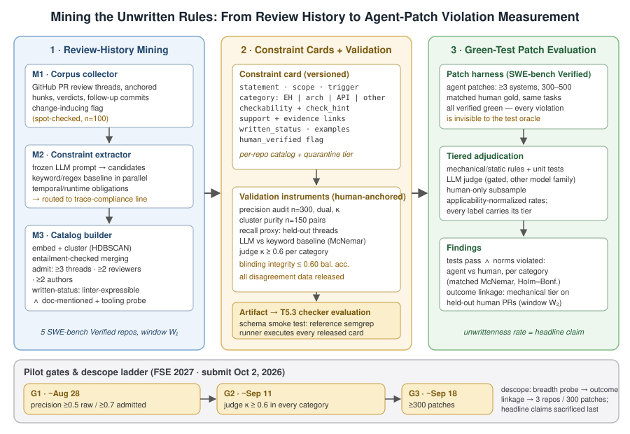

# 挖掘不成文的规则：从代码评审历史中抽取隐式设计约束，并测量绿测 agent 补丁对它们的违反

**目标会议：** FSE 2027（2026-10-02 截稿）。**状态：** 修订版完整草稿（2026-08-13），取代自动讨论包草稿；实验框架已恢复为经审计的 discussion.md 方案。

## 摘要

编码 agent（coding agent）如今能例行产出通过仓库全部测试套件的补丁，却仍无法通过人类评审：METR 报告约一半通过测试的 SWE-bench Verified agent PR 不会被维护者合并。"测试通过"与"人类接受"之间的落差，正是仓库**不成文**设计约束（implicit design constraint）栖身之处——错误处理规范、分层规则、API 惯例，这些由评审者在实践中强制执行，却未被任何测试、linter 或文档编码。我们提出首个满足以下条件的测量工具：(i) 从 PR 评审历史中挖掘这些约束，以*促成修改的评审评论*（change-inducing review comment，即某内联评论所锚定的代码行在后续提交中按评论要求被修改）作为约束被强制执行的行为证据；(ii) 将复现性证据（≥3 个线程、≥2 位评审者、≥2 位作者）汇聚为经验证、带版本的**约束卡片**（constraint card），包含作用域、触发条件、可检查性类别、支持计数与证据链接，其抽取精确率由双人独立标注审计（报告 κ）确立，而非 LLM 自评；(iii) 以仓库自身的 lint 配置与文档为对照测量每张卡片的**不成文率**（unwrittenness）；(iv) 在相同 SWE-bench Verified 任务上，测量绿测（green-test，通过全部测试）agent 补丁相对匹配的人类金标补丁的分类别违规率，因此发现的每个违规在构造上都对测试预言机（test oracle）不可见。一项预算受控的结果关联分析检验机械可检的违规是否能预测留出人类 PR 的首轮评审裁决。与用 LLM 判官验证按 issue 组织的设计约束的并行工作（arXiv 2604.05955）不同，我们的目录是仓库级、经复现性过滤、人工审计，并同时关联 agent-人类对比与真实评审结果；与在 agent 执行轨迹上做过程合规验证的工作（AgentLTL、MANTRA）不同，我们检查的是**制品**（artifact）——补丁文本——对从未被写下的规范的符合性。卡片制品作为下游自动检查器评测的输入契约发布。

**关键词：** 代码评审挖掘、隐式惯例、编码 agent、SWE-bench、接受落差、实证软件工程。

## 1 引言

当前一代编码 agent 已基本饱和了测试预言机：前沿系统能为很大比例的 SWE-bench 类任务产出绿测补丁。生产环境的证据表明**接受预言机**（acceptance oracle）并不同意。在一项由三个 SWE-bench Verified 仓库的活跃维护者评审 296 个 agent 生成 PR 的研究中，维护者的合并决定比自动评分器低约 24 个百分点——约一半通过测试的 PR 不会被合并进主干 [METR 2026]。野外 agent PR 的实地研究方向一致：45.1% 已合并的 agent PR 需要修订，其中包括针对项目特定标准的修订 [Watanabe et al. 2025]；agent 撰写的测试补丁中 80.2% 的断言信号弱或缺失，且断言强度独立地预测合并 [Banik et al. 2026]。

我们测量这一接受落差的一个候选机制——隐式约束违反——并量化其份额，而非整个落差。仓库 R 的**设计约束**是关于 R 中代码应如何编写的、复现性的、规定性的期望：评审者在实践中可证实地强制执行它，但 R 的任何机器可检或文档化制品都未将其编码。评审历史是恢复此类约束的独特优质基质：它已大规模存在（成熟开源项目携带 10⁴–10⁵ 条带锚定的评审评论、修订与裁决）；它是*行为上被验证的*——促成修改的评论记录了作者实际遵从的期望，比调查、访谈或 agent 规则文件中的陈述性偏好更强；且它由定义接受落差的同一预言机产出，因此挖掘出的约束在构造上就与合并相关。

并行工作证实问题真实存在，但测量工具仍未建成。*Does Pass Rate Tell the Whole Story?* [arXiv 2604.05955] 为 6 个 SWE-bench 对齐仓库中的 495 个 issue 验证了 1,787 条设计约束，发现功能正确的补丁中不到一半满足设计要求——但其约束按 issue 组织、由 LLM 验证器判定，且既未测量 agent-人类对比，也未关联真实合并结果。面向*成文*贡献规则的合规基准 [RepoComplianceBench, arXiv 2607.26819] 与 agent 运行的轨迹级过程验证 [AgentLTL, arXiv 2607.02599; MANTRA, arXiv 2605.06334] 处理的是规则已显式或合规对象是执行过程而非产出制品的互补情形。缺失的恰是维护者强制执行而基准遗漏的部分：*不成文*、复现性强制执行的设计约束的仓库级目录、经验证的抽取，以及绿测 agent 补丁相对匹配人类工作违反它们的频率的定量刻画。

**贡献。**
1. **经验证的挖掘工具。** 从 PR 评审线程到按仓库约束卡片目录的流水线，每个 LLM 阶段都以人工核验样本为锚：n=300 双人标注卡片精确率（双杆闸门：≥0.5 继续 / ≥0.7 可发表，Wilson 置信区间，κ）、聚类纯度审计、留出线程上的独立人工召回代理，以及界定 LLM 增益的非 LLM 关键词/祈使句基线。
2. **不成文率测量。** 两级操作化检验——`linter-expressible`（可被现有已配置规则或 ≤20 行自定义 semgrep/ruff 规则覆盖）与 `doc-mentioned`（文档中存在以可比具体度陈述该规则的句子）——量化被强制执行的规范中有多大比例无处成文。
3. **违规研究。** 在相同 SWE-bench Verified 任务上，对来自 ≥3 个 agent 系统的 300–500 个绿测 agent 补丁与匹配人类金标补丁，按类别（错误处理 / 架构惯例 / API 约定 / 其他）计算按适用性归一化的违规率（任务内 McNemar 配对，Holm–Bonferroni 校正），采用分层裁决（机械 / 静态 / 一致性闸门 LLM 判官——每类别 κ ≥ 0.6 / 人工），标注全程盲化并测量盲化完整性上界。
4. **结果关联。** 在不相交窗口的留出人类 PR 上：机械层违规对首轮评审裁决的逻辑回归（控制补丁规模与作者经验协变量）——在我们自己的数据内检验挖掘出的约束是否预测接受。
5. **可消费的制品。** 带版本约束卡片（陈述、作用域、触发、可检查性、支持、证据链接、成文状态、示例、人工核验标志），端到端冒烟测试后作为下游自动检查器评测（T5.3）的输入契约发布。

## 2 相关工作

**(a) 代码评审的实证基础。** Bacchelli & Bird [ICSE 2013] 确立现代评审的主要产出是惯例执行与知识传递而非仅缺陷发现；Sadowski et al. [ICSE-SEIP 2018] 记录了 Google 规模的评审作为规范执行；Bosu et al. [MSR 2015] 给出评论有用性分类。这些工作确立了现象，但产出的是人类可读的分类学，而非可对未见补丁检查的机器可用按仓库规则清单。

**(b) 评审活动自动化。** CodeReviewer [Li et al., ESEC/FSE 2022] 及 LLM 评审工作线学习 diff→评论映射；惯例知识潜藏于权重之中，未蒸馏出持久可审计制品，且面向缺陷的变体明确将惯例评论降级为"吹毛求疵"（nitpicks）——恰是我们瞄准的切片。代码评审基准综述 [Khan et al. 2026] 证实没有基准评测恢复出的*规范清单*。

**(c) 从代码历史归纳惯例与规则。** NATURALIZE [Allamanis et al., FSE 2014] 从代码学习表层惯例；Getafix [Bader et al., OOPSLA 2019] 从编辑学习修复模式；MUDetect/MUBench 挖掘 API 误用模式；经典规约挖掘（Ammons et al.；Daikon）从运行推断不变式。它们都仅从*代码或编辑*归纳规则，因此无法捕获唯一证据是评审者陈述理由的规范（分层规则、"在此边界禁止捕获裸 Exception"）；且都未测量 agent 合规。LintCFG [Zhang et al. 2026] 把*已陈述的*编码标准编译为 linter 配置——它预设规则已被写下，而我们的不成文率测量恰恰表明这常常为假。

**(d) agent 补丁的设计约束合规——最近邻。** *Does Pass Rate Tell the Whole Story?* [arXiv 2604.05955] 是最接近的并行工作：它从真实 PR 挖掘并验证设计约束（1,787 条，6 个与 SWE-bench Verified/Pro 对齐的仓库），并表明功能正确性与设计满足几乎无统计关联。我们承认共享论点，并在测量工具的每个轴上区分：其约束按单个 issue 索引、由 LLM 验证器判定；我们的是仓库级规范，仅在跨 ≥3 线程、≥2 评审者、≥2 作者复现时才被接纳，并由带预注册一致性阈值的双人审计验证；他们孤立测量 agent 合规，我们让 agent *与相同任务上的匹配人类金标*对比，并进一步将违规与*真实首轮评审结果*关联；且只有我们以仓库自身 lint/文档表面测量不成文率。RepoComplianceBench [arXiv 2607.26819] 评测 agent 对*成文*贡献规则（CONTRIBUTING/AGENTS 文件）的遵守；我们的对象是其补集——无处成文的规范。分类学层面的近邻 *From Correctness to Collaboration* [arXiv 2512.23844] 定性挖掘静态已成文规则文件与访谈，没有按仓库目录、支持计数、违规率或结果关联。

**(e) 边界：制品级设计符合 vs 轨迹级过程合规。** 一簇并行工作验证 agent 的*执行*是否符合过程性规约：AgentLTL [arXiv 2607.02599] 在 agent 轨迹上检查时序逻辑义务，MANTRA [arXiv 2605.06334] 执行轨迹级工作流合规。该工作线回答"agent 的*行为*是否遵守过程规则？"——运行时事件序列上的性质。我们回答"产出的*制品*——补丁文本——是否符合仓库的设计规范？"——源代码的静态性质，事后检查，从人类评审对话而非规约或轨迹中挖掘，被静态补丁检查器而非运行时监控器消费。路由规则是显式的：任何自然表述为运行时或工具调用事件上时序义务的候选不在本文范围内，归轨迹合规线；任何证据是评审对话文本的轨迹线候选归本文。二者是 agent 监督栈的互补层，互不包含。

**(f) agent PR 实地研究与 LLM 判官效度。** Watanabe et al. [2025]（567 个 Claude Code PR：接受率 83.8%，45.1% 需修订）、Peralta et al. [arXiv 2605.22534]（仅 35.7% 的 agentic PR 拒绝是明确的 agent 失败——工作流混杂不可忽视）、Patel et al. [arXiv 2606.21804]（agent 在 agent 代码上续作时解决率下降至多 13.1%，常规可维护性指标无法解释）以及 Banik et al. [arXiv 2606.18168] 支撑接受落差的动机，但止步于粗粒度类别。由于我们的流水线包含 LLM 阶段，我们采用 LLM-as-judge 可靠性文献中的一致性闸门判官设计：任何 LLM 标签在通过人工锚定的 κ 闸门前不得进入头条数字。

## 3 问题定义

**设计约束（操作化）。** 对仓库 R，约束由*促成修改的评审事件*作证：锚定到 diff 代码块的内联 PR 评论，且同一 PR 中稍后的提交按评论要求修改了被锚定的行。候选仅当语义等价候选在挖掘窗口内于 **≥3 个不同线程、来自 ≥2 位不同评审者与 ≥2 位不同 PR 作者**复现时才晋升为约束——复现性把项目规范与一次性修复或单个评审者的口味区分开。显式非约束：一次性缺陷报告、无复现性的个人偏好、范围/流程评论，以及时序/运行时义务（按 §2e 路由至轨迹合规线）。

**不成文（操作化）。** 晋升的约束是*不成文的*，当且仅当 `linter-expressible = false`（无现有已配置规则 id 覆盖它，且 ≤20 行自定义 semgrep/ruff 规则也无法覆盖）**且** `doc-mentioned = false`（无标注者能指出以可比具体度陈述该规则的文档句子——排除"优雅地处理错误"级别的空话）。头条不成文声明使用此合取；成文但被强制执行的卡片保留并打标。

**任务 1（挖掘）。** 输入：R 的 PR 评审语料（线程、锚定代码块、后续提交、裁决、合并状态）加 R 的形式化规则表面（lint 配置、文档）。输出：按仓库的**约束目录**（卡片模式见 §4.4）。质量：人工审计精确率、独立召回代理、不成文率。

**任务 2（违规测量）。** 输入：R 的目录；R 的 SWE-bench Verified 任务上的绿测 agent 补丁（公开榜单提交，≥3 个不同脚手架/模型家族）与*相同任务*的匹配人类金标补丁。输出：按补丁的违规标签（卡片 id、类别、file:line、裁决层、理由），聚合为按适用性归一化的分类别比率，agent vs 人类。由于每个被测补丁都验证为绿，发现的每个违规都对测试预言机不可见——本文的中心句。

**反循环性结构。** 目录从窗口 W₁（截至 SWE-bench 任务截止点）的 PR 中挖掘；违规在不相交任务的 agent 补丁上测量；结果关联使用不相交窗口 W₂ 的留出*人类* PR。目录被评分所依据的任何数据都未用于构建它：主张是过去的评审行为预测未来的接受行为——经验性主张，而非同义反复。

## 4 方法



*图1：流水线总览。M1 收集评审线程并计算促成修改标志；M2 用 LLM 抽取候选约束（关键词基线并行运行）；M3 以蕴含检验合并聚类、施加 ≥3/≥2/≥2 复现规则，并赋予成文状态、类别与可检查性。验证工具（精确率审计与闸门 G1、聚类纯度、召回代理、判官闸门 G2）位于目录与违规研究之间；违规研究以四层裁决对比绿测 agent 补丁与匹配人类金标，馈入结果关联回归与发布的卡片制品（下游检查器评测 T5.3 的输入契约）。*

### 4.1 挖掘流水线（M1–M3）

**M1——评审语料收集器。** 按仓库进行 GitHub GraphQL 采集：以（仓库, PR, 线程, 内联评论, 锚定代码块）粒度的线程，联结裁决、合并状态与后续提交。*促成修改*标志——PR 中稍后的提交修改了被锚定的行（经变基 diff 追踪后的行区间重叠）——本身在 100 个线程上抽检。窗口：每仓库近约 5 年，记录在每张卡片上以约束规范漂移。补丁在**首个可外部评审修订**（index revision）处对齐，使 agent 的首发输出永远不会与已经过评审修复的人类代码对比（采纳自自动讨论包草稿）。

**M2——约束抽取器。** 冻结且带版本的 LLM 提示将每条促成修改的评论（+ 锚定代码块 ± 20 行）映射为 `no_constraint`（一次性修复、提问、称赞、流程评论、时序/运行时义务 → 路由出）或候选记录 {祈使句陈述, 作用域猜测, 触发条件, 暂定类别, 证据链接}。**关键词/祈使句正则基线**（should/must/never/avoid + 代码元素提及）在相同输入上并行运行，以界定 LLM 的增益（线程级配对 McNemar）。

**M3——目录构建器。** 候选陈述经句向量嵌入并聚类（HDBSCAN, cosine）；聚类由 LLM 合并为规范卡片，合并仅在抽样的簇内配对通过人工*双向蕴含*审计后才被接受（采纳自草稿的等价判据：两个候选是同一规则，当且仅当在相同触发下满足其一必然满足其二）。接纳要求线程 ≥ 3 ∧ 评审者 ≥ 2 ∧ 作者 ≥ 2；未达阈值的候选隔离保留在制品中并打标。`written_status` 由 (a) 对照仓库已配置 lint 规则清单加 ≤20 行可表达性判断，与 (b) 文档检索加标注者确认赋值；**工具链执行探针**（tooling-enforcement probe）额外记录已配置检查是否在卡片的违例示例上确定性失败、在符合示例上通过。类别与可检查性由人工双标注；LLM 提议的可检查性单独保留为 `checkability_pred`，使其准确性本身在下游可测。

### 4.2 验证工具（在违规研究消费目录之前运行）

1. **卡片精确率：** 分层 n=300（仓库 × 类别 × 支持度），两位有软件工程经验的标注者（非提示词作者），盲化，裁决 ∈ {genuine, spurious, ambiguous}；报告 κ 与 Wilson 置信区间；**闸门 G1** 用前 100 张（§5.3）。预先承诺一轮编码手册修订（试标 50 → 修订一次 → 全量 300）；若"是否真约束"的 κ < 0.4 持续，论文转向关于该构念的可行性/否定结果。
2. **聚类纯度：** n=150 簇内配对，同规则/不同规则；纯度 < 0.8 强制以更紧阈值重聚类。
3. **召回代理：** 50–100 个留出线程由标注者独立挖掘；报告流水线的恢复比例。
4. **基线对比：** LLM vs 关键词抽取器，McNemar，α = 0.05。
5. **盲化完整性**（采纳自草稿）：标注者在每次标注补丁-卡片对后猜测补丁作者身份；研究报告平衡准确率及其 95% 置信区间，上界 > 0.60 视为盲化失败并连同受影响标签一并披露。

全部分歧数据公开发布。

### 4.3 违规研究（M4）与结果关联

**补丁集。** 来自公开 SWE-bench 实验仓库的试点仓库任务全部绿测 agent 补丁，取 3–5 个最高产出的不同脚手架/模型家族（避免单一模型的伪重复），过滤后目标 300–500 个，加相同任务的匹配人类金标补丁。任务内匹配使 agent-人类对比免疫于任务选择混杂。

**适用性。** 卡片通过作用域 glob + 触发谓词匹配补丁；歧义保守地判为 N/A；匹配器在 100 对上人工抽检。所有比率使用适用性分母：比率 = 违规数 / 适用数，按（类别, 补丁集）——任何类别都不会仅因其卡片最常适用而显得"最常被违反"。

**分层裁决。** (i) *机械/静态：* 由 `check_hint` 导出的 semgrep/AST 规则；每条规则携带由卡片违例/符合示例代码块构建的单元测试（必须标出前者、放过后者）加每规则 10 样本人工抽检；不合格规则降级至 LLM 层。(ii) *LLM 判官*，**按类别**施加一致性闸门：在 n=400（补丁, 卡片）对（每类别约 130 对）上相对双人人工标签 κ ≥ 0.6 方可规模化使用——**闸门 G2**；判官模型与所有被评测 agent 来自不同家族；未通过闸门的类别改由人工在预算子样本上裁决，并以更宽不确定度报告。(iii) *仅人工*卡片：预算子样本，单独报告。每个报告的违规都携带其裁决层。

**对比。** 分类别按适用性归一化比率，agent vs 人类金标，按类别配对 McNemar 加 Holm–Bonferroni；按仓库与按系统（系统 × 类别）矩阵，绝不只报汇总；卡方检验类别非均匀性。

**结果关联（预算受控形式）。** 在 W₂ 的留出人类 PR 上：每仓库每首轮裁决类别抽样 150 个 PR；仅运行机械/静态层卡片（不新增判官验证债务）；首轮结果（approved vs changes-requested）对违规计数的逻辑回归，控制 PR 规模、涉及文件数、作者既往合并 PR 数；陈述因果告诫。主张刻意谦逊：挖掘约束的*机械可检子集*预测结果。

**污染说明。** agent 训练数据可能包含被挖掘的评审线程；暴露使 agent 偏向*合规*，因此测得的违规率是下界——反而强化头条主张。

### 4.4 约束卡片制品（下游输入契约）

```yaml
card_id: django-EH-0007
repo: django/django
statement: "ORM 层代码禁止捕获裸 Exception；须捕获最窄的适用子类。"
category: error_handling            # error_handling | arch_convention | api_convention | other
scope: {paths: ["django/db/**"], exclude: ["**/tests/**"]}
trigger: "diff 新增 except 子句"
checkability: static                # mechanical | static | llm | human_only
checkability_pred: static           # LLM 提议值，保留用于元评测
check_hint: "semgrep: except Exception: within django/db/"
support: {threads: 5, reviewers: 3, authors: 4, window: "2019-01..2024-06"}
evidence: [{pr: 14231, comment_url: "...", revision_commit: "abc123"}]
written_status: {linter_expressible: false, doc_mentioned: false, tooling_enforced: false}
examples: {violating_hunk: "...", conforming_hunk: "..."}
provenance: {extractor: "model+prompt v1.3", human_verified: true}
validation: {audit_round: 1, annotators: 2, verdict: genuine}
```

下游检查器研究（T5.3）需要的字段——`statement`、`scope`+`trigger`、`checkability`+`check_hint`、`examples`、`human_verified`——均为一等公民。发布前，一个平凡参考检查器（对 `checkability=mechanical` 卡片的 semgrep 运行器）对每张发布卡片端到端执行，作为模式冒烟测试。

## 5 实验设计

### 5.1 数据集与规模

- **评审语料：** 5 个 SWE-bench Verified 仓库（候选：django、scikit-learn、sympy、matplotlib、sphinx；W1 体量审计后定稿，阈值为窗口内 ≥2k 条促成修改评论）。预期经 M2 处理 10k–40k 条促成修改评论。
- **补丁语料：** 上述仓库的 SWE-bench Verified 任务 × ≥3 个 agent 系统的绿测提交 → 300–500 个 agent 补丁 + 匹配金标。
- **留出结果集：** W₂ 窗口抽样的人类 PR（每仓库每裁决类别 150 个），带首轮裁决。
- **广度探针：** 在 2 个非 Python 重评审文化仓库（一个 Rust、一个 TypeScript）上仅运行挖掘；报告目录产出量 + 30 卡精确率抽检；界定"仅限 Python 流水线"的质疑。

### 5.2 指标（W1 预注册）

| 指标 | 定义 | 目标/闸门 |
|---|---|---|
| 约束产出量 | 每 1k 促成修改评论的接纳卡片数，按仓库 | 描述性 |
| 抽取精确率 | 抽样卡片双人判定为真的比例（Wilson CI, κ） | **G1：前 100 原始 ≥0.5；接纳卡片 ≥0.7 方可作头条** |
| 召回代理 | 标注者在留出线程中发现且被流水线恢复的约束比例 | 描述性, CI |
| 不成文率 | linter-expressible=false ∧ doc-mentioned=false 的卡片比例 | 若过半即头条 |
| 判官效度 | 每类别 κ(LLM 判官, 双人人工)，n=400 对 | **G2：每类别 κ ≥ 0.6** |
| 违规率 | 按适用性归一化，类别 × 系统，agent vs 金标（McNemar, Holm–Bonferroni） | 头条 |
| 结果相关 | 机械层违规 → 首轮裁决（逻辑回归，协变量） | 支持性 |
| 基线增量 | LLM vs 关键词抽取器（McNemar） | 支持性 |
| 盲化完整性 | 作者身份猜测的平衡准确率 | 上界 > 0.60 即披露 |

### 5.3 通过/中止闸门与降规模阶梯

- **G1（W2 末，约 Aug 28）：** 前 100 卡精确率 ≥ 0.5。失败 → 一轮提示/过滤修订（≤4 天）；再失败 → 转向可行性/否定结果，或降规模至精确率成立的仓库。G1 之前不再投入。
- **G2（W4 中，约 Sep 11）：** 每类别判官 κ ≥ 0.6；未达类别改人工回退。
- **G3（W5 末，约 Sep 18）：** 违规研究在 ≥300 补丁、≥3 系统上完成；缺口如实报告并附 CI。
- **降规模阶梯：** Sep 11 落后 → 砍广度探针；Sep 15 → 结果关联移入未来工作；Sep 18 → 降至 3 仓库 / 300 补丁。两个头条主张（经验证的抽取；绿补丁上的违规率）最后牺牲。若 Oct 2 滑期的后备场所：FSE 第二轮（如有），否则 ISSTA 2027 / ICSE 2028，并把二阶段扩展（更多仓库/语言）折入。

### 5.4 里程碑（自 Oct 2 倒推；今日 Aug 13）

| 周 | 日期 | 交付物 |
|---|---|---|
| W1 | Aug 13–20 | 体量审计 + 仓库定稿；采集器上线；卡片模式 v0 对照 T5.3 需求冻结；标注者档期承诺（2 × 约 45 小时）；预注册（指标、闸门、α）；新颖性扫描 + 引文核验清单；引言/相关工作起稿 |
| W2 | Aug 21–28 | 2 仓库上运行 M2；100 卡审计 → **G1**；如需则修订编码手册 |
| W3 | Aug 28–Sep 4 | 5 仓库全量挖掘；聚类 + 目录；双人标注（300 卡 + 纯度配对）；检查器开工（仅需模式 + 早期卡片）；广度探针启动 |
| W4 | Sep 4–11 | 目录验证完成（精确率/召回/不成文率）；机械规则 + 单元测试完成；判官样本 → **G2** |
| W5 | Sep 11–18 | 违规研究全量；结果关联回归 → **G3** |
| W6 | Sep 18–25 | 分析冻结；图表；卡片制品 v1.0 + 冒烟测试 + 交接说明；全文草稿 |
| W7 | Sep 25–Oct 1 | 内部评审、威胁章节、制品打包（提示词、目录、标签、分歧数据）；Oct 2 提交 |

预算：无训练；约 30k–80k 次 LLM API 调用（M2 + 判官），数百美元量级；W2–W5 约 90 标注者小时，标注关键路径显式串行化（卡片审计严格先于判官验证）。

### 5.5 移入未来工作

自动讨论包的处置/轨迹研究计划——五路关闭分解、评审者介入的必要性重放、跨仓库留出的增量处置预测（其 RQ17–RQ21）——方法上有吸引力，但需要 10⁴ 量级、来源可证实的野外 agent PR 队列与数千标注者小时，与本周期不相容。我们在预算受控的结果关联回归中保留其分析目标，并将完整计划列为卡片制品建成后的自然延伸。

## 6 效度威胁

**构念效度。** 约束由评审者执行行为定义；可见性偏差意味着目录仅捕获*被评审者揭示的*规范——是规范全集的下界，且是保守的下界：agent 仅被对照评审者可证实执行的规范检查。CHANGES_REQUESTED 混杂了惯例违规与范围/时机分歧；裁决仅经促成修改过滤器进入挖掘阶段，并在关联分析中作为带协变量的结果变量。**内部效度。** LLM 抽取与判官由人工一致性闸门（G1、G2、按类别）把守；机械规则携带单元测试；盲化完整性被测量而非假设。结果关联中的作者经验混杂经协变量控制并附因果告诫。**外部效度。** 主张限定于成熟 Python 开源项目；全程按仓库报告；广度探针界定语言依赖。agent 系统异质性按系统世代报告。**污染。** 训练暴露于被挖掘线程使 agent 偏向合规；测得比率为下界。

## 7 结论

对编码 agent 而言，通过测试已不再是瓶颈；被拥有代码的人接受才是。我们把接受过程的记录——促成修改的评审评论及满足它们的修订——转化为首批经验证的、仓库级的不成文设计约束目录，测量绿测 agent 补丁相对匹配人类工作违反它们的频率，并检验这些违规是否预测真实评审结果。测量工具、闸门与发布的卡片制品的设计使每个头条数字都锚定于人工审计量，并使自动检查器评测可以直接消费这些目录。

## 参考文献

- Bacchelli, A., Bird, C. Expectations, Outcomes, and Challenges of Modern Code Review. ICSE 2013.
- Sadowski, C. et al. Modern Code Review: A Case Study at Google. ICSE-SEIP 2018.
- Bosu, A. et al. Characteristics of Useful Code Reviews. MSR 2015.
- Allamanis, M., Barr, E.T., Bird, C., Sutton, C. Learning Natural Coding Conventions (NATURALIZE). FSE 2014.
- Bader, J. et al. Getafix: Learning to Fix Bugs Automatically. OOPSLA 2019.
- Amann, S. et al. MUBench (MSR 2016); MUDetect (ESEC/FSE 2019).
- Li, Z. et al. Automating Code Review Activities by Large-Scale Pre-training (CodeReviewer). ESEC/FSE 2022.
- Jimenez, C.E. et al. SWE-bench: Can Language Models Resolve Real-World GitHub Issues? ICLR 2024.
- Aleithan, R. et al. SWE-Bench+: Enhanced Coding Benchmark for LLMs. arXiv:2410.06992.
- METR. Many SWE-bench-Passing PRs Would Not Be Merged into Main. METR research note, 2026-03-10.
- Anonymous. Does Pass Rate Tell the Whole Story? Evaluating Design Constraint Compliance in LLM-based Issue Resolution. arXiv:2604.05955, 2026.
- Anonymous. A First Look at Coding Agents' Compliance with AI Contribution Rules in Open-Source Communities (RepoComplianceBench). arXiv:2607.26819, 2026.
- AgentLTL: temporal-logic compliance checking of agent executions. arXiv:2607.02599, 2026.
- MANTRA: trace-level workflow compliance for coding agents. arXiv:2605.06334, 2026.
- Dong et al. From Correctness to Collaboration. arXiv:2512.23844.
- Watanabe, M. et al. On the Use of Agentic Coding: An Empirical Study of Pull Requests on GitHub. arXiv, 2025.
- Peralta, S.R.O. et al. Why Are Agentic Pull Requests Merged or Rejected? arXiv:2605.22534, 2026.
- Patel, S. et al. Is Agent Code Less Maintainable Than Human Code? arXiv:2606.21804, 2026.
- Banik, D. et al. All Smoke, No Alarm: Oracle Signals in Agent-Authored Test Code. arXiv:2606.18168, IEEE AITest 2026.
- Sawada, S. et al. To What Extent Does Agent-generated Code Require Maintenance? arXiv:2605.06464, 2026.
- Zhang, Z. et al. Still Manual? Automated Linter Configuration via DSL-Based LLM Compilation of Coding Standards (LintCFG). 2026.
- Khan, T.I. et al. A Survey of Code Review Benchmarks and Evaluation Practices. 2026.
- Zhang, X. et al. Pull Request Decisions Explained: An Empirical Overview. IST.
- Lenarduzzi, V. et al. Does Code Quality Affect Pull Request Acceptance? An Empirical Study.
