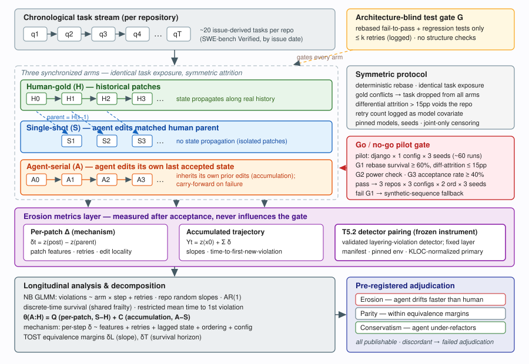

# Matched Trajectory Decomposition of Structural Erosion from Serial AI Coding Agent Patches

## Abstract

AI coding agents make implicit architectural decisions, and recent long-horizon evaluations report that agent-maintained code degrades over iterated tasks. What these evaluations cannot establish is whether the degradation is *erosion* — structural decay in excess of what matched human maintenance would produce on the identical task sequence — or merely the ordinary structural cost of change, nor whether it originates in individual patches or in the accumulation of agent-edited state. We propose a pre-registered, repository-grouped, pilot-gated design that synchronizes three arms on identical chronological task sequences drawn from real repositories: human-gold (historical patches), agent-serial (the agent edits its own last accepted state), and single-shot (the agent edits the matched human parent, with no state propagation). All arms share an architecture-blind functional test gate, deterministic rebasing, symmetric attrition rules, and state carry-forward. At every accepted checkpoint, a frozen structural instrument — the design-violation detector configuration validated in our companion single-edit study (T5.2) — measures newly introduced forbidden layering dependencies as the primary endpoint, with complexity, coupling, and clone measures as secondaries. Hierarchical longitudinal and survival analyses estimate step-by-arm degradation and time to first new violation; the matched single-shot contrasts decompose the agent–human trajectory difference into a per-patch quality effect and an accumulation effect; and per-patch mechanism profiling attributes erosion rate to patch features, retry pressure, agent configuration, and task ordering. Pre-registered equivalence margins adjudicate erosion, parity, or conservatism as symmetric, equally publishable outcomes. A staged pilot with hard go/no-go gates on rebase survival, statistical power, and agent acceptance rate controls scale-up and triggers a synthetic-sequence fallback if real chronological sequences prove unconstructible.

## Introduction

AI coding agents increasingly modify production repositories through sequences of issue-resolution tasks. Although each accepted patch may satisfy its functional tests, agents also make implicit architectural decisions about component boundaries and dependencies. Evidence that prompt wording alone can induce structurally different implementations indicates that architecture is an agent-affected quality dimension. Functional tests verify externally observable behavior but generally do not reveal whether a change introduces forbidden dependencies, increases coupling, duplicates logic, or concentrates complexity. Repository maintainers therefore need evidence about whether repeated agent edits preserve software structure or gradually increase future review and integration burden — and, if structure does degrade, what the degradation rate depends on.

The existence of long-horizon degradation in agent-maintained code is no longer an open question, and we do not claim it as one. SlopCodeBench (arXiv:2603.24755) tracks a structural-erosion metric over iterative agent tasks and reports erosion rising in 80% of trajectories, with agent code scoring 0.68 against 0.31 for human-maintained repositories; SWE-Milestone/EvoClaw (arXiv:2603.13428) shows agent scores collapsing from above 80% to at or below 38% when isolated tasks become continuous evolution over milestone DAGs; Regression Accumulation (arXiv:2607.01855) documents functional regressions accumulating across 40–73% of multi-turn programming tasks; and Zhu, Tsantalis, and Rigby (arXiv:2605.02741) show that correctness and structural quality of LLM-generated code are decoupled. What none of these studies provides is *identification*. Their degradation is measured on synthetic self-extended code, on functional integrity, or without any counterfactual: no arm tells us what a human maintainer would have done to the same repository on the same chronological task sequence, so observed decay conflates agent-specific erosion with the structural cost any sequence of changes imposes. Nor can they say whether degradation comes from individually worse patches or from patches interacting with previously agent-modified state — the distinction that determines whether the remedy is per-patch review or trajectory-level control.

Resolving the identification question requires three things that snapshot studies and single-arm long-horizon benchmarks lack. First, a matched human counterfactual: erosion must be defined as a *contrast* — the difference in structural trajectory between agent and human arms on the identical task sequence — because necessary coupling (a feature legitimately adding a dependency) appears in both arms and cancels. This definition makes erosion, parity, and conservatism (agents under-refactoring and thus drifting *slower* than humans) symmetric, adjudicable outcomes rather than a presupposed direction. Second, an isolation arm: a single-shot control in which the same agent patches the matched human parent without inheriting its own prior edits, enabling the decomposition of the agent–human difference into a per-patch effect and an accumulation effect. Third, an artifact-level, pre-registered endpoint: newly introduced forbidden dependency edges against a layer manifest frozen before any run, measured by an instrument whose sensitivity and specificity are validated independently — in our case, inherited from the companion single-edit study T5.2 — so that structural measurement never contaminates the architecture-blind acceptance gate.

A valid comparison must additionally preserve chronological task order and repository dependence while handling rebases, failures, and attrition symmetrically; otherwise arm-specific success induces selection bias. And because per-step structural deltas are small relative to step-to-step variability, the analysis must be longitudinal by construction: hierarchical models over repeated, serially dependent observations, not before/after snapshots.

We address this gap by treating each chronological repository task as a synchronized comparison opportunity. Human-gold patches are applied along the historical trajectory, agent-serial patches modify the last accepted agent state, and single-shot patches modify the corresponding human-gold parent. Deterministic rebasing, state carry-forward, and arm-symmetric censoring preserve comparability without conditioning observations on arm-specific patch success. After architecture-blind functional acceptance, every checkpoint is analyzed in a pinned environment using the T5.2-validated, baseline-fixed executable layer specification; newly introduced forbidden dependencies form the primary endpoint, with complexity, coupling, and clone measures as secondary outcomes. Hierarchical longitudinal and survival analyses jointly adjudicate erosion, parity, or conservatism; matched single-shot–human-gold and agent-serial–single-shot contrasts estimate per-patch and accumulation effects; and mechanism profiling regresses per-step structural deltas on patch features, retry counts, agent configuration, and ordering to answer the second half of the research question: what does the erosion rate depend on? The study is deliberately piloted: a single-repository pilot must pass hard gates on rebase survival, differential attrition, detectable effect size, and agent acceptance rate before the multi-repository factorial is run, with a pre-declared synthetic-sequence fallback if real chronological sequences cannot be constructed at sufficient survival rates.

## Contributions

- We propose a synchronized three-arm trajectory design (human-gold, agent-serial, single-shot) that, unlike existing long-horizon degradation benchmarks, identifies erosion as a contrast against matched human maintenance on identical real-repository task sequences, under symmetric execution and attrition rules.
- We formalize a longitudinal effect decomposition — agent–human trajectory difference = per-patch quality effect + accumulation effect — together with a pre-registered, two-sided adjudication of erosion, parity, or conservatism using equivalence margins, in which all three outcomes are publishable findings.
- We restore mechanism to the measurement: a per-patch profiling and attribution framework (patch features, retry pressure, agent configuration, task ordering, lagged erosion state) that estimates what the erosion rate depends on, not only whether erosion occurs.
- We specify a feasibility-first execution protocol: reuse of the T5.2-validated design-violation detector as the frozen per-step instrument, a piloted scale with hard go/no-go gates, and a pre-declared fallback — making the study runnable within a low-thousands-USD, 2–3 person-month envelope.

## Problem Definition

### Formal Problem Definition

Let \(\mathcal{R}\) denote the set of study repositories. Each repository \(r\in\mathcal{R}\) provides a chronologically ordered task sequence \(Q_r=(q_{r1},\ldots,q_{rT_r})\), where \(T_r\approx 20\) tasks per repository with a pre-registered floor of \(T_r\ge 12\) surviving steps after rebase attrition. Every sequence is executed under three arms: agent-serial (\(A\)), human-gold (\(H\)), and isolated single-shot (\(S\)). The human-gold arm is a comparison trajectory, not an error-free ground truth.

For each serial arm \(a\in\{A,H\}\), let \(x^a_{rt}\) be the repository state after task \(q_{rt}\), with a common initial state \(x_{r0}\). An accepted patch \(p^a_{rt}\) induces the transition
\[
x^a_{rt}=p^a_{rt}(x^a_{r,t-1}).
\]
Acceptance is determined by a functional test gate \(G\) (rebased fail-to-pass tests plus the regression suite, with at most \(k\) retries), such that \(G(p^a_{rt},x^a_{r,t-1},q_{rt})=1\) for an accepted step. The gate may use test outcomes but must not use structural measurements. The retry count \(k^a_{rt}\) consumed at each step is logged and enters the analysis as a covariate. In the single-shot arm, each patch \(p^S_{rt}\) is instead applied to the matched human-gold parent \(b_{rt}=x^H_{r,t-1}\):
\[
x^{S,+}_{rt}=p^S_{rt}(b_{rt}),
\]
and \(x^{S,+}_{rt}\) is not propagated to task \(q_{r,t+1}\).

Let \(F\) be the single static-analysis instrument — the frozen detector configuration validated in T5.2 — used with an invariant version and configuration across all repositories, steps, and arms. For a repository state \(x\), it returns
\[
F(x)=\bigl(V(x),z_1(x),\ldots,z_M(x)\bigr),
\]
where \(V(x)\) is the set of detected layering violations against the baseline-fixed layer manifest and \(z_m(x)\) is a pre-registered structural measure. Define \(z_1(x)=|V(x)|\) as the primary endpoint, with cyclic-dependency count as co-primary; the remaining measures represent complexity, coupling, and cloning as secondary endpoints, computed on production code only. Metric orientations are fixed before execution so that larger values consistently denote greater structural degradation.

For each metric \(m\), the task-local structural change is
\[
\delta^a_{rtm}=
\begin{cases}
z_m(x^a_{rt})-z_m(x^a_{r,t-1}), & a\in\{A,H\},\\[3pt]
z_m(x^{S,+}_{rt})-z_m(b_{rt}), & a=S.
\end{cases}
\]
The corresponding cumulative measurement is
\[
Y^a_{rtm}=z_m(x_{r0})+\sum_{j=1}^{t}\delta^a_{rjm}.
\]
For \(A\) and \(H\), this equals the measurement of the accumulated repository state. For \(S\), it defines a counterfactual trajectory obtained by summing isolated patch effects without propagating state between tasks.

For arms \(a,b\in\{A,H,S\}\), define the paired trajectory contrast
\[
D^{a:b}_{rtm}=Y^a_{rtm}-Y^b_{rtm}.
\]
Let \(u_{rt}\) be the pre-registered encoding of chronological step position. The step-by-arm interaction \(\theta^{a:b}_m\) is estimated with a repository-grouped model; equivalently,
\[
(\widehat{\boldsymbol{\alpha}}_m,\widehat{\theta}^{a:b}_m)
=
\arg\min_{\boldsymbol{\alpha}_m,\theta}
\sum_{(r,t)\in\Omega}
w_{rt}
\left(D^{a:b}_{rtm}-\alpha_{rm}-\theta u_{rt}\right)^2,
\]
where \(\alpha_{rm}\) is a repository-specific effect, \(w_{rt}\) is a pre-registered weight, and \(\Omega\) is the analysis set produced by the arm-symmetric rebase and attrition policy (primary contrasts are restricted to the task intersection completed by all arms). The primary trajectory effect is \(\widehat{\theta}^{A:H}_1\): positive values indicate faster accumulation of layering violations under agent-serial execution, negative values slower accumulation, and values within a pre-registered equivalence region indicate parity.

For each serial arm \(a\in\{A,H\}\), define the time to first newly introduced layering violation as
\[
\tau_{ra}=\inf\left\{t:V(x^a_{rt})\setminus V(x^a_{r,t-1})\neq\varnothing\right\},
\]
with right-censoring when no event occurs within \(T_r\) steps. Repository-grouped time-to-event distributions and a pre-registered contrast \(\widehat{\Delta}_{\tau}^{A:H}\) compare the two serial arms. A total, pre-registered adjudication function
\[
\mathcal{J}\!\left(\widehat{\theta}^{A:H}_1,\widehat{\Delta}_{\tau}^{A:H}\right)
\in\{\text{erosion},\text{parity},\text{conservatism}\}
\]
combines the primary interaction and time-to-event evidence. Greater degradation and earlier violation under \(A\) count as erosion, practical equivalence as parity, lower degradation and later violation as conservatism; handling of discordant estimates is fixed before observing outcomes (reported as failed adjudication, never resolved post hoc).

The isolated arm provides the per-patch quality effect
\[
\widehat{Q}_m=\widehat{\theta}^{S:H}_m,
\]
whereas the effect attributable to accumulated agent state is
\[
\widehat{C}_m=\widehat{\theta}^{A:S}_m
=\widehat{\theta}^{A:H}_m-\widehat{\theta}^{S:H}_m.
\]
Thus the overall agent–human trajectory difference decomposes as
\[
\widehat{\theta}^{A:H}_m=\widehat{Q}_m+\widehat{C}_m.
\]

Finally, let \(\phi_{rt}\) denote the pre-registered per-patch mechanism features (size, files and modules touched, new import edges, layer-crossing flags, duplication delta, edit locality, retry count). The attribution model regresses \(\delta^a_{rtm}\) on \(\phi_{rt}\), agent configuration, ordering condition, and lagged structural state \(Y^a_{r,t-1,m}\) within trajectories, estimating what the erosion rate depends on without requiring additional trajectories.

Valid estimation requires identical chronological task sequences, symmetric rebase and attrition rules, architecture-blind test gating, invariant structural measurement, preservation of repository grouping, and propagation of accumulated state only in the serial arms.

## Challenges

The problem is technically difficult because the observations \(Y^A_{rtm}\) are path-dependent: each transition operates on \(x^A_{r,t-1}\), so a large \(\widehat{\theta}^{A:H}_m\) may arise from individually harmful patches, interactions with prior edits, or both; separating these mechanisms requires the counterfactual single-shot construction and the decomposition into \(\widehat{Q}_m\) and \(\widehat{C}_m\). Sequence construction is the named hard part: tasks and their fail-to-pass tests were authored against true historical base commits, and after the agent's edits diverge from history, later tasks may not apply — rebase attrition is not a logging nuisance but a selection threat, since surviving tasks may be systematically easier and attrition may differ between arms, contaminating the primary contrast. Human-gold patches face the same divergence problem in reverse, and any hand-fixing would inject experimenter edits into the control arm. The gate \(G\) must remain independent of \(F\), because conditioning acceptance on \(V(x)\) or \(z_m(x)\) would bias both the interaction and \(\tau_{ra}\); yet the retry mechanism inside \(G\) creates its own confound, since retry pressure may correlate with both task difficulty and structural damage. Per-step structural deltas are small against step-to-step variability driven by patch sizes spanning orders of magnitude, requiring hierarchical longitudinal inference rather than snapshots, and power at pilot scale is not guaranteed. Finally, layering violations may pre-exist in \(x_{r0}\), may appear and later disappear, and may be censored before \(T_r\); the survival analysis must isolate newly introduced violations and handle incomplete event times consistently with the count-based endpoint. A latent feasibility risk sits underneath all of this: if the agent's acceptance rate is low, carry-forward keeps checkpoints "measurable" while the serial arm's state rarely changes, silently destroying the erosion signal — which is why acceptance rate is a hard pilot gate rather than an assumption.

## Method Overview

The framework takes pre-registered, chronologically ordered repository tasks and their historical human patches as input and produces matched development trajectories for human-gold, agent-serial, and single-shot editing. Each arm encounters the same task opportunities and the same architecture-blind functional acceptance gate, after which every accepted checkpoint enters the frozen T5.2 structural instrument. The resulting longitudinal measurements support trajectory-level adjudication of architectural erosion, parity, or conservatism; the matched contrasts distinguish isolated patch effects from effects of accumulated agent-edited state; and per-patch mechanism profiling attributes the observed rates to measurable causes.

*Figure 1: Overview of the experimental architecture. A chronological task stream from real repository history feeds three synchronized arms — human-gold (historical patches), agent-serial (agent edits its own last accepted state), and single-shot (agent edits the matched human parent, no propagation) — all governed by the same architecture-blind test gate and symmetric rebase/attrition protocol; every accepted checkpoint is measured by the frozen T5.2 design-violation detector, and the load-bearing comparison is the step-by-arm contrast that decomposes the agent–human trajectory difference into a per-patch effect (S−H) and an accumulation effect (A−S), gated by a go/no-go pilot before scale-up.*

The synchronized task-opportunity panel constructs comparable trajectories while preserving repository membership, task order, parent revisions, and accumulated state. Human-gold applies the historical patch, agent-serial edits its latest accepted state, and single-shot edits the corresponding human-gold parent. Symmetric rebase, rejection, carry-forward, and censoring rules address conflicts, failures, and attrition without selecting observations by arm-specific success; primary contrasts are restricted to the task intersection completed by all arms, and differential attrition beyond 15 percentage points between arms voids the primary contrast for that repository.

The frozen structural instrument extends evaluation beyond functional correctness by measuring newly introduced layering violations together with changes in complexity, coupling, and clone coverage at every checkpoint. The layering-violation detector is T5.2's validated configuration reused verbatim against a baseline-fixed executable layer manifest, in a pinned measurement environment; structural scores are computed only after functional acceptance is recorded, so architectural measurement never influences patch selection. Instrument validity is inherited from T5.2's mutation-based validation and confirmed on the study repositories by a small transfer probe rather than re-derived at scale.

The hierarchical longitudinal analysis estimates arm differences over successive tasks while accounting for repository dependence, repeated measurements, attrition, and serially accumulated state. Longitudinal count models characterize the rate and trajectory of structural violations; survival models estimate differences in the timing of the first new violation; the matched single-shot contrasts implement the decomposition; and the mechanism model regresses per-step deltas on patch features, retry counts, configuration, ordering, and lagged state. Pre-registered margins adjudicate erosion, parity, conservatism, or inconclusive evidence.

## Methodology

### Synchronized Trajectory Construction

Rebases, patch failures, and attrition must be handled symmetrically across editing arms without disturbing chronological task order or introducing selection based on arm-specific success. Otherwise differences in structural evolution may reflect incomparable task exposure rather than the effects of isolated or accumulated edits.

The central design principle is to synchronize comparison opportunities at the repository–task level and preserve state after unsuccessful edits. Task sequences are drawn from SWE-bench Verified instances grouped by repository and ordered by issue creation date; primary repositories are django/django, sympy/sympy, and astropy/astropy, the repositories with the densest verified chronological coverage. Each task runs in the benchmark's container environment against the current evolved checkout of its arm — not the instance's original base commit — with the task's fail-to-pass tests mechanically rebased onto that checkout.

At each opportunity, the human-gold arm applies the corresponding historical patch under the identical mechanical rebase procedure as the agent arms; gold patches that conflict are dropped, and the same task is then dropped from all arms (the intersection rule), never hand-fixed — keeping the control arm experimenter-free. The agent-serial arm edits its most recent accepted state; the single-shot arm edits the human-gold parent associated with the same task. Thus the serial arm inherits prior agent edits, whereas the single-shot arm estimates patch behavior without inherited agent-generated state.

Both agent arms operate under the same fixed generation budget and frozen functional test suite: rebased fail-to-pass tests plus the regression suite, exactly the SWE-bench correctness definition, with no linters and no structure checks — so every counted violation is one the test gate admitted. For each arm, the first candidate patch that passes the gate within at most \(k\) retries is retained, and the retry count is logged as a per-step covariate. If no candidate passes, or a patch conflicts under the deterministic rebase procedure, the arm retains its preceding state and advances to the next synchronized task; carry-forward preserves the task opportunity and records failure without converting it into arm-specific attrition. Loss of infrastructure required to replay or evaluate a task triggers joint censoring of all arms at that opportunity; patch failure within an individual arm does not.

Reproducibility is built into the harness: pinned model versions and temperatures, fixed seeds per trajectory, at least one fully re-runnable open-weight arm, and release of all accepted-patch sequences and per-step snapshots. The panel retains repository identity, chronological task position, parent hashes, patch-attempt outcomes, retry counts, and acceptance indicators for every checkpoint.

### Architecture-Aware Structural Measurement (T5.2 Instrument Pairing)

Structural outcomes must remain comparable across repositories, editing arms, and evolving revisions, and the measurement process must remain independent of functional acceptance so that architecture-aware signals never contaminate the common test gate.

The per-step instrument is not built here: it is the design-violation detector validated in the companion single-edit study T5.2, whose frozen configuration (executable import-linter layer contracts derived once per repository from documented package structure and baseline build boundaries) is reused verbatim. T5.2 establishes, on design-violating-but-test-equivalent mutants, that the detector distinguishes forbidden dependencies from compliant refactorings; T5.4 points that validated microscope at a time series. Any construct-validity criticism resolved in the T5.2 paper therefore transfers, and the two studies cross-cite as a designed pair. Adjudicators freezing each repository's manifest are blinded to arm outcomes, and the manifest remains fixed throughout the trajectory.

The primary outcome is the number of newly introduced forbidden dependency edges, normalized by production KLOC; cyclic-dependency count (modules in strongly connected components of size >1) is co-primary. A forbidden edge is a production-code dependency violating the direction or boundary constraints of the layer manifest; newly introduced edges are identified relative to the preceding synchronized checkpoint, distinguishing structural additions from violations already present at baseline. Secondary outcomes are baseline-differenced function complexity, module coupling, architectural smells, and token-clone coverage, computed on production code only (test code reported separately in the appendix). All structural scores are computed only after the frozen acceptance decision is recorded; rejected patches produce carried-forward checkpoints, never structurally screened alternatives.

Instrument validity on the study repositories is confirmed by a small transfer probe rather than re-derived: approximately 40 labeled mutations (seeded forbidden dependencies and dependency-preserving refactorings, adjudicated blind to detector output) across the three repositories, plus a blinded expert construct check of ~60 sampled snapshots. Determinism is assessed by repeated clean evaluations of a stratified checkpoint sample in fresh pinned containers.

### Longitudinal Effect Decomposition and Mechanism Attribution

The analysis must distinguish systematic change per maintenance step from degradation caused specifically by inheriting agent-edited state, while accounting for repeated observations, repository dependence, attrition, and temporal correlation induced by accumulated revisions — and it must then explain the rate, not only detect it.

The primary violation counts are analyzed with an inverse-censoring-weighted hierarchical negative-binomial model with a production-KLOC offset. Fixed effects include editing arm, centered chronological step, their interaction, and the logged retry count; random effects include repository(:seed) intercepts and slopes, with an AR(1) trajectory term for residual serial dependence. The arm-by-step interaction estimates whether violations accumulate at different rates across arms; Mann–Kendall tests per trajectory provide a nonparametric check, and Cliff's delta on per-trajectory slopes provides a distribution-free effect size. Analogous hierarchical models are applied to co-primary and secondary endpoints with Holm–Bonferroni correction across metric families, and the correlation matrix among metrics is reported as a supplement.

The timing of the first newly introduced layering violation is analyzed with a discrete-time survival model with shared repository frailty; restricted mean time to first violation over the planned horizon provides a temporal estimand complementary to the count-based effect.

At matched tasks, the accepted single-shot-minus-human-gold contrast estimates the per-patch effect of an agent-generated change applied to a human-maintained parent; the agent-serial-minus-single-shot contrast estimates the accumulation effect attributable to inherited agent-edited state. Because both contrasts are task-matched, they separate state inheritance from differences in task sequence or repository composition.

Mechanism attribution proceeds without additional trajectories. A per-patch profiler records, for both agent and human patches: LOC added/removed, files and modules touched, new import edges with layer-crossing flags, duplication delta, and edit locality (graph distance among touched modules). Paired Wilcoxon tests compare agent versus human patch features on the same tasks; within-trajectory regressions of per-step structural deltas on patch features, retry count, agent configuration, ordering condition, and lagged structural state estimate the correlates of erosion rate, including the compounding question — whether prior erosion accelerates subsequent erosion (a lagged-state effect). Ordering effects are probed directly by the two-orderings design plus a random-order control arm. Because the three agent configurations do not fully cross scaffold and backbone, attribution claims are worded as "agent configuration" effects; one crossed cell (same scaffold × open-weight backbone) is added if budget allows as a minimal scaffold-versus-backbone probe.

Erosion, parity, and conservatism are adjudicated using 95% intervals and pre-registered practical-equivalence margins: a longitudinal margin \(\delta_L\) of 0.20 human-gold baseline standard deviations per ten tasks, and a temporal margin \(\delta_T\) of 10% of the planned survival horizon. Effects beyond the adverse margins support erosion; effects beyond the favorable margins support conservatism; intervals contained within the equivalence region support parity. If the longitudinal and time-to-event analyses imply incompatible classifications, the outcome is reported as failed adjudication rather than resolved through post hoc prioritization. All three substantive outcomes are publishable findings with distinct practical consequences: structure gates for agent pipelines (erosion), reassurance (parity), or evidence that agents ossify code by under-refactoring (conservatism).

## Experiments

### Experimental Setup

The study is staged: a pilot with hard go/no-go gates, then a factorial scale-up.

**Pilot.** One repository (django/django) × one agent configuration × one ordering × 3 seeds, approximately 60 task-runs, plus one human-gold trajectory and matched single-shot patches. Estimated cost: $100–300 in API spend plus roughly one CPU-day of static analysis; about one person-week.

**Go/no-go gates (pre-registered, decided on pilot data only):**

- **G1 (hard):** rebase survival ≥ 60% of tasks per sequence *and* differential attrition between agent and human-gold arms ≤ 15 percentage points. Fail → invoke the synthetic-sequence fallback: a curated sequence of ~20 feature/bugfix tasks authored against one mid-size layered OSS application, sacrificing task realism for guaranteed sequence validity, and reported as such.
- **G2:** power check — seed-level slope variability from the pilot determines the minimally detectable standardized slope; if the observed agent-versus-human slope gap is under one-third of that threshold, scale-up as designed is futile and trajectories are lengthened (fewer, longer sequences) instead of adding conditions.
- **G3:** agent task-acceptance rate ≥ 40%; below this, sequences stall and "longitudinal" collapses into short stubs (carry-forward keeps checkpoints measurable while the serial state freezes). Remedies — an easier task filter or a larger retry budget — are applied with retry counts logged and modeled.
- **Outcome-neutrality clause:** erosion, parity, and conservatism are all reportable findings; there is no result-shaped no-go.

**Scale-up (conditional on gates).** Three repositories (django, sympy, astropy) × 3 agent configurations (e.g., OpenHands + frontier model, SWE-agent + a second frontier model, Agentless + open-weight model) × 2 orderings × 3 seeds = 54 agent-serial trajectories of ~20 steps each (floor: ≥12 surviving steps), approximately 1,080 step-observations, plus per-repository human-gold trajectories (6), single-shot arms (3), and random-order controls (3). Estimated cost: $2k–8k API spend, about one A100-GPU-week for the open-weight arm, static-analysis minutes per snapshot, and 20–40 expert-hours for the blinded construct spot-check — a low-thousands-USD, 2–3 person-month envelope in which the sequence-construction harness is the dominant cost. (A 50-repository full-scale extension is discussed in the Appendix; it is explicitly out of scope for this study.)

**Instrument validation data.** The T5.2 transfer probe: ~40 blind-adjudicated mutations (seeded forbidden dependencies and dependency-preserving refactorings) across the three repositories; a clean-rerun sample of ~90 checkpoints stratified by arm, repository, and early/middle/late trajectory position, each evaluated twice in fresh pinned containers with no shared caches; and the ~60-snapshot blinded expert construct check.

**Baselines.** The human-gold trajectory anchors erosion/parity/conservatism adjudication; the single-shot arm is the decomposition control; independent arm-wise complete-case replay of the pilot repository quantifies the selection loss avoided by joint synchronized construction; and the random-order control probes ordering dependence.

The evaluation addresses five research questions:

1. **RQ1 (Feasibility and panel validity):** Can synchronized three-arm trajectories be constructed on real chronological task sequences with adequate rebase survival, bounded differential attrition, and sufficient agent acceptance for the serial arm to actually evolve?
2. **RQ2 (Instrument transfer and reproducibility):** Does the T5.2-validated detector transfer to the study repositories (sensitivity to seeded violations, insensitivity to compliant refactorings), and are structural measurements reproducible across clean evaluations of identical checkpoints?
3. **RQ3 (Erosion adjudication):** Do longitudinal layering measurements and violation-free survival jointly indicate erosion, parity, or conservatism in agent-serial trajectories relative to human-gold?
4. **RQ4 (Decomposition):** Can the matched three-arm design distinguish negligible per-patch effects from degradation caused by serial accumulation?
5. **RQ5 (Mechanism and attribution):** What does the erosion rate depend on — patch features, retry pressure, agent configuration, task ordering, or accumulated prior erosion?

### RQ1: Feasibility and Panel Validity

RQ1 tests whether the synchronized construction preserves matched task exposure on real chronological sequences — the study's named hard part and its largest feasibility risk. The pilot's ~60 task-runs and human-gold trajectory are constructed jointly; each arm is also replayed independently with complete-case filtering as the procedural baseline, quantifying the selection loss joint construction avoids.

Measured quantities: per-sequence rebase survival rate; per-arm and differential attrition; agent acceptance rate; fraction of opportunities with valid checkpoints and structural measurements in all three arms; and the paired completeness difference versus independent complete-case replay, with repository-cluster bootstrap intervals at scale-up. The gates G1–G3 define success: survival ≥ 60%, differential attrition ≤ 15pp, acceptance ≥ 40%. Failing G1 triggers the synthetic-sequence fallback rather than abandonment; failing G3 triggers the pre-declared remedies with retry modeling. RQ1 is answered on the pilot before any scale-up money is spent.

**Metrics:** rebase survival; per-arm/differential attrition; acceptance rate; three-arm joint measurability; paired completeness difference vs. independent replay.

### RQ2: Instrument Transfer and Reproducibility

RQ2 examines whether the borrowed instrument behaves on the study repositories as T5.2 validated it to behave, without re-deriving that validation at scale. The ~40-mutation transfer probe tests sensitivity to seeded forbidden dependencies and false-positive behavior on dependency-preserving refactorings, with labels adjudicated blind to detector output; the ~90-checkpoint clean-rerun sample tests determinism of primary counts (exact equality) and stability of secondary measures (intraclass correlation) across fresh pinned containers; the ~60-snapshot blinded expert rating checks construct validity of the frozen manifests.

Success criteria: transfer-probe sensitivity ≥ 0.90 with false-positive rate ≤ 0.10 (looser than T5.2's original validation bounds, reflecting the probe's confirmatory rather than foundational role — a miss quarantines the affected repository's manifest for re-derivation, not silent continuation); exact agreement of layering-violation counts ≥ 0.99 across clean reruns; ICC ≥ 0.95 for secondary measures; no systematic disagreement between expert ratings and manifest-based violations.

**Metrics:** transfer-probe true-positive and false-positive rates; exact-agreement rate for violation counts; ICCs for secondary measures; expert–instrument agreement.

### RQ3: Longitudinal Erosion Adjudication

RQ3 asks whether agent-serial trajectories exhibit structural erosion relative to human-gold when both the growth of layering violations and the timing of the first new violation are considered. Matched agent-serial and human-gold states are analyzed over the common-support horizon across all scale-up repositories: the hierarchical negative-binomial model estimates the arm-by-step interaction (with retry covariate, repository(:seed) random intercepts and slopes, AR(1) term); the discrete-time frailty survival model and restricted mean time to first new violation supply the temporal estimand; Mann–Kendall and Cliff's delta provide nonparametric checks.

Adjudication follows the pre-registered margins. Erosion requires the lower 95% bound of the agent-serial arm-by-step interaction to exceed \(\delta_L\) *and* the upper bound of the restricted-mean-time difference to lie below \(-\delta_T\); conservatism requires the mirror-image conditions; parity requires both intervals contained within the equivalence regions (TOST); anything else is reported as failed adjudication. All three substantive outcomes are pre-registered as publishable.

**Metrics:** standardized arm-by-step coefficient for layering-violation counts; agent-serial-minus-human-gold restricted mean time to first new violation; per-trajectory Mann–Kendall statistics and Cliff's delta.

### RQ4: Per-Patch Effects Versus Serial Accumulation

RQ4 tests whether structural degradation arises primarily from serial accumulation rather than from the structural effect of an individual accepted patch. Accepted-patch structural contrasts are estimated across the scale-up repositories over the common-support horizon in a mixed model containing arm, step, retry, and repository effects with repository-clustered uncertainty. The single-shot-minus-human-gold contrast estimates the per-patch effect \(\widehat{Q}\); the agent-serial-minus-single-shot contrast estimates the accumulation effect \(\widehat{C}\). Removing the serial trajectory via the single-shot control is the central ablation: it preserves patch generation while eliminating accumulated agent state.

An accumulation-dominant explanation requires both conditions: under two one-sided equivalence testing, both bounds of the single-shot-minus-human-gold contrast within \(\pm\delta_L\); and the lower 95% bound of the agent-serial-minus-single-shot contrast at the planned horizon above \(+\delta_L\). A patch-dominant explanation requires the mirror pattern (\(\widehat{Q}\) beyond margin, \(\widehat{C}\) within it); mixed patterns are reported as such. Complexity, coupling, and clone contrasts are reported as descriptive secondary outcomes.

**Metrics:** standardized accepted-patch layering contrast (single-shot minus human-gold); standardized horizon layering contrast (agent-serial minus single-shot).

### RQ5: Mechanism and Attribution of Erosion Rate

RQ5 answers the second half of the research question: what does the erosion rate depend on? Within-trajectory regressions relate per-step structural deltas to the per-patch profiler features (LOC, files/modules touched, new import edges and layer-crossing flags, duplication delta, edit locality), the logged retry count, agent configuration, ordering condition, and lagged structural state. Paired Wilcoxon tests compare agent versus human patch features on identical tasks, characterizing *how* agent patches differ mechanically even where trajectory-level outcomes are equivalent. The two-orderings design and random-order control estimate ordering dependence; the lagged-state coefficient tests compounding (whether prior erosion accelerates subsequent erosion); the retry coefficient tests whether retry pressure predicts structural damage ("desperate patches are hackier").

Because scaffold and backbone are not fully crossed, configuration effects are reported as such, with the optional crossed cell providing the minimal disentangling probe. Success for RQ5 is descriptive precision, not a directional hypothesis: pre-registered reporting of standardized coefficients with repository-clustered intervals, multiplicity-controlled across the feature family.

**Metrics:** standardized within-trajectory regression coefficients (features, retries, lagged state, ordering, configuration); paired agent-vs-human patch-feature differences.

## Related Work

### Longitudinal Degradation Under Agent Editing

The closest neighbors measure long-horizon degradation of agent-maintained code, and we position against them by concession and contrast. SlopCodeBench (arXiv:2603.24755) benchmarks coding-agent degradation over iterative tasks and explicitly tracks a structural-erosion metric, reporting erosion rising in 80% of trajectories and agent code at 0.68 versus 0.31 for human-maintained repositories — we concede that the phenomenon of agent-driven structural decline has been measured. Its erosion, however, is complexity-mass concentration on synthetic, self-extended code, with no matched human arm executing the same task sequence and no pre-registered conformance endpoint; its human figure is an unmatched population reference, not a counterfactual. SWE-Milestone/EvoClaw (arXiv:2603.13428) evaluates agents on continuous software evolution over milestone DAGs from real commit logs and documents error accumulation (scores dropping from above 80% to at or below 38% between isolated and continuous settings) — but its degraded quantity is functional integrity, not artifact structure, and it has no human-gold or single-shot arm. Regression Accumulation (arXiv:2607.01855) shows 40–73% of multi-turn programming tasks losing previously passing behavior and proposes verification-gated rollback; its degraded quantity is functional and is caught by the very regression tests it criticizes, whereas our target is the disjoint case — patches that pass every regression test at every step (its mitigation would report zero accumulated regression) yet degrade dependency structure. Zhu, Tsantalis, and Rigby (arXiv:2605.02741) establish that correctness and structural quality of AI-generated code are decoupled, motivating exactly our architecture-blind-gate design, but measure snapshots rather than identified trajectories. The delta we claim is therefore not the phenomenon but its identification: a matched human-gold counterfactual on identical chronological task sequences from real repositories, a pre-registered artifact-level layering endpoint against a frozen manifest, and a three-arm structure that decomposes per-patch from accumulation effects and attributes the rate.

### Artifact-Level Conformance Versus Trace-Level Procedural Compliance

A distinct 2026 cluster verifies agent *behavior* rather than agent *output*: AgentLTL (arXiv:2607.02599) checks linear-temporal-logic properties over agent action traces, and MANTRA (arXiv:2605.06334) audits trace-level procedural compliance — tool-call ordering, presence, and grounding. These verify a different object. A trajectory can be procedurally impeccable — every tool call ordered, grounded, and compliant — while the committed code silently violates the repository's dependency architecture; conversely, a procedurally messy trajectory can leave the artifact clean. Our endpoint lives in the artifact: forbidden dependency edges in the committed code against a frozen layer manifest, measured after acceptance and independent of how the agent behaved while producing the patch. The two families are complementary gates — process compliance during the trajectory, structural conformance of the result — and neither subsumes the other.

### AI-Generated Code Quality and Technical Debt

Snapshot-level quality studies characterize AI-generated code at birth. Cotroneo et al. (arXiv:2508.21634) compare human- and model-authored code across defects, vulnerabilities, and complexity; Schreiber and Tippe (arXiv:2510.26103) mine AI-attributed GitHub files for security weaknesses; Mujahid and Imran (arXiv:2601.07786) analyze AI-referencing self-admitted technical-debt comments. Complementary technical-debt research provides commit-level tracking and management analyses (Biazotto et al., arXiv:2502.03153; Ramirez Lahti et al., arXiv:2103.11486). These studies measure quality-at-birth or self-reported debt; none assesses whether objective structural degradation accumulates across sequential, individually accepted edits under a controlled acceptance gate with a human counterfactual — decay-in-place rather than quality-at-birth.

### Functional Evaluation of Coding Agents

Benchmark-validity work strengthens functional evaluation of isolated tasks. Aleithan et al. (SWE-Bench+, arXiv:2410.06992) audit instances and patches for leakage and weak tests; Yu et al. (UTBoost, arXiv:2506.09289) expose patches accepted by insufficient suites; Zhang et al. (SWE-bench Goes Live!, arXiv:2505.23419) provide continuously updated, reproducible issue-resolution tasks; Garg et al. (arXiv:2510.08996) improve task-description realism; Liang et al. (arXiv:2506.12286) diagnose memorization. These advances also calibrate our feasibility posture — post-filtering resolution rates can be low, which is precisely why agent acceptance rate is a hard pilot gate (G3) rather than an assumption. None of these evaluations preserves accumulated repository state or measures architectural change across chronological tasks.

### Software Evolution, Erosion, and Conformance Tooling

Lehman's laws and the architecture-erosion literature (Li et al. 2022 systematic mapping; Sas et al. 2021 on smells co-evolving with commits) are built on human-driven change at human cadence; autonomous agents change the cadence, the acceptance process, and plausibly the mechanism, so prior findings cannot be assumed to transfer — Li et al.'s call for empirical erosion studies marks the gap. Our instrument descends from architecture-conformance checking (reflexion models; dependency-rule tools such as import-linter and ArchUnit; smell detectors such as Arcan): conformance *gating* exists as tooling practice, but is unstudied inside agentic pipelines, and this study measures the cost of its absence. We make no novelty claim for the instrument itself; its contribution here is disciplined reuse under pre-registration.

### Companion Study (T5.2)

T5.2, this project's single-edit study, asks whether one design-violating patch can remain test-indistinguishable and whether detectors catch it, and validates the violation detectors on labeled mutants. T5.4 asks whether such degradation *happens* under real serial agent workflows, how fast, and what predicts it. T5.4 mounts T5.2's frozen detector configuration verbatim as its per-step instrument, inheriting detector validity rather than re-arguing it; the two papers cross-cite as a designed pair — the microscope and the time series.

## Conclusion

Behaviorally accepted edits can still alter architectural boundaries, creating a maintenance risk that test gates are not designed to reveal — and that recent long-horizon benchmarks detect but cannot identify. This research plan treats architecture as a trajectory-level outcome and supplies the missing identification: a matched human-gold counterfactual on identical chronological task sequences, a single-shot arm serving as the counterfactual bridge between human-gold and serial agent states, and a frozen, independently validated instrument that never touches the acceptance gate. Joint evidence from structural slopes and violation-free survival supports only a pre-registered adjudication of erosion, parity, or conservatism — each a publishable finding with distinct consequences: structure gates in agent pipelines if accumulation dominates, patch-level scrutiny if effects are local, reassurance under parity, and an ossification warning under conservatism. Mechanism profiling converts the rate into actionable correlates: which patch features, how much retry pressure, and how much inherited erosion predict further decay. The staged pilot with hard gates on rebase survival, power, and acceptance rate keeps the study inside a low-thousands-USD, 2–3 person-month envelope and makes failure modes explicit rather than silent. Future work includes the full-scale extension sketched in the Appendix, robustness to alternative pre-registered manifests and censoring assumptions, and transfer of any resulting review policies across repository ecosystems and agent configurations.

## Appendix: Full-Scale Extension (Out of Scope for This Study)

If the piloted study's gates pass and its findings warrant confirmation at scale, a full-scale extension would grow the panel to approximately 50 repositories × 60 chronological opportunities (≈3,000 task opportunities), with a 400-mutation dual-adjudicated validation suite and a 600-checkpoint clean-rerun sample, enabling tighter interval estimates and repository-ecosystem moderator analyses. We record explicitly why this is an extension and not the present design: no existing dataset supports it — SWE-bench Verified covers 500 instances over 12 repositories and SWE-bench-Live averages roughly 8.5 tasks per repository, so realistically only a handful of repositories clear 60 verified chronological tasks, and assembling the remainder is itself a benchmark-construction project of SWE-bench-Live scale; the adjudication labor (50 arm-blinded manifests, 400 dual-adjudicated labels, a 300-opportunity blinded reconstruction audit) is measured in person-months; and the agent-execution budget (two agent arms × 3,000 opportunities × retries) lands in the tens of thousands of USD. The extension is therefore conditional on a funded dataset-construction subproject and on the piloted study's gates and findings, and is not claimed as part of this study's contribution.
