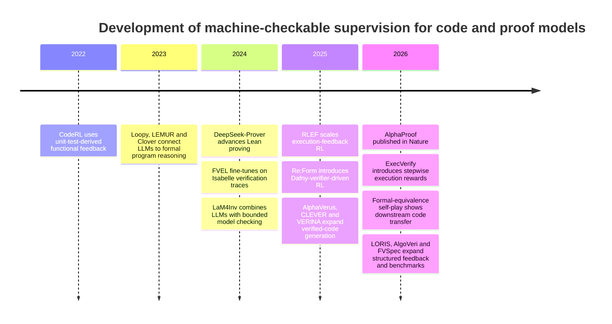
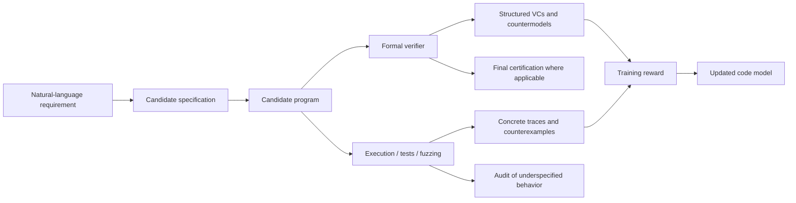

# Prover-Derived Supervision for Trustworthy Code LLMs

## Executive summary

The uploaded research brief resolves the otherwise unspecified topic: the central question is whether **machine-checkable proof supervision can replace or complement execution-based reinforcement learning for code LLMs**, with a required distinction between mathematical theorem proving and formal program verification, and with special emphasis on causal evidence, retained capability without a prover at inference, specification risk, and a concrete 0.6B/1.7B proof of concept. fileciteturn0file0

**Bottom line.** The broad idea “use a formal verifier as an RL reward for code” is **no longer novel**. Re:Form, first posted in July 2025 and published in TMLR in May 2026, trains code models with RL driven automatically by the Dafny verifier; its authors explicitly report that verifier-driven RL improves out-of-domain generalization after SFT and open-source the pipeline, data, and checkpoints. citeturn26view0turn28view0 Formal-verification feedback has also been used in closely related inference-time, controller-training, repair, and data-generation systems, so a paper whose contribution is merely “replace unit-test reward with a verifier” would face a serious novelty problem. citeturn3academia0turn3academia1turn2academia0turn4search0

The more important result of this review is that I found **no direct, compute-matched experiment** in the surveyed 2020–August 21, 2026 literature that holds base model, training examples, sampling budget, optimizer/RL algorithm, and inference budget fixed while comparing **unit-test reward, execution-process reward, binary program-verifier reward, and structured verification-condition reward**. Existing papers establish that each paradigm can work, but confound reward source with task, dataset, formal language, training procedure, or inference scaffolding. Re:Form is the closest formal-RL paper; RLEF and ExecVerify are strong execution-RL counterparts; none supplies the missing head-to-head causal comparison. citeturn26view0turn25search0turn27view7 This is the strongest defensible research gap.

There is also credible evidence that proof-derived learning can transfer beyond the exact training operation. FVEL fine-tunes LLMs on Isabelle-based verification data and reports that the resulting Llama3-8B and Mistral-7B models solve respectively 17.39% and 12% more SV-COMP problems than their corresponding baselines. citeturn27view6 More strikingly, the April 2026 semantic-equivalence self-play study trains on Haskell using **Liquid Haskell proofs for equivalent programs and execution counterexamples for inequivalent ones**; it reports up to a 13.3 percentage-point improvement on EquiBench and gains on PySecDB, while its ablation attributes distinctive reasoning gains to formal equivalence proofs rather than merely to greater training-data volume. citeturn27view5 This is the best existing evidence for a **hybrid proof-plus-execution design** and materially weakens any claim that such a hybrid is wholly unprecedented.

Mathematical theorem proving is much more mature as an RL domain. AlphaProof treats Lean proof states as RL states and tactics as actions, uses kernel-checkable formal feedback at very large scale, and showed steadily improving held-out theorem-proving performance during RL; its combined 2024 IMO system scored 28/42, within the silver-medal range. citeturn24search0 DeepSeek-Prover V1.5/V2, Goedel-Prover-V2, hierarchical lemma-reward systems, and theorem-prover-feedback work provide additional evidence that formal proof environments can teach decomposition, search, lemma proposal, and long-chain deductive consistency. citeturn1academia25turn15academia0turn15academia1turn20academia2turn20academia1 But **direct transfer from mathematical-proof RL to ordinary software engineering remains weakly established**. Mathematical proving should therefore be a scientifically useful control or later pretraining arm, not the centerpiece of the first PoC.

The recommended research position is consequently **not “formal verification should replace runtime RL.”** It is:

> **Formal verification supplies a qualitatively different, potentially more informative training signal than finite execution, and the missing experiment is a matched causal comparison of those signals—especially a structured verification-condition reward—followed by tool-free transfer evaluation.**

For the first PoC, use Dafny and the user-specified 0.6B/1.7B model family, with the exact base family otherwise **unspecified**. Train an identical code-SFT checkpoint under four primary conditions: execution outcome, binary formal verification, structured verification-condition progress, and hybrid proof-plus-execution. Make **no-prover inference the primary endpoint**, with verifier-assisted inference secondary. The decisive result would not be a higher Dafny verification rate alone; it would be a statistically robust gain on unseen program families and ordinary code reasoning/repair after removing the prover, at matched training and inference budgets.

The development of the field explains why this comparison has become possible only recently. Execution-grounded code learning appeared earlier, formal-program feedback systems then matured, and 2025–2026 brought both direct verifier RL and better transfer-oriented benchmarks. citeturn8search0turn25search0turn26view0turn27view7turn23academia0

**Recommendation:** pursue the **matched execution-vs-program-proof reward study**, with structured VCs as the main innovation and a hybrid arm as the practically favored outcome. Treat mathematical proving as a control in the full paper, but exclude it from the smallest first PoC unless resources are effectively unlimited.

## Evidence landscape and supervision taxonomy

The most important conceptual distinction is not simply “formal versus informal.” It is **what semantic object the environment proves**. Mathematical theorem proving manipulates propositions, hypotheses, lemmas, and proof states. Formal program verification reasons about programs through states, transitions, preconditions, postconditions, invariants, memory models, and verification conditions. Both can produce machine-checkable supervision, but the inductive biases are different. AlphaProof demonstrates the former at scale in Lean; Re:Form, FVEL, LORIS, and related work illustrate the latter in Dafny, Isabelle, SMT-backed verification, and program-analysis settings. citeturn24search0turn26view0turn27view6turn2academia0

**Table A — Mathematical theorem proving versus formal program verification**

| Dimension | Mathematical proving | Formal program verification | Research implication |
|---|---|---|---|
| Primary semantic object | Proposition, hypotheses, theorem, subgoals | Program states, transitions, contracts, invariants, heap/state properties | Program proof is more directly aligned with software behavior |
| Typical action | Apply tactic, instantiate lemma, introduce intermediate claim | Generate invariant/specification/assertion/code; discharge VC | Program verification exposes software-specific intermediate targets |
| Machine checker | Lean, Isabelle, Rocq/Coq, HOL, Metamath | Dafny/Boogie/Z3, Verus, CBMC, SeaHorn, Frama-C, Liquid Haskell, Isabelle/Lean encodings | Both can produce deterministic feedback within the modeled semantics |
| Natural process state | Open goals and tactic state | Parsing/type errors, individual VCs, initiation, preservation, postcondition, countermodels | Program proof offers an unusually natural dense-reward decomposition |
| Demonstrated learning | Formal proof search, decomposition and theorem solving | Specification synthesis, verification, invariant/proof generation | Both have empirical support, but on different task distributions |
| Best evidence at scale | AlphaProof; DeepSeek-Prover; Goedel-Prover | Re:Form is currently the closest direct code-RL analogue | Mathematical proving is more mature as RL |
| Evidence of downstream transfer | Some transfer to informal mathematical reasoning; code transfer remains sparse | FVEL and semantic-equivalence self-play provide code-oriented transfer evidence | H3 is plausible but not established by a matched comparison |
| Core failure mode | Search explosion; autoformalization mismatch; theorem distribution narrowness | Weak/misaligned specification, vacuity, solver/modeling limitations | Program proving carries greater specification-risk burden |
| Best role in proposed project | Control/pretraining condition | Main experimental supervision | Start with program proof |

AlphaProof is particularly informative because it cleanly demonstrates that formal proof states are usable as an RL environment rather than merely as an output filter. The system represents Lean tactic states as RL states, tactics as actions, and uses successful machine-checked trajectories to update the proof network; the paper reports approximately 80,000 TPU-days in the main RL phase and large-scale autoformalization into roughly 80 million formal problems. citeturn24search0 That establishes **feasibility of learning from formal interaction**, but its extraordinary scale and mathematical task make it a poor direct baseline for a small code-model experiment.

For software, Re:Form is the critical prior art. It constructs approximately 20,000 Dafny functions, automatically annotates and checks them, and explicitly states that its RL is driven by the Dafny verifier without human judgments or natural-language process supervision. Models from roughly 0.5B upward are studied, and the pipeline is open-sourced. citeturn26view0 Its existence decisively answers one of the brief's first questions: **yes, formal software verification has already been used as a direct RL signal for model parameters.**

The second distinction is the granularity of the reward. Execution and proof environments form a continuum rather than a binary choice.

**Table B — Reward taxonomy**

| Reward | Signal available | What it certifies | Credit assignment | Major advantage | Major weakness | Representative evidence |
|---|---|---|---|---|---|---|
| Final unit-test outcome | Pass/fail or fraction of tests | Behavior on sampled inputs | Sparse | Cheap and broadly applicable | Finite coverage; can overfit tests | CodeRL; RLEF citeturn8search0turn25search0 |
| Execution trace | Statement/state/value transitions | Specific concrete executions | Dense | Direct state reasoning; no formal spec required | Still sample/path dependent | ExecVerify gives verifiable rewards for next statements and variable values/types. citeturn27view7 |
| Self-generated testing | Generated tests/counterexamples | Chosen concrete behaviors | Medium | Scales when hidden tests unavailable | Generator bias and correlated errors | Self-debugging studies report biases from self-generated tests. citeturn8academia50turn8academia51 |
| Binary prover result | Verified/not verified | All behaviors covered by the formal model/specification | Sparse | Universal within modeled assumptions | Requires adequate specification; sparse reward | Re:Form. citeturn26view0 |
| Structured proof-process reward | VC/subgoal solved, proof-state progress, countermodel reduction | Local proof obligations | Potentially dense | Precise, causal-looking localization | Reward design may distort proof strategy | LORIS uses formally checked local proof steps at inference; hierarchical theorem-proving RL rewards intermediate lemmas. citeturn2academia0turn20academia2 |
| Hybrid proof + execution | Proof for universal cases; execution/counterexamples otherwise | Complementary semantic evidence | Dense/medium | Audits specs while retaining strong proofs | More engineering and compute | Semantic-equivalence self-play combines Liquid Haskell equivalence proofs with execution counterexamples. citeturn27view5 |

This taxonomy reveals why **structured formal reward** is more interesting than merely substituting a binary verifier for tests. A verifier already internally reasons about multiple obligations. For a loop, for example, correctness usually decomposes into whether an invariant holds initially, whether it is preserved by the body, whether it suffices together with the exit condition to imply the postcondition, and whether auxiliary assertions/termination obligations hold. An RL environment can expose those components separately rather than collapsing them into a single bit. Existing systems such as LORIS already exploit fine-grained failed verification conditions to localize invariant errors, but primarily as **inference-time scaffolding**, leaving open the question of whether such structured information should directly update code-model parameters. citeturn2academia0

The same distinction applies to “the prover helped.” Proof2Silicon/PREFACE, for example, uses reinforcement learning to improve the mechanism that constructs prompts for a frozen model from formal-verification feedback; its reported verification gains therefore do **not** show that the underlying language model itself learned a retained formal-reasoning capability. citeturn3academia0 AlphaVerus similarly uses verifier feedback and iterative refinement to produce verified code without establishing the same kind of base-model parameter learning. citeturn3academia1 Any literature matrix that combines these systems with Re:Form under a generic label such as “prover-trained LLM” would therefore overstate the evidence.

The evidence classes requested in the brief are thus crucial:

**A** requires a matched causal comparison in which reward source is essentially the only manipulated variable.  
**B** isolates supervision meaningfully but leaves important factors unmatched.  
**C** demonstrates an improved prover-guided system while entangling learning with search/scaffolding.  
**D** supplies enabling datasets, verifiers, or benchmarks.  
**E** is conceptual/survey evidence.

On that standard, the field is rich in **B–D evidence but presently lacks the A-class experiment needed for the central execution-versus-proof question**.

## What prior work actually establishes

The literature supports six distinct claims, but it is important not to conflate them.

First, **formal mathematical feedback can train powerful theorem-proving policies**. AlphaProof is the strongest published demonstration: an AlphaZero-inspired Lean agent trains on self-generated proof experience, improves on held-out formal benchmarks during RL, and contributed three non-geometry solutions to the combined system's 28/42 performance at IMO 2024. citeturn24search0 DeepSeek-Prover V1.5 explicitly combines proof-assistant feedback with search and reports 63.5% on miniF2F and 25.3% on ProofNet; later DeepSeek-Prover-V2 and Goedel-Prover-V2 further scale formal theorem proving through decomposition, synthetic data, expert iteration, and RL/self-correction. citeturn1academia25turn15academia0turn15academia1

Second, **intermediate formal goals can improve credit assignment**. Work on hierarchical theorem proving rewards useful intermediate lemmas even when the complete target theorem has not yet been solved and reports improved theorem-proving performance, including out-of-distribution evaluation. citeturn20academia2 This is important methodologically: a final theorem-check bit is not the only machine-checkable supervision available.

Third, there is some evidence that theorem-prover feedback teaches capabilities broader than exact formal proof replay. RLTPF uses a theorem prover to assess formalized intermediate mathematical reasoning and reports gains on informal arithmetic/reasoning benchmarks. citeturn20academia1 That supports the **general mechanism** behind H1—machine-checked reasoning may alter model behavior beyond replaying known proofs—but it does not establish transfer to code generation or software repair.

Fourth, **program-verifier feedback can directly train code models**. Re:Form is the strongest evidence. It uses Dafny as the formal environment, automatically curates formal training material, and performs RL from verifier-generated system signals; the authors report stronger out-of-domain generalization after RL than after SFT alone and publish the work as TMLR in May 2026. citeturn26view0turn28view0 This makes candidate novelty claim “first use of formal verification as an RL reward” untenable.

Fifth, **formal-program supervision can transfer**. FVEL constructs an Isabelle-based verification environment and FVELER dataset with 758 theories, 29,125 lemmas, and 200,646 proof steps; fine-tuning on it increases the number of SV-COMP problems solved from 69 to 81 for Llama3-8B and from 75 to 84 for Mistral-7B. citeturn27view6 The 2026 semantic-equivalence work is even closer to the proposed hypothesis: it generates roughly 28,000 validated Haskell programs, proves equivalence using Liquid Haskell, obtains inequivalence evidence through execution counterexamples, and reports downstream transfer of up to +13.3 percentage points on EquiBench plus gains on PySecDB. Crucially, its ablations attribute the distinctive reasoning benefit to the equivalence-proof side of supervision. citeturn27view5

Sixth, **execution supervision remains a formidable baseline rather than a straw man**. RLEF trains code models end-to-end to react to execution feedback over multiple turns and reports gains for both 8B and 70B models while reducing the required samples by roughly an order of magnitude relative to previous methods. citeturn25search0 ExecVerify goes further by deriving white-box, stepwise rewards from execution traces—next-statement prediction and variable value/type prediction—and reports that a 7B model becomes competitive with 32B models on execution-reasoning benchmarks while improving code-generation pass@1 by as much as 5.9 percentage points over strong post-training baselines. citeturn27view7 Thus any proof-reward experiment must beat not just binary unit-test RL but **structured execution supervision**.

**Table C — Closest prior work, ranked by overlap with the proposed project**

| Rank | Work | Branch / mechanism | What learns | Key relevance | Evidence |
|---:|---|---|---|---|---|
| 1 | Re:Form, 2025–26 | Dafny program-verifier RL | Base/code-model parameters after SFT | Directly establishes verifier-driven RL for formal software verification | **B** citeturn26view0 |
| 2 | Semantic Equivalence Self-Play, 2026 | Liquid Haskell proof + execution counterexamples | Generator/evaluator models | Strongest proof+execution hybrid and downstream transfer evidence | **B** citeturn27view5 |
| 3 | ExecVerify, 2026 | Structured execution-process RL | Code-model parameters | Strongest close comparator for dense non-proof reward | **B** citeturn27view7 |
| 4 | RLEF, ICML 2025 | Multi-turn execution feedback RL | Code-model parameters | Modern execution-RL baseline | **B** citeturn25search0 |
| 5 | FVEL, 2024 | Isabelle verification data + fine-tuning | LLM parameters | Direct verification-data learning and SV-COMP transfer | **B/C** citeturn27view6 |
| 6 | Proof2Silicon / PREFACE, 2025 | Verifier-feedback RL for prompt repair | Prompt/controller policy; frozen target LLM | Shows formal feedback can drive RL but not base-model learning | **C** citeturn3academia0 |
| 7 | LORIS, 2026 | Failed-VC proof localization | Inference-time agent/search | Closest precedent for structured VC feedback | **C** citeturn2academia0 |
| 8 | AlphaVerus, 2024 | Verifier-guided refinement | Search/data-generation pipeline | Verified-code generation plus specification-alignment controls | **C** citeturn3academia1 |
| 9 | Clause2Inv, ISSTA 2025 | LLM invariant clauses + counterexamples | Inference procedure | Demonstrates counterexample-guided invariant composition | **C** citeturn4search0 |
| 10 | LaM4Inv, ASE 2024 | LLM + bounded model checking | Inference procedure | Structured symbolic filtering for invariants | **C** citeturn4search2 |
| 11 | LEMUR, 2023 | LLM + sound automated reasoning calculus | Inference framework | Shows LLM/reasoner composition for program verification | **C** citeturn17academia0 |
| 12 | Loopy, 2023 | LLM invariant generation + formal checking/repair | Inference workflow | Early evidence that LLMs generate useful invariant components | **C** citeturn19search2 |
| 13 | Clover, 2023–24 | Closed-loop consistency verification | Inference/certification system | Directly addresses spec/code consistency and false verification | **C/D** citeturn4academia47 |
| 14 | AlphaProof, Nature 2026 | Lean RL + proof search | Proof-network parameters | Strongest demonstration of formal-feedback RL at scale | **B/C** for transfer question citeturn24search0 |
| 15 | DeepSeek-Prover V1.5 | Lean proof-assistant feedback RL | Theorem-prover parameters | Demonstrates effective RL from proof feedback | **B** citeturn1academia25 |
| 16 | Hierarchical proof-decomposition RL | Rewards intermediate lemmas | Prover parameters | Strong precedent for denser formal-process reward | **B** citeturn20academia2 |
| 17 | Theorem Prover as Judge / RLTPF | Formal verification of reasoning steps | LLM parameters | Evidence for cross-setting mathematical-reasoning transfer | **B** citeturn20academia1 |
| 18 | CodeRL, NeurIPS 2022 | Unit-test / critic functional feedback | Actor and critic | Canonical execution-grounded training baseline | **B/C** citeturn8search0 |
| 19 | Outcome-Refining Process Supervision, ICML 2025 | Runtime process + outcome supervision | Search/reasoning system | Demonstrates richer execution supervision than test pass/fail | **C** citeturn25search4 |
| 20 | μCODE, ICML 2025 | Multi-turn execution feedback with single-step rewards | Generator + verifier | Further strong execution-feedback comparator | **B/C** citeturn25search1 |

The most consequential finding is what is **not** in this table. None of these papers is class A for the central hypothesis. Re:Form compares stages and models inside a verifier-centric task rather than comparing equivalent proof and execution rewards. citeturn26view0 ExecVerify compares structured execution supervision with other code post-training approaches, not with a formal verifier. citeturn27view7 Semantic-equivalence self-play contains a useful ablation between types of semantic evidence but does not perform the proposed compute-matched unit-test-vs-VC reward experiment. citeturn27view5 RLEF establishes execution-RL effectiveness rather than its causal superiority or inferiority to proof feedback. citeturn25search0

**Table D — Papers with meaningful causal/ablation evidence**

| Work | Isolated contrast | What it supports | Why it is not class A for the proposed question |
|---|---|---|---|
| Re:Form | SFT versus verifier-driven RL and RL design variants | Program-verifier RL adds useful capability/generalization | No matched execution-reward arm; task/reward tied to formal specification synthesis citeturn26view0 |
| Semantic-equivalence self-play | Equivalence-proof versus inequivalence/counterexample regimes | Formal proofs contribute reasoning gains beyond dataset volume | Different semantic objectives; not a matched general code-RL comparison citeturn27view5 |
| FVEL | Base versus verification-data-fine-tuned models | Verification-oriented training improves downstream verification | SFT rather than reward-source comparison citeturn27view6 |
| ExecVerify | Process-reward training and transfer stages versus post-training baselines | Dense execution-state supervision transfers to code generation | No formal-proof reward condition citeturn27view7 |
| Hierarchical theorem-proving RL | Intermediate lemma reward/decomposition variants | Denser formal credit helps theorem proving | Mathematical proofs, not program behavior citeturn20academia2 |
| RLEF | Execution-feedback RL versus prior/sample-based strategies | Models can learn to exploit runtime feedback | No prover comparison citeturn25search0 |

**Result of the causal audit:** the central scientific experiment remains open. I found no A-class study through August 21, 2026 that isolates **the semantic source and granularity of reward** while holding the remainder of code-model training essentially fixed.

## Novelty, debates, and failure modes

The novelty landscape is much narrower than the initial framing might suggest, but the remaining gap is stronger scientifically.

**Table E — Novelty audit**

| Candidate contribution | Status as of Aug. 21, 2026 | Closest conflict | Defensible replacement claim |
|---|---|---|---|
| First use of formal verification as an RL reward | **Already established** | Re:Form directly trains with Dafny-verifier feedback; PREFACE also uses RL around verifier feedback. citeturn26view0turn3academia0 | Do not claim |
| First structured verification-condition reward for code-LLM parameter training | **Likely novel / strongly adjacent prior art** | LORIS exploits localized VC reasoning at inference; formal theorem work rewards intermediate lemmas. citeturn2academia0turn20academia2 | “A controlled study of VC-decomposed rewards for code-model post-training” |
| First matched comparison of execution and proof rewards | **Likely novel** | Re:Form, RLEF, ExecVerify separately establish the arms but do not match them against each other. citeturn26view0turn25search0turn27view7 | Strong central claim after another pre-submission search |
| First comparison of mathematical-proof and program-proof supervision | **Likely novel in the required matched form** | Mature theorem-prover RL and nascent program-verifier RL exist separately. citeturn24search0turn26view0 | “Controlled cross-domain comparison of formal supervision sources” |
| First demonstration of prover-trained capability with prover removed | **Partially explored** | Semantic-equivalence self-play reports downstream transfer; theorem-prover-feedback work reports informal reasoning transfer. citeturn27view5turn20academia1 | “Matched measurement of retained tool-free capability across reward sources” |
| First transfer from loop-invariant proof training to ordinary code generation/repair | **Likely novel** | FVEL transfers verification training within verification benchmarks; ExecVerify transfers execution reasoning to generation. citeturn27view6turn27view7 | Strong secondary contribution |
| First proof-for-certification + execution-for-counterexamples hybrid | **Already partially explored** | 2026 semantic-equivalence self-play explicitly uses this division. citeturn27view5 | Generalize the hybrid to program verification and study it causally |
| First program-verification RL at exactly 0.6B and 1.7B | **Possibly technically novel but scientifically weak** | Re:Form already spans small-model scales starting around 0.5B. citeturn26view0 | Avoid scale-based “first” claims |
| First systematic specification-hacking audit in prover-trained code LLMs | **Partially explored; systematic training audit may remain open** | Clover and AlphaVerus address spec consistency/misalignment; Re:Form explicitly recognizes behavioral/specification issues. citeturn4academia47turn3academia1turn26view0 | “Controlled measurement of specification exploitation under verifier-optimized training” |

The major scientific debate is therefore not whether formal proofs are useful. They clearly are. The debate is **what a proof reward optimizes compared with execution**.

A finite test suite provides evidence about sampled executions. For properties with broad or unbounded input domains, passing all available tests is not equivalent to satisfying a universal specification. Formal verification can, subject to its formal semantics and assumptions, establish the quantified property rather than merely sample it. Re:Form motivates formal systems precisely because ordinary tests can miss paths and edge cases. citeturn26view0 But this advantage is conditional on **the specification being correct and sufficiently strong**. A proof of the wrong property is rigorous evidence about the wrong requirement.

That caveat is not philosophical; it creates a concrete reward-hacking channel. A model optimized only to make a verifier accept may learn to weaken preconditions, underspecify postconditions, exploit unreachable cases, choose vacuous invariants, remove behavioral obligations, or exploit errors in the translation from natural-language intent to logic. Re:Form explicitly notes that verified code can still exhibit behavior not captured by the specification and motivates additional alignment checks. citeturn26view0 Clover's central idea is likewise to check consistency among natural-language descriptions, code, and formal annotations rather than treating prover acceptance alone as proof of intended correctness. citeturn4academia47 AlphaVerus filters specification/program misalignment during its verified-code-generation pipeline, further confirming that “verified” and “meets the user's intended task” are different objectives. citeturn3academia1

This yields a more precise hierarchy of correctness:

\[
\text{passes tests}
\;\not\Rightarrow\;
\text{satisfies intended behavior}
\]

and

\[
\text{proves } P
\;\Rightarrow\;
P\text{ holds in the formal model},
\]

but

\[
\text{proves } P
\;\not\Rightarrow\;
P = \text{the user's intended requirement}.
\]

The hybrid hypothesis is consequently stronger than a pure “proof replaces execution” hypothesis. Runtime testing, fuzzing, property-based tests, metamorphic checks, or differential execution can expose cases omitted by the formal contract, while the formal verifier can supply universal evidence for the behaviors that *are* specified. The Liquid-Haskell semantic-equivalence work already demonstrates this complementary architecture: formal proof certifies equivalent examples while concrete execution supplies counterexamples for inequivalence. citeturn27view5

There is also a credit-assignment debate. A binary formal-verification reward may be **more semantically rigorous yet just as sparse** as final test success. For a 500-token candidate with one bad loop invariant, “verification failed” does not tell the optimizer which part was useful. By contrast, ExecVerify's success with rewards for intermediate execution state illustrates why dense, machine-verifiable process targets can matter. citeturn27view7 LORIS supplies the analogous formal-verification precedent by decomposing failed verification into locally checked logical steps and pinpointing erroneous invariant reasoning. citeturn2academia0 The strongest research hypothesis is therefore not simply **proof > tests**, but:

> **Structured program-proof feedback should deliver the semantic strength of formal verification with credit assignment closer to white-box execution feedback.**

A second major uncertainty concerns **capability acquisition versus search compression**. A prover-guided system can improve because the model learned a new abstraction, because it learned to emit patterns that a solver likes, because an external repair loop searched more effectively, or because the prover itself did the hard work. AlphaProof provides strong evidence for parameter learning within mathematical proving—the proof network is repeatedly updated from successful formal trajectories and held-out benchmark performance increases over the RL phase—but it also uses powerful tree search and, on the hardest problems, test-time RL. citeturn24search0 Re:Form updates the model using verifier-driven RL, but the proposed project's central transfer question goes further: **what survives when the formal tool is taken away and the syntax/domain change?** citeturn26view0

The cleanest tests of genuinely learned capability are therefore tool-off evaluation, cross-language transfer, semantic-preserving perturbations, unseen loop schemas, pass@k curves at matched inference budgets, and ordinary program-repair/code-generation tasks in which the training prover is unavailable. A gain only when Dafny remains in the loop would be a useful engineering result, but weak evidence for H6.

## Benchmarks, implementation readiness, and scalability

The benchmark situation has improved rapidly enough that a credible experiment no longer needs to create every resource from scratch.

**Table F — Datasets and benchmarks**

| Resource | Domain | Scale / defining feature | Best use in proposed study | Evidence |
|---|---|---|---|---|
| Re:Form training corpus | Dafny formal specification/program generation | About 20,000 Dafny functions; automatically curated/verified | Starting data pipeline and formal-RL reproduction | Pipeline, data, code, checkpoints reported open. citeturn26view0 |
| DafnyComp | Compositional Dafny programs | Multi-function formal reasoning benchmark introduced by Re:Form | OOD formal composition | Local verification does not by itself settle downstream transfer. citeturn26view0turn16academia2 |
| DafnyBench | Dafny annotation/proof generation | 782 programs in its public repository | Invariant/assertion/specification completion | Public benchmark and evaluation tooling. citeturn18search3 |
| CLEVER | Lean verified code generation | 161 curated tasks | Independent verified-generation endpoint | Designed to test formal specifications and implementations without relying only on ordinary test supervision. citeturn5academia0 |
| VERINA | Lean code/spec/proof generation | 189 manually curated tasks | Hard cross-formalism transfer | Reports low proof completion relative to code generation, making it discriminative. citeturn5academia2 |
| AlgoVeri | Dafny, Verus, Lean | 77 algorithms with corresponding contracts across three systems | Cross-tool robustness | Same algorithmic concepts expose large verifier/language performance differences. citeturn5academia1 |
| FVELER | Isabelle formal verification | 758 theories, 29,125 lemmas, 200,646 proof steps | Formal-trace SFT/control | Already shown to improve SV-COMP solving after fine-tuning. citeturn27view6 |
| FVSpec | Real Python → Lean verification | 11,039 property-based tests scraped; 2,772 translated into 9,415 Lean challenges | Real-world specification-transfer test | Particularly valuable bridge from ordinary software tests to formal properties. citeturn6academia12 |
| Code2Inv / SV-COMP | Program verification | Established invariant/program-verification tasks | OOD program-proof evaluation | Used by FVEL to measure downstream verification transfer. citeturn27view6 |
| Defects4C | C/C++ repair/security | 248 high-quality buggy functions plus 102 vulnerable functions | Tool-off repair transfer | Built from large-scale bug mining and includes executable tests. citeturn21search7 |
| SWE-EVO | Long-horizon repository evolution | 48 evolution tasks; substantially harder than isolated issue repair | Ambitious late-stage transfer | Reported agent success remains far below SWE-Bench-style issue repair. citeturn21academia14 |
| RoadmapBench | Repository-scale version evolution | 115 version-upgrade tasks across 17 repositories and five languages | Long-horizon robustness | Tests coherent multi-file evolution rather than isolated functions. citeturn21academia12 |

Open-source readiness is best for **Dafny-based first experiments**. Re:Form explicitly releases its pipeline, data, and checkpoints. citeturn26view0 DafnyBench has a public benchmark repository. citeturn18search3 Clause2Inv, LaM4Inv, FVEL, and recent verified-code benchmarks supply additional code/data or project artifacts, although exact environment reproduction difficulty varies by solver/version and should be pinned in containers rather than assumed from current installations. citeturn4search0turn4search2turn27view6

Dafny is preferable to starting with Lean for the PoC because the proposed scientific unit is **program state reasoning**, not proof-language mastery. Re:Form has already shown that relatively small models can be brought into the Dafny distribution through SFT and verifier-driven training, while AlgoVeri reports substantial performance variation among Dafny, Verus, and Lean even on corresponding algorithms, showing that proof-system syntax and automation are large confounders. citeturn26view0turn5academia1 A first causal experiment should minimize those confounders.

The most tractable training domain is **single-function imperative code with loops, arrays, integer arithmetic, and explicit contracts**. This supports clean execution and formal-verification oracles on the same underlying task. The experiment can then progressively introduce nonlinear arithmetic, aliasing, pointers, multiple procedures, and composition. The ordering matters because compositional formal reasoning is already known to be much harder than proving locally isolated fragments, which is why DafnyComp was introduced. citeturn26view0turn16academia2

Scaling to realistic software is the largest limitation of the program-proof thesis. Formal verification of C/C++ must model pointers, memory safety, integer overflow, undefined behavior, calls into libraries, and often aliasing. Concurrency adds interleavings, synchronization invariants, rely-guarantee-style reasoning, or other concurrency-specific proof obligations. Repository-level evolution adds external APIs, build systems, generated code, integration tests, configuration, and behavior whose specification exists only implicitly in surrounding code. The gap between current function-level formal benchmarks and repository evolution is visible in the contrast between verified-code datasets such as CLEVER/FVSpec and long-horizon benchmarks such as SWE-EVO/RoadmapBench. citeturn5academia0turn6academia12turn21academia14turn21academia12

This implies that formal supervision probably cannot **globally replace runtime feedback** in near-term code agents. Much production behavior is not presently formalized. A realistic architecture is therefore layered:

The **formal branch** is strongest where requirements can be stated precisely; the **runtime branch** remains essential where the specification is partial or where the environment itself is the practical definition of correctness. The hybrid need not be philosophically compromised: it can assign proof the role of universal certification **within the formal model** and execution the role of detecting omitted assumptions and providing concrete behavioral evidence.

In terms of stakeholders, the project has an unusually broad relevance footprint:

| Stakeholder | Principal value | Principal concern | Expected impact if hypothesis succeeds |
|---|---|---|---|
| Code-model researchers | Stronger automated training signal | Training/solver cost and confounding | High |
| Programming-languages/formal-methods community | Learned invariant/specification generation | Unsound or weak autoformalization | High |
| Software-engineering researchers | Better generation and repair transfer | Function-level results may not scale | High |
| Safety-critical software teams | Machine-checkable correctness evidence | Specifications are expensive and incomplete | Potentially very high, longer term |
| General software-agent developers | Less reliance on hidden test suites | Formal coverage of real repositories is low | Moderate initially |
| Benchmark designers | Universal semantic endpoints | Formalization validity and contamination | High |
| Model evaluators | Tool-off measure of retained reasoning | Difficult causal attribution | High |

The expected near-term impact is therefore highest on **training methodology and verified programming**, rather than on immediately replacing CI test suites or repository-level agent feedback.

## Recommended experiment and final decision

The recommended project should be framed as a **causal study of supervision semantics**, not as another verified-code-generation system.

The full experiment in the uploaded brief proposes G0–G7. That design is sound for a mature project, but it is broader than necessary for the first falsifiable PoC. The smallest high-information design is to begin with the user-specified **0.6B model**, then replicate the surviving contrasts at **1.7B**. The exact base-model family was not specified and should be selected before registration; both sizes should come from the same architecture/tokenizer/pretraining family.

The PoC should use a common set of underlying imperative programming problems for which both **formal specifications and executable reference behavior** are available. Derive all reward conditions from the same training instances and, as far as practical, the same model-sampled candidates. That last constraint is important: if the proof condition gets different data or more rejection-sampling attempts, reward source is no longer the causal variable.

The first-stage groups should be:

| Group | Training after shared code SFT | Purpose |
|---|---|---|
| G0 | No RL | Controls for SFT and dataset exposure |
| G1 | Final execution/test reward | Standard outcome-RL control |
| G4 | Binary program-verifier reward | Tests whether universality alone helps |
| G5 | Structured program-proof reward | Main proposed contribution |
| G7 | Structured proof + execution reward | Tests the practically strongest hybrid hypothesis |

**G2 structured execution traces** should be added before publication, because ExecVerify shows that this is a substantially stronger baseline than binary tests. citeturn27view7 **G3 mathematical-proof reward** and **G6 mathematical→program proof curriculum** should be part of the larger study, but not the smallest PoC. Their inclusion is scientifically valuable for distinguishing general deduction from state-transition reasoning; their inclusion in the first experiment would introduce an additional domain, language, dataset, and curriculum confound.

A suitable structured formal reward should not simply reward “more verifier messages passed” without semantic analysis. Instead, expose named verification obligations. For loop-centric programs, an observation/reward vector can include:

\[
r_t =
[
r_{\text{parse}},
r_{\text{type}},
r_{\text{init}},
r_{\text{preserve}},
r_{\text{exit}},
r_{\text{post}},
r_{\text{termination}},
r_{\text{full}}
].
\]

Here **initiation** indicates whether the candidate invariant follows before entering the loop; **preservation** whether one loop step maintains it; **exit/post** whether the invariant plus loop-exit condition entails the desired postcondition; and **full** whether all required obligations verify. This decomposition follows the semantics of loop verification rather than inventing natural-language “reasoning quality” scores. LORIS's successful use of localized failed verification conditions provides strong evidence that this information is operationally useful, while hierarchical theorem-proving RL provides precedent for rewarding valid intermediate formal progress. citeturn2academia0turn20academia2

Do **not** hand-pick a complicated weighted scalar after seeing test performance. Either preregister simple normalized weights, learn a monotone aggregation on a disjoint development set, or report both the vector and several fixed scalarizations. Otherwise a reviewer can reasonably argue that the contribution is reward engineering rather than formal supervision.

The strongest design uses **paired candidate evaluation**:

1. Sample candidate \(c\) from policy \(\pi_\theta(c\mid x)\).
2. Run the fixed test harness on \(c\), recording test outcomes and execution traces.
3. Run the fixed formal verifier on the same \(c\), recording binary acceptance and individual VC statuses.
4. Compute the reward appropriate to each experimental arm.
5. Update separate policy copies using an identical optimizer/RL implementation and matched sampled-token budget.

This removes a major confound in most existing literature: reward conditions no longer see fundamentally different sampled programs.

For compute matching, record at least total sampled tokens, number of candidate programs, verifier/test calls, wall-clock time, accelerator FLOPs or accelerator-hours, solver CPU time, successful trajectories recycled into training, and inference samples per benchmark instance. Report results both under **equal model-compute budgets** and **equal end-to-end wall-clock/cost budgets**. Formal verification may reduce program executions yet consume substantial solver resources; claiming greater efficiency from “fewer rollouts” without counting solver cost would be misleading.

The primary evaluation must explicitly separate **tool-assisted performance** from **retained parameter capability**.

| Evaluation mode | Tool availability | Main question |
|---|---|---|
| Formal in-domain | Verifier allowed | Did the training objective work at all? |
| Formal OOD | Verifier allowed | Did formal reasoning generalize to unseen program families? |
| Formal tool-off | No verifier | Has useful reasoning moved into model parameters? |
| Ordinary code generation | No formal tool | Does proof training help non-formal coding? |
| Execution reasoning | No prover | Does it improve state-transition understanding? |
| Program repair | No training prover | Does it help identify/repair semantic defects? |
| Cross-language | No original verifier | Did it learn concepts rather than Dafny surface patterns? |
| Hybrid agent | Verifier + execution available | What is the best deployable system? |

Use perturbations aggressively: variable renaming, dead-code insertion, loop refactoring, equivalent conditional forms, reordered independent statements, changed literal distributions, unseen loop templates, and altered identifier vocabularies. A reward-trained model that memorizes stereotyped Dafny invariant syntax should collapse under these changes; a model that learned induction over program state should degrade less.

The transfer ladder should begin with feasible endpoints before attempting repository evolution:

**Tier 1:** unseen loops and arrays in Dafny.  
**Tier 2:** semantic equivalence and execution reasoning.  
**Tier 3:** ordinary code generation.  
**Tier 4:** Defects4C-style C/C++ repair.  
**Tier 5:** a carefully selected subset of long-horizon evolution tasks.

Defects4C offers a concrete intermediate repair benchmark with real C/C++ bugs and vulnerabilities. citeturn21search7 SWE-EVO and RoadmapBench demonstrate that long-horizon evolution is now benchmarkable but remains much more demanding, so they should be regarded as stretch evaluation rather than the PoC's make-or-break endpoint. citeturn21academia14turn21academia12

The experiment should preregister explicit success and falsification criteria. The following are research-design recommendations, not claims from prior literature:

| Hypothesis | Evidence that would support it | Falsification or strong weakening |
|---|---|---|
| H1 mathematical proofs teach transferable deduction | Math-proof arm beats matched SFT on tool-free non-Lean reasoning/code tasks | Gain disappears outside theorem proving |
| H2 program proof teaches state reasoning | G5 beats G0/G4 on unseen execution/invariant/equivalence tasks without verifier | Gain occurs only on Dafny verification |
| H3 program-proof transfer exceeds math-proof transfer | G5 beats G3 at matched compute on code/repair transfer while G3 retains math advantage | G3 matches or exceeds G5 across code tasks |
| H4 verifier reward can replace tests for formally expressible properties | G4/G5 match or beat G1 while reducing required concrete executions and maintaining transfer | Proof arms underperform G1 or exploit specs |
| H5 hybrid is best under incomplete specifications | G7 is Pareto-superior across proof correctness, test robustness, and spec-hacking audits | G7 adds cost without robust gains |
| H6 capability moves into parameters | Training gains persist under no-tool evaluation and syntax/domain shifts | Gains vanish when verifier/search scaffolding is removed |

Rather than define “success” as any statistically significant gain, the paper should require a **practically meaningful predeclared effect size with confidence intervals**. For a modest model, a robust several-percentage-point absolute tool-free transfer gain over a strong execution-process baseline, replicated across both 0.6B and 1.7B, would be far more convincing than a large in-domain Dafny gain. The exact threshold should be set after measuring benchmark variance on an untouched pilot split, not retrospectively optimized.

Specification hacking needs its own adversarial evaluation set. Create deliberately weak or malformed contracts containing overly strong preconditions, weak postconditions, missing frame conditions, irrelevant properties, contradictory assumptions, vacuous domains, and semantically incomplete translations. Also generate candidate programs that satisfy the written contract while blatantly violating the natural-language intent. Clover and AlphaVerus show why such alignment checks are necessary, and Re:Form itself cautions that formal verification against a specification is not sufficient to establish behavior outside what that specification captures. citeturn4academia47turn3academia1turn26view0

For the full paper, add the mathematical-proof branch only after the program-proof comparison works. Use a matched volume of formal theorem training and compare it with program-proof examples by tokens, optimizer steps, and sampled trajectories. The critical test is not whether the mathematical prover gets better at Lean—it almost certainly should, given the existing theorem-proving literature—but whether its learned decomposition skills transfer to execution reasoning and repair as strongly as state-transition-oriented program proof. AlphaProof, DeepSeek-Prover, and hierarchical theorem proving make mathematical supervision a strong positive control rather than a weak straw-man baseline. citeturn24search0turn1academia25turn20academia2

The research should be positioned differently depending on venue. For a **programming-languages** paper, emphasize semantic reward design, verification-condition decomposition, soundness boundaries, and specification exploitation. For a **software-engineering** paper, emphasize ordinary-code transfer, fault localization, repair, robustness, and realistic formalization costs. For a **machine-learning** paper, the strongest contribution is the matched causal comparison of reward oracles and the distinction between tool-assisted gains and retained parameter capability.

The six requested final decisions are therefore:

**Is the direction genuinely novel?**  
Partly. Formal verification as RL feedback is established, especially by Re:Form. citeturn26view0 The genuinely open center is a **matched causal comparison of reward sources and granularities plus tool-off transfer**.

**Which component is novel?**  
Most defensibly: **credit assignment and comparative evaluation**. Structured VC-derived post-training for the base code model appears substantially less explored than binary prover feedback, and a controlled comparison against execution-process reward appears absent from the surveyed primary literature. LORIS is the closest structured-VC precedent but uses the mechanism primarily during verification/inference rather than establishing the proposed model-training comparison. citeturn2academia0

**Replace runtime RL, augment it, or compare both?**  
**Compare both, with augmentation as the practical prior.** The literature already supplies strong execution-RL systems such as RLEF and ExecVerify, while the 2026 semantic-equivalence study supplies empirical precedent for complementary proof and execution evidence. citeturn25search0turn27view7turn27view5 A replacement claim should be an empirical conclusion, not the project's premise.

**What should mathematical proving do?**  
Use it as a **control and optional pretraining curriculum in the full study**, not as the first PoC. Mathematical-prover RL is already powerful, but direct software-transfer evidence is weaker than the program-verification evidence. citeturn24search0turn20academia1turn27view6

**What is the smallest experiment that can validate or falsify the core hypothesis?**  
At 0.6B, start from one shared SFT checkpoint and one common Dafny loop/array corpus; train matched G1 execution-outcome, G4 binary-verifier, and G5 structured-VC policies, with G0 as the frozen baseline. Evaluate on unseen loop schemas **without the verifier** as the primary endpoint. If G5 cannot beat G1/G4 on a predeclared tool-free transfer measure, the core structured-proof-transfer hypothesis is already substantially weakened. Replicate the surviving result at 1.7B, then add G2 structured execution and G7 hybrid for the publication-grade experiment.

**What result is strong enough for a credible paper?**  
Not “the verifier accepts more code.” Re:Form and multiple inference-time systems already make that unsurprising. citeturn26view0turn3academia1turn2academia0 A strong result is: **under matched data, model, RL algorithm, sampling, and inference budgets, structured program-proof reward yields reproducible tool-free gains over both binary proof reward and strong execution supervision; the effect persists across model scales, unseen program structures, semantic-preserving perturbations, and at least one ordinary-code or repair benchmark; and an adversarial specification audit shows that the gain is not explained by weakening or gaming contracts.** A result in which the hybrid arm subsequently performs best would provide an especially credible engineering conclusion.

The resulting project would make a stronger claim than “provers are better tests.” It would answer a much more durable question:

> **What kind of machine-checkable experience should a code model learn from: examples of behavior, proofs of behavior, or both—and which parts of that supervision become capability rather than temporary scaffolding?**

As of August 21, 2026, the literature has separately demonstrated powerful execution-feedback learning, formal mathematical RL, formal-software verifier RL, structured execution rewards, and promising proof-to-code transfer. citeturn25search0turn24search0turn26view0turn27view7turn27view5 What it has not yet convincingly supplied is the controlled experiment that puts these signals on equal footing. **That—not first use of a prover—is the research opportunity worth pursuing.**

source 

Citations · 30

•

1
Pasted markdown.md

Pasted markdown.md
arxiv.org
arxiv.org

2
Re:Form -- Reducing Human Priors in Scalable Formal Software Verification with RL in LLMs: A Preliminary Study on Dafny
https://arxiv.org/abs/2507.16331

3
Proof2Silicon: Prompt Repair for Verified Code and Hardware Generation via Reinforcement Learning
https://arxiv.org/abs/2509.06239?utm_source=chatgpt.com

4
[2406.14408] FVEL: Interactive Formal Verification Environment with Large Language Models via Theorem Proving
https://arxiv.org/abs/2406.14408

5
[2604.17010] Improving LLM Code Reasoning via Semantic Equivalence Self-Play with Formal Verification
https://arxiv.org/abs/2604.17010

7
DeepSeek-Prover-V1.5: Harnessing Proof Assistant Feedback for Reinforcement Learning and Monte-Carlo Tree Search
https://arxiv.org/abs/2408.08152?utm_source=chatgpt.com

9
[2603.11226] ExecVerify: White-Box RL with Verifiable Stepwise Rewards for Code Execution Reasoning
https://arxiv.org/abs/2603.11226

10
Learning to Generate Unit Tests for Automated Debugging
https://arxiv.org/abs/2502.01619?utm_source=chatgpt.com

11
Guiding LLM-based Loop Invariant Synthesis via Feedback on Local Reasoning Errors
https://arxiv.org/abs/2605.17914?utm_source=chatgpt.com

12
AlphaVerus: Bootstrapping Formally Verified Code Generation through Self-Improving Translation and Treefinement
https://arxiv.org/abs/2412.06176?utm_source=chatgpt.com

13
Formal Theorem Proving by Rewarding LLMs to Decompose Proofs Hierarchically
https://arxiv.org/abs/2411.01829?utm_source=chatgpt.com

14
Theorem Prover as a Judge for Synthetic Data Generation
https://arxiv.org/abs/2502.13137?utm_source=chatgpt.com

18
Lemur: Integrating Large Language Models in Automated Program Verification
https://arxiv.org/abs/2310.04870?utm_source=chatgpt.com

20
Clover: Closed-Loop Verifiable Code Generation
https://arxiv.org/abs/2310.17807?utm_source=chatgpt.com

24
CLEVER: A Curated Benchmark for Formally Verified Code Generation
https://arxiv.org/abs/2505.13938?utm_source=chatgpt.com

25
VERINA: Benchmarking Verifiable Code Generation
https://arxiv.org/abs/2505.23135?utm_source=chatgpt.com

26
AlgoVeri: An Aligned Benchmark for Verified Code Generation on Classical Algorithms
https://arxiv.org/abs/2602.09464?utm_source=chatgpt.com

27
FVSpec: Real-World Property-Based Tests as Lean Challenges
https://arxiv.org/abs/2606.01008?utm_source=chatgpt.com

29
SWE-EVO: Benchmarking Coding Agents in Long-Horizon Software Evolution Scenarios
https://arxiv.org/abs/2512.18470?utm_source=chatgpt.com

30
RoadmapBench: Evaluating Long-Horizon Agentic Software Development Across Version Upgrades
https://arxiv.org/abs/2605.15846?utm_source=chatgpt.com
nature.com
nature.com

6
Olympiad-level formal mathematical reasoning with reinforcement learning | Nature
https://www.nature.com/articles/s41586-025-09833-y?utm_source=chatgpt.com
proceedings.neurips.cc
proceedings.neurips.cc

8
CodeRL: Mastering Code Generation through Pretrained Models and Deep Reinforcement Learning
https://proceedings.neurips.cc/paper_files/paper/2022/hash/8636419dea1aa9fbd25fc4248e702da4-Abstract-Conference.html?utm_source=chatgpt.com
proceedings.mlr.press
proceedings.mlr.press

15
RLEF: Grounding Code LLMs in Execution Feedback with Reinforcement Learning
https://proceedings.mlr.press/v267/gehring25a.html?utm_source=chatgpt.com

21
Reasoning Through Execution: Unifying Process and Outcome Rewards for Code Generation
https://proceedings.mlr.press/v267/yu25f.html?utm_source=chatgpt.com

22
Multi-Turn Code Generation Through Single-Step Rewards
https://proceedings.mlr.press/v267/jain25a.html?utm_source=chatgpt.com
conf.researchr.org
conf.researchr.org

16
Clause2Inv: A Generate-Combine-Check Framework for Loop Invariant Inference (ISSTA 2025 - Research Papers) - ISSTA 2025
https://conf.researchr.org/details/issta-2025/issta-2025-papers/44/Clause2Inv-A-Generate-Combine-Check-Framework-for-Loop-Invariant-Inference?utm_source=chatgpt.com

28
Defects4C: Benchmarking Large Language Model Repair Capability with C/C++ Bugs (ASE 2025 - Research Papers) - ASE 2025
https://conf.researchr.org/details/ase-2025/ase-2025-papers/9/Defects4C-Benchmarking-Large-Language-Model-Repair-Capability-with-C-C-Bugs?utm_source=chatgpt.com
github.com
github.com

17
GitHub - SoftWiser-group/LaM4Inv: Code for the paper "LLM Meets Bounded Model Checking: Neuro-symbolic Loop Invariant Inference" at ASE 2024 · GitHub
https://github.com/SoftWiser-group/LaM4Inv?utm_source=chatgpt.com

19
GitHub - microsoft/loop-invariant-gen-experiments: Loop invariant generation with LLMs · GitHub
https://github.com/microsoft/loop-invariant-gen-experiments?utm_source=chatgpt.com

23
GitHub - sun-wendy/DafnyBench: DafnyBench: A Benchmark for Formal Software Verification · GitHub
https://github.com/sun-wendy/DafnyBench?utm_source=chatgpt.com
Sources scanned · 317

nature.com
nature.com
Olympiad-level formal mathematical reasoning with reinforcement learning | Nature

https://www.nature.com/articles/s41586-025-09833-y

Mathematicians put AI model AlphaProof to the test | Nature

* NEWS AND VIEWS * 12 November 2025 MATHEMATICIANS PUT AI MODEL ALPHAPROOF TO THE TEST Mathematicians use computational tools to prove theorems. An AI model that is trained to use these tools might...

DeepMind AI crushes tough maths problems on par with top human solvers | Nature

* NEWS * 07 February 2025 DEEPMIND AI CRUSHES TOUGH MATHS PROBLEMS ON PAR WITH TOP HUMAN SOLVERS The company’s AlphaGeometry 2 reaches the level of gold-medal students in the International Mathemat...

DeepMind AI solves geometry problems at star-student level | Nature

* 17 January 2024 DEEPMIND AI SOLVES GEOMETRY PROBLEMS AT STAR-STUDENT LEVEL Algorithms are now as good at geometry as some of the world’s most mathematically talented school kids. By * Davide Cas...

A geometric neural solving method based on a diagram text information fusion analysis | Scientific Reports

A geometric neural solving method based on a diagram text information fusion analysis Download PDF Download PDF * Article * Open access * Published: 30 December 2024 A GEOMETRIC NEURAL SOLVING ME...

Making Mathematical Research Data FAIR: Pathways to Improved Data Sharing | Scientific Data

Making Mathematical Research Data FAIR: Pathways to Improved Data Sharing Download PDF Download PDF * Article * Open access * Published: 22 June 2024 MAKING MATHEMATICAL RESEARCH DATA FAIR: PATHW...

Improvement of college students’ higher mathematics problem solving ability based on neural network and multiple regression model | Scientific Reports

Improvement of college students’ higher mathematics problem solving ability based on neural network and multiple regression model Download PDF Download PDF * Article * Open access * Published: 28...

The power of supportive parenting on children’s mathematical performance: evidence from a longitudinal study | Scientific Reports

The power of supportive parenting on children’s mathematical performance: evidence from a longitudinal study Download PDF Download PDF * Article * Open access * Published: 06 October 2024 THE POW...

Solutions, challenges and rising tensions in AI and mathematics | Nature Machine Intelligence

Solutions, challenges and rising tensions in AI and mathematics Download PDF Download PDF * Editorial * Published: 23 June 2026 SOLUTIONS, CHALLENGES AND RISING TENSIONS IN AI AND MATHEMATICS Na...

A comparison of functions in Finnish, Singaporean, and Taiwanese middle-school mathematics textbooks | Humanities and Social Sciences Communications

A comparison of functions in Finnish, Singaporean, and Taiwanese middle-school mathematics textbooks Download PDF Download PDF * Article * Open access * Published: 12 November 2024 A COMPARISON O...

Exploring factors influencing student satisfaction in mathematics education using PLS-SEM and fuzzy sets FsQCA | Scientific Reports

FUNDING The work is supported by the natural science foundation of Gansu Province（no.22JR11RM164). AUTHOR INFORMATION AUTHORS AND AFFILIATIONS 1. School of mathematics and information engineering,...

Children’s arithmetic skills do not transfer between applied and academic mathematics | Nature

Children’s arithmetic skills do not transfer between applied and academic mathematics Download PDF Download PDF * Article * Open access * Published: 05 February 2025 CHILDREN’S ARITHMETIC SKILLS...

Computational science | Nature

MULTIMODAL LEARNING WITH NEXT-TOKEN PREDICTION FOR LARGE MULTIMODAL MODELS Emu3 enables large-scale text, image and video learning based solely on next-token prediction, matching the generation and p...

Volume 651 Issue 8106, 19 March 2026

* Siwei Zhang * Weijun Yuan * Sebastian Will Article 18 Mar 2026 * ### Olympiad-level formal mathematical reasoning with reinforcement learning Olympiad-level formal mathematical reasoning is achie...

Solving olympiad geometry without human demonstrations | Nature

Solving olympiad geometry without human demonstrations Download PDF Download PDF * Article * Open access * Published: 17 January 2024 SOLVING OLYMPIAD GEOMETRY WITHOUT HUMAN DEMONSTRATIONS * Tri...

Decoding complexity through machine learning is redefining scientific discovery | Communications Physics

Decoding complexity through machine learning is redefining scientific discovery * Perspective * Open access * Published: 14 May 2026 * Ricardo Vinuesa  ORCID: orcid.org/0000-0001-6570-5499^{1,2,3...

Research articles | Nature

PHYSIOLOGY AND IMMUNOLOGY OF A PIG-TO-HUMAN DECEDENT KIDNEY XENOTRANSPLANT Xenotransplantation of a genetically edited pig kidney with a thymic autograft into a brain-dead human for 61 days with immu...

Research articles | Nature

Olympiad-level formal mathematical reasoning is achieved with reinforcement learning, with performance reaching a score equivalent to that of a silver medallist at the 2024 International Mathematical...

Research articles | Nature

Together with a companion paper, molecular details of immune responses in a pig-to-human xenotransplantation are identified through dense longitudinal multi-omics profiling of the xenograft and the h...

Articles in 2025 | Nature

Together with a companion paper, molecular details of immune responses in a pig-to-human xenotransplantation are identified through dense longitudinal multi-omics profiling of the xenograft and the h...

Articles in 2025 | Nature

* Image FIRST NEW TYPE OF MALARIA TREATMENT IN DECADES SHOWS PROMISE AGAINST DRUG RESISTANCE If approved, GanLum could be available within a year and a half, according to maker. * Mariana Lenharo...

Research articles | Nature

RESEARCH ARTICLES FILTER BY: Article Type All * All * Analysis (6) * Article (1302) * Matters Arising (41) Year 2025 (1349) * All * 2025 (1349) STRUCTURAL BASIS OF REGULATED N-GLYCOSYLATION...

Research articles | Nature

RESEARCH ARTICLES FILTER BY: Article Type Article (1302) * All * Article (1302) Year 2025 (1302) * All * 2025 (1302) * Image STRUCTURAL BASIS OF REGULATED N-GLYCOSYLATION AT THE SECRETORY TR...

arxiv.org
arxiv.org
ProofOptimizer: Training Language Models to Simplify Proofs without Human Demonstrations

https://arxiv.org/abs/2510.15700

DeepSeek-Prover-V1.5: Harnessing Proof Assistant Feedback for Reinforcement Learning and Monte-Carlo Tree Search

https://arxiv.org/abs/2408.08152

LeanAgent: Lifelong Learning for Formal Theorem Proving

https://arxiv.org/abs/2410.06209

Less Effort, Shorter Proofs: Reinforcement Learning for Security Protocol Analysis in Tamarin

https://arxiv.org/abs/2605.23643

P3-LLM: An Integrated NPU-PIM Accelerator for LLM Inference Using Hybrid Numerical Formats

https://arxiv.org/abs/2511.06838

SentinelAgent: Intent-Verified Delegation Chains for Securing Federal Multi-Agent AI Systems

https://arxiv.org/abs/2604.02767

P3: A Policy-Driven, Pace-Adaptive, and Diversity-Promoted Framework for data pruning in LLM Training

https://arxiv.org/abs/2408.05541

Clover: Closed-Loop Verifiable Code Generation

https://arxiv.org/abs/2310.17807

FVSpec: Real-World Property-Based Tests as Lean Challenges

https://arxiv.org/abs/2606.01008

CodeRL: Mastering Code Generation through Pretrained Models and Deep Reinforcement Learning

https://arxiv.org/abs/2207.01780

Learning to Generate Unit Test via Adversarial Reinforcement Learning

https://arxiv.org/abs/2508.21107

Learning to Generate Unit Tests for Automated Debugging

https://arxiv.org/abs/2502.01619

Revisit Self-Debugging with Self-Generated Tests for Code Generation

https://arxiv.org/abs/2501.12793

Unified Generation and Self-Verification for Vision-Language Models via Advantage Decoupled Preference Optimization

https://arxiv.org/abs/2601.01483

MedCalc-R1: Knowledge-Guided Reward Framework for Medical Mathematical Reasoning

https://arxiv.org/abs/2608.08623

Learning What to Fail On: Failure-Mode Contextual Bandits for Adversarial Data Curation

https://arxiv.org/abs/2608.18681

Training-Free Inference-Time Self-Reflection and Cost-Bounded Early Stopping for Large Language Models

https://arxiv.org/abs/2608.18884

RoadmapBench: Evaluating Long-Horizon Agentic Software Development Across Version Upgrades

https://arxiv.org/abs/2605.15846

When the Specification Emerges: Benchmarking Faithfulness Loss in Long-Horizon Coding Agents

https://arxiv.org/abs/2603.17104

SWE-EVO: Benchmarking Coding Agents in Long-Horizon Software Evolution Scenarios

https://arxiv.org/abs/2512.18470

DeepSWE: Measuring Frontier Coding Agents on Original, Long-Horizon Engineering Tasks

https://arxiv.org/abs/2607.07946

[2507.16331] Re:Form -- Reducing Human Annotations in Scalable Formal Software Verification with RL in LLMs: A Preliminary Study on Dafny

Total lines: 162

deepmind.google
deepmind.google
Advanced version of Gemini with Deep Think officially achieves gold-medal standard at the International Mathematical Olympiad — Google DeepMind

July 21, 2025 Research ADVANCED VERSION OF GEMINI WITH DEEP THINK OFFICIALLY ACHIEVES GOLD-MEDAL STANDARD AT THE INTERNATIONAL MATHEMATICAL OLYMPIAD Thang Luong and Edward Lockhart Image: Abstract...

Demonstration-Regularized RL — Google DeepMind

March 11, 2024 DEMONSTRATION-REGULARIZED RL View publication Download ABSTRACT Incorporating expert demonstrations has empirically helped to improve the sample efficiency of reinforcement learnin...

Large Language Models Self-Discover Reasoning Structures — Google DeepMind

February 6, 2024 LARGE LANGUAGE MODELS SELF-DISCOVER REASONING STRUCTURES View publication ABSTRACT We introduce SELF-DISCOVER, a general framework for LLMs to self-discover and compose atomic re...

Language models, like humans, show content effects on reasoning tasks — Google DeepMind

July 16, 2024 LANGUAGE MODELS, LIKE HUMANS, SHOW CONTENT EFFECTS ON REASONING TASKS View publication Download ABSTRACT Abstract reasoning is a key ability for an intelligent system. Large languag...

Deep SE(3)-Equivariant Geometric Reasoning for Precise Placement Tasks — Google DeepMind

May 7, 2024 DEEP SE(3)-EQUIVARIANT GEOMETRIC REASONING FOR PRECISE PLACEMENT TASKS View publication Download ABSTRACT Many robot manipulation tasks can be framed as geometric reasoning tasks, whe...

AlphaTensor for Optimizing Quantum Computations — Google DeepMind

February 23, 2024 ALPHATENSOR FOR OPTIMIZING QUANTUM COMPUTATIONS View publication Download ABSTRACT We address the problem of T-count optimization, i.e., minimizing the number of the most expens...

Geometric-Averaged Preference Optimization for Soft Preference Labels — Google DeepMind

September 26, 2024 GEOMETRIC-AVERAGED PREFERENCE OPTIMIZATION FOR SOFT PREFERENCE LABELS View publication Download ABSTRACT Many algorithms for aligning LLMs with human preferences assume that hu...

Levels of AGI for Operationalizing Progress on the Path to AGI — Google DeepMind

July 21, 2024 LEVELS OF AGI FOR OPERATIONALIZING PROGRESS ON THE PATH TO AGI View publication Download ABSTRACT We propose a framework for classifying the capabilities and behavior of Artificial...

ExeDec: Execution Decomposition for Compositional Generalization in Neural Program Synthesis — Google DeepMind

May 6, 2024 EXEDEC: EXECUTION DECOMPOSITION FOR COMPOSITIONAL GENERALIZATION IN NEURAL PROGRAM SYNTHESIS View publication Download ABSTRACT When writing programs, people have the ability to tackl...

Learning Agile Soccer Skills for a Bipedal Robot with Deep Reinforcement Learning — Google DeepMind

April 10, 2024 LEARNING AGILE SOCCER SKILLS FOR A BIPEDAL ROBOT WITH DEEP REINFORCEMENT LEARNING View publication ABSTRACT We investigated whether deep reinforcement learning (deep RL) is able to...

AI achieves silver-medal standard solving International Mathematical Olympiad problems — Google DeepMind

July 25, 2024 Science AI ACHIEVES SILVER-MEDAL STANDARD SOLVING INTERNATIONAL MATHEMATICAL OLYMPIAD PROBLEMS AlphaProof and AlphaGeometry teams Image: A blue background with faint white outlines o...

Near-Minimax-Optimal Distributional RL with a Generative Model — Google DeepMind

February 12, 2024 NEAR-MINIMAX-OPTIMAL DISTRIBUTIONAL RL WITH A GENERATIVE MODEL View publication Download ABSTRACT We propose a new algorithm for model-based distributional reinforcement learnin...

conf.researchr.org
conf.researchr.org
Clause2Inv: A Generate-Combine-Check Framework for Loop Invariant Inference (ISSTA 2025 - Research Papers) - ISSTA 2025

https://conf.researchr.org/details/issta-2025/issta-2025-papers/44/Clause2Inv-A-Generate-Combine-Check-Framework-for-Loop-Invariant-Inference

Defects4C: Benchmarking Large Language Model Repair Capability with C/C++ Bugs (ASE 2025 - Research Papers) - ASE 2025

https://conf.researchr.org/details/ase-2025/ase-2025-papers/9/Defects4C-Benchmarking-Large-Language-Model-Repair-Capability-with-C-C-Bugs

alphaxiv.org
alphaxiv.org
CIll: CTI-Guided Invariant Generation via LLMs for Model Checking | alphaXiv

CILL: CTI-GUIDED INVARIANT GENERATION VIA LLMS FOR MODEL CHECKING YS Yuheng Su TB Tianjun Bu QY Qiusong Yang YC Yiwei Ci ET Enyuan Tian ABSTRACT Inductive invariants are crucial in model...

Clover: Closed-Loop Verifiable Code Generation | alphaXiv

Clover: Closed-Loop Verifiable Code Generation November 16, 2024 Image: Stanford University logoStanford University VMware Research Copy Markdown Chuyue Sun, Ying Sheng, Oded Padon, Clark Barrett...

Quokka: Accelerating Program Verification with LLMs via Invariant Synthesis | alphaXiv

QUOKKA: ACCELERATING PROGRAM VERIFICATION WITH LLMS VIA INVARIANT SYNTHESIS Anjiang Wei, Tianran Sun, Tarun Suresh, Haoze Wu, Ke Wang, Alex Aiken 2026-04-02 PDF Download ABSTRACT Program verific...

FVSpec: Real-World Property-Based Tests as Lean Challenges | alphaXiv

FVSPEC: REAL-WORLD PROPERTY-BASED TESTS AS LEAN CHALLENGES QD Quinn Dougherty MV Max von Hippel HS Hazel Shackleton MD Mike Dodds ABSTRACT We present a benchmark for evaluating AI models an...

CodeRL: Mastering Code Generation through Pretrained Models and Deep Reinforcement Learning | alphaXiv

CODERL: MASTERING CODE GENERATION THROUGH PRETRAINED MODELS AND DEEP REINFORCEMENT LEARNING CodeRL: Mastering Code Generation through Pretrained Models and Deep Reinforcement Learning November 3, 2...

Learning to Generate Unit Test via Adversarial Reinforcement Learning | alphaXiv

LEARNING TO GENERATE UNIT TEST VIA ADVERSARIAL REINFORCEMENT LEARNING Dongjun Lee, Changho Hwang, Kimin Lee 2025-09-30 ABSTRACT Unit testing is a core practice in programming, enabling systematic...

CodeRL: Mastering Code Generation through Pretrained Models and Deep Reinforcement Learning | alphaXiv

CODERL: MASTERING CODE GENERATION THROUGH PRETRAINED MODELS AND DEEP REINFORCEMENT LEARNING CODERL: MASTERING CODE GENERATION THROUGH PRETRAINED MODELS AND DEEP REINFORCEMENT LEARNING November 3, 2...

RLEF: Grounding Code LLMs in Execution Feedback with Reinforcement Learning | alphaXiv

Submitted 18 Feb 2025 en RLEF: GROUNDING CODE LLMS IN EXECUTION FEEDBACK WITH REINFORCEMENT LEARNING Jonas Gehring KZ Kunhao ZhengJade Copet VM Vegard Mella QC Quentin CarbonneauxTC Taco Cohe...

Apprentissage par renforcement avec supervision de processus pour la génération de code | alphaXiv

SIGNIFICATION ET ORIENTATIONS FUTURES Cette recherche représente une avancée significative dans la génération automatique de code en introduisant la première investigation dédiée de l'apprentissage p...

Re:Form -- Reducing Human Priors in Scalable Formal Software Verification with RL in LLMs: A Preliminary Study on Dafny | alphaXiv

RE:FORM -- REDUCING HUMAN PRIORS IN SCALABLE FORMAL SOFTWARE VERIFICATION WITH RL IN LLMS: A PRELIMINARY STUDY ON DAFNY Re:Form -- Reducing Human Priors in Scalable Formal Software Verification with...

Re:Form — LLM 내 강화 학습(RL)을 활용한 확장 가능한 형식 소프트웨어 검증에서의 인간 주석 감소: Dafny에 대한 예비 연구 | alphaXiv

RE:FORM — LLM 내 강화 학습(RL)을 활용한 확장 가능한 형식 소프트웨어 검증에서의 인간 주석 감소: DAFNY에 대한 예비 연구 Shanghai Artificial Intelligence Laboratory CY Chuanhao Yan FC Fengdi Che XH Xuhan Huang XX Xu Xu XL Xin LiYi...

DafnyBench: A Benchmark for Formal Software Verification | alphaXiv

DafnyBench: A Benchmark for Formal Software Verification June 12, 2024 Chloe Loughridge, Qinyi Sun, Seth Ahrenbach, Federico Cassano, Chuyue Sun, Ying Sheng, Anish Mudide, Md Rakib Hossain Misu, N...

DafnyBench: Ein Benchmark für die formale Softwareverifikation | alphaXiv

DafnyBench: Ein Benchmark für die formale Softwareverifikation June 12, 2024 Image: Harvard University logoHarvard UniversityImage: Northeastern University logoNortheastern University Copy Markdow...

Laurel: Unblocking Automated Verification with Large Language Models | alphaXiv

Submitted 03 Mar 2025 en LAUREL: UNBLOCKING AUTOMATED VERIFICATION WITH LARGE LANGUAGE MODELS Eric Mugnier EA Emmanuel Anaya Gonzalez RJ Ranjit Jhala NP Nadia Polikarpova YZ Yuanyuan Zhou...

Finding Inductive Loop Invariants using Large Language Models | alphaXiv

FINDING INDUCTIVE LOOP INVARIANTS USING LARGE LANGUAGE MODELS Adharsh Kamath, Aditya Senthilnathan, Saikat Chakraborty, Pantazis Deligiannis, Shuvendu K. Lahiri, Akash Lal, Aseem Rastogi, Subhajit R...

AutoVerus: Automated Proof Generation for Rust Code | alphaXiv

AutoVerus: Automated Proof Generation for Rust Code August 22, 2025 Image: University of Illinois at Urbana-Champaign logoUniversity of Illinois at Urbana-ChampaignImage: University of California,...

AutoVerus: Automated Proof Generation for Rust Code | alphaXiv

AUTOVERUS: AUTOMATED PROOF GENERATION FOR RUST CODE ImageUniversity of Illinois at Urbana-ChampaignImageUniversity of California, IrvineImageColumbia University CY Chenyuan Yang XL Xuheng Li MR...

디펙츠4C: C/C++ 버그를 활용한 대규모 언어 모델 결함 수정 능력 벤치마킹 | alphaXiv

DEFECTS4C: BENCHMARKING LARGE LANGUAGE MODEL REPAIR CAPABILITY WITH C/C++ BUGS 디펙츠4C: C/C++ 버그를 활용한 대규모 언어 모델 결함 수정 능력 벤치마킹 December 2, 2025 Tianjin UniversityImage: Nanyang Technological Universi...

Neuro-Symbolic Software Verification: Hyper-charging Local Language Models with Symbolic Reasoning at Scale | alphaXiv

NEURO-SYMBOLIC SOFTWARE VERIFICATION: HYPER-CHARGING LOCAL LANGUAGE MODELS WITH SYMBOLIC REASONING AT SCALE Muhammad A. A. Pirzada, Julian Parsert, Weiqi Wang, Konstantin Korovin, Lucas C. Cordeiro...

Guiding LLM-based Loop Invariant Synthesis via Feedback on Local Reasoning Errors | alphaXiv

GUIDING LLM-BASED LOOP INVARIANT SYNTHESIS VIA FEEDBACK ON LOCAL REASONING ERRORS Tianchi Li, Zhenyu Yan, Junhao Liu, Peng Di, Xin Zhang 2026-05-18 PDF Download ABSTRACT We propose a novel frame...

Clover: Генерация верифицируемого кода с замкнутым циклом | alphaXiv

Clover: Генерация верифицируемого кода с замкнутым циклом November 16, 2024 Image: Stanford University logoStanford University VMware Research Copy Markdown Chuyue Sun, Ying Sheng, Oded Padon, Cl...

CIll: CTI-управляемая генерация инвариантов с использованием БЯМ для верификации моделей | alphaXiv

Submitted 13 Mar 2026 ru CILL: CTI-УПРАВЛЯЕМАЯ ГЕНЕРАЦИЯ ИНВАРИАНТОВ С ИСПОЛЬЗОВАНИЕМ БЯМ ДЛЯ ВЕРИФИКАЦИИ МОДЕЛЕЙ YS Yuheng Su TB Tianjun Bu QY Qiusong Yang YC Yiwei Ci ET Enyuan Tian ABS...

Clover: Closed-Loop Verifiable Code Generation | alphaXiv

CLOVER: CLOSED-LOOP VERIFIABLE CODE GENERATION Chuyue Sun, Ying Sheng, Oded Padon, Clark Barrett 2024-11-16 PDF Download ABSTRACT The use of large language models for code generation is a rapidl...

P3-LLM: An Integrated NPU-PIM Accelerator for LLM Inference Using Hybrid Numerical Formats | alphaXiv

P3-LLM: AN INTEGRATED NPU-PIM ACCELERATOR FOR LLM INFERENCE USING HYBRID NUMERICAL FORMATS P3-LLM: An Integrated NPU-PIM Accelerator for LLM Inference Using Hybrid Numerical Formats November 10, 20...

Lemur: Integrating Large Language Models in Automated Program Verification | alphaXiv

LEMUR: INTEGRATING LARGE LANGUAGE MODELS IN AUTOMATED PROGRAM VERIFICATION Haoze Wu, Clark Barrett, Nina Narodytska 2024-04-25 PDF Download ABSTRACT The demonstrated code-understanding capabilit...

Нейро-символьная верификация программного обеспечения: Гипер-ускорение локальных языковых моделей с помощью символьного рассуждения в масштабе | alphaXiv

Submitted 15 Jun 2026 ru НЕЙРО-СИМВОЛЬНАЯ ВЕРИФИКАЦИЯ ПРОГРАММНОГО ОБЕСПЕЧЕНИЯ: ГИПЕР-УСКОРЕНИЕ ЛОКАЛЬНЫХ ЯЗЫКОВЫХ МОДЕЛЕЙ С ПОМОЩЬЮ СИМВОЛЬНОГО РАССУЖДЕНИЯ В МАСШТАБЕ MA Muhammad A. A. Pirzada J...

Verificación de Software Neurosimbólica: Hipercargando Modelos de Lenguaje Locales con Razonamiento Simbólico a Gran Escala | alphaXiv

Submitted 15 Jun 2026 es VERIFICACIÓN DE SOFTWARE NEUROSIMBÓLICA: HIPERCARGANDO MODELOS DE LENGUAJE LOCALES CON RAZONAMIENTO SIMBÓLICO A GRAN ESCALA MA Muhammad A. A. Pirzada JP Julian Parsert...

Execution Guided Line-by-Line Code Generation | alphaXiv

EXECUTION GUIDED LINE-BY-LINE CODE GENERATION Boaz Lavon, Shahar Katz, Lior Wolf 2025-10-23 PDF Download ABSTRACT We present a novel approach to neural code generation that incorporates real-tim...

TestForge: Feedback-Driven, Agentic Test Suite Generation | alphaXiv

TESTFORGE: FEEDBACK-DRIVEN, AGENTIC TEST SUITE GENERATION Kush Jain, Claire Le Goues 2025-03-18 PDF Download ABSTRACT Automated test generation holds great promise for alleviating the burdens of...

Обучение генерации модульных тестов посредством состязательного обучения с подкреплением | alphaXiv

Submitted 15 Mar 2026 ru ОБУЧЕНИЕ ГЕНЕРАЦИИ МОДУЛЬНЫХ ТЕСТОВ ПОСРЕДСТВОМ СОСТЯЗАТЕЛЬНОГО ОБУЧЕНИЯ С ПОДКРЕПЛЕНИЕМ ImageKAISTImageMicrosoft DL Dongjun LeeChangho HwangKimin Lee ABSTRACT Модульно...

Feedback Over Form: Why Execution Feedback Matters More Than Pipeline Topology in 1-3B Code Generation | alphaXiv

Submitted 23 Apr 2026 en FEEDBACK OVER FORM: WHY EXECUTION FEEDBACK MATTERS MORE THAN PIPELINE TOPOLOGY IN 1-3B CODE GENERATION CJ Charles Junichi McAndrews ABSTRACT Small language models (1-3B)...

Revisit Self-Debugging with Self-Generated Tests for Code Generation | alphaXiv

REVISIT SELF-DEBUGGING WITH SELF-GENERATED TESTS FOR CODE GENERATION Revisit Self-Debugging with Self-Generated Tests for Code Generation January 22, 2025 Image: Peking University logoPeking Unive...

CodeRL+: Improving Code Generation via Reinforcement with Execution Semantics Alignment | alphaXiv

CODERL+: IMPROVING CODE GENERATION VIA REINFORCEMENT WITH EXECUTION SEMANTICS ALIGNMENT Xue Jiang, Yihong Dong, Mengyang Liu, Hongyi Deng, Tian Wang, Yongding Tao, Rongyu Cao, Binhua Li, Zhi Jin, We...

Reinforcement Learning from Meta-Evaluation: Aligning Language Models Without Ground-Truth Labels | alphaXiv

REINFORCEMENT LEARNING FROM META-EVALUATION: ALIGNING LANGUAGE MODELS WITHOUT GROUND-TRUTH LABELS Micah Rentschler, Jesse Roberts 2026-01-29 PDF Download ABSTRACT Most reinforcement learning (RL...

Resource-Efficient Reinforcement for Reasoning Large Language Models via Dynamic One-Shot Policy Refinement | alphaXiv

RESOURCE-EFFICIENT REINFORCEMENT FOR REASONING LARGE LANGUAGE MODELS VIA DYNAMIC ONE-SHOT POLICY REFINEMENT Yunjian Zhang, Sudong Wang, Yang Li, Peiran Xu, Conghao Zhou, Xiaoyue Ma, Jianing Li, Yao...

DafnyBench: A Benchmark for Formal Software Verification | alphaXiv

DAFNYBENCH: A BENCHMARK FOR FORMAL SOFTWARE VERIFICATION Chloe Loughridge, Qinyi Sun, Seth Ahrenbach, Federico Cassano, Chuyue Sun, Ying Sheng, Anish Mudide, Md Rakib Hossain Misu, Nada Amin, Max Te...

DafnyBench：形式ソフトウェア検証ベンチマーク | alphaXiv

DafnyBench：形式ソフトウェア検証ベンチマーク June 12, 2024 Image: Harvard University logoHarvard UniversityImage: Northeastern University logoNortheastern University Copy Markdown Chloe Loughridge, Qinyi Sun, Set...

A benchmark for vericoding: formally verified program synthesis | alphaXiv

A BENCHMARK FOR VERICODING: FORMALLY VERIFIED PROGRAM SYNTHESIS Sergiu Bursuc, Theodore Ehrenborg, Shaowei Lin, Lacramioara Astefanoaei, Ionel Emilian Chiosa, Jure Kukovec, Alok Singh, Oliver Butter...

DafnyBench: 形式化软件验证基准 | alphaXiv

DafnyBench: 形式化软件验证基准 June 12, 2024 Image: Harvard University logoHarvard UniversityImage: Northeastern University logoNortheastern University Copy Markdown Chloe Loughridge, Qinyi Sun, Seth Ahre...

DafnyBench: A Benchmark for Formal Software Verification | alphaXiv

DAFNYBENCH: A BENCHMARK FOR FORMAL SOFTWARE VERIFICATION Chloe Loughridge, Qinyi Sun, Seth Ahrenbach, Federico Cassano, Chuyue Sun, Ying Sheng, Anish Mudide, Md Rakib Hossain Misu, Nada Amin, Max Teg...

Tenspiler: A Verified Lifting-Based Compiler for Tensor Operations (Extended Version) | alphaXiv

TENSPILER: A VERIFIED LIFTING-BASED COMPILER FOR TENSOR OPERATIONS (EXTENDED VERSION) Jie Qiu, Colin Cai, Sahil Bhatia, Niranjan Hasabnis, Sanjit A. Seshia, Alvin Cheung 2024-12-14 PDF Download A...

github.com
github.com
GitHub - SoftWiser-group/LaM4Inv: Code for the paper "LLM Meets Bounded Model Checking: Neuro-symbolic Loop Invariant Inference" at ASE 2024 · GitHub

https://github.com/SoftWiser-group/LaM4Inv

GitHub - ChuyueSun/Clover: Clover: Closed-Loop Verifiable Code Generation · GitHub

ChuyueSun / Clover Public * Notifications You must be signed in to change notification settings * Fork 4 * Star * Code * Issues 2 * Pull requests 1 * Actions * Projects * Security and quality 0 * I...

GitHub - Hyun-Ryu/clover: Official code for "Divide and Translate: Compositional First-Order Logic Translation and Verification for Complex Logical Reasoning", ICLR 2025. · GitHub

Hyun-Ryu / clover Public * Notifications You must be signed in to change notification settings * Fork 5 * Star * Code * Issues 2 * Pull requests 0 * Actions * Projects * Security and quality 0 * In...

GitHub - salesforce/CodeRL: This is the official code for the paper CodeRL: Mastering Code Generation through Pretrained Models and Deep Reinforcement Learning (NeurIPS22). · GitHub

salesforce / CodeRL Public * Notifications You must be signed in to change notification settings * Fork 70 * Star * Code * Issues 17 * Pull requests 25 * Actions * Projects * Security and quality 0...

GitHub - sun-wendy/DafnyBench: DafnyBench: A Benchmark for Formal Software Verification · GitHub

https://github.com/sun-wendy/DafnyBench

GitHub - microsoft/loop-invariant-gen-experiments: Loop invariant generation with LLMs · GitHub

https://github.com/microsoft/loop-invariant-gen-experiments

GitHub - Veri-Code/ReForm · GitHub

Veri-Code / ReForm Public * Notifications You must be signed in to change notification settings * Fork 1 * Star * Code * Issues 1 * Pull requests 0 * Actions * Projects VERI-CODE 🌐 Project Page |...

ReForm/README.md at main · ReFormDafny/ReForm · GitHub

VERI-CODE A framework for code to specification generation using large language models, based on Supervised Fine-Tuning (SFT) and Reinforcement Learning (RL). TABLE OF CONTENTS * Installation * Da...

GitHub - defects4c/defects4c: Defects4C · GitHub

defects4c / defects4c Public * Notifications You must be signed in to change notification settings * Fork 9 * Star * Code * Issues 4 * Pull requests 0 * Actions * Projects * Security and quality 0...

marktechpost.com
marktechpost.com
Stanford Researchers Introduce Clover: Closed-Loop Verifiable Code Generation that Checks Consistencies Among Code, Doc Strings and Annotations and Enforces Correctness in AI-Generated Code - MarkTechPost

Current practices, exemplified by Github Copilot, involve human oversight but limit scalability. Recent studies underscore the risks and limitations of AI as a code assistant. Researchers from Stanfo...

CURE: A Reinforcement Learning Framework for Co-Evolving Code and Unit Test Generation in LLMs - MarkTechPost

CURE: A REINFORCEMENT LEARNING FRAMEWORK FOR CO-EVOLVING CODE AND UNIT TEST GENERATION IN LLMS By Sajjad Ansari - June 11, 2025 INTRODUCTION Large Language Models (LLMs) have shown substantial...

xutangzhi.github.io
xutangzhi.github.io
主页 | 许汤智

许汤智 南京大学计算机软件研究所 Softwiser 课题组博士研究生 Image: avatar.jpg Softwiser 课题组 南京大学 xutz@smail.nju.edu.cn 英文简历 PDF 我是南京大学计算机软件研究所 Softwiser 课题组三年级博士研究生，导师为姚远副教授和徐锋教授。 我的研究方向是面向软件工程的大语言模型，重点关注自动化技术与软件质量。目...

verina.io
verina.io
VERINA: Benchmarking Verifiable Code Generation

VERINA ICLR 2026 VERINA: BENCHMARKING VERIFIABLE CODE GENERATION Zhe Ye^{1}, Zhengxu Yan^{1}, Jingxuan He^{1}, Timothe Kasriel^{1}, Kaiyu Yang^{2}, Dawn Song^{1} ^{1}UC Berkeley  ·  ^{2}Meta FAIR...

prezi.com
prezi.com
LLM Meets Bounded Model Checking by Aryan Raval on Prezi

LLM MEETS BOUNDED MODEL CHECKING Image: Button to like this contentImage: Button to report this contentImage: Button to embed this content on another site Make a copyCustomize with AI[Button: Downl...

LLM Meets Bounded Model Checking by Aryan Raval on Prezi

Loop invariants serve as a foundation for verifying program correctness by validating that specific conditions remain unchanged throughout loop execution. Their role in establishing correctness reduc...

mdpi.com
mdpi.com
Spurious or Genuine? Evaluating Large Language Models in Validating Counterexamples for Loop Invariant Inference

Electronics 2026, 15(6), 1148; https://doi.org/10.3390/electronics15061148 Submission received: 6 February 2026 / Revised: 25 February 2026 / Accepted: 8 March 2026 / Published: 10 March 2026 (This...

pith.science
pith.science
P³: Joint Program-and-Proof Planning for Verified Code Generation · Pith Review

P$^{3}$: JOINT PROGRAM-AND-PROOF PLANNING FOR VERIFIED CODE GENERATION T0 review · 3 major / 5 minor · reviewed 2026-08-11 · deepseek-v4-flash Challenge this review Re-run · record.json Download PD...

P3-LLM: An Integrated NPU-PIM Accelerator for Edge LLM Inference Using Hybrid Numerical Formats · Pith

P3-LLM: AN INTEGRATED NPU-PIM ACCELERATOR FOR EDGE LLM INFERENCE USING HYBRID NUMERICAL FORMATS T0 review · 2 major / 2 minor · reviewed 2026-05-18 · grok-4.3 Challenge this review Download PDF Rea...

Re:Form -- Reducing Human Annotations in Scalable Formal Software Verification with RL in LLMs: A Preliminary Study on Dafny · Pith

RE:FORM -- REDUCING HUMAN ANNOTATIONS IN SCALABLE FORMAL SOFTWARE VERIFICATION WITH RL IN LLMS: A PRELIMINARY STUDY ON DAFNY T0 review · 4 major / 6 minor · reviewed 2026-08-06 · deepseek-v4-flash...

doi.org
doi.org
P³: Reasoning about Patches via Product Programs | Proceedings of the ACM on Programming Languages

research-article Open access P³: REASONING ABOUT PATCHES VIA PRODUCT PROGRAMS Authors: Arindam Sharma Image Arindam Sharma Imperial College London, London, United Kingdom https://orcid.org/000...

Large Language Model Powered Symbolic Execution | Proceedings of the ACM on Programming Languages

We show that LLM-based symbolic execution mitigates many of the limitations of both traditional and LLM-based program analysis. We have implemented our approach in the form of AutoBug—an automated LLM...

[2506.02943] Hallucination to Consensus: Multi-Agent LLMs for End-to-End JUnit Test Generation

[Submitted on 3 Jun 2025 (v1), last revised 25 Mar 2026 (this version, v7)] TITLE:HALLUCINATION TO CONSENSUS: MULTI-AGENT LLMS FOR END-TO-END JUNIT TEST GENERATION Authors:Qinghua Xu, Guancheng Wan...

fvspec.galois.com
fvspec.galois.com
fvspec Leaderboard - Formal Verification Benchmark

FVSpec REAL-WORLD PROPERTY-BASED TESTS AS LEAN CHALLENGES A benchmark for evaluating AI models and agents on real-world formal software verification. Explore the DatasetRead the Paper ABOUT FVSPE...

About — FVSpec

About ABOUT FVSPEC Galois, Inc.•Funded by ARIA (Advanced Research + Invention Agency) FVSpec is a benchmark for evaluating AI models and agents on real-world formal software verification. It exten...

Paper — FVSpec

FVSPEC: REAL-WORLD PROPERTY-BASED TESTS AS LEAN CHALLENGES Galois, Inc.•Funded by ARIA (Advanced Research + Invention Agency) arXivGitHub ABSTRACT We present a benchmark for evaluating AI models...

themoonlight.io
themoonlight.io
[Revue de papier] FVSpec: Real-World Property-Based Tests as Lean Challenges

Cette page offre le résumé le plus précis et concis au monde du document intitulé FVSpec: Real-World Property-Based Tests as Lean Challenges. Avec Moonlight, votre partenaire de recherche IA, vous po...

[Literature Review] FVSpec: Real-World Property-Based Tests as Lean Challenges

This page provides the most accurate and concise summary worldwide for the paper titled FVSpec: Real-World Property-Based Tests as Lean Challenges. With Moonlight, your AI research colleague, you can...

[Papierüberprüfung] FVSpec: Real-World Property-Based Tests as Lean Challenges

Diese Seite bietet die weltweit genaueste und prägnanteste Zusammenfassung des Artikels mit dem Titel FVSpec: Real-World Property-Based Tests as Lean Challenges. Mit Moonlight, deinem KI-Forschungspa...

[Revisión de artículo] FVSpec: Real-World Property-Based Tests as Lean Challenges

Esta página proporciona el resumen más preciso y conciso del mundo sobre el artículo titulado FVSpec: Real-World Property-Based Tests as Lean Challenges. Con Moonlight, tu compañero IA de investigaci...

[论文评述] Autoformalization in the Era of Large Language Models: A Survey

发现错误，验证属性。 * Dependency graph (Liao et al., 2025): 基于静态分析构建依赖图 DG=(V,E,L)，捕获反编译代码语义信息，验证一致性。 * Assertion generation: 自动化测试，确保代码单元按预期行为。自动生成断言减少手动工作。 * Specification generation: 描述函数/系统预期行为。SpecGen (Ma...

huggingface.co
huggingface.co
GaloisInc/fvspec-fv · Datasets at Hugging Face

DATASETS: * * * GaloisInc / fvspec-fv like [Button: 0] Follow Image Galois Inc [Button: 4] Tasks: Text Generation Modalities: Tabular Text Formats: json Languages: English Size: 1K - 10K...

Paper page - FVSpec: Real-World Property-Based Tests as Lean Challenges

arxiv:2606.01008 Copy markdown FVSPEC: REAL-WORLD PROPERTY-BASED TESTS AS LEAN CHALLENGES Published on May 31 · Submitted by Quinn Dougherty on Jun 15 * * * Authors: Image Quinn Dougherty ,...

quinn-dougherty/fvspec · Datasets at Hugging Face

DATASETS: * * * quinn-dougherty / fvspec like [Button: 0] Tasks: Text Generation Modalities: Tabular Text Formats: json Languages: English Size: 1K - 10K Tags: code lean4 formal-verificati...

Paper page - Learning to Generate Unit Test via Adversarial Reinforcement Learning

arxiv:2508.21107 Copy markdown LEARNING TO GENERATE UNIT TEST VIA ADVERSARIAL REINFORCEMENT LEARNING Published on Aug 28, 2025 Upvote - Authors: Image Dongjun Lee , [Button: Changho Hwang] ,...

Paper page - Execution Guided Line-by-Line Code Generation

arxiv:2506.10948 Copy markdown EXECUTION GUIDED LINE-BY-LINE CODE GENERATION Published on Oct 23, 2025 Authors: [Button: Boaz Lavon] , [Button: Shahar Katz] , [Button: Lior Wolf] ABSTRACT E...

catalyzex.com
catalyzex.com
FVSpec: Real-World Property-Based Tests as Lean Challenges

TITLE:FVSPEC: REAL-WORLD PROPERTY-BASED TESTS AS LEAN CHALLENGES PAPER AND CODE View Code Notebook May 31, 2026 Authors:Quinn Dougherty, Max von Hippel, Hazel Shackleton, Mike Dodds Figures and...

P3-LLM: An Integrated NPU-PIM Accelerator for LLM Inference Using Hybrid Numerical Formats

TITLE:P3-LLM: AN INTEGRATED NPU-PIM ACCELERATOR FOR LLM INFERENCE USING HYBRID NUMERICAL FORMATS PAPER AND CODE View Code Notebook Nov 16, 2025 Authors:Yuzong Chen, Chao Fang, Xilai Dai, Yuheng...

RLEF: Grounding Code LLMs in Execution Feedback with Reinforcement Learning

TITLE:RLEF: GROUNDING CODE LLMS IN EXECUTION FEEDBACK WITH REINFORCEMENT LEARNING PAPER AND CODE View Code Notebook Oct 02, 2024 Authors:Jonas Gehring, Kunhao Zheng, Jade Copet, Vegard Mella, Ta...

ReVeal: Self-Evolving Code Agents via Iterative Generation-Verification

TITLE:REVEAL: SELF-EVOLVING CODE AGENTS VIA ITERATIVE GENERATION-VERIFICATION PAPER AND CODE View Code Notebook Jun 13, 2025 Authors:Yiyang Jin, Kunzhao Xu, Hang Li, Xueting Han, Yanmin Zhou, Ch...

Chloe Loughridge

CHLOE LOUGHRIDGE Image: Alert button DAFNYBENCH: A BENCHMARK FOR FORMAL SOFTWARE VERIFICATION View CodeNotebook Image: Bookmark button Image: Alert button Jun 12, 2024 Authors:Chloe Loughridge...

Ying Sheng

DAFNYBENCH: A BENCHMARK FOR FORMAL SOFTWARE VERIFICATION View CodeNotebook Image: Bookmark button Image: Alert button Jun 12, 2024 Authors:Chloe Loughridge, Qinyi Sun, Seth Ahrenbach, Federico Ca...

Qinyi Sun

DAFNYBENCH: A BENCHMARK FOR FORMAL SOFTWARE VERIFICATION View CodeNotebook Image: Bookmark button Image: Alert button Jun 12, 2024 Authors:Chloe Loughridge, Qinyi Sun, Seth Ahrenbach, Federico C...

proceedings.neurips.cc
proceedings.neurips.cc
CodeRL: Mastering Code Generation through Pretrained Models and Deep Reinforcement Learning

https://proceedings.neurips.cc/paper_files/paper/2022/hash/8636419dea1aa9fbd25fc4248e702da4-Abstract-Conference.html

codeofpaper.com
codeofpaper.com
CodeRL: Mastering Code Generation through Pretrained Models and Deep Reinforcement Learning

CODERL: MASTERING CODE GENERATION THROUGH PRETRAINED MODELS AND DEEP REINFORCEMENT LEARNING Hung Le, Yue Wang, Akhilesh Deepak Gotmare, Silvio Savarese, Steven C. H. Hoi 7/5/2022 cs.LG cs.CL cs.PL...

Reflexion: Language Agents with Verbal Reinforcement Learning | Code of Paper

REFLEXION: LANGUAGE AGENTS WITH VERBAL REINFORCEMENT LEARNING Noah Shinn, Federico Cassano, Edward Berman, Ashwin Gopinath, Karthik Narasimhan +1 more 3/20/2023 cs.AI cs.CL cs.LG ABSTRACT Large...

deep.ai
deep.ai
CodeRL: Mastering Code Generation through Pretrained Models and Deep Reinforcement Learning | DeepAI

CODERL: MASTERING CODE GENERATION THROUGH PRETRAINED MODELS AND DEEP REINFORCEMENT LEARNING 07/05/2022 ∙ by   Hung Le, et al. ∙ Image Image 0 ∙ Program synthesis or code generation aims to gen...

newx.sg
newx.sg
RLEF: Grounding Code LLMs in Execution Feedback with Reinforcement Learning

RLEF: GROUNDING CODE LLMS IN EXECUTION FEEDBACK WITH REINFORCEMENT LEARNING 📅 2024-10-02 🏛️ arXiv.org 📈 Citations: 0 ✨ Influential: 0 📄 PDF♡ Bookmark📋 Share 🤖 AI Summary Current large languag...

arxivlens.com
arxivlens.com
PerfCodeGen: Improving Performance of LLM Generated Code...

Back ArXiv cs.SE PerfCodeGen: Improving Performance of LLM Generated Code with Execution Feedback ArXiv cs.SE cs.AI cs.CL PERFCODEGEN: IMPROVING PERFORMANCE OF LLM GENERATED CODE WITH EXECUTION FEE...

PyTOD: Programmable Task-Oriented Dialogue with Execution...

PYTOD: PROGRAMMABLE TASK-ORIENTED DIALOGUE WITH EXECUTION FEEDBACK Alexandru Coca, Anders Johannsen, Bo-Hsiang Tseng, Diarmuid Ó Séaghdha, Héctor Martinez Alonso, Jianpeng Cheng, Joe Stacey, Mark Ga...

smusg.elsevierpure.com
smusg.elsevierpure.com
CodeRL: Mastering Code Generation through Pretrained Models and Deep Reinforcement Learning -

CODERL: MASTERING CODE GENERATION THROUGH PRETRAINED MODELS AND DEEP REINFORCEMENT LEARNING * Hung Le * , Yue Wang * , Akhilesh Deepak Gotmare * , Silvio Savarese * , Steven C.H. Hoi * Salesforce R...

proceedings.mlr.press
proceedings.mlr.press
RLEF: Grounding Code LLMs in Execution Feedback with Reinforcement Learning

https://proceedings.mlr.press/v267/gehring25a.html

Multi-Turn Code Generation Through Single-Step Rewards

https://proceedings.mlr.press/v267/jain25a.html

Minimax Optimal Regret Bound for Reinforcement Learning with Trajectory Feedback

MINIMAX OPTIMAL REGRET BOUND FOR REINFORCEMENT LEARNING WITH TRAJECTORY FEEDBACK Zihan Zhang, Yuxin Chen, Jason D. Lee, Simon Shaolei Du, Ruosong Wang Proceedings of the 42nd International Conferen...

Score as Action: Fine Tuning Diffusion Generative Models by Continuous-time Reinforcement Learning

SCORE AS ACTION: FINE TUNING DIFFUSION GENERATIVE MODELS BY CONTINUOUS-TIME REINFORCEMENT LEARNING Hanyang Zhao, Haoxian Chen, Ji Zhang, David Yao, Wenpin Tang Proceedings of the 42nd International...

Reasoning Through Execution: Unifying Process and Outcome Rewards for Code Generation

https://proceedings.mlr.press/v267/yu25f.html

AssistanceZero: Scalably Solving Assistance Games

ASSISTANCEZERO: SCALABLY SOLVING ASSISTANCE GAMES Cassidy Laidlaw, Eli Bronstein, Timothy Guo, Dylan Feng, Lukas Berglund, Justin Svegliato, Stuart Russell, Anca Dragan Proceedings of the 42nd Inte...

Symmetric Reinforcement Learning Loss for Robust Learning on Diverse Tasks and Model Scales

SYMMETRIC REINFORCEMENT LEARNING LOSS FOR ROBUST LEARNING ON DIVERSE TASKS AND MODEL SCALES Ju-Seung Byun, Andrew Perrault Proceedings of the 42nd International Conference on Machine Learning, PMLR...

Reinforcement Learning with Segment Feedback

REINFORCEMENT LEARNING WITH SEGMENT FEEDBACK Yihan Du, Anna Winnicki, Gal Dalal, Shie Mannor, R. Srikant Proceedings of the 42nd International Conference on Machine Learning, PMLR 267:14598-14647,...

LARM: Large Auto-Regressive Model for Long-Horizon Embodied Intelligence

LARM: LARGE AUTO-REGRESSIVE MODEL FOR LONG-HORIZON EMBODIED INTELLIGENCE Zhuoling Li, Xiaogang Xu, Zhenhua Xu, Ser-Nam Lim, Hengshuang Zhao Proceedings of the 42nd International Conference on Machi...

Policy Filtration for RLHF to Mitigate Noise in Reward Models

POLICY FILTRATION FOR RLHF TO MITIGATE NOISE IN REWARD MODELS Chuheng Zhang, Wei Shen, Li Zhao, Xuyun Zhang, Xiaolong Xu, Wanchun Dou, Jiang Bian Proceedings of the 42nd International Conference on...

On the Robustness of Reward Models for Language Model Alignment

ON THE ROBUSTNESS OF REWARD MODELS FOR LANGUAGE MODEL ALIGNMENT Jiwoo Hong, Noah Lee, Eunki Kim, Guijin Son, Woojin Chung, Aman Gupta, Shao Tang, James Thorne Proceedings of the 42nd International...

Enhancing Rating-Based Reinforcement Learning to Effectively Leverage Feedback from Large Vision-Language Models

ENHANCING RATING-BASED REINFORCEMENT LEARNING TO EFFECTIVELY LEVERAGE FEEDBACK FROM LARGE VISION-LANGUAGE MODELS Tung Minh Luu, Younghwan Lee, Donghoon Lee, Sunho Kim, Min Jun Kim, Chang D. Yoo Pro...

emergentmind.com
emergentmind.com
ReVeal: Iterative Code Generation & Verification

REVEAL: SELF-EVOLVING CODE AGENTS VIA ITERATIVE GENERATION-VERIFICATION Published 13 Jun 2025 in cs.SE and cs.LG | (2506.11442v1) Abstract: Recent advances in reinforcement learning (RL) with verif...

LiveCodeBench-Pro-Dafny Benchmark

LIVECODEBENCH-PRO-DAFNY BENCHMARK Updated 4 July 2026 * LiveCodeBench-Pro-Dafny is a comprehensive benchmark for verified program synthesis that challenges models to generate both executable Dafny...

DafnyBench: Formal Verification Benchmark

DAFNYBENCH: A BENCHMARK FOR FORMAL SOFTWARE VERIFICATION Published 12 Jun 2024 in cs.SE, cs.AI, cs.LG, and cs.PL | (2406.08467v1) Abstract: We introduce DafnyBench, the largest benchmark of its kin...

CCrepair: C++ Compilation Repair Benchmark

CCREPAIR: C++ COMPILATION REPAIR BENCHMARK Updated 12 July 2026 * CCrepair is a large-scale dataset of buggy C++ code paired with compiler errors to benchmark semantically sound repair systems. * I...

Defects4C: C/C++ Repair Benchmark

DEFECTS4C: C/C++ REPAIR BENCHMARK Updated 5 July 2026 * Defects4C is a benchmark for automated program repair in C/C++ featuring confirmed bug functions, paired tests, and executable evaluation env...

P3-LLM: An Integrated NPU-PIM Accelerator for LLM Inference Using Hybrid Numerical Formats

P3-LLM: AN INTEGRATED NPU-PIM ACCELERATOR FOR LLM INFERENCE USING HYBRID NUMERICAL FORMATS Published 10 Nov 2025 in cs.AR and cs.LG | (2511.06838v1) Abstract: The substantial memory bandwidth and c...

CURE: Co-Evolving LLM Coder & Tester

CO-EVOLVING LLM CODER AND UNIT TESTER VIA REINFORCEMENT LEARNING Published 3 Jun 2025 in cs.CL | (2506.03136v1) Abstract: We propose CURE, a novel reinforcement learning framework with a dedicated...

RLEF: Grounding Code LLMs with Execution Feedback

RLEF: GROUNDING CODE LLMS IN EXECUTION FEEDBACK WITH REINFORCEMENT LEARNING Published 2 Oct 2024 in cs.CL and cs.AI | (2410.02089v2) Abstract: LLMs deployed as agents solve user-specified tasks ove...

ExecVerify: White-Box RL with Verifiable Stepwise Rewards for Code Execution Reasoning

EXECVERIFY: WHITE-BOX RL WITH VERIFIABLE STEPWISE REWARDS FOR CODE EXECUTION REASONING Published 11 Mar 2026 in cs.SE | (2603.11226v1) Abstract: Code LLMs still struggle with code execution reasoni...

UTGen: Unit Test Generation for Debugging

LEARNING TO GENERATE UNIT TESTS FOR AUTOMATED DEBUGGING Published 3 Feb 2025 in cs.SE, cs.AI, cs.CL, and cs.LG | (2502.01619v2) Abstract: Unit tests (UTs) play an instrumental role in assessing cod...

CURE: Co-Evolving LLM Coder & Tester

CO-EVOLVING LLM CODER AND UNIT TESTER VIA REINFORCEMENT LEARNING Published 3 Jun 2025 in cs.CL | (2506.03136v1) Abstract: We propose CURE, a novel reinforcement learning framework with a dedicated...

OpenCodeInstruct: Code Instruction Tuning Dataset

OPENCODEINSTRUCT: A LARGE-SCALE INSTRUCTION TUNING DATASET FOR CODE LLMS Published 5 Apr 2025 in cs.SE and cs.CL | (2504.04030v2) Abstract: LLMs have transformed software development by enabling co...

LLMLOOP: Iterative LLM Architectures & Attacks

LLMLOOP: ITERATIVE LLM ARCHITECTURES & ATTACKS Updated 3 July 2026 * LLMLOOP is a framework for orchestrating LLMs through iterative cycles of proposal, evaluation, and refinement with robust guard...

jglobal.jst.go.jp
jglobal.jst.go.jp
Re:Form-LLMにおけるRLを用いたスケーラブルな形式的ソフトウェア検証における人間の事前確率の低減:Dafnyに関する予備研究〖JST機械翻訳〗 | 文献情報 | J-GLOBAL 科学技術総合リンクセンター

プレプリント J-GLOBAL ID：202502209226024231   整理番号：25P0190425 RE:FORM-LLMにおけるRLを用いたスケーラブルな形式的ソフトウェア検証における人間の事前確率の低減:DAFNYに関する予備研究〖JST機械翻訳〗 Re:Form -- Reducing Human Priors in Scalable Formal Software Ve...

classcentral.com
classcentral.com
Free Video: DafnyBench: A Benchmark for Formal Software Verification from ACM SIGPLAN | Class Central

DAFNYBENCH: A BENCHMARK FOR FORMAL SOFTWARE VERIFICATION ACM SIGPLAN via YouTube [Button: Help ] 0 reviews * * [Button: Add to list ] * [Button: Mark complete ] DETAILS Image [Button: Play C...

computing.smu.edu.sg
computing.smu.edu.sg
Pre-Conference Talk by YU Jiongchi | Defects4C: Benchmarking Large Language Model Repair Capability with C/C++ Bugs | School of Computing and Information Systems

Image Defects4C: Benchmarking Large Language Model Repair Capability with C/C++ Bugs Speaker (s):Image YU Jiongchi PhD Candidate School of Computing and Information Systems Singapore Management Univ...

liyiweb.com
liyiweb.com
Papers accepted by ASE 2025 – Yi Li | Associate Professor | NTU

YI LI ASSOCIATE PROFESSOR College of Computing and Data Science (CCDS) Nanyang Technological University (NTU) Address: Block S3-01c-104 50 Nanyang Avenue, Singapore 639798 Phone: +65 6790 4287 PA...

ink.library.smu.edu.sg
ink.library.smu.edu.sg
"Defects4C: Benchmarking large language model repair capability with C/" by Jian WANG, Xiaofei XIE et al.

RESEARCH COLLECTION SCHOOL OF COMPUTING AND INFORMATION SYSTEMS DEFECTS4C: BENCHMARKING LARGE LANGUAGE MODEL REPAIR CAPABILITY WITH C/C++ BUGS * Jian WANG, Singapore Management UniversityFollow *...

dblp.org
dblp.org
dblp: Jian Wang 0067

* view * electronic edition via DOI * unpaywalled version * details & citations authority control: * * export record * BibTeX * RIS * RDF N-Triples * RDF Turtle * RDF/XML * XML * plain text dblp...

dblp: Clause2Inv: A Generate-Combine-Check Framework for Loop Invariant Inference.

"CLAUSE2INV: A GENERATE-COMBINE-CHECK FRAMEWORK FOR LOOP INVARIANT INFERENCE." Weining Cao et al. (2025) * * Image: use mirror server Dagstuhl * Trier DOI: 10.1145/3728920 access: closed ty...

dblp: CodeRL: Mastering Code Generation through Pretrained Models and Deep Reinforcement Learning.

"CODERL: MASTERING CODE GENERATION THROUGH PRETRAINED MODELS AND DEEP ..." * help us * How can I correct errors in dblp? * contact dblp Hung Le et al. (2022) DETAILS AND STATISTICS * show exter...

dblp: CodeRL: Mastering Code Generation through Pretrained Models and Deep Reinforcement Learning.

"CODERL: MASTERING CODE GENERATION THROUGH PRETRAINED MODELS AND DEEP ..." * help us DETAILS AND STATISTICS * show external API response * JSON @ openalex.org see also: * API doc @ openalex.org...

dblp: DafnyBench: A Benchmark for Formal Software Verification.

"DAFNYBENCH: A BENCHMARK FOR FORMAL SOFTWARE VERIFICATION." * help us * How can I correct errors in dblp? * contact dblp Chloe Loughridge et al. (2024) * * Image: use mirror server Dagstuhl...

dblp.uni-trier.de
dblp.uni-trier.de
dblp: Defects4C: Benchmarking Large Language Model Repair Capability with C/C++ Bugs.

"DEFECTS4C: BENCHMARKING LARGE LANGUAGE MODEL REPAIR CAPABILITY WITH C/C++ ..." * help us * How can I correct errors in dblp? * contact dblp Jian Wang et al. (2025) * * Image: use mirror server...

colab.ws
colab.ws
Aligning the Objective of LLM-Based Program Repair | CoLab

,  страницы 2548-2560 ALIGNING THE OBJECTIVE OF LLM-BASED PROGRAM REPAIR Тип публикации: Proceedings Article Дата публикации: 2025-04-26 Institute of Electrical and Electronics Engineers (IEEE)...

Clause2Inv: A Generate-Combine-Check Framework for Loop Invariant Inference | CoLab

Proceedings of the ACM on Software Engineering ,  том 2 ,  издание ISSTA ,  страницы 1009-1030 CLAUSE2INV: A GENERATE-COMBINE-CHECK FRAMEWORK FOR LOOP INVARIANT INFERENCE Тип публикации: Journal A...

deepdyve.com
deepdyve.com
Defects4C: Benchmarking Large Language Model Repair Capability with C/C++ Bugs | 2025 40th IEEE/ACM International Conference on Automated Software Engineering (ASE) | DeepDyve

DEFECTS4C: BENCHMARKING LARGE LANGUAGE MODEL REPAIR CAPABILITY WITH C/C++ BUGS Wang, Jian; Xie, Xiaofei; Hu, Qiang; Liu, Shangqing; Yu, Jiongchi; Kong, Jiaolong; Li, Yi 2025 40th IEEE/ACM Internatio...

neurips.cc
neurips.cc
NeurIPS Poster CURE: Co-Evolving Coders and Unit Testers via Reinforcement Learning

* Spotlight Poster Fri, Dec 5, 2025 • 4:30 PM – 7:30 PM PST Exhibit Hall C,D,E #3710 CURE: CO-EVOLVING CODERS AND UNIT TESTERS VIA REINFORCEMENT LEARNING Yinjie Wang · Ling Yang · Ye Tian · Ke Shen...

NeurIPS VeriCoder: Enhancing LLM-Based RTL Code Generation through Functional Correctness Validation

* Poster in Workshop: Deep Learning for Code in the Agentic Era VERICODER: ENHANCING LLM-BASED RTL CODE GENERATION THROUGH FUNCTIONAL CORRECTNESS VALIDATION Anjiang Wei · Huanmi Tan · Tarun Suresh ·...

NeurIPS Learning to Solve and Verify: A Self-Play Framework for Mutually Improving Code and Test Generation

Workshop: Deep Learning for Code in the Agentic Era LEARNING TO SOLVE AND VERIFY: A SELF-PLAY FRAMEWORK FOR MUTUALLY IMPROVING CODE AND TEST GENERATION Zi Lin · Sheng Shen · Jingbo Shang · Jason Wes...

Co-Evolving LLM Coder and Unit Tester via Reinforcement Learning

CO-EVOLVING LLM CODER AND UNIT TESTER VIA REINFORCEMENT LEARNING Yinjie Wang, Ling Yang, Ye Tian, Ke Shen, Mengdi Wang Advances in Neural Information Processing Systems 38 (NeurIPS 2025) Main Confer...

NeurIPS OctoPack: Instruction Tuning Code Large Language Models

Workshop: Instruction Tuning and Instruction Following OCTOPACK: INSTRUCTION TUNING CODE LARGE LANGUAGE MODELS Niklas Muennighoff · Qian Liu · Armel Zebaze · Qinkai Zheng · Binyuan Hui · Terry Yue Z...

NeurIPS Beyond Accuracy: Realistic and Diagnostic Evaluation of Code Generation Models

* Poster in Workshop: Deep Learning for Code in the Agentic Era BEYOND ACCURACY: REALISTIC AND DIAGNOSTIC EVALUATION OF CODE GENERATION MODELS Pareesa Golnari · Adarsh Kumarappan · Wen Wen · Xiaoyu...

Fault-Aware Neural Code Rankers

FAULT-AWARE NEURAL CODE RANKERS Jeevana Priya Inala, Chenglong Wang, Mei Yang, Andres Codas, Mark Encarnación, Shuvendu Lahiri, Madanlal Musuvathi, Jianfeng Gao Advances in Neural Information Proces...

NeurIPS INDICT: Code Generation with Internal Dialogues of Critiques for Both Security and Helpfulness

Poster in Workshop: Towards Safe & Trustworthy Agents INDICT: CODE GENERATION WITH INTERNAL DIALOGUES OF CRITIQUES FOR BOTH SECURITY AND HELPFULNESS Hung Le · Yingbo Zhou · Caiming Xiong · Silvio S...

Generating Code World Models with Large Language Models Guided by Monte Carlo Tree Search

GENERATING CODE WORLD MODELS WITH LARGE LANGUAGE MODELS GUIDED BY MONTE CARLO TREE SEARCH Nicola Dainese, Matteo Merler, Minttu Alakuijala, Pekka Marttinen Advances in Neural Information Processing...

NeurIPS GitChameleon 2.0: Evaluating AI Code Generation Against Python Library Version Incompatibilities

* Poster in Workshop: Deep Learning for Code in the Agentic Era GITCHAMELEON 2.0: EVALUATING AI CODE GENERATION AGAINST PYTHON LIBRARY VERSION INCOMPATIBILITIES Diganta Misra · Nizar Islah · Victor...

NeurIPS SWE-Dev: Evaluating and Training Autonomous Feature-Driven Software Development

* Poster in Workshop: Deep Learning for Code in the Agentic Era SWE-DEV: EVALUATING AND TRAINING AUTONOMOUS FEATURE-DRIVEN SOFTWARE DEVELOPMENT Du Yaxin · Yuzhu Cai · Yifan Zhou · Cheng Wang · Yu Qi...

An empirical analysis of compute-optimal large language model training

AN EMPIRICAL ANALYSIS OF COMPUTE-OPTIMAL LARGE LANGUAGE MODEL TRAINING Jordan Hoffmann, Sebastian Borgeaud, Arthur Mensch, Elena Buchatskaya, Trevor Cai, Eliza Rutherford, Diego de Las Casas, Lisa An...

VLMo: Unified Vision-Language Pre-Training with Mixture-of-Modality-Experts

VLMO: UNIFIED VISION-LANGUAGE PRE-TRAINING WITH MIXTURE-OF-MODALITY-EXPERTS Hangbo Bao, Wenhui Wang, Li Dong, Qiang Liu, Owais Khan Mohammed, Kriti Aggarwal, Subhojit Som, Songhao Piao, Furu Wei Adv...

Exploring the Limits of Domain-Adaptive Training for Detoxifying Large-Scale Language Models

EXPLORING THE LIMITS OF DOMAIN-ADAPTIVE TRAINING FOR DETOXIFYING LARGE-SCALE LANGUAGE MODELS Boxin Wang, Wei Ping, Chaowei Xiao, Peng Xu, Mostofa Patwary, Mohammad Shoeybi, Bo Li, Anima Anandkumar, B...

Deep Bidirectional Language-Knowledge Graph Pretraining

DEEP BIDIRECTIONAL LANGUAGE-KNOWLEDGE GRAPH PRETRAINING Michihiro Yasunaga, Antoine Bosselut, Hongyu Ren, Xikun Zhang, Christopher D Manning, Percy Liang, Jure Leskovec Advances in Neural Informatio...

BiT: Robustly Binarized Multi-distilled Transformer

BIT: ROBUSTLY BINARIZED MULTI-DISTILLED TRANSFORMER Zechun Liu, Barlas Oguz, Aasish Pappu, Lin Xiao, Scott Yih, Meng Li, Raghuraman Krishnamoorthi, Yashar Mehdad Advances in Neural Information Proce...

Large Language Models are Zero-Shot Reasoners

LARGE LANGUAGE MODELS ARE ZERO-SHOT REASONERS Takeshi Kojima, Shixiang (Shane) Gu, Machel Reid, Yutaka Matsuo, Yusuke Iwasawa Advances in Neural Information Processing Systems 35 (NeurIPS 2022) Main...

Generating Training Data with Language Models: Towards Zero-Shot Language Understanding

GENERATING TRAINING DATA WITH LANGUAGE MODELS: TOWARDS ZERO-SHOT LANGUAGE UNDERSTANDING Yu Meng, Jiaxin Huang, Yu Zhang, Jiawei Han Advances in Neural Information Processing Systems 35 (NeurIPS 2022...

Polyhistor: Parameter-Efficient Multi-Task Adaptation for Dense Vision Tasks

POLYHISTOR: PARAMETER-EFFICIENT MULTI-TASK ADAPTATION FOR DENSE VISION TASKS Yen-Cheng Liu, CHIH-YAO MA, Junjiao Tian, Zijian He, Zsolt Kira Advances in Neural Information Processing Systems 35 (Neu...

Few-Shot Parameter-Efficient Fine-Tuning is Better and Cheaper than In-Context Learning

FEW-SHOT PARAMETER-EFFICIENT FINE-TUNING IS BETTER AND CHEAPER THAN IN-CONTEXT LEARNING Haokun Liu, Derek Tam, Mohammed Muqeeth, Jay Mohta, Tenghao Huang, Mohit Bansal, Colin A Raffel Advances in Ne...

ZeroQuant: Efficient and Affordable Post-Training Quantization for Large-Scale Transformers

ZEROQUANT: EFFICIENT AND AFFORDABLE POST-TRAINING QUANTIZATION FOR LARGE-SCALE TRANSFORMERS Zhewei Yao, Reza Yazdani Aminabadi, Minjia Zhang, Xiaoxia Wu, Conglong Li, Yuxiong He Advances in Neural I...

veri-code.github.io
veri-code.github.io
Re:Form — Reducing Human Priors in Scalable Formal Software Verification

R E : F O R M REDUCING HUMAN PRIORS IN SCALABLE FORMAL SOFTWARE VERIFICATION WITH RL IN LLMS A Preliminary Study on Dafny 📁 GitHub Repository ⭐ 📄 Read Paper 📄 Models & Dataset 🔤 Informal Language...

sina.com.cn
sina.com.cn
可自动检测AI生成程序可靠性？科学家提出减少软件验证对先验知识的依赖|AI|定理|软件_新浪科技_新浪网

因此，他和团队将构建可验证的、高可靠性的软件系统确立为终极目标。这不仅是对数学宇宙假说在特定领域可行性的实践探索，更是利用形式化环境的本征优势——提供绝对客观、无歧义的验证信号，来突破当前依赖人类先验的 AI 训练范式，实现真正可扩展（scalable）的“制造安全 AI”路径的关键一步。 最近，随着 Manus 等工具的流行，也暴露出一个问题：生成代码很容易，但如何验证代码的正确性却是一个难题...

aclanthology.org
aclanthology.org
Your Reasoning Model is Secretly a Reward Model - Optimization-Free Verification from Experience - ACL Anthology

YOUR REASONING MODEL IS SECRETLY A REWARD MODEL - OPTIMIZATION-FREE VERIFICATION FROM EXPERIENCE Zhenwen Liang, Ruosen Li, Yujun Zhou, Linfeng Song, Dian Yu, Xinya Du, Haitao Mi, Dong Yu ABSTRACT...

Beyond Outcome Verification: Verifiable Process Reward Models for Structured Reasoning - ACL Anthology

BEYOND OUTCOME VERIFICATION: VERIFIABLE PROCESS REWARD MODELS FOR STRUCTURED REASONING Massimiliano Pronesti, Anya Belz, Yufang Hou ABSTRACT Recent work on reinforcement learning with verifiable...

Hard2Verify: A Step-Level Verification Benchmark for Open-Ended Frontier Math - ACL Anthology

HARD2VERIFY: A STEP-LEVEL VERIFICATION BENCHMARK FOR OPEN-ENDED FRONTIER MATH Shrey Pandit, Austin Xu, Xuan-Phi Nguyen, Yifei Ming, Caiming Xiong, Shafiq Joty ABSTRACT Large language model (LLM)-...

Knowledge-to-Verification: Exploring RLVR for LLMs in Knowledge-Intensive Domains - ACL Anthology

KNOWLEDGE-TO-VERIFICATION: EXPLORING RLVR FOR LLMS IN KNOWLEDGE-INTENSIVE DOMAINS Zhonghang Yuan, Zhefan Wang, Fang Hu, Zihong Chen, Jinzhe Li, Gang Li, Jie Ying, Huanjun Kong, Songyang Zhang, Nanqi...

AgentV-RL: Scaling Reward Modeling with Agentic Verifier - ACL Anthology

AGENTV-RL: SCALING REWARD MODELING WITH AGENTIC VERIFIER Jiazheng Zhang, Ziche Fu, Zhiheng Xi, Wenqing Jing, Mingxu Chai, Wei He, Guoqiang Zhang, Chenghao Fan, Chenxin An, Wenxiang Chen, Zhicheng Li...

researchgate.net
researchgate.net
(PDF) DafnyBench: A Benchmark for Formal Software Verification

DAFNYBENCH: A BENCHMARK FOR FORMAL SOFTWARE VERIFICATION * June 2024 DOI:10.48550/arXiv.2406.08467 * License * CC BY 4.0 Authors: Chloe Loughridge Chloe Loughridge * This person is not on Rese...

(PDF) InvBench: Can LLMs Accelerate Program Verification with Invariant Synthesis?

Preprint PDF Available INVBENCH: CAN LLMS ACCELERATE PROGRAM VERIFICATION WITH INVARIANT SYNTHESIS? * September 2025 DOI:10.48550/arXiv.2509.21629 * License * CC BY 4.0 Authors: Anjiang Wei Anj...

(PDF) Code Repair with LLMs gives an Exploration-Exploitation Tradeoff

<STDIO.H> int main(int a, int b){ assert(a>=1); assert(b>=1); int x,y,u,v; x=a; y=b; u=b; v=0; p=1; q=0; r=0; s=1; while(1) { // loop invariant in Z3: if (!(x!=y)) break; while (1){ i...

(PDF) AutoVerus: Automated Proof Generation for Rust Code

Our evaluation shows that AutoVerus can automatically prove more than 90% of the tasks in Verus-Bench (137 out of 150). In contrast, a baseline design of directly prompting GPT-4o can only prove 45%...

uni-trier.de
uni-trier.de
dblp: CodeRL: Mastering Code Generation through Pretrained Models and Deep Reinforcement Learning.

"CODERL: MASTERING CODE GENERATION THROUGH PRETRAINED MODELS AND DEEP ..." * help us * How can I correct errors in dblp? * contact dblp Hung Le et al. (2022) DETAILS AND STATISTICS * show exter...

dblp: How Far Can Transformers Reason? The Locality Barrier and Inductive Scratchpad.

"HOW FAR CAN TRANSFORMERS REASON? THE LOCALITY BARRIER AND INDUCTIVE ..." * help us * How can I correct errors in dblp? * contact dblp Emmanuel Abbe et al. (2024) * * Image: use mirror server...

dblp: Joost van de Weijer 0001

persistent URL: * https://dblp.org/rec/conf/icmcs/TangW024 Chuanming Tang, Kai Wang, Joost van de Weijer: IterInv: Iterative Inversion for Pixel-Level T2I Models. ICME 2024: 1-6 * Image: Conference...

sigplan.org
sigplan.org
DafnyBench: A Benchmark for Formal Software Verification (Dafny 2025) - POPL 2025

DAFNYBENCH: A BENCHMARK FOR FORMAL SOFTWARE VERIFICATION Who Chloe Loughridge, Qinyi Sun, Seth Ahrenbach, Federico Cassano, Chuyue Sun, Ying Sheng, Anish Mudide, Md Rakib Hossain Misu, Nada Amin, M...

24-ai.news
24-ai.news
LLM-as-a-Verifier: Verification as a New Scaling Axis | 24 AI

Home / 🤝 Agents 🟡 🤝 Agents Published: Tuesday, July 7, 2026 · 4 min read · 24 AI Editorial LLM-AS-A-VERIFIER: VERIFICATION AS A NEW FOURTH SCALING AXIS FOR LANGUAGE MODELS Image: Editorial illustr...

llvm.org
llvm.org
The LLVM Compiler Infrastructure Project

ARRAYS 2.0: EXTENDING THE SCOPE OF THE ARRAY ABSTRACTION ▲ back to schedule SAMAN AMARASINGHE^{1} ^{1} MASSACHUSETTS INSTITUTE OF TECHNOLOGY FORTRAN, the first programming language introduced over...

luma.com
luma.com
Re:Form — Reducing Human Priors in Scalable Formal Software Verification with Reinforcement Learning in LLMs: A Preliminary Study on Dafny · Luma

RE:FORM — REDUCING HUMAN PRIORS IN SCALABLE FORMAL SOFTWARE VERIFICATION WITH REINFORCEMENT LEARNING IN LLMS: A PRELIMINARY STUDY ON DAFNY Hosted by Yuxi LI & 4 others https://us06web.zoom.us/j/568...

computationaltoken.com
computationaltoken.com
DafnyBench: A Benchmark for Formal Software Verification

DAFNYBENCH: A BENCHMARK FOR FORMAL SOFTWARE VERIFICATION DafnyBench is the largest benchmark for training and evaluating machine learning systems for formal software verification, featuring 750+ pro...

paperdigest.org
paperdigest.org
Paper Digest: ICLR 2025 Papers & Highlights – Resources | Paper Digest

Related Papers   Related Patents   Related Grants   Related Venues   Related Experts   View Highlight: Due to the limited control of audio signals in driving human motion, existing methods often add a...

ICLR 2025 Papers with Code & Data – Resources | Paper Digest

89 | Dynamic-LLaVA: Efficient Multimodal Large Language Models Via Dynamic Vision-language Context Sparsification Related Papers   Related Patents   Related Grants   Related Venues   Related Experts...

ecosyste.ms
ecosyste.ms
https://github.com/azminewasi/Awesome-Graph-Research-NeurIPS2024 | Ecosyste.ms: Awesome

HTTPS://GITHUB.COM/AZMINEWASI/AWESOME-GRAPH-RESEARCH-NEURIPS2024 All graph/GNN papers accepted at NeurIPS 2024. https://github.com/azminewasi/Awesome-Graph-Research-NeurIPS2024 List: Awesome-Graph-...

fugumt.com
fugumt.com
Related papers: Co-Evolving LLM Coder and Unit Tester via Reinforcement Learning

CO-EVOLVING LLM CODER AND UNIT TESTER VIA REINFORCEMENT LEARNING * URL: http://arxiv.org/abs/2506.03136v1 * Date: Tue, 03 Jun 2025 17:58:42 GMT * Title: Co-Evolving LLM Coder and Unit Tester via Rein...

Related papers: Learning to Generate Unit Tests for Automated Debugging

LEARNING TO GENERATE UNIT TESTS FOR AUTOMATED DEBUGGING * URL: http://arxiv.org/abs/2502.01619v2 * Date: Wed, 26 Feb 2025 18:03:54 GMT * Title: Learning to Generate Unit Tests for Automated Debugging...

Related papers: Execution Guided Line-by-Line Code Generation

EXECUTION GUIDED LINE-BY-LINE CODE GENERATION * URL: http://arxiv.org/abs/2506.10948v1 * Date: Thu, 12 Jun 2025 17:50:05 GMT * Title: Execution Guided Line-by-Line Code Generation * Authors: Boaz Lav...

delgrange.me
delgrange.me
Foundation World Models for Agents that Learn, Verify, and Adapt Reliably Beyond Static Environments | Florent Delgrange

FOUNDATION WORLD MODELS FOR AGENTS THAT LEARN, VERIFY, AND ADAPT RELIABLY BEYOND STATIC ENVIRONMENTS Florent Delgrange May 2026 Cite PDF ACM DOI Kudos Image ABSTRACT The next generation of auto...

academ.us
academ.us
[2607.08521] On the Convergence of Belief Propagation for Multipath Data Association in Target Tracking - Academus scientific article reader

3.4 CONVERGENCE THEOREM↩︎ Building upon Proposition 1, we now establish the convergence of the loopy BP updates in Algorithm 2. Theorem 1. Consider the message space \(\mathcal{X}=(0,+\infty)^t\) wi...

stanford.edu
stanford.edu
Clover: Closed-Loop Verifiable Code Generation | SAIL Blog

CLOVER: CLOSED-LOOP VERIFIABLE CODE GENERATION Chuyue Sun, Ying Sheng December 28, 2023 * * * CLOVER: CLOSED-LOOP VERIFIABLE CODE GENERATION TL;DR - Although large language models (LLM) have ach...

https://web.stanford.edu/~chuyues/files/clover.html

@inproceedings{10.1007/978-3-031-65112-0_7, author = {Sun, Chuyue and Sheng, Ying and Padon, Oded and Barrett, Clark}, title = {Clover: Closed-Loop Verifiable Code Generation}, year = {2024}, isbn = {...

hkust.edu.hk
hkust.edu.hk
Re:Form — Reducing Human Annotations in Scalable Formal Software Verification with RL in LLMs: A Preliminary Study on Dafny - The Hong Kong University of Science and Technology Research Portal

RE:FORM — REDUCING HUMAN ANNOTATIONS IN SCALABLE FORMAL SOFTWARE VERIFICATION WITH RL IN LLMS: A PRELIMINARY STUDY ON DAFNY * Chuanhao Yan * , Fengdi Che * , Xuhan Huang * , Xu Xu * , Xin Li * , Yiz...

uni-bonn.de
uni-bonn.de
Publications – StachnissLab

* S. Gupta, T. Guadagnino, B. Mersch, I. Vizzo, and C. Stachniss, “Effectively Detecting Loop Closures using Point Cloud Density Maps,” in Proc. of the IEEE Intl. Conf. on Robotics & Automation (ICRA)...

liner.com
liner.com
Re:Form -- Reducing Human Priors in Scalable Formal Software Verification with RL in LLMs: A Preliminary Study on Dafny [Quick Review]

Unfortunately, it becomes unacceptably all-consuming to provide such priors for supervising complex programming tasks. In this work, we systematically explore ways to reduce human priors with the form...

tangled.org
tangled.org
next · althaea.zone/candy@860b9c4 · Tangled

next author marshmallow.tngl.sh date 2 years ago (Feb 25, 2024, 3:35 PM +1100) commit 860b9c49 parent 2b965ba7 +778 -4638 Unified Split +4 .envrc ··· 1 + if ! has nix_direnv_version || ! nix_di...

researchr.org
researchr.org
Tangzhi Xu -

conf.researchr.org / Tangzhi Xu conf.researchr.org general profile Image Registered user since Wed 5 Mar 2025 Name:Tangzhi Xu Contributions 2025 ISSTA * Author of Clause2Inv: A Generate-Combin...

Weining Cao -

conf.researchr.org / Weining Cao conf.researchr.org general profile * ASE 2024 profile * ISSTA 2025 profile Registered user since Tue 10 Sep 2024 Name:Weining Cao Contributions 2025 ISSTA * A...

Tangzhi Xu -

Registered user since Wed 5 Mar 2025 Name:Tangzhi Xu Contributions 2025 ASE * Author of Comprehend, Imitate, and then Update: Unleashing the Power of LLMs in Test Suite Evolution within the Rese...

Weining Cao - ISSTA 2025

Wed 25 - Sat 28 June 2025 Trondheim, Norway ISSTA 2025 (series) / Weining Cao ISSTA 2025 profile Image Registered user since Tue 10 Sep 2024 Name:Weining Cao Affiliation:Nanjing University, Chin...

Guangyuan Wu - ISSTA 2025

ISSTA 2025 (series) / Guangyuan Wu ISSTA 2025 profile * conf.research.org general profile * ASE 2024 profile Image Registered user since Mon 27 May 2024 Name:Guangyuan Wu Affiliation:Nanjing Un...

bigaidream.github.io
bigaidream.github.io
Re:Form -- Reducing Human Priors in Scalable Formal Software Verification with RL in LLMs: A Preliminary Study on Dafny | Big AI Dream | Jie Fu

* # Re:Form -- Reducing Human Priors in Scalable Formal Software Verification with RL in LLMs: A Preliminary Study on Dafny Jul 23, 2025· Chuanhao Yan , Fengdi Che , Xuhan Huang , Xu Xu , X...

openreview.net
openreview.net
Loss Landscape Degeneracy and Stagewise Development in Transformers | OpenReview

LOSS LANDSCAPE DEGENERACY AND STAGEWISE DEVELOPMENT IN TRANSFORMERS JESSE HOOGLAND, GEORGE WANG, MATTHEW FARRUGIA-ROBERTS, LIAM CARROLL, SUSAN WEI, DANIEL MURFET Published: 11 Aug 2025, Last Modifie...

Submissions | OpenReview

IJCAI 2025 WORKSHOP AIA SUBMISSIONS * * * * #### Inferring Implicit Goals Across Differing Task Models Silvia Tulli, Stylianos Loukas Vasileiou, Mohamed CHETOUANI, Sarath Sreedharan * Published:...

Autoformalizing Memory Device Specifications with Agents | OpenReview

AUTOFORMALIZING MEMORY DEVICE SPECIFICATIONS WITH AGENTS JAN OLE ERNST, DMITRI MICHELANGELO SABERI, THOMAS ZIMMERMANN, DEREK CHRIST, RAJATH SALEGAME, SUHAAS M BHAT, STANISLAV LEVENTAL, THOMAS DYBDAHL...

Submissions | OpenReview

NEURIPS 2025 WORKSHOP FORLM SUBMISSIONS * * * * #### FlagEval Findings Report: A Preliminary Evaluation of Large Reasoning Models on Automatically Verifiable Textual and Visual Questions Bowen Qin...

Formal Specifications from Natural Language | OpenReview

FORMAL SPECIFICATIONS FROM NATURAL LANGUAGE CHRISTOPHER HAHN, FREDERIK SCHMITT, JULIA JANICE TILLMAN, NIKLAS METZGER, JULIAN SIBER, BERND FINKBEINER Published: 01 Feb 2023, Last Modified: 14 Jan 202...

Submissions | OpenReview

ICLR 2025 WORKSHOP LLM REASON AND PLAN SUBMISSIONS * * * * #### MAS-GPT: Training LLMs To Build LLM-Based Multi-Agent Systems Rui Ye, Shuo Tang, Rui Ge, Yaxin Du, Zhenfei Yin, Jing Shao, Siheng Ch...

DafnyLLM: Pre-training Dafny Representations with Large Language Models for Code Verification | OpenReview

DAFNYLLM: PRE-TRAINING DAFNY REPRESENTATIONS WITH LARGE LANGUAGE MODELS FOR CODE VERIFICATION SHENTONG MO Published: 02 Mar 2026, Last Modified: 05 Mar 2026 ICLR 2026 Workshop VerifAI-2 EveryoneRevi...

Explaining, Fast and Slow: Abstraction and Refinement of Provable Explanations | OpenReview

EXPLAINING, FAST AND SLOW: ABSTRACTION AND REFINEMENT OF PROVABLE EXPLANATIONS SHAHAF BASSAN, YIZHAK YISRAEL ELBOHER, TOBIAS LADNER, MATTHIAS ALTHOFF, GUY KATZ Published: 01 May 2025, Last Modified:...

CLEVER: A Curated Benchmark for Formally Verified Code Generation | OpenReview

CLEVER: A CURATED BENCHMARK FOR FORMALLY VERIFIED CODE GENERATION AMITAYUSH THAKUR, JASPER LEE, GEORGE TSOUKALAS, MEGHANA SISTLA, MATTHEW ZHAO, STEFAN ZETZSCHE, GREG DURRETT, YISONG YUE, SWARAT CHAUD...

Don't Trust: Verify -- Grounding LLM Quantitative Reasoning with Autoformalization | OpenReview

DON'T TRUST: VERIFY -- GROUNDING LLM QUANTITATIVE REASONING WITH AUTOFORMALIZATION JIN PENG ZHOU, CHARLES E STAATS, WENDA LI, CHRISTIAN SZEGEDY, KILIAN Q WEINBERGER, YUHUAI WU Published: 16 Jan 2024...

Large Language Models for Verifiable Sequential Decision-Making in Autonomous Systems | OpenReview

LARGE LANGUAGE MODELS FOR VERIFIABLE SEQUENTIAL DECISION-MAKING IN AUTONOMOUS SYSTEMS YUNHAO YANG, JEAN-RAPHAEL GAGLIONE, CYRUS NEARY, UFUK TOPCU Published: 21 Oct 2023, Last Modified: 03 Nov 2023 L...

Beyond Solving: A Closer Look at LLMs as Solution Verifiers | OpenReview

BEYOND SOLVING: A CLOSER LOOK AT LLMS AS SOLUTION VERIFIERS JACK LU, RYAN TEEHAN, JINRAN JIN, MENGYE REN 20 Sept 2025 (modified: 11 Feb 2026)Submitted to ICLR 2026 EveryoneRevisionsBibTeXCC BY 4.0...

$Q\sharp$: Provably Optimal Distributional RL for LLM Post-Training | OpenReview

$Q\SHARP$: PROVABLY OPTIMAL DISTRIBUTIONAL RL FOR LLM POST-TRAINING JIN PENG ZHOU, KAIWEN WANG, JONATHAN DANIEL CHANG, ZHAOLIN GAO, NATHAN KALLUS, KILIAN Q WEINBERGER, KIANTÉ BRANTLEY, WEN SUN Publi...

tomesphere.com
tomesphere.com
Towards Autonomous Mathematics Research

Towards Autonomous Mathematics Research | Tomesphere TomesphereBetaAtlasMCP Suggest an editPDF arXiv:2602.10177·cs.LG·March 9, 2026·2 cites TOWARDS AUTONOMOUS MATHEMATICS RESEARCH Tony Feng, Tri...

sciencestack.ai
sciencestack.ai
P3-LLM: An Integrated NPU-PIM Accelerator for LLM Inference Using Hybrid Numerical Formats (arXiv:2511.06838v1) - ScienceStack

P3-LLM: AN INTEGRATED NPU-PIM ACCELERATOR FOR LLM INFERENCE USING HYBRID NUMERICAL FORMATS Yuzong Chen, Chao Fang, Xilai Dai, Yuheng Wu, Thierry Tambe, Marian Verhelst, Mohamed S. Abdelfattah TL;DR...

takara.ai
takara.ai
RLEF: Grounding Code LLMs in Execution Feedback with Reinforcement Learning | Takara TLDR

Image: DS1 spectrogram: RLEF: Grounding Code LLMs in Execution Feedback with Reinforcement Learning RLEF: GROUNDING CODE LLMS IN EXECUTION FEEDBACK WITH REINFORCEMENT LEARNING 2410.02089 AUTHORS...

Re:Form -- Reducing Human Priors in Scalable Formal Software Verification with RL in LLMs: A Preliminary Study on Dafny | Takara TLDR

[Input: Search papers] Re:Form -- Reducing Human Priors in Scalable Formal Software Verification with RL in LLMs: A Preliminary Study on Dafny 2507.16331 AUTHORS Xuhan Huang,Chenghua Lin,Binhang...

aibr.jp
aibr.jp
Clover: 閉ループで検証可能なコード生成（Clover: Closed-Loop Verifiable Code Generation） | AI Benchmark Research

2025.10.26 * 論文研究 8 分で読了 0 views CLOVER: 閉ループで検証可能なコード生成 （Clover: Closed-Loop Verifiable Code Generation） 目次 * 1.概要と位置づけ * 2.先行研究との差別化ポイント * 3.中核となる技術的要素 * 4.有効性の検証方法と成果 * 5.研究を巡る議論と課題 * 6.今後...

google.com
google.com
Weekly TMLR digest for May 10, 2026

WEEKLY TMLR DIGEST FOR MAY 10, 2026 15 views Skip to first unread message  Image: TMLR's profile photo TMLR unread, May 9, 2026, 10:00:12 PM May 9 New certifications ================== J2C...

Weekly TMLR digest for Nov 09, 2025

WEEKLY TMLR DIGEST FOR NOV 09, 2025 14 views Skip to first unread message  Image: TMLR's profile photo TMLR unread, Nov 9, 2025, 12:00:22 AM 11/9/25    to tmlr-annou...@googlegroups.co...

qeios.com
qeios.com
Challenges and Paths Towards AI for Software Engineering - Article (Preprint v1) by Alex Gu et al. | Qeios

346. ^{^}Loughridge C, Sun Q, Ahrenbach S, Cassano F, Sun C, Sheng Y, Mudide A, Misu MRH, Amin N, Tegmark M (2024). "DafnyBench: A Benchmark for Formal Software Verification". arXiv preprint arXiv:240...

proceedings.com
proceedings.com
CodeRL: Mastering Code Generation Through Pretrained Models and Deep Reinforcement Learning - proceedings.com

* * # CodeRL: Mastering Code Generation Through Pretrained Models and Deep Reinforcement Learning Item #: 068431-1549 UPC: [Input] [Input] Download PDF DETAILS * DOI: https://doi.org/10.52202...

paperswithcode.com
paperswithcode.com
P3: A Policy-Driven, Pace-Adaptive, and Diversity-Promoted Framework for data pruning in LLM Training | Papers With Code

P3: A POLICY-DRIVEN, PACE-ADAPTIVE, AND DIVERSITY-PROMOTED FRAMEWORK FOR DATA PRUNING IN LLM TRAINING 10 Aug 2024  ·  Yingxuan Yang, Huayi Wang, Muning Wen, Xiaoyun Mo, Qiuying Peng, Jun Wang, Weinan...

RLEF: Grounding Code LLMs in Execution Feedback with Reinforcement Learning | Papers With Code

RLEF: GROUNDING CODE LLMS IN EXECUTION FEEDBACK WITH REINFORCEMENT LEARNING 2 Oct 2024  ·  Jonas Gehring, Kunhao Zheng, Jade Copet, Vegard Mella, Taco Cohen, Gabriel Synnaeve · Edit social preview L...

bytez.com
bytez.com
Not All Invariants Are Equal: Curating Training Data to ...

Not All Invariants Are Equal: Curating Training Data to Accelerate Program Verification with SLMs 1 month ago · arXiv ABSTRACT The synthesis of inductive loop invariants is a critical bottleneck...

jarxiv.com
jarxiv.com
Learning to Generate Unit Tests for Automated Debugging | jarxiv

LEARNING TO GENERATE UNIT TESTS FOR AUTOMATED DEBUGGING 投稿日: 2025年2月27日 作成者: jarxiv 要約 ユニットテスト（UT）は、コードの正確性を評価したり、大規模な言語モデル（LLM）にフィードバックを提供したり、自動テスト生成の動機付けにフィードバックを提供したりするのに役立ちます。 ただし、障害のあるコードが与えら...

sagepub.com
sagepub.com
A study of vectorization for matrix-free finite element methods - Tianjiao Sun, Lawrence Mitchell, Kaushik Kulkarni, Andreas Klöckner, David A Ham, Paul HJ Kelly, 2020

Loopy (Klöckner, 2014) is a loop generator embedded in Python which targets both CPUs and GPUs. Loopy provides abstractions based on integer sets for loop-based computations and enables powerful tran...

cornell.edu
cornell.edu
4. Loop Invariants | CS 2110

EXERCISES Exercise 4.1: Check Your Understanding (a) Which of the following is not true about the loop guard? [Input] It is a `boolean` expression. [Input] It is used to determine when the loop t...

opentrain.ai
opentrain.ai
Clover: Closed-Loop Verifiable Code Generation | Paper2Code Finder

CLOVER: CLOSED-LOOP VERIFIABLE CODE GENERATION Published: Oct 1, 2023 Best maintained implementation now Evidence: Direct Domain fit: AI-adjacent Verified repos: 1 Top repo stars: 47 Paper app...

gist.science
gist.science
Quokka: Accelerating Program Verification with LLMs via… — Plain-Language Explanation | Gist.Science

🤖 machine learning QUOKKA: ACCELERATING PROGRAM VERIFICATION WITH LLMS VIA INVARIANT SYNTHESIS The paper introduces Quokka, an evaluation-centric framework that leverages large language models to d...

paperswithlean.com
paperswithlean.com
P$^{3}$: Joint Program-and-Proof Planning for Verified Code Generation · Papers With Lean

P$^{3}$: JOINT PROGRAM-AND-PROOF PLANNING FOR VERIFIED CODE GENERATION Zenan Li, Ziran Yang, Peiyang Song, Zhaoyu Li, Kaiyu Yang cs.AI Aug 10, 2026 · v1 cs.PL ai-agents verification benchmark theo...

dgjun32.github.io
dgjun32.github.io
UTRL · Learning to Generate Unit Test via Adversarial Reinforcement Learning

UTRL · ICLR 2026 LEARNING TO GENERATE UNIT TEST VIA Adversarial Reinforcement Learning Dongjun Lee^{1}, Changho Hwang^{2}, Kimin Lee^{1} ^{1}KAIST  ·  ^{2}Microsoft Research Training an LLM to wri...

newswire.com
newswire.com
Clover Security Releases Kura: Adaptive Security Context, Outperforming Frontier Labs on Secure Code Generation | Newswire

CLOVER SECURITY RELEASES KURA: ADAPTIVE SECURITY CONTEXT, OUTPERFORMING FRONTIER LABS ON SECURE CODE GENERATION Press Release • Aug 3, 2026 Coding agents running on Kura prevented 94% of business-l...

aiconfpaper.com
aiconfpaper.com
RLEF: Grounding Code LLMs in Execution Feedback with Reinforcement Learning

ICML 2025 spotlight 25 citations RLEF: GROUNDING CODE LLMS IN EXECUTION FEEDBACK WITH REINFORCEMENT LEARNING Save Jonas Gehring, Kunhao Zheng, Jade Copet, Vegard Mella, Taco Cohen, Gabriel Synnaev...

schemmel.net
schemmel.net
P³: Reasoning about Patches via Product Programs

* Daniel Schemmel * Publications * Posts P³: REASONING ABOUT PATCHES VIA PRODUCT PROGRAMS PDF DOI `1@inproceedings{p3:oopsla25, 2 author = {Sharma, Arindam and Schemmel, Daniel and Cadar, Cristia...

gitlink.org.cn
gitlink.org.cn
fanguangsheng/spurious

* TimeController.pyelectronics version12天前 * Ultimate.logelectronics version12天前 * UltimateCounterExample.errorpathelectronics version12天前 * convert.pyelectronics version12天前 README.md SPURIOUS COUN...

arxiv.gg
arxiv.gg
ReVeal: Self-Evolving Code Agents via Reliable Self-Verification - arXiv.gg

REVEAL: SELF-EVOLVING CODE AGENTS VIA RELIABLE SELF-VERIFICATION `2506.11442` · 2025-10-21 · Cited by 4 · 🧠 ready Yiyang Jin, Kunzhao Xu, Hang Li, Xueting Han, Yanmin Zhou, Cheng Li, Jing Bai cs.S...

papers.cool
papers.cool
DryRUN: On the Role of Public Tests in LLM-Driven Code Generation | Cool Papers - Immersive Paper Discovery

Furthermore, we identify that reliance on these public tests induces an ``overconfidence gap,'' causing frameworks to overfit to simplistic examples and fail on hidden evaluations. In contrast, we obs...

Connector sources scanned

No connector sources scanned
