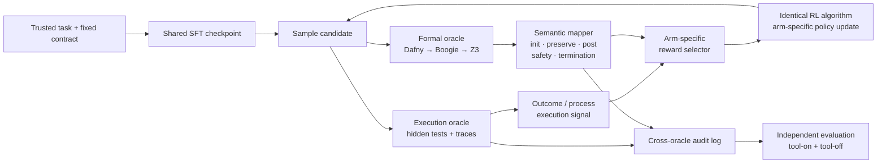
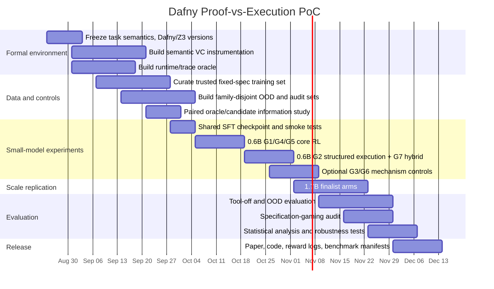

# From Execution Rewards to Proof Rewards: A Rigorous Prior-Art, Novelty, and Feasibility Assessment

## Executive summary

The draft research direction is **scientifically viable, but its strongest claims need to be narrowed**. The interview deck frames Pillar II as a progression from token-level learning, to state-transition grounding, to invariant/prover-based verification; page 1 explicitly contrasts runtime feedback as delayed/sparse with proof as structured/local, while page 2 proposes combining token, execution-trace, semantic-equivalence, and proof-alignment learning signals. fileciteturn0file4 The accompanying research brief sharpened this into the question of whether machine-checkable proof supervision can become a learning signal rather than merely an inference-time checker. fileciteturn0file0

The literature supports the overall direction, but **“use a formal verifier instead of tests as an RL reward” is already prior art**. Re:Form directly performs reinforcement learning with Dafny-verifier feedback, studies Qwen-2.5 models from roughly 0.5B to 14B, and demonstrates both large gains in formal verification and a critical failure mode: optimizing verifier acceptance alone can reward weak or underspecified specifications. citeturn25academia13turn6view1turn7view1 A 2026 thesis independently reports the same phenomenon in Dafny RLVR: verified reward initially rose from 2.2% to 58.1%, but specification hacking forced redesign of the task set and training protocol. citeturn25academia15

The strongest remaining novelty is instead:

> **Use a fixed semantic decomposition of program-verification obligations as training-time credit-assignment units, and causally compare that supervision against equally structured execution-process supervision under matched models, data, sampling, and compute.**

That distinction is important because the draft's claim that execution reward is intrinsically “sparse and delayed” is no longer generally defensible. ExecVerify constructs stepwise execution rewards from next-statement and variable-state predictions and reports substantial gains in execution reasoning and code generation. citeturn7view2turn8view1 Thus the decisive comparison is not

\[
\text{binary tests}\quad\text{vs.}\quad\text{formal proof},
\]

but

\[
\boxed{
\text{execution outcome}
\rightarrow
\text{execution process}
\rightarrow
\text{proof outcome}
\rightarrow
\text{proof process}.
}
\]

I found **no published study through August 21, 2026 that cleanly matches all four under the same base checkpoint, programming instances, candidate/token budget, optimizer, and inference budget**. Re:Form establishes verifier RL; RLEF establishes multi-turn execution-feedback RL; ExecVerify establishes dense execution-process reward; LORIS establishes localized formal reasoning feedback; but none performs the proposed head-to-head causal comparison. citeturn25academia13turn25search0turn25academia12 This is the strongest defensible research gap.

There is also already evidence that formal supervision can enter model parameters rather than helping only at inference. FVEL fine-tunes Llama-3-8B and Mistral-7B on Isabelle-based program-verification traces and reports downstream SV-COMP gains from 69 to 81 and 75 to 84 solved problems respectively. citeturn26academia24 A 2026 semantic-equivalence self-play paper trains approximately 7B models using Liquid Haskell proofs for equivalent programs and execution counterexamples for inequivalent programs; it releases approximately 28,000 validated Haskell programs and reports up to a 13.3-point gain on EquiBench plus gains on PySecDB. citeturn26academia25 Therefore, “first evidence that proof learning transfers to code reasoning” would also be too broad. The novel version is **matched prover-free transfer from VC-level program-proof RL against strong execution-process RL**.

For a Dafny proof of concept, the project is technically feasible at 0.6B and 1.7B. Dafny already generates and discharges assertions corresponding to contracts, loop invariants, safety side conditions, and termination conditions using Z3, and its official tooling supports per-assertion isolation, verification outcomes, durations, and resource counts. citeturn26search0turn26search5 The principal engineering challenge is **not invoking the prover**; it is constructing a stable mapping from Dafny's implementation-level assertion batches to research-level semantic categories such as `init`, `preserve`, `post`, `safety`, and `termination`.

A reasonable standard experiment with approximately 200,000 generated candidates per RL arm is estimated at roughly **64 A800-equivalent GPU-hours per 0.6B arm and 145 GPU-hours per 1.7B arm**, using Re:Form's published scaling as an empirical anchor and adding a planning margin. Re:Form itself reports approximately 176 A800 GPU-hours for 0.5B and 400 GPU-hours for 1.5B under a substantially larger rollout regime. citeturn6view2 These are planning estimates, not vendor quotes; candidate length, RL implementation, batching, and inference engine can easily move them by a factor of two.

The proposed categorical solver outcomes are conceptually correct:

\[
z_j\in
\{
\text{proved},
\text{refuted},
\text{unknown},
\text{timeout},
\text{invalid}
\},
\]

but **`unknown` and `timeout` must never be treated as logical refutations**. Z3 is a complete decision procedure only for supported quantifier-free combinations; quantified reasoning is incomplete in general and may fail to terminate. citeturn26search1 Dafny likewise documents that individual assertion batches can succeed, fail, or time out independently. citeturn26search0

The recommended primary endpoint is:

\[
\boxed{
\textbf{prover-free OOD verified solve rate}
}
\]

where the trained model receives **no verifier feedback during inference**, produces its program/invariant, and the evaluator invokes the verifier only afterward for scoring. This cleanly distinguishes “the model learned something” from “the model learned to operate an external repair loop.”

The final recommended scientific claim is therefore:

> **Formal verification can replace sampled execution as the correctness oracle for properties expressed by a trusted formal specification, but that does not imply that proof supervision universally dominates runtime supervision. We propose structured verification-condition supervision as a semantic credit-assignment mechanism and test, under matched training conditions, whether it learns more transferable program semantics than binary proof reward and dense execution-process supervision.**

That claim is novel enough to investigate, falsifiable, and substantially stronger than “LLMs with provers perform better.” It also preserves the two-branch distinction in the previous brief: mathematical proof should be treated as a control or later curriculum, whereas program verification is the main treatment because it explicitly represents program state and transition semantics. fileciteturn0file1 The current weekly research brief reaches the same bottom-line assessment: promising, but the key missing evidence is retained capability after the prover is removed. fileciteturn0file3

## Prior art and claim verification

The literature divides naturally by **where the machine-checkable correctness evidence originates**.

Execution-feedback systems observe concrete program behavior. Formal systems reason symbolically about a specification and program model. Within either class, feedback can be an outcome-level bit or a structured process signal. Keeping these axes separate avoids incorrectly contrasting “dense proof” with only the weakest possible execution baseline.

### Prior-art comparison

| Work | What is learned | Model / scale | Data | Reward or supervision | Training budget | Main result and relevance |
|---|---|---:|---|---|---|---|
| **CodeRL**, NeurIPS 2022 | Code model + learned critic | CodeT5-large, ~770M | APPS; transfer to MBPP | Generated programs are compiled/executed; functional outcomes supervise an actor-critic, with the critic providing finer token-level value information | Paper reports multi-A100 infrastructure but not a clean end-to-end “RL GPU-hour” accounting comparable with modern RLVR | Seminal demonstration that compiler/test outcomes can train code generation rather than merely rerank it; reported >2% pass@1 and ~20% pass@1000 on APPS. citeturn21view0turn22view5 |
| **RLEF**, ICML 2025 | Base LLM parameters | Llama-3.1-Instruct 8B, 70B | CodeContests, ~12.7k filtered training tasks | PPO over multi-turn code repair; public execution feedback is returned to the model and terminal task success supplies reward | 12k updates for 8B and 8k for 70B; ~20 h runs with large H100 allocations reported by the paper | 8B CodeContests 1@3 rises roughly 10.5→16.1; 70B ~27.5→40.1; paper reports order-of-magnitude sample reduction over prior approaches. citeturn25search0turn23academia12 |
| **ExecVerify**, 2026 | Code-model parameters | Qwen2.5-Coder-7B-Instruct | ~239,992 raw + ~239,466 mutated Python programs; after filters ~119k hard training examples | White-box execution process: final I/O plus step-level next-statement and variable value/type correctness; \(R=2[(1-\alpha)R_{\rm IO}+\alpha R_{\rm white}]\), main \(\alpha=0.5\) | SFT and GRPO on 8×H100; RL uses 128 prompts × 8 responses and 500 steps; wall-clock not cleanly reported | Strongest direct challenge to “runtime reward is sparse”: execution-process RL raises execution reasoning substantially and improves generation, with up to ~5.9-point pass@1 gains over pure GRPO settings. citeturn7view2turn7view3turn8view1turn8view3 |
| **Re:Form**, TMLR 2026 | Code-model parameters | Qwen-2.5 family ~0.5B, 1.5B, 3B, 7B, 14B | ~20k Dafny functions; SFT ~3k, RL ~4.5k; DafnyComp/DafnyBench evaluation | GRPO with Dafny verification. Variants include verification-only and stronger specification/subset relations plus regularization | 40 RL epochs. Approx. 176, 400, 640, 1,280, 2,304 A800 GPU-h for 0.5B/1.5B/3B/7B/14B | Directly establishes formal-verifier RL. Verification-only reward obtains very high verifier success but poor specification-quality scores; stronger rewards mitigate hacking and improve OOD generalization. citeturn25academia13turn6view1turn6view2turn7view1 |
| **Formal Verification RL thesis**, 2026 | Open code-model parameters + inference scaffold | Open-source models; Dafny RL and Lean inference | APPS-derived Dafny; refined benchmark; VERINA and Dalek-Bench for later studies | GRPO/RLVR with compiler and formal-verifier outcomes | Thesis experiments; no single standardized budget directly comparable with Re:Form | Initial verified reward 2.2→58.1%, but specification hacking appears; after filtering, refined multi-turn RL improves verified pass rate 9.7→31.1%. Strong independent confirmation of reward-hacking risk. citeturn25academia15 |
| **LORIS**, TOPLAS 2026 | No base-model post-training; inference feedback | LLM-driven system | 460 main C programs + 50 nonlinear cases | Failed VC → model explains reasoning → another LLM formalizes steps as FOL implications → SMT identifies invalid local implication | Inference-time calls rather than RL training | Solves 445/460 main programs and reports 93.1% overall success. Closest prior art to **localized formal process feedback**, but not parameter-level VC reward learning. citeturn25academia12 |
| **FVEL**, 2024 | LLM parameters through fine-tuning | Llama-3-8B-Instruct, Mistral-7B-Instruct | FVELER: 758 Isabelle theories, 29,125 lemmas, 200,646 proof steps | Code translated into Isabelle; models fine-tuned on verification/proof processes | LoRA-based runs; paper reports lightweight single-GPU training rather than RL-scale compute | Llama-3-8B improves SV-COMP 69→81 solved; Mistral-7B 75→84. Evidence that formal-program proof training can enter parameters and transfer within verification. citeturn26academia24 |
| **Semantic Equivalence Self-Play**, 2026 | Generator/evaluator model parameters | DeepSeek-R1-Distill-Qwen-7B-class setup | OpInstruct-HSx, ~28k validated Haskell programs | Liquid Haskell proofs certify equivalence; executable counterexamples certify inequivalence; difficulty-aware self-play curriculum | Main reported configuration roughly several days on four L40S GPUs | Up to +13.3 percentage points on EquiBench and gains on PySecDB. Important precedent for **hybrid proof + execution** and for tool-free downstream transfer. citeturn26academia25 |
| **AlphaVerus**, ICML 2025 | Search/self-improvement pipeline, not target-model fine-tuning | Llama-3.1-70B-based verified-code generation system | HumanEval/MBPP translated into Verus-oriented tasks | Verifier-guided iterative generation/refinement; filters specification/program misalignment | Inference/search cost, not a comparable RL training budget | Shows that verifier feedback and explicit specification-alignment controls produce verified code, but does not establish retained model capability from post-training. citeturn12search0 |
| **Proof2Silicon / PREFACE**, 2025 | Prompt-repair policy; target LLM frozen | Multiple frozen LLMs | 100-task Dafny benchmark | RL policy modifies prompts using Dafny verification as reward | Lightweight prompt-policy RL rather than code-model training | Up to 21% improvement in Dafny verification success; crucial distinction: “verifier RL” does not necessarily mean the code LLM itself learned. citeturn25academia14 |
| **P³**, 2026 | Inference-time planning/search | Multiple frontier LLMs | Verina, AlgoVeri, Lean4Commit0 | Jointly plan implementation and proof before generation | No model-weight training | Improves verified solve rate by ~4.6–11.2 points over strong baselines; shows proof obligations can shape code generation *before* final checking, but remains an inference scaffold. citeturn13academia13 |

Two distinctions from this table are central.

First, **Re:Form is the closest prior work to the original proposal**. It directly invalidates any “first formal-verifier RL for code” claim. Its verifier-only condition is especially informative: the formal signal is exact with respect to the stated Dafny contract, but maximizing it can still produce semantically undesirable behavior because the model can optimize the specification boundary. citeturn25academia13turn7view1

Second, **LORIS is the closest conceptual predecessor to VC-level semantic credit assignment**. It demonstrates that one can identify a locally invalid logical implication associated with a failed program proof rather than merely report “verification failed.” However, LORIS feeds that diagnosis into an inference-time repair loop; it does not establish that `init/preserve/post/...` outcomes make a better RL signal for the underlying code model. citeturn25academia12

Execution work also evolved beyond final unit-test bits. RLEF teaches multi-turn use of execution feedback, while ExecVerify explicitly derives white-box process supervision from concrete execution states. citeturn25search0turn7view2 Thus the interview-slide phrase “runtime verification/RL = late, sparse, hard to localize” should be changed to:

> **Final test rewards can be late and sparse; execution-process methods can make them substantially denser, but they remain grounded in sampled executions. Formal proof offers a different advantage: universal reasoning within the represented specification and formal semantics.**

That is both stronger and harder for reviewers to attack.

### What proof establishes—and what it does not

For sampled execution,

\[
\{P(x_1),P(x_2),\ldots,P(x_n)\}
\]

provides evidence about those executions.

A valid deductive verification can establish a proposition of the form

\[
\forall x,\quad
\operatorname{Pre}(x)
\Rightarrow
\operatorname{Post}(\operatorname{Program}(x))
\]

over the program semantics encoded by the verifier. Dafny automatically creates proof obligations for assertions, contract clauses, well-formedness/safety conditions, and invariants before and after loop iterations; these are discharged using Z3. citeturn26search0

But the correct interpretation is:

\[
\boxed{
\text{verified against specification}
\neq
\text{guaranteed intended real-world behavior}.
}
\]

Re:Form's reward-hacking results and the 2026 RLVR thesis give empirical examples of precisely this gap. citeturn7view1turn25academia15

The draft should therefore avoid saying “the prover does not need execution” without qualification. A precise statement is:

> **For properties fully represented in a trusted formal model, the training oracle need not concretely execute the candidate program on sampled inputs; the verifier can instead discharge symbolic proof obligations.**

The verifier itself still performs substantial computation, and SMT solving is not universally complete. In particular, the official Z3 documentation notes that quantified reasoning is incomplete in general and may diverge or fail to decide a formula. citeturn26search1

## Novelty and scientific positioning

The strongest contribution is no longer “proof reward.” It is the **granularity, experimental control, and transfer question**.

| Candidate claim | Verdict | Closest prior art | Recommended formulation |
|---|---|---|---|
| Formal verification can be an RL reward for code | **Already published** | Re:Form; 2026 Dafny RLVR thesis citeturn25academia13turn25academia15 | Do not claim novelty |
| Binary verifier reward may replace binary tests | **Already substantially explored** | Re:Form | Use only as experimental baseline |
| Local formal failures are more informative than terminal verifier failure | **Already demonstrated at inference** | LORIS citeturn25academia12 | Novelty must be in converting them to parameter-level training |
| Explicit fixed `init/preserve/post/safety/termination` reward for code-model RL | **Appears novel in surveyed literature** | LORIS is adjacent but inference-only; theorem proving has analogous subgoal rewards | Main methodological contribution |
| Direct proof-process vs execution-process comparison on identical programming tasks | **Strong apparent gap** | ExecVerify and Re:Form establish separate sides | Main causal contribution |
| Proof training transfers after prover removal | **Partly established, not in the proposed matched setting** | FVEL; Haskell semantic-equivalence work citeturn26academia24turn26academia25 | Claim “matched prover-free transfer relative to execution-process training” |
| Hybrid proof + execution supervision | **Not novel in general** | Semantic-equivalence self-play uses proof for equivalence and execution counterexamples for inequivalence citeturn26academia25 | Study hybrid specifically for program VCs and incomplete specs |
| Specification-gaming audit | **Risk already recognized** | Re:Form, AlphaVerus, formal-RL thesis citeturn7view1turn12search0turn25academia15 | Make systematic comparative measurement part of contribution |
| Math-proof training vs program-proof training | **No matched code-transfer comparison found** | Mature theorem-prover RL exists separately | Valuable mechanistic/control experiment |
| Better performance only with prover at inference | **Engineering contribution, weak learning claim** | P³, LORIS, AlphaVerus | Keep as secondary tool-on endpoint |

The project can therefore be organized around a two-axis supervision taxonomy:

| | **Outcome-level** | **Process-level** |
|---|---|---|
| **Execution** | unit-test pass/fail, test fraction | execution states, traces, values, next statements |
| **Formal proof** | whole-program verifies/fails | initiation, preservation, postcondition, safety, termination, individual proof obligations |

The missing high-value experiment is the bottom-right cell **versus** the top-right cell.

This reframes the thesis from:

> Formal verification is better than testing.

to:

> **Does a universal symbolic decomposition of program correctness teach a different and more transferable representation than a dense decomposition of sampled executions?**

That is scientifically much more interesting.

There is also a useful asymmetry between proving and refuting behavior. A single execution can efficiently establish

\[
\exists x:
P(x)\neq Q(x),
\]

whereas establishing universal equivalence

\[
\forall x:
P(x)=Q(x)
\]

requires stronger reasoning. The 2026 semantic-equivalence study explicitly exploits this asymmetry by using Liquid Haskell proofs for equivalence and executable counterexamples for inequivalence. citeturn26academia25 This strongly supports keeping G7, but means the broad “proof + execution hybrid” idea itself is not a first.

The mathematical-prover branch should remain scientifically separate, as your previous draft already recognized. fileciteturn0file1 Mathematical theorem proving teaches decomposition over propositions and proof states; program verification additionally grounds proof obligations in mutable state, transitions, contracts, safety conditions, and loops. The full study can test whether those inductive biases transfer differently, but adding Lean/Isabelle training to the first PoC would introduce another language, data distribution, and toolchain confound.

The paper should therefore lead with:

\[
\boxed{
\text{Structured semantic credit assignment}
+
\text{matched oracle comparison}
+
\text{prover-free transfer}.
}
\]

not with “first prover RL.”

## Dafny PoC feasibility and reward design

A Dafny PoC is technically attractive because the formal stack already exposes most of the raw machinery required by the experiment.

### Recommended toolchain

| Layer | Recommended component | Research role |
|---|---|---|
| Task representation | Versioned Dafny programs with **fixed trusted** `requires`/`ensures` contracts | Prevent the main training experiment from being confounded by specification generation |
| Program verifier | Dafny 4.x, pinned exactly | Parsing, type checking, generation of proof obligations |
| VC/intermediate layer | Boogie/Dafny verification pipeline | Converts program correctness requirements into logical obligations |
| SMT backend | Z3, pinned with Dafny | Discharges obligations; reports success/failure/unknown behavior |
| VC instrumentation | `{:isolate_assertions}`, explicit assertions, controlled `{:split_here}` where needed | Isolate logical obligations rather than obtain only a whole-method result |
| Machine-readable logging | Dafny verification logs with per-batch outcomes, duration and resource units | Reward extraction and solver-cost diagnostics |
| Runtime oracle | Sandboxed executable/reference interpreter + hidden tests; trace instrumentation for G2 | Matched execution baseline |
| Training | Same GRPO/RLVR implementation for G1/G2/G4/G5/G7 | Prevent optimizer choice from becoming a confound |
| Data/log store | Hash of task, candidate, spec, tool versions, execution results, proof outcomes, reward components | Reproducibility and cross-oracle disagreement analysis |
| Evaluation harness | No-feedback generator plus offline verifier/runtime scorer | Separates tool-free capability from tool use |

Dafny documents that it proves loop invariants both before the loop and after each iteration, checks method postconditions before return, and automatically creates safety obligations such as valid array indices and defined division. citeturn26search0 It can isolate assertions so they succeed, fail, or time out independently and can report independent duration/resource data for assertion batches. citeturn26search0turn26search5

A critical engineering point is that:

\[
\boxed{
\text{Dafny assertion batch}
\neq
\text{semantic reward category}.
}
\]

`{:isolate_assertions}` isolates individual verifier assertions, but Dafny can generate many implicit assertions, and the location/batching of those assertions does not automatically yield the research abstraction “preservation” or “postcondition.” citeturn26search0

For the PoC, therefore, create explicit, tagged verification harnesses so each fixed category can be evaluated reproducibly:

\[
O =
\{
O_{\text{init}},
O_{\text{preserve}},
O_{\text{post}},
O_{\text{safety}},
O_{\text{termination}}
\}.
\]

For example:

\[
O_{\text{init}}:\quad P(s)\Rightarrow I(s)
\]

\[
O_{\text{preserve}}:\quad
I(s)\land G(s)\land T(s,s')
\Rightarrow I(s')
\]

\[
O_{\text{post}}:\quad
I(s)\land\neg G(s)
\Rightarrow Q(s).
\]

Safety should include explicit side conditions required by the task—array bounds, nonzero divisors, type/range conditions, assertions, and analogous obligations generated by Dafny. citeturn26search0 Termination should be scored only for tasks in which **total correctness** is part of the target; otherwise it creates an unnecessary difference from an execution baseline that may only assess partial functional correctness.

### Reward validation

The proposed categorical status is sound in spirit:

\[
z_j\in
\{
\text{proved},
\text{refuted},
\text{unknown},
\text{timeout},
\text{invalid}
\}.
\]

But these outcomes have different epistemic meanings.

| Status | Interpretation | Recommended treatment |
|---|---|---|
| `proved` | Obligation established by the verifier under the formal model | Positive semantic reward |
| `refuted/counterexample` | A countermodel/path establishes that the obligation does not hold in that query | Semantic failure |
| `unknown` | Solver could not decide | **Do not call false**; separate solver-reliability state |
| `timeout` | Resource budget exhausted | **Do not call false**; small cost penalty at most |
| `invalid` | Syntax/type/formalization failed before semantic proof | Gate/penalty separate from proof score |

The distinction is not cosmetic. Z3's quantified reasoning is incomplete, and Dafny explicitly documents timeout/unknown as solver outcomes rather than logical counterexamples. citeturn26search1turn26search3

I would replace the raw formulation

\[
R_{\text{VC}}
=
\frac{\sum_j w_jV(z_j)}
{\sum_jw_j}
\]

with a **two-level category aggregation**. First aggregate individual obligations inside a fixed semantic category:

\[
s_c =
\frac{1}{|O_c|}
\sum_{j\in O_c}
\mathbf 1[z_j=\text{proved}],
\]

then aggregate categories:

\[
R_{\text{sem}}
=
\sum_{c\in C}w_cs_c,
\qquad
\sum_cw_c=1.
\]

This prevents a program that happens to generate many easy safety assertions from overwhelming a single conceptually critical preservation obligation.

A reasonable initial weight vector for total-correctness loop tasks is:

\[
(w_{\rm init},
w_{\rm preserve},
w_{\rm post},
w_{\rm safety},
w_{\rm term})
=
(0.20,0.25,0.25,0.20,0.10).
\]

The exact weights are hypotheses, not known optimal values, and should be preregistered and sensitivity-tested.

Then use:

\[
R_t =
R_{\text{sem}}
+
\lambda_{\text{complete}}
\mathbf 1[\text{all required categories proved}]
-
\lambda_{\text{invalid}}
\mathbf 1[\text{invalid}]
-
\eta C_{\text{solver}}
+
\mu R_{\text{progress}}.
\]

A defensible starting configuration is:

\[
\lambda_{\text{complete}}=1.0,
\qquad
\lambda_{\text{invalid}}\in[0.25,0.5],
\qquad
\eta\in[0.02,0.05],
\]

with

\[
R_{\text{progress}}^{(t)}
=
\operatorname{clip}
\left(
R_{\text{sem}}^{(t)}
-
R_{\text{sem}}^{(t-1)},
-0.25,0.25
\right)
\]

and

\[
\mu\approx0.25
\]

only in a genuinely multi-turn repair environment.

`R_progress` should **not** be used in one-shot RL simply because it sounds dense; it has no natural state-to-state interpretation there.

A solver-cost term, if retained at all, should be small. Dafny's documentation explicitly warns that verification time can vary with machine conditions and solver behavior; its deterministic-ish resource-unit measure on a fixed build/platform is a better diagnostic than raw duration for proof complexity. citeturn26search0 Rewarding “fast verification” too aggressively risks teaching the model to produce solver-friendly but semantically impoverished contracts or invariants.

Three alternatives deserve ablation.

**Ordinal/dominance reward.** Rather than inventing weights, rank two candidates by the set of semantic obligations proved:

\[
A\succ B
\]

when \(A\) proves a strict superset of required categories without introducing additional refutations or invalid states. GRPO is naturally compatible with within-group relative rankings. This is probably the cleanest alternative to weighted scalarization.

**Lexicographic reward.** Rank:

\[
\text{valid syntax/type}
\prec
\text{partial semantic proof}
\prec
\text{full proof}.
\]

Within the partial stage, compare a fixed vector

\[
[\text{init},\text{preserve},\text{post},
 \text{safety},\text{termination}].
\]

This makes it harder for ten easy obligations to compensate for a fundamental failed postcondition.

**Terminal proof + potential-difference shaping.** Preserve a strong terminal notion of correctness while adding progress only as a shaping term:

\[
R_t=
R_{\rm terminal}
+
\mu
\left[
\Phi(s_{t+1})-\Phi(s_t)
\right].
\]

This is conceptually preferable to rewarding arbitrary “VC count reduction” because the potential is defined on the stable semantic category representation.

The most serious reward threat is **specification gaming**. Re:Form empirically finds that verification-only reward can produce strong formal acceptance while failing stronger specification-consistency measures, and the independent 2026 Dafny-RL thesis reports specification hacking as a major early failure mode. citeturn7view1turn25academia15

Therefore the initial experiment should freeze:

- preconditions;
- postconditions;
- reference declarations;
- evaluation harnesses.

Generated code should be statically rejected if it modifies the trusted contract or uses constructs that bypass the intended proof. In particular, unchecked assumptions, disabled verification, or analogous proof-shortcut mechanisms must be banned by AST-level validation. Dafny's own documentation notes that an `assume` makes its expression available to subsequent verification, illustrating why unrestricted proof-affecting constructs cannot be treated as ordinary generated code. citeturn26search0

Only after the fixed-spec experiment succeeds should specification synthesis be introduced as a second research problem.

### Compute and solver budget

Re:Form provides the best directly comparable empirical anchor. Its 0.5B run used roughly 176 A800-SXM4-80GB GPU-hours, while the 1.5B run used about 400 GPU-hours under its reported 40-epoch verifier-RL configuration. citeturn6view2 The paper's rollout setup implies a much larger candidate budget than the 200k-per-arm proposal below, so linear scaling should be treated only as first-order planning.

For budgeting, define three candidate regimes:

| Regime | Candidate generations / RL arm | Purpose |
|---|---:|---|
| Smoke | 50,000 | Verify reward density, infrastructure, no catastrophic hacking |
| Standard | 200,000 | Primary 0.6B experiment |
| High | 500,000 | Sensitivity / negative-result follow-up |

Using Re:Form's observed 0.5B/1.5B throughput as the anchor and adding approximately 30% systems margin gives:

| Model | Candidates | Estimated GPU-h / RL arm | 8-GPU wall-clock, excluding major prover stalls | 16-GPU wall-clock |
|---|---:|---:|---:|---:|
| 0.6B | 50k | ~16 | ~2.5–3 h | ~1.3–1.5 h |
| 0.6B | **200k** | **~64** | **~10–12 h** | **~5–6 h** |
| 0.6B | 500k | ~159 | ~24–30 h | ~12–15 h |
| 1.7B | 50k | ~36 | ~5.5–7 h | ~3–4 h |
| 1.7B | **200k** | **~145** | **~22–27 h** | **~11–14 h** |
| 1.7B | 500k | ~361 | ~55–68 h | ~27–34 h |

These are **estimates derived from Re:Form, not reported measurements for the proposed models**. Variation in generated sequence length, attention implementation, vLLM batching, offloading, KL/reference-model requirements, and RL framework can easily produce a \(0.5\times\)–\(2\times\) range around them. citeturn6view2

The dollar cost should therefore remain a variable:

\[
C_{\rm GPU}=H_{\rm GPU}p_{\rm GPU},
\]

rather than embedding a cloud-vendor price into the scientific plan.

For illustration only:

| Standard arm | GPU-h | \(p_{\rm GPU}=\$2/h\) | \$4/h | \$8/h |
|---|---:|---:|---:|---:|
| 0.6B | 64 | $128 | $256 | $512 |
| 1.7B | 145 | $290 | $580 | $1,160 |

This excludes storage, CPUs, SFT, evaluation, failed jobs, and engineering time.

Proof processing is unlikely to dominate GPU cost **if** solver latencies stay low and verification is asynchronous, but tail behavior matters. A 200k-candidate G5 run with roughly five independently instrumented semantic categories corresponds to about **one million SMT/assertion-batch evaluations**.

| Mean solver-batch time | CPU-h for 1M batches | Ideal wall-clock at 32 CPU workers | Ideal wall-clock at 64 workers |
|---:|---:|---:|---:|
| 0.05 s | 13.9 | 0.43 h | 0.22 h |
| 0.20 s | 55.6 | 1.74 h | 0.87 h |
| 1.00 s | 277.8 | 8.68 h | 4.34 h |
| 2.00 s | 555.6 | 17.36 h | 8.68 h |

The table excludes Dafny front-end/startup overhead and assumes perfect parallelism. Dafny's own documentation emphasizes that some assertions can become unexpectedly difficult, time out, or vary in solver cost, which is why per-batch logging and resource limits are essential. citeturn26search0

The sensitivity variable that matters most is therefore not “CPU price” but the distribution

\[
T_{\rm SMT}\sim
\text{many fast obligations + a long timeout tail}.
\]

Use fixed per-obligation resource/time limits in the experiment and report the complete timeout distribution instead of silently increasing solver effort until an arm looks better.

For the principal 0.6B core experiment, three RL seeds for G1/G4/G5 at 200k candidates implies roughly:

\[
3\ \text{arms}
\times
3\ \text{seeds}
\times
64
\approx
576
\]

A800-equivalent GPU-hours, plus shared SFT and evaluation.

Adding the mandatory publication-grade G2 and G7 controls raises this by another

\[
2\times3\times64
\approx384
\]

GPU-hours, or approximately **960 GPU-hours of 0.6B RL**.

Replicating five finalist arms at 1.7B with two seeds gives approximately

\[
5\times2\times145
=
1,450
\]

additional GPU-hours; three seeds would require about 2,175. These estimates make a staged design considerably more economical than training G0–G7 simultaneously.

## Experimental protocol, metrics, and statistics

The experiment should separate **oracle information content**, **on-policy learning**, and **inference-time tool use**.

A subtle but important correction to the earlier design is that divergent on-policy RL models cannot continue training on literally “the same sampled candidates.” After the first parameter update, their policies differ.

The correct design is twofold.

First, create a **paired offline candidate experiment** from the shared SFT checkpoint. Every sampled candidate is evaluated by both execution and formal oracles. This directly measures which signal distinguishes semantically meaningful differences.

Second, in on-policy RL, fix the prompts, data distribution, candidate-token budget, generation hyperparameters, optimizer, number of updates, and evaluation budgets. Every candidate can still be **logged against both oracles**, but each training arm uses only its assigned reward. This preserves a powerful disagreement analysis without pretending that divergent policies produce identical trajectories.

### Experimental groups

| Group | Post-SFT supervision | Scientific role |
|---|---|---|
| **G0** | None | Shared SFT control |
| **G1** | Final hidden-test/execution reward | Conventional outcome-RL baseline |
| **G2** | Dense execution-state/process reward | **Required strong execution control**, motivated by ExecVerify |
| **G3** | Mathematical theorem-proof supervision | Tests generic deduction-transfer hypothesis |
| **G4** | Binary final Dafny-verifier reward | Tests whether proof universality alone matters |
| **G5** | **Structured semantic VC reward** | **Main treatment** |
| **G6** | Mathematical proof → program proof | Tests staged general-proof/domain-proof curriculum |
| **G7** | Structured program proof + execution | Tests practical complementarity |

The core PoC should begin with G0/G1/G4/G5 at 0.6B. G2 and G7 become mandatory before a strong publication claim, because ExecVerify makes binary test reward alone an insufficient runtime baseline. citeturn7view2turn8view1 G3/G6 are scientifically interesting but should not delay the first proof-vs-execution result.

### Dataset composition

Treat composition as a preregistered variable rather than pretending the optimal mix is known. A reasonable starting domain contains:

- scalar induction loops;
- arrays and index safety;
- branch-dependent loops;
- simple nested loops;
- accumulation/search algorithms;
- explicit termination variants for a controlled subset.

The main RL set can contain approximately **5,000 distinct underlying tasks**, with generated variations used for rollout diversity. Re:Form's use of approximately 3,000 SFT and 4,500 RL examples demonstrates that this scale is workable for small-model Dafny adaptation, although the proposed experiment should enforce stronger family-level train/test separation. citeturn25academia13turn6view1

The primary evaluation should have at least **1,200–2,000 independent held-out tasks**, preferably generated from algorithm/program families excluded from training rather than merely different surface instances.

Public benchmarks such as DafnyComp/DafnyBench can be secondary external endpoints rather than the sole statistical sample. Re:Form introduced DafnyComp explicitly to test compositional OOD formal reasoning. citeturn25academia13

For G1/G2/G7, create two execution-test banks:

\[
T_{\rm train}
\cap
T_{\rm audit}
=
\varnothing.
\]

Only \(T_{\rm train}\) can affect RL. \(T_{\rm audit}\) is never revealed and exists to detect test overfitting and proof/specification mismatch.

### Tool-on versus tool-off evaluation

**Tool-on evaluation** asks whether the trained system uses formal verification effectively. Fix verifier-call and wall-clock budgets across groups.

**Tool-off evaluation**, which should be the primary endpoint, gives the model no verifier diagnostics, test feedback, repair loop, or external proof search. It produces its candidate in one shot or under a fixed no-feedback sampling budget. The evaluator may run Dafny afterward because that does not leak information back to the model.

This distinction directly operationalizes the central question from the current research brief: does the capability enter the model, or does the prover remain merely an external scaffold? fileciteturn0file3

Recommended evaluation ladder:

| Suite | Tool feedback during generation? | Main capability |
|---|---|---|
| Trusted Dafny ID holdout | No | Baseline internalization |
| Family-disjoint Dafny OOD | No | Program-semantic generalization |
| DafnyComp / DafnyBench | No, then tool-on separately | External formal generalization |
| Semantic-preserving rewrites | No | Surface-pattern robustness |
| Execution reasoning suite | No prover | Internal state-transition reasoning |
| Semantic equivalence | No training prover | Behavioral reasoning |
| HumanEval+/MBPP+/LiveCodeBench-style generation | No | Ordinary coding transfer |
| Small real-code repair set | No Dafny | Cross-language/domain transfer |
| Tool-on Dafny repair | Yes, fixed budget | Deployment-oriented verifier use |

The crucial adversarial transformations are variable renaming, literal perturbations, semantically equivalent condition rewrites, loop normalization, dead-code insertion, and reordered independent statements. A model that learned Dafny invariant templates should be substantially less robust to these than one that learned actual state-transition relationships.

### Primary metrics

The most defensible **primary metric** is:

\[
\boxed{
\operatorname{VerifiedSolveRate}_{\rm OOD,tool-off}
}
\]

under a trusted fixed contract.

The co-primary or key secondary metric should be **independent behavioral correctness** on the same generated candidates:

\[
\operatorname{HiddenTestPass}_{\rm audit}.
\]

This creates a useful four-way diagnostic:

| Formal audit | Independent execution audit | Interpretation |
|---|---|---|
| Pass | Pass | Strong agreement |
| Pass | Fail | **Specification/model adequacy problem or formal/runtime semantic mismatch** |
| Fail with counterexample | Pass | **Test-only acceptance gap**: tests missed a formally represented failing case |
| Timeout/unknown | Pass | Inconclusive proof, not evidence of program incorrectness |

Do not call the third category “false program correctness” unless the verifier supplies a genuine counterexample. Passing finite tests while the solver merely times out is not evidence that the implementation is incorrect. Z3's incompleteness for general quantified problems makes this distinction necessary. citeturn26search1

Secondary metrics should include:

\[
\text{tool-on verified solve rate},
\]

\[
\text{pass@1 / pass@}k,
\]

\[
\text{verifier calls per solved task},
\]

\[
\text{program executions per solved task},
\]

\[
\text{solver CPU-seconds / resource units},
\]

\[
\text{sampled tokens and GPU-hours per solved task},
\]

plus per-category success rates for initiation, preservation, postcondition, safety, and termination. Dafny's per-assertion resource reporting makes the proof-cost metrics directly instrumentable. citeturn26search0

For prover-free transfer, report:

\[
\Delta_{\text{transfer}}
=
M_{\text{post-training,tool-off}}
-
M_{\text{shared-SFT,tool-off}}
\]

for every external benchmark, not merely raw accuracy. The meaningful causal comparisons are then

\[
\Delta_{G5}-\Delta_{G2}
\]

and

\[
\Delta_{G5}-\Delta_{G4}.
\]

The first asks whether proof **process** beats execution process; the second whether structure matters beyond final proof acceptance.

### Specification-gaming diagnostics

At minimum measure:

\[
P(\text{proof pass}\land\text{audit execution fail}),
\]

the proportion of generated candidates containing prohibited proof shortcuts, and the prevalence of vacuity-prone conditions.

Add a deliberately adversarial specification suite containing:

- overly strong preconditions;
- weak postconditions;
- omitted frame/behavioral requirements;
- contradictory or unreachable assumptions;
- natural-language requirements whose formal contracts omit one important behavior.

The model should not be rewarded for “fixing” these contracts in the main fixed-spec condition. A later generated-spec experiment can explicitly measure whether RL pressure weakens them. Re:Form and the 2026 RLVR thesis make such an audit a necessity rather than an optional robustness experiment. citeturn7view1turn25academia15

### Statistical design

Use **three independent RL seeds at 0.6B**. For expensive 1.7B replication, two seeds can be a resource-constrained minimum, but three is substantially preferable before making a strong model-scale claim.

Because all conditions are evaluated on the same held-out tasks, task-level results are paired. For binary solved/not-solved endpoints:

- report absolute risk difference with 95% confidence intervals;
- use an exact or asymptotic **McNemar test** for the primary paired contrast;
- use hierarchical/task-level bootstrap confidence intervals;
- add mixed-effects logistic regression as a robustness analysis, with treatment as a fixed effect and task family/training seed as grouping factors.

The useful sample size depends strongly on how often the two systems disagree. A simple paired-binary approximation illustrates the scale:

| Target absolute difference | Approx. discordant fraction | Rough tasks for 80% power, two-sided 5% |
|---:|---:|---:|
| 5 pp | 20% | ~630 |
| 5 pp | 25% | ~780 |
| 4 pp | 20% | ~980 |
| 4 pp | 25% | ~1,225 |
| 3 pp | 20% | ~1,740 |
| 3 pp | 25% | ~2,180 |

Therefore **~1,200 primary OOD tasks** is a reasonable target if a four-point absolute effect is considered scientifically meaningful; ~2,000 is safer if the hoped-for gain is only three points.

For pass@k and continuous cost metrics, bootstrap over **tasks**, not individual generations. Individual samples from the same task are not independent observations.

If evaluating G5 against both G2 and G4 as predeclared primary contrasts, use Holm correction or another preregistered family-wise adjustment. Do not run all G0–G7 pairwise comparisons and then choose whichever is significant.

For tool-on multi-turn evaluation, “number of verifier calls before success” can additionally be analyzed as a censored time-to-event variable under a fixed maximum call budget. This reveals whether an arm truly finds proofs faster rather than merely succeeding eventually after more external search.

### Timeline

The following schedule assumes an existing small-model training stack and access to 8–16 accelerators during training windows. Solver-instrumentation work, not RL itself, is likely to dominate early engineering time.

A negative G5 result after the first 0.6B experiment should **not** immediately terminate the project. First determine whether G5 receives meaningful nonterminal signal at all and whether 200k candidates are enough to move the model. But if, after matching budgets and adding G2, structured proof reward improves only tool-on Dafny verification and produces no tool-off/OOD advantage, the strong “semantic capability internalization” hypothesis should be considered unsupported.

## Deliverables, risks, and primary sources

The PoC should produce more than trained checkpoints. A credible formal-learning paper needs an auditable chain from specification to solver result to reward.

### Experimental checklist

| Check | Required action | Exit criterion |
|---|---|---|
| **Toolchain freeze** | Pin Dafny, Boogie/Z3 versions, CLI flags and resource limits | Exact container reproduces verification outcomes |
| **Trusted-spec boundary** | Freeze contracts in main experiment | Generated candidates cannot modify specification |
| **Shortcut prevention** | AST/static lint disallowed assumptions, verification disabling, unsafe escape hatches | Zero accepted candidate can bypass target obligations |
| **Semantic mapper** | Map verifier assertions into `init/preserve/post/safety/termination` | Manual audit on ≥200 examples shows near-perfect category assignment |
| **Solver outcome handling** | Preserve proved/refuted/unknown/timeout/invalid separately | No timeout or unknown silently treated as logical false |
| **Paired oracle logging** | Execute and formally verify candidates wherever feasible | One record contains both proof and runtime evidence |
| **Hidden execution audit** | Maintain unrevealed execution bank | No training process can inspect audit cases |
| **Reward smoke test** | Plot status/category frequencies before full RL | Reward is neither almost always zero nor saturated |
| **Specification-hacking suite** | Include intentionally weak/misaligned contracts | Report proof/audit disagreement rates |
| **Core 0.6B experiment** | G0/G1/G4/G5, ≥3 RL seeds | Determine whether structured proof beats binary proof/test outcome |
| **Strong execution baseline** | Add G2 | Publication claim never rests on comparison with binary tests alone |
| **Hybrid baseline** | Add G7 | Measure complementarity rather than assume replacement |
| **Tool-off primary eval** | Remove all verifier/test feedback during generation | Report OOD verified solve and independent semantics |
| **Scale replication** | Repeat key contrasts at 1.7B | Direction and meaningful effect reproduce |
| **Robustness** | Rename/refactor/semantic-preserving transforms | Gains do not collapse under surface changes |
| **Cost accounting** | Log sampled tokens, GPU-h, CPU solver seconds/RU, verifier calls, executions | Report both model-compute and end-to-end efficiency |
| **Artifact release** | Candidate IDs, contracts, rewards, solver logs, seeds, checkpoints where possible | Another group can reproduce every reported metric |

The top engineering risks, in order, are:

**Specification validity.** The strongest formal proof says nothing beyond the encoded requirement. Re:Form's own verifier-RL experiments and the 2026 formal-RL thesis empirically demonstrate this risk. citeturn7view1turn25academia15

**Unstable VC granularity.** Dafny's fundamental verification unit is an assertion batch, and splitting can change the number and isolation of solver queries. citeturn26search0turn26search5 Raw “percentage of VCs passed” is therefore a poor research reward unless the semantic categories are explicitly stabilized.

**Solver incompleteness and timeout tails.** Z3 handles quantified formulas heuristically and is incomplete for general quantified reasoning. citeturn26search1 Unknown/timeout rates must be reported rather than hidden inside failure.

**Mismatch between formal and runtime semantics.** Integer overflow, libraries, external APIs, concurrency, undefined behavior, and implementation/runtime details become increasingly difficult as the project moves beyond Dafny's clean model. The first experiment should therefore remain intentionally narrow and should not claim that success immediately generalizes to arbitrary C/C++ or repository software.

**Baseline weakness.** Comparing G5 only with final test reward would likely be criticized because ExecVerify already shows that execution traces provide dense machine-verifiable supervision. citeturn7view2turn8view1 G2 is essential.

**Tool-use/internalization confusion.** P³, LORIS, AlphaVerus, and Proof2Silicon all show ways that formal tools can improve an overall system without necessarily teaching the underlying model the intended capability. citeturn13academia13turn25academia12turn12search0turn25academia14 Tool-off evaluation is therefore not optional.

**Cross-domain overclaiming.** FVEL and semantic-equivalence self-play make parameter-level transfer plausible, but neither constitutes a matched VC-process-vs-execution-process experiment on ordinary code. citeturn26academia24turn26academia25 A successful Dafny PoC should be described initially as evidence about program-verification supervision, not universal software intelligence.

### Primary and official source set

The following should form the core of the paper's related-work and implementation bibliography.

| Source | Why it is essential |
|---|---|
| [**Re:Form — Reducing Human Priors in Scalable Formal Software Verification with RL in LLMs**](https://arxiv.org/abs/2507.16331) | Closest direct prior art: Dafny verifier-driven RL, small-to-large model scaling, specification-reward failure modes. citeturn25academia13 |
| [**RLEF: Grounding Code LLMs in Execution Feedback with Reinforcement Learning**](https://proceedings.mlr.press/v267/gehring25a.html) | Strong modern execution-feedback RL baseline, 8B and 70B. citeturn25search0 |
| [**ExecVerify**](https://arxiv.org/abs/2603.11226) | Most important methodological execution baseline because it provides machine-verifiable **process-level** state rewards. citeturn7view2turn8view1 |
| [**CodeRL**](https://arxiv.org/abs/2207.01780) | Seminal actor-critic code RL from compiler/unit-test functional evidence. citeturn21view0 |
| [**LORIS — Guiding LLM-Based Loop Invariant Synthesis via Feedback on Local Reasoning Errors**](https://arxiv.org/abs/2605.17914) | Closest structured formal-process feedback precedent. citeturn25academia12 |
| [**FVEL: Interactive Formal Verification Environment with LLMs via Theorem Proving**](https://arxiv.org/abs/2406.14408) | Evidence that program-verification proof data can train model parameters and improve downstream verification. citeturn26academia24 |
| [**Improving LLM Code Reasoning via Semantic Equivalence Self-Play with Formal Verification**](https://arxiv.org/abs/2604.17010) | Important proof+execution hybrid and prover-derived downstream-transfer precedent. citeturn26academia25 |
| [**Automating Formal Verification with Reinforcement Learning and Recursive Inference**](https://arxiv.org/abs/2605.30914) | Independent Dafny RLVR evidence; particularly useful for specification-hacking analysis. citeturn25academia15 |
| [**Proof2Silicon / PREFACE**](https://arxiv.org/abs/2509.06239) | Clarifies the distinction between verifier-guided RL around a frozen LLM and training the code-model parameters themselves. citeturn25academia14 |
| [**P³: Joint Program-and-Proof Planning**](https://arxiv.org/abs/2608.09277) | Current inference-time evidence that proof obligations can guide implementation planning, not merely final checking. citeturn13academia13 |
| [**Dafny Verification Optimization documentation**](https://dafny.org/v4.9.1/VerificationOptimization/VerificationOptimization) | Official description of assertions, loop-invariant checking, assertion batches, isolation, timeouts, and resource metrics. citeturn26search0 |
| [**Dafny Reference Manual**](https://dafny.org/dafny/DafnyRef/DafnyRef) | Authoritative specification of verification constructs and assertion splitting. citeturn26search5 |
| [**Z3 Guide — Quantifiers**](https://microsoft.github.io/z3guide/docs/logic/Quantifiers/) | Primary documentation for the important limitation that general quantified SMT reasoning is incomplete. citeturn26search1 |

### Final research statement

The evidence supports a narrower but stronger thesis than the original slide.

The field already knows that:

\[
\text{execution feedback can train code models};
\]

CodeRL and RLEF establish that. citeturn21view0turn25search0

It also knows that:

\[
\text{execution traces can provide dense semantic supervision};
\]

ExecVerify establishes that. citeturn7view2turn8view1

And it now knows that:

\[
\text{formal verifier feedback can train code models};
\]

Re:Form establishes that directly. citeturn25academia13

It knows that local formal reasoning failures can be exposed and repaired, as LORIS demonstrates, and that formal-proof-derived training can transfer beyond the exact training examples, as FVEL and semantic-equivalence self-play indicate. citeturn25academia12turn26academia24turn26academia25

What remains insufficiently answered is:

\[
\boxed{
\begin{aligned}
&\text{When model, tasks, optimizer, sampling and compute are matched,}\\
&\text{does structured proof-process supervision teach better}\\
&\text{program semantics than structured execution-process supervision?}
\end{aligned}
}
\]

and, crucially,

\[
\boxed{
\text{does that advantage remain after prover feedback is removed?}
}
\]

That should be the paper.

A final title that accurately reflects the novelty is:

> **From Execution Rewards to Proof Rewards: A Controlled Study of Semantic Credit Assignment for Code LLMs**

A slightly more neutral—and scientifically safer—title is:

> **Execution or Proof? Comparing Machine-Checkable Semantic Supervision for Code LLMs**

The corresponding abstract-level claim should be:

> **We investigate formal program verification not merely as a terminal correctness checker but as a source of structured semantic credit for code-model post-training. We decompose verification into stable program obligations such as invariant initiation, transition preservation, postcondition sufficiency, safety, and termination, and compare this supervision under matched budgets with both outcome-level and process-level execution feedback. Our primary question is whether proof-derived learning improves out-of-distribution semantic correctness after verifier feedback is removed. We separately audit solver uncertainty, specification gaming, and end-to-end compute, and study when proof and execution should be combined rather than treated as substitutes.**

That formulation preserves the conceptual arc visible in the interview deck—**token → state → proof**—while correcting its weakest empirical implication: the contribution is not that proof is the first dense or grounded alternative to tests. fileciteturn0file4 It is that **formal proof obligations may provide a qualitatively different semantic decomposition of correctness, and no existing work located in this review has yet isolated that difference against strong execution-process supervision in the matched, prover-free-transfer experiment required to establish the claim.**

===source 

Sources

Activity · 12m

Citations · 17

•

1
Jian_Wang_Interview_30min copy.pdf

Jian_Wang_Interview_30min copy.pdf
•

2
Pasted markdown.md

Pasted markdown.md
arxiv.org
arxiv.org

3
https://arxiv.org/abs/2507.16331
https://arxiv.org/abs/2507.16331

4
https://arxiv.org/abs/2605.30914
https://arxiv.org/abs/2605.30914

5
https://arxiv.org/html/2603.11226v1
https://arxiv.org/html/2603.11226v1

6
https://arxiv.org/abs/2406.14408
https://arxiv.org/abs/2406.14408

7
https://arxiv.org/abs/2604.17010
https://arxiv.org/abs/2604.17010

9
https://arxiv.org/html/2507.16331v4
https://arxiv.org/html/2507.16331v4

11
https://arxiv.org/abs/2207.01780
https://arxiv.org/abs/2207.01780

13
https://arxiv.org/abs/2605.17914
https://arxiv.org/abs/2605.17914

15
https://arxiv.org/abs/2509.06239
https://arxiv.org/abs/2509.06239

16
https://arxiv.org/abs/2608.09277
https://arxiv.org/abs/2608.09277
dafny.org
dafny.org

8
https://dafny.org/v4.9.1/VerificationOptimization/VerificationOptimization
https://dafny.org/v4.9.1/VerificationOptimization/VerificationOptimization

17
https://dafny.org/dafny/DafnyRef/DafnyRef
https://dafny.org/dafny/DafnyRef/DafnyRef
microsoft.github.io
microsoft.github.io

10
https://microsoft.github.io/z3guide/docs/logic/Quantifiers/
https://microsoft.github.io/z3guide/docs/logic/Quantifiers/
proceedings.mlr.press
proceedings.mlr.press

12
https://proceedings.mlr.press/v267/gehring25a.html
https://proceedings.mlr.press/v267/gehring25a.html

14
https://proceedings.mlr.press/v267/aggarwal25a.html
https://proceedings.mlr.press/v267/aggarwal25a.html
Sources scanned · 113

arxiv.org
arxiv.org
Guiding LLM-based Loop Invariant Synthesis via Feedback on Local Reasoning Errors

https://arxiv.org/abs/2605.17914

ExecVerify: White-Box RL with Verifiable Stepwise Rewards for Code Execution Reasoning

https://arxiv.org/abs/2603.11226

Re:Form -- Reducing Human Priors in Scalable Formal Software Verification with RL in LLMs: A Preliminary Study on Dafny

https://arxiv.org/abs/2507.16331

P$^{3}$: Joint Program-and-Proof Planning for Verified Code Generation

https://arxiv.org/abs/2608.09277

Proof2Silicon: Prompt Repair for Verified Code and Hardware Generation via Reinforcement Learning

https://arxiv.org/abs/2509.06239

Loop Invariant Generation: A Hybrid Framework of Reasoning optimised LLMs and SMT Solvers

https://arxiv.org/abs/2508.00419

Automating Formal Verification with Reinforcement Learning and Recursive Inference

https://arxiv.org/abs/2605.30914

Qafny: A Quantum-Program Verifier

https://arxiv.org/abs/2211.06411

Towards AI-Assisted Synthesis of Verified Dafny Methods

https://arxiv.org/abs/2402.00247

[2504.21801] DeepSeek-Prover-V2: Advancing Formal Mathematical Reasoning via Reinforcement Learning for Subgoal Decomposition

Total lines: 161

[2505.03818] Program Semantic Inequivalence Game with Large Language Models

Total lines: 168

RLEF: Grounding Code LLMs in Execution Feedback with Reinforcement Learning

https://arxiv.org/abs/2410.02089

[2604.17010] Improving LLM Code Reasoning via Semantic Equivalence Self-Play with Formal Verification

Total lines: 162

[2406.14408] FVEL: Interactive Formal Verification Environment with Large Language Models via Theorem Proving

Total lines: 163

alphaxiv.org
alphaxiv.org
Guiding LLM-based Loop Invariant Synthesis via Feedback on Local Reasoning Errors | alphaXiv

https://www.alphaxiv.org/abs/2605.17914

Re:Form -- Reducing Human Priors in Scalable Formal Software Verification with RL in LLMs: A Preliminary Study on Dafny | alphaXiv

https://www.alphaxiv.org/overview/2507.16331v1

ExecVerify: White-Box RL mit verifizierbaren schrittweisen Belohnungen für das Nachvollziehen der Code-Ausführung | alphaXiv

https://www.alphaxiv.org/de/overview/2603.11226

ExecVerify: White-Box RL with Verifiable Stepwise Rewards for Code Execution Reasoning | alphaXiv

https://www.alphaxiv.org/overview/2603.11226v1

RLEF: Grounding Code LLMs in Execution Feedback with Reinforcement Learning | alphaXiv

https://www.alphaxiv.org/abs/2410.02089

RLEF: Fundierung von Code-LLMs durch Ausführungsfeedback mittels Reinforcement Learning | alphaXiv

https://www.alphaxiv.org/de/abs/2410.02089

pith.science
pith.science
Guiding LLM-based Loop Invariant Synthesis via Feedback on Local Reasoning Errors · Pith

https://pith.science/paper/2605.17914

proceedings.mlr.press
proceedings.mlr.press
RLEF: Grounding Code LLMs in Execution Feedback with Reinforcement Learning

Total lines: 49

RLTHF: Targeted Human Feedback for LLM Alignment

https://proceedings.mlr.press/v267/xu25c.html

The Energy Loss Phenomenon in RLHF: A New Perspective on Mitigating Reward Hacking

https://proceedings.mlr.press/v267/miao25c.html

LARM: Large Auto-Regressive Model for Long-Horizon Embodied Intelligence

https://proceedings.mlr.press/v267/li25dj.html

Divide and Conquer: Grounding LLMs as Efficient Decision-Making Agents via Offline Hierarchical Reinforcement Learning

https://proceedings.mlr.press/v267/hu25q.html

Everything Everywhere All at Once: LLMs can In-Context Learn Multiple Tasks in Superposition

https://proceedings.mlr.press/v267/xiong25a.html

Dense Reward for Free in Reinforcement Learning from Human Feedback

https://proceedings.mlr.press/v235/chan24a.html

Policy Filtration for RLHF to Mitigate Noise in Reward Models

https://proceedings.mlr.press/v267/zhang25bq.html

ReMax: A Simple, Effective, and Efficient Reinforcement Learning Method for Aligning Large Language Models

https://proceedings.mlr.press/v235/li24cd.html

Proceedings of Machine Learning Research | Proceedings of the 42nd International Conference on Machine Learning Held in Vancouver Convention Center, Vancouver, Canada on 13-19 July 2025 Published as Volume 267 by the Proceedings of Machine Learning Research on 06 October 2025. Volume Edited by: Aarti Singh Maryam Fazel Daniel Hsu Simon Lacoste-Julien Felix Berkenkamp Tegan Maharaj Kiri Wagstaff Jerry Zhu Series Editors: Neil D. Lawrence

https://proceedings.mlr.press/v267/

Emergent Response Planning in LLMs

https://proceedings.mlr.press/v267/dong25p.html

Teaching Language Models to Critique via Reinforcement Learning

https://proceedings.mlr.press/v267/xie25a.html

LEVER: Learning to Verify Language-to-Code Generation with Execution

https://proceedings.mlr.press/v202/ni23b.html

RLVF: Learning from Verbal Feedback without Overgeneralization

https://proceedings.mlr.press/v235/stephan24a.html

MPO: An Efficient Post-Processing Framework for Mixing Diverse Preference Alignment

https://proceedings.mlr.press/v267/wang25af.html

Nash Learning from Human Feedback

https://proceedings.mlr.press/v235/munos24a.html

SayPlan: Grounding Large Language Models using 3D Scene Graphs for Scalable Robot Task Planning

https://proceedings.mlr.press/v229/rana23a.html

Adapting While Learning: Grounding LLMs for Scientific Problems with Tool Usage Adaptation

https://proceedings.mlr.press/v267/lyu25a.html

openreview.net
openreview.net
Verifying your browser | OpenReview

Total lines: 9

Anton Podkopaev | OpenReview

https://openreview.net/profile?id=~Anton_Podkopaev1

Longtao Zheng | OpenReview

https://openreview.net/profile?id=~Longtao_Zheng1

OpenReview

https://openreview.net/profile?id=~Shlomo_Zilberstein1

Tarun Suresh | OpenReview

https://openreview.net/profile?id=~Tarun_Suresh1

Xiaoqiang Lin | OpenReview

https://openreview.net/profile?id=~Xiaoqiang_Lin1

Rajeev Alur | OpenReview

https://openreview.net/profile?id=~Rajeev_Alur1

Azim Ospanov | OpenReview

https://openreview.net/profile?id=~Azim_Ospanov1

Seraphina Goldfarb-Tarrant | OpenReview

https://openreview.net/profile?id=~Seraphina_Goldfarb-Tarrant1

emergentmind.com
emergentmind.com
Execution-Grounded RLHF

https://www.emergentmind.com/topics/execution-grounded-rlhf

RLEF: Grounding Code LLMs with Execution Feedback

https://www.emergentmind.com/papers/2410.02089

papers.lunadong.com
papers.lunadong.com
RLEF: Grounding Code LLMs in Execution Feedback with Reinforcement Learning - Paper Summary

https://papers.lunadong.com/paper/4687

researchgate.net
researchgate.net
(PDF) RLEF: Grounding Code LLMs in Execution Feedback with Reinforcement Learning

https://www.researchgate.net/publication/384630844_RLEF_Grounding_Code_LLMs_in_Execution_Feedback_with_Reinforcement_Learning

educative.io
educative.io
How RLEF gives your AI coding assistant an upgrade

https://www.educative.io/newsletter/artificial-intelligence/what-is-rlef

bohrium.dp.tech
bohrium.dp.tech
https://bohrium.dp.tech/paper/arxiv/2410.02089

https://bohrium.dp.tech/paper/arxiv/2410.02089

aibr.jp
aibr.jp
RLEF：実行フィードバックを用いた強化学習によるコード生成LLMのグラウンディング (RLEF: Grounding Code LLMs in Execution Feedback with Reinforcement Learning) | AI Benchmark Research

https://aibr.jp/archives/102776

deep-paper.org
deep-paper.org
Can LLMs Learn to Debug? Deep Dive into RLEF | Deep Paper

https://deep-paper.org/en/paper/2410.02089/

koineu.com
koineu.com
A Multi-agent Text2SQL Framework using Small Language Models and Execution Feedback | KOINEU

https://koineu.com/posts/2025/12/2025-12-21-166956-a_multi_agent_text2sql_framework_using_small_langu/

deepmind.google
deepmind.google
Hybrid neural–cognitive models reveal how memory shapes human reward learning — Google DeepMind

https://deepmind.google/research/publications/94006/

Advanced version of Gemini with Deep Think officially achieves gold-medal standard at the International Mathematical Olympiad — Google DeepMind

https://deepmind.google/blog/advanced-version-of-gemini-with-deep-think-officially-achieves-gold-medal-standard-at-the-international-mathematical-olympiad/

Towards Structural Understanding of LLM Overthinking — Google DeepMind

https://deepmind.google/research/publications/203490/

Bridging the Scale Gap: Augmenting Human Red-Teaming to Uncover Latent Risks in T2I Models — Google DeepMind

https://deepmind.google/research/publications/149262/

Solipsistic superintelligence is unlikely to be cooperative — Google DeepMind

https://deepmind.google/research/publications/231466/

AI-Generated Video Detection via Perceptual Straightening — Google DeepMind

https://deepmind.google/research/publications/160567/

Image Generators are Generalist Vision Learners — Google DeepMind

https://deepmind.google/research/publications/240658/

AI achieves silver-medal standard solving International Mathematical Olympiad problems — Google DeepMind

https://deepmind.google/blog/ai-solves-imo-problems-at-silver-medal-level/

Distributional reinforcement learning in prefrontal cortex — Google DeepMind

https://deepmind.google/research/publications/2504/

AlphaEvolve: A Gemini-powered coding agent for designing advanced algorithms — Google DeepMind

https://deepmind.google/blog/alphaevolve-a-gemini-powered-coding-agent-for-designing-advanced-algorithms/

Gemma 3 4B helps Levro build a model training platform with lower inference costs — Google DeepMind

https://deepmind.google/en/models/gemma/gemmaverse/levro/

Learning to Learn Faster from Human Feedback with Language Model Predictive Control — Google DeepMind

https://deepmind.google/research/publications/74007/

microsoft.github.io
microsoft.github.io
Local Search | Online Z3 Guide

https://microsoft.github.io/z3guide/programming/Local%20Search/

Uninterpreted Functions and Constants | Online Z3 Guide

https://microsoft.github.io/z3guide/docs/logic/Uninterpreted-functions-and-constants/

Arithmetical Optimization | Online Z3 Guide

https://microsoft.github.io/z3guide/docs/optimization/arithmeticaloptimization/

Z3 JavaScript | Online Z3 Guide

https://microsoft.github.io/z3guide/programming/Z3%20JavaScript%20Examples/

Tactics | Online Z3 Guide

https://microsoft.github.io/z3guide/docs/strategies/tactics/

Introduction | Online Z3 Guide

https://microsoft.github.io/z3guide/programming/Z3%20Python%20-%20Readonly/Introduction/

Documentation for Online Z3 Guide | Online Z3 Guide

https://microsoft.github.io/z3guide/

Parameters | Online Z3 Guide

https://microsoft.github.io/z3guide/programming/Parameters/

Strategies | Online Z3 Guide

https://microsoft.github.io/z3guide/programming/Z3%20Python%20-%20Readonly/Strategies/

Goals | Online Z3 Guide

https://microsoft.github.io/z3guide/docs/strategies/goals/

Guess the Secret Formula | Online Z3 Guide

https://microsoft.github.io/z3guide/playground/Guess%20the%20Secret%20Formula/

Quantifiers | Online Z3 Guide

https://microsoft.github.io/z3guide/docs/logic/Quantifiers/

Attack Surface Analyzer

https://microsoft.github.io/AttackSurfaceAnalyzer/index.html

dafny.org
dafny.org
Dafny Documentation

https://dafny.org/v3.11.0/DafnyRef/DafnyRef

Dafny Documentation

https://dafny.org/v3.9.0/DafnyRef/DafnyRef

Dafny Documentation

https://dafny.org/dafny/DafnyRef/DafnyRef

How do {:split_here} and {:focus} work to divide up a proof? | Dafny Documentation

https://dafny.org/dafny/HowToFAQ/FAQSplitHere.html

Dafny Documentation

https://dafny.org/v4.0.0/DafnyRef/DafnyRef

Dafny Documentation

https://dafny.org/v3.10.0/DafnyRef/DafnyRef

Verification Optimization | Dafny Documentation

https://dafny.org/v4.9.1/VerificationOptimization/VerificationOptimization

Dafny Documentation

https://dafny.org/v3.9.1/DafnyRef/DafnyRef

How-to and FAQ Guide for Dafny users (one page) | Dafny Documentation

https://dafny.org/v4.1.0/HowToFAQ/onepage

github.com
github.com
GitHub - dafny-lang/dafny-reportgenerator: A tool for analyzing and reporting on Dafny, especially the results of verification · GitHub

https://github.com/dafny-lang/dafny-reportgenerator

GitHub - dafny-lang/dafny: Dafny is a verification-aware programming language · GitHub

https://github.com/dafny-lang/dafny

Dafny · GitHub

https://github.com/dafny-lang

Inconsistent verification performance with simple arithmetics · Issue #6379 · dafny-lang/dafny · GitHub

https://github.com/dafny-lang/dafny/issues/6379

huggingface.co
huggingface.co
FVELer (FVELer)

Total lines: 80

Connector sources scanned

No connector sources scanned

