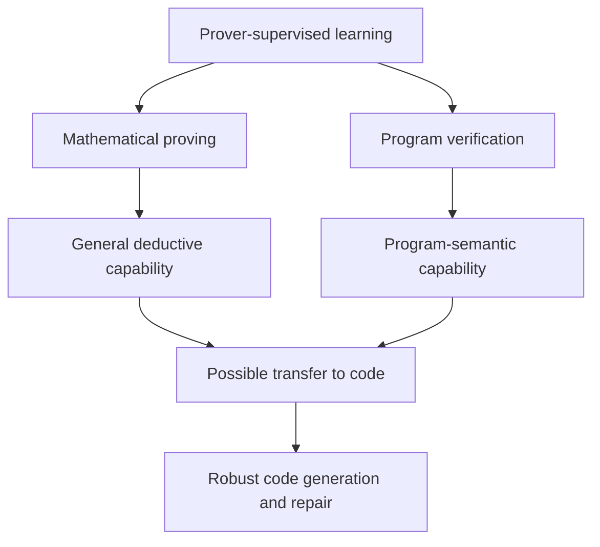

I reviewed the two-page interview draft. Its current progression is:

> **Understand** token difference ≠ semantic difference
> **Track/Ground** program state transitions
> **Verify** invariants/provers instead of relying only on runtime feedback

The literature search shows that the idea is viable, but the novelty must be positioned carefully: **formal-verifier RL already exists**. Your stronger opportunity is a controlled comparison of execution-derived versus proof-derived semantic supervision, especially whether proof supervision transfers to ordinary programming tasks where the prover is unavailable.

# 1. Closest prior work: formal verification as an RL reward

## Re:Form

[Re:Form: Reducing Human Priors in Scalable Formal Software Verification with RL in LLMs](https://arxiv.org/html/2507.16331v1), July 2025.

The system trains models to generate Dafny programs using verifier feedback. It reports that SFT enables small 0.5B models to produce verifiable Dafny, while regularized RL improves out-of-domain performance.

**Overlap with your proposal**

* Formal verifier supplies an automatic reward.
* It reduces dependence on human reasoning annotations.
* It argues that formal languages make supervision reliable and scalable.

**Remaining gap**

It primarily asks whether RL improves **verified Dafny generation**. It does not directly compare:

* test-execution reward versus proof reward;
* binary verifier reward versus structured proof-obligation reward;
* transfer from prover training to ordinary C/C++ reasoning and repair;
* retained performance after removing the prover at inference.

This is very close prior work and must appear in the related-work section.

---

## Automating Formal Verification with RL and Recursive Inference

[MIT thesis, May 2026](https://arxiv.org/html/2605.30914v1).

This is probably the single most important work for you to read. It applies GRPO-style RLVR to Dafny and uses compiler/verifier outcomes as rewards.

Reported results include:

* initial verified reward increasing from **2.2% to 58.1%**;
* after removing underspecified tasks, verified pass rate improving from **9.7% to 31.1%**;
* evidence of **specification hacking**, where the model satisfies a weak formal specification without implementing the intended program.

**Overlap**

This directly confirms that formal verification can drive RL without executing ordinary test cases.

**Critical lesson**

A proof reward is grounded only relative to the specification:

[
\text{Prover accepts}(P,S)
\not\Rightarrow
S \text{ captures the user's intended behavior}.
]

Therefore your pipeline needs two correctness levels:

1. **Implementation correctness:** (P\models S).
2. **Specification adequacy:** (S\approx I_{\text{user}}).

Execution tests may still help with the second level.

---

## Proof2Silicon / PREFACE

[Proof2Silicon: Prompt Repair for Verified Code and Hardware Generation via Reinforcement Learning](https://arxiv.org/abs/2509.06239), September 2025.

A lightweight RL agent modifies prompts sent to a frozen LLM, using Dafny verification as the objective. The reported improvement in verification success is up to 21%, followed by compilation into hardware.

**Overlap**

* Formal verification is the reward oracle.
* Program execution is not the primary correctness signal.

**Difference**

The LLM itself is frozen. It optimizes prompt selection rather than internalizing proof capability. This helps you define an important distinction:

| Setting             | What learns?                               |
| ------------------- | ------------------------------------------ |
| Proof2Silicon       | Prompt-repair policy                       |
| Prover-guided agent | Test-time search strategy                  |
| Your intended model | Code LLM parameters and semantic reasoning |

---

# 2. Strongest evidence for your deeper hypothesis

## Semantic-equivalence self-play with formal verification

[Improving LLM Code Reasoning via Semantic Equivalence Self-Play with Formal Verification](https://arxiv.org/html/2604.17010v1), Findings of ACL 2026.

This work constructs equivalent and inequivalent Haskell program pairs:

* semantic equivalence is certified using Liquid Haskell proofs;
* inequivalence is demonstrated using executable counterexamples;
* verified examples are used for training through rejection-sampling SFT rather than RL.

It reports:

* approximately 28,000 verified programs;
* up to **13.3 percentage-point** improvement on EquiBench;
* transfer to PySecDB;
* ablations indicating that inequivalence examples mainly provide volume, while formally verified equivalence examples are particularly responsible for reasoning gains.

**Why this is highly relevant**

This provides early evidence for the claim you actually care about:

> Proof-certified training data can improve downstream code reasoning, not merely formal proof completion.

It also naturally supports a hybrid design:

[
D =
D_{\text{proof-equivalent}}
\cup
D_{\text{execution-counterexample}}.
]

A prover is effective at certifying universal equivalence. Execution is effective at cheaply witnessing inequivalence:

[
\exists x:P(x)\ne Q(x).
]

This asymmetry is important. To prove equivalence, formal methods are much stronger; to disprove equivalence, one counterexample execution can be enough.

---

# 3. Execution-based baselines you must compare against

## ExecVerify

[ExecVerify: White-Box RL with Verifiable Stepwise Rewards for Code Execution Reasoning](https://arxiv.org/html/2603.11226), March 2026.

ExecVerify converts interpreter traces into step-level questions:

* next executed statement;
* next variable value;
* next variable type;
* final input/output result.

A 7B model reportedly approaches 32B-model performance on execution-reasoning tasks and improves code-generation pass@1 by up to **5.9%**.

Its reward is:

[
R_{\text{ExecVerify}}
=====================

2\big((1-\alpha)R_{\text{IO}}
+\alpha R_{\text{state}}\big).
]

**Why it matters**

This is the strongest baseline for your state-transition approach. It already addresses the weakness of sparse final test rewards by using dense execution-state rewards.

Your proof approach must therefore beat more than binary unit testing. The correct comparison is:

1. final test reward;
2. execution-state reward;
3. binary proof reward;
4. structured verification-condition reward;
5. hybrid execution and proof reward.

---

## RLEF

[RLEF: Grounding Code LLMs in Execution Feedback](https://openreview.net/forum?id=PzSG5nKe1q).

RLEF uses compilation, public test results and execution feedback to train iterative code repair.

It represents the classic runtime formulation:

[
\text{code}
\rightarrow
\text{execute tests}
\rightarrow
\text{failure feedback}
\rightarrow
\text{repair}.
]

Its principal limitation is that reward remains conditional on the sampled tests. It does not certify behavior outside those executions.

---

## ReVeal

[ReVeal: Self-Evolving Code Agents via Iterative Generation-Verification](https://arxiv.org/html/2506.11442v1), June 2025.

ReVeal trains code generation and self-verification jointly using multi-turn RL. The agent generates tests and calls execution tools, receiving dense per-turn rewards.

It improves LiveCodeBench pass@1 from 36.9% at turn 1 to 42.4% at turn 19.

**Why it matters**

ReVeal is the correct agentic runtime baseline. Your claim should be that proof-driven feedback can reduce:

* the number of rollouts;
* dependence on self-generated tests;
* overfitting to narrow test sets;
* delayed credit across many interaction turns.

---

# 4. Inference-only formal feedback

These papers support the mechanism but do not establish training-time capability acquisition.

## LORIS

[Guiding LLM-Based Loop-Invariant Synthesis via Feedback on Local Reasoning Errors](https://arxiv.org/html/2605.17914v1).

LORIS formalizes individual natural-language reasoning steps into logical implications and asks an SMT solver to identify the exact invalid implication.

This is a template for your structured reward:

[
R_{\text{proof}}
================

w_iR_{\text{init}}
+w_pR_{\text{preservation}}
+w_qR_{\text{post}}
+w_sR_{\text{strength}}.
]

LORIS currently uses these signals for iterative inference. Your work could convert them into training advantages.

---

## P³

[P³: Joint Program-and-Proof Planning](https://arxiv.org/html/2608.09277v1).

P³ jointly plans an implementation and its proof. It improves solve rates by 4.6–11.2 percentage points and shows that proof-aware planning is more effective than implementation-only planning.

This supports:

> Proof obligations should influence the program before generation is complete.

But again, this is an agent scaffold rather than learned prover capability.

---

## LaM4Inv and Clause2Inv

* [LaM4Inv: LLM Meets Bounded Model Checking](https://chentaolue.github.io/pub-papers/ASE24.pdf)
* Clause2Inv, ISSTA 2025, DOI: `10.1145/3728920`

These generate invariant candidates and use symbolic tools to check, filter or combine them.

They establish the generate-check-repair family but do not test whether formal supervision creates transferable internal semantic capability.

---

# 5. Execution-free code reasoning

## Agentic Code Reasoning

[Agentic Code Reasoning](https://arxiv.org/abs/2603.01896), March 2026.

This paper explicitly asks whether agents can judge program behavior **without executing the code**. It uses “semi-formal reasoning”: explicit premises, execution paths and derived conclusions.

Reported results include:

* patch-equivalence accuracy from 78% to 88% on curated examples;
* 93% on real agent-generated patches;
* improvements in fault localization and code question answering.

The authors explicitly describe execution-free semantic analysis as potentially useful for RL reward signals.

**Important distinction**

Its “certificate” is structured natural-language reasoning, not necessarily a kernel-checked formal proof. It is therefore closer to a learned semantic verifier than to Z3/Lean/Dafny-grounded reward.

For your paper, this becomes a useful middle baseline:

| Reward source                     |                Grounding strength |
| --------------------------------- | --------------------------------: |
| LLM judgment                      |                               Low |
| Semi-formal reasoning certificate |                            Medium |
| Execution on finite tests         |                 Exact but sampled |
| SMT/ITP proof                     | Universal within the formal model |

---

# 6. Surveys worth reading

## Directly relevant surveys

1. [A Survey on LLM Symbolic Reasoning](https://github.com/jindongli-Ai/LLM-Symbolic-Reasoning-Survey), AAAI 2026 Bridge.

   Covers theorem proving, symbolic reasoning and neuro-symbolic collaboration. Useful for the broad research taxonomy, but not focused on code-RL reward replacement.

2. [Neuro-Symbolic AI: Towards Improving the Reasoning Abilities of LLMs](https://www.ijcai.org/proceedings/2025/1195), IJCAI 2025.

   Useful for describing whether the symbolic system is used as:

   * a generator;
   * an external tool;
   * a verifier;
   * a training supervisor;
   * an inference controller.

3. [A Survey on Code Generation with LLM-Based Agents](https://arxiv.org/abs/2508.00083).

   Useful for positioning your method within agentic software engineering and the complete development lifecycle.

4. [Code Generation with LLMs: From Neural Program Synthesis to Autonomous Software Development](https://link.springer.com/article/10.1007/s10489-026-07230-0), 2026.

   Broad coverage of code-generation architectures, training and evaluation. It is background rather than the conceptual foundation of your paper.

5. [Awesome RLVR](https://github.com/opendilab/awesome-RLVR).

   Not a peer-reviewed survey, but a useful continuously updated index of RL with objectively checkable rewards, including code execution and formal proof.

### Survey gap

None of these appears to organize the field around the comparison you need:

[
\boxed{
\text{execution-derived supervision}
\quad\text{vs.}\quad
\text{proof-derived supervision}
}
]

That comparative lens itself could become a valuable survey section or perspective paper.

# 7. Recommended taxonomy for your survey

Organize related work by **where correctness evidence comes from**, rather than by RL algorithm:

| Family                    | Evidence source                                 | Representative work            | Principal weakness                        |
| ------------------------- | ----------------------------------------------- | ------------------------------ | ----------------------------------------- |
| Outcome execution         | Unit-test pass/fail                             | RLEF                           | Sparse and sampled                        |
| Process execution         | Runtime states and traces                       | ExecVerify                     | Requires execution; input-dependent       |
| Self-verification         | Model-generated tests/reasoning                 | ReVeal                         | Self-confirmation and test overfitting    |
| Binary formal outcome     | Program verifies or fails                       | Re:Form, MIT thesis            | Sparse; specification hacking             |
| Structured formal process | Individual VCs/proof steps                      | LORIS                          | Formalization cost and solver limitations |
| Proof-aware generation    | Proof shapes implementation                     | P³                             | Primarily inference-time evidence         |
| Proof-certified training  | Verified examples train reasoning               | Semantic-equivalence self-play | Limited language/domain evidence          |
| Hybrid                    | Proof for universality, execution for witnesses | Your proposed direction        | Needs careful reward calibration          |

# 8. Where your novelty remains

Avoid claiming:

> We are the first to use formal verification as an RL reward.

That is no longer defensible.

A stronger and apparently less explored claim is:

> We systematically study when prover-derived semantic rewards can replace execution-derived rewards, when they should complement them, and whether proof-oriented training transfers beyond formally verified code generation.

The potential contributions are:

1. **Matched reward comparison**

   Same models, training data, compute and RL algorithm; only the reward oracle changes.

2. **Structured proof credit**

   Reward initiation, preservation, postcondition sufficiency and invariant strength separately—not only final prover acceptance.

3. **Execution-free training path**

   Train on verification conditions without repeatedly running candidate programs.

4. **Capability-transfer test**

   Evaluate whether prover training improves ordinary code generation, program repair and semantic-equivalence reasoning when no prover is available.

5. **Hybrid asymmetric oracle**

   Use proof to certify universal correctness and execution to cheaply find counterexamples or expose specification mismatch.

6. **Specification-hacking audit**

   Measure proof success separately from intended functional correctness.

# 9. Revised wording for your interview slide

The current slide says:

> Verify — 用 invariant / prover 证明程序正确，而非只依赖 runtime feedback

A sharper version is:

> **Verify and Learn — Replace sparse execution rewards with structured proof obligations whenever correctness is formally expressible; combine proof and runtime evidence when specifications are incomplete.**
> **验证并学习——对于可形式化的正确性，用结构化证明义务替代稀疏执行奖励；在规格不完整时，将证明与运行证据结合。**

The accompanying research question can be:

> **Can proof-derived semantic supervision teach stronger code reasoning than execution-derived feedback under the same training budget?**

This formulation separates your work from ordinary verified-code generation and directly states the experiment needed to validate the idea.


Correct. “Prover capability” currently mixes two substantially different branches. They should be separated in the research framing and experiments.

# Two prover branches

| Branch                        | Mathematical theorem proving           | Program formal verification                           |
| ----------------------------- | -------------------------------------- | ----------------------------------------------------- |
| Primary object                | Mathematical proposition               | Program behavior                                      |
| Typical input                 | Theorem, assumptions, definitions      | Program, pre/postconditions, safety property          |
| Generated artifact            | Formal proof                           | Invariant, specification, annotation or program proof |
| Common tools                  | Lean, Isabelle, Rocq, Metamath         | Z3, Dafny, Verus, Boogie, CBMC, SeaHorn, Frama-C      |
| Central relation              | (\Gamma\vdash\phi)                     | (P\models Q)                                          |
| State transitions             | Usually implicit in logical derivation | Explicitly induced by program execution               |
| Main challenge                | Lemma selection and proof search       | Inferring specifications and inductive invariants     |
| Reward                        | Proof accepted by kernel               | Verification conditions discharged                    |
| Connection to code generation | Indirect/general reasoning transfer    | Direct semantic correctness                           |
| Main risk                     | Benchmark/proof-library memorization   | Weak specifications and model mismatch                |

## Branch A — Mathematical theorem proving

The model receives a mathematical goal:

[
\Gamma\vdash\phi
]

and generates a proof accepted by Lean, Isabelle or Rocq.

Typical learning signals include:

* tactic accepted or rejected;
* proof state changed;
* number of remaining goals;
* useful lemma selection;
* validity of an intermediate proposition;
* complete kernel-checked proof.

Representative directions include:

* AlphaProof;
* theorem-proving RL;
* Prover Agent;
* Proof-Verifier;
* proof-state process reward;
* autoformalization from natural language into Lean.

### What this branch can teach

Mathematical proving may improve general abilities such as:

* logical decomposition;
* deduction from explicit assumptions;
* lemma discovery;
* long reasoning-chain consistency;
* recognizing unsupported intermediate conclusions;
* planning backward from a goal.

But its relationship with real software behavior is indirect. A model can become better at Lean proofs without becoming better at:

* tracking mutation;
* understanding aliasing;
* reasoning about loops;
* repairing C/C++ bugs;
* preserving repository-level behavior.

Therefore, mathematical theorem proving is best treated as a **general reasoning pretraining branch**, not direct evidence for trustworthy code generation.

---

## Branch B — Formal program verification

Here the proof concerns a program and its transition semantics.

For a loop:

```c
while (G) {
    S;
}
```

the model generates an invariant (I) satisfying:

[
P\Rightarrow I
]

[
I\land G\land T_S\Rightarrow I'
]

[
I\land\neg G\Rightarrow Q
]

where (T_S) formally represents the state transition produced by the loop body.

Typical learning signals include:

* precondition implies invariant;
* invariant is preserved by the loop body;
* invariant and loop exit imply the postcondition;
* assertion or memory-safety obligation is proved;
* countermodel showing why a verification condition fails;
* invariant strength and non-vacuity;
* unresolved proof obligations.

Representative directions include:

* Re:Form;
* LORIS;
* LaM4Inv;
* Clause2Inv;
* P³;
* verified Dafny/Verus/Lean code generation;
* Liquid Haskell semantic-equivalence training.

### What this branch can teach

This branch directly targets:

* program state transition;
* semantic equivalence;
* loop invariants;
* precondition/postcondition reasoning;
* program repair;
* memory and assertion safety;
* correctness across all modeled inputs.

It is therefore the primary branch for your proposed replacement or auxiliary to runtime RL.

# The relationship between the branches

They share the same high-level mechanism:

```text
Generate reasoning
        ↓
Formalize candidate
        ↓
Machine-check candidate
        ↓
Receive exact proof feedback
        ↓
Update generation policy
```

But their semantic grounding differs:



The interesting scientific question is not whether both use a prover. It is whether they teach different capabilities.

# Better hypothesis structure

## H1 — Mathematical-prover transfer

> Training on machine-checked mathematical proofs improves general deductive reasoning, decomposition and long-chain consistency, which may transfer to software reasoning.

This is plausible but requires a transfer experiment.

## H2 — Program-prover transfer

> Training on program verification conditions directly improves state-transition reasoning, invariant generation, semantic code generation and program repair.

This is your principal hypothesis.

## H3 — Domain advantage

> Under matched training budgets, program-verification supervision transfers more strongly to code tasks than mathematical-proof supervision because its formal objects encode program states and transition semantics.

This is particularly novel and important.

## H4 — Complementarity

> Mathematical proof training provides general proof-search ability, while program-verification training supplies domain grounding; sequential or joint training achieves better robustness than either branch alone.

## H5 — Runtime replacement

> For formally specified properties, program-prover rewards can replace execution-based rewards while requiring fewer program rollouts and providing stronger correctness evidence.

## H6 — Hybrid reward

> For incompletely specified real software, prover rewards combined with runtime counterexamples outperform prover-only and runtime-only learning.

# Essential experimental groups

Use the same 0.6B and 1.7B base models and matched post-training budgets.

| Group | Training supervision            | Purpose                         |
| ----- | ------------------------------- | ------------------------------- |
| G0    | SFT/code baseline               | Establish base capability       |
| G1    | Runtime/test reward             | Existing code-RL baseline       |
| G2    | Mathematical proof reward       | Test general proof transfer     |
| G3    | Binary program-verifier reward  | Test formal outcome supervision |
| G4    | Structured program-proof reward | Test semantic credit assignment |
| G5    | Math proof → program proof      | Test staged transfer            |
| G6    | Program proof + runtime         | Test complementary signals      |

The most important comparison is:

[
G2\ \text{vs.}\ G4
]

This determines whether gains come from generic formal reasoning or from learning program-specific transition semantics.

The second is:

[
G1\ \text{vs.}\ G4
]

This directly tests whether proof-derived feedback can replace execution-derived RL.

# Evaluation should also have two branches

## Mathematical proving evaluation

* unseen Lean/Isabelle theorems;
* proof completion;
* new library or notation;
* number of proof attempts;
* proof length;
* robustness to irrelevant premises;
* lemma-selection accuracy.

## Program verification evaluation

* loop-invariant synthesis;
* invariant repair;
* verified program generation;
* semantic equivalence;
* assertion and memory safety;
* Defects4C repair;
* transformations and variable renaming;
* arrays, pointers, branches and nonlinear loops;
* unseen program templates;
* performance without prover access.

## Cross-branch transfer matrix

| Training → Evaluation   |       Math proofs |  Loop invariants |      Code generation |       Program repair |
| ----------------------- | ----------------: | ---------------: | -------------------: | -------------------: |
| Math-prover training    |   Expected strong |          Unknown |              Unknown |              Unknown |
| Program-prover training | Possibly moderate |  Expected strong | Expected improvement | Expected improvement |
| Runtime training        |       Likely weak |          Limited |      Expected strong | Expected improvement |
| Combined training       |  Test empirically | Test empirically |     Test empirically |     Test empirically |

This matrix is more scientifically valuable than reporting only invariant-generation performance.

# Recommended project framing

Your project should not be titled simply “Prover-Based RL,” because that obscures the distinction.

A stronger framing is:

> **From Mathematical Proof to Program Proof: Can Formal Supervision Replace Execution Rewards for Trustworthy Code LLMs?**

The core idea:

> Mathematical theorem proving teaches models how to construct valid deductions. Program formal verification additionally grounds those deductions in program states and transition semantics. We investigate whether these two forms of prover supervision produce different transferable capabilities, and whether program-proof rewards can replace or complement execution-based RL for code generation and repair.

For the interview slide, the two branches can be summarized as:

* **Mathematical prover:** teaches *how to prove*.
* **Program verifier:** teaches *what program behavior must remain true*.
* **Runtime execution:** shows *what happened on selected inputs*.

Your intended contribution should focus primarily on the second branch, while using the mathematical branch as a controlled comparison and possible reasoning pretraining stage.

